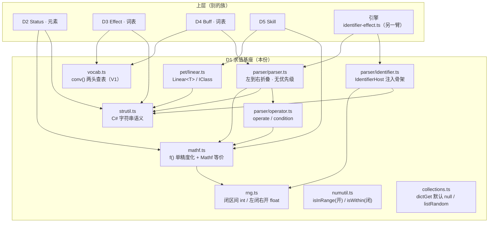
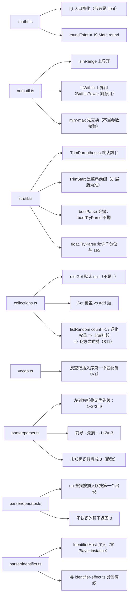

# 域模型子设计 D1 · 求值基座（domain-base.md）

> **定位**：本线的**最底层** —— 公共底座（`mathf` / `numutil` / `strutil` / `collections` / `vocab` / `rng`）
> + `Linear<T>`（`IClass`）+ **求值 DSL**（`parser/{identifier,parser,operator}`）。
> 上层的每一个族（`Status` / `Effect` / `Buff` / `Skill` / `Pet`）都站在它上面。
>
> 父文档 = `docs/domain/domain-design.md`（**§1 V1–V7 / §6 地图**）。
> 实现在 `game/core/{mathf,numutil,strutil,collections,vocab,rng}.ts` + `game/core/pet/linear.ts`
> + `game/core/parser/{identifier,parser,operator}.ts`（**共 832 行**）。
>
> **别与这些重复**：逐件实测结论 → `docs/engine/port-map.md`；边界 → `docs/engine/battle-engine-design.md §8.4`。
> **注入面父文档** → `docs/runtime/runtime-components-design.md`（**R1 随机源**：`Rng` 怎么进核心、谁装配、默认行为、验收口径都在那里；
> **本文件只管算法与接口的真值**，见 §2.6）。
> **本份不含** `parser/identifier-effect.ts`（`Identifier.cs:190-548` + `GetBattleIdentifier`）——**那是引擎**（§8.4(3) #4）。

---

## 0. 这份文档回答什么

1. 十个文件各自**对齐哪个上游**、**为什么不能"顺手 JS 化"**。
2. 三条**最容易静默分叉**的求值语义（V1 反查顺序 / 左到右折叠无优先级 / 未知标识符塌成 0）。
3. `f()` 单精度化的**入口窄化纪律**（为什么每个函数都要在入口先 `f()`）。
4. `Identifier.cs` 被**切成两半**：`:10-188` 在本份，`:190-548` 在引擎。

---

## 1. 范围与边界

| | |
|---|---|
| **本份覆盖** | `mathf.ts`(87) · `numutil.ts`(16) · `strutil.ts`(195) · `collections.ts`(93) · `vocab.ts`(12) · `rng.ts`(49) · `pet/linear.ts`(46) · `parser/operator.ts`(101) · `parser/parser.ts`(155) · `parser/identifier.ts`(78) |
| **不覆盖** | `parser/identifier-effect.ts` → **引擎**（`Identifier.cs:190-548`，effect 上下文 + `GetBattleIdentifier`） |
| | `Identifier.GetPetIdentifier` 的**臂**（`random`/`date`/`player` 之外的业务标识符） → **D6**（走 `IdentifierHost` 注入） |
| | `Status` 的算术运算符（`Status / float` 等） → **D2**（本份只提供 `mathf` 原语） |
| | 效果/印记的**词表内容** → **D3 / D4**（本份只提供 `conv()` 工厂） |

---

## 2. 上游真值（逐件）

### 2.1 `mathf.ts` — `UnityEngine.Mathf` 等价件

【我们】`game/core/mathf.ts`（87）｜依据【源码】`Operator.cs` 用了 `Mathf.{Min,Max,Pow,FloorToInt,CeilToInt,RoundToInt,Abs}`

| 导出 | 语义要点 |
|---|---|
| `f(x)` | **单精度化**（`Math.fround`）= C# 的 `float` 存储 |
| `floorToInt` / `ceilToInt` / `roundToInt` / `toInt` | 整型转换**一律**走这里。`roundToInt` 与 JS `Math.round` **舍入方向不同**（`.5` 的处理按 .NET） |
| `clamp` / `clamp01` / `clampInt` | `clampInt` 是**三点比较**（不过 `f()`），与 `clamp` 不同形 |
| `abs` / `min` / `max` / `pow` / `sign` | 全部**先 `f()` 再算再 `f()`** |

> **入口窄化纪律**（文件头）：这些函数在 C# 侧**形参类型就是 `float`**，而 JS 传进来的可能是**带额外精度的 double**
> （对拍向量里的字面量 `0.2` 就是 double `0.2`，而 C# 收到的是 `0.2f = 0.20000000298…`）
> ⇒ **每个函数入口必须先 `f()`**，否则 oracle 与 TS 各算一套。

### 2.2 `numutil.ts` — 两个"名字像但上下界不同"的区间判据

【源码】`HelperMath.cs:23-56`；【我们】`game/core/numutil.ts`（16）

| 导出 | 边界 | 谁在用 |
|---|---|---|
| `isInRange(num, min, max)` | **上界开** `[min, max)` | 下标检查（`List.Get/Set`）、性格 id 判界、`target.ts` 的 `index` 支 |
| `isWithin(num, min, max)` | **上界闭** `[min, max]` | `Buff.IsPower` 的 `id ∈ [1,10]`（**刻意**用闭） |

> ⚠️ 两者在 `min > max` 时**先交换** ⇒ 调用方传反区间**不会抛**，只会静默变宽。**别指望它当参数校验。**

### 2.3 `strutil.ts` — C# 字符串语义（**不是 JS 直觉**）

【源码】`Helper.cs` / `Identifier.cs` 的工具段；【我们】`game/core/strutil.ts`（195）

| 组 | 导出 | 语义要点 |
|---|---|---|
| **浮点** | `tryParseFloat` / `parseFloatOr0` / `parseFloatOrThrow` | C# `float.TryParse` 默认风格 = `Float \| AllowThousands`（CurrentCulture）：允许前导/尾随空白、可选符号、`"123."`、`".5"`、**科学计数法 `"1e5"`**、**千分位 `"1,000"`**；**拒绝** hex、`"1f"`、空串、纯符号、`,5`、`1.000,5` |
| **整数** | `tryParseInt` / `parseIntOrThrow` | `(int)` **向零截断** |
| **真值** | `boolParse` / `boolTryParse` / `csBool` | ⚠️ **`boolParse` 会抛**（`bool.Parse`），`boolTryParse` 不抛。**调用点选错哪个就是行为差别**（`skillCondition` 的快照 `null` 支走**会抛**的那个） |
| **剥括号** | `trimParentheses` / `tryTrimParentheses` / `trimParenthesesLoop` | ⚠️ **默认剥方括号 `[ ]`，不是圆括号**（`Helper.cs:91`）。圆括号要显式传参（`Status.Parse` 的默认就是圆括号 —— 两处默认值**相反**） |
| **前缀** | `trimStartStr` / `trimEndStr` / `tryTrimStart` | ⚠️ C# 的 `str.TrimStart("pet")` 是 **char 集合**重载（会剥掉任意前导 `p`/`e`/`t` 字符）；本仓有 `Helper.cs:34/46` 的扩展把它改成**整串前缀** ⇒ **以扩展版为准** |
| **列表** | `toFloatList` / `toIntList` / `toIntRange` / `concatToString` | `toIntRange` 把 `"1~3\|7"` 展开成 `[1,2,3,7]`，先把全角「－」换半角 |
| **文本** | `replaceSpecialWhitespace` / `replaceColorAndNewline` | 工坊/新建路径的清洗（CSV 路径**不清**，见 D4） |

### 2.4 `collections.ts` — `HelperCollections.cs:14-95` 的 C# 语义镜像

【我们】`game/core/collections.ts`（93）｜依据【源码】`HelperCollections.cs:14-95`

| 导出 | 语义要点（**JS 直觉会错**） |
|---|---|
| `dictGet(map, key, default = null)` | 不带默认值时给 **`null`**（**不是 `''`**）。`Effect.cs:277` 的 `x?.Get("on_fail")` 后接 `FirstOrDefault(x => x != null)` **就靠这个 null** |
| `dictSet` / `dictTryGet` / `dictMerge` | `Set` = "有则覆盖、无则插入"（`:35`） |
| — | ⚠️ 与 `Add` 的"**重复键即抛**"是**两回事**：上游 Skills 用 `Add`、Buffs/Items 用 `Set`。这个差别已在 oracle 的 `tablediag` 里验过 |
| `listGet` / `listSet` / `atIndex` | `atIndex` 越界**抛**（`where` 参数进错误信息）—— 用来建模上游"下标越界即抛" |
| `isEmpty` | `null` 或长度 0 |
| `listPickRandom` / `listRandom` | ⚠️ **`listRandom` 的两条挂起路**【源码】`HelperCollections.cs:125-138`：① **`count = -1`**（DSL 里 `target_num` 没配）⇒ `while (result.Count != count)` **永真** ⇒ **上游死循环（挂起，不抛）**；② `repeat = false` + **退化权重**（`weights` 只指向一项，如 `[5,0]`）而 `count ≤ values.Count` ⇒ 过采样同一项、`Contains` 永不增长 ⇒ 同样挂起。<br>⇒ ★ 按 2026-10-17 的政策（`docs/arch-docs.md §4.1`）= **声明 + 修**：我方在**入口显式抛**（`count < 0` ⇒ 抛并带上来源标识符；`repeat=false` 且**可取到的不同项数 `< count`** ⇒ 抛），**不**复刻挂起。<br>⇒ **照搬**的是另外两支口径（不是 bug）：`!repeat && count > values.length` ⇒ **静默返回整表**（`:127-128`，浅拷整表，不是截断也不是抛）· `listPickRandom` 越界经 `listGet` 给 **`null`**。详见 §5 **B11** 与 `game/core/collections.ts:55-58` 的 as-built 注释（**该注释也要随 B11 同步改**） |
| `toDictionaryStrict` | 重复键**抛**（与 `dictSet` 对照） |

### 2.5 `vocab.ts` — 词表两头查表工厂（**V1 的唯一实现处**）

【我们】`game/core/vocab.ts`（12）｜依据【源码】`EffectDatabase.cs:92-122` 与 `BuffDatabase.cs:52-77`（**两处结构一字不差**）

```ts
conv(table: [string, E][], fallback: E) => ({ from: raw => …fallback, to: v => …'none' })
```

- 正向 = `dict.Get(raw, fallback)`（**不抛**）；反向 = `ContainsValue(v) ? First(x => x.Value == v).Key : "none"`。
- **表必须是有序数组**：反查取**第一个匹配键**；今天每值一键所以看不出，**加别名键就会显形**（V1）。
- 四个词表（`EffectTiming`/`Target`/`Condition`/`Ability`）与两个印记词表（`BuffType`/`CopyHandleType`）**都用它**。

### 2.6 `rng.ts` — 可注入种子的随机源

【我们】`game/core/rng.ts`（49）｜依据【源码】`Identifier.cs:18` 的 `Random.Range(0, 100)` 与 `EffectAbilityHandler` 的 `.Random()` 形态

- ⚠️ **两个方法、不给一个方法两种语义**：Unity 的 `Random.Range(int,int)` 是**闭区间**（min/max 都可能取到），
  而 `Random.Range(float,float)` 是**左闭右开** —— 与 JS 习惯**相反**。
- 复刻的是**规则**不是它存档里的随机序列。
  ⚠️ **口径已改（人类决议 ①，2026-10-17）**：原版要求"S1b 的 oracle 侧 `UnityEngine.Random` shim **必须跑同一算法**（`mulberry32`，C# 侧逐位复现）"——
  **这条作废**。随机数**不需要启 Unity、不需要与 JS 逐值一致** ⇒ oracle 侧的 `UnityEngine.Random` shim **取消**
  （`docs/runtime/runtime-components-design.md §5 R1 / §7`；`tools/oracle-cs/Program.cs:195-206` 那段"探一次→炸→从对拍剔除"的策略同时作废）。
- **本文件（`rng.ts`）仍是算法与接口的真值**：`Rng` 的五支方法、**闭区间 `nextInt` / 左闭右开 `nextFloat`** 的形状照旧（那是 Unity 语义的**规则**部分，仍要照搬）。
  改的只是**验收**：同 seed ⇒ 同序列（自复现）+ 形状断言 + **人类手测**（`AGENTS.md §1.1`），**不与上游逐值比**。
- **注入面归功能组件线**：`Rng` 怎么进核心（哪个接缝、谁装配、默认行为）不在本文件定，见 `docs/runtime/runtime-components-design.md §5 R1`（现状是 10 条路、6 条无人调用，同文档 §3.1）。
- 全仓**无头**：`UnityEngine.Random` 一律走注入的 `Rng`（引擎侧 `state.ts`/`phase.ts` 的 `randomSource` 也取自它）。

### 2.7 `pet/linear.ts` — `IClass/IKeyValuePair.cs` 的移植

【我们】`game/core/pet/linear.ts`（46）

- `class Linear<T>`（`mult` + `add` 两段）+ `parseLinear<T>(text, parseFunc, defaultValue, delim = '/')`。
- **实测事实（省掉一轮猜测）**：`Linear<Status>.Parse` 在上游**从来没被调用过** —— 全仓只有 `Linear<int>.Parse`
  两处（`Item.cs:61` 道具表、`PetUIInfo.cs:99` 皮肤表）。⇒ 技能表的 `powerup`/`powerdown` **恒为默认值**
  `new Linear<Status>(Status.one, Status.zero)`，之后由**运行期效果**改写。
  **⇒ S1 数据管道不需要为此加列**（见 `docs/engine/port-map.md`）。

### 2.8 `parser/operator.ts` — `Operator.cs`（163）

**三处按 C# 原样保留（不是"修正"）**：

1. 一切算术在 **float32** 上做 ⇒ 每步过 `f()`，否则 `0.1+0.2` 这类分歧会在几千回合里炸出来。
2. ⚠️ `Condition` 的 op 查找是「**按 `condDict` 插入顺序找第一个出现的**」——**不是**「找最靠前的」
   ⇒ `"x=1LTE2"` 会用 `'='` 且 value 是 `"1LTE2"`（`Operator.cs:26-36`）。
3. ⚠️ `Operate` 遇到不认识的算子**返回 0，不抛**（`Operator.cs:88`）。配合 Parser 的 split 再寻位，
   形如 `"1+[MIN]2"` 的串会**静默变 0**。这是既有内容里真实存在的行为，**照搬**。

导出：`operate` / `condition` / `conditionOf` / `splitCondition` / `toHalfCondition` / `parseDataType` /
`isFraction` / `parseFraction` / `genericMax` / `genericMin` + `DataType` / `Fraction` / `COND_KEYS` / `OP_KEYS`。

### 2.9 `parser/parser.ts` — `Parser.cs:10-150` 的求值部分

**四个反直觉点全部按 C# 保留**：

1. ⚠️ **左到右折叠、无优先级**：`"1+2*3"` = `(1+2)*3` = **9**，不是 7。Split 出所有操作数后，
   从 `i=1` 起用 `expr.IndexOf(操作数)` **反推**中间的算子串，依次 `Operate`。
2. **前导 `-` 先摘成符号位再解析**：`"-1+2"` = `-(1+2)` = **-3**；`(int)` 与减加都发生在**摘符号之后**的串上。
3. **`Split` 用 `RemoveEmptyEntries`** ⇒ 相邻/首尾算子产生的空串**直接消失**，反推出的"算子串"可能是
   `"+-"` 这种复合串 → `Operate` 不认识 ⇒ **返回 0**（不是抛，也不是按第二个算子算）。
4. ⚠️ **未知标识符最终落到 `GetNumIdentifier` → 解析失败返回 `0`，整条表达式跟着塌成 0**。
   ⇒ 内容表里一个**拼错的字段名不会报错**，只会静默变 0 ⇒ 对拍必须靠**值逐位比**，不能靠"没抛错"。

导出：`parseOperation` / `literalResolver` / `parseConditionFilter<T>` / `parseOptions` /
`parseMultipleOptions` / `parseDataType` / `isOperator` / `isConditionOp` / `isFraction` / `parseFraction`。

### 2.10 `parser/identifier.ts` — `Identifier.cs:10-188`（**无上下文骨架**）

- 凡是要碰 `Player.instance` / `BattleState` / `Pet` / `Buff` / `Skill` 的分支，一律走 **`IdentifierHost`** 由外部实现。
- 本份只搬「与运行时无关」的骨架：`random` 系列 + 前缀分派 + 兜底 `GetNumIdentifier`。
- 导出：`IdentifierHost`（接口）· `getNumIdentifier` · `getIdentifier`。
- ⚠️ **同一个 `.cs` 被切成两半**：`:10-188` 在本份，`:190-548`（effect 上下文 + `GetBattleIdentifier`）
  在 **`parser/identifier-effect.ts`**（**引擎**）。⇒ 判归属按**臂**，不按文件（§8.4(3) #4）。

---

## 3. 目标结构（契约）

```
core/vocab.ts        conv(table, fallback) -> { from(raw), to(value) }          // V1 唯一实现
core/rng.ts          interface Rng { next floats/int ranges; … } / createRng(seed)
core/numutil.ts      isInRange(开) / isWithin(闭)
core/mathf.ts        f / floorToInt / ceilToInt / roundToInt / toInt / clamp / clamp01 / clampInt
                     abs / min / max / pow / sign
core/strutil.ts      tryParseFloat / parseFloatOr0 / parseFloatOrThrow / tryParseInt / parseIntOrThrow
                     trimStartStr / trimEndStr / tryTrimStart / trimParentheses(默认 [ ]) / tryTrimParentheses
                     trimParenthesesLoop / toFloatList / toIntList / toIntRange / concatToString
                     boolParse(会抛) / boolTryParse / csBool / replaceSpecialWhitespace / replaceColorAndNewline
core/collections.ts  dictGet(默认 null) / dictSet / dictTryGet / dictMerge / listGet / listSet / atIndex(越界抛)
                     isEmpty / listPickRandom / listRandom / toDictionaryStrict
core/pet/linear.ts   class Linear<T> / parseLinear<T>(...)
core/parser/operator.ts  operate / condition / conditionOf / splitCondition / toHalfCondition
                         parseDataType / parseFraction / isFraction / genericMax / genericMin
                         COND_KEYS / OP_KEYS / DataType / Fraction
core/parser/parser.ts    parseOperation(expr, resolve) / literalResolver(host) / parseConditionFilter<T>
                         parseOptions / parseMultipleOptions / isOperator / isConditionOp
core/parser/identifier.ts  interface IdentifierHost / getNumIdentifier / getIdentifier
```

---

## 4. 接口（mermaid）

### 4.1 族内位置图



### 4.2 文件↔接口图



---

## 5. 不变量与围栏

| # | 不变量 / 围栏 |
|---|---|
| **B1** | **V1**：词表反查取**插入序第一个匹配键**；表必须是**有序数组**（`conv()` 是唯一实现处） |
| **B2** | **V2**：正向 miss ⇒ fallback（`None`）；反向 miss ⇒ `"none"`；**都不抛** |
| **B3** | **V3 入口窄化**：一切 `Mathf` 等价函数**入口先 `f()`**；`roundToInt` ≠ JS `Math.round` |
| **B4** | **括号默认值相反**：`TrimParentheses` 默认 `[ ]`；`Status.Parse` 默认 `( )`。**两处都对**，别统一 |
| **B5** | **`boolParse` vs `boolTryParse` 是行为差别**，不是风格 —— 调用点必须选对 |
| **B6** | **求值静默塌陷**：未知算子 / 未知标识符 / 复合算子串 ⇒ **返回 0，不抛**。⇒ 对拍只能比值，不能比"抛不抛" |
| **B7** | **无优先级求值**：左到右折叠；前导 `-` 先摘成符号位。**不许"修好"成数学优先级** |
| **B8** | **headless 围栏**：本份零 `UnityEngine` / 零 `Player.instance`；随机一律注入 `Rng`；业务标识符一律走 `IdentifierHost` |
| **B9** | **`Identifier.cs` 的两臂分属两线**：`:10-188` 本份、`:190-548` 引擎。**不许互相搬** |
| **B10** | **V6**：本份不读 `game/data/**`（只提供工厂与注入点） |
| **B11** | **`listRandom` 的两条挂起路 ⇒ 声明 + 修（§2.4）**：入口对 `count < 0` 与「`repeat=false` 且可取到的不同项数 `< count`」**显式抛** ⇒ **不**复刻上游死循环；`!repeat && count > length` ⇒ **静默返回整表** 照搬（那是口径）。<br>⚠️ **V2 与本条的分工**（`docs/arch-docs.md §4.1`）：V2（= 本表 **B2**）管**发行内容表里的错字/水印 ⇒ 照搬**；**代码写错**（挂起、越界、单边漏检）⇒ **声明 + 写无 bug 的目标行为** ⇒ B11 属后者。**B6/B7 的"不许修好"不受本条影响**（无优先级折叠、静默塌 0 是**求值规则**，改了才是破复刻契约） |

---

## 6. 现状与缺口

| 件 | 【我们】 | 对拍 kind | 状态 |
|---|---|---|---|
| `mathf.ts` | 87 | （随各 kind 间接） | ✅ |
| `numutil.ts` | 16 | （同上） | ✅ |
| `strutil.ts` | 195 | `tablediag` / `effectparse` | ✅ |
| `collections.ts` | 93 | `tablediag` | ✅ |
| `vocab.ts` | 12 | `raw` 串往返（逐 kind） | ✅ |
| `rng.ts` | 49 | **不比上游**（决议 ①：oracle 侧 `UnityEngine.Random` shim 取消）⇒ 随各 kind 用**同 seed 自复现 + 形状断言** | ✅ |
| `pet/linear.ts` | 46 | `skilltable`（`powerup`/`powerdown` 恒默认值） | ✅ |
| `parser/operator.ts` | 101 | `parserop` 族 | ✅ |
| `parser/parser.ts` | 155 | `parser` / `effectparse` | ✅ |
| `parser/identifier.ts` | 78 | `effectid`（无上下文段） | ✅ |

**缺口**：

| 缺口 | 说明 |
|---|---|
| **`IdentifierHost` 的业务臂** | `random`/`date`/`player` 之外的标识符（`me.pet.status.maxHp` 等）**要 host 提供**；本份只定义接口，实现在 **D6** + 引擎的 `identifier-effect.ts` |
| **`Linear<Status>` 的运行期改写** | `parseLinear` 已搬，但 `Linear<Status>.Parse` 上游**从未调用** ⇒ 无向量（这是**结论**不是缺口） |
| **`listRandom` 的两条挂起路** | ⚠️ 口径已随**人类决议 ②** 改版（`docs/arch-docs.md §4.1`）：这是**代码写错**（挂起）而非 V2 的数据错字 ⇒ **声明 + 修**，**不再"不修"**。目标行为见 **§2.4** 与 **§5 B11**：入口对 `count < 0`、以及「`repeat=false` 且可取到的不同项数 `< count`」**显式抛**。落码 = 改 `game/core/collections.ts:55-81`（⬜ **待落码**，阶段一不发码），**该文件的 as-built 注释也要同步改**（现文写的是"移植体保留同一个循环、不补兜底"）；对拍侧不再需要"在生成阶段挡掉"，改成**断言抛** |

---

## 7. 待核 / 已知怪癖

| # | 事项 | 证据 |
|---|---|---|
| 1 | **`isInRange` 开 / `isWithin` 闭** —— 混用会静默改行为 | 【源码】`HelperMath.cs:23-56` |
| 2 | **两处括号默认值相反**（`[ ]` vs `( )`） | 【源码】`Helper.cs:91` vs `Status.cs:85` |
| 3 | **`TrimStart` 的 char 集合重载 vs 整串前缀扩展** —— 以**扩展版**为准 | 【源码】`Helper.cs:34/46` |
| 4 | **`Operate` 的 op 查找按 `condDict` 插入序**（不是"最靠前"） | 【源码】`Operator.cs:26-36` |
| 5 | **求值失败静默塌成 0**（未知算子 / 未知标识符） | 【源码】`Operator.cs:88` + `Parser.cs` |
| 6 | **`dictGet` 默认 `null` 而非 `''`** —— `on_fail` 的 `FirstOrDefault(x => x != null)` 靠它 | 【源码】`HelperCollections.cs:14` + `Effect.cs:277` |
| 7 | **`Set` vs `Add`**：Skills 用 `Add`（重复键抛）、Buffs/Items 用 `Set`（覆盖） | 【源码】`HelperCollections.cs:35` |
| 8 | **`Linear<Status>.Parse` 从未被调用** ⇒ 技能 `powerup` 恒默认值 | 全仓 grep（见 `docs/engine/port-map.md`） |
| 9 | **Unity `Range` 的两种区间语义**（int 闭 / float 左闭右开） | 【源码】`Identifier.cs:18` |

---

## 8. 配对实现（impl）指针

- 本份配对 = 未来的 **`docs/domain/domain-impl.md`** + **`domain-code-map.md`**（阶段一续写）。
- **现状**：`game/core/{mathf,numutil,strutil,collections,vocab,rng}.ts` + `pet/linear.ts` + `parser/{identifier,parser,operator}.ts` **全部已落地**。
- **事实面**：以 `docs/engine/kernel-handoff.md §3` 的 S1/S1b 段为准；逐条实测 = `docs/engine/port-map.md`。
- **as-built**：本份不重复（§5 末的口径）。
