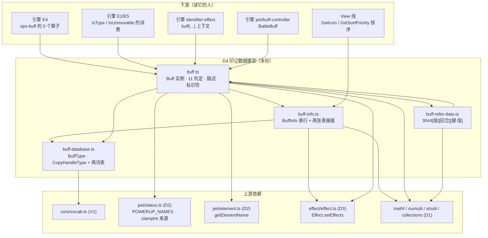
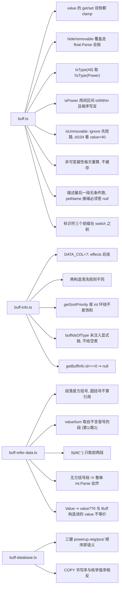

# 域模型子设计 D4 · 印记数据模型（domain-buff.md）

> **定位**：本线的**印记族** —— 四个文件**四类东西**，职责不许混：
> `Buff`（**战斗中那一个实例**）· `BuffInfo`（**表里那一行**，静态内容）·
> `BuffDatabase`（**两个枚举 + 两张词表**）· `BuffReferData`（**表里那种紧凑引用写法**）。
>
> 父文档 = `docs/domain/domain-design.md`（**§1 V1–V7 / §4 接缝 S7 / §6.1 为什么不与 D3 合并**）。
> 实现在 `game/core/buff/{buff,buff-info,buff-database,buff-refer-data}.ts`（**共 716 行**）。
>
> **别与这些重复**：逐算子实测 → `docs/engine/port-map.md`；边界 → `docs/engine/battle-engine-design.md §8.4`；
> **印记算子的行为**（加/删/复制/阻断）→ **引擎 E4**（`core/effect/ops-buff.ts`，**不在本份**）。

---

## 0. 这份文档回答什么

1. **四件东西的分工**：`Buff` 只带四样可变数据，其余**每次读都从 `info` 重算**。
2. `value` 的 **getter 与 setter 都过 `Clamp`** —— JS 里必须真写成访问器。
3. `hide`/`removable` 的**表内覆盖走 `float.Parse`**（畸形值**抛**，不是 `false`）。
4. `IsType(All)` = `!IsType(Power)`（**不是**"All 恒真"）这条反直觉到值得单独测。
5. `BuffReferData` 的**四条解析细节**（方括号 / 前两段纯数字 / `Split(':')` 只取两段 / 无方括号段即 `int.Parse`）。
6. `BuffInfo` 的**两个构造清洗规则不同**，以及 `getSortPriority` 的 **int 环绕**（不是饱和）。
7. **单向依赖**：`Buff → Effect`（D3），反向没有 ⇒ 两族不合并的理由。

---

## 1. 范围与边界

| | |
|---|---|
| **本份覆盖** | `Buff`（三构造 · `value`/`hide`/`removable`/`ignore`/`info`/`name`/`description` · 11 个 `Is*` · 8 个静态工厂 · `BUFFID_*` · `getBuffDescriptionPreview`/`getDescription` · `Get·TryGet·SetBuffIdentifier`）｜ `BuffInfo`（`DATA_COL` · 属性 · 两个构造 · `initOptionsProperty` · `getSortPriority` · `getRawInfoStringArray` · `setEffects` · `isMod`）｜ `BuffInfoTable`/`setBuffTables`/`buffIdsOfType`/`numIdentifier` 接缝 ｜ `BuffDatabase`（`BuffType`/`CopyHandleType` + 两表）｜ `BuffReferData`（`parse`/`parseDict` + `createBuff`） |
| **上游** | `MVC/Model/Basic/Buff/Buff.cs`(434) + `BuffInfo.cs`(163) + `BuffDatabase.cs`(77) + `BuffReferData.cs`(67) |
| **不覆盖** | 印记**算子**（`add_buff`/`remove_buff`/`copy_buff`/`set_buff`/`block_buff`）的行为 → **引擎 E4**（`core/effect/ops-buff.ts`） |
| | `getBuffIdentifier` 的**调用方**（效果语言里的 `buff(...)` 上下文） → **引擎** `parser/identifier-effect.ts` |
| | `Buff.IsType` 的**消费端**（"这条印记算不算异常/可动"影响相位与目标选择） → **引擎 E2/E5** |
| | 印记**图标**（`GetIcon` → `Sprite`、`resId` 的寻址） → **View 线** |
| | 印记表的**生产**（CSV → `buffs.json`） → **L2 内容桥** |

---

## 2. 上游真值（逐件）

### 2.1 四件东西的分工（**本份最重要的一节**）

| 件 | 是什么 | 只带什么 | 生命周期 |
|---|---|---|---|
| **`Buff`** | **战斗中那一个印记实例** | `id` / `turn` / `value` / `options` **四样可变数据** | 每场战斗新建、随回合变 |
| **`BuffInfo`** | **表里那一行**（静态内容） | 全部**不变**的字段（名字/类型/回合/11 个布尔/上下限/`effects`） | 装载时一次，战斗内**只读** |
| **`BuffDatabase`** | 名字↔数值 | `BuffType` / `CopyHandleType` 两枚举 + 两张词表 | 常量 |
| **`BuffReferData`** | 表里的一种**紧凑引用写法** | `3044[值][回合][键:值]…` 解析结果 | 解析即弃 |

> ⚠️ **`Buff` 的一切非可变属性都是"每次重算"**（`get info()` / `get name()` / `get hide()` / `get removable()`），
> **不是缓存字段**。写成"构造时缓存一份"会在 `BuffInfo` 表被热替换（工坊/导入）后**静默用旧值**。
> `Buff.cs` 与 `BuffInfo.cs` 里这些**全是属性**，就是为了这个。
>
> ⚠️ **`BuffReferData` 不只服务 `Buff`**：技能/道具/天赋表**都借它**（它是 buff 管线**之外**的公共件）。

### 2.2 `Buff` 的三个构造 + 访问器

【源码】`Buff.cs:47-93`｜【我们】`buff.ts:71-142`

| 上游 | 【我们】 | ⚠️ 要点 |
|---|---|---|
| `Buff(int _id, int _turn = -1, int? _value = null)` (:47-64) | 主构造 | ⚠️ **`(_turn == -1) ? info.turn : _turn`** ⇒ 想传"永久"就得给 `-1`，而表里 `turn` **恰好也可能是 `-1`** ⇒ **调用方无法把回合数显式写成 `-1`**（上游形状，照搬） |
| `Buff(BuffReferData data)` (:66-78) | `fromReferData(data)` | ⚠️ 读的是 `data.value`（**可空**），不是 `data.Value`（把 null 变 0）⇒ **两者不等价**：`Value` 会丢掉"没写值" |
| `Buff(Buff rhs)` (:80-92) | `clone()` | 深拷 `options` |

| 访问器 | 上游 | ⚠️ 要点 |
|---|---|---|
| `get value` / `set value` | `Buff.cs:20-30` | ⚠️ **getter 与 setter 都过 `Mathf.Clamp`** ⇒ `b.value = 999` 之后读回来是 `maxValue`；**JS 里必须真写成访问器**，退化成普通字段就丢了这个 |
| `get hide` / `get removable` | `Buff.cs:32-45` | ⚠️ 表内覆盖走 **`float.Parse`（不是 `TryParse`）** ⇒ `options["hide"] = "abc"` 在 C# **抛**。给成 `false` 就把一条**配置错误**变成了**静默的显示差异** |
| `get info` / `get name` | | `get info()` 查不到表**直接炸**（与静态 `getBuffInfo` 的"答 null"不同，见 §2.5） |
| `get ignore` | | 读 `options` |
| `get description` | | = `getDescription()`（§2.6） |

### 2.3 11 个 `Is*` 判定

【源码】`Buff.cs:95-160`｜【我们】`buff.ts:144-181`

| 判定 | 实现 | ⚠️ 反直觉处 |
|---|---|---|
| `isType(type)` | 先看 `options["type"]` 覆盖；再 `switch` | ⚠️ **`All` 那一支取的是 `!IsType(Power)`** —— **不是"All 恒真"**。这条值得单独测 |
| `isUneffectable()` | `(id <= 0 && ![-2003,-2004].includes(id) && !isMod(id)) \|\| !removable \|\| [90,91,99,100].includes(id)` | 三支 OR；`isMod` 是**内容表**的覆盖开关 |
| `isCopyable()` | `!isPower()` | |
| `isPower()` | ⚠️ **`isWithin(id, 1, 10) \|\| isWithin(id, -9, -10)`** | 用的是**闭区间** `isWithin`（不是 `isInRange`）；第二支**写反了端序**（`-9 > -10`，靠 `isWithin` 内部先交换才成立）—— 上游形状，**别"修"** |
| `isPowerUp()` / `isPowerDown()` | `[1,3,5,7,9,-9]` / `[2,4,6,8,10,-10]` | 六维各一 + 速度特例 |
| `isAbnormal()` | `info.type === Abnormal \|\| id === 199` | 硬编 id |
| `isUnhealthy()` | `info.type === Unhealthy \|\| id === 1999` | 硬编 id |
| `isUnmovable()` | ⚠️ `if (ignore) return false; if (id === 104) return value < 40; return !info.movable` | **取反两次**：`ignore ⇒ 一定可动`；`id 104`（封印系）看 `value < 40` |
| `isYiTeMedicineItem()` | `isInRange(id, 400005, 400015)` | **开区间** |

### 2.4 `BUFFID_*` 常量

【源码】`Buff.cs:10-16`｜【我们】`buff.ts:41-47`

| 常量 | 值 | 备注 |
|---|---|---|
| `BUFFID_TOKEN` | `-21` | |
| `BUFFID_PVP_IV_120` | `61_0000` | |
| `BUFFID_PET_EXCHANGE` | `62_0000` | |
| `BUFFID_PET_RANDOM` | `62_0001` | |
| `BUFFID_PROTECT_POWERUP` | `-2003` | 与 `isUneffectable` 的 `excludeIdList` **同两个值** |
| `BUFFID_PROTECT_POWERDOWN` | `-2004` | |
| `BUFFID_RESIST_BUFF` | `-2005` | |

### 2.5 静态工厂

【源码】`Buff.cs:162-229`｜【我们】`buff.ts:186-245`

| 上游 | 【我们】 | 要点 |
|---|---|---|
| `GetBuffInfo(id)` (:162-164) | `Buff.getBuffInfo(id)` | 上游是 `Database.instance.GetBuffInfo` 的**静态转发**；【我们】转发到 `getBuffInfo`（**查不到给 null**）。⚠️ `get info()` 走同一函数但 **null 时炸** —— 这个静态入口的设计用途正是"**先探一下有没有这张表**" |
| `GetExtendUIBuffId(bool)` (:167-170) | `getExtendUIBuffId(extend)` | `extend ? -6 : -5` |
| `GetExtendUIBuff(bool)` (:172-175) | `getExtendUIBuff` | |
| `GetPowerUpBuffId(int type, int powerup)` (:177-186) | `getPowerUpBuffId(type, powerup)` | `powerup === 0 ⇒ 0`；`type === 5`（速度）⇒ `powerup > 0 ? -9 : -10` |
| `GetProtectBuffTypeId(BuffType)` (:188-198) | `getProtectBuffTypeId` | |
| `GetWeatherBuff(int)` (:200-207) | `getWeatherBuff` | |
| `GetFeatureBuff(Pet)` / `GetEmblemBuff(Pet)` (:209-229) | `getFeatureBuff` / `getEmblemBuff` | ⚠️ 上游**吃 `Pet`**；【我们】收窄成**吃 id**（`number \| null`）⇒ 依赖**不**指向 D6，保持单向 |
| `yite{Easy,Hard,End}BuffDatabase` | `get yite*BuffDatabase` | 一键三档 |

### 2.6 `GetBuffDescriptionPreview` / `GetDescription`

【源码】`Buff.cs:231-349`｜【我们】`buff.ts:247-345`

**两段结构**：

1. **`powerup` 特判**（前置）：六维各查一次 `ref.getBuffIdentifier("option[<name>]")`，非 0 就拼 `物攻+3，` 式的串。
2. **`valueTypeFunc` 11 项**：`pet` / `skill` / `buff` / `element` / `poker` / `powerup` / `who` / `num` / `+num` / `-num` / `value`。
3. 正则找出所有 `[键]` / `[option[键]:类型]` 占位符，**去重**后逐个替换；⚠️ `option[...]` 且 **`ref.options` 里没有那个键** ⇒ 输出 `"空栏位"`。
4. ⚠️ **最后那个 `foreach (var key in valueTypeFuncDict.Keys)` 是「无条件」跑的**：
   连 `[pet]` 这条也会拿 `referenceBuff.value` 去查精灵表 ⇒ 【我们】的 `BuffHost.petName` 接缝**必须同样答 `null`**
   （上游 pet 表在 oracle 里是空的，见 `Boot.cs` 填 null 字典那一步），否则会造出"**只有 oracle 有**"的假分歧。

> 【我们】的接缝 = **`BuffHost`**（`petName` / `skillName` / `allInfos`）+ **`setBuffHost`**（`buff.ts:29-39`）。
> 默认答 `null` —— 与 oracle 的真实状态一致。

### 2.7 `GetBuffIdentifier` / `TryGetBuffIdentifier` / `SetBuffIdentifier`

【源码】`Buff.cs:351-432`｜【我们】`buff.ts:347-392`

- **三个前缀分支都在 `switch` 之前**（`Buff.cs:351-386`）⇒ `"option[type]"` 走的是 **option 分支**，不是 `type` 分支。
- 可写键：`option[...]` 之外只有**六个**（含 `round` / `removable` 等），其余 **静默 `return`**（不抛）。
- 接缝：`option[...]` 的值交给 `numIdentifier`（= `Identifier.GetNumIdentifier` 的注入版）；
  **未注入时显式抛**，不静默给 0（否则"接缝没接"会伪装成"表里就是 0"）。

### 2.8 `BuffInfo` —— 表里那一行

【源码】`BuffInfo.cs`(163)｜【我们】`buff-info.ts`(206)

| 项 | 要点 |
|---|---|
| `DATA_COL = 7` | `id / name / type / copyHandleType / turn / options / description`（⚠️ `description` 之外**没有**第十列；`effects` 是**后挂**的） |
| **两个构造的清洗规则不同** | ⚠️ **CSV 版**（`:59-71`）只 `description.Trim()` —— 因为 `GetCSV` 已按 `,`/`\n` 切过，残留的只有制表与 `\v\f`，**上游在那条路径上就是不清**；**工坊/程序化版**（`:47-57`）对 `name`/`options`/`description` 全过 `ReplaceSpecialWhiteSpaceCharacters`。**合成一个构造就错了** |
| ⚠️ 字段初始化器 | C# 的 `effects = new List<Effect>()` 对**每个**构造重载都跑 ⇒ 【我们】`fromFields` 用 `Object.create` 时必须**自己补 `self.effects = []`**，否则工坊那条路拿到 `undefined`（`Buff` 构造里直接炸） |
| 属性（`get`） | `sortPriority` / `addPriority`（`parseIntOrThrow(dictGet(options,'priority','0'))`）/ `position`（默认 `'none'`）/ `overrideType`（`dictGet(options,'type')`，**可为 null**） |
| `getSortPriority()` | ⚠️ 全是 **int 加法** ⇒ 要的是 **32 位环绕**（unchecked），**不是饱和**。C# 的 `(int)float` 才是饱和 —— 两者**不同**，`wrap32 = (x) => x \| 0` |
| `setEffects(list)` | = `Effect.setEffects(list)`（**常驻壳就地展开**，见 D3 §2.6） |
| `getRawInfoStringArray()` | 7 列往返；options 串**末尾砍 `&`**（`trimEndStr`） |
| `isMod(id)` | 内容表覆盖开关（`Workshop*` 用） |
| `GetIcon` | ⚠️ 返回 `Sprite` ⇒ **View 线**，本份不搬 |

**接缝**：
- `BuffInfoTable` = `{ getBuffInfo(id): BuffInfo \| null; buffIdsOfType?(type): number[] }`。
  ⚠️ `buffIdsOfType` **可选**；未实现时 `buffIdsOfType()` **显式抛**（`NOT_PORTED`），
  **不静默给空表** —— 否则"候选为空 ⇒ `return false`"会把"**表没接**"伪装成"**这一型真没印记**"。
- `getBuffInfo(id)` 里 **`id === 0 ⇒ null`**（`Database.cs:156-161`，表里真有 0 号也不给查）。
- `setBuffTables(infos, prefabs, numId)` **一处把两张表 + 数字标识符一次装好**（+ 顺手 `setEffectTable`）。
- `numIdentifier(id)`：未注入 ⇒ **显式抛**（同上理由）。

### 2.9 `BuffDatabase` —— 两个枚举 + 两张词表

【源码】`BuffDatabase.cs:35-77`｜【我们】`buff-database.ts`(40)

| 枚举 | 值 | ⚠️ |
|---|---|---|
| `BuffType` | `Powerdown=-4, Powerup=-3, Power=-2, All=-1, None=0, Feature=1, Emblem=2, Mark=3, Unhealthy=4, Abnormal=5, TurnBased=6, ChanceBased=7, Shield=8, Weather=9, Item=10` | 值是**字面量**（负值族靠它区分）⇒ **一个都不许改** |
| `CopyHandleType` | `New=0, Block=1, Replace=2, Stack=3, Min=4, Max=5` | 纯顺序 |

- ⚠️ **词表顺序 = C# Dictionary 的插入顺序**（`BuffDatabase.cs:8-33`）；这张表里有
  **`powerup.neg` / `powerup.pos` / `powerup`** 三个键分别指向 `Powerdown`/`Powerup`/`Power`，
  **顺序一旦调过，`getRawInfoStringArray` 的 round-trip 就和上游分歧**（V1）。
- ⚠️ `COPY` 表的**书写顺序**是 `new, block, replace, stack, max, min` —— 与枚举值的 `Min=4, Max=5` **相反**
  （又一个"词表序 ≠ 声明序"，与 D3 的 `EffectTarget` 同类）。
- 两张表都用 `conv()`（`core/vocab.ts`，与 D3 的 `EffectDatabase` **同一个工厂**）。

### 2.10 `BuffReferData` —— 紧凑引用写法

【源码】`BuffReferData.cs`(67)｜【我们】`buff-refer-data.ts`(78)

**四条必须照搬的解析细节（每条都是静默分歧点）**：

1. ⚠️ 段落在**方括号**里（`TrimParenthesesLoop` 的**默认**左右括号就是 `[`/`]`，`Helper.cs:91`）——
   表里写的正是 `1008[10]`。**搞错会让每一条带值的引用静默退化成"没写值"**；
   而 `int.Parse("3044(2)")` 这类**圆括号**写法**反而不是**引用（对拍实测：上游对 `3044(2)` 抛 `FormatException`）。
2. ⚠️ **值与回合取自"不含 `:`"的那些段**：**第 1 段是 `value`、第 2 段是 `turn`**（`FirstOrDefault` / `ElementAtOrDefault(1)`）
   ⇒ **段落的书写序不重要，只看它们是不是纯数字**：`3044[k:v][w]` 里 `w` 当 value ⇒ `int.Parse` 抛；
   `3044[2][a:b:c]` 则是 `value=2`、`options a=b`。
3. ⚠️ **`Split(':')[0] / [1]` 只取前两段** ⇒ `"a:b:c"` 落成 `a=b`，**第三段被丢掉**。
4. ⚠️ **没有方括号段 ⇒ 整串当 id 走 `int.Parse`**（畸形串**在这里炸**，**不是兜成 0**）。

- ⚠️ **`get Value` = `value ?? 0`，但 `Buff` 构造读的是可空的 `value` 字段** ——
  `data.Value` 与 `data.value` **不等价**（前者把"没写值"变成 0，后者保留 `null` 让调用方能区分）。
- `parseDict(str)` 支持 `3044(2)/3045(1)` 多条；用 **`ToDictionary`** ⇒ **同一个 `id` 出现两次即抛**。
  ⚠️ 另一处隐藏前提：`parse` 对空段返回 `null`，而这里直接 `data.id` ⇒ 上游是 **NRE**，**这里也让它炸**。
- `createBuff(data)`（= `BuffReferData.CreateBuff`）：⚠️ **`data === null || data.id === 0` ⇒ `null`**
  （`id == 0` 视为"**没有引用**"，**别改成"查不到"**）。

---

## 3. 目标结构（契约）

```
core/buff/buff-database.ts
  BuffType { Powerdown -4 … Item 10 } · CopyHandleType { New 0 … Max 5 }
  toBuffType / buffTypeToRaw · toCopyHandleType / copyHandleToRaw        // conv(TYPE,None) / conv(COPY,New)

core/buff/buff-info.ts
  type Options = Map<string, string>
  INT_MIN / INT_MAX
  interface BuffInfoTable { getBuffInfo(id): BuffInfo | null; buffIdsOfType?(type): number[] }
  setBuffInfoTable(t) · buffIdsOfType(type)        // 未注入 ⇒ 显式抛
  numIdentifier(id)                                // 未注入 ⇒ 显式抛
  setBuffTables(infos, prefabs, numId?)            // 一处装好 (+ setEffectTable)
  getBuffInfo(id)                                  // id===0 ⇒ null
  class BuffInfo
    static DATA_COL = 7
    id / name / type / copyHandleType / turn / options / description
    resId / itemId / keep / inherit / legacy / hide / autoRemove / movable / removable / minValue / maxValue / effects
    constructor(_data: string[], startIndex = 0)                    // CSV 版: 只 description.trim()
    static fromFields(id, name, type, copyHandleType, turn, options, description)  // 全过空白清洗
    get sortPriority / addPriority / position / overrideType
    getSortPriority(): number                                       // wrap32 环绕
    setEffects(list) · getRawInfoStringArray(): string[]
    static isMod(id): boolean

core/buff/buff.ts
  interface BuffHost { petName(id) · skillName(id) · allInfos() }   + setBuffHost(h)
  BUFFID_* (7 个) · powerupBuffIds / powerdownBuffIds / powerBuffIds
  class Buff
    constructor(_id, _turn = -1, _value = null)                     // (_turn == -1) ? info.turn : _turn
    static fromReferData(data) · clone()
    get info / name / description / ignore
    get value / set value                                           // 两侧都 clampInt
    get hide / get removable                                        // 覆盖走 parseFloatOrThrow
    isType / isUneffectable / isCopyable / isPower / isPowerUp / isPowerDown
    isAbnormal / isUnhealthy / isUnmovable / isYiTeMedicineItem
    static getBuffInfo / getExtendUIBuffId / getExtendUIBuff / getPowerUpBuffId / getProtectBuffTypeId
    static getWeatherBuff / getFeatureBuff / getEmblemBuff
    static get yite*BuffDatabase
    static getBuffDescriptionPreview(raw, referenceBuff?)
    getDescription(): string
    getBuffIdentifier(id) / tryGetBuffIdentifier(id) / setBuffIdentifier(id, num)

core/buff/buff-refer-data.ts
  class BuffReferData { id · turn · value · options; get ID / Turn / Value }
  BuffReferData.parse(str, defaultValue = null, defaultTurn = -1): BuffReferData | null
  BuffReferData.parseDict(str, defaultValue, defaultTurn): Map<number, BuffReferData> | null
  createBuff(data): Buff | null                                      // id===0 ⇒ null
```

---

## 4. 接口（mermaid）

### 4.1 族内位置图



### 4.2 文件↔接口图



---

## 5. 不变量与围栏

| # | 不变量 / 围栏 |
|---|---|
| **G1** | **四件东西不许合并**：`Buff` 只带四样可变数据；`BuffInfo` 只读；一切非可变属性**每次重算** |
| **G2** | **`value` 的 getter 与 setter 都 clamp** —— JS 里必须真写成访问器 |
| **G3** | **`hide`/`removable` 的表内覆盖走 `float.Parse`（会抛）**，不是 `bool.TryParse` |
| **G4** | **`IsType(All)` = `!IsType(Power)`**，不是"恒真" |
| **G5** | **`BuffType` / `CopyHandleType` 的值取字面量**；`BuffType` 的负值族与 `0..10` **一个都不许改** |
| **G6** | **V1**：两张词表的**顺序 = 上游插入顺序**；`powerup.neg/pos/` 三键顺序即语义 |
| **G7** | **`BuffReferData` 用方括号**；value/turn 取自**不含冒号**的第 1/第 2 段；`Split(':')` 只取两段；无方括号段 ⇒ `int.Parse`（**炸**） |
| **G8** | **`Value`（`?? 0`）与 `value`（可空）不等价**；`Buff` 构造读后者 |
| **G9** | **`createBuff` 的 `id === 0 ⇒ null`**（"没有引用"，不是"查不到"） |
| **G10** | **未注入的接缝一律显式抛**（`numIdentifier` / `buffIdsOfType`），**不许静默给 0 或空表** |
| **G11** | **依赖单向 `Buff → Effect`**（D3），**反向没有** ⇒ 这两族**不合并**（`docs/domain/domain-design.md §6.1`） |
| **G12** | **`getFeatureBuff`/`getEmblemBuff` 收窄成吃 id**（上游吃 `Pet`）—— 为了**不**让本份依赖 D6 |
| **G13** | **View 围栏**：`GetIcon` / `resId` 寻址 / 排序的**显示**归 View；本份只出 `sortPriority` 数值 |
| **G14** | **V6**：表经 `setBuffTables` 一处注入；本份零读盘、零 `UnityEngine`、零 `Player.instance` |

---

## 6. 现状与缺口

| 件 | 行数 | 对拍 kind | 状态 |
|---|---|---|---|
| `buff/buff-database.ts` | 40 | `buffinfo` / `raw` 串往返 | ✅ |
| `buff/buff-info.ts` | 206 | `buffinfo` / `tablediag` | ✅ |
| `buff/buff.ts` | 392 | `buffid` / `buffdesc` | ✅ |
| `buff/buff-refer-data.ts` | 78 | `refer` | ✅ |

**缺口**

| 缺口 | 说明 | 去向 |
|---|---|---|
| **印记算子行为** | `add_buff`/`remove_buff`/`copy_buff`/`set_buff`/`block_buff` **不在本份** | **引擎 E4**（`core/effect/ops-buff.ts`，已落地） |
| **`GetIcon` / `resId` 寻址** | 要 `Sprite` / 素材路径 | **View 线** |
| **`buffIdsOfType` 的真实实现** | 上游是 LINQ 直查 `buffInfoDict`（顺序 = 字典枚举序）；【我们】按**装载序**打 | 唯一可比的一格是"筛完为空 ⇒ false"；顺序**不可观测** |
| **`PetDemoView.SetName(name, isMod)`** 一侧的 `isMod` | ⚠️ `PetElementSystem.IsMod` 在 `Workshop*Model` 里**只被注释引用** ⇒ 工坊路径当前**没有活调用** | 与 D2 的缺口同一条 |

---

## 7. 待核 / 已知怪癖

| # | 事项 | 证据 |
|---|---|---|
| 1 | **`IsType(All)` = `!IsType(Power)`** —— 反直觉，值得单独测 | 【源码】`Buff.cs:95-113` |
| 2 | **`isPower` 的 `isWithin(id, -9, -10)` 端序写反**，靠 `isWithin` 内部交换才成立 | 【我们】`buff.ts:167` |
| 3 | **`value` 的 setter 也 clamp** ⇒ 写 999 读回 `maxValue` | 【源码】`Buff.cs:20-30` |
| 4 | **`hide`/`removable` 覆盖走 `float.Parse`** ⇒ `"abc"` 抛 | 【我们】`buff.ts:90-98` |
| 5 | **`(_turn == -1) ? info.turn : _turn`** ⇒ 调用方**无法显式把 turn 写成 -1** | 【源码】`Buff.cs:47-64` |
| 6 | **`BuffInfo` 两构造清洗规则不同**（CSV 不清、工坊全清） | 【源码】`BuffInfo.cs:47-71` |
| 7 | **`getSortPriority` 是 int 环绕**（`wrap32`），不是饱和 | 【我们】`buff-info.ts:25-26` |
| 8 | **`3044(2)` 圆括号写法不是引用**（上游抛 `FormatException`） | 【我们】`buff-refer-data.ts:5-7` |
| 9 | **`Split(':')` 只取前两段** ⇒ `"a:b:c"` 落成 `a=b` | 【我们】`buff-refer-data.ts:11` |
| 10 | **描述末尾的 `valueTypeFunc` 循环无条件跑** ⇒ `petName` 接缝必须答 `null`，否则造出假分歧 | 【我们】`buff.ts:10-12` |
| 11 | **`getFeatureBuff`/`getEmblemBuff` 上游吃 `Pet`** ⇒ 本份收窄成吃 id 以保单向 | 【我们】`buff.ts:215-227` |
| 12 | **`buffIdsOfType` 未注入显式抛**（不给空表，避免把"表没接"伪装成"真没印记"） | 【我们】`buff-info.ts:27-32` |
| 13 | **`COPY` 表书写序 `max, min` 与枚举值 `Min=4, Max=5` 相反** | 【我们】`buff-database.ts:29-32` |

---

## 8. 配对实现（impl）指针

- 本份配对 = 未来的 **`docs/domain/domain-impl.md`** + **`domain-code-map.md`**（阶段一续写）。
- **现状**：`buff/{buff-database,buff-info,buff,buff-refer-data}.ts` **已落地且有 golden**（V1–V7 已在本族确认）。
- **事实面**：`docs/engine/kernel-handoff.md §3`（S3 效果语言段 / S4 印记表）；逐条实测 = `docs/engine/port-map.md`。
- **消费方**：`docs/engine/battle-engine-judge.md`（E5）、`docs/domain/domain-effect.md`（D3）、`docs/save/save-xml-spec.md`（`BuffInfo` 的 XML 形状）。
