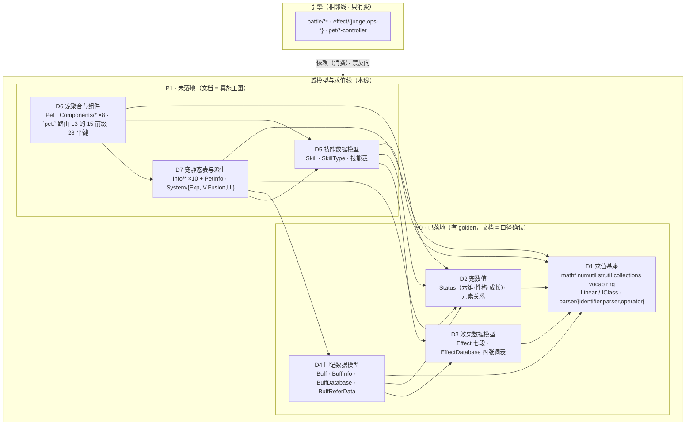
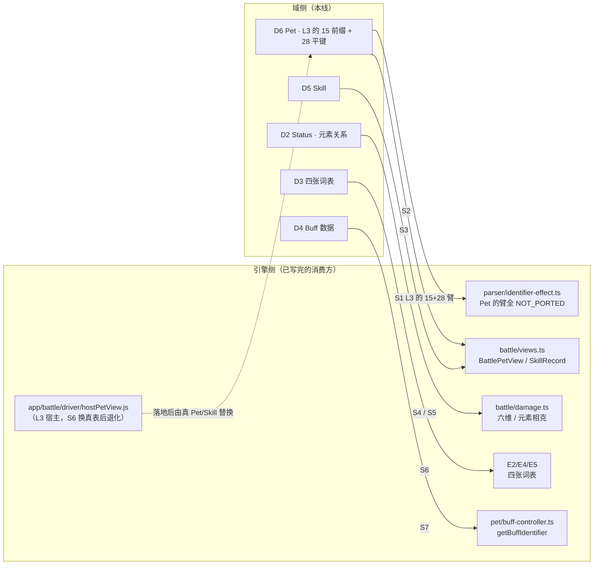

# 域模型与求值线 · 总设计（domain-design.md）

> **定位**：**域模型与求值线**的**总设计兼导读**。本线 = 从战斗引擎线**剥离**出来的
> 「**通用域模型**（`Pet` / `Skill` / `Status` / `Buff` / `Effect` 数据）+ **求值 DSL**（`parser/**`）+ **公共底座**」。
> 它**不按行为**组织（不像引擎线有相位/算子），而**按数据族与求值基座**组织。
>
> **上级文档**：`docs/architecture.md`（分层与不变量）。**边界真值** = `docs/engine/battle-engine-design.md §8.4`
> （逐文件判定表 + 跨界例外；**本文只引用不重复**）。**文档架构** = `docs/arch-docs.md`。**代码分层** = `docs/arch-code.md §3.1`。
> **移植事实** = `docs/engine/port-map.md`；**路线** = `docs/engine/kernel-handoff.md`；**对拍** = `docs/engine/oracle-playbook.md`。
>
> **证据标注**：【源码】= 上游 `.cs`；【我们】= `game/**`。

---

## 0. 这份文档回答什么

1. 这条线**是什么、圈里有什么、圈外有什么**（与引擎线 / Save 线 / View 线 / 内容桥的分界）。
2. **七条不变量（V1–V7）** —— 全线的公共口径，子设计只能遵守。
3. **族图与依赖序** —— 谁在谁下面，按什么顺序评审。
4. **与引擎的接缝清单** —— 本线对引擎的**唯一对外面**（7 条），含**最大的一条**（`pet.` 标识符的穿层链，D6 §2.3 已把它拆成五层）。
5. **子设计地图**（**8 份** = D0 + D1–D7）与批次。
6. **文档形态口径** —— 为什么"已落地半"写短文档、"未落地半"写真设计。

---

## 1. 不变量（V1–V7，全线的公共口径）

> 这六条**跨所有子设计**。子设计只能**遵守**，不能各自另立。带「⚠️」的是**已实测为真**的。

| # | 不变量 | 说明 / 证据 |
|---|---|---|
| **V1** | **词表反查取「插入序第一个匹配键」** | 【我们】`core/vocab.ts` 的 `conv()` 工厂（`EffectDatabase.cs:92-122` / `BuffDatabase.cs:52-77` 两处结构一字不差）。今天每值一键看不出差别；**只要加一个别名键，正/反查就会各自选中不同串** ⇒ 表必须是 `[ [raw, value], … ]` **有序数组**，不许用 `Map`/对象 |
| **V2** | **未知键/值静默兜底，不抛** | 正向 miss ⇒ `None`/`None`；反向 miss ⇒ `"none"`。这是**上游行为**（重启内容表里**真有拼错的 timing**，见 `game/data/unity/manifest.json` 的 `silentFallbackQuota`）⇒ 移植体也必须静默，否则"表里那一条"两边行为不同 |
| **V3** | **float 收窄点固定** | C# 侧一切标量是 `float`（32 位）⇒ 每个算术结果过 `f()`（【我们】`core/mathf.ts:6`）。**不许**顺手 `toFixed`/`Math.round`/双精度直算 —— 末位 ULP 会在几千回合的对拍里炸出来。⚠️ 两个高危点见 V3a/V3b |
| **V3a** | `Status / float` 是**乘倒数**（`lhs * (1/rhs)`），不是除法 | 【源码】`Status.cs:287-290`；【我们】`core/pet/status.ts` 头注。`/100` = `x * 0.009999999776482582`，与 `x/100f` 的最近值**可差 1 ULP** |
| **V3b** | **LINQ 的 `Max/Min/Sum` 与 `Mathf.Max/Min` 是两套语义** | LINQ 空表**抛**；`Mathf` 是两点运算。混用即分叉（【我们】`pet/status.ts` 的 `linqMax`/`linqMin` vs `mathf.max`) |
| **V4** | **成员顺序 = 声明顺序** | XML 与 CSV **都**靠它（`Status.cs:19-24` 的 `[XmlElement("atk")]`… 声明序即 `atk/mat/def/mdf/spd/hp`）。见 `docs/save/save-xml-spec.md` |
| **V5** | **`[XmlIgnore]` 不出现；`null` 单引用省略** | 同 Save 线口径（`docs/save/save-xml-spec.md`）。`coin`/`diamond` 就是 `[XmlIgnore]` 改存 `itemStorage` 的例子 |
| **V6** | ⚠️ **域侧不读 `game/data/**`；表一律注入** | 已实测：域侧件只有注释提到 `game/data`，**零实际读盘**。接缝 = `setEffectTable` / `setBuffTables` / `setBuffInfoTable` / `setSkillTable` / `setRandomSkillSource` / `setSkillNumHost` / `setBuffHost` |
| **V7** | **依赖单向：引擎 → 域模型 → 底座** | `docs/engine/battle-engine-design.md §8.4`；`docs/arch-code.md §3.1`。**域模型禁反向依赖引擎** |

---

## 2. 边界（圈里 / 圈外）

### 2.1 在圈内

- **宠物族**：`Pet`（聚合根）· `Components/*`（8 件）· `Info/*`（**10 件**）· `PetInfo`（组装根）· `System/*`（派生 4 件 + `PetElementSystem` 归 D2）
- **技能族**：`Skill` · `SkillType` · 技能表
- **数值族**：`Status`（六维 / 性格 / 成长 / `GetPetNormalStatus`）· 元素关系
- **印记族**：`Buff`（实例）· `BuffInfo`（表行）· `BuffDatabase`（词表）· `BuffReferData`（紧凑引用）
- **效果族**：`Effect`（七段数据模型）· `EffectDatabase`（四张词表）
- **求值 DSL**：`Parser.cs` · `Operator.cs` · `Identifier.cs:10-188`
- **公共底座**：`mathf` / `numutil` / `strutil` / `collections` / `vocab` / `rng` · `Linear<T>`（`IClass`）

### 2.2 在圈外（只链接，不展开）

| 圈外 | 去向 | 判据 |
|---|---|---|
| **战斗专属的宠包装**：`BattlePet` · `BattleStatus` · `PetBattle*Controller` | **引擎**（E3） | §8.4：住在 `Basic/Pet/Battle/`、类名打头 `Battle` |
| **效果的判定与算子**：`Effect.Condition/Apply` · `EffectConditionHandler` · `EffectAbilityHandler` | **引擎**（E4/E5） | §8.4(4)：否则域侧 `buff/**` 会反向依赖引擎 |
| **`parser/identifier-effect.ts`**（`Identifier.cs:190-548`，effect 上下文 + `GetBattleIdentifier`） | **引擎** | §8.4(3) #4：一个 `.cs` 按**臂**切成两半 |
| **`Pet.Add` / `Pet.OpenHintbox` + 6 处 `Player.instance.gameData`/`petBag`** | **Save 线 / 编排线**（编排线已立 ⇒ `docs/orchestration/orchestration-design.md`） | 【源码】`Pet.cs:150/153/156/401/589/603/604` —— 域模型是**纯数据**，不摸存档。⚠️ **地图侧的同类箭头已有着落**：`MapManager` 的 `LoadMap/LoadPlayer` + `mapInitPos` + `SceneLoader.ChangeScene` = **编排线**；而 **NPC/条件/动作/对话/传送语义 = 地图线**（`docs/map/map-design.md`，2026-10-17 立） |
| **`PetUIInfo` / `PetSoundInfo` / `PetTransformInfo` 的「消费」**（SWF 名 / 音效 / 舞台变换） | **View 线** | **数据 shape 仍在本线**（D7），只有"拿它去画"才归 View |
| **`PetElementSystem.GetElementRelation(int, BattlePet)` / `(Skill, BattlePet)` 两个重载** | **引擎**（E3 的 `damage.ts` 用） | 【源码】`PetElementSystem.cs:167/172` —— 吃 `BattlePet` 的重载是战斗侧；本线只提供**纯函数**版（`:155/160`） |
| **内容表的实际装载**（CSV → JSON、`content.js`） | **L2 内容桥** | V6：本线只**接受注入**的表 |
| **XML 节点树 / 落盘** | **Save 线** | `docs/save/save-design.md` |

---

## 3. 族图与依赖序

> **约定**：`A --> B` 读作「**A 依赖 B**」（A import B）。所以箭头方向 = **依赖方向**，
> 与 V7 一致：引擎 → 域模型 → 底座。



**评审/写作顺序 = 依赖序（拓扑）**：

```
D1 基座 → D2 数值 → D3 Effect → D4 Buff → D5 Skill → D7 Info+派生 → D6 Pet 聚合
```

> **为什么 D7 在 D6 前**：读源实测 `Components/*` **每一个都吃 `Info/*`**（`PetBasic←PetBasicInfo`、
> `PetExp←PetExpInfo`、`PetFeature←PetFeatureInfo`、`PetSkill←PetSkillInfo`、`PetTalent←PetTalentInfo`、
> `PetUI←{PetHitInfo,PetInfo,PetSoundInfo,PetUIInfo}`），且吃 `System/*`（`PetExp←PetExpSystem`、
> `PetTalent←PetIVSystem`、`PetUI←PetUISystem`）⇒ **表与派生在实例之下**。
> ✅ D7 已把这张表逐件落到 `行号` 级：见 `docs/domain/domain-info.md §6.3`（八件组件 × 各自吃的 Info/System 臂）。

**批次**：**P0 = D0 + D1–D4**（四份都是"确认"）；**P1 = D5 + D6 + D7**（真设计，接 S5/S6）。

> **P1 进度**：D5 ✅（`docs/domain/domain-skill.md`）· D7 ✅（`docs/domain/domain-info.md`）· **D6 ✅**（`docs/domain/domain-pet.md`，2026-10-17）
> ⇒ **域线 `design` 全部成文**，阶段一的下一批是域线 `impl`（等人类评审）。
> ⚠️ 当初给 D6 的那条口径已执行：**D6 的现状列是按同一口径实测的**（`domain-pet.md §6`）—— `core/pet/**` 已有 **1139 行**，
> 但**本族 `Pet` + 8 组件对象仍是 0 个**（那 1139 行属于 D2/D4/E3），而 **oracle 侧 `BuildPet` 已经在用反射拼真 `BattlePet` + 8 组件**（`domain-pet.md §6`）。
> 另外 D5 报出一条 **V7 地雷**（`SkillType` 这个域侧枚举由引擎文件 `battle/damage.ts:22` 定义，被域侧语义件 import；
> 见 `domain-skill.md §5 G9`）—— 施工批 **B1** 拆雷；**D7 报了同族第二条**（纯整数函数 `GetSortPriority` 住在 `Helper/HelperMath.cs:13` 的 `namespace UnityEngine` 里，见 `domain-info.md §5 G12` / 它的 **B1**）。
> ⚠️ D7 还留了**三条待人类拍板**（`domain-info.md §8` 末：`LearnSkillInfo.Condition` 的收窄形状 / skin 三表要不要进桥 / `PetKizunaInfo` 的跨线归属）。

---

## 4. 与引擎的接缝清单（本线对外的**唯一面**）

> 这是本线**最重要的一节**：引擎线已经把消费方写完了（`views.ts` / `identifier-effect.ts` / `damage.ts` …），
> 本线落地时要**逐个对上**。

| # | 接缝 | 引擎侧现状（消费方） | 本线提供方 | 状态 |
|---|---|---|---|---|
| **S1** | **`pet.<x>` 的穿层**（⚠️ **不是"23 个 `case`"** —— 那是 `SetPetIdentifier` 的平键数；读侧 `Pet` 实例层是 **15 前缀臂 + 28 平键 + 兜底**，且上面还有 `UnitPetSystem` / 静态路由 / `BattlePet` override 三层，见 `domain-pet.md §2.3`）+ `TryGetPetIdentifier` | `core/parser/identifier-effect.ts:691` —— `Pet` 的臂**一律显式 `NOT_PORTED`** | **D6** | ⬜ 最大的一条；**分批顺序已由 D6 定**（W2） |
| **S2** | `BattlePetView`（`anger` / `battleElement` / `subBattleElement` / `isDead` 是**转发属性**，不是快照字段） | `core/battle/views.ts:542`；产品实现 = `game/app/battle/driver/hostPetView.js`（L3） | **D6** + 引擎 E3 | ⬜ |
| **S3** | `SkillRecord`（extends `SkillView`） | `core/battle/views.ts:62` + `core/battle/damage.ts:30` | **D5** | ⬜ **逐条对齐合同已定**（`domain-skill.md §3.1`）；现仍由 DTO + 自由函数顶替 |
| **S4** | `Status` 六维 + 隐藏维（`hit/cri/eva/cdf/rec/angrec`） | `core/pet/status-controller.ts` 的 `BattleStatus extends Status` | **D2** | ✅ 已提供 |
| **S5** | 元素相克（`getElementRelation` / `getElementRelationSub` / `getSameElementBuff`） | `core/battle/damage.ts` + `elementRelation` 印记 | **D2** | ✅ 已提供 |
| **S6** | 四张词表（`EffectTiming` / `EffectTarget` / `EffectCondition` / `EffectAbility`） | 引擎 E2/E4/E5 **直接用** | **D3** | ✅ 已提供 |
| **S7** | `Buff` 数据 + `getBuffIdentifier` / `tryGetBuffIdentifier` / `setBuffIdentifier` | `core/pet/buff-controller.ts` | **D4** | ✅ 已提供 |



> **S1 是验收面**：`identifier-effect.ts` 现在把 `Pet.GetPetIdentifier` 的臂整体标 `NOT_PORTED`，
> 并注明「宠表 (`petInfoDict`) 与 Pet 实例组件 (basic/talent/record/ui/feature/kizuna) 本轮**不接**」。
> D6 落地后这些臂要**逐臂**接上，且**每臂都要有向量**；D6 已按发行数据的实测命中给出**分批口径**
> （`domain-pet.md §2.3` 命中表 + `§3.4` 施工批 B4/B5：先接有真实向量的 6 支，再补 20+ 支零命中臂）。

---

## 5. 文档形态口径（**与引擎线的最大差别**）

本线**六成未落地**（3381 / 5718 行），且两半性质不同 ⇒ **两套写法**：

| | 已落地半（D1–D4） | 未落地半（D5–D7） |
|---|---|---|
| 文档性质 | **口径确认 + 边界** | **真施工图**（S5/S6 照着写码） |
| 篇幅 | **短**（≈150–220 行） | **长**（≈250–400 行） |
| **字段表** | **不重抄** —— 指向上游 `文件:行` + `port-map.md` | 列**关键**字段 + 全量表指针 |
| 主要价值 | 锁 V1–V7 在本族的具体形态 / 记怪癖 / 报偏差 | 定契约 + 依赖 + 接缝 + 施工顺序 |
| as-built | 以 `kernel-handoff.md §3` 为准（引用） | 待写 |

> **为什么"不重抄字段表"**：同一事实会散在上游 `.cs`、`port-map.md`、本文档**三处**，**必然过期**。
> 文档只写**上游看不出来的**东西：不变量、顺序、接缝、偏差。这与父文档"只链接不重复"是同一条纪律。
>
> **本文兼导读，不单立导读文档**：引擎线需要导读是因为它有**机制**（相位/时机/队列）要先讲通；
> 本线只有**族与接缝**，§3 + §4 已够。

---

## 6. 子设计地图（**已决议：8 份**）

| # | 子设计 | 覆盖 | 上游 | 我们现状 | 批 | 状态 |
|---|---|---|---|---|---|---|
| **D0** | **`docs/domain/domain-design.md`**（本文） | 边界 / V1–V7 / 族图 / 接缝清单 / 子地图 | 索引 | — | **P0** | ✅ 已写 |
| **D1** | `docs/domain/domain-base.md` | 公共底座 + `Linear`/`IClass` + `parser/{identifier,parser,operator}` | `IClass` · `Parser` 198 · `Operator` 163 · `Identifier:10-188` | ✅ 832 行 | **P0** | ✅ 已写 |
| **D2** | `docs/domain/domain-status.md` | `Status`（六维/性格/成长/`GetPetNormalStatus`）+ 元素关系 | `Status.cs:1-393`+`:522-545` · `PetElementSystem` 216 | ✅ 396 行 | **P0** | ✅ 已写 |
| **D3** | `docs/domain/domain-effect.md` | `Effect` 七段 + `Parse`/`TryParse`/`SetEffects`/`Format`/克隆 + `EffectDatabase` | `Effect.cs`(数据) · `EffectDatabase` 201 | ✅ 393 行 | **P0** | ✅ 已写 |
| **D4** | `docs/domain/domain-buff.md` | `Buff` / `BuffInfo` / `BuffDatabase` / `BuffReferData` | `Buff` 434 · `BuffInfo` 163 · `BuffDatabase` 77 · `BuffReferData` 67 | ✅ 716 行 | **P0** | ✅ 已写 |
| **D5** | `docs/domain/domain-skill.md` | `Skill` · `SkillType` · 技能表（含 **DTO 字段 ↔ 真 `Skill` 字段**逐条对齐） | `Skill.cs` 732 | ⚠️ **约 550 行已落地、但没有对象**（`SkillRecord` DTO + 自由函数，且**寄在引擎目录**；见 `domain-skill.md §6.1`） | P1 | ✅ 已写 |
| **D6** | `docs/domain/domain-pet.md` | `Pet` 聚合根 + `Components/*` ×8 + **`pet.` 路由的 L3（15 前缀 + 28 平键）** | `Pet.cs` 715 · `Components/*` 843 | ⚠️ **本族 0 个对象，但不是零落地**：`core/pet/**` 已有 **1139 行**（属 D2/D4/E3，三面推导的原语 `status.ts:270/:218` 已在）；**oracle 侧 `BuildPet` 已用反射拼真 `BattlePet` + 8 组件**（`Program.cs:772-861`），宠表却还由 `EnsurePetInfo` 合成；S1 围栏已在 `identifier-effect.ts:691-730` 逐臂就位（见 `domain-pet.md §6`） | P1 | ✅ 已写 |
| **D7** | `docs/domain/domain-info.md` | `Info/*` **×10**（表条目）+ `PetInfo.cs` + `System/{PetExp,PetIV,PetFusion,PetUI}System`（派生）+ `SecretSkillDatabase.cs`（`learnLevel` 编解码半边） | `Info/*` 767 · `PetInfo.cs` 41 · `System/*` 350 · `SecretSkillDatabase.cs` 83 | ⚠️ **数据齐、对象与算式全缺**（L2 桥 `build-unity-data.mjs` 已拼出 `pets.json` 838 行，但 `core/pet/**` 本族 **0 个对象**；`hit/sound/transform` 三件**连桥都没有**且**发行无行**；见 `domain-info.md §6.1`） | P1 | ✅ 已写 |

**统一骨架**（承接引擎线，两线可同法阅读）：① 范围/边界 ② 上游真值（`文件:行`）③ 目标结构（类/函数契约）
④ 与相邻模块的接口（**2 张 mermaid**：族内位置图 + 文件↔接口图）⑤ 不变量与围栏 ⑥ 现状与缺口 ⑦ 待核/怪癖 ⑧ 配对 impl 指针。

### 6.1 粒度取舍（为什么不这么切）

| 候选 | 取舍 |
|---|---|
| 按上游目录拆 `Info` / `Components` / `System` 三份 | ❌ **三份互相引用**（表→组件→派生是一条链），违反"父文档只链接不重复"。唯一干净 seam = **实例侧（`Pet`+`Components`）/ 表与派生侧（`Info`+`System`）** |
| 把 `Pet` 簇合成一份 | ❌ 2649 行 = 引擎线最大子设计（E2 1133）的 2.3 倍，不成"独立评审"的边界 |
| `Effect` + `Buff` 合成一份 | ❌ 两个独立目录、独立对拍 kind（`effectparse` vs `buffinfo/buffid/buffdesc/refer`）、且 `Buff → Effect` **单向** ⇒ 可先冻结 D3 再评审 D4 |
| `Skill` 并入 `Pet` | ❌ `Skill.cs` 独立 732 行，且是 **Q4 已冻结的 `views.ts` DTO** 的替换目标 ⇒ 需要单独一份做字段对齐 |
| 单立一份"导读"（对仗引擎线） | ❌ 本线无"机制"可讲；D0 §3/§4 兼任 |

---

## 7. 纪律

1. **不重抄字段表**（§5）；上游是唯一字段真值。
2. **引用一律写全路径**（`docs/domain/…` / `docs/engine/…`），见 `docs/arch-docs.md §0.1`。
3. **改了源必须同步本线文档**：域侧件被引擎/存档引用，改动会外溢（尤其 V1/V4 两条）。
4. **域侧零读盘**（V6）：新增表一律加**注入接缝**，不许 `import` `game/data/**`。
5. **上流水印/拼写错误照搬**（V2）：静默兜底是**行为**，不是 bug。
   ⚠️ 但这条**只管数据表**。上游**代码逻辑 bug**（写反的判断、漏掉的 fallthrough、误当哨兵的返回值）政策相反 =
   **在文档里声明 + 设计文档写没有该 bug 的目标行为**（人类 2026-10-17 拍板，原文与分工见 `docs/arch-docs.md §4.1`、`AGENTS.md §2`）。
6. **随机数与墙钟不追求与上游逐值一致**（人类 2026-10-17 拍板）：不为它们启 Unity，oracle 侧的 `UnityEngine.Random` shim 取消。
   ⇒ 域内凡"因为 native Random 所以永久不可比"的口径**一律作废**，改由 `docs/runtime/runtime-components-design.md`（R1 随机源 / R2 时钟）
   定接缝与验收；**主要验收手段是人类手测**，对拍只是回归门（`AGENTS.md §1.1`）。

---

## 8. 与现有文档/代码的关系

**已覆盖（不重复）**

- 边界逐文件判定 → `docs/engine/battle-engine-design.md §8.4`（**权威**）
- 代码分层与 L0 内部三区 → `docs/arch-code.md §3.1`
- 移植事实与逐算子实测 → `docs/engine/port-map.md`；路线 → `docs/engine/kernel-handoff.md`；对拍 → `docs/engine/oracle-playbook.md`
- 存档 XML（成员顺序 / `[XmlIgnore]` / `null` 语义） → `docs/save/save-xml-spec.md`
- 舞台与素材（`Info/*` 的消费端） → `docs/view/view-design.md`、`docs/view/scene/battle/view-scene-battle-stage.md`

**本线相对现有内核文档的定位**

> `kernel-handoff.md` / `port-map.md` 是**移植线**文档，且**跨了两条线**（它们的 S1/S2/S5/S6 段同时含引擎与域侧内容）。
> 本线是**设计线**文档：说"域模型是什么、该长什么样、守什么"。两者**并存**；
> 移植线里**属于域侧**的段落，等 S5 收口时再决定是否移交（现在只**引用**）。

---

## 9. 开放问题

| # | 问题 | 现状 |
|---|---|---|
| **W1** | `kernel-handoff.md` 的 **S1/S2/S5/S6** 段是两条线共用的；本线成立后是否要**拆出**域侧段落 | **暂不拆**（引用即可），等 S5 收口再看 |
| **W2** | `Pet.GetPetIdentifier` 的 23 臂要**一次接完**还是**按频次分批** | ✅ **D6 已定：按频次分批**（先接发行数据里有真实命中的 6 支，再补 20+ 支零命中臂）。理由与命中计数见 `domain-pet.md §2.3` 的实测表；批次落点是 `§3.4` 的 **B4 / B5**。⚠️ 同时纠正了本题的措辞：读侧不是"23 臂"（那是写侧平键数），且 `pet.` 上面还有三层（`§2.3`） |
| **W5** | D6 留给人类的**四条待拍板**（RNG/时钟注入策略 · `per/percentage` 丢值照搬还是修 · 写侧上移的形态 · 继承 D7 的**本族待拍板 ②**） | ✅ **四条已于 2026-10-17 全部拍板**（= **人类决议 ①②③④**，**索引 `AGENTS.md §5`**，原文散见 `AGENTS.md §4` D6 段）：① RNG/时钟**不为它启 Unity、不追求逐值一致** ⇒ 另立运行时线 `docs/runtime/runtime-components-design.md`（R1/R2）；② `per`/`percentage` 丢值 = **上游代码 bug ⇒ 声明 + 修**（`docs/domain/domain-pet.md §2.7` + 它的 §7 **CB3**）；③ 写侧上移 = **核心层只调接口**，落盘/弹窗走 R4/R5；④ skin 三表**要建数据桥**（= D7 本族待拍板 ②）。D6 已按四条改完，本条**不再是开放问题**，只留作**决议索引** |
| **W3** | `Info/*` 的 10 件里 `PetUIInfo` / `PetSoundInfo` / `PetTransformInfo` / `PetHitInfo` 是否**永久留在本线**（它们服务 View） | 倾向**留**（数据 shape 属域模型）—— **D7 已按此登记消费端**（`domain-info.md §2.1` 的 View 行 + `§5 G9`）；⚠️ `hit/sound/transform` 三件**发行无行**（`domain-info.md §6.1`）那半**已决**：三张表**要进 L2 桥**（人类决议 ④ ⇒ D7 本族待拍板 ②，落 D7 施工批 **B5**、D6 的 **B1** 依赖它），真值先吃**合成行**、以**人类手测**为主验收 |
| **W4** | 本线是否需要一个 `domain-overview.md` 式的**真导读**（面向"第一次读的人"） | 倾向**不要**（§5 末） |
