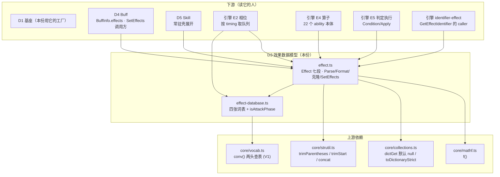
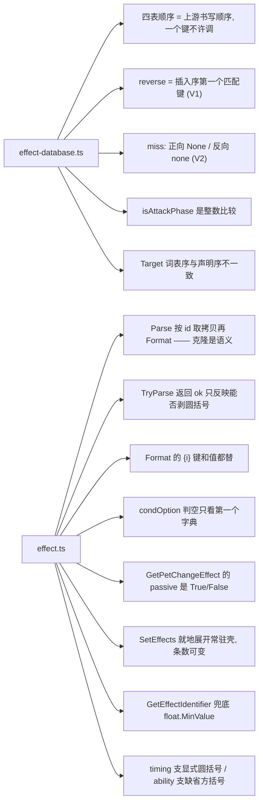

# 域模型子设计 D3 · 效果数据模型（domain-effect.md）

> **定位**：本线的**效果数据层** —— `Effect`（一条效果的**七段数据模型** + 解析 / 格式化 / 克隆 / 往返）
> + `EffectDatabase`（**四张词表** + `isAttackPhase`）。它是**引擎效果系统的语言**：
> 引擎的 E2（相位时机）/ E4（22 算子）/ E5（判定执行）全都在**读它**。
>
> 父文档 = `docs/domain/domain-design.md`（**§1 V1–V7 / §4 接缝 S6 / §5 文档形态**）。
> 实现在 `game/core/effect/effect.ts`(280) + `game/core/effect/effect-database.ts`(113)（**共 393 行**）。
>
> ⚠️ **本份只管「数据」那半**。判定与执行（`Effect.Condition` / `Apply` / `CheckAndApply` / `PostProcess`）
> 在 **`core/effect/effect-judge.ts`**，归**引擎 E5**（`docs/engine/battle-engine-judge.md`）；
> 22 个算子的**本体**在 `core/effect/ops-*.ts`，归**引擎 E4**。
> **别与这些重复**：逐算子实测 → `docs/engine/port-map.md`；边界 → `docs/engine/battle-engine-design.md §8.4`。

---

## 0. 这份文档回答什么

1. 一条效果 = **七列**，为什么 `id` 是第八个东西（预制体）。
2. **`Parse` 取拷贝再 `Format`**：克隆是**语义**，不是防御性复制。
3. 三个**往返**函数（`GetRaw*`）与它们各自的**畸形输入**行为。
4. `SetEffects` —— 常驻 `set_skill(type=effect)` 的**就地展开**（技能表装载的关键一步）。
5. **四张词表**：为什么必须是有序数组（V1）、为什么值必须逐字面量对照（`IsAttackPhase` 是**数值比较**）。
6. `Effect.cs` 被切成**三段**，其中 `:391-431` 从"战斗半"**回到**域侧。

---

## 1. 范围与边界

| | |
|---|---|
| **本份覆盖** | `Effect` 类：七列 + `id` · 三个构造 · `clone` · `targetType`/`targetFilter`/`type`/`isSelect` · `getRawEffectStringArray`/`getRawConditionOptionString`/`getRawAbilityOptionString`/`GetRawEffectListStringArray` · `getEffect(id)` · `Parse`/`TryParse` · `Format` · `SetEffects` · `GetDefaultEffect`/`GetEscapeEffect`/`GetPetChangeEffect` · `SetTiming` · `GetEffectIdentifier`/`TryGetEffectIdentifier` ｜ `EffectDatabase`：`EffectTiming`/`EffectTarget`/`EffectCondition`/`EffectAbility` 四枚举 + 四张词表 + `isAttackPhase` ｜ 我方接缝：`EffectTable`/`setEffectTable`/`currentEffectTable`/`PrefabRow`/`effectFromRow`/`PrefabTable` |
| **上游** | `MVC/Model/Basic/Effect/Effect.cs:1-223` + `:391-431`（**数据半**）+ `EffectDatabase.cs`(201) |
| **不覆盖** | `Effect.cs:224-389`（`Condition`/`Apply`/`CheckAndApply`/`PostProcess`/`TryGetPostProcessEffects`） → **引擎 E5** |
| | `EffectConditionHandler.cs`(414) + `EffectAbilityHandler.cs`（`DefaultAbility` + 22 算子） → **引擎 E4/E5** |
| | `Effect.cs:391-431` 的**调用方**（`GetBattleIdentifier` 的 `effect` 上下文） → **引擎** `parser/identifier-effect.ts` |
| | 预制体表的**生产**（CSV → `effects.json`） → **L2 内容桥**（`tools/build-unity-data.mjs`） |

---

## 2. 上游真值（逐件）

### 2.1 一条效果 = **七列** + 一个 `id`

【源码】`Effect.cs:16-28`（`DATA_COL = 7`）｜【我们】`effect.ts:36-76`

| 列 | 上游字段 | 【我们】 | 说明 |
|---|---|---|---|
| 1 | `timing` | `timing` | `EffectTiming`，32 值 |
| 2 | `priority` | `priority` | int，排序用 |
| 3 | `target` | `target` | `EffectTarget`，8 值 |
| 4 | `condition` | `condition` | `EffectCondition`，9 值 |
| 5 | `condOption` | `condOptionDictList` | **`List<Dictionary>`** ⇒ 多组条件参 |
| 6 | `ability` | `ability` | `EffectAbility`，22 值 |
| 7 | `abilityOption` | `abilityOptionDict` | **`Dictionary`** ⇒ 参数字典 |
| **+** | `id` | `id` | **不是列** —— 见下 |

> **CSV 里的一行 = 一个预制体（prefab）**；而技能/印记/道具表里的 DSL 串（`1002{buff=3&2=4&5=6}`）
> 是**对预制体的引用 + 实参**。所以「`id` + 七列」是一个**可被引用的模板**，不是效果本身。
>
> 【我们】的表形状：`PrefabRow`（`optPairs` **有序 pair 数组**，不用对象）——
> 因为数字串键 `"2"`/`"5"` 会被 JSON 对象**重排**，而反解出的 raw 串按**插入序**拼。
> 这一条与 V1 同源：**顺序是语义**。

### 2.2 三个构造 + 一个别名

| 上游 | 【我们】 | 要点 |
|---|---|---|
| `Effect()` (:30) | 无参构造的等价物 | |
| `Effect(string ×7)` (:31) | 七参构造 | ⚠️ **`_condition_option === null` 时压入一个空字典**（不是留空列表）—— `condOptionDictList.Select(...)` 的**长度**在别处可观测 |
| `Effect(EffectTiming, int, EffectTarget, …)` (:43-62) | 同上 | |
| `Effect(Effect rhs)` (:64-74) | `clone()` | ⚠️ **只拷 7 列 + `id`**，**不拷** `source`/`sourcePet`/`invokeUnit`/`isSelect` |

**导出属性（都是"每次重算"，不是缓存字段）**

| 属性 | 上游 | 语义 |
|---|---|---|
| `targetType` | `:20-21` | `dictGet(abilityOptionDict, 'target_type', 'none')!.split('_')` —— ⚠️ 任何值都能切出 `['none']`，默认值 `'none'` |
| `targetFilter` | `:22` | `dictGet(…, 'target_filter', 'none')` |
| `type` | `:24-25` | ⚠️ **`type` 与 `ability` 是同一个东西的两个名字**（`type` 只是别名） |
| `isSelect` | `:26` | `targetType.includes('index')` |

### 2.3 三个往返函数（**畸形输入各有各的行为**）

| 上游 | 【我们】 | ⚠️ 可观测点 |
|---|---|---|
| `GetRawEffectStringArray` (:94-98) | `getRawEffectStringArray()` | 7 列按**列顺序**拼 |
| `GetRawCondtionOptionString` (:100-104) | `getRawConditionOptionString()` | ⚠️ **判空只看第一个条件字典**（`FirstOrDefault()?.Count ?? 0`）⇒ `[{},{a=1}]` 这种畸形**整体输出 `none`**，后面的字典被吞。**原样保留** |
| `GetRawAbilityOptionString(excludeKeys)` (:106-116) | `getRawAbilityOptionString(exclude)` | ⚠️ **先拷一份再 `Remove`，不改原表**（调用点是渲染/回写路径，改了就污染预制体） |
| `GetRawEffectListStringArray(id, list)` (:76-93) | `getRawEffectListStringArray` | `Effect.Parse` 的**逆运算**（含 `id`） |

### 2.4 `Parse` / `TryParse` —— 四个抛点、一个"别当校验用"

【源码】`Effect.cs:118-152`｜【我们】`effect.ts:121-155`

```
Parse(value, table):
  value === null                     → null                (不抛)
  剥不掉外层圆括号 (TrimParenthesesLoop) → null            (不抛)
  id 不是整数                         → int.Parse 抛
  id 是整数但表里查不到                → 对 null 调 Format ⇒ NullReferenceException 抛   ← 照搬
  否则                               → 按 id 取**一份拷贝**再 Format 实参 → Effect[]
```

- ⚠️ **`new Effect(e)` 这个克隆是语义的一部分**：同一个预制体被 2000 个技能引用时**互不污染**。
  少了它，一次 `Format` 会把实参写回预制体，**后续所有引用都被污染**（且不可复现）。
- ⚠️ **`TryParse` 的返回值由「能不能剥圆括号」决定，与解析成不成功无关**：
  `"(1002)"` 与 `"abc"` 都返回 `false`，但前者的 `effects` 是**有效列表** ⇒ **别把它当"校验成功"用**。
- 【我们】的接缝：`EffectTable.getEffect(id)`；`PrefabTable` 额外实现**上游 `Database.GetEffect`（`Database.cs:125-129`）的 `id === 0 一律查不到`**（哪怕表里真有 0 号行）。

### 2.5 `Format` —— `{i}` **键和值都替**

【源码】`Effect.cs:207-217`｜【我们】`effect.ts:156-171`

- 实参列表来自 `TrimParenthesesLoop('{','}')` ⇒ `1002{buff=3&2=4&5=6}` 只有**一个**实参 `{0}`。
- ⚠️ 替换是 **`ToDictionary` 两边都 `Replace`** ⇒ **键也替**：预制体的键 `{0}` 整块变成字面值
  `"buff=3&2=4&5=6"`，而值里的 `{1}`… **保持字面**。
  **这条已在真二进制上实测**（`tools/oracle-cs` 的 `dbprobe`）；写成"只替值"会让整族参数的镜像反过来。
- `options` 为空 ⇒ 直接返回（不动）。

### 2.6 `SetEffects` —— 常驻壳的**就地展开**

【源码】`Effect.cs:159-180`｜【我们】`effect.ts:173-190`

```
对每条 e:
  if e.timing === Resident && e.ability === formatAbility(默认 SetSkill) && abilityOption['type'] === 'effect':
      value = abilityOption['value']
      value 为空          → 整条**丢弃**
      否则               → e = Effect.Parse(value) 展开进来的那些
  else → 原样留下
```

- **技能表装载时靠这一步把嵌套的常驻壳剥掉**（`Effect.setEffects` 的调用方 = `BuffInfo.setEffects` + 技能表）。
- ⚠️ 展开出来的条数**不固定** —— 上层不能假设"一进一出"。

### 2.7 三个工厂 + `SetTiming`

| 上游 | 【我们】 | 要点 |
|---|---|---|
| `GetEffect(int id)` (:118-122) | `Effect.getEffect(id, table)` | 查不到 ⇒ **null**（调用方据此抛）；查到 ⇒ **拷贝** |
| `GetDefaultEffect()` (:182-185) | `getDefaultEffect()` | |
| `GetEscapeEffect()` (:187) | `getEscapeEffect(table)` | 就是 `GetEffect(-4)` |
| `GetPetChangeEffect(src, tgt, passive)` (:188-197) | `getPetChangeEffect(src, tgt, passive)` | ⚠️ `priority` 硬编 **99999**；`target` = 当前宠；`passive` 决定 `timing` 落 `OnPassivePetChange(-1)` 还是 `OnBeforeAttack(6)`；⚠️ `passive` 以 **`passive.ToString()`** 落进 option ⇒ C# 是 `"True"`/`"False"` **首字母大写**，不是 JSON 的 `true`/`false` |
| `SetTiming(EffectTiming)` (:199-205) | `setTiming()` | |

### 2.8 `GetEffectIdentifier` / `TryGetEffectIdentifier` —— **回到域侧的第三段**

【源码】`Effect.cs:391-431`｜【我们】`effect.ts:213-253`

- 两族：`timing…` 与 `ability…`；兜底是 **`float.MinValue = -3.4028235E+38`**（`FLOAT_MIN_VALUE`），
  `TryGet` 拿它判"这个键我认不认"。⚠️ 换成 `-Number.MAX_VALUE` 会**差一个数量级** ⇒ 写死 C# 那个值。
- ⚠️ **两族的括号字符不是一套**：
  - `timing(…)` 支:**显式给了** `'('` `')'`（`Effect.cs:398`）；
  - `ability[…]` 支:**不带**字符实参 ⇒ 吃 `Helper.cs:85` 的**缺省 `[` `]`**。
  ⇒ `ability(rage)` **剥不动**、直接落到 `return 0`；只有 `ability[键:值]` 真会去查 `abilityOptionDict`。
  **写成圆括号会让整族判定反过来。**
- ⚠️ `ability[单冒号]` 那支把 option 值交给 `Identifier.GetNumIdentifier` —— 键不存在时上游拿到 `null`
  **立刻 NRE**；【我们】同样在 `resolveNum` 里炸，**不静默兜 0**。
- **归属**：这两个方法住在 `Effect.cs` 的**后半**（`Condition`/`Apply` 之后），但**只吃效果自身的数据**
  ⇒ **归域侧**。⇒ `Effect.cs` 被切成**三段**：`:1-223` 与 `:391-431` 在本份，`:224-389` 在引擎 E5。

### 2.9 `EffectDatabase` —— 四张词表

【源码】`EffectDatabase.cs:8-90`（表）/ `:92-122`（查表）/ `:134-139`（`IsAttackPhase`）/ `:142-202`（枚举字面量）
【我们】`effect-database.ts`（113）

| 枚举 | 值域 | ⚠️ 关键点 |
|---|---|---|
| `EffectTiming` | 32 值：`All = -999`、`None = 0` … `OnAfterTurnEnd = 18`、`OnBattleEnd = 999`、`OnPassivePetChange = -1` … `OnAfterEffect = -11` | ⚠️ 值取自**字面量**（不是声明顺序）：故意跳出去的值直接参与 `>`/`<` 比较（见 `IsAttackPhase`）⇒ **值错一个都不行** |
| `EffectTarget` | 8 值 `None 0` … `CurrentToken 7` | ⚠️ **词表顺序与声明顺序不一致**（词表里 `pet` 在 `pet_bag` 之前）；枚举**数值**只由声明顺序决定，词表顺序只影响**反查命中谁**（V1） |
| `EffectCondition` | 9 值 `None 0` … `Poker 8` | |
| `EffectAbility` | 22 值 `None 0` … `Card 21` | 与 E4 的"22 算子本体"**同值域但不同东西**：这里是**名字↔数值**，算子本体是**行为** |

- **四张表都用 `conv(table, fallback)` 工厂**（工厂本体在 `core/vocab.ts`，D1）—— `EffectDatabase.cs` 与
  `BuffDatabase.cs` 里这段结构**一字不差**（V1 的唯一实现处）。
- **反向查表** = `First(x => x.Value === v).Key` ⇒ **插入序第一个匹配键**（V1）。
  今天每值一键看不出；**加一个别名键就会显形**。
- **顺序纪律**：`TIMING` 表的顺序 = `EffectDatabase.cs:8-90` 的**书写顺序**，**一个键都不许调**
  （一旦调过，`GetRawInfoStringArray` 式的 round-trip 就和上游分歧）。

### 2.10 `isAttackPhase` —— **数值比较，不是名字查表**

【源码】`EffectDatabase.cs:134-139`｜【我们】`effect-database.ts:109-113`

```
atk = timing > OnBeforeAttack(6) && timing < OnAttackEnd(16)
dmg = timing >= OnDamageParamCalculate(8) && timing <= OnFinalDamageCalculate(12)
return atk && !dmg
```

- ⚠️ 是**整数比较**：负值那批（`OnPassivePetChange` 等）因此**天然不是**攻击阶段。
- 写成"名字属于攻击阶段集合"会在**加/改 timing 值时静默走偏** ⇒ 必须照搬数值比较。
- 调用方：引擎 E2 的相位链与 E5 的 `isAttackAndHit`（**引擎只读它**）。

---

## 3. 目标结构（契约）

```
core/effect/effect-database.ts
  EffectTiming / EffectTarget / EffectCondition / EffectAbility       // as const 数值对象
  toEffectTiming / timingToRaw                                        // conv(TIMING, None)
  toEffectTarget / targetToRaw · toEffectCondition / conditionToRaw
  toEffectAbility / abilityToRaw
  isAttackPhase(timing): boolean                                      // 数值比较

core/effect/effect.ts
  type Options = Map<string, string>
  interface EffectTable { getEffect(id: number): Effect | null }
  setEffectTable(t) / currentEffectTable(): EffectTable               // V6 注入接缝
  class Effect
    static DATA_COL = 7
    timing / priority / target / condition / condOptionDictList / ability / abilityOptionDict / id
    source? / sourcePet? / invokeUnit? / isSelect                      // 接缝(不参与 clone)
    clone(): Effect
    get targetType(): string[] · get targetFilter(): string · get type(): EffectAbility · get isSelect(): boolean
    getRawEffectStringArray(): string[]
    getRawConditionOptionString(): string
    getRawAbilityOptionString(excludeKeys?: string[] | null): string
    static getRawEffectListStringArray(id, list): string[]
    static getEffect(id, table): Effect | null
    static parse(value: string | null, table): Effect[] | null
    static tryParse(value: string, table): { ok: boolean; effects: Effect[] | null }
    static setEffects(effects, formatAbility = SetSkill): Effect[]
    static getDefaultEffect(): Effect · getEscapeEffect(table) · getPetChangeEffect(src, tgt, passive)
    format(options: string[] | null): void · setTiming(t): void
    getEffectIdentifier(id, resolveNum): number                        // 兜底 float.MinValue
    tryGetEffectIdentifier(id, resolveNum): { ok: boolean; value: number }
  interface PrefabRow · effectFromRow(r) · class PrefabTable implements EffectTable   // id===0 查不到
```

---

## 4. 接口（mermaid）

### 4.1 族内位置图



### 4.2 文件↔接口图



---

## 5. 不变量与围栏

| # | 不变量 / 围栏 |
|---|---|
| **F1** | **V1**：四张词表是**有序数组**；反查取**插入序第一个匹配键**；表序 = 上游书写顺序，**不许重排** |
| **F2** | **V2**：正向 miss ⇒ fallback（`None`/`None`），反向 miss ⇒ `"none"`。**都不抛** |
| **F3** | **枚举值取字面量**，不取声明顺序；故意跳出去的值（`-999` / `999` / 负值族）**一个都不许改** |
| **F4** | **`Parse` 的克隆是语义**（`new Effect(e)`）—— 不许"优化"成共享引用 |
| **F5** | **抛点照搬**：`id` 非整数 ⇒ 抛；`id` 查不到 ⇒ NRE 抛；`value === null` / 剥不掉圆括号 ⇒ **不抛**（返回 null） |
| **F6** | **`TryParse` 的 `ok` ≠ 校验成功**（只反映能否剥圆括号）。**不许**当校验用 |
| **F7** | **`Format` 替键也替值**；`GetRaw*` 全部**不改原表**（先拷再改） |
| **F8** | **`GetEffectIdentifier` 的兜底是 `float.MinValue`**（不是 `-Number.MAX_VALUE`）；两族括号字符**不是一套** |
| **F9** | **`isAttackPhase` 是整数比较**，不是名字集合 —— 改 timing 值时不许改成查表 |
| **F10** | **本份零判定零执行**：任何"条件成不成立 / 状态怎么改"都在引擎 E5；本份只保证**数据与往返** |
| **F11** | **V6**：预制体表经 `setEffectTable` 注入；`effectFromRow`/`PrefabTable` 是**桥**，不是读盘 |

---

## 6. 现状与缺口

| 件 | 行数 | 对拍 kind | 状态 |
|---|---|---|---|
| `effect/effect-database.ts` | 113 | `effectparse` / `raw` 串往返 | ✅ |
| `effect/effect.ts` | 280 | `effectparse` / `dbprobe`（`Format` 键值都替） | ✅ |

**缺口**

| 缺口 | 说明 | 去向 |
|---|---|---|
| **`Effect.cs:224-389`**（`Condition`/`Apply`/`CheckAndApply`/`PostProcess`/`TryGetPostProcessEffects`） | **不在本份** | **引擎 E5**（`effect-judge.ts`，已落地） |
| **22 个算子本体** | **不在本份**；本份只有 `EffectAbility` 的**名字↔数值** | **引擎 E4**（`ops-*.ts`） |
| **`GetRawEffectListStringArray` 的调用点** | 生产侧（配套 `Effect.Parse` 的回写路径）当前**未接** | 写 **E7 出口** 或 Save 线时确认 |
| **预制体表的来源** | `game/data/unity/effects.json` 的 `prefabs` → `PrefabTable` | L2 内容桥（`build-unity-data.mjs`）已生产 |

---

## 7. 待核 / 已知怪癖

| # | 事项 | 证据 |
|---|---|---|
| 1 | **`Format` 的 `{i}` 键也替** ⇒ `1002{buff=3&2=4&5=6}` 的键整块变实参串 | 【源码】`Effect.cs:207-217` + `dbprobe` |
| 2 | **`condOption` 判空只看第一个字典** ⇒ `[{},{a=1}]` 整体输出 `none` | 【源码】`Effect.cs:100-104` |
| 3 | **`TryParse` 的 `ok` 只反映"能否剥圆括号"** | 【源码】`Effect.cs:148-152` |
| 4 | **`GetPetChangeEffect` 的 `passive` 是 `"True"`/`"False"`**（不是 JSON 布尔） | 【源码】`Effect.cs:188-197` |
| 5 | **`timing` 支显式圆括号 / `ability` 支缺省方括号** ⇒ `ability(rage)` 落到 `return 0` | 【源码】`Effect.cs:398` vs `:412` |
| 6 | **兜底 `float.MinValue = -3.4028235E+38`**（换 `-Number.MAX_VALUE` 差一个量级） | 【源码】`Effect.cs:424` |
| 7 | **`PrefabTable` 的 `id === 0` 一律查不到**（哪怕表里真有 0 号行） | 【源码】`Database.cs:125-129` |
| 8 | **`EffectTarget` 词表顺序 ≠ 声明顺序**（`pet` 在 `pet_bag` 前） | 【我们】`effect-database.ts:66-72` |
| 9 | **`type` 与 `ability` 是同一个东西的两个名字** | 【源码】`Effect.cs:24-25` |
| 10 | **`Effect.cs` 被切成三段**（`:1-223`+`:391-431` 域 / `:224-389` 引擎） | §8.4(3) #4 的"按臂不按文件" |
| 11 | **`SetEffects` 展开条数可变** —— 上层不许假设"一进一出" | 【源码】`Effect.cs:159-180` |

---

## 8. 配对实现（impl）指针

- 本份配对 = 未来的 **`docs/domain/domain-impl.md`** + **`domain-code-map.md`**（阶段一续写）。
- **现状**：`effect-database.ts` + `effect.ts` **已落地且有 golden**（V1–V7 已在本族确认）。
- **事实面**：`docs/engine/kernel-handoff.md §3`（S3 效果语言段）；逐条实测 = `docs/engine/port-map.md`。
- **消费方**：`docs/engine/battle-engine-judge.md`（E5）、`docs/engine/battle-engine-phases.md`（E2）、`docs/domain/domain-buff.md`（D4）。
