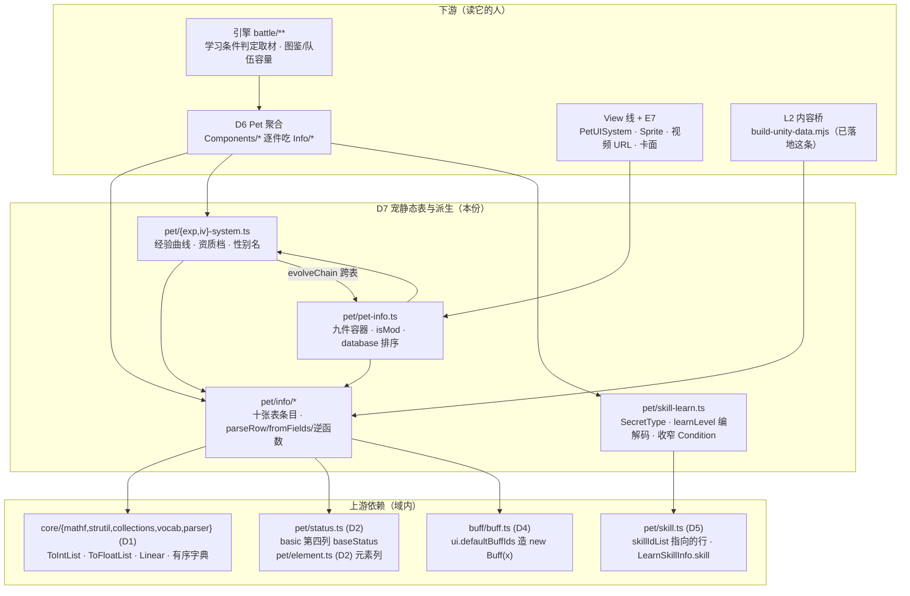
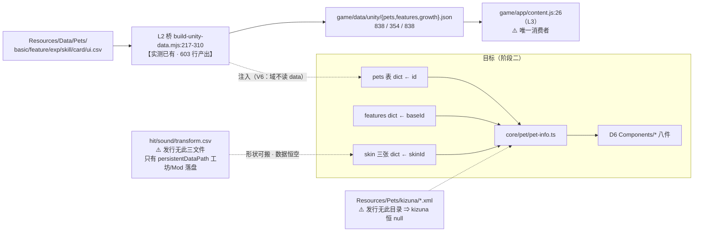

# 域模型子设计 D7 · 宠静态表与派生（domain-info.md）

> **父文档**：`docs/domain/domain-design.md`（不变量 V1–V7 · 接缝 S1–S7 · 子设计地图 §6）·
> **同级**：D1 `docs/domain/domain-base.md` · D2 `docs/domain/domain-status.md` · D5 `docs/domain/domain-skill.md` · **D6** `docs/domain/domain-pet.md`（✅ 已写 2026-10-17）·
> **注入面父文档**：`docs/runtime/runtime-components-design.md` —— 本族 §3.2 的六个 `set*Table` **是 R7「内容表注册」的消费面**，不是本族自造的平行接口（该文档定义注册动作、装配点与缺表时的失败时机）·
> **粒度口径**：`docs/domain/domain-design.md §5`（P1 = **真施工图**）· 文档纪律 `docs/arch-docs.md §3`（含 **§4.1** 的「数据表错字照搬 / 代码 bug 声明+修」分工）· 分层 `docs/arch-code.md §3.1`
> **状态**：✅ 已写；**已按 2026-10-17 的人类决议修订**（**本族待拍板 ②** = skin 三表建桥 ⇒ **已由人类决议 ④ 定案**，落到 §3.2/§3.3 B5/G8；上游 bug 政策 = **人类决议 ②**，落到 **§2.10 CB1–CB6**）；
> **本族**待拍板 **① ③ 仍开放**（见 §8 末）。⚠️ 本行的 ①②③④ 有两套编号：带「本族」的是 D7 本地清单，「人类决议」是全局索引 `AGENTS.md §5`。**配对 `impl` 未写**（阶段一续）。
> ⚠️ 本族**不吃随机源也不吃时钟**（【实测】`Info/*.cs` + `System/Pet{Exp,IV,Fusion,UI}System.cs` + `SecretSkillDatabase.cs` + `HelperMath.cs` 里 `Random` / `DateTime` **零命中**）
> ⇒ R1/R2 的口径改动**不外溢到本族**；本族与运行时线的交点只有 **R7**。

> ⚠️ **本份不重抄字段表**。十三张表的**字段真值在那些 `.cs` 里**（`Assets/Scripts/MVC/Model/Basic/Pet/Info/*.cs`），
> 本份只定 **归属 / 键空间 / 组装合同 / 算式精度 / 围栏 / 施工顺序**。要字段就读源，别在这里找第二份。

---

## 0. 这份文档回答什么

1. **`Info/*` 十件 + `PetInfo.cs` + 四支 `System/Pet*System.cs` + 两支外站件（`SecretSkillDatabase.cs`、`FusionRecipe`）逐臂归谁** —— 哪一半是域，哪一半是 **View / Save / Item / Map** 线（§2.1，也是 D6 开工的前提）。
2. **宠表有三套互不相通的 key 空间**（`id` / `baseId` / `skinId`），而 `GetEvolveChain` 靠一条**没写在任何文档里的约定**
   （初阶宠的 `id` 与 `baseId` 重合）把它们缝在一起（§2.2）。
3. **`PetInfo` 的组装合同**（`ResourceManager.cs:850-862`）：谁有兜底、谁没有、装载是 `Set`（静默覆盖）而不是 `Add`（抛）、
   以及那个**一行坏 ⇒ 整张宠表变空字典且毫无提示**的 catch（§2.3）。
4. **派生算式的形状与精度**：经验曲线两支**互相独立**的公式（`uint` 截断 + float32 + int 除法三处各自钉死）、
   `IVRanking` 的**枚举序 ≠ 档位序**、`learnLevel` 那个**跨两个文件的编解码对**（含负值往返不对称）（§2.5–§2.7）。
5. **现状不是 `⬜ 0`**：内容桥 `tools/build-unity-data.mjs` 已经把六张官方表拼成 `pets.json`（838 行），
   但 `game/core/pet/**` 里**本族一个对象都没有**，`hit/sound/transform` 三件**连桥都没有** —— 而且它们**在发行数据里根本没有行**（§6）。
   ⚠️ 口径已按人类决议 ④ 改版：**"没有行"不再是"不建桥"的理由** —— 三张桥照建（§3.2 / B5），真值改吃**工坊·Mod 落盘目录 + 合成行**，验收以**人类手测**为主（`AGENTS.md §1.1` 的验收段）。
6. **本族里哪些是"上游写错的代码"** —— 六条（`learnLevel` 编解码不互逆、`emblem` 无条件解引用、transform 解析失败**通配覆盖**、
   进化链断裂的 null、`TrySavePetMod` 漏写第六张表、装载 `catch` 吞掉整表）。
   按 2026-10-17 的政策分工（`docs/arch-docs.md §4.1`）：这些**不是** V2 的"数据表错字"，而是**代码 bug ⇒ 声明 + 写无 bug 的目标行为**（§2.10）。

---

## 1. 范围与边界

| | |
|---|---|
| **本份覆盖** | `Info/*` ×10（Basic / Exp / Feature / Hit / Kizuna / Skill / Sound / Talent / Transform / UI，共 767 行）｜ `PetInfo.cs`（41：九件容器 + `IsMod` + `database` 排序 + `PET_BAG_SIZE`）｜ `System/{PetExp(114),PetIV(31),PetFusion(97),PetUI(108)}System.cs` ｜ `Basic/Skill/SecretSkillDatabase.cs`（83）里 **`LearnSkillInfo` 的编解码半边 + `SecretType` 枚举** ｜ `Helper/HelperMath.cs:13 GetSortPriority` ｜ 装载与导出面：`ResourceManager.cs:788-905`（组装）+ `:907-1039`（逐表读取）+ `SaveSystem.cs:605-690`（Mod 导出）+ `:737-790`（Mod 读入） |
| **上游** | `Assets/Scripts/MVC/Model/Basic/Pet/{Info,System}` + `Assets/Scripts/System/{ResourceManager,SaveSystem,Database}.cs`；表源 `Assets/Resources/Data/Pets/{basic,feature,exp,skill,card,ui}.csv`（**只有这六张**） |
| **不覆盖** | `PetElementSystem.cs`（216）→ **D2**（已落地为 `core/pet/element.ts`，本族只调它） |
| | `Pet.cs`（715）+ `Components/*` ×8（`PetBasic/PetExp/PetFeature/PetRecord/PetResist/PetSkill/PetTalent/PetUI`）→ **D6**（它们**逐件吃本族的 `Info/*`**，见 §6.3）。⚠️ `enum Personality` 也物理住在那边（`Components/PetBasic.cs:70-92`）⇒ **本族不搬**，只搬同族里位置正确的 `enum IVRanking`（`Info/PetTalentInfo.cs:10`）；`gender` 一侧**没有枚举**，是 `List<int>`（`PetBasicInfo.cs:76 TryParseGender`） |
| | 技能本体与学习表的**技能那一半** → **D5** `docs/domain/domain-skill.md`（本族只出 `learnLevelList` 与解码后的 `secretType/value`） |
| | `Status`（六维基值来自 `basic.csv` 第四列）→ **D2**；`Buff`（`ui.defaultBuffIds` 造出的默认印记）→ **D4** |
| | **任何 `Sprite` / `GameObject` / `AudioClip` / Addressables / 视频 URL** → **View 线** + 引擎 **E7** `docs/engine/battle-engine-views.md`（`PetUISystem` 整支、`PetUIInfo.cs:31-57`、`PetHitInfo.GetVideoUrl`） |
| | `ItemInfo` / `ItemType.Recipe` / `Effect.abilityOptionDict`（配方来源）→ **Item 族**（**2026-10-17 已立** ⇒ `docs/item/item-design.md`；本线的配方**落地**仍归 **T2·15**）；`NpcButtonHandler` / `NpcHandler`（羁绊对话条件）→ **地图线**（**2026-10-17 已立** ⇒ `docs/map/map-design.md`）；`Item.Add` + `SetRecord`（羁绊礼物发放）→ **Item + Save 线** |
| | 存档 **XML 读写管道** → `docs/save/save-design.md`（本族只出 `PetKizunaInfo` 的 shape，不碰 `LoadXML` 那支） |

---

## 2. 上游真值

### 2.1 逐臂归属（**本份最重要的一节**）

| 臂 | 上游 | 归属 | 判据 / 现状 |
|---|---|---|---|
| `PetInfo` 转发属性（`id/baseId/name/star`）+ `allEvolvePetIds` + `IsMod` + `database` + 6 参 ctor | `PetInfo.cs:11-15` `:25-38` | **D7** | 纯转发与纯排序；【我们】只在桥里有一份"拼好的行"（`build-unity-data.mjs:426-448`），没有对象 |
| 五张定长 CSV 表的 `ctor` + `GetRawInfoStringArray`（basic/feature/exp/skill/ui） | `Info/*.cs` + `RM:907-990` | **D7** | 纯数据往返 ⇒ 对拍素材（照 `skilltable` 的比法，新 kind `pettable`） |
| `PetTalentInfo` | `Info/PetTalentInfo.cs:5-8` | **D7**（**空类，照搬**） | ⚠️ 类体是空的；资质 `iv/ev` 住在 `Components/PetTalent.cs`（D6）。同文件的 `enum IVRanking` 才是货 |
| `PetUIInfo` 的 `icon/emblemIcon/battleImage/idleImage/GetBattleAnim*/Preload*/PlaySound` | `:31-57` | **D7 出值**（`defaultSkinId`/`baseId`/`PetAnimationType`/`AudioVolumeType` 的**数值**），**取资源归 View/E7** | 与 D5 本份已拍板 ① 同法：**取值属域、渲染属 View** |
| `PetUIInfo.GetAllSkinList(Pet)` | `:135` | **D6**（吃 `Pet` 实例） | 本族只留 `specialSkinList` + `defaultSkinId` 两份原料 |
| `PetUISystem` 整支（108） | `System/PetUISystem.cs` | **View 线**；只有 `enum PetAnimationType`（17 值）与「transform 的形状」属域 | 【源码】每一支都碰 `Addressables`/`Sprite`/`GameObject` ⇒ **headless 装不下**；【实测】`GetPetTransformInfo(petId, type)` **把 `type` 整个丢掉**（只转发 `skinId`），`type` 只在 `GetPositionByType` 那一步才用 |
| `PetHitInfo` / `PetSoundInfo` / `PetTransformInfo` 的**数据形状** | `Info/Pet{Hit,Sound,Transform}Info.cs` | **D7** | 帧数/音效串/姿态是数据；`GetVideoUrl` 与 `Application.persistentDataPath` 归 View+Save |
| `PetExpSystem` 六支算式 + `GetEvolveChain` | `PetExpSystem.cs:9-85` `:91-112` | **D7**（纯函数，但 `GetEvolveChain` 吃宠表 ⇒ 注入） | 【我们】0 行；对拍 kind `expcurve`（§3.3 B3） |
| `PetIVSystem.GetIVRank` / `genderNameDict` / `GetGenderName` | `PetIVSystem.cs:7-30` | **D7** | 纯查表 + 阈值 |
| `FusionRecipe`（shape + `Parse` + `IsEmpty/IsPetEmpty`）与 `GetFusionRecipeList` | `PetFusionSystem.cs:29-96` `:14-26` | **D7 出 shape**，**配方来源是 Item 族围栏**（**该族 2026-10-17 已立** ⇒ `docs/item/item-design.md`；落地归 **T2·15**） | 【源码】`fusionRecipes`（`:10-12`）= `ItemInfo.database.Where(type == Recipe)` ⇒ 本族只能吃**注入的配方行**；`GetFusionRecipeList` 只认**有序对**（对称那支被注释掉了） |
| `LearnSkillInfo` 的**编解码** + `SecretType` 枚举 | `SecretSkillDatabase.cs:20-24` `:68-82` | **D7** | 它就是 `PetSkillInfo` 第三列的解码器（§2.6）；文件在 `Basic/Skill/` 而**不在** `Basic/Pet/` |
| `LearnSkillInfo.Condition(Pet, BattleState)` 十二臂 | `:26-42` | **D7 出谓词，但入参必须收窄**（**本族待拍板 ①**，见 §8 末） | 上游吃 `BattleState`（引擎类型）⇒ 域不许反向 import（V7）。同 D5 把 `GetSelectableTarget(BattlePet[])` 收窄成吃 `isDead[]` 那条法 |
| `LearnSkillInfo.GetLearnDescription` / `learnDescription` | `:45-63` | **D7 出串**，排版归 View | 纯函数（只吃 `skill.name` + `value`）；`skill.name` 那一半属 D5 |
| `PetKizunaInfo` 的 XML shape（`[XmlAttribute] id` / `[XmlArray] tagList/dialog/gift`） | `Info/PetKizunaInfo.cs:11-22` | **D7**（**只出 shape**） | 【实测】发行版没有 `Resources/Pets/kizuna` 目录 ⇒ `PetInfo.kizuna` **恒 null**、`pets.json` **没有 kizuna 这一件** |
| `PetKizunaInfo.GetKizunaDialog` / `PetKizunaDialog.GetCondition` / `PetKizunaGift.Gifts·Condition·Apply` | `:24-99` | **围栏**（Map / Item / Save 三线交叉） | 【源码】`NpcButtonHandler`、`new Item(id,count)`、`pet.record` + `SetRecord`、`Item.OpenHintbox` |
| `MathHelper.GetSortPriority(this int)` | `Helper/HelperMath.cs:13-18` | **D7 语义**，但**必须搬家**（B1） | ⚠️ 它是**纯整数函数却住在 `namespace UnityEngine` 里**（`:7`）⇒ 域侧照搬=把引擎命名空间引进来。正解：下沉到 `core/mathf.ts` |
| `RM.GetPet*Info` 七个循环 + `GetPetInfo` 协程组装 | `RM:788-905` `:907-1039` | **L2 内容桥**（域不实现装载） | 【我们】`build-unity-data.mjs:217-310` `:426-448` `:533` 已是这条的 JS 版 ⇒ **V6 靠"桥在域外"维持** |

### 2.2 三套 key 空间 —— 本族的"id 语义"合同

| 字典 / 表 | key | 行数【样本】 | 谁往里塞 |
|---|---|---|---|
| `Database.petInfoDict` | **`id`**（宠位） | 838 | `RM:861 petInfos.Set(info.id, info)`，随后 `:867` 用 Mod 行**覆盖**同 id |
| `exp` / `skill` / `card` / `ui` 四张 | **`id`** | 838 / 838 / **4** / 838 | `RM:942` `:958` `:974`（card 走同一个 `GetPetSkillInfo`，`RM:819`） |
| `featureInfoDict` | **`baseId`**（种族） | 354 | `RM:926`（`info.baseId`）；Mod 覆盖 `:870` |
| `hitInfoDict` / `soundInfoDict` / `transformInfoDict` | **`skinId`**（皮肤） | **0 / 0 / 0** | `RM:828-835` **只在 `persistentDataPath/PetAnimation/pet/*.csv` 存在时**才填；官方 CSV 那两行**被注释掉了**（`:821-822`） |

三条**没写在文档里但被依赖**的约定：

- ⚠️ `PetExpSystem.GetEvolveChain(baseId, id)` 第一步就是 `Pet.GetPetInfo(baseId)`（`:97`）—— **拿 `baseId` 当 `petId` 查**。
  【实测】发行 838 行里 `PetInfo[baseId]` 缺失 **0 例** ⇒ 每个种族都有一条"初阶宠行"的 `id == baseId`。这不是巧合，是**表制作约定**，端口必须照它跑，但**不许把它当输入校验**（Mod 宠可能不满足）。
- ⚠️ 同一个 int 在不同表里身份不同：`ui.defaultFeatureId` → 查的是 **`featureInfoDict[baseId]`**（`RM:855`），
  而 `Components/PetFeature.cs:15-16` 的兜法是 `featureId == 0 ? defaultInfo.baseId : featureId` ⇒ `0` 在特性空间是"没指定"，不是"第 0 号特性"。
- ⚠️ `Database.cs:137`（`GetFeatureInfo`）、`:220` `:225` `:228-230`（hit/sound/transform）三支都写成
  `(key == 0) ? null : dict.Get(key, null)` ⇒ **`0` 号键被永久屏蔽**。端口照抄这条哨兵，别顺手改成"0 也查"。

### 2.3 `PetInfo` 组装合同（`ResourceManager.cs:850-862`）

| 件 | 来源 | 兜底 | ⚠️ |
|---|---|---|---|
| `basic` | `basicInfo[i]`（循环变量本身） | — | 遍历的是 **basic 的行序**，其余六件都靠 `basic.id` 去捞 ⇒ basic 缺行就**没有那只宠** |
| `ui` | `uiInfo.Get(basic.id, …)` | **有**：`new PetUIInfo(basic.id, basic.baseId)` | 兜底件只设 `id/baseId` + 一组默认值（`PetUIInfo.cs:59-68`）⇒ `ui.csv` 少一行不会炸，但 `defaultSkinId`/`star`/`hide` 全变默认 |
| `feature` | `featureInfo.Get(ui.defaultFeatureId)` | **无** | 查不到 ⇒ `PetInfo.feature == null`；`Pets/feature.csv` 按 `baseId` 建，所以初阶宠能对上、非默认特性未必 |
| `exp` | `expInfo.Get(basic.id)` | **无** | ⚠️ 查不到 ⇒ `PetInfo.exp == null` ⇒ 之后任何 `exp.evolvePetIds`（含 `allEvolvePetIds`）**当场 NRE** |
| `talent` | `new PetTalentInfo()` | **恒新造** | 【源码】每只宠发一个**空类**实例；它**不是**从表读的（发行没有 talent.csv） |
| `skills` | `skillInfo.Get(basic.id)` | **无** | 同 `exp` |
| `cards` | `cardInfo.Get(basic.id, skillInfo.Get(basic.id))` | **有**：回落 `skills` | 【实测】`card.csv` 只有 **4** 行（`id` 3/6/9/207）⇒ 834 行的 `cards` 与 `skills` **逐列全等**、4 行不同 |
| `kizuna` | `SaveSystem.LoadXML("Resources/Pets/kizuna/{id}")` | **无** | 【实测】该目录不存在 ⇒ **恒 null** |

三条装载纪律（本族与技能族**不一致**，不许统一）：

- ⚠️ **`petInfos.Set(...)`**（`:861`、`:867`、`:870-882`）= **重复 id 静默覆盖**；技能族是 `Add` = **重复当场抛**（D5 §7 第 13 条）。
  ⇒ 宠表**容许** Mod 覆盖官方行（这就是 Mod 宠的实现方式），技能表**不允许**。
- ⚠️ `catch (Exception)`（`:897-904`）**包在整个循环外**，且五个回调各自发一份**空字典** ⇒
  **任何一行读炸 ⇒ 整张宠表凭空消失**，而 `Database.cs:103-105` 只会显示「正在获取精灵档案 0」。技能族至少弹一次 Hintbox（D5）。
- ⚠️ `while (任一未就绪)` + `isFailed`（`:837-846`）⇒ 六张官方表**有一张读不到就整体放弃**，返回**空表**（不抛）。

### 2.4 三种表形状 —— 别按一种写装载器

| 形状 | 成员 | 契约 |
|---|---|---|
| **定长 stride** | basic(10) / feature(5) / exp(5) / skill(3) / ui(4) / hit(7) / sound(7) | `cur = DATA_COL * i`，行数 = `data.Length / DATA_COL`（**整除截断**）；ctor 收 `(string[], startIndex)` 自己 `Array.Copy`；`i` 从 **1** 起（跳表头） |
| **行长不齐** | transform | `GetCSVByLines`（逐行切）+ `foreach (data.Skip(1))` + `ctor(string[])`；⚠️ 类里**声明了 `DATA_COL = 7` 但 ctor 完全不用**，实际按 `_data.Length` 遍历 |
| **XML** | kizuna | `[XmlAttribute]` / `[XmlArray]` + `SaveSystem.LoadXML`（V5：`[XmlIgnore]` 永不入档、null 单引用省略） |

- ⚠️ **只有 `GetPetBasicInfo` 认 `#` 行**（`:916` 跳过首列以 `#` 开头的行）⇒ 这是"手改 CSV 时注释掉一行"的约定；【实测】发行 `basic.csv` 命中 **0 行**。其余六张不认 ⇒ 同一份注释在别的表里会变成脏行。端口**照搬这个不对称**。
- ⚠️ 表头契约的真值是 `SaveSystem.cs:645-649` 写死的**五行**（basic / feature / exp / skill / ui）——`card` **没有表头也没有写方**：`TrySavePetMod` 只导这五张 ⇒ **Mod 宠的 `cards` 恒回落 `skills`**。
  ⇒ ★ 这条是**§2.10 CB5**（漏一张表 = 代码 bug，声明 + 补第六张），不是"照搬的不对称"。
- ⚠️ `GetRawInfoStringArray` 的存在性不齐：basic/feature/exp/skill/ui **有**（`sound` 也有），**`hit` 的那段整块被注释掉**（无逆函数）、**transform / kizuna / talent 没有** ⇒ 对拍只能对"有逆函数"的那几张做往返比（§3.3）。
  ⚠️ **人类决议 ④（skin 三表建桥）改变的是"读取侧"**：**装载桥照建**；`hit` 的**导出侧**上游是空段 ⇒ 我方若补逆函数，必须**显式标注为"端口扩展、非上游行为"**，且该支**不与上游逐值对拍**（没有可比对象），验收 = 往返自洽 + 人类手测（`AGENTS.md §1.1` 验收段）。见 §5 **G8**。

### 2.5 经验曲线 —— 两条**互相独立**的公式（`PetExpSystem.cs:9-85`）

- `GetLevelExp(l, t) = (l == 0) ? 0 : 公式(l)`；`GetTotalExp(l, t) = (l == 0) ? 0 : 公式(l - 1)`（⚠️ **差一格**，`-1` 在 Total 那支里）；
  `GetLevelByTotalExp` 是 `while (GetTotalExp(level+1) <= totalExp) level++`（线性递增，非二分）。
- `expType` 分流是 `switch { 1 => B, _ => A }`（`:33-44`）⇒ **只有 1 走 B，其余一切（0 / 2 / 负数）都走 A**（V2 静默）。
- 三处精度各自独立（V3）：
  - `n3/n2/n1`（`:9-11`）= **纯 int 乘法后 `(uint)`**，`/6` 是**整数除法**；
  - `LevelExpBasic`（`:46-48`）= `v.x * level * level + v.y * level + v.z`，`v` 是 **`Vector3`（float32）**，末尾 `(uint)` **截断**；
  - `TotalExpBasic`（`:50-52`）= 四个 `float × uint` 相加，末尾同样截断，**外加** `n1((level+1)/4)`（A 支的整数除法项）。
  ⇒ 落地时必须过 `f()`（float32 收窄），且**不许把两条公式合并成一条**。
- 【实测（按上述精度在 JS 复算 L=1..100）】两条曲线各自单调，且 `GetLevelByTotalExp(GetTotalExp(L, t), t) === L` **1..100 全通过**（t=0/1）⇒ 反函数可安全用 while；
  文档注释里的总量精确对上：TypeA `GetTotalExp(100)` = **1,250,000**（注释写 125w）、TypeB = **833,330**。
- 【实测】**Level 与 Total 不是彼此的累加**：`GetTotalExp(10, 0)` = **1,250**，而 `Σ LevelExp(1..9)` = **1,549**（t=1 同样对不上）⇒ 上游就是两套式子，**"由升级经验累加算总经验"是错的**。
- 【实测】发行表 `expType` 只有 **0（815 只）/ 1（23 只）** ⇒ B 支是少数派，别拿它当默认。

### 2.6 `learnLevel` 的编解码对（**跨两个文件**）

| 方向 | 位置 | 式子 |
|---|---|---|
| 编码 | `PetSkillInfo.cs:32` | `learnLevel = ((int)secretType) * 10000 + value` |
| 解码 | `SecretSkillDatabase.cs:22-23` | `secretType = (learnLevel < 0) ? (SecretType)learnLevel : (SecretType)(learnLevel / 10000)`；`value = learnLevel % 10000` |

- 【实测 13,389 条 `learnLevel`（skills 6,693 + cards 6,696）】：< 10000 的裸等级 **9,985** 条、≥ 10000 的编码值 **2,308** 条、**负值恰好只有 `-1` 与 `-2` 两种**（`-2 Auto` 810 条、`-1 Others` 282 条）、`0` 四条。
  ⇒ **发行数据里 Auto/Others 存的是裸负数，不走 `×10000` 那条编码**。解码后 `secretType` 覆盖 **0…10 全 11 支**（0 级 9,989 / 胜场 214 / 败场 131 / 自带 buff 469 / 对手 buff 391 / 血量 304 / 回合 92 / 天气 178 / 用过技能 387 / 伤害 79 / 特定宠 63）。
- ⚠️ **往返不对称 ⇒ ★ 已改判为上游代码 bug（§2.10 CB1：声明 + 修，不再"照抄不修"）**：工坊那条 ctor 造一个 `Auto` 技会得到 `-20000 + value`，回读时 `(learnLevel < 0)` 那一支**直接整体 cast** ⇒ `secretType = (SecretType)(-20000)`（**未定义枚举值**）、`value = -20000 % 10000 = 0`。
  结果：`isAutoLearned`（`= secretType == Auto ‖ value == 0`）**仍然为真**——被 `value == 0` 那半救回来；
  但 `GetLearnDescription()` 的 switch 落到 `_ => GreaterThanLevel()` ⇒ **说明串被写成"等级达到 0"**。
  ⇒ **目标行为**：**只改编码侧**（负 `secretType` 写裸值，与发行数据同形），**解码侧一行都不许动**（它要能读发行表；也**不许**"顺手改成 `Math.Abs` 解码"，那会把 `-2` 读成 `2`）。
  证据与落点见 **§2.10 CB1**、§5 **G6**、§3.3 **B4**。

### 2.7 `IVRanking` 与 `PetIVSystem` —— 枚举序 ≠ 档位序（`PetTalentInfo.cs:10-19` + `PetIVSystem.cs:15-30`）

- 【源码】`IVRanking { Normal 0, Good 1, Great 2, Rare 3, Perfect 4, Cheat 5, **Bad 6** }`，
  而 `GetIVRank` 的阈值是 `<0 Bad · <11 Normal · <21 Good · <28 Great · <31 Rare · ==31 Perfect · 其余 Cheat`。
  ⇒ **`Bad` 是枚举里最大的值、语义里最差的档** ⇒ 任何"按枚举整数比大小"的写法都是错的（要排序必须自带档位序表）。
- 【实测】`iv` 的合法域是 0–31（`==31 Perfect`），但 `<0` 与 `>31` **都有确定档位**（Bad / Cheat）⇒ 超域不报错，这是工坊刷宝的口径。
- `genderNameDict { -1 无性, 0 雄性, 1 雌性, 2 双性 }`，`GetGenderName` 未知值出「未知性别」⇒ 与 §2.8 的 `gender` 链同一条。

### 2.8 `PetBasicInfo` 的 gender —— **原串才是真值**（`PetBasicInfo.cs:20-24` `:44` `:69-74` `:76+`）

- 三件套：`rawGender`（**原串**）+ `genderList`（解析后）+ `genderDistribution`；`gender => genderList.FirstOrDefault()`。
- ⚠️ **逆函数写的是 `rawGender` 原串** ⇒ **往返保串**。这与技能族**相反**（D5 §7 第 10 条：`ignore_*` 的 `true`/`True` 回写恒 `"True"`，不保串）⇒ `pettable` 的 basic 列可以放心比"逐列全等"。
- ⚠️ `TryParseGender` 两处坑：`TrimEnd("[" + p + "]")` 命中的是 **`char[]` 重载**（把整串当"待裁字符集合"，两端逐字符裁），且失败时 out 参数**部分写入**。
  【我们】内容桥**逐字照搬**（`tools/build-unity-data.mjs:217-269`），审计策略「照搬不修（与 Unity 行为一致优先）」，失败行以 `genderParseFailed` 字段带出 ⇒ 已在 `docs/engine/port-map.md` 记档。
- `baseStatus` 走 `new Status(ToFloatList('/'))`（第四列）⇒ **六维基值属 D2**，本族只搬"这一列怎么进怎么出"。

### 2.9 skin 三张表与 `PetUIInfo` 的形状细节

- ⚠️ **`PetHitInfo` 的列序置换**：`dataIndexes = {2,4,3,5,6}`（`:9`）按 `((int)type) - 9` 索引，循环走枚举序 `Physic(9) → Special(10) → Property(11) → Super(12) → SecondSuper(13)`，
  ⇒ 落到列序是 **2=Physic / 3=Property / 4=Special / 5=Super / 6=SecondSuper**（正好与 `PetSoundInfo` 的字段序 `physics, attribute, special, critical, fit` 对齐）。**这个置换是语义，不是笔误**，不许"顺手排成枚举序"。
- ⚠️ **缺省值两处不同**：`hitFrameDict.Set(type, frameData.Get(0))`（`:36`）⇒ 命中帧缺省 `default(short)` = **0**；`videoFrameDict.Set(type, frameData.Get(1, (short)-1))`（`:37`）⇒ 视频帧缺省 **-1**。
- ⚠️ **`PetTransformInfo` 的三处行为**：`posDict.Add`（`:44` `:51`）⇒ 同 `type` **重复直接抛**；`Enum.TryParse` 失败 ⇒ 把值写进 **`PetAnimationType.None`** 并且 **`break`**（`:44-48`，该行剩下的列全丢）；
  `GetPositionByType`/`GetScaleByType`（`:57-72`）**先查 `None`** ⇒ **一条写坏的串变成"全类型覆盖"**（`None` 优先于任何具体 type）。`ToVector2` 的两处缺省也不同（pos 零向量 / scale `Vector2.one`）。
  ⇒ 其中「**解析失败写进 `None`**」= **§2.10 CB3**（声明 + 修 ⇒ 坏行丢弃、`None` 只留给字面写了 `None` 的行）；`Add` 抛与两处缺省不同**照搬**。
- ⚠️ **`PetFeatureInfo.GetRawInfoStringArray` 无条件读 `emblem.name`**（`:34-35`），而 `emblem = (第三列 == "none") ? null : new Emblem{…}`（`:25`）⇒ **没有徽章的行导出时 NRE**，被 `TrySavePetMod` 的大 try 吞掉 ⇒ 整个 Mod 存不下去。【实测】发行 354 行特性 **emblem 缺失 0 行** ⇒ 当前不可观测，但**形状必须允许 null**（V5）。
  ⇒ 这条是 **§2.10 CB2**：`emblem` 的**可空性照搬**（V5 不动），**只修导出侧** —— `null` 写成占位串 `"none"`，与 ctor 的解析侧成对 ⇒ 往返保形。
- ⚠️ **`PetUIInfo.GetRawInfoStringArray`（`:117-124`）在 `specialSkinList` 与 `options` 都空时返回 `null`**（源码注释 "If no info, then no need to write"），导出方 `SaveSystem.cs:661-663` 就是先判 null 再写 ⇒ **返回 `null` 是契约**，不是缺陷。
- 【实测 `ui.csv` → `pets.json` 的 `options` 键】`star` 838 · `default_feature` 117 · `default_buff` 79 · `default_id` 49 · `hide` 50 · `default_anim` 26 · `default_skin` 25 · `generation` 25 · `min_kizuna`/`max_kizuna` 各 5。
  ⚠️ 最后两把键 **`PetUIInfo` 的 ctor 不解析**（只躺在 `options` 里）⇒ 它们是**羁绊线的原料**（`PetKizunaInfo`），本族按 V2 原样带着走，不解释。
  `star` 是 **`float`**（V3），【实测】值域含 **`5.5`（3 行）** ⇒ 不许收成 int；`hide` 50 行 ⇒ 图鉴过滤靠它。

### 2.10 上游**代码 bug** 的声明与目标行为（CB1–CB6）

> **政策分工**（`docs/arch-docs.md §4.1`、`docs/domain/domain-design.md §7` 第 5/6 条、`AGENTS.md §2`）：
> **V2 的"静默兜底照搬"只管发行内容表里的错字/水印**；**代码写错**（读错变量、缺 null 检查、编解码不互逆、漏一张表）**一律 = 声明 + 写没有该 bug 的目标行为**。
> 所以**本节取代**旧版散在 §2.6 / §2.9 / §3.2 / §7 的"照抄不许修"口径；§7 的对应行已改成指向本节的指针。
> ⚠️ 判据是**症状是否可观察地丢数据/抛异常**，不是"上游看起来像不像故意的"。

| # | bug | 上游怎么写【源码】 | 可观察后果 | **目标行为（无 bug 的设计）** | 落点 |
|---|---|---|---|---|---|
| **CB1** | `learnLevel` 的**编码侧与解码侧不互逆** | 编码 `learnLevel = (int)secretType * 10000 + value`（`PetSkillInfo.cs:32`）；解码对**负值整体 cast**（`SecretSkillDatabase.cs:22-23`）⇒ 写出的 `-20000` 回读得到**未定义枚举值** `(SecretType)(-20000)` 与 `value = -20000 % 10000 = 0` | `isAutoLearned` 被 `value == 0` 那半**侥幸救回**，但 `GetLearnDescription()` 落到 `_ => GreaterThanLevel()` ⇒ **说明串被写成"等级达到 0"**（玩家可见的错文案） | **改编码侧**：`secretType` 为负时**写裸值**（`-1` / `-2`），与**发行数据的实际存储形状一致**【实测】负值恰为 `-1`(282) / `-2`(810)、**无 `-10000/-20000` ⇒ **解码侧一行都不许动**（动了就读坏发行表）。⇒ 往返闭合、说明串正确、且**上游自己也能读我们导出的 Mod** | §3.3 **B4**、§5 **G17** |
| **CB2** | `PetFeatureInfo.GetRawInfoStringArray` **无条件解引用 `emblem`** | `:34-35` 直接读 `emblem.name`，而 `emblem = (第三列 == "none") ? null : new Emblem{…}`（`:25`） | 没有徽章的特性行**导出即 NRE**，被 `TrySavePetMod` 的大 try 吞掉 ⇒ **整个 Mod 存不下去**，且用户看不到原因。【实测】发行 354 行 emblem 缺失 **0 行** ⇒ 当前不可观测，但**形状必须允许 null**（V5） | 导出时对 `emblem == null` 写**占位串 `"none"`** —— 与 ctor 的解析侧**成对**（`"none" ⇒ null`）⇒ 往返保形、不再 NRE。**不**改 `emblem` 的可空性 | §3.3 **B2**、§5 **G17** |
| **CB3** | transform 解析失败 ⇒ **写进 `None` 并 `break`**，而读取侧 `None` **优先于任何具体 type** | `PetTransformInfo.cs:44-48`（`Enum.TryParse` 失败分支）+ `:57-72`（`GetPositionByType`/`GetScaleByType` 先查 `None`） | **一条写坏的动画类型串 = 覆盖该皮肤的全部动画**（"一个 typo 改整只宠"），且该行**剩下的列全丢**（`break`）却仍算装载成功 | 解析失败 ⇒ **不写入任何键**（该行丢弃并可被桥审计到），`None` 只保留给**字面写了 `None`** 的行（合法通配）⇒ "坏数据"与"通配"两种意图**分开** | §3.3 **B5**、§5 **G17** |
| **CB4** | 进化链断裂返回 **`null`**，调用方**直接解引用** | `PetExpSystem.cs:100-111` 返回 `null`；`PetSkillInfo.cs:39-45` 直接 `chain.Count`，且 `GetSkillList` 逐跳 `Pet.GetPetInfo(chain[i])` **不判 null** | 【实测】发行数据**不可达**（521 只非初阶宠全部找得到链，链长 2–6 分布 `286/139/48/25/23`，**0 例 null**）⇒ 但**Mod 宠满足不了 §2.2 的 `id == baseId` 约定**时就是 NRE，而 NRE 又落进 §2.3 的大 catch ⇒ **整张宠表变空** | 端口**改成显式抛**（不返回 null、不静默降级），抛出点**带链断在哪一跳的 `baseId`/`petId`**；§2.2 的约定**不作为输入校验**（约定破了要能看见，不是被 catch 吞掉） | §3.2 注、§3.3 **B3**、§5 **G4** |
| **CB5** | `TrySavePetMod` **漏写第六张表**（`card`） | `SaveSystem.cs:645-649` 的表头契约写死**五行**（basic/feature/exp/skill/ui），`card` **既无表头也无写方**；读取侧 `GetPetCardInfo` 却走同一张 `GetPetSkillInfo`（`RM:819`） | **Mod 宠的 `cards` 恒回落 `skills`**（`RM:859` 的兜底），⇒ Mod 作者改的卡面/暗杀技列**存不下去也读不回来**。【实测】官方 838 行里 834 行 cards 与 skills 逐列全等、仅 4 行不同 ⇒ 差异行正是"会丢的那类" | 桥与导出面**补第六张**（列序 = skill 的三列，表头同形）⇒ Mod 宠 `cards` 不再回落。**登记互认边界**：上游读入侧只认五行 ⇒ 含 `card.csv` 的 Mod 包**只在端口内有效**，需同步到 `docs/save/save-xml-spec.md` 的 Mod 文件面 | §3.3 **B6**、§5 **G17** |
| **CB6** | 装载的 `catch` **包在整个循环外** + 五个回调各自发**空字典** | `RM:897-904`（try 位置）+ `:837-846`（`while (任一未就绪)` + `isFailed` ⇒ 一张读不到就整体放弃） | **任何一行读炸 ⇒ 整张宠表凭空消失**，而 `Database.cs:103-105` 只显示「正在获取精灵档案 0」⇒ **零提示的静默全丢**。（技能族至少弹一次 Hintbox，见 D5） | 这条**不在域内修**（V6：域不实现装载）⇒ 归 **L2 桥**：桥改成**逐行 try**、坏行**跳过并计入 `manifest.json` 的审计列**（现 `parseGender` 的 `genderParseFailed` 已是同法先例），**绝不整表丢弃**；域侧对"未注入"一律**显式抛**（G4）。⇒ 静默兜底的层级从"整张表"降到"单行键/值"，那才是 V2 的本义 | §2.3、§3.3 **B2**、§5 **G4** |

> ⚠️ **本节不改动、也不该改动的"不对称"**（它们不是 bug，是上游的口径差异 ⇒ 照搬，V2；对应 §7 表里**没有 ★** 的那些行）：
> 只有 `GetPetBasicInfo` 认 `#` 注释行（§2.4）· 宠表 `Set`（覆盖）vs 技能表 `Add`（抛）（§2.3）· `expType` 的 `switch { 1 => B, _ => A }`（§2.5）·
> 命中帧缺省 `0` vs 视频帧缺省 `-1`、`GetSoundByType` 未知 type 出 `"0"`（§2.9 / G14）· `PetHitInfo` 的列序**置换**（§2.9 / G8）·
> `PetTalentInfo` 是空类（G7）· `PetExpInfo` 两条 ctor 都不清洗（G15）· `0` 号键被 `Database` 屏蔽（G1）。
> **B2 与"置换"的区别要说得清**：列序置换是**被两侧一致使用的设计**（读也这么排、写也这么排 ⇒ 自洽）；B2 是**单边漏检**（读侧允许 null、写侧不许）⇒ 后者才是 bug。

---

## 3. 目标结构（契约）

### 3.1 落点与轮廓

```
core/pet/info/                      ← 新目录（本族权威文件，上游同名 Info/*.cs）
  pet-basic-info.ts      PetBasicInfo      DATA_COL=10 · parseRow/fromFields/getRawInfoStringArray · gender 三件套 + tryParseGender(含两处坑)
  pet-exp-info.ts        PetExpInfo        DATA_COL=5 · ⚠️ 两条 ctor 都不清洗
  pet-feature-info.ts    PetFeatureInfo + Feature + Emblem   DATA_COL=5（key=baseId）· emblem 可为 null · 逆函数照抄 NRE 面
  pet-skill-info.ts      PetSkillInfo      DATA_COL=3 · ⚠️ 只出 skillIdList/learnLevelList；跨表那两支（skillList/learnInfoList）改吃注入
  pet-ui-info.ts         PetUIInfo         DATA_COL=4 · options 有序 Map · 皮肤/特性/buff 原料 · getRawInfoStringArray 可为 null
  pet-talent-info.ts     PetTalentInfo     ⚠️ 空壳类，照搬 + enum IVRanking
  pet-hit-info.ts        PetHitInfo        DATA_COL=7 · dataIndexes 置换 · -1 缺省 · ⚠️ 无逆函数
  pet-sound-info.ts      PetSoundInfo      DATA_COL=7 · getSoundByType（_ => "0"）· 有逆函数
  pet-transform-info.ts  PetTransformInfo  ⚠️ 行长不齐（不吃 DATA_COL）· None 覆盖 + break
  pet-kizuna-info.ts     PetKizunaInfo     XML shape（V5）· ⚠️ 只出数据，NPC/Item/Save 三支不搬（§5 G11）

core/pet/pet-info.ts                PetInfo（九件容器）· static isMod(id)（**宠是 id < 0，技能是 id < -10000**）· static database（排序）· PET_BAG_SIZE = 12
core/pet/exp-system.ts              getLevelExp / getTotalExp / getLevelByTotalExp / evolveChain —— 全部**吃注入的宠表**
core/pet/iv-system.ts               getIVRank / genderNameDict / getGenderName
core/pet/skill-learn.ts             SecretType（13 值）· LearnSkillInfo（编解码 + 说明串）· Condition —— **收窄版**（拍板候选 ①）
core/pet/fusion-recipe.ts           FusionRecipe · parse(row) · isEmpty/isPetEmpty —— **吃注入的配方行**（§5 G10）
core/pet/animation-type.ts          enum PetAnimationType（17 值，Physic=9 … SecondSuper=13）—— 从 PetUISystem.cs:90 拆出来，**它不是 View 件**

core/mathf.ts                       ← 收 getSortPriority（现 `Helper/HelperMath.cs:13`，`namespace UnityEngine` 里）—— B1
```

- `parseRow(data, startIndex)` = 上游 CSV ctor；`fromFields(…)` = 上游程序化 ctor（清洗规则**两条不许合并**，同 D5 G6）；`getRawInfoStringArray()` = 上游逆函数（**没有的就没有**）。
- **表条目一律是"可变态"**：上游 `RM:855-862` 把 `Info` 实例**直接塞进 `PetInfo`**（不拷），`Components/*` 又透过 `Database.GetPetInfo(id)` 读它们 ⇒ 本族沿用"表行是共享模板"的纪律（D5 G1），任何实例化必须拷（拷贝点由 **D6** 落）。
- `core/pet/` 现有的 `element.ts`/`status.ts`/`linear.ts`/`*-controller.ts` 路径**不动**（D2 已落地、controller 是引擎件寄在 `pet/`，见 `docs/arch-code.md §3.1`）。

### 3.2 表注入合同（V6 在本族的样子 = 运行时线 **R7** 的消费面）

> ★ **口径来源（人类决议 ③ 的延伸，2026-10-17）**：下表这些 `set*Table` **不是本族自造的平行接口** ——
> 「注册」这个**动作、时机与缺表如何失败**由 `docs/runtime/runtime-components-design.md §5`（**R7 内容表注册**）定义，
> 目标形状是**一个** `registerTables(tables: ContentTables)`，缺任一项 ⇒ **装配期就抛**（不是运行时首碰才抛），
> 装配点 = `game/app/runtime/bootstrap.js`（该文档 §6，顺序上 **R7 最先**）。
> **本族只管两件事**：① 每项的**字段真值与形状**（§2、`docs/domain/domain-info.md` 本身即真值源）；② **未注入时域内的行为**（下表第三列）。
> ⇒ 落码时**不新增第七个 `set*`**，而是把本族这些项**并进 `ContentTables`**（RT2 一件一缝；本族与 D4/D5 的 registrar 一并合并 = RB5）。

| 接缝（现名 · 并入 R7 前） | 注入什么 | 未注入时（域内行为） |
|---|---|---|
| `setPetInfoTable(dict)` | 八件表行的**组装结果**（或逐表 `setPetTable`） | 显式抛（**不学上游给空表**，§5 G4） |
| `setFeatureTable` | `baseId → PetFeatureInfo` | 同上 |
| `setSkinTables({ hit, sound, transform })` | `skinId → …` 三张 —— **人类决议 ④ = 桥要建**（B5）；装载源 = `persistentDataPath/PetAnimation/pet/*.csv`（工坊/Mod 落盘，`RM:821-835`），**发行数据无行** | 查不到 ⇒ **返回 null**（照上游 `0` 号键屏蔽哨兵，§2.2 / G1）—— 这是**数据缺省**，与"没注册"是两件事：没注册 ⇒ 装配期抛 |
| `setKizunaTable` | `id → PetKizunaInfo` | 照上游 = **null**（V5） |
| `setRecipeRows` | 配方行（来自 `ItemInfo`；**Item 族 2026-10-17 已立** ⇒ `docs/item/item-design.md`，但**落地归 T2·15** ⇒ 阶段二仍**不发向量**） | 显式抛 `NOT_PORTED` |
| `setSkillTable`（D5 已有） | `evolveChain` / `learnInfo` 那两支跨表时用 | 显式抛 |

- ⚠️ **`GetEvolveChain` 与 `PetSkillInfo.GetSkillList/learnInfoList` 是跨表臂**（宠表 + 技能表 + D5），上游在链条断裂时给 **`null` 再 `.Count` ⇒ NRE**（`PetExpSystem.cs:100-111` 返回 null、`PetSkillInfo.cs:45` 直接 `chain.Count`）。
  【实测】发行数据**不可达**（521 只非初阶宠全部能找到链，链长 2–6 分布 `286/139/48/25/23`，**0 例 null**）。
  ⇒ ★ 这条是 **§2.10 CB4**（声明 + 修）：端口把 null 契约**改成显式抛**，抛出消息**带断链处的 `baseId`/`petId`**（不是静默降级，也不是返回空数组）。

### 3.3 施工批次（每批后 `difftest` + `--test` 全绿；新 kind 需 oracle 侧先发向量）

> ⚠️ **验收口径（2026-10-17，`AGENTS.md §1.1` 的「验收」段）**：`node tools/difftest.mjs` 与 `node --test game/core/` 是**回归辅助门**，
> **主要验收手段 = 人类手动测试并反馈**。⇒ 下表「门禁」列读作"**不许 regress 的东西**"，不是"这样就算过"；
> **不与上游逐值比**的支（§2.10 的六条 bug、合成行、无上游逆函数的 `hit`）在表里**明写替代断言**。

| 批 | 内容 | 影响面 | 门禁（辅助）＋ 主验收 |
|---|---|---|---|
| **B1** | `getSortPriority` 从 `Helper/HelperMath.cs:13`（`namespace UnityEngine`）**下沉**到 `core/mathf.ts` | 零行为变更（先落地者无人，纯新函数） | `node --test game/core/`；`grep -E "UnityEngine" game/core/**` 空（该门禁文本待拍板 = `docs/runtime/runtime-components-design.md §8.3 Q5`） |
| **B2** | 五张定长表 + `PetTalentInfo` 空壳 → `core/pet/info/*`（`parseRow` / `fromFields` / `getRawInfoStringArray` 三件齐）｜**含 §2.10 CB2**（`emblem == null` 导出写 `"none"`）｜**含 §2.10 CB6 的桥侧**（`build-unity-data.mjs` 改**逐行 try + 审计列**，不再整表丢弃） | **新 kind `pettable`**：逐列 ctor→逆函数 往返比，比法照 `skilltable`（`core/battle/skill-table.ts:1-16` 的说明就是本 kind 的章程） | oracle 重建 + 全绿；**CB2/CB6 两支不与上游比**（上游是 NRE / 全丢方）⇒ 替代断言 = 往返自洽 + 人读一遍导出行 |
| **B3** | `exp-system.ts` + `iv-system.ts`（含 `f()` 精度、`-1`/`0` 哨兵、`expType` 静默回落、`IVRanking` 档位序表）｜**含 §2.10 CB4**（进化链断裂 = **显式抛**并带 `baseId`/`petId`，**不返回 null**） | **新 kind `expcurve`**：`L ∈ {0,1,2,5,10,20,50,99,100,101,120} × t ∈ {0,1,2,-1}` × 正反两支；`iv ∈ {-1,0,10,11,20,21,27,28,30,31,32,99}` | 同上；**CB4 支**用**人为断链的合成宠**验"抛而不静默"（上游是 NRE 方 ⇒ 不比） |
| **B4** | `skill-learn.ts`：`SecretType` 13 值 + `LearnSkillInfo` 编解码 + 说明串 + **收窄版 `Condition`**（吃显式上下文，不吃 `Pet`/`BattleState`；形状仍待**本族待拍板 ①**）｜**含 §2.10 CB1**：**只改编码侧**（负 `secretType` 写裸值）、**解码侧一行不动** | **新 kind `learn`**：**发行数据的裸 `-1`/`-2` 照旧可比**；上游导出的 `-20000` 形状**不比** ⇒ 替代断言 = 我方往返闭合 + 说明串不再是"等级达到 0" | 同上；主验收 = 人类在图鉴/学习面板读一遍暗杀技说明串 |
| **B5** | skin 三张（`hit`/`sound`/`transform`）+ `animation-type.ts` —— **人类决议 ④ 已决 = 这三张桥要建**（见 §8 末）｜**含 §2.10 CB3**（transform 解析失败 ⇒ **坏行丢弃**、`None` 只留给字面 `None`）｜`hit` 上游**无逆函数** ⇒ 若要补，显式标注"端口扩展"（G8） | 发行数据**无行**【样本】⇒ 装载源 = `persistentDataPath/PetAnimation/pet/*.csv`（工坊/Mod 落盘）；对拍只能喂**合成行**（工坊列序 + `-1` 缺省 + `Add` 抛）；`None` 覆盖**不与上游比**（上游是 bug 方） | 同上；**真机上有无行、皮肤帧/音效/变身是否正确 ⇒ 人类手测确认**（`AGENTS.md §1.1`） |
| **B6** | `pet-info.ts` 组装 + `database` 排序 + `PET_BAG_SIZE` ｜**含 §2.10 CB5**（导出面补第六张 `card`，列序同 skill；登记"含 `card.csv` 的 Mod 包只在端口内互认"→ `docs/save/save-xml-spec.md`） | 与 **D6** 同期落（消费者是 `Pet`/`Components`）；`Set` 覆盖语义 + catch 归桥（§5 G4） | `node tools/difftest.mjs` 30316 向量不动；主验收 = 人类导入一个改过 `card` 列的 Mod，看卡面是否保住 |
| **B7** | **等别的族，不在本族**：`fusion-recipe.ts`（等 Item 族 → **2026-10-17 已立** `docs/item/item-design.md`，落地仍归 **T2·15**）、`PetKizunaInfo` 的三支（等 Map + Item + Save）、`PetUISystem`（归 View） | — | — |

---

## 4. 接口（mermaid）

### 4.1 族内位置图



### 4.2 三套 key 空间与组装流向（**现状 → 目标**）



---

## 5. 不变量与围栏

| # | 不变量 / 围栏 |
|---|---|
| **G1** | **三套 key 空间不许混用**（`id` / `baseId` / `skinId`）；`0` 在三支 `Database` 访问器里是**屏蔽哨兵**（§2.2），不许"顺手也查 0" |
| **G2** | **组装的兜底面照抄**：`ui` 有兜底件、`exp`/`skills`/`feature` **没有** ⇒ `PetInfo` 允许带 null 件（V5），不许补默认对象 |
| **G3** | **装载用 `Set`（覆盖）**，因为 Mod 覆盖官方行**是功能**；技能族用 `Add`（抛）—— **两族纪律不同，不许统一**（§2.3） |
| **G4** | **"一行坏 ⇒ 整表空"那段 `catch` 归 L2 桥，域不实现装载**（V6）。域侧对"未注入"一律**显式抛**—— 上游的静默是**键/值级别**（V2），**不是"整张表消失"级别**，两者不许混为一谈。⇒ 桥侧目标行为见 **§2.10 CB6**（逐行 try + 审计列，绝不整表丢弃）；跨表臂断裂见 **§2.10 CB4**（显式抛，不返回 null） |
| **G5** | **Level 与 Total 是两条独立公式**（§2.5【实测】累加对不上）：不许互相推导；`uint` 截断、float32（`f()`）、`/6` 与 `(level+1)/4` 的**整数除法**三处精度各自钉死（V3 / V3b） |
| **G6** | **`learnLevel` 的解码侧双向照抄、编码侧按 §2.10 CB1 修正**：发行数据的裸 `-1`/`-2` **必须原样能解**（解码侧不许动，尤其不许 `Math.Abs`），导出侧**不再**写 `-10000`/`-20000` ⇒ 往返闭合、说明串正确。**这条取代旧版"编码解码都照抄"** |
| **G7** | **`PetTalentInfo` 是空类**：不许给它加字段（资质在 `Components/PetTalent.cs`，D6）。`IVRanking` 的**枚举序 ≠ 档位序**，比较/排序必须自带档位表（§2.7） |
| **G8** | **skin 三张表：桥照建（人类决议 ④，2026-10-17），真值另找** —— 发行数据**无行**【样本】⇒ 读取源 = `persistentDataPath/PetAnimation/pet/*.csv`（工坊/Mod 落盘），对拍**只能喂合成行**（§3.3 B5）；`hit` 的列序**置换**照搬（读侧与写侧自洽 ⇒ 是设计不是 bug，见 §2.10 末）。`hit` 上游**无逆函数** ⇒ 我方若补导出侧，**必须显式标注"端口扩展、非上游行为"**，该支不与上游逐值比，且**不许**反过来改动 ctor 的解析形状 |
| **G9** | **View 围栏**：本族只出**数值与字符串**（`PetAnimationType`、`skinId`、`soundId` 串、`pos/scale` 的 `Vector2` 原料、`star`）。`Sprite`/`GameObject`/`AudioClip`/Addressables/`Application.persistentDataPath` 视频路径 **一律不搬**；`PetUISystem` 整支归 View/E7 |
| **G10** | **`FusionRecipe` 只吃显式注入的配方行**：`ItemInfo.database` / `ItemType.Recipe` / `Effect.abilityOptionDict` 属 **Item 族**（**已立** ⇒ `docs/item/item-design.md`）⇒ 未注入显式抛（`NOT_PORTED`）。`petId[0]/[1]` 越界、`IndexOf('[')` 那两处**上游会抛**，照搬抛点 |
| **G11** | **`PetKizunaInfo` 只出 shape**：`NpcButtonHandler`/`NpcHandler`（**地图线** = `docs/map/map-design.md`）、`Item.Add`/`OpenHintbox`（Item 线 = **`docs/item/item-design.md`**）、`pet.record`/`SetRecord`（Save 线）三支**不搬**，`RecordKey` 的格式串可留作常量 |
| **G12** | **`getSortPriority` 必须住在域文件**：它是纯整数函数却被声明在 `namespace UnityEngine`（`HelperMath.cs:7-18`）⇒ **B1 先拆**，别照抄这个"谁定义谁"（同 D5 G9 那类地雷） |
| **G13** | **V1**：`PetUIInfo.options` 是有序字典（逆函数按插入序出）；**V4**：字段声明序 = 序列化序，成员不许重排；**V5**：`PetKizunaInfo` 的 `[XmlIgnore]` 永不入档、null 单引用省略 |
| **G14** | **两处缺省值不许"统一"**：`PetHitInfo` 命中帧缺省 **0** vs 视频帧缺省 **-1**（§2.9）；`PetSoundInfo.GetSoundByType` 未知 type 出 **"0"** 串（不是空串、不是 null） |
| **G15** | **两种清洗口径不许合**：`PetBasicInfo` 的**程序化 ctor** 清 `name/description/habitat/linkId`（`ReplaceSpecialWhiteSpaceCharacters(string.Empty)`），**CSV ctor 不清**；`PetExpInfo` **两条都不清** ⇒ 逐表钉死（承 D5 G6） |
| **G16** | **`IsMod` 谓词分族**：宠 `id < 0`（`PetInfo.cs:25`）、技能 `id < -10000`（`Skill.cs:74`）⇒ 本族用宠的口径，**不许共用一个 `isMod`**（承 D5 §7 第 17 条） |
| **G17** | **§2.10 的六条上游代码 bug 已定"声明 + 修"，目标行为不许在落码时被"照搬上游"的理由回退**。判据（`docs/arch-docs.md §4.1`）：**发行内容表里的错字/水印 = 照搬（V2）**；**代码写错（单边漏检、编解码不互逆、缺 null 检查、漏一张表、catch 位置错）= 声明 + 写无 bug 的形状**。<br>⇒ 这六支**不与上游逐值对拍**（上游是 bug 方），替代断言写在 §2.10 末列与 §3.3 各批；**主要验收 = 人类手测**（`AGENTS.md §1.1` 的验收段）。<br>⇒ 同时**不许扩大解释**：§2.10 末"不许改动的不对称"清单是**边界桩**，任何"顺手统一"（列序、缺省值、`#` 注释、`Set`/`Add`、清洗口径）仍然违反 V2 |

---

## 6. 现状与缺口

### 6.1 现状（**本族也不是"零落地"，是"数据齐、对象与算式全缺"**）

| 件 | 现状 | 状态 |
|---|---|---|
| 六张官方表的**行数据** | `tools/build-unity-data.mjs:217-310`（逐表 stride）+ `:426-448`（`PetInfo` 组装，镜像 `RM:850-862`）+ `:533` 产出 `pets.json` **838** / `features.json` **354** / `growth.json`（`growth` 838 + `petSkills` + `petCards` **4** + `petUI`） | ✅ **桥已就位**，且 `manifest.json.strides` 已登记行数与余数（`Pets/basic rows 839 remainder 0` 等） |
| `parseGender` | `build-unity-data.mjs:217-269` **逐字照搬** `TryParseGender` 两处坑，并额外产出 `genderParseFailed` 审计列 | ✅ 口径已定（「照搬不修」） |
| `core/pet/**` 的本族对象 | 实有 `element/linear/status/{status,skill,buff}-controller` ⇒ 本族的 Info / Exp / IV / Learn / Fusion / PetInfo **一个都没有** | ⬜ **0 个对象** |
| 经验曲线 / `GetIVRank` / `SecretType` | 【实测】L0 无实现、无 kind（`tools/difftest.mjs` 的 kind 表里没有 `exp`/`learn`/`pettable`） | ⬜ 0 |
| `hit` / `sound` / `transform` | **发行数据里没有这三个 CSV**（`Resources/Data/Pets/` 实有 6 张）；装载方只在 `persistentDataPath/PetAnimation/pet/*.csv` 存在时读（`RM:821-835`） | ⬜ 桥**未建**、对象**没有**；**真表无行 = 事实，不再是"不建桥"的理由**（人类决议 ④ ⇒ §3.3 **B5**：桥照建，真值吃工坊/Mod 目录 + 合成行） |
| `kizuna` | `SaveSystem.LoadXML<PetKizunaInfo>("Resources/Pets/kizuna/{id}")`，**该目录不存在** ⇒ 恒 null、`pets.json` 无此件 | ⬜ 不桥（V5：null 省略） |
| `pets.json` 的消费方 | 【实测】只有 `game/app/content.js:26`（**L3**）。L0/L2 都不读 ⇒ V6 目前靠"桥在域外"成立 | ✅ 依赖方向干净 |
| 对拍基线 | 30,316 向量 / 可比 29,827 / 不一致 0；`node --test game/core/` **304 通过** | ✅ 本族任何一批都不许动它 |

### 6.2 缺口

| # | 缺口 | 等谁 |
|---|---|---|
| **N1** | `core/pet/info/*` 十件对象（含空壳 `PetTalentInfo`） | B2 + B5 |
| **N2** | `exp-system.ts` / `iv-system.ts`（算式 + 精度 + 反函数） | B3 |
| **N3** | `skill-learn.ts`（`SecretType` + 编解码 + **收窄 `Condition`**） | B4（依赖 D5 的 `Skill` 对象、依赖**拍板候选 ①**） |
| **N4** | `pet-info.ts`（九件容器 + `database` 排序 + `PET_BAG_SIZE = 12`） | B6，与 **D6** 同期 |
| **N5** | `getSortPriority` 在 `namespace UnityEngine` 里（**V7 地雷**，D5 G9 的同族问题） | **B1**（先拆，B6 才动） |
| **N6** | **`Item` 族**（`fusionRecipes` 与 `PetKizunaGift` 都要它）**——2026-10-17 已立**（`docs/item/item-design.md`） | 本线的 `fusion-recipe.ts` **落地**仍归 **T2·15** ⇒ B7 |
| **N7** | **`PetUISystem` 无处安放**：它是纯 View 件，但 `enum PetAnimationType` 住在它文件里 ⇒ 拆枚举到 `core/pet/animation-type.ts`（B5） | 需在 `docs/arch-code.md §3.1` 登记这条拆分 |
| **N8** | skin 三张表**没有真数据可对** ⇒ oracle 侧要发**合成行**（工坊列序 / `-1` / `None` 覆盖 / `Add` 抛四类） | B5 的前置 |
| **N9** | `S1`（`pet.` 的穿层，D6 已把它拆成五层 ⇒ 见 `docs/domain/domain-pet.md §2.3`）在本族**只占两把键**：`baseId[..]`（吃 `GetEvolveChain`）与 `kizuna[tag]`（吃 `PetKizunaInfo`）⇒ 其余臂在 D6 | `docs/domain/domain-design.md §4` |
| **N10** | **§2.10 六条目标行为的落地**（CB1 编码侧 / CB2 导出占位 / CB3 坏行丢弃 / CB4 显式抛 / CB5 第六张表 / CB6 桥逐行审计）⇒ **本族唯一"改动上游行为"的一批**，每批的替代断言已在 §3.3 写明 | CB1→**B4** · CB2/CB6→**B2** · CB3→**B5** · CB4→**B3** · CB5→**B6** |

### 6.3 谁吃本族（**这是 D6 必须先读本份的理由**）

| D6 的组件 | 吃本族的哪件 | 上游 |
|---|---|---|
| `PetBasic` | `PetInfo.basic` | `Components/PetBasic.cs:20` |
| `PetExp` | `PetInfo.exp` + **`PetExpSystem.GetTotalExp`**（`levelUpExp` 与 `totalExp` 的夹紧上界） | `PetExp.cs:15` `:19` `:22` |
| `PetFeature` | `featureInfoDict`（经 `Database.GetFeatureInfo`）+ `baseId` 兜底 | `PetFeature.cs:15-16` |
| `PetSkill` | `PetInfo.skills` + `LearnSkillInfo[]` | `PetSkill.cs:10` `:33` |
| `PetTalent` | `PetInfo.talent`（**空壳**）+ **`PetIVSystem.GetIVRank`** | `PetTalent.cs:13` `:16` |
| `PetUI` | `PetInfo.ui` + `skinId` 那条 `ui` + **hit/sound/transform**（`PetAnimationType` 取帧与音效） | `PetUI.cs:11-12` |
| `PetResist` | `PetInfo.star`（float）+ `Buff.GetBuffInfo`（D4） | `PetResist.cs:18-19` |

⇒ **表与派生都在实例之下**（`docs/domain/domain-design.md §3` 定 D7 先于 D6 的理由，本节是它的逐件证据）。

---

## 7. 待核 / 已知怪癖

> **本表分两类**：**照搬**（数据/装载不对称，V2）与 **★ 已改判**（上游**代码** bug ⇒ 指针指向 **§2.10**，那边才有目标行为）。
> 旧版把 §2.10 的六条记在**本表**并写"登记不修"—— 2026-10-17 政策分工落地后**已改判**，本表只留证据、不再留口径。

| # | 事项 | 证据 |
|---|---|---|
| 1 | **官方 `hit.csv` / `sound.csv` 的装载行被注释掉了**（`RM:821-822`），三张 skin 表**只从 `persistentDataPath` 与 Mod 读** ⇒ 纯净发行版里 hit/sound/transform **恒空字典** —— 照搬（**事实**），但**不阻断建桥**：人类决议 ④ ⇒ 装载源改吃工坊/Mod 目录 + 合成行（§3.2 / §3.3 **B5** / **G8**） | 【源码】`RM:821-835`；【样本】`Resources/Data/Pets/` 只有 6 张 CSV |
| 2 | ⇒ ★ **§2.10 CB5**（漏一张表 = 代码 bug ⇒ 声明 + 补第六张）：`card.csv` **没有写方**（`TrySavePetMod` 只导 basic/feature/exp/skill/ui 五张）⇒ Mod 宠 `cards` **恒回落 `skills`** | 【源码】`SaveSystem.cs:645-671`；【实测】`pets.json` 834 行 cards 与 skills 逐列全等、4 行不同 |
| 3 | ⇒ ★ **§2.10 CB6**（catch 位置 = 代码 bug ⇒ 归桥逐行容错 + 审计）：`catch` 包在循环外 + 五个回调各发空字典 ⇒ 一行坏全表空，**没有任何用户提示**（技能族至少弹 Hintbox） | 【源码】`RM:897-904`；【我们】`Database.cs:103-105` 只显示计数 |
| 4 | **只有 `GetPetBasicInfo` 认 `#` 注释行**；发行 `basic.csv` 命中 0 行 —— **照搬**（是装载约定，不是丢数据的 bug；§2.10 末"不许改动的不对称"） | 【源码】`RM:916`；【样本】`grep -c '^#'` = 0 |
| 5 | **`PetTransformInfo.DATA_COL = 7` 是摆设**（ctor 不用它，按 `_data.Length` 遍历），且装载走 `GetCSVByLines` + `Skip(1)`（**不跳表头以外的东西**）—— **照搬**（形状差异，不丢数据） | 【源码】`Info/PetTransformInfo.cs:9` `:21-30` vs `RM:1026-1039` |
| 6 | ⇒ ★ **§2.10 CB1**（编码/解码不互逆 ⇒ 只改编码侧）：发行存裸 `-1`/`-2`，上游导出编 `-10000`/`-20000`，回读 `(SecretType)(-20000)` = 未定义值 + `value = 0` ⇒ `isAutoLearned` 侥幸仍真、**说明串错成"等级达到 0"** | 【源码】`PetSkillInfo.cs:32` vs `SecretSkillDatabase.cs:22-23`；【样本】负值恰 `-1`(282) / `-2`(810)，**无 -10000/-20000** |
| 7 | ⇒ ★ **§2.10 CB4**（断裂返回 null + 调用方不判 ⇒ NRE ⇒ 改显式抛）：`GetEvolveChain` 返回 `null` 而调用方直接 `.Count`/`.skillList`；`GetSkillList` 还**逐跳 `Pet.GetPetInfo(chain[i])`** 不判 null。【实测】发行数据不可达（0 例） | 【源码】`PetExpSystem.cs:100-111` + `PetSkillInfo.cs:39-45` |
| 8 | ⇒ ★ **§2.10 CB2**（单边漏检 ⇒ 导出侧写占位 `"none"`）：`PetFeatureInfo.GetRawInfoStringArray` 无条件读 `emblem.name`，而 `emblem` 可为 null ⇒ **导出 NRE** 被大 try 吞掉 ⇒ 整个 Mod 存不进 | 【源码】`Info/PetFeatureInfo.cs:25` `:34-35` + `SaveSystem.cs:671`；【样本】发行 354 行 emblem 缺失 0 行 |
| 9 | **`PetHitInfo.GetRawInfoStringArray` 整段被注释掉** ⇒ 无逆函数 ⇒ 无导出（工坊存的 hit.csv 从哪来？**待核**：疑似另有写方或手工）。口径 = **G8**：补导出侧要**显式标注"端口扩展"**，且该支不与上游比 | 【源码】`Info/PetHitInfo.cs:71-80`（块注释） |
| 10 | ⇒ ★ **§2.10 CB3**（坏数据与通配两种意图要分开 ⇒ 坏行丢弃、`None` 只留给字面 `None`）：`TransformInfo` 解析失败 ⇒ 写进 `None` 并 `break`，而 `GetPositionByType` 先查 `None` ⇒ 一条坏串**覆盖全部动画类型**（"一个 typo 改整只宠"） | 【源码】`Info/PetTransformInfo.cs:36-48` `:57-72` |
| 11 | **`posDict.Add`（非 Set）** ⇒ 同一行动画类型重复出现**当场抛**；`ToVector2` 的缺省两支不同（pos 零向量 / scale `Vector2.one`）—— **照搬**（严格性 + 缺省差异，G14） | 【源码】`Info/PetTransformInfo.cs:44` `:51-53` |
| 12 | **`PetUISystem.GetPetTransformInfo(petId, type)` 把 `type` 丢掉**（只转发 `skinId`）⇒ 参数是装饰；真正的分流在 `GetPositionByType(type)`。**照搬范围 = 无**（本族不搬 `PetUISystem`，归 View/E7 ⇒ §1 不覆盖行）；**这条 bug 的声明随件移交** `docs/view/scene/battle/view-scene-battle-design.md` / 引擎 **E7**，本族只留证据 | 【源码】`PetUISystem.cs:33-36` |
| 13 | **`star` 是 float 且真表里有 `5.5`（3 行）**；`ui.hide` 50 行；`options` 里 `min_kizuna`/`max_kizuna` 各 5 行**ctor 不解析**，只躺在字典里 —— **照搬** | 【样本】`pets.json` 全量实测 |
| 14 | **`expType` 的 `switch { 1 => B, _ => A }`** ⇒ 表若出现 2/负数一律走 A（V2 **照搬**）；且 `n3` 在 `level` 很大时是 **int 溢出**候选（发行最高 100 级，当前安全） | 【源码】`PetExpSystem.cs:33-44` `:9`；【样本】`expType` 仅 0/1 |
| 15 | **`GetLevelExp` 与 `GetTotalExp` 差一格**（后者喂 `level-1`）+ `level == 0` 特判两支都有 ⇒ 抄式子时最容易错的一步 —— **照搬**（G5） | 【源码】`PetExpSystem.cs:23-30` |
| 16 | **`IVRanking.Bad = 6` 是枚举最大值但语义最差档** ⇒ 按枚举整数排序会把"最烂"排在"最好"之后 —— **照搬**（G7：比较必须自带档位表） | 【源码】`PetTalentInfo.cs:10-19` + `PetIVSystem.cs:15-25` |
| 17 | **`GetSortPriority` = 正数变 `int.MaxValue - x`、负数原样** ⇒ `database` 降序的结果是**正 id 升序在前、负 id（Mod）在后**；`id == 0` 的优先级恰好是 0 —— **照搬**，但**必须搬家**（G12 / B1） | 【源码】`HelperMath.cs:13-18` + `PetInfo.cs:26-27` |
| 18 | **`PetExpInfo` 两条 ctor 都不清洗**（对比 `PetBasicInfo` 程序化 ctor 清四样）⇒ exp 列的空白字符原样进表、原样出表 —— **照搬**（G15） | 【源码】`Info/PetExpInfo.cs:20-40` |

---

## 8. 配对实现（impl）指针

- 本份配对 = 未来的 **`docs/domain/domain-impl.md`** + **`domain-code-map.md`**（阶段一续写；见 `docs/arch-docs.md §8`）。
- **现状事实面**：`docs/engine/port-map.md`（逐列实测）· `docs/engine/oracle-playbook.md`（§7 的 int/float 两版 `Clamp`、`skilltable` 往返比法 = kind `pettable` 的模板）·
  `tools/build-unity-data.mjs` 是本族**唯一已落地的实现**（L2 桥），B2 的 `parseRow` 要与之逐列对齐后**由它改吃域对象**。
- **消费方文档**：
  - **运行时线** `docs/runtime/runtime-components-design.md` —— §3.2 六个 `set*Table` 的**注册动作**归它的 **R7**（`registerTables`，装配点 §6、缺表在**装配期**抛）；本族**不吃 R1/R2**（无随机、无墙钟，见文档头）；
  - **D6** `docs/domain/domain-pet.md`（✅ 已写 2026-10-17）—— `Components/*` 八件逐件吃本族（§6.3），`Pet.GetPetInfo`/`GetRandomPet` 的表入口在它那侧；
  - **D5** `docs/domain/domain-skill.md` §1/§6 —— 「宠的技能袋与学习表 → D6/D7」那条的 D7 半边就是 §2.6 编解码；
  - **D2** `docs/domain/domain-status.md` —— `basic.csv` 第四列 `baseStatus` 的六维形状；
  - **D4** `docs/domain/domain-buff.md` —— `ui.defaultBuffIds` → `new Buff(x)`、`GetEmblemIcon` 的 `abs + sign`；
  - **引擎** `docs/engine/battle-engine-units.md`（E3：学习条件取材）· `docs/engine/battle-engine-overview.md` §8.4（域模型边界真值，本族的行是 `Info/*` 与 `System/*`）·
    `docs/engine/kernel-handoff.md` **S6** —— ⚠️ 编号撞车：接缝清单的 **S6 = 四张词表**（已完），handoff 里的 **S6 = 宠表进 oracle 的内核移交阶段**；本族的移交发生在 **B2/B3 落码之后**，读 handoff 时按后一义。
  - **View** `docs/view/scene/battle/view-scene-battle-design.md` + 引擎 **E7** `docs/engine/battle-engine-views.md`（`PetUISystem` / Sprite / 视频 URL 那一半的去处，含 §7 第 12 条那条 bug 的**移交**）；
  - **Save** `docs/save/save-xml-spec.md` + `save-code-map.md`（`PetKizunaInfo` 的 XML 管道、`TryLoadPetMod` / `TrySavePetMod` 的文件面；**CB5 补第六张表要同步到那里**）。
- **编号约定（2026-10-17 补，避免三套 `B` 撞车）**：
  「**人类决议**」用 ①–⑧（**索引在 `AGENTS.md §5`**；原文散见 `AGENTS.md §1.1`/`§2`/`§4`、`docs/arch-docs.md §4.1`、`docs/domain/domain-pet.md §7` 末「已决」四条 = ①②③④）；「**本族待拍板**」用 ① ② ③（下方，引用时一律带「本族」限定词）；
  「**施工批**」用 **B1–B7**（§3.3）；「**上游代码 bug**」用 **CB1–CB6**（§2.10）。⇒ **`B` 与 `CB` 是本族两套不同的编号，不许互换。**
- **已决**：本族待拍板 **② = skin 三表建桥**，由**人类决议 ④**（"皮肤、打击音和变身的三张表也要编写相应的数据桥"）**推翻本份原建议**后定案 ⇒ 落 §3.2 / §3.3 **B5** / §5 **G8** / §6 **N8**。
  装载源 = 上游的 `persistentDataPath/PetAnimation/pet/*.csv`（工坊/Mod 落盘，`RM:821-835`）；⚠️ **发行数据仍无行** ⇒ 真值只能吃**合成行**，
  **主要验收 = 人类手测**（`AGENTS.md §1.1` 的验收段）；下游消费方 = D6 的 `PetEnv.{hitInfo,soundInfo,transformInfo}`（`docs/domain/domain-pet.md §3.2`）。
- **另按人类决议 ②（上游 bug ⇒ 声明 + 写无 bug 的设计）**：本族的六条代码 bug 已在 **§2.10** 声明并给出目标行为，不变量 **G17** 钉住不回退 ⇒ **不再是待拍板项**。
- **本族待拍板**（⚠️ 下面的 ① ③ 是**本族清单**的编号，不是人类决议；写完即停，不进入 B1）：
  ① `LearnSkillInfo.Condition` 的**收窄形状**（建议：吃一个显式「学习上下文」纯数据 —— 胜场/败场/回合/天气/用过技 id/伤害/双方 buff 标志，**不吃 `Pet`/`BattleState`**，同 D5 本份已拍板 ① 的取值-渲染分法）；
     ⚠️ **证据底座已单独成文** ⇒ `docs/view/panel/petbag/restart-secret-skill-learning.md`（代码分析报告：12 臂逐臂真值 + 实测分布 + **六条学习入口只有一条判谓词** + 怪癖登记 **A1–A9**）；
  ③ `PetKizunaInfo` 是留在本族（只出 shape）还是整族推给 Map/Item 线（现在**三分跨线**）。
