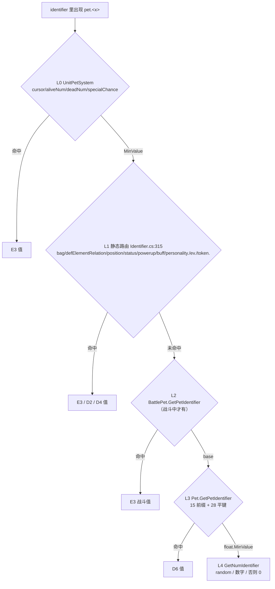

# 域模型子设计 D6 · 宠聚合与组件（domain-pet.md）

> **父文档**：`docs/domain/domain-design.md`（不变量 V1–V7 · 接缝 S1–S7 · 子设计地图 §6）·
> **同级**：D1 `docs/domain/domain-base.md` · D2 `docs/domain/domain-status.md` · D3 `docs/domain/domain-effect.md` · D4 `docs/domain/domain-buff.md` · D5 `docs/domain/domain-skill.md` · D7 `docs/domain/domain-info.md` ·
> **注入面父文档**：`docs/runtime/runtime-components-design.md`（R1 随机源 · R2 时钟 · R3 存档读写面 · R4 写盘 sink · R5 弹窗 sink —— 本族**只声明消费**，不自建平行接口）·
> **边界裁判**：`docs/engine/battle-engine-design.md §8.4`（`Basic/Pet/**` 减 `Battle/` = 本族；`Basic/Pet/Battle/**` = 引擎 E3）·
> **粒度口径**：`docs/domain/domain-design.md §5`（P1 = **真施工图**）· 文档纪律 `docs/arch-docs.md §3` · 分层 `docs/arch-code.md §3.1`
> **状态**：✅ 已写；**§7 的四条待拍板已于 2026-10-17 全部拍板**（见该节「已决」块）。**配对 `impl` 未写**（阶段一续）。

> ⚠️ **本份不重抄字段表**。九件（`Pet` + 8 组件）的字段真值在 `Assets/Scripts/MVC/Model/Basic/Pet/{Pet.cs,Components/*.cs}`，
> 静态表字段在 D7 `docs/domain/domain-info.md`。本份只定 **归属 / 决定性 / 路由分层 / 写侧上移 / 施工顺序**。要字段就读源，别在这里找第二份。

---

## 0. 这份文档回答什么

1. **`Pet` 是"域里唯一会被引擎继承的类"** —— `BattlePet : Pet`（`Basic/Pet/Battle/BattlePet.cs:8`）override 了三个 `virtual`
   （`GetPetIdentifier` / `TryGetPetIdentifier` / `SetPetIdentifier`）⇒ 本族的 `Pet` 不能做成封闭对象，必须把这三件留成**可覆写的接缝**（§3.3）。
2. **S1 的真实形状不是"23 臂"** —— `pet.x` 在运行时穿的是**五层**（`UnitPetSystem` → `Identifier` 静态路由 → `BattlePet` override → `Pet` 实例 → `GetNumIdentifier`）。
   D0 记的"23 臂"其实是 **Set 侧**的平键数；Get 侧实例臂是 **15 前缀（含 `own`）+ 28 平键 + 兜底**（§2.3、§2.4）。**这条同时回答 D0 的待拍板 W2。**
3. **发行数据里各臂的命中次数**（§2.3 表）—— 用来定"一次接完 vs 分批"：实测 `pet.` 命中**绝大多数落在前两层（引擎/Element/Buff/Status）**，
   真正属于本族的第三层臂一共只有 ~130 次命中，且高度集中在 6 支 ⇒ **按频次分批成立**（W2 的答案）。
4. **构造家族的决定性分级** —— 4 个构造器 + 5 个静态工厂里，哪几支碰 `UnityEngine.Random` / `DateTime.Now` / `Player.instance` / `SaveSystem.SaveData()`，
   由此分出**"与上游逐值可比"** 与 **"不与上游比、按自己的目标实现"** 两类（§2.2）。
   ⚠️ 口径已按人类决议 ① 改版：**碰随机/墙钟不再是"不做"的理由**，只改变**验收手段**（同 seed 自复现 + 形状断言 + 人类手测）。
5. **写侧上移的切法** —— `Pet` 里 9 处 `Player.instance.*` / `SaveSystem.SaveData()` / `Hintbox.Open…`（升级、进化、换技能）不能进 `core/`，
   本族**只调用接口**：`PetStore` = R3、落盘 = R4、弹窗 = R5，三件都在 `docs/runtime/runtime-components-design.md` 里定义（人类决议 ③，§2.2、§3.2）。
6. **现状不是 `⬜ 0`** —— `core/pet/**` 已有 1139 行，但**本族一个 `Pet` 对象都没有**；同时 oracle 侧 `BuildPet` 已经在**用反射拼真 `BattlePet` + 8 组件**（§6）。

---

## 1. 范围与边界

| | |
|---|---|
| **本份覆盖** | `Pet.cs`（715）｜ `Components/{PetBasic 83, PetExp 86, PetFeature 63, PetRecord 74, PetResist 175, PetSkill 204, PetTalent 64, PetUI 94}.cs`（843）｜ `enum Personality`（`Components/PetBasic.cs:70-92`，55 项）｜ `enum IVRanking` 的**归属**（定义在 D7，本族只用）｜ `IKeyValuePair<,>` / `Linear<T>`（`IClass/IKeyValuePair.cs`）里**被组件吃到的那部分**语义 |
| **上游** | `Assets/Scripts/MVC/Model/Basic/Pet/**`（减 `Battle/`）+ `Assets/Scripts/{IClass/IKeyValuePair.cs, System/Data/GameData.cs:45-48, Helper/Helper.cs:32-103}` |
| **不覆盖** | `Basic/Pet/Battle/**`：`BattlePet.cs`、`PetBattle{Status,Skill,Buff}Controller`、`BattleStatus` → **引擎 E3** `docs/engine/battle-engine-units.md`。本份只定**接缝**（§3.3），不定它们的内部 |
| | `Info/*` ×10 + `PetInfo` + `System/Pet{Exp,IV,Fusion,UI}System` + 装载/导出 → **D7** `docs/domain/domain-info.md`（本族全部经 D7 的表读接口拿静态值，**不自己碰 `game/data/**`**，V6） |
| | `Status` 六维算式（`GetPetNormalStatus` / `GetPersonalityBuff`）→ **D2**；`Skill` 对象与 `GetSkillIdentifier` → **D5**；`Buff` 与 `SetBuffIdentifier` → **D4**；`Element` 关系 → **D2**（`core/pet/element.ts` 已落地） |
| | `PetUI` 的 `Sprite` / `GameObject` / `AudioClip` / Addressables 臂（`Components/PetUI.cs:50-76`）与 `PetFeatureInfo.{Feature,Emblem}.GetSprite` → **View 线** + 引擎 **E7** `docs/engine/battle-engine-views.md` |
| | 九件的 **XML 形状与归档顺序** → `docs/save/save-design.md §3`（本份只声明"顺序 = 字段声明顺序"这条不变量，见 §5 G1，**不重抄 member 表**） |
| | `UnitPetSystem`（`Scene Specific/Battle/UnitComponent/UnitPetSystem.cs`）的 `petBag` / `cursor` / `token` / `specialChance` → **引擎 E3**（§2.3 的第 0 层） |

---

## 2. 上游真值

### 2.1 逐件归属与"决定性"总表

决定性列的含义：**Y** = 只吃入参与已落地表值，可进对拍；**N** = 方法体内有 `UnityEngine.Random` / `DateTime.Now`，oracle 侧**抛** `SecurityException`（机理见 §2.2 注）——
⚠️ **N ≠ 不做**（人类决议 ①）：这些件**照常实现**，随机/时间来自注入的 **R1/R2**，只是**验收手段换成"同 seed 自复现 + 形状断言 + 人类手测"**，不与上游逐值对拍；
**W** = 写外部状态（`Player.instance` / 磁盘 / UI）⇒ 一律走 **R3/R4/R5** 三个接缝（人类决议 ③），核心层只调用接口。

| 件 | 归档字段（V4 声明序） | 吃的 D7 表 | 本族要搬的算子 | 决定性 |
|---|---|---|---|---|
| `Pet` | `id, backupPet, basic, feature, exp, talent, resist, skills, record, ui, currentStatus`（`Pet.cs:16-27`） | 全部（经 `info`） | `normalStatus`/`extraStatus` 推导（`:28-30`）· 23 个转发属性（`:33-83`）· `GetPetHashId`（`:241`）· 三层 identifier（§2.3/§2.4） | Y（构造另计，§2.2） |
| `PetBasic` | `id, name, gender, personality, height, weight, getPetDate`（`Components/PetBasic.cs:13-18`；`baseId` 是转发属性 `:11`） | `basic.csv` | `ToBestPersonality`（`:47`）· `hashId`（`:52-67`） | 构造 **N**；其余 Y |
| `PetExp` | `id, level, fixedMaxLevel, totalExp`（`:9-12`）—— ⚠️ **`expSum` 不归档**，它是 `totalExp` 的 `[XmlIgnore]` 钳位视图（`:13-17`） | `exp.csv` | `expSum` 钳位 · `levelUpExp`/`maxExp`（`:22/:24`）· `GetMaxLevel`（`:41-50`）· `GainExp`（`:57`）· `LevelDown`（`:77`） | Y |
| `PetFeature` | `id, hasEmblem, featureId, emblemId, afterwardBuffIds`（`:10-13`；`afterwardBuffs` 是 `[XmlIgnore]` 视图 `:17`） | `feature.csv` | `feature`/`emblem` 解析（`:15-16`）· `info` 组装（`:19`）· `GetExtraStatus`（`:43-50`）· `SetTrait`（`:52`） | `SetTrait(0)` **N**；其余 Y |
| `PetTalent` | `id, iv, ev, evStorage`（`:8-11`）—— ⚠️ **`ev` 是一个 `Status`**（不是 `int[]`），所以 `ev.<六维名>` 直接吃 D2 的索引器 | `basic.csv` 的 `IVRanking` 侧 | `ev` 索引器 · `totalEV`（`:14`）· `AddEVStorage` · `SetEVStorage` 钳位（`:49`）· `IVRank`/`IVRankId`（`:15`） | 构造 **N**（`Random.Range(0,32)`）；其余 Y |
| `PetResist` | `id, lockState, criResist, fixResist, perResist, abnormalResist, unhealthyResist`（`:10-14`；后两件是 `IKeyValuePair<int,int>`） | `ui.csv`（`defaultResist`） | `resistKeyNames`（`:9`）· `lockState` 初始化（`:29`）· `abnormalBuffId`/`unhealthyBuffId`（`:18-19`）· `GetResistBuffs`（`:55-72`）· `ToArray`/`ToDictionary`（`:74/:88`）· `SetResistArray`（`:102`）· `SetResistValue`（`:122`）· `ToBest`（`:159`）· `Reset` | Y（但 key 词汇不收敛 = 上游 bug，§2.7 + §7 **CB3**） |
| `PetSkill` | `id, ownSkillId, normalSkillId[4], superSkillId`（`:12-15`；`skillList`/`ownSkill`/`normalSkill`/`secretSkill` 全 `[XmlIgnore]`） | `skill.csv`（经 D5 的 `Skill`） | `ownSkill`（`:22-25`）· `normalSkill`/`superSkill`/`secretSkill`（`:29-56`）· `GetLearnSkillInfos`（`:85`）· `CheckNewSkill`（`:98`）· `Learn*/Remove*/Get*/Swap*`（`:120-196`） | Y；`Swap*` 两支带 **W** |
| `PetRecord` | `winFightNum, loseFightNum, recordDict`（`:10-13`） | — | `GetRecord` 的两个虚拟键（`:36-44`）· `GetRecord<T>`（`:46`）· `TryGetRecord`（`:51`）· `SetRecord`（`:57`）· `CleanMod`/`CleanIconFrame` | Y（读写口径不对称，§7 条 9） |
| `PetUI` | `id, baseId, specialSkinList`（`:16-18`）—— ⚠️ **`skinId` 不归档**，它是 `[XmlIgnore]` 的兜底 getter（`:21-25`） | `ui.csv` | `skinId` 兜底（`:21-25`）· `skinBaseId`（`:28`）· `skinInfo/hitInfo/soundInfo`（`:12-14`）· `animId`（`:35`）· `hashId`（`:38`） | Y；`Sprite` 臂（`:50-76`）→ View |

> **`enum Personality` 物理在本族**（`Components/PetBasic.cs:70-92`，25 单维 + 30 双升 = **55** 项），D7 已声明"本族不搬、只搬 `IVRanking`"
> ⇒ 这条落点归 **D6**：`core/pet/basic.ts` 出 `Personality`，且**必须 0..54 全覆盖**，因为 D2 的 `getPersonalityBuff` 界是 `p>=0 && p<55`（`game/core/pet/status.ts:218`）。

### 2.2 构造家族 —— 谁能进对拍，谁走注入随机（口径 2026-10-17 改版）

> **本轮改了什么**：原版把带 native 随机的构造判成"**永久不可比 ⇒ 不发向量、oracle 侧永久不放**"。
> 按人类决议 ①（随机数**不需要**启 Unity、**不需要**与 JS 逐值一致）与验收口径（`AGENTS.md §1.1`），
> 这里的 **N 不再是"死账"，而是"实现路径不同"** —— 这些构造**要照常实现**，随机来自 **R1 注入的 `Rng`**、时间来自 **R2 注入的时钟**
> （见 `docs/runtime/runtime-components-design.md §5`），验收 = **同 seed 自复现 + 形状断言 + 人类手测**，**不与上游逐值对拍**。

| 构造/工厂 | 源 | 非确定性 / side effect | oracle 现状 | 判定 |
|---|---|---|---|---|
| `Pet()` | `Pet.cs:173` | 无 —— 但 10 件组件**全 null**，`info`/`normalStatus` 一碰就 NRE | **正是 oracle `BuildPet` 走的那条**：反射建 `Pet` + 8 组件，只填各组件 `id`（`tools/oracle-cs/Program.cs:772-861`） | **Y**（本族唯一必须无条件支持的形状） |
| `Pet(Pet copy)` | `Pet.cs:175-193` | 无（深拷贝 11 件；`backupPet` 递归） | 未覆盖 | **Y** ← B2 的主战场 |
| `Pet(int, int level, bool hasEmblem)` | `Pet.cs:195-210` | `new PetBasic(id)` 里 **4 处 native**：`genderList.Random(dist)` / `(Personality)Random.Range(0,25)` / `height`·`weight = base + Random.Range(0,6)` / `getPetDate = DateTime.Now`；`new PetTalent(id)` 里 `Random.Range(0,32)` | 不可执行 | **N** |
| `Pet(int evolveId, Pet original)` | `Pet.cs:212-239` | 转给 `PetBasic(evolveId, personality, gender)` —— 显式传入时**避开**两处 `Random`；但 `PetFeature(evolveId, …)` 与 `PetSkill(…)` 内部是否再掷需按分支核 | 不可执行 | **N（部分可救）** |
| `GetExamplePet(id, 100, 31)` | `Pet.cs:100-128` | **先走 N 的那条 ctor**，再回写 `gender/height/weight/personality` ⇒ 唯一残留非确定量是 `basic.getPetDate` | 不可执行 | **N**（§7 待核：能否拆成"Y 的构造 + 显式填值"） |
| `ToBestPet(pet, 31)` | `Pet.cs:130-146` | 调 `GainExp`/`LearnNewSkill` ⇒ 见 §2.6 的 **W** | 不可执行 | **W** |
| `Add(pet)` / `OpenHintbox` | `Pet.cs:148-171` | `Player.instance.petBag` + `Hintbox.OpenHintbox<ItemHintbox>()` | — | **W → 上移**：背包写 = **R3 存档读写面**，落盘 = **R4 写盘 sink**，弹窗 = **R5 提示 sink**（核心层只调接口，人类决议 ③） |
| `GetRandomPetInfo()` | `Pet.cs:91-99` | `ListHelper.Random()` = **托管**随机（与 native 不同一条链，但仍是随机源） | — | **N → 照常提供**，随机来自 **R1**（旧口径"本族不提供"随人类决议 ① 作废） |
| `GetPetInfo(id)` | `Pet.cs:86-90` | `Database.instance` → 交 D7 的表读注入 | — | **Y**（注入后） |

> ⚠️ **N 的机理（事实照录）**：`UnityEngine.Random.Range(int,int)` 是 native ECall，**离进程必抛**
> `SecurityException: ECall methods must be packaged into a system module.`，且**与走哪条分支无关**（oracle 已实测：
> `{}`、`{random:"maybe"}` 这类连第一句 `TryParse` 都没过的形状同样抛；`tools/oracle-cs/Program.cs:1815-1820`、`docs/engine/port-map.md:133-138`）。
> ⇒ **但这条机理不再构成"不做"的理由**（人类决议 ①）：oracle 侧的 `UnityEngine.Random` shim **取消**，N 支**不与上游逐值比**。
> 对照：**托管**的 `ListHelper.Random` 在 `count > values.length` 时**掷骰前短路** ⇒ 那条链本来就可比（`AddBuff/RemoveBuff/Range` 的先例），维持可比。
> ⇒ **N 支的验收**：① 同 seed ⇒ 同序列（自复现，走 R1）；② 形状断言（区间端点可达性、钳位、字段齐全 —— 见 §7 条 8：`iv` 的 `0..32` 闭区间、`personality` 的 `0..25`）；
> ③ **人类手测**（建宠/进化/洗特性真跑一遍）。三类断言都进 `node --test game/core/pet/`，**不再**记作"oracle 永久缺口"。

### 2.3 S1 的真实形状：`pet.` 穿五层，不是"23 臂"

| 层 | 源 | 臂 | 归谁 |
|---|---|---|---|
| **L0 petSystem** | `UnitPetSystem.cs:179-193` | `cursor` / `aliveNum` / `deadNum` / `specialChance` | **引擎 E3** |
| **L1 静态路由** | `System/Parser/Identifier.cs:315-396` | `bag(…)`（含 `.count`/`sum`/`max`/`min`）· `defElementRelation[..]` · `position` · `status*` · `powerup*` · `buff*` · `personality.*` · `ev.*` · `token.*` | 混合：`bag`/`position`/`token` = E3；`status`/`powerup` = D2 算子 + E3 持有；`buff` = D4；`ev.` = **本族**；`personality.` = D2 |
| **L2 BattlePet override** | `Basic/Pet/Battle/BattlePet.cs:187-285` | `element.` / `subElement.` / `skill[..]` / `normalSkill[..]` / `superSkill` + 平键 `stayTurn`/`chain`/`element`/`subElement`/`movable`/`dead`/`token` | **引擎 E3**（本族只有"基类同臂不同读法"的那份，见 L3） |
| **L3 `Pet` 实例** | `Pet.cs:253-434` | **15 前缀臂 + 28 平键 + `_ => float.MinValue`** | **本族 = S1 主场** |
| **L4 兜底** | `System/Parser/Identifier.cs` → `GetNumIdentifier`（`game/core/parser/identifier.ts:26` 已落地） | `random` 系列 / 数字 | parser（已落地） |

**L3 的臂清单**（顺序即语义，`||` 合取的守卫**不成立就不算进臂**，继续下穿直到 L4）：

`backup`(:255) · `status.`(:263，内部再分 `init`/`extra`/`battle`(:272)/`personality` 四前缀，否则读 `currentStatus`) · `ev.`(:281) ·
`normalSkill[..]`(:287) · `superSkill`(:298) · `skill[..]`(:308) · `buff`(:315，括号不成立 ⇒ **显式 `return float.MinValue`**，不穿透) ·
`record(..)`(:328) · `kizuna`(:336) · `skin[..]`(:358) · `baseId[..]`(:365) · `gender[..]`(:372) ·
`element.group(…)`(:379) · `subElement.group(…)`(:389) · `own`(:399) + 平键 28 支（`:405-432`）。

**发行数据命中实测**【样本】（`Assets/Resources/Data/{Effects,Skills,Buffs,Items}/{info,effect}.csv` + `Pets/*.csv` 里 `pet\.[A-Za-z_]+(\[…\])?` 的出现次数，下标归一为 `[N]`；同一表达式多处出现会重复计数）：

| 臂 | 次数 | 落在 | 可比性（B1 之后） |
|---|---|---|---|
| `status.*` | 1373（`maxHp` 686 / `hp` 311 / `anger` 133 / `lostHp` 66 / `mat` 40 / `atk` 33 / `mdf` 19 / `def` 18 / `maxAnger` 16 / `spd` 10 / `init*` 20 / 其余 6） | **L1** | 已可比（D2 已落 `status-controller.ts`），本族只需 `currentStatus` 提供 `Status[string]` |
| `buff[N]`(+裸 45 +`[unhealthy]` 17 +`[abnormal]` 13) | 705 | **L1** | 已可比（D4） |
| `powerup*` | 159 | **L1** | 已可比 |
| `chain` 70 · `dead` 67 | 137 | **L2** | 已可比（E3） |
| `defElementRelation` | 77 | **L1** | 已可比（D2 `element.ts`） |
| `specialChance` 27 · `cursor` 13 · `deadNum` 5 · `aliveNum` 1 | 46 | **L0** | E3 |
| `bag(...)` | 40 | **L1** | E3（`petBag`） |
| `weight` / `height` | 38 / 17 | **L3 平键** | Y（值来自构造时的 native 掷点 ⇒ **向量只能显式填值**，不能靠构造） |
| `baseId` | 25 | **L3 `baseId[..]`** | Y（D7 进化链） |
| `element` / `subElement` | 22 / 15 | **L3 平键**（裸 `Pet` 才到这层；战斗中 L2 先命中） | Y |
| `kizuna` | 16 | **L3 `kizuna`** | Y（含 `min`/`max`/`[tag]`） |
| `normalSkill[N]` | 14（+裸 4） | **L3 合取臂** | Y（需 D5 `Skill.GetSkillIdentifier`） |
| `iv` 8 · `uid` 5 · `level` 4 · `id` 4 · `gender` 4 · `star` 2 · `skinId` 2 · `skill[N]` 2 · `personality` 2 · `superSkill` 1 · `ev` 1 · `emblem`/`featureId`/`featureType`/`emblemId`/`emblemType`/`resistLock`/`exp`/`levelExp`/`evStorage`/`maxLevel`/`generation`/`subId`/`minKizuna`/`maxKizuna`/`trait` | 0 | **L3** | Y |
| `stayTurn[N]` 1 · `kizuna[min]` 1 | 2 | L2 / L3 | Y |

> **W2 的答案（`docs/domain/domain-design.md:263`）**：**分批接，按频次排**。理由三条：
> ① L3 的 15 前缀臂里，实测只有 6 支有非零命中（`weight`/`height`/`baseId`/`kizuna`/`normalSkill`/`element` 系），其余 **20+ 支零命中** —— 一次接完等于**为一半的臂现编向量**；
> ② 零命中臂**必须**补合成向量才谈得上"接完"，那是 B4/B5 的独立工作量，不该压在第一批上；
> ③ D0 的口径本来就要求"每臂都有向量"（`docs/domain/domain-design.md:176-178`）⇒ 分批 = **批一到有数据的臂（真实向量，免费）**、**批二到零命中臂（合成向量，显式声明来源）**，两批的验收手段不同，混在一起反而看不出漏。
> ⚠️ 分批只是**顺序**，不是**取舍**：28 平键**一支都不能少**地最终接完，围栏（`game/core/parser/identifier-effect.ts:691-730`）逐臂摘 `notPorted`。

### 2.4 `SetPetIdentifier` —— 1 前缀 + 23 平键与写入目标

`Pet.cs:445-539`，形状是 `default: return`（**未知键静默丢弃**，与 Get 侧的 `float.MinValue` 不对称 ⇒ V2 照搬）。

| 写入目标 | 平键 |
|---|---|
| `record`（前缀 `record(..)`，`:447`） | 前缀臂：record 内任意键 |
| `ui.skinId` | `skinId` |
| `skills`（经 D5 `Skill.GetSkill((int)num,false)`） | `skill` · `skill+` · `skill-` |
| `feature.afterwardBuffIds` | `buff` · `buff+` · `buff-` |
| `basic` | `gender` · `personality` · `height` · `weight` |
| `feature` | `trait`（→ `SetTrait`，`0` 掷 `Random` ⇒ **N**）· `emblem` · `featureId` · `featureType` · `emblemId` · `emblemType` |
| `exp` / 等级家族 | `level` · `maxLevel` · `exp` |
| `talent` | `iv` · `evStorage` |
| `resist` | `resistLock`（`<=0` 触发 `Reset()`） |

**三条必须照搬的不对称**【源码】：
1. **`exp` 的无符号回退**：`uint gainExp = (uint)num - totalExp;`（`:497`）—— `num < totalExp` 时**不是负数而是天文数字**，`GainExp` 直接把宠顶到满级。写侧的"降级"只能走 `level`（内部判 `toLevel <= level ⇒ LevelDown`）。
2. **`personality` 与 `iv` 重建 `currentStatus` 的方式不同**：前者 `hp = currentStatus.hp`（`:479`），后者 `hp = Mathf.Min(normalStatus.hp, currentStatus.hp)`（`:502`）。同一次改动顺序不同结果不同 ⇒ §5 G7。
3. **`featureType` / `emblemType` 索引的是同一张 `info.ui.defaultFeatureList`**（`:519/:527`），且 C# 的 `%` 对**负** `num` 返回**负**余数 ⇒ 直接 `IndexOutOfRange`。§7 待核（发行数据里有无负数写入）。

> 注：`BattlePet.cs:293-324` 覆写了 `element` / `subElement` / `stayTurn` 与 **`level|maxLevel|iv` 三键合写**的一支（先记 `oldStatus`，写完后把 `normalStatus` 差值加进 `maxHp`，再回写战斗技能袋）
> ⇒ 本族的 `SetPetIdentifier` 只做"字段写入 + `currentStatus` 重建"，**任何涉及 `maxHp` / 战斗技能袋的差额回写都不许进 `core/`**（E3 的活）。

### 2.5 三面状态推导链

```
info.basic.baseStatus (D7 表) ─┐
talent.iv, talent.ev (组件)   ─┼─► Status.GetPetNormalStatus(level,…) ─► normalStatus  (D2 算式, :28)
basic.personality (组件)      ─┘          │
                                          ▼
                          feature.GetExtraStatus(normalStatus)  ─► extraStatus  (:30, :43-50)
                                          │
currentStatus  ◄── new Status(normalStatus)   (ctor 家族)   ◄── (normalStatus + extraStatus) 的合并只发生在
                                                                  identifier 的 "status.battle.<x>" 支 (:272)
initBuffs = info.ui.defaultBuffs ++ feature.afterwardBuffs ++ resist.resistBuffs   (:53, [XmlIgnore])
```

**四条真值**：
1. **`normalStatus` 是每次读都重算的 `=>`**（不是缓存字段），`extraStatus` 亦然 ⇒ 写 `iv`/`personality` 之后**只有 `currentStatus` 需要显式重建**，`normalStatus` 自动变（§2.4 条 2 的由来）。
2. **`initBuffs` 三段拼接有顺序语义**（默认印记 → 后天印记 → 抗性印记），且它 `[XmlIgnore]` ⇒ **不归档**，每次由三件组件现算（V5）；`buff[..]` 臂（`:315`）读的就是这条。
3. **`status.battle.` / `status.extra.` / `status.init.` 是同一支 `Status` 索引器的三种坐标**，`battle` 用 `normalStatus + extraStatus` 现场相加而不落盘 ⇒ 本族必须在 `Pet` 上提供，不能在 `Status` 里做。
4. **羁绊三件**（`kizuna`/`minKizuna`/`maxKizuna`，`:43-45`）：`minKizuna` 的兜底是 **`float.Parse(info.ui.options.Get("min_kizuna","-255"))`** —— `Parse` 而非 `TryParse` ⇒ 表里写脏了会**抛**；`kizuna` 本体是 `record["kizuna"]` 钳在 `[min,max]` 之间，即**羁绊值住在 `record`，不住在专属字段**。

### 2.6 升级 / 进化 / 退化家族与背包写回

`GainExp :541` · `LevelDown :568` · `Evolve :587` · `EvolveTo :608` · `Devolve :631`。上游这五支**同时**干三件事：改组件、动 `Player.instance`（`petBag` / `petDict` / `petStorage`）、落盘 + 弹提示（`SaveSystem.SaveData()`、`Hintbox`）。

本族的切法（**写侧上移**，§3.2）：

| 上游 | 本族返回 | 调用方（Save/引擎）负责 |
|---|---|---|
| `exp.GainExp(uint) → bool`（`PetExp.cs:57-75`，"够进化条件"） | 同样 `boolean`（纯计算，**无 side effect**） | 决定是否 `Evolve` |
| `Pet.GainExp(uint)`（含 `Evolve` 触发） | `(pet'': Pet, levelUps: number, evolveReady: boolean)` | 替换 `petBag[i]`、存档、`Hintbox` |
| `Evolve/EvolveTo/Devolve` | `Pet`（用 §2.2 的 `Pet(evolveId, original)` 语义，**内部不碰 `Player.instance`**） | 写回背包 + `backupPet` 链（`Devolve` 从 `backupPet` 取回退化前形态） |
| `PetSkill.SwapNormalSkill/SwapSuperSkill` | 交换后的两个槽（纯数组操作） | `SaveSystem.SaveData()`（上游在这两支里各调一次，`Components/PetSkill.cs` 内） |

> `VersionUpdate :678` 的 `lite_3.6.1` 抗性强重建 + `baseId[704] ⇒ gender=1` 是**存档迁移**，归 `docs/save/save-design.md`；本族只提供它需要的 `SetResistDict` / `ToBest` 原语。

### 2.7 `PetResist` 的三套口径不对称

同一个"七项抗性"在上游有**三套互不相通的 key 名**【源码】：

| 口径 | 源 | key |
|---|---|---|
| key 名单（`resistKeyNames`，只被 `SetResistArray` 用） | `Components/PetResist.cs:9`（用于 `:104/:107/:108`） | `critical / fix / **per** / abnormal.id / unhealthy.id / abnormal.value / unhealthy.value` |
| 出字典（`ToDictionary`，方法 `:88`） | `:94` | 第三项写作 **`"percentage"`** |
| 写值（`SetResistValue`，方法 `:122`） | `:137` | **只认** `"percentage"`；且 `:124-125` 是 `default: return` ⇒ 传 `"per"` 进来**静默返回**（不写、不抛、不记） |
| （对照）**裸数组**（`ToArray` `:74` / `SetResistArray` `:102`） | `:74-85` / `:102-109` | 数组**按位置**对应，**不引用 key 名** ⇒ 只有经 `SetResistArray → SetResistValue` 这条路才会丢 |

⇒ **`SetResistArray` 用 `resistKeyNames` 里的 `"per"` 去喂只认 `"percentage"` 的写入器，百分比抗性被静默丢弃。**
`BattlePet.cs:124` 的 PVP 建宠（`resist.SetResistArray(resist)`）正是这条链的**实际受害者**：PVP 对手带的百分比抗性会丢。

**★ 本条的处理政策已拍板（2026-10-17，见 `AGENTS.md §2` / `docs/arch-docs.md §4.1`）**：这是**代码逻辑 bug**，**不是** V2 说的"数据表拼写/水印"
⇒ 政策 = **声明 + 不照搬**：本节即为**声明**（含 `路径:行`、症状、受害者），**目标行为**如下 ——

| 项 | 口径 |
|---|---|
| **哪套词汇是权威**（实测【源码】） | **`percentage`** —— `ToDictionary`（`:94`）**产出**它、`SetResistValue`（`:137`）**只认**它、`PetResistModel` 的 EV 临时字典（`MVC/Model/Pet/Basic/PetResistModel.cs:20` = `resist.ToDictionary()`，`:57/:67` 回写）也**吃**它。`"per"` **只出现在 `resistKeyNames`（`:9`）一处**，且 `resistKeyNames` 全仓仅被 `SetResistArray`（`:104/:107/:108`）用（`ToArray` 压根不引用它，它是**位置对应**的裸数组） |
| **目标行为（写没有该 bug 的形状）** | `resistKeyNames[2]` 由 `"per"` 改为 **`"percentage"`** ⇒ 三套词汇**收敛为一套**，`SetResistArray → SetResistValue` 不再丢值；`BattlePet.cs:124` 的 PVP 建宠因此**带上百分比抗性** |
| **改动面** | **一个字符串常量**（`game/core/pet/resist.ts` 里的那张 key 表）；**归档字段名与 XML member 序不变**（`perResist` 是字段名，与 key 词汇无关 ⇒ 存档兼容，V4/V5 不受扰动） |
| **对拍** | 该支**不与上游逐值比**（上游是 bug 方）；改为我方**往返无损**断言：`ToArray → SetResistArray → ToDictionary` 与 `ToDictionary → SetResistDict` 必须**等价**且 `percentage` 不丢 |
| **登记** | 本节 + §7 **CB 组 CB3** + `docs/domain/domain-design.md §7` 第 5/6 条的分工；§5 的 **G8** 已按此改写 |

### 2.8 `hashId`：两半 + 那个墙钟

`Pet.GetPetHashId`（`:241-251`）在 `unchecked` 里 `17*31 + basic.hashId`，再 `*31 + ui.hashId`。
`PetBasic.hashId`（`Components/PetBasic.cs:52-67`）把 `name/gender/personality/height/weight/baseId` 与 **`getPetDate.GetHashCode()`** 逐项混进去。

⇒ **与上游不可比**，但**理由要说准**（两条，都跟随机无关）：① `getPetDate` = 上游的 `DateTime.Now`（墙钟）；② C# 的 `DateTime.GetHashCode()` 依运行时/位数而定。
⇒ **目标行为**：`getPetDate` 改由 **R2 注入时钟**取（`docs/runtime/runtime-components-design.md §5`），混列算法照搬但**用我们自己的稳定整数散列**替掉 `DateTime.GetHashCode()`
⇒ 于是 `hashId` 在**我方内部**完全确定、可断言、可跨档比较；只是**不与上游逐值对拍**（上游那两个不可复现量我们不复刻，符合人类决议 ① 的精神）。
⇒ `hashId` 仍**只作为身份指纹**住在 save 线（背包去重），**不进 identifier**。§5 的 **G10** 已按此改写。

---

## 3. 目标结构与契约

### 3.1 文件布局（`game/core/pet/`，全部 L0）

| 文件 | 内容 | 依赖方向 |
|---|---|---|
| `pet.ts` | `class Pet` + 4 构造器 + 23 转发属性 + 三面状态 + identifier 三层里的 L3 + 升级/进化家族 | → `basic/exp/feature/talent/resist/skills/record/ui`，`../status` |
| `basic.ts` | `PetBasic` + **`enum Personality`（55）** + `hashId` | → `../table`（D7 注入） |
| `exp.ts` | `PetExp`（钳位 getter / `GetMaxLevel` / `GainExp` / `LevelDown`） | → D7 `PetExpSystem` 三函数 |
| `feature.ts` | `PetFeature` + `GetExtraStatus` + `SetTrait` | → D7 `GetFeatureInfo`、D2 `Status`、D4 `BuffInfo` |
| `talent.ts` | `PetTalent`（`ev` 索引器 / `SetEVStorage` / `IVRank`） | → D7 `IVRanking` |
| `resist.ts` | `PetResist` + `GetResistBuffs`（`BUFFID_RESIST_BUFF = -2005`） | → D4 `Buff` |
| `skills.ts` | `PetSkill`（三组读写器 + `Learn*/Remove*/Get*/Swap*`） | → D5 `Skill` / `LearnSkillInfo` |
| `record.ts` | `PetRecord` | → D1 `IKeyValuePair` / `Linear`（`core/pet/linear.ts` 已落地 46 行） |
| `ui.ts` | `PetUI`（`skinId` 兜底 / 三 `Info` 读取 / `hashId`） | → D7；**Sprite 臂不落地**（`NOT_PORTED`） |
| `identifier.ts`（拆出） | `petGetIdentifier(id): number \| FLOAT_MIN_VALUE` + `petSetIdentifier(id, num): void` | 被 `pet.ts` 用；**围栏摘除在此进行** |

> `core/pet/` 已有的 6 个文件（`status`/`status-controller`/`buff-controller`/`element`/`linear`/`skill-controller`）**不动**：`status.ts` = D2、`buff-controller.ts` = D4/E3、`skill-controller.ts` = E3 的持有者。
> ⚠️ `SkillType` 的地雷在这里仍然成立且**优先级更高**：`pet/skill-controller.ts:17` 从 `core/battle/damage.ts` import，而 `skills.ts` 要 `Skill` ⇒ **D5 的 B1（`SkillType` 下沉）必须先于本族 B3**（`docs/domain/domain-skill.md §5 G9`）。

### 3.2 注入契约

```ts
export interface PetEnv {
  // —— 静态表（D7）：域不读盘，全部注入（V6）
  petInfo(id: number): PetInfo | null            // Database.GetPetInfo
  featureInfo(id: number): PetFeatureInfo | null
  totalExp(level: number, expType: number): number      // PetExpSystem
  getLevelExp(level: number, expType: number): number
  evolveChain(baseId: number, petId: number): number[]
  skill(id: number): Skill | null                 // D5 的 Skill.GetSkill
  buffInfo(id: number): BuffInfo | null            // D4；SetTrait(0) 的 trait 组查询也走它
  // —— skin 三表（人类决议 ④ = D7 本族待拍板 ② 的 `setSkinTables({hit, sound, transform})`，本族只按 skinId 取）
  hitInfo(skinId: number): HitInfo | null              // 打击音（⚠️ 上游**无逆函数**，D7 G8）
  soundInfo(skinId: number): SoundInfo | null          // 
  transformInfo(skinId: number): TransformInfo | null  // 变身
  // —— 运行时：**全部来自功能组件线，本族不另造一套**（人类决议 ①③）
  rng: Rng            // R1 随机源（不再有"oracle 不注入"这回事）
  now(): number       // R2 时钟（喂 getPetDate / date.* 臂）
  store: PetStore     // R3 存档读写面（见下）
  save(): void        // R4 写盘 sink —— 核心层**只调用**，落盘由外部实现
  hint(spec: HintSpec): void   // R5 提示/弹窗 sink —— 上游 `Hintbox.OpenHintbox<ItemHintbox>()` 的替身，核心层**只调用**
}
export interface PetStore {                       // 替代 Player.instance.*（9 处）
  petBag: (Pet | null)[]                          // GameData.cs:45，12 格
  petDict(): Pet[]                                // :48 = petBag ∪ petStorage
  indexOf(pet: Pet): number
}
```

**★ 本节的口径来源（2026-10-17 拍板）**：`rng` / `now` / `store` / `save` / `hint` 五支**不是本族自定义的接口**，
而是 `docs/runtime/runtime-components-design.md §5` 里 **R1–R5** 的**消费面**（该文档才是这些能力的**定义处**，含默认行为、装配点与验收口径）。
本族只声明"**我消费哪几件**"。⇒ 原版的 `rng?: Rng`（可选、"oracle 不注入"）与 `save?: () => void` 两处**已改必选**；
"写侧上移"的形态也**就此定死**：**注入 store/save/hint 接缝**，**不**改成"返回意图对象由上层执行"（那条会逼 `SetPetIdentifier` 的 23 支逐个改写返回类型，收益不抵代价）。

**命名对齐（不许自造平行接口）**：随机源与时钟必须复用 `game/core/parser/identifier.ts:9-20` 的 `IdentifierHost` 已有成员名
（`rng: Rng`、`getDate(part)`），即 `rng` / `now`；`Rng` 类型从 **`../rng.ts`** 取（该文件在 `game/core/rng.ts`）。

### 3.3 接缝：S1 的实例半 + S2 的转发属性

* **S1**（`docs/domain/domain-design.md:142`）：`identifier-effect.ts:691-730` 的围栏**逐臂**摘除，每次摘一支就**同时**在该臂处接上 `pet.ts` 的实现。
  围栏的进入条件已与上游合取守卫同形（前缀 + 括号 + `int.TryParse`），**不许放宽**——放宽会造成"围栏抛、上游给 0"的假不一致（围栏注释 `:684-686` 已记录实测咬到过一次）。
* **S2**（`docs/domain/domain-design.md:143`）：`BattlePetView`（`game/core/battle/views.ts:542-579`）里 `name/level/star/isDead/isMovable/isToken/statusController/battleStatus/anger/maxHp/…`
  是**转发属性而非快照字段** ⇒ 本族的 `Pet` 落地后，`views.ts` 的构造入参从 `FakePet`/`hostPetView.js` 换成真 `Pet`，**属性名一个都不许改**（转发面就是验收面）。
* **与 E3 的分界**：`Pet` 提供 `normalStatus`/`extraStatus`/`initBuffs`/`GetDefaultSkill` 的**数据与算式**；`BattlePet` 提供 `currentStatus` 的战斗覆盖、`maxHp` 差额回写、`element.` 的战斗语义。
  ⚠️ 按 D0 的两条拍板（`docs/domain/domain-design.md` D5 注），`GetDefaultSkill` / `ToRPCData` **不归本族**（→ 引擎 E6）。

### 3.4 施工批 B1–B7

| 批 | 内容 | 前置 | 验收手段 |
|---|---|---|---|
| **B1** | **六张宠表进 oracle**（`Pets/{basic,exp,feature,skill,ui,card}.csv`），替掉 `EnsurePetInfo` 的反射合成（`tools/oracle-cs/Program.cs:751-770`）与 `Boot.cs:99-102` 的空字典。**＋ skin 三表的桥（人类决议 ④）**：`hit` / `sound`（打击音）/ `transform`（变身）三张**要建 L2 桥** —— 这已是 D7 的施工批 **B5**（`docs/domain/domain-info.md §5`）与 §2 的 `setSkinTables`，本族 B1 只**依赖并接上** `PetEnv.{hitInfo,soundInfo,transformInfo}` 三个读取器；⚠️ 这三张表**发行数据里没有行**（`Resources/Data/Pets/` 实有 6 张，装载源是 `persistentDataPath/PetAnimation/pet/*.csv`，见 `docs/domain/domain-info.md §6` 表末行）⇒ 桥照建、真值用**工坊/Mod 目录 + 合成行**，`pet.skinId`/`pet.skin[..]` 两支因此能接真值（旧口径"oracle 没有行 ⇒ 只能停在围栏"作废） | D7 的装载合同（§2.3 of D7）+ D7 本族待拍板 ② **已决 = 建桥** | `node tools/difftest.mjs` 无回归；`Database.GetPetInfo` 在 oracle 内不再 NRE；三张桥的**列序与 `-1` 缺省**与合成行断言一致 |
| **B2** | 9 件**对象形状** + `Pet(Pet)` 深拷贝 + `Pet()` 全 null 形状 + `Personality` 55 项枚举 | B1 | `node --test game/core/pet/`（拷贝往返、null 形状、枚举全覆盖） |
| **B3** | **三面状态**（`normalStatus`/`extraStatus`/`initBuffs`/`status.{init,extra,battle,personality}.*`） | B2 + **D5 B1**（`SkillType` 下沉）+ D2/D4 | kind `petstat`：`BuildPet` 起真 `BattlePet`，两侧读同一组 `status.X` |
| **B4** | **L3 有真实命中的臂**（`weight`/`height`/`baseId`/`kizuna`/`element`/`subElement`/`normalSkill[..]` + 其余平键里表内可定的那批）；新 kind **`petid`** | B3 | 发行数据里的**真实表达式**做向量，逐支摘围栏 |
| **B5** | **零命中臂**（合成向量）+ **`SetPetIdentifier` 23+1** + 升级/进化家族 + 扩 `petmut` | B4 | 合成向量显式标注"非发行数据"；写侧断言含 §2.4 三条不对称 |
| **B6** | **N 支**（`Pet(int,…)` / `GetExamplePet` / `SetTrait(0)` / `GetRandomPetInfo`）——**照常实现**，随机来自 **R1**、时间来自 **R2**（`docs/runtime/runtime-components-design.md §5`） | B2 | ① 同 seed 自复现 + ② 形状断言（区间端点可达、钳位、字段齐全）＋ ③ **人类手测**（建宠/进化/洗特性真跑）。**不再**记作"oracle 永久不放"（人类决议 ①） |
| **B7** | 真 `Pet` 替换 `game/app/battle/driver/hostPetView.js`（122 行手写替身）与 `tools/snap-mirror.mjs:127-167 FakePet`；与 E3 `BattlePet` 同步落地 | B4–B5 + E3 | S2 转发面属性名 diff 为空 |

---

## 4. 图

### 4.1 本族的依赖方向

```mermaid
graph TD
  subgraph D6["D6 宠聚合（core/pet/{pet,basic,exp,feature,talent,resist,skills,record,ui}.ts）"]
    PET["Pet"]
    BASIC["basic 8 组件"]
    IDENT["identifier.ts（S1 的 L3）"]
  end
  D7["D7 Info+派生<br/>docs/domain/domain-info.md"]
  D5["D5 Skill<br/>docs/domain/domain-skill.md"]
  D4["D4 Buff"]
  D2["D2 Status/Element"]
  E3["引擎 E3 BattlePet<br/>docs/engine/battle-engine-units.md"]
  SAVE["Save 线<br/>docs/save/save-design.md"]
  PET --> BASIC
  PET --> IDENT
  IDENT -->|normalSkill/superSkill/skill| D5
  IDENT -->|status./initBuffs| D2
  BASIC -->|featureInfo/evolveChain/totalExp| D7
  IDENT -->|buff[..]| D4
  E3 -->|继承 + 覆写三 virtual| PET
  E3 -->|petBag / maxHp 差额| SAVE
  IDENT -.->|围栏逐臂摘除| FENCE["core/parser/identifier-effect.ts"]
```

### 4.2 `pet.x` 的五层穿层



---

## 5. 不变量与围栏

| # | 不变量 | 硬规则 / 落地手段 |
|---|---|---|
| **G1** | **V4：归档顺序 = 字段声明顺序**，而**拷贝构造的赋值顺序与它不同**（`Pet.cs:16-27` 是 `…talent, resist, skills…`，`:175-193` 是 `…talent, skills, record, ui, resist`） | 镜像按**声明序**排列成员；member 表在 `docs/save/save-design.md §3`，本份**不重抄** |
| **G2** | **V5：`[XmlIgnore]` 的派生视图永不归档** —— `Pet` 侧 `info`（`:14`）/ `initBuffs`（`:53`）/ `name`（`:36`，实为 `basic.name` 的转发）；**组件侧同样有一批**：`expSum`（`PetExp.cs:13`，是 `totalExp` 的钳位视图）· `afterwardBuffs`（`PetFeature.cs:17`）· `resistBuffs`（`PetResist.cs:22`）· `skillList`/`ownSkill`/`normalSkill`/`secretSkill`（`PetSkill.cs:19/22/29/51`）· `skinId`（`PetUI.cs:21`） | 镜像里这些一律必须是 getter，**不许落成字段**；任何"序列化 `initBuffs`/`expSum`/`skinId`"的形状即红。⚠️ 特别注意 `expSum` 与 `totalExp`、`skinId` 与 `id` 是**两个不同的归档量** |
| **G3** | **V6：本族不读 `game/data/**`**；一切静态值经 §3.2 的 `PetEnv` | lint：`core/pet/**` 里 `game/data` 命中 0（`docs/arch-code.md §3.1` 唯一硬门 + 本条自加一条 grep） |
| **G4** | **域侧不得调 `Player.instance` / `SaveSystem.SaveData()` / `Hintbox`** —— 上游 9 处（§2.6）全部上移；**核心层只调用接口**（人类决议 ③） | 三件各有唯一接缝且**都来自功能组件线**：背包/字典 = **R3 `PetStore`**、落盘 = **R4 `save()`**、弹窗 = **R5 `hint()`**。lint 仍走 `docs/arch-code.md §3` 规则 1 那条 grep（口径修订见 `docs/runtime/runtime-components-design.md §8.3 Q5`） |
| **G5** | **`float.MinValue` 是 L3 的"不属我"哨兵**，不是返回值；哨兵成立后由 L4 兜成 `TryParse ? num : 0` | 围栏与 `pet.ts` 共用同一常量（`identifier-effect.ts` 里的 `FLOAT_MIN_VALUE`）；`TryGetPetIdentifier` 的判据就是 `!= FLOAT_MIN_VALUE`（`:439-443`） |
| **G6** | **合取守卫不成立 = 不算进臂**（前缀 + 括号 + `int.TryParse` 三件齐），必须继续下穿 | 围栏注释 `:684-686` 已钉过；B4 每摘一支臂，向量必须同时覆盖"守卫失败"形状 |
| **G7** | **写序敏感**：`personality` 与 `iv` 重建 `currentStatus` 用**不同**的 `hp` 规则（§2.4 条 2），`level`/`maxLevel`/`iv` 在 `BattlePet` 里是**合写**的一支 | 镜像逐行照搬两条规则；B5 的 `petmut` 向量必须包含**同一组写入的两种顺序** |
| **G8** | **§2.7 的 `per`/`percentage` 丢值 = 上游代码 bug ⇒ 声明 + 修**（不是 V2 的数据表兜底） | `resistKeyNames[2]` 目标写作 `"percentage"`；断言 = `ToArray → SetResistArray → ToDictionary` 与 `ToDictionary → SetResistDict` **等价且不丢**。**不与上游逐值比这一支**（上游是 bug 方） |
| **G9** | **`ownSkill` setter 的 `null ⇒ new int[1]`**（`Components/PetSkill.cs:24`）与 `GetNormalSkill` 的 `Array.Resize(ref ret, 4)`（`:160+`）照搬 | B2 断言：写 `null` 后数组长度**为 1 而非 0/4** |
| **G10** | **`hashId` 我方内部确定、但不与上游逐值比**（§2.8 的两条理由：墙钟 + `DateTime.GetHashCode()`） | 墙钟改走 **R2 注入**、混列用**我方稳定散列** ⇒ 可断言、可跨档比较；对拍向量与 identifier 仍不引用它（它不是规则量，是身份指纹） |
| **G11** | **N 支照常实现，随机一律来自 R1、时间来自 R2**（人类决议 ①）：任何可达 native `Random` 的构造 / `SetTrait(0)` / `GetRandomPetInfo` | **不再"静默不发"**：验收 = 同 seed 自复现 + 形状断言 + 人类手测（`AGENTS.md §1.1`）；oracle 侧 `UnityEngine.Random` shim **取消**（`docs/runtime/runtime-components-design.md §7`） |
| **G12** | **`GetPetIdentifier("id")` 读的是 `info.ui.defaultId` 而非 `this.id`**（`:407`；`uid` 才是 `this.id`） | 照搬；命名地雷登记 §7，B4 的向量必须显式区分 `pet.id` 与 `pet.uid` |

---

## 6. 现状与缺口（按 D0 的 P1 实测口径：`docs/domain/domain-design.md §3` 末）

| 面 | 实测 | 结论 |
|---|---|---|
| `game/core/pet/**` 本族落地 | 6 个 `.ts` 共 **1139 行**：`buff-controller.ts` 369（D4/E3）· `status.ts` 286 + `status-controller.ts` 293（D2）· `element.ts` 110（D2）· `linear.ts` 46（D1）· `skill-controller.ts` 35（E3 持有者） | **`Pet` 与 8 组件对象 = 0 个**（D0 的 `⬜ 0` 在这一列**是对的**，但"1139 行已有"必须写明） |
| 三面推导的原语 | `game/core/pet/status.ts:270 getPetNormalStatus(level, baseStatus, iv, ev, personality)`、`:218 getPersonalityBuff`（界 `p>=0 && p<55`） | **算式已落地**，缺的只是"谁来持有组件字段并调用它" |
| S1 围栏 | `game/core/parser/identifier-effect.ts:691-730 getPetIdentifierBase`：7 纯前缀臂 + 5 合取臂 + `buff[..]` + `element./subElement.` group + **28 平键** ⇒ 全部 `notPorted` | 围栏形状与 §2.3 的 L3 清单**逐条对齐**（28 平键数量吻合） |
| oracle 侧 | `tools/oracle-cs/Program.cs:772-861 BuildPet(spec)` **已经**用反射造真 `BattlePet` + 8 组件（走 `Pet()` + 参数less 组件构造 + 只填组件 `id`）+ 真三个战斗控制器；`:751-770 EnsurePetInfo` 反射合成 `PetInfo`；`Boot.cs:69-97` 只加载 effects/skills/buffs/items 四组表，`:99-102` 明写**宠表字典为空** | **B1 = 把 `EnsurePetInfo` 换成真表**；`BuildPet` 的形状可直接当 B2 之后的对照物；kinds 已就位：`petbag :284`、`petmut :295`、`pet :1392/1632`、`addNewPet :1395`、`:1944` |
| S2 替身 | `game/core/battle/views.ts:542-579 BattlePetView`（18 个转发成员）· `game/app/battle/driver/hostPetView.js` 122 行手写 L3 替身 · `tools/snap-mirror.mjs:127-167 FakePet` | 三处替身 = B7 的替换点；**转发面已冻结**，本族不许改名 |
| 静态数据 | `game/data/unity/pets.json` = D7 拼的 **838 行 `PetInfo`**（生成物）；`game/data/pets.json` = **AS3 世代的遗留表**（1016 怪，字段 `id,name,swfId,type,element,stats,skillIds`，消费方 `tools/build-wild-index.mjs` / `verify-*.mjs` / `rbattle-restart-save-test.mjs`） | 域侧一律吃 **D7 的 `unity/pets.json`**；遗留 `pets.json` **不是本族真值**，别接错（§7） |
| 存档侧 | `docs/save/save-design.md` 已描述 `Pet` 的 XML member 序列；`GameData.cs:45-48` 的 `petBag[12]` / `petStorage` / `pvpPetTeam` / `petDict` | 本族只需 `PetStore` 接口形状，管道不动 |

---

## 7. 待核 / 怪癖登记

**怪癖 · A 组：照搬（V2 口径 —— 数据/行为差异，不是 bug）**

1. **两条"读错变量"的臂** ⇒ ★ **改判：这是上游代码 bug，不再归"照搬"**（登记已搬到 **CB 组 CB1 / CB2**）。原登记保留出处：
   `superSkill` 支用 `trimNormalSkill.TrimStart('.')`（`Pet.cs:300`）；`gender[..]` 支用 `trimSkin.TryTrimParentheses`（`:373`）。
2. `buff` 支（`:315`）括号不成立时**显式** `return float.MinValue`（不穿透），而其它臂守卫失败是**继续下穿** ⇒ 围栏已区分处理，落地后不许统一。
3. `pet.id` ≠ 自身 id（G12）。
4. `exp` 写入的 `uint` 下溢（§2.4 条 1）。
5. `SetTrait(-1)` 直接 return，`SetTrait(0)` 掷 `Random`（`Components/PetFeature.cs:52-62`）—— 一个"关掉特性"的语义要靠随机数实现。
6. `GetMaxLevel` 里硬编码 `id.IsInRange(20001,30000) ⇒ 105`（`Components/PetExp.cs:41-50`）—— 用 id 区间代表"某世代神兽"，**没有表驱动**。
7. `PetSkill.CheckNewSkill` 的自动学习阈值**硬编码 60 级**（`:98-118`）。
8. `PetTalent` 构造里 `iv = Random.Range(0,32)` 而**注释写 "from 0 to 31"**（`:22`）；Unity `Random.Range(int,int)` 是**闭区间** ⇒ **32 可达**。同族第二条：`PetBasic` 的 `(Personality)Random.Range(0,25)` ⇒ **25（双升组第一项）可达**，与"只 25 项单性格"的直觉相反。
9. **`PetRecord` 的读写口径不对称**【源码】：`GetRecord` 把 `winFightNum`/`loseFightNum` 当**虚拟键**优先返回（`Components/PetRecord.cs:36-44`），而 `SetRecord` **只写 `recordDict`**（`:57`）⇒ `record[winFightNum]=…` 这类写入会落进字典并在下次读时被**静默遮蔽**。另一条同族：`SetRecord` 是 `RemoveAll` + `Add`，**同键重写会把它挪到列表末尾** ⇒ `recordDict` 的**条目顺序随写入历史变化**（V4 只保证 member 顺序，不保证这个），存档 diff 要按 key 归一化再比。
10. `GetRecord<T>` 用 `Convert.ChangeType`（`:46`）⇒ 表里存了非数字串时**抛**（与 §2.5 条 4 的 `float.Parse` 同族，两处都不走 `TryParse`）。

**怪癖 · CB 组：上游代码 bug ⇒ 声明 + 不照搬**（政策原文 `docs/arch-docs.md §4.1`、`AGENTS.md §2`；每条写"上游怎么错 / 后果 / 我们的目标行为"）

> ⚠️ **编号约定**（避免与 §3.4 的施工批 **B1–B7** 撞号，人类侧同名冲突已在 `docs/domain/domain-info.md §8` 记过一次）：
> **`B<n>` = 施工批**（§3.4），**`CB<n>` = 本族的代码 bug 登记**（本表），**`G<n>` = §5 不变量**，**`Q<n>` = §7 末待核**，**A 组条**按序号引用（"§7 条 8"）。
> ⚠️ D7 另有一套**本地**的 CB1–CB6（`docs/domain/domain-info.md §2.10`），与本表**不是同一批条目**；跨文档引用一律写**全路径 + 节号**。

| # | bug | 上游怎么写【源码】 | 可观察后果 | **目标行为（无 bug 的设计）** |
|---|---|---|---|---|
| **CB1** | `superSkill` 支**读错变量** | `Pet.cs:298` 进入本支的条件是 `id.TryTrimStart("superSkill", out var trimSuperSkill)`，但 `:300` 取的是**上一支（`:287`）的** `trimNormalSkill.TrimStart('.')`，`trimSuperSkill` 从未被用 ⇒ `trimId` = 整条 `"pet.superSkill.X"`（首字符不是 `.`，`TrimStart('.')` 不动它） | `superSkill?.GetSkillIdentifier("pet.superSkill.X")` 认不出这个键 ⇒ `?? 0`；且空串兜底 `"id"` **永远进不去** ⇒ **发行数据里任何 `pet.superSkill.<某属性>` 恒为 0**（实测命中 1 次，见 §2.3 表） | `:300` 改用**自己的** `trimSuperSkill`，并按 `normalSkill` 支同形裁剪（`TrimStart('.')` ⇒ 空串则 `"id"`）⇒ `pet.superSkill.level`/`hp`/… 读到真值。该支**不与上游逐值比**（上游是 bug 方），改为我方断言：`pet.superSkill.X` == 必杀技对象的 `X` |
| **CB2** | `gender[..]` 支**靠巧合工作** | `Pet.cs:372-373`：括号解析用的是**上一支 skin 的** `trimSkin`（`:359`）而非本支的 `trimGender`，只因 `TryTrimStart` 失败时返回**原串**（`Helper/Helper.cs:48-57`）且 `TryTrimParentheses` 用 `IndexOf` 在**任意位置**找 `[`（`:59-77`），才恰好拿到 `[N]` | 只对 `gender[N]` 这一种形状成立；同族的其它写法（带前导 `.`、无括号、嵌套）行为不可预期 ⇒ 是**地雷**而非"能跑" | 本支改用**自己的** `trimGender` 做 `TryTrimParentheses` + `int.TryParse`，守卫与 §2.3 的合取形状一致（前缀 + 括号 + 可解析整数），**不依赖任何巧合** |
| **CB3** | `PetResist` 的 `"per"` / `"percentage"` **两套 key 词汇不收敛** ⇒ 百分比抗性静默丢 | `Components/PetResist.cs:9` 的 `resistKeyNames[2] = "per"`，而 `:108 SetResistValue(resistKeyNames[i], …)` 的 switch（`:137`）**只有** `"percentage"` ⇒ `SetResistArray` 走的那一支**丢值**（`ToArray` 是裸数组、不受影响） | `BattlePet.cs:124` 的 PVP 建宠（`resist.SetResistArray(resist)`）⇒ **PVP 对手带的百分比抗性会丢**；另一条同族后果见 §2.7 | `resistKeyNames[2]` 改为 **`"percentage"`**（三套词汇收敛为一套）⇒ 往返无损。细节与证据见 **§2.7 的目标行为表**；不变量见 **G8** |

> ⚠️ **CB 组三条都不是 V2 说的"数据表拼写/水印"**：V2 管的是**发行内容表里的错字**（照搬，`docs/domain/domain-design.md §1 V2`、`§7` 第 5 条）；
> CB 组是**代码写错**（读错变量、靠巧合、词汇不收敛）⇒ 按 `docs/arch-docs.md §4.1` 的分工，**声明 + 写无 bug 的目标行为**。

**待核（需要数据/样本，附测量法）**

| # | 待核 | 测法 | 卡住哪一批 |
|---|---|---|---|
| **Q1** | `iv` 上界到底是 31 还是 32、`Personality` 是否真能取到 25..54（§7 条 8） | 需要**真实存档样本** —— ✅ **样本现已入库**：`tools/fixtures/save-lite4.9.2-played.xml`（真机快照，见 `docs/save/save-xml-spec.md §6.1`）。测法：统计 `talent/iv` 与 `basic/personality` 的取值分布（⚠️ 只有 6 只宠，**不足以定上界**，仍要配合源码 `(Personality)rand(0,25)` 的形状） | B6 的形状断言 |
| **Q2** | `Pet(int evolveId, Pet original)` 里 `PetFeature`/`PetSkill` 是否再掷随机 | 读 `Components/PetFeature.cs` 的 `(id, hasEmblem, …)` 重载 + `PetSkill(evolveId, level, skills)` 是否含 `Random` | B5 进化家族的可放性 |
| **Q3** | `featureType`/`emblemType` 的负 `num` 是否真在发行数据里出现（§2.4 条 3） | `grep -E 'pet\.(featureType\|emblemType)' ` 反查写入侧（`Effects/effect.csv` 的 `op=SET` 表达式 + `Pets/*.csv`） | B5 |
| **Q4** | `GetExamplePet` 能否拆成"Y 的构造 + 显式填值"，从而让**进化链**进对拍 | 逐行看它回写了哪些 `basic` 字段（§2.2 已列）；若只剩 `getPetDate`，可注入 `now()` 绕开 | B5/B6 边界 |
| **Q5** | 遗留 `game/data/pets.json`（AS3 世代，1016 怪）与 D7 `unity/pets.json`（838）的关系：是否存在**只有遗留表有**的 id | 两个文件的 id 集合做差；`build-wild-index.mjs` 的消费面 | 不卡 B 系列，但卡 `docs/engine/port-map.md` 的宠表批次口径 |
| **Q6** | ~~本仓库的一处待修~~ **已修**（2026-10-17，人类拍板"现在就改"）：`game/core/parser/identifier.ts:6` 的说明符已由 `'./rng.ts'` 改为 `'../rng.ts'`（该文件实际在 `game/core/rng.ts`）；同轮把注释里不存在的 `IIdentifierHost` 改为实际接口名 `IdentifierHost`。重跑 `node tools/build-core.mjs`（42 文件）+ `node --test game/core/`（fail 0） | as-built：本仓库**仍没有 type-check 门**（`tsc --noEmit --strict game/core/**` 实测 **154 错**，其中 58 条只缺 `@types/node`）⇒ 这类错**依然不可见**；加门的代价登记在 `docs/runtime/runtime-components-design.md §8.3` | 不卡 B 系列 |

**已决（人类 2026-10-17 · 四条全部拍定）** ⚠️ 下面 **1–4 就是全局「人类决议」①–④**（索引 `AGENTS.md §5`）；落点见本份 §2.2 / §2.7 / §2.8 / §3.2 / §3.4 与 §5。

1. **RNG / 时钟注入策略** ⇒ 原列的两个选项**都不选**：新建一条**功能组件线** `docs/runtime/runtime-components-design.md`，
   把随机数当**其中一个组件**（R1）、时钟当 R2；**不需要启 Unity、不需要与 JS 逐值一致**。
   ⇒ N 支**照常实现**，验收 = 同 seed 自复现 + 形状断言 + **人类手测**（`AGENTS.md §1.1`）。
2. **`per`/`percentage` 丢值（G8）** ⇒ **判定为上游代码 bug ⇒ 声明 + 修**（政策原文 `docs/arch-docs.md §4.1`）：
   §2.7 是**声明**，目标行为 = key 词汇收敛为 `"percentage"`、百分比抗性不丢。
   ⚠️ **V2 的"静默兜底照搬"只管数据表拼写/水印**，不给代码 bug 兜底（`docs/domain/domain-design.md §7` 第 5/6 条已写死这个分工）。
3. **写侧上移的形态** ⇒ **注入接缝**：`PetStore` = R3、`save()` = R4、`hint()` = R5，**核心层只调用接口**，落盘与弹窗由外部实现（人类决议 ③）；
   **不**改成"本族返回意图对象、由上层执行"（那要把 `SetPetIdentifier` 的 23 支逐个改返回类型，收益不抵代价）。
4. **skin 三表（`hit` / `sound` / `transform`）** ⇒ **要建数据桥**（= D7 本族待拍板 ② 已决，落 D7 施工批 **B5**；本份 B1 依赖它）。
   ⚠️ 事实不变：这三张表**发行数据无行**（源只在 `persistentDataPath/PetAnimation/pet/*.csv`，见 `docs/domain/domain-info.md §6` 表末行）
   ⇒ **桥照建、真值用工坊/Mod 目录 + 合成行**；旧口径"oracle 没有行 ⇒ 这两支只能停在围栏"**作废**。
   仍开放的只是 D7 的**另外两条**（`LearnSkillInfo.Condition` 的收窄形状 / `PetKizunaInfo` 的跨线归属），本份保持开放。

---

## 8. 配对 `impl`

**✅ 已写**（`docs/domain/domain-pet-impl.md`，2026-10-18；待人类评审）。落码前读本份的 **§3.4 批次表** + **§7 待核表**：B1 的入口是 `tools/oracle-cs/Boot.cs:99-102` 与 `Program.cs:751-770`，B2 的对照物是 `Program.cs:772-861 BuildPet`，
围栏摘除的清单是 `game/core/parser/identifier-effect.ts:691-730`，S2 的替换点是 `game/app/battle/driver/hostPetView.js` + `tools/snap-mirror.mjs:127-167`。
`impl` 与 `code-map` 的写法见 `docs/arch-docs.md §3`；as-built 优先。
