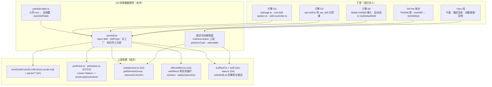
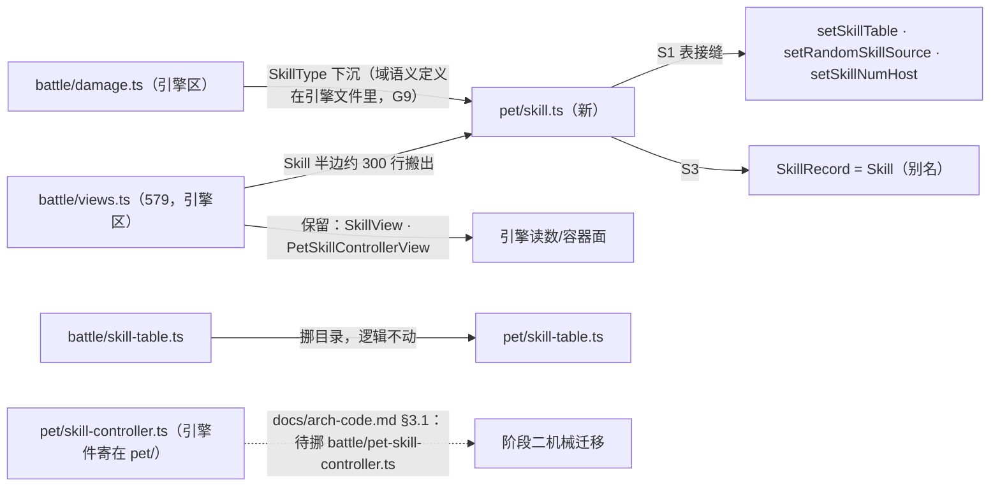

# 域模型子设计 D5 · 技能数据模型（domain-skill.md）

> **定位**：本线的**技能族** —— 上游一个 `Skill.cs`（**732 行、单类**）同时服务**内核、表现、网络、工坊**四类消费方。
> 本份做三件事：**① 把这个类按消费方劈开并逐臂定归属**（哪一臂是域、哪一臂是引擎、哪一臂是 View）；
> **② 把已落地的 `SkillRecord`（DTO）与真 `Skill` 字段逐条对齐**（接缝 S3 的兑现清单）；
> **③ 定真对象的契约与施工批次**（S5/S6 照着写码，且不改任何对拍 kind）。
>
> 父文档 = `docs/domain/domain-design.md`（**§1 V1–V7 / §4 接缝 S3 / §5 P1 写法口径 / §6.1 为什么不并入 D6**）。
> **边界真值** = `docs/engine/battle-engine-design.md §8.4`（第 (2) 表把 `Basic/Pet/Skill.cs` 判给**域模型线**，现状「未移植（`SkillRecord` 顶替）」）。
>
> **证据标注**：【源码】= 上游 `MVC/Model/Basic/Pet/Skill.cs` 及其调用方；【我们】= `game/core/**`；【样本】= `game/data/unity/skills.json`（**5340 行**，实测于 `game/data/unity/manifest.json`）。
> **别与这些重复**：逐列实测 → `docs/engine/port-map.md`；伤害/命中算式 → 引擎 E3（`core/battle/damage.ts`）；
> 出手位账本 → 引擎 E3（`core/battle/unit-skill-system.ts`）；印记算子 → 引擎 E4。
>
> **本份已拍板（D5 自己定的两条 ⚠️ 不是全局「人类决议」，后者索引在 `AGENTS.md §5`）**：① **描述文本的生成属域**（纯函数 + 注入表），**渲染**才属 View；
> ② **`ParseRPCData` / `ToRPCData` / `GetDefaultSkill` 不搬进本族**（吃 `Player.instance` / Photon RPC / 自动战斗游标 ⇒ 引擎 E6 + 围栏）。
> 引用这两条一律写「**本份已拍板 ①/②**」。

---

## 0. 这份文档回答什么

1. **`Skill` 没有 `Info` 分层**（与 D4 的 `Buff`/`BuffInfo` 最大的差别）：**表里那一行就是可变对象**，
   所以「谁拷贝、什么时候拷贝、拷不拷 PP」是**本族的第一条纪律**（§2.7）。
2. **一个 732 行的类，四条使用面**：内核语义 / 战斗装配 / 表现 / 网络与工坊 ⇒ **逐臂归属表**（§2.1）。
3. `SkillRecord`（DTO）与真 `Skill` 的**逐条差**：哪些字段是**派生属性**、哪些是**别名**、哪些**根本没搬**（§3.1）。
4. **`SkillType` 住错了文件**：它（`Skill.cs:727-731`）现在定义在引擎区的 `core/battle/damage.ts:22`，
   而 §8.4 判它归**域模型线** ⇒ **引擎文件替域侧定义权威类型**（§5 G9 / §6.1）。
   ⚠️ 措辞要准：**按目录**（`arch-code.md §3.1` 把 `battle/**` 整片算引擎区）今天**还不算破** §3 硬规则 #3；
   但 `pet/skill-controller.ts:13-14` 已经在**从域目录 import 引擎目录**，所以 B2/B3 把 `Skill` 搬回 `core/pet/` 之前**必须先做 B1**，否则箭头立刻指反。这是 D5 第一批要还的债。
5. 真表里**活着的怪癖**：`type=-7` 未声明值、13 条负 id、`groupd` 拼错、`accuracy=950` 描述里两头都不显示（§7）。
6. **落地契约与施工批次**：怎么在**不动对拍签名**的前提下把 DTO 换成真对象（§3.3 / §6.2）。

> **为什么 D5 值得单列一份**（承 `docs/domain/domain-design.md §6.1`）：`Skill.cs` 独立 732 行，
> 且它是**已冻结的 `views.ts` DTO** 的替换目标 —— 字段对齐必须逐条钉，塞进 D6 就没人再去看那张对齐表。

---

## 1. 范围与边界

| | |
|---|---|
| **本份覆盖** | `Skill`（四构造 + `DATA_COL` + 全字段与派生属性 · `GetRawInfoStringArray` · `InitCost`/`InitOptionsProperty` · 六个 `Is*` 判定 · `Get·TryGet·SetSkillIdentifier` · `Set·AddEffects` · `SetParallelIndex` · 五支工厂 · `GetRandomSkill` · `GetSkill`/`database`/`IsMod`/`IsNullOrEmpty` · 描述三段生成 · 动画/音效**取值**）｜ `SkillType` 枚举 ｜ `SkillTable`/`setSkillTable`/`setRandomSkillSource`/`setSkillNumHost` 接缝 ｜ 真技能表装载与逆函数（现 `core/battle/skill-table.ts`，目标 `core/pet/skill-table.ts`） |
| **上游** | `MVC/Model/Basic/Pet/Skill.cs`（732）+ 装载方 `System/ResourceManager.cs:737-766` + `System/Database.cs:130-133` + 表头契约 `System/SaveSystem.cs:531` |
| **不覆盖** | 伤害/命中/暴击/先手算式（`UnitSkillSystem.cs:161-224`）→ **引擎 E3**（`battle/damage.ts`） |
| | 出手位的**临时账本**（`UnitSkillSystem.cs` 332：`skill`/`counterSkill`/累加器/`onChainStart` 回填）→ **引擎 E3**（`battle/unit-skill-system.ts`） |
| | `PetBattleSkillController.cs`（106：四袋容器 + `FindSkill` + `GetAvailableSkills` + `GetDefaultSkill`）→ **引擎 E3**（§8.4(2)；现寄在 `core/pet/skill-controller.ts`，`docs/arch-code.md §3.1` 已登记「位置待挪」） |
| | 宠的技能袋与学习表（`Components/PetSkill.cs` + `Info/PetSkillInfo`）→ **D6 / D7** |
| | `Effect` 七段与常驻壳展开 → **D3**（本族只调 `Effect.setEffects`）；`Buff`/`BuffReferData` → **D4**（`referBuffList` 的解析在它那边） |
| | 技能的**渲染**（富文本 / 卡面 / 页签 / 气泡）→ **View 线**（`docs/view/scene/battle/view-scene-battle-design.md`） |
| | 技能表的**生产**（CSV → `skills.json`）→ **L2 内容桥**（V6：本族只吃注入的表）；`Item` 族（`GetItemSkill` 的入参）→ **本线未立族**（§6 缺口） |

---

## 2. 上游真值

### 2.1 逐臂归属（**本份最重要的一节**）

> 上游把四类消费方写进了同一个类。判据仍是 §8.4(1)：**入参/读值碰 `BattlePet`/`Player`/`Sprite` ⇒ 出本族**。

| 臂 | 上游 | 归属 | 判据 / 现状 |
|---|---|---|---|
| 九列 ctor + `InitCost` + `InitOptionsProperty` + 逆函数 | `:86-107` `:129-150` `:189-207` | **D5** | 纯数据往返；【我们】`battle/skill-table.ts`（247）已绿，kind `skilltable` |
| 字段与派生属性（`PP`/`isSuper`/`ignore*`/`positionType`） | `:14-58` `:61-72` | **D5** | `positionType` 的消费端在 `PetSkill.cs:26-42`（D6）与 `UnitCardSystem.cs:38`（引擎围栏） |
| 六个 `Is*` + `IsNullOrEmpty` + `IsMod` | `:460-503` `:74-82` | **D5** | 只吃 `type`/`effects`；【我们】`views.ts:88-98` 已搬（纯判定） |
| `Get/TryGet/SetSkillIdentifier`（5 前缀 + 21 臂） | `:539-723` | **D5** | 效果语言的读/写面；【我们】`views.ts:104-294` 已搬，kind `skillsys`/`wsk` |
| `Set·AddEffects` / `SetParallelIndex` | `:426-458` | **D5** | 常驻壳展开在 D3；`source` 回指是本族语义 |
| 五支工厂（空过/逃跑/換场/換场换时机/道具）+ `GetRandomSkill` + `GetSkill`/`database` | `:277-345` `:209-213` `:12` | **D5**（道具与 random 两支带围栏，见 §6） | 算子 `set_skill` 的前置；【我们】`views.ts:334-440` 已搬 |
| `GetDescription` / `GetAdditionalCardDescription` / `GetSkillDescriptionPreview` | `:347-424` | **D5**（**本份已拍板 ①**） | 纯函数，但摸 `Buff.GetBuffInfo` 表与 `elementColorDict` ⇒ 一律**注入接缝**；渲染归 View |
| `animSpeed` / `soundId` / `petAnimType` / `captureAnimType` | `:69-72` `:513-537` | **D5 出值**，**消费归 View/E7** | 本族只出 `enum` 数值与字符串 id；`SetTimeScale`/`rateScale` 在 `BattlePetAnimView.cs:61-171` |
| `GetSelectableTarget(BattlePet[], cursor, parallelCount)` | `:484-498` | **D5 出规则**（收窄成吃 `isDead[]`），调用点在 E6/View | **本份已拍板 ① 的同法**：判定是纯的，入参形状收窄（同 D4 §2.5 把 `getFeatureBuff` 收窄成吃 id） |
| `ParseRPCData` / `ToRPCData(BattleSettings)` | `:220-275` | **引擎 E6 + 编排围栏**（**本份已拍板 ②**） | 吃 `Player.instance.currentBattle.settings.parallelCount`（:250）与 Photon RPC（`BattleManager.cs:298` / `BattleUnitView.cs:38`）；且它是**回合输入**，不是数据 shape |
| `ToString` / `Skill()` 无参 ctor | `:215-218` `:84` | **D5**（`ToString` 仅调试） | 无参 ctor 只造「全默认」壳，是 `blankSkillRecord` 的真值源 |

### 2.2 字段：**类型与读写语义**才是要点（全量表 = `Skill.cs:14-58`）

> 按 `docs/domain/domain-design.md §5`，本份**不重抄字段表**；只钉**移植体会在类型上分叉**的那几列。

| 列 | 上游声明式 | ⚠️ 要点 |
|---|---|---|
| `elementId` / `element` | `:16` + `:17-21` | **同一个 int 的两个名字**（属性是 cast 往返）⇒ 移植体只留 `elementId` 一份，**别存两份**（会漂移） |
| `anger, pp, maxPP` | `:26`（三个 int 字段） | `pp` 是**原始值**，`PP` 才是夹紧属性（`:27-31`，**读写两侧都夹**）⇒ 同 D4 的 `Buff.value` 纪律 |
| `critical` | `:43` **`float`** | 字段就是 float（V3）⇒ 写入过 `f()`；真表实测**全是整数**【样本】，但形状不许改成 int |
| `combo, chain` | `:44` int | ⚠️ ctor 里 `combo = chain = 1` **写在 `InitOptionsProperty` 之前**（`:103-104`），而 options 里**没有**这两把键【样本 0 命中】⇒ **装载技恒 1/1**，只有运行期 `SetSkillIdentifier("combo"/"chain")` 会动 |
| `ignoreShield` | `:46` **真字段** | 装载时 `bool.Parse` |
| `ignorePowerup` / `ignorePowerdown` | `:47-56` **派生属性** | = `powerup.mult.def * powerup.mult.mdf == 0` / `powerdown.mult.atk * mat == 0`；**没有字段**，setter 把两格**同时**打成 0 或 1 ⇒ 写 `false` 也是**覆盖**（把 0 改回 1）。读侧判的是**乘积**，不是"两格都为 0" |
| `powerup` / `powerdown` | `:57-58` `Linear<Status>` | 初值 `(Status.one, Status.zero)`（D1 的 `Linear` + D2 的 `Status`） |
| `referBuffList` | `:41` `List<string>`，初值**空表** | ⚠️ 字段初始化给 `[]`，但 `InitOptionsProperty`（`:141`）**无条件重指**：`options.Get("ref_buff", null)?.Split('/')` ⇒ **表技没这把键就是 `null`**，而**特殊技（protected ctor）保持空表** —— 两者都"没有 buff"，但不是同一个值（`GetAdditionalCardDescription:410` 的 `?.Union(...) ?? new List` 就靠这个差） |
| `rawCostString` / `rawDescription` / `name` | `:25` `:34` `:15` string | ⚠️ `protected Skill(SkillType)`（`:180-187`）**三个都不写** ⇒ 特殊技的 `rawDescription` 是 `null` ⇒ `GetDescription`（`:355` `plainText.Trim()`）与 `GetSkillIdentifier("description[..]")` 在它们身上**NRE**，与表里那行的技不一样 |

### 2.3 四个构造（清洗规则**互不相同**）

【源码】`:84`（无参）· `:86-107`（CSV 九列）· `:109-127`（工坊/程序化）· `:152-178`（拷贝）· `:180-187`（protected 特殊技）

| 构造 | 清洗 | ⚠️ 要点 |
|---|---|---|
| CSV `Skill(string[], int)` | **不过** `ReplaceSpecialWhiteSpaceCharacters` | 【我们】注释钉过（`skill-table.ts:36`）：`GetCSV` 已按 `,`/`\n` 切过，这条路径上游**就是不清** —— 与工坊那条的**清洗差是 `skilltable` 的素材**，合成一条就错 |
| 工坊 `Skill(id, name, …)` | `name`/`options`/`rawDescription` **三处全清** | 【我们】`skillRowFromFields`（`skill-table.ts:229-247`） |
| 拷贝 `Skill(Skill rhs, bool copyPP = true)` | — | ⚠️ 走 `SetEffects(rhs.effects.Select(x => new Effect(x)))`（**复数重载 ⇒ 常驻壳会展开**）⇒ **克隆一只技能可能改变它的效果条数**；`options.ToDictionary` 吃 null options **当场抛**（`ArgumentNullException`）；`PP` 读的是**夹紧后**的值 |
| protected `Skill(SkillType)` | — | `id = (int)specialType` · `power = anger = 0` · `accuracy = 100` · `combo = chain = 1`；**其余全默认**（`critical` 因此是 **0** 而不是 5 —— 5 是 options 的默认串，只有走过 `InitOptionsProperty` 才拿到） |

### 2.4 `InitCost` —— 三处会当场炸的形状

【源码】`:129-137`｜【我们】`skill-table.ts:97-105`

1. `anger = list[0]` —— `ToIntList("")` 给**空表** ⇒ 空费用串**当场 `ArgumentOutOfRange`**，不是兜 0。【样本】真表 5340 行**没有一条空费用**（这条炸不到，但形状要留着）。
2. `maxPP = (list.Get(1, 0) > 0) ? list[1] : Mathf.Max(5, 40 - anger)` —— 三元判的是"**存不存在且 > 0**"，取值取的是**原表** `list[1]` 而不是兜底值。
3. `PP = maxPP` 走**属性**（int 夹紧）⇒ **落库的 `pp` 恒等于 `maxPP`**，所以 `skills.json` 里**没有 `pp` 这一列不是缺数据**。【样本】`rawCostString` 单段 5252 行 / 两段 88 行。
   ⚠️ `Mathf.Max` 这里是 **int 版**，不是 float 版（`docs/engine/oracle-playbook.md §7` 那条 `Clamp` 两版的教训）。

### 2.5 `options` —— 词表之外的第二套真值

【源码】`:37` `Dictionary<string,string>`（**插入序即回写序**，V1 同族纪律）｜【我们】`Map<string,string>`

**表实测的 15 把键**【样本】：`ref_buff 1632 · priority 426 · group 100 · critical 64 · ignore_powerup 42 · ignore_shield 40 · second_super 11 · keep 6 · token 4 · ignore_powerdown 2 · battle_report 2 · position 2 · anim_speed 1 · groupd 1 · first 1`

| 事实 | 后果 |
|---|---|
| ⚠️ `ignore_powerup` 同时有 `true`(38) 与 `True`(4) 两种写法 | `bool.Parse` 不敏感 ⇒ 装载无差；但**逆函数回写恒出 `"True"`**（`:198` 的 `ignoreShield.ToString()`）⇒ **往返不保串**，`skilltable` 比的就是这条 |
| ⚠️ `groupd`（`14739 千雪折樱`）是 `group` 的拼错 | V2：**静默**。`option[group]` 读它给兜底 `"0"` ⇒ 那条技能的行为就是"分组条件不成立"，**这是行为不是 bug**（同 `manifest.json` 的 `silentFallbackQuota` 口径） |
| ⚠️ 表里**没有** `sound` / `capture_result` / `item_id` / `evolve` / `parallel_*` / `source_index` / `target_index` | 全靠**运行期注入**：`GetItemSkill`(`:342`) / `GetPetChangeSkill`(`:315-317`) / `ParseRPCData`(`:240` `evolve`) / `SetParallelIndex`(`:450-451`)。⇒ `soundId` 在发行内容上**恒空串**，View 因此永远回落到宠的 `soundInfo.GetSoundByType`（`BattlePetAnimView.cs:172`） |
| `option[...]` 是**活臂** | 效果表达式里 `option[` 出现 63 次 `group]`、还有 `parry`/`checkEvolve`/`tmpPower` 等 ⇒ 读侧那支不能空转 |
| `keep`/`token`/`first` 各 6/4/1 条 | ⚠️ 它们是 `GetAdditionalCardDescription`（`:398` `spAbility` 三把键）里 `-101/-102/-103` 号 `BuffInfo` 的**开关**，**不是**运行时字段 ⇒ 描述生成会**回写 `referBuffList`**（`:410`）——** getter 有副作用**，见 §7 第 8 条 |

### 2.6 `GetRawInfoStringArray` —— ctor 的逆函数（比的那九列）

【源码】`:189-207`｜【我们】`skill-table.ts:155-180`

- 前七列与第九列 = 字段直读；**第八列是重算**：七把"默认键"由字段重拼（`critical != 5` 才写、`priority != 0` 才写、三个 `ignore_*` 出 `"True"`、`second_super` 出小写 `true`），其余键按 options **插入序**原样带走。
- ⚠️ **表头契约**：`SaveSystem.cs:531` 写的是 `id,name,element,type,power,anger,accuracy,option,description` —— **第六列的表头叫 `anger`，装的却是费用串**（`InitCost` 的入参）。逆函数与它必须同序，**别"顺手改成anger"**。
- ⚠️ `raw + "&" + other` 中间那个 `&` 在 `other` 为空时留下**尾 `&`**，由末尾 `Trim('&')` 砍；两支都空才是 `"none"`（判的是**拼接后**的串，不是两支各自）。
- `mod` 导出判据：`(!Skill.IsMod(id)) && (!bool.Parse(options.Get("mod","false")))` ⇒ 跳过（`SaveSystem.cs:536-537`）。【样本】**发行表 `id` 域 `[-1012, 100040]`，没有一条 `< -10000`** ⇒ `IsMod` 在发行内容上**恒 false**，这条只对工坊开。

### 2.7 表行是**共享可变模板** —— 拷贝纪律（与 D4 的分层差别）

> `Buff`/`BuffInfo` 是"实例 vs 只读表行"两层；**`Skill` 没有这个分层**：`skillDict` 里那一行**自身可变**，
> 谁想改它都得先拷。上游的拷贝点**只有三处**，各自语义不同：

| 拷贝点 | 上游 | `copyPP` | 语义 |
|---|---|---|---|
| **进宠袋**（`PetBattleSkillController` 两构造） | `:20-32` `new Skill(x, **false**)` | **false** | ⚠️ **按满 PP 重建** ⇒ 每只宠袋里是**私有副本**；`PP` 消耗（`takeSkillCost` → `findSkill(id).pp -= 1`，【我们】`state.ts:506-521`）**落在袋里那一份，不动表行** |
| **战斗状态深拷**（控制器拷贝构造 / `Unit.setSkill`） | `:34-41` `new Skill(x)` · 【我们】`state.ts:306-310` | **true**（缺省） | 保 PP；⚠️ 拷贝构造里 `headerSkills` 那一支**没有 `x == null ? null :` 守卫**（`:37`），而 `normalSkills` 那支有（`:39`）⇒ **袋里有洞时 `new Skill(null)` 当场抛**（上游形状，两条不对称） |
| **算子换技能**（`set_skill` 的 `id` 支） | `EffectAbilityHandler.cs:1312` | true | ⚠️ **switch 的结果再过一次拷贝构造** ⇒ 工厂 new 的那只不是最终对象；`"-3"` 拿到 null 时炸在拷贝构造的 `rhs.id` |

**为什么 `onChainStart` 要回填**（`UnitSkillSystem.cs:145-149`，【我们】`unit-skill-system.ts:225-231`）：
连击第二击从**表里那一份**重取 `critical/combo/accuracy/power` —— 因为出手位那只可能已被 `set_skill` 改写。
这是"表 = 模板权威"的直接证据：**别把回填改成"用当前技能自己的值"**。

### 2.8 装载：`RM.GetSkill` → `Database.skillDict` → `Skill.GetSkill`

| 事实 | 证据 |
|---|---|
| ⚠️ **`for (int i = 1; ...)`** ⇒ **第 0 行是表头，跳过**；`info.Length / DATA_COL` 定行数 | 【源码】`ResourceManager.cs:742-753` |
| ⚠️ 效果按 **`effect.csv` 的行序**配对（`effectLists[i - 1]`），**不是按 id** | 【源码】`:751`；【我们】`tools/build-unity-data.mjs:319` 的 `pairEffects(...)`（`manifest.json` 的 `rowMismatch` 登记了越界行的处理） |
| ⚠️ `skillDict.**Add**(skill.id, skill)` ⇒ **重复 id 抛** `ArgumentException`，而 try 包在**整个循环外** ⇒ **其后所有行一起丢**（只弹一次 Hintbox「技能ID N 出错」） | 【源码】`:745-758`；【样本】发行表**无重复 id**（`manifest.json` 的 `audit.dupId` 空）⇒ 这条现在炸不到，但**工坊导入会** |
| mod 覆盖在装载**之后**（`TryLoadSkillMod` → 逐键 `Set`） | 【源码】`:771-784`；`Set` 是覆盖不是抛（与 `Add` 不同型） |
| `Database.GetSkill(id)` 的 **`id == 0` 短路**（表里真有 0 号也不给查） | 【源码】`Database.cs:130-133`；【我们】`skill-table.ts:225` |
| `Skill.GetSkill(id, avoidNull = true)` ⇒ 查不到落 `GetNoOpSkill()`；`avoidNull=false` 才答 null | 【源码】`:209-213`；【我们】`views.ts:454-457` |
| `Skill.database` 是**静态属性**，每次读都 `Where(x => x != null).ToList()` ⇒ **全表新建** | 【源码】`:12`（别缓存它，工坊会热替换 `skillDict`） |
| ⚠️ `skills.json` 里 build 已经把 `anger/maxPP/critical/priority/ignore*/referBuffList` **预计算过一遍** | 【我们】`tools/build-unity-data.mjs:320-346`；**内核刻意不吃这些现成字段**（`port-map.md` 已登记：否则"比的是我自己"）。HUD 侧读取方继续用现成字段，不受这条影响 |

### 2.9 标识符：读侧与写侧是**两套分支顺序**

【源码】`:539-627`（读）· `:629-633`（Try）· `:635-723`（写）｜【我们】`views.ts:104-294`（已搬，kind `skillsys` / `wsk`）

- **读**：5 个前缀支在 `switch` **之前**（`description` / `option` / `powerup.` / `effect.` / `element.`），末尾 21 臂 + `default ⇒ float.MinValue` 哨兵。
  ⚠️ `effect.` 与 `element.` 两支的**内层子分支不匹配时穿透**到后面的支继续，**不是 return 0**（`element.xxx` 其余写法会落到末尾 `switch`）。
  ⚠️ `option` 支**不要求方括号**（`:545` 无条件 `TrimParentheses`）⇒ `optionX` 查的是键 `X`。
- **写**：`option[...]` 支**要求真的有方括号**（`:637` 两个条件）⇒ `optionX` **穿透**到末尾 `switch` 的 `default: return` **静默不写**。
  ⇒ **读写两侧的 `option` 语义不同**，别互相"对齐"（这条已经在 `views.ts:231-243` 的注释里钉死）。
- `powerup.` 支两侧同形：`split[1]` 越界在 C# 是 `IndexOutOfRange`（switch 先求值），JS 会静默走 default ⇒ **显式补边界**；
  `split[0]` 既非 `pos` 又非 `neg` 时上游 new 一份**临时** `Linear` 再写进去 ⇒ **静默丢弃**（这是行为，不是 bug 可抄）。
- ⚠️ `element.group` 臂（`:592-600`）现在 **`NOT_PORTED`** 显式抛（`views.ts:152-156`）。
  **本族其实不欠 S6 的宠表**：它要的是 `PetElementSystem.GetElementGroup`，而 D2 已有可注入版
  （`core/pet/element.ts:101`，分组表**发行数据里没有** ⇒ 恒「自己」，见那文件头注）⇒ **D5 可以直接接**（§6.2 批四）。

### 2.10 判定与派生属性（一行一条，都在本族）

| 臂 | 上游 | ⚠️ |
|---|---|---|
| `IsAction()` | `:460-465` | `type < 属性(0) && type != 被动` ⇒ **不是"非攻击技"**：空过/道具/换场/逃跑才是 action，**属性技(0)不是**【我们】`views.ts:88-90` |
| `IsAttack()` | `:467-471` | `type > 属性`；注释掉的三条件旧版**不算数** |
| `IsSelect()` | `:473-476` | `effects.Exists(x => x.IsSelect())` —— 读 D3 的 `isSelect` getter |
| `IsSelectReady()` | `:478-482` | ⚠️ **空 effects ⇒ `All()` 恒真** |
| `IsCapture()` | `:500-503` | `Any(x => x.ability == Capture)` |
| `GetPositionType()` | `:505-511` | `options["position"]`（**忽略大小写**比 `"super"`）⇒ 否则回 `type`。【样本】表里只有 2 条 `position=super` ⇒ `连携(3)` 的 12 条靠这一臂**不会**变成必杀 |
| `IsNullOrEmpty(skill)` | `:79-82` | ⚠️ 判的是 `type == 空过`，**不是 null**（名字是坑，照搬） |
| `IsMod(id)` | `:74-77` | `id < -10000`（**不是** `id < 0`；与 `settings.ts` 的 `petInfoIsMod`（`id < 0`）**不同型**，别统一） |

---

## 3. 目标结构（契约）

### 3.1 DTO ↔ 真 `Skill` 逐条对齐（接缝 **S3** 的兑现清单）

> 现状：真 `Skill` 没有对象，只有 `SkillView`（13 字段，`damage.ts:30-47`）+ `SkillRecord`（继承它再补 15 项声明，含把 `options`/`powerup`/`powerdown` 从可选钉成必带，`views.ts:64-82`）
> + 一批**自由函数**（`skillPP`/`isActionSkill`/`cloneSkill`/`getSkillIdentifier`/…）。**这一张表就是迁移的合同**。

| 上游 `Skill` | 类型 | 现在 DTO 里的样子 | 差在哪 | 落地 |
|---|---|---|---|---|
| `id/name/elementId/type/power/anger/pp/maxPP/accuracy` | int | 同名字段 ✓ | — | 保留字段 |
| `PP` | **属性**（读写都夹） | `skillPP(s)` + `setSkillPP(s,v)` **自由函数** | 调用点要记得走函数；写成 `s.pp` 就读不到夹紧值 | ⇒ `get PP()/set PP()`；自由函数留作**过渡别名**（对拍签名不改） |
| `rawCostString/rawDescription` | string? | 同名字段（`null` 保留）✓ | — | 保留 |
| `description` | **属性**（`GetDescription(raw)`） | **没有** | 未搬（描述半边整块缺） | ⇒ `get description()`（批四） |
| `element` | `Element`（同一 int 的别名） | 只有 `elementId` ✓ | 刻意不存两份 | ⇒ `get element()` 只作出参便利 |
| `options` | `Dictionary`（**序**） | `Map`（必带）✓ | 序 = 插入序，已钉 | 保留 |
| `effects` | `List<Effect>`（**可有 null 洞**） | `Effect[]` | 【我们】类型里没留 null ⇒ `setSkillParallelIndex` 手动判 `x === null`（`views.ts:223-227`） | ⇒ 元素类型补 `Effect \| null`（与 `PetSkillControllerView` 同法） |
| `isSecondSuper/critical/combo/chain/priority/vipriority/ignoreShield` | float/int/bool | 同名字段 ✓ | — | 保留 |
| `ignorePowerup/ignorePowerdown` | **派生属性** | 自由函数 `powerupIgnored` 等 | ✓ 已不存字段 | ⇒ 收成访问器 |
| `powerup/powerdown` | `Linear<Status>` | 字段（必带）✓ | — | 保留 |
| `referBuffList` | `List<string>` \| null | 字段 ✓（null 与 `[]` 的差已在 §2.2 钉） | — | 保留 |
| `isAction` | **属性**（`IsAction()`） | ⚠️ **契约字段** —— 实现方必须用 `isActionSkill(type)` 填、**且改 `type` 时改它**（`views.ts:8`、`setSkillIdentifier` 的 `case 'type'` 特意补这一笔） | **DTO 特有的负担**，真对象上不存在 | ⇒ 变 `get isAction()` ⇒ **删掉这条纪律**（批二一起做，别留两样） |
| `isSuper/isAttack/isSelect/isCapture/positionType` | 属性/方法 | `isActionSkill` 式的**自由函数** | 无对象入口 | ⇒ 属性（纯函数继续留着给调用方过渡） |
| `animSpeed/soundId/petAnimType/captureAnimType` | 属性 | **没有** | 未搬 | ⇒ `get`（批四），值语义照 §2.1 |
| `GetSkillIdentifier` 三兄弟 | 方法 | `getSkillIdentifier(s,id)` 等自由函数 ✓ **已全搬** | — | ⇒ 方法 + 自由函数转发（对拍不动） |
| `Set·AddEffects/SetParallelIndex` | 方法 | `setSkillEffects` 等 ✓ | — | 同上 |
| `GetRawInfoStringArray` | 方法 | `getSkillRawInfoStringArray(skill)` ✓ | — | 同上 |
| 五支工厂 + `GetRandomSkill`/`GetSkill`/`database`/`IsMod`/`IsNullOrEmpty` | **静态** | `noOpSkill()`/`escapeSkill()`/… ✓（**除 `GetItemSkill` 与 `database`**） | 道具技等 `Item` 族；`database` 没入口 | ⇒ 静态挂 `Skill`（§6 缺口表） |
| `GetDescription` 三段 | 方法 | **没有** | 未搬 | 批四 |
| `GetSelectableTarget` | 方法 | **没有** | 未搬（**收窄成吃 `isDead[]`**） | 批四 |
| `ParseRPCData`/`ToRPCData` | 静/方法 | **没有**（**刻意不搬**） | 本份已拍板 ② | 归 E6 / 围栏 |

### 3.2 落点与轮廓

```
core/pet/skill.ts                      ← 新（本族权威文件，上游同名 Skill.cs）
  SkillType { 空过 -1 · 道具 -2 · 換场 -3 · 逃跑 -4 · 被动 -5 · 属性 0 · 物理 1 · 特殊 2 · 连携 3 · 必杀 100 }   // 从 battle/damage.ts 搬来（§5 G9）
  class Skill                                  // 由 SkillRecord 变来；SkillRecord = Skill（类型别名）
    字段（§2.2 全表）· effects: (Effect | null)[]
    static DATA_COL = 9 · static database · static isMod(id) · static isNullOrEmpty(s)
    get PP / set PP          get element        get description        get isAction / isAttack / isSuper / isSelect / isCapture
    get positionType         get animSpeed / soundId / petAnimType / captureAnimType
    get ignorePowerup / set  · get ignorePowerdown / set
    isSelectReady() · getSelectableTarget(deadFlags, cursor, parallelCount)
    setEffects(e) · setEffects(list) · addEffects(list) · setParallelIndex(src, tgt)
    getRawInfoStringArray() · clone(copyPP = true)
    getSkillIdentifier(id) / tryGetSkillIdentifier(id) / setSkillIdentifier(id, value)
    static parseRow(data, startIndex = 0)       // CSV 九列 ctor
    static fromFields(id, name, …)              // 工坊 ctor（全清洗）
    static noOp / escape / petChange / petChangeWithTiming / item / random / get(id, avoidNull = true)

core/pet/skill-table.ts                ← 现 core/battle/skill-table.ts 迁来（247，逻辑零改动）
core/pet/skill-database.ts（可选）      ← 只在 SkillType 需要被 D2/D3 独立 import 时才分文件（默认**不分**）
```

- `core/battle/views.ts` **保留**：`SkillView`（引擎读数面，§8.4 的 E7 出口半边）+ `PetSkillControllerView`（E3 的容器面）。
  它 import `core/pet/skill.ts` —— 方向 = 引擎 → 域 ⇒ **V7 正**（现状的反面：`SkillType` 这个**域语义**由引擎文件 `damage.ts` 定义、被别人 import 进来用，B1 就是把这个"谁定义谁"翻过来）。
- **对拍面不许动**：kind `skilltable` / `skillsys` / `wsk` 的**签名与调用序列**一字不改（`tools/snap-mirror.mjs:25-26` 的 import 只换路径）。

### 3.3 施工批次（每批后 `difftest` + `--test` 全绿，且**不改 kind**）

| 批 | 内容 | 影响面 | 门禁 |
|---|---|---|---|
| **B1** | `SkillType` 从 `battle/damage.ts:22` **下沉**到 `core/pet/skill.ts`。**实测 `SkillType` 的全部 import 方 = 8 个非测试文件**：`battle/{skill-table,views,state,phase,unit-skill-system}.ts`、`pet/{status,skill}-controller.ts`、`effect/effect-judge.ts`（`pet/` 那两个是**从域目录伸进引擎目录**的箭头；其余本来就正，只需换路径）| 零行为变更 | **✅ 已落（2026-10-19）**：`SkillType` 已移至 `core/pet/skill.ts`，共 12 个 import 方重指（6 core .ts + 2 app .js + 4 test .ts），`damage.ts` 改为 import 进来；`node tools/build-core.mjs` 干净（63 .ts→.js）、`node tools/difftest.mjs` 无回归（不一致=0、架子没对上=0）；`pet/skill-controller.ts` 的反向箭头已消，D6 B3 解锁 |
| **B2** | `SkillRecord` → `class Skill`：把 `views.ts` 的 Skill 半边（标识符读写 · `cloneSkill` · 五工厂 · 表接缝 · 纯判定）**整体搬进** `core/pet/skill.ts`；`isAction` 由契约字段变 getter | `views.ts` 减约 300 行；`snap-mirror` 的 `blankSkill`/FakeSkillController 要改成 new 对象。**实测外部消费方**：`tools/snap-mirror.mjs:25`、`tools/difftest.mjs:28`、`tools/drv-proto.mjs:12`（都只拿 `setSkillTable` / 工厂 / 标识符那几个名字）⇒ **名字不动、只换路径** | 同上 + `node --test game/core/` |
| **B3** | 装载半边：`battle/skill-table.ts` → `pet/skill-table.ts`；补 `Skill.database` 静态与 `IsMod` 的方法形态 | 目录移动（`.js` 重生成，`docs/arch-code.md §7`）。**实测消费方**：`tools/snap-mirror.mjs:26` + `game/app/battle/driver/tables.js:9`（后者 import 的是**产物** `/game/core/battle/skill-table.js` ⇒ 改源后**必须** `node tools/build-core.mjs` 再改这一行，别只改 `.ts`） | 同上 |
| **B4** | 描述与选择面：`get description` / `GetDescription` 三段 / `GetSkillDescriptionPreview` / 四个动画属性 / `getSelectableTarget`（收窄版）/ `element.group` 臂接上 D2 注入 | **新 kind `skilldesc`**（要 oracle 侧先发向量）；`element.group` 臂一接，现有 `skillsys` 向量会**多出一条可比支** | oracle 重建 + 全绿 |
| **B5** | 依赖别的族，**不在本族的批**：`GetItemSkill`（等 `Item`）、`GetDefaultSkill`（等 D6 + `phase.ts:986` 解栏）、`ParseRPCData`（归 E6） | — | — |

---

## 4. 接口（mermaid）

### 4.1 族内位置图



### 4.2 文件↔接口图（**现状 → 目标**）



---

## 5. 不变量与围栏

| # | 不变量 / 围栏 |
|---|---|
| **G1** | **表行是共享可变模板**：任何"上场/入袋"必须先拷；三处拷贝点的 `copyPP` 语义（§2.7）**不许合并** |
| **G2** | **`PP` 是夹紧属性，读写两侧都夹** —— 真对象里必须写成访问器；`pp` 是原始值，`maxPP` 不是上界来源而是 `InitCost` 的结果 |
| **G3** | **`ignorePowerup`/`ignorePowerdown` 没有字段**：读判 **乘积为 0**，写是**双向覆盖**（`false` 会把 0 改回 1） |
| **G4** | **读写两侧的分支顺序各是语义**（§2.9）：`option` 读侧不要求方括号、写侧要求；**不许互相"对齐"**；`default` 在写侧是**静默不写** |
| **G5** | **逆函数 = 第八列重算**：默认键由字段重拼、bool 出 `"True"`、其余按 options 插入序带走、`"none"` 判的是拼接后的串 |
| **G6** | **两条 ctor 的清洗规则不同**（CSV 不清 / 工坊全清）⇒ 不许合成一条 |
| **G7** | **V2**：`options` 缺失/拼错一律走**默认串**或 `"0"`，**静默**；未声明的 `SkillType` 值（`-7`）原样带进运行时，**不加校验** |
| **G8** | **V3**：`critical` 是 float、标识符返回 float、哨兵是 `float.MinValue`；**V1**：`options` 用有序 `Map` |
| **G9** | **V7 的"谁定义谁"**：`SkillType` 是**域侧**枚举 ⇒ 必须住在域文件；引擎文件**只能 import 进来**，不能反过来定义它。⚠️ 现状（`damage.ts:22` 定义、`skill-table.ts:17` + `pet/skill-controller.ts:13` 反向 import）在**按目录**的读法下还没破 §3 硬规则 #3，但它是**B2/B3 的地雷**：`Skill` 对象一旦搬回 `core/pet/`，不先做 B1 就是真的反向依赖（§6.1） |
| **G10** | **V6**：表经 `setSkillTable` 注入、随机源经 `setRandomSkillSource`、option 数值经 `setSkillNumHost`；**未注入一律显式抛**，不静默给 0 或空表 |
| **G11** | **headless 收窄纪律**：碰 `BattlePet[]`/`cursor`/`settings` 的臂 ⇒ 本族只出**显式入参的纯函数**（`getSelectableTarget(deadFlags, …)`）；碰 `Player.instance`/Photon 的 `ParseRPCData`/`ToRPCData` **不搬** |
| **G12** | **View 围栏**：本族只出**文本 shape 与枚举数值**（`description` / `petAnimType` / `animSpeed` / `soundId`）；排版、`SetTimeScale`、音效播放归 View / E7 |
| **G13** | **未移植显式抛**（E7 口径）：`element.group`（B4 接掉）、`GetItemSkill`（等 `Item`）、`GetDefaultSkill`（等 D6）、native 随机三支（生成阶段不发向量） |

---

## 6. 现状与缺口

### 6.1 现状（**本族不是"零落地"，是"落地了但没有对象"**）

| 件 | 行数 | 上游对应 | 对拍 kind | 状态 |
|---|---|---|---|---|
| `core/battle/views.ts` 的 Skill 半边 | 约 300 | `Skill.cs` 的 ctor 外方法面 | `skillsys` / `wsk` | ✅ 绿（**寄在引擎文件里**） |
| `core/battle/skill-table.ts` | 247 | `Skill.cs:86-207` | `skilltable` | ✅ 绿（**在引擎目录**） |
| `core/battle/damage.ts` 的 `SkillType`/`SkillView` | 269 | `Skill.cs:727-731` + `:14-58` 的读面子 | — | ✅（**`SkillType` 定义在引擎文件里** ⇒ B1 拆雷，G9） |
| `core/battle/unit-skill-system.ts` | 349 | `UnitSkillSystem.cs` | `skillsys` | ✅（**引擎 E3**，不属本份） |
| `core/pet/skill-controller.ts` | 35 | `PetBattleSkillController.cs:69-81` | — | ✅（**引擎 E3**，位置待挪） |
| `core/effect/ops-skill.ts` | 191 | `EffectAbilityHandler.cs:1291-1392` | `effectq`/算子批二 | ✅（**引擎 E4**，它的前置就是本份的写侧） |

> ⇒ `docs/domain/domain-design.md §6` 的「D5 我们现状 = 0」要按本表改成「**约 550 行已落地，缺的是对象化与归属**」。

**G9 的实测形状**（【我们】`grep` 实跑）：`battle/damage.ts:22` 定义 `SkillType`，
被 `battle/skill-table.ts:17` 与 `pet/skill-controller.ts:13-14` import（后者是**从域目录伸进引擎目录**的那一条）。
⇒ 今天**没有 zone-lint** 会报（`docs/arch-code.md §3` 硬规则 #1 只 grep `UnityEngine|Player.instance|Photon|Database.instance`），
但**这条不修，D6 会照抄同样的形状**，且 B2/B3 一落地它就变成真违规。（D7 已写，且**报了同族第二条**雷：`GetSortPriority` 住在 `namespace UnityEngine` 里 ⇒ 见 `docs/domain/domain-info.md §5 G12`。）

### 6.2 缺口

| 缺口 | 说明 | 去向 |
|---|---|---|
| **真 `Skill` 对象** | DTO 顶替；`isAction` 契约字段、`skillPP()` 自由函数、无 `description` 等派生入口 | **B1–B3**（§3.3） |
| **描述三段 + 动画取值 + `getSelectableTarget`** | 整块未搬；`GetAdditionalCardDescription` 还**回写 `referBuffList`**（§7 第 8 条） | **B4** + 新 kind `skilldesc` |
| **`element.group` 标识符臂** | 现在 `NOT_PORTED` 抛（`views.ts:155`）；**其实只欠 D2 的注入**，发行内容下分组表恒空 ⇒ 恒「自己」 | **B4** |
| **`Skill.database`** | 静态全表读（工坊/UI 用）；本族需要一个**注入版**入口，不能自己摸 `game/data` | B3（走 V6 接缝） |
| **`GetItemSkill`** | 入参是 `Item`（`item.name` / `item.effects`）⇒ **`Item` 族本线未立**；上游另有 `phase.ts:479` 的道具支围栏 | 等 `Item` 族立项 |
| **`GetDefaultSkill(anger)`** | 自动战斗的**游标轮转**（header → loop，`PetBattleSkillController.cs:43-67`）；`phase.ts:986` 现显式抛 | **引擎 E6**（容器在 E3，规则要读 D6 的技能袋） |
| **`ParseRPCData` / `ToRPCData`** | 回合输入编码（`target_index` 串、`evolve`、`parallel_*`）；吃 `Player.instance.currentBattle` | **引擎 E6 / 编排线**（编排线已立 ⇒ `docs/orchestration/orchestration-design.md`；本份已拍板 ②） |
| **native 随机三支** | `GetRandomSkill` 的 `Random.Range` + `set_skill` 的 `random[available]` / `parallelTargetIndex=random` | ⚠️ 口径已随**人类决议 ①** 改版（`docs/runtime/runtime-components-design.md §5 R1 / §7`、`AGENTS.md §1.1`）：**不再写"不可比"** —— 这三支**照常实现**，随机来自 **R1 注入的 `Rng`**（现缝 `setRandomSkillSource` / `setOpsSkillRng` 随 RB1 并入 R1）；验收 = **同 seed 自复现 + 形状断言 + 人类手测**，**不与上游逐值比** ⇒ 对拍侧用**显式声明来源的合成向量**，不再"生成阶段不发" |
| **工坊热替换** | `skillDict.Set(mod)` 在装载之后；`Skill.database` 每次重算就是为它 | 内容桥 / Save 侧议题 |

---

## 7. 待核 / 已知怪癖

| # | 事项 | 证据 |
|---|---|---|
| 1 | **表头第六列写 `anger`，装的却是费用串** | 【源码】`SaveSystem.cs:531` vs `Skill.cs:98`（`InitCost(_slicedData[5])`） |
| 2 | **`combo = chain = 1` 在 options 回写之前，且表里没有这两把键** ⇒ 装载技恒 1/1 | 【源码】`:103-104`；【样本】option 键 15 种里无 `combo`/`chain` |
| 3 | **空费用串当场 `ArgumentOutOfRange`**（不是 0）；真表 0 条空费用 | 【源码】`:133`；【样本】5340 行费用串均非空 |
| 4 | **`referBuffList`：表技是 `null`、特殊技是空表**（字段初值 vs ctor 重指）；`blankSkillRecord` 现给 `null`，因两个调用方都会覆盖 ⇒ **当前不可观测**，真对象落地时按 protected ctor 那条给 `[]` | 【源码】`:41` + `:141` + `:180-187`；【我们】`skill-table.ts:83`、`views.ts:357` |
| 5 | **`critical` 默认串 `"5"` 只走 options 那条路**；protected ctor 造的技能 `critical = 0` | 【源码】`:143` vs `:180-187` |
| 6 | **`accuracy/1000` 是整数除法** ⇒ `1100`/`2100`/`6100` 出【必中】；`950` 那一行（`13871 星变`）**既不到 1000 又 > 100 ⇒ 命中率与必中都不显示** | 【源码】`:362-372`；【样本】`accuracy` **主要**分布 95×2862 / 100×1486 / 1100×835，另有 85×56 / 70×33 / 50×16 / 97×15 / 35×9 / 96×6 / 25×4 / 90×4 / 40×3 / 75×3 / 80×2 / 2100×2 / 10×1 / 20×1 / 950×1 / 6100×1（>1000 的一共 **838** 行） |
| 7 | **真表有 `type = -7`（`id=-7`「变身成功」）** —— 整数转枚举不校验成员；`-7 < 0 && != -5` ⇒ 它是 **action** 技（不扣代价） | 【源码】`:95` + `:460`；【样本】`manifest.json` 的 `skillTypeFrequency` 有 `"-7": 1`；`tools/build-unity-data.mjs:331` 只登记不拦 |
| 8 | **`GetAdditionalCardDescription` 是 getter 链上有副作用**：把命中的 `-101/-102/-103` **并进 `referBuffList`** ⇒ 读一次描述会改技能状态；且循环靠 `Buff.GetBuffInfo(id)` 返回 null 才停 | 【源码】`:396-424` |
| 9 | **`option[groupd]`（1 条，`id=14739 千雪折樱`）是拼错的 `group`** ⇒ 静默走兜底 `"0"` | 【样本】option 键表；V2 |
| 10 | **`ignore_*` 表里有 `true` 与 `True` 两种写法，逆函数回写恒 `"True"`** ⇒ 往返不保原串（`second_super` 那支反而恒写小写 `true`） | 【源码】`:194-200`；【样本】`ignore_powerup` 38/4、`ignore_shield` 35/5 |
| 11 | **表里真有负 id 13 条**：`-1 空过`/`-4 逃跑`/`-7 变身成功` 与工厂技**同 id 不同对象**；其余 10 条是真技能（PVP 档），id 为 `-1001 … -1008` + `-1011` + `-1012`（**没有 `-1009/-1010`**）。⇒ `GetSkill(-1)` 拿表行，`ParseRPCData("-1")` 拿新空过 | 【样本】`skills.json` 负 id 行；【源码】`:209-213` + `:224-231` |
| 12 | **发行表 `id` 域 `[-1012, 100040]`、稠密度约 5%** ⇒ `GetRandomSkill` 的 `Random.Range` 大多落在空洞上，`GetSkill` 兜成**空过**后立刻满足过滤条件返回 ⇒ 抽到的常常就是「空过」而不是循环重试 | 【样本】min/max id；【源码】`:277-289`（**待核**：oracle 侧不发这条支，属推断） |
| 13 | **`RM.GetSkill` 的 `Add` 遇重复 id 抛，且 try 包在整个循环外** ⇒ 一行坏、其后全丢，只弹一次 Hintbox | 【源码】`:745-758`；【样本】发行表无重复 |
| 14 | **控制器拷贝构造两支不对称**：`headerSkills`/`loopSkills` 无 null 洞守卫，`normalSkills` 有 | 【源码】`PetBattleSkillController.cs:37-39` |
| 15 | **`FindSkill` 实际是 `allSkills.Find(…)`**（拼接序 header→loop→normal→super），注释里那套"super 优先"**不算数** ⇒ 同 id 跨袋时先命中 header | 【源码】`:83-105` |
| 16 | **`Skill.database` 每次读都全表新建**（`Where().ToList()`）—— 别缓存 | 【源码】`:12` |
| 17 | **`IsMod` 判 `id < -10000`，而宠的 `petInfoIsMod` 判 `id < 0`** —— 同族两个不同谓词 | 【源码】`Skill.cs:74-77` vs 【我们】`battle/settings.ts:57` |

---

## 8. 配对实现（impl）指针

- 本份配对 = 未来的 **`docs/domain/domain-impl.md`** + **`domain-code-map.md`**（阶段一续写；见 `docs/arch-docs.md §8`）。
- **现状事实面**：`docs/engine/kernel-handoff.md`（S3 各段对拍记录、批二 `set_skill` 收口）；逐列实测 = `docs/engine/port-map.md`；
  向量与反射纪律 = `docs/engine/oracle-playbook.md`（§7 的 int/float 两版 `Clamp`、`skilltable` 九列比法）。
- **消费方文档**：引擎 **E3** `docs/engine/battle-engine-units.md`（`damage` / `UnitSkillSystem` / 技能袋）·
  **E4** `docs/engine/battle-engine-effects.md`（§2.2/§2.5：批四 B 档 `rage`/`copy_buff`/`set_buff` 在等本族的 `Skill.PP`）·
  **E6** `docs/engine/battle-engine-session.md`（`SetSkill` 唯一输入接缝 / 自动战斗）·
  **E7** `docs/engine/battle-engine-views.md`（出口 DTO）·
  **D6** `docs/domain/domain-pet.md`（✅ 已写 2026-10-17：`PetSkill` 袋与本族 `GetSkill` 的接缝在它的 §3.1/§3.4 B3，⚠️ 它把**本族的 B1（`SkillType` 下沉）列为自己的前置**）·
  **View** `docs/view/scene/battle/view-scene-battle-design.md`（卡面字段）· **Save** `docs/save/save-xml-spec.md`（**技能不入 XML，只存 id** ⇒ V4/V5 对本族不适用）。
