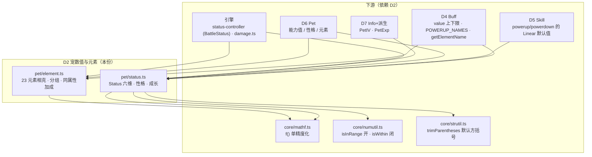
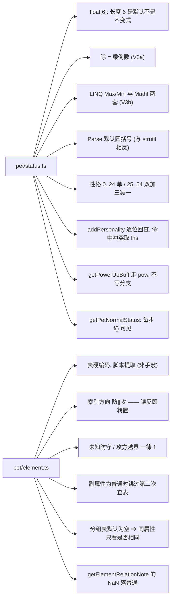

# 域模型子设计 D2 · 宠数值与元素（domain-status.md）

> **定位**：本线的**数值底座** —— `Status`（六维 / 性格 / 成长 / 能力值主公式）+ **元素相克**。
> 它**被所有族消费**：`Buff`（`value` 上下限、`powerup` 名字）、`Skill`（`powerup`/`powerdown` 的 `Linear<Status>`）、
> 引擎（`BattleStatus` 继承它、`damage.ts` 算伤害与相克）。
>
> 父文档 = `docs/domain/domain-design.md`（**§1 V1–V7 / §4 接缝 S4·S5**）。
> 实现在 `game/core/pet/status.ts`(286) + `game/core/pet/element.ts`(110)（**共 396 行**）。
>
> **别与这些重复**：逐算子实测 → `docs/engine/port-map.md`；边界 → `docs/engine/battle-engine-design.md §8.4`；
> 战斗中那层包装（`BattleStatus`）→ `docs/engine/battle-engine-units.md`（E3）。

---

## 0. 这份文档回答什么

1. `Status` 的**存储形状**（`float[6]`）与「长度 6 是默认、不是不变式」这条**别做防御**的纪律。
2. 三条**算术语义**（除 = 乘倒数 / LINQ 与 Mathf 两套 / 全链 `f()`）。
3. **性格**的 55 值协议与 `addPersonality` 的**逐位回查**判据。
4. **能力值主公式** `GetPetNormalStatus` 的逐括号展开。
5. **元素表**：硬编码来源、`[防][攻]` 索引方向、三处「未知 ⇒ 1」、双属性两次查表、分组表**默认为空**。

---

## 1. 范围与边界

| | |
|---|---|
| **本份覆盖** | `Status`（存储/下标/六个名字表/运算符/`Parse`/`ToString`/`Get·Set(string)`）· `getPersonalityBuff` · `addPersonality` · `getPowerUpBuff` · `getPetNormalStatus` · `statusMin/Max/Clamp` · `HIDDEN_TYPE_NAMES` · **元素**（`Element` / `ELEMENT_NAMES` / `ELEMENT_COLORS` / `ELEMENT_DEFENSE_RELATION` / `getElementRelation(-Sub)` / `getElementName` / `getElementGroup` / `getSameElementBuff` / `getElementRelationNote`） |
| **上游** | `MVC/Model/Basic/Pet/Status.cs:1-393`（`Status` 类）+ `:522-545`（`StatusType` / `HiddenStatusType` 两枚举）+ `System/PetElementSystem.cs`(216) |
| **不覆盖** | `BattleStatus`（`Status.cs:394-521` 的六隐藏列 + 战斗态） → **引擎 E3**（`core/pet/status-controller.ts`） |
| | `PetElementSystem.GetElementRelation(int, BattlePet)`(:167) / `(Skill, BattlePet)`(:172) 两个**吃 `BattlePet` 的重载** → **引擎 E3**（`battle/damage.ts`）；本份只提供**纯函数**版(:155/:160) |
| | `Personality` 枚举的**中文名表** → 见 §6 缺口（写 XML 才需要） |
| | `PetElementSystem.ParseElementEffect`(:95)（从表覆盖相克表） + `IsMod`(:93) → **未搬**，见 §6 缺口 |
| | `Status` 的 `[XmlElement]` 序列化语义 → `docs/save/save-xml-spec.md`（本份只引用 V4/V5） |

---

## 2. 上游真值（逐件）

### 2.1 `Status` 的存储形状 —— `float[6]`，**长度 6 是默认不是不变式**

【源码】`Status.cs:70-73`｜【我们】`game/core/pet/status.ts:59-77`

- 上游是 `protected float[] status = new float[6]`。六列的**声明顺序** = `atk / mat / def / mdf / spd / hp`（V4）。
- ⚠️ **`Status(IEnumerable<float>)` 用 `Where((x,i) => i < 6)` 截断**：给长表截到 6，**给短表就得到短数组**。
  之后任何 `s[5]` 越界即抛 `IndexOutOfRangeException` —— 这是上游形状，**不许"顺手"补零**（补了就把抛点吞掉了）。
  【我们】`status.ts` 头注明说「保持同样的『不做防御』形状」。
- ⚠️ **每个标量都是 `float32`**（V3）：构造、以及每一个算术点都过 `f()`。
  对拍里 `statusop` 那批分歧就是漏 `f()` 造成的（oracle 侧 `Coerce`/`GetSingle` 天然收窄）。
- **下标读取**：`this[int]` 对 `i ∉ [0,5)` 返回 **0**；但若数组本身就是短的，仍会**越界抛**。
  两个行为不许混成一个（`at()` vs `s[i]`）。

### 2.2 六个名字表 + 隐藏列

【源码】`Status.cs:8-10`（`Status` 的成员）/ `:522-537`（`StatusType`）/ `:538-545`（`HiddenStatusType`）
【我们】`status.ts:17-21` / `:285-286`

| 导出 | 内容 | 备注 |
|---|---|---|
| `STATUS_TYPE_NAMES` | `atk, mat, def, mdf, spd, hp` | CSV/XML 的键名 = 上游 `StatusType` 枚举（**我们落成数组**，不建枚举） |
| `STATUS_TYPE_NAMES_CN` | `物攻, 特攻, 物防, 特防, 速度, 体力` | |
| `POWERUP_NAMES` | 同上但 `hp → hit` | ⚠️ 只有 **hp** 换名成 **hit**（`命中`） |
| `POWERUP_NAMES_CN` | `体力 → 命中` | |
| `HIDDEN_TYPE_NAMES` | `hit, cri, eva, cdf, rec, angrec` | ⚠️ 上游是 **`BattleStatus` 的** `HiddenStatusType` 枚举（`:538`）；**归引擎 E3**，本份顺带列出只因为上游同文件 |
| `HIDDEN_TYPE_NAMES_CN` | `命中, 暴击, 闪避, 暴抗, 回复率, 怒气回复率` | |

> ⚠️ **上游这四个是属性（`get => new[]{…}`）**：每次访问建一份**新数组**。
> 有下游意义：`SetPowerUp(Status)` 读 `Status.typeNames.Length` 拿到的是"刚建的 6 个"。
> 【我们】是 `const` 数组（不重建）—— 只要无人改写它就等价；**若将来有人 `push` 就会分叉**，见 §7 #6。

### 2.3 运算符 —— **除是乘倒数**

【源码】`Status.cs:220-300`｜【我们】`status.ts` 的 `plus/minus/times/div/plusF/timesF/divF/powTo` 等

| 组 | 上游 | 语义要点 |
|---|---|---|
| `+ - *` | `operator (Status,float)` / `(float,Status)` / `(Status,Status)` | 逐元素，每步 `f()` |
| **`/`** | `Status.cs:287-290` | ⚠️ **`lhs * (1 / rhs)`**，不是除法 ⇒ `/100` = `x * f(1/100)` = `x * 0.009999999776482582`，与 `x/100f` 的最近值**可差 1 ULP**（V3a） |
| `^` | `Pow(Status,float)` / `Pow(Status,Status)` | 走 `Mathf.Pow` ⇒ 逐元素 `pow` + `f()` |
| `Sign / Abs / Min / Max / Clamp` | `:220-241` | ⚠️ `Min/Max` 是 **`Mathf` 两点运算**，**不是 LINQ** —— 与 `linqMax/linqMin`（空表抛）是两套 |
| `FloorToInt / Select / Count` | `:243-257` | `FloorToInt` 逐元素 `floorToInt` |
| `Get(int) / Set(int,float)` | `:132-146` | 越界读 **0**（见 §2.1） |
| `Get(string) / Set(string,float)` | `:148-194` | ⚠️ 名字→列的映射是 `switch` 的**字面量表**；未知键 ⇒ 不写、不动（**静默**，V2） |
| `Parse(str, defaultReturn, leftPar='(', rightPar=')')` | `:85-108` | ⚠️ 默认括号是**圆括号**（`strutil.trimParentheses` 默认是**方括号** —— **两处默认值相反**，见 `docs/domain/domain-base.md` B4）；`"a=1\|b=2"` 逐段，切不成两半 / 解析失败 ⇒ 返回 `defaultReturn`（**不抛**） |
| `ToString(delim)` | `:122-125` | 先 `FloorToInt` 再逐个 `ToString`，最后 `concatToString`（**不是 `string.Join`**，尾分隔符行为不同） |

### 2.4 性格 —— `Personality` 55 值，**枚举声明在 `Components/PetBasic.cs:70`**

【源码】`PetBasic.cs:70-92` + `Status.cs:303-361`｜【我们】`status.ts:215-256`

**枚举分两段（`PetBasic.cs` 的注释就是分组）**：

| 段 | 值域 | 结构 |
|---|---|---|
| 单加单减 | `0..24` | 5 组 × 5：`up = ⌊p/5⌋`（物攻/特攻/物防/特防/速度 之一），`down = p % 5`；`buff[up] += 0.1f`、`buff[down] -= 0.1f` |
| 双加三减一 | `25..54` | 5 组 × 6：`id = p − 25`；`UP_PAIRS[⌊id/3⌋]` 两列 `+0.1f`，其余三列 `−0.1f`、但跳过 `i == id % 3` 那一列 |

- ⚠️ **`0.1` 是 `f(0.1) = 0.100000001490116…`**，不是双精度 `0.1`（`status.ts:23` 的 `F01`）。
- ⚠️ 边界用 `isInRange(0, 55)` = `>= 0 && < 55` ⇒ **55 本身不在范围内**，返回 `Status.one()`（不变）。
- `UP_PAIRS` = `[[0,1],[0,2],[0,3],[0,4],[1,2],[1,3],[1,4],[2,3],[2,4],[3,4]]`（**10 组**，`⌊id/3⌋ ∈ 0..9` 全覆盖）。

### 2.5 `addPersonality` —— 合成靠**逐位回查**

【源码】`Status.cs:303-323`｜【我们】`status.ts:241-256`

1. 取两侧的 `getPersonalityBuff(p) − 1`（即纯 delta）。
2. **冲突判据**：存在某列**两侧都是 `+0.1`**（`lhsBuff[i] === rhsBuff[i] && !== 0`）⇒ **直接返回 `lhs`**（不合成）。
3. 否则 `buff = (lhsDelta + rhsDelta) + 1`，在 `0..54` 里回查**第一个逐列 `=== 0`** 的性格。
4. 全都查不到 ⇒ 返回 **`0`**（`Personality.实干`）。

> ⚠️ 第 3 步比的是**逐位相等**（`buff` 是 float32 累加的结果），**不是近似相等**。
> 用 `Math.abs(diff) < eps` 会把"撞车的两个性格"错误地当成命中 —— 实测 `addPersonality(25, 26)` 仍返回 `25`。
> 这是 V3 在性格上的形态：**舍入路径本身就是语义**。

### 2.6 `getPowerUpBuff` —— 用**幂**表达正负

【源码】`Status.cs:379-383`｜【我们】`status.ts:258-263`

```
base = |powerup| * 0.5f + 1        // abs → timesF(0.5) → plusF(1)
result = base ^ sign(powerup)      // 正走 base, 负走 1/base —— 但**不是分支**, 是 Mathf.Pow
```

> ⚠️ 写成 `p > 0 ? base : 1/base` 会**不同**：`pow` 与倒数在末位 ULP 上不一致。**必须走 `powTo`**。

### 2.7 `getPetNormalStatus` —— 能力值主公式（逐括号展开）

【源码】`Status.cs:385-391`｜【我们】`status.ts:270-277`

```
t = (baseStatus * 2f) + iv + (ev / 4f)                 // *2 逐元素; +iv 是 Status+float; /4 是**乘倒数**
scaled        = (t * level) / 100f                     // 除 100 也是乘倒数
normalStatus  = (scaled + 5f) * getPersonalityBuff(personality)
hpStatus      = (scaled + 10f) + level                 // 左结合: ((scaled + 10) + level)
normalStatus.hp = hpStatus.hp                          // ⚠️ 只覆盖 hp 一列, 其余五列仍是前者
return FloorToInt(normalStatus)
```

> **这是全线最容易翻车的一条公式**：四个 `/`、`*2`、以及最后 `FloorToInt` 都必须逐步 `f()`。
> 【我们】的 `timesF/plusF/divF` 命名就是为了让每一步的窄化点**在代码里可见**。

### 2.8 元素 —— 23 值，表**硬编码在 C# 里**

【源码】`PetElementSystem.cs:32-90/112-199/207-226`｜【我们】`element.ts`（表由脚本从 `:68-90` 机械提取，N/R/W/O → 1/0.5/2/0）

| 项 | 要点 |
|---|---|
| `Element` | `全部 = -1`、`普通 = 0` … `邪灵 = 22`（23 个真元素 + `全部`） |
| `ELEMENT_DEFENSE_RELATION` | ⚠️ **索引方向 `[防][攻]`** —— 读反整张表就转置了。坐实：草攻光 = `2`(W)、光攻草 = `0`(O) |
| `getElementRelation(atk, def)` | ⚠️ **三处「未知 ⇒ 1」**：防守方 id 不在表里（含 `全部=-1` 与 `≥23`）⇒ `1`；攻击方 id **越界** ⇒ `1` |
| `getElementRelationSub(atk, def, defSub)` | **两次查表再相乘**（float32 乘）；⚠️ 副属性 `=== 普通` 时**跳过**第二次查表（乘 1，而不是用表值） |
| `getElementRelationNote(rel)` | ⚠️ 按**关系值**分档：`0 ⇒ 无效`、`>1 ⇒ 克制`、`<1 ⇒ 微弱`、**其余 ⇒ 普通**。`NaN` 三个判据都不成立 ⇒ 落到"普通"（上游形状，别改成 `else` 抛） |
| `ELEMENT_COLORS` | 含 `全部=-1` 也有色（`#ffffff`）—— **View 线**要用 |
| `getElementName(el, totalLength)` | `id < 0 ⇒ "全部"`、越界 ⇒ `"未知"`；`totalLength > 名字长度` 时**在前面补全角空格 `　`**（UI 对齐；半角空格不行） |
| `getElementGroup(el, groups)` | ⚠️ **分组表默认为空**：它只由**玩家自己导入**的元素表填充（`SaveSystem.cs:1059-1063` → `ResourceManager.GetElementEffect`），发行数据里**没有那份文件** ⇒ 本体语境下分组恒为「自己」。保留可注入 `Map`，将来支持导入不必改调用点 |
| `getSameElementBuff(atkEl, subEl, star, skillEl, groups)` | 三档：主属性组含技能属性 ⇒ **1.5**；副属性组含且副属性 `≠ 普通` ⇒ `star > 5 ? 1.5 : 1.25`；否则 **1**。⚠️ 上游住在 `UnitSkillSystem.cs:187-199`（**引擎文件**），但它是**纯数值函数**、只吃 `Element` ⇒ 归本份 |

---

## 3. 目标结构（契约）

```
core/pet/status.ts
  STATUS_TYPE_NAMES / _CN · POWERUP_NAMES / _CN · HIDDEN_TYPE_NAMES / _CN
  class Status(s?: number[] | number)
    s: number[]                       // 长度 6 是默认; 短表不补零
    static zero() / one()
    at(i) / setAt(i,v)                // 越界读 0
    get hp / set hp                   // 便捷访问器
    plus / minus / times / div / plusF / timesF / divF / powTo
    sign / abs / floorToInt / select / select2 / count / toArray
    getByName(n) / setByName(n,v)     // 未知键静默
    static parse(s, dflt, lp='(', rp=')')
    toString(delim)
  getPersonalityBuff(p: number): Status          // 0..24 与 25..54 两段
  addPersonality(lhs: number, rhs: number): number
  getPowerUpBuff(powerup: Status): Status
  getPetNormalStatus(level, baseStatus, iv, ev, personality): Status
  statusMin / statusMax / statusClamp
  fcmp(a,b): number · linqMax / linqMin / linqSum   // ⚠️ LINQ 语义, 不是 Mathf

core/pet/element.ts
  Element (as const) · ELEMENT_NAMES · ELEMENT_COLORS · ELEMENT_DEFENSE_RELATION · ELEMENT_NUM
  getElementRelation(atk, def): number
  getElementRelationSub(atk, def, defSub): number
  getElementRelationNote(rel): string
  getElementName(el, totalLength?): string
  getElementGroup(el, groups?): number[] · type ElementGroups = Map<number, number[]>
  getSameElementBuff(atkEl, subEl, star, skillEl, groups?): number
```

---

## 4. 接口（mermaid）

### 4.1 族内位置图



### 4.2 文件↔接口图



---

## 5. 不变量与围栏

| # | 不变量 / 围栏 |
|---|---|
| **N1** | **`float[6]` 是默认不是不变式**：短表**不补零**，越界照抛（照搬上游"不做防御"） |
| **N2** | **每一个算术点都 `f()`**（V3）；`/` 一律写 `divF`（乘倒数）；**不许**顺手 `toFixed`/`Math.round` |
| **N3** | **LINQ ≠ Mathf**（V3b）：`linqMax/linqMin/linqSum` 是 LINQ 语义，`statusMin/statusMax` 是 `Mathf` 两点运算。**不许互替** |
| **N4** | **`0.1` 是 `F01 = f(0.1)`**；性格的加减与回查全用这一个常量 |
| **N5** | **`addPersonality` 逐位相等，不是近似**；冲突 ⇒ 取 `lhs`；全 miss ⇒ `0` |
| **N6** | **`getPowerUpBuff` 必须走 `powTo`**，不许写成 `p > 0 ? base : 1/base` |
| **N7** | **元素索引方向 `[防][攻]`**；三处「未知 ⇒ 1」；副属性为 `普通` 时**跳过**第二次查表 |
| **N8** | **分组表默认为空** ⇒ 本体语境下 `getElementGroup` 恒返回 `[element]`。注入点必须保留（未来支持导入） |
| **N9** | **上游住在引擎文件里的纯函数**（`getSameElementBuff`，`UnitSkillSystem.cs:187-199`）**归本份** —— 判据是**是否只吃域类型**，不是文件位置 |
| **N10** | **吃 `BattlePet` 的重载归引擎**（`PetElementSystem.cs:167/172`）—— 本份**不**提供 |
| **N11** | **V6**：本份零读盘、零 `UnityEngine`、零 `Player.instance` |

---

## 6. 现状与缺口

| 件 | 行数 | 对拍 kind | 状态 |
|---|---|---|---|
| `pet/status.ts` | 286 | `statusop` / `petnormal` / `personality` | ✅ |
| `pet/element.ts` | 110 | `elementrel`（23×(0..23) 全交叉逐格） | ✅ |

**缺口**

| 缺口 | 说明 | 去向 |
|---|---|---|
| **`Personality` 中文名表** | 上游枚举名就是中文（55 项）；**XML 存档按枚举名写**（`docs/save/save-design.md:64/210`）。本份只提供**数值协议**（0..54 + `addPersonality`），**名字↔数值**的表在仓里**无落点** | **D2 补 `PERSONALITY_NAMES`**（或由 D6 的 `PetBasicInfo` 一并给出）—— 待核，见 §7 #7 |
| **`PetElementSystem.ParseElementEffect` + `IsMod`** | 上游**唯一调用点**是 `System/ResourceManager.cs:1251`（玩家里导入元素表时覆盖相克表），`IsMod` 只被 `Workshop*Model` 的**注释**引用 | **未搬**；若要支持"导入元素表"需补，且属 **L2 内容桥**的写入口 |
| **`getElementRelation(int, BattlePet)` / `(Skill, BattlePet)`** | 吃 `BattlePet` 的**战斗侧重载** | **引擎 E3**（`battle/damage.ts` 里以内联实现） |
| **`Status.typeSprites`** | 要 `UnityEngine` 资源 | **不搬**；View 线自取素材 |

---

## 7. 待核 / 已知怪癖

| # | 事项 | 证据 |
|---|---|---|
| 1 | **除 = 乘倒数**：`/100` = `x * 0.009999999776482582` | 【源码】`Status.cs:287-290` |
| 2 | **`Parse` 默认圆括号 vs `trimParentheses` 默认方括号** —— 两处默认值**相反** | 【源码】`Status.cs:85` / `Helper.cs:91` |
| 3 | **`Get/Set(string)` 未知键静默**（不抛、不改） | 【源码】`Status.cs:148-194` |
| 4 | **`Status(IEnumerable<float>)` 短表不补零** ⇒ 后续 `[5]` 越界抛 | 【源码】`Status.cs:70-73` |
| 5 | **`addPersonality` 的逐位回查**：`(25,26)` 撞车仍返回 `25` | 【我们】`status.test.ts:59` |
| 6 | ⚠️ **上游名字表是属性（每次新数组），我们是 `const`** —— 只要无人 `push` 即等价 | 【源码】`Status.cs:1-10` |
| 7 | **`Personality` 枚举名不在 `Status.cs` 里**（在 `Components/PetBasic.cs:70`）⇒ 语义归 **D2**、物理位置归 **D6**（D7 已明确**不搬**它，见 `docs/domain/domain-info.md §1`） | 【源码】`PetBasic.cs:70-92` |
| 8 | **`getElementRelationNote` 的 `NaN` 落"普通"**（三个判据都不成立） | 【我们】`element.ts:78-80` |
| 9 | **`getSameElementBuff` 住在引擎文件 `UnitSkillSystem.cs`** 但只吃 `Element` ⇒ 归域侧 | 【源码】`UnitSkillSystem.cs:187-199` |
| 10 | **元素分组表发行数据里为空** ⇒ 本体同属性加成只看"是否相同" | 【我们】`element.ts` 头注（实测安装目录无 element 表） |
| 11 | **`ELEMENT_DEFENSE_RELATION` 是脚本机械提取**（N/R/W/O → 1/0.5/2/0），**不是手敲** —— 手敲必然错几格 | 【我们】`element.ts:2-3` |

---

## 8. 配对实现（impl）指针

- 本份配对 = 未来的 **`docs/domain/domain-impl.md`** + **`domain-code-map.md`**（阶段一续写）。
- **现状**：`game/core/pet/status.ts` + `pet/element.ts` **已落地且有 golden**（V1–V7 已在本族确认）。
- **事实面**：`docs/engine/kernel-handoff.md §3`（S2 数值层）；逐条实测 = `docs/engine/port-map.md`。
- **消费方**：`docs/engine/battle-engine-units.md`（E3，`BattleStatus` 与战斗数值五段）、`docs/domain/domain-buff.md`（D4）。
