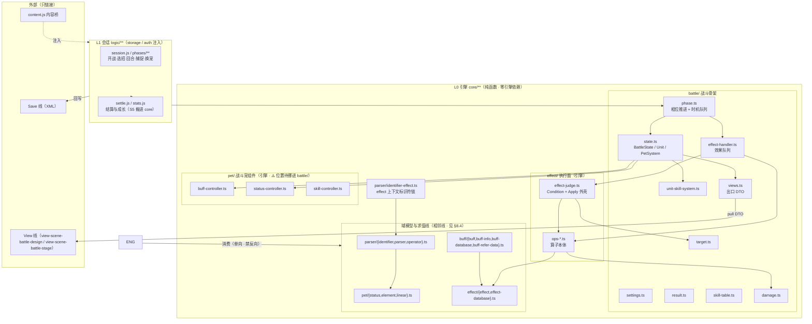
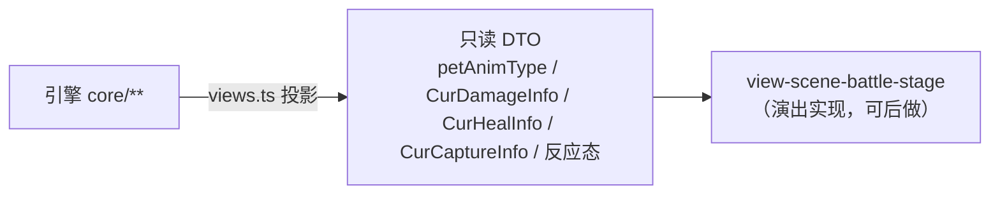

# 重启回合制战斗引擎总设计（battle-engine-design.md）

> **定位**：本文是**战斗引擎（规则与状态）的总设计** —— 上游 Unity 回合制战斗的**真值**，
> 如何整体映射到我们的**无头域引擎**。本文只给**边界 / 模块图 / 不变量 / 跨模块口径 / 子设计地图**，
> **不重复逐块细节**。
>
> **与已有文档的关系**（父文档只链接不重复）：
> - **构成与机制**（"读得懂"）→ **`docs/engine/battle-engine-overview.md`**：本文**默认读者已读它**，不重述机制。
> - 移植**事实与口径**（逐算子实测）→ `docs/engine/port-map.md`；**对拍操作** → `docs/engine/oracle-playbook.md`；
>   **S1–S6 路线与当前落点** → `docs/engine/kernel-handoff.md`。
> - 战斗**场景版式**（表现）→ `docs/view/scene/battle/view-scene-battle-design.md` + `docs/view/scene/battle/view-scene-battle-stage.md`。
> - 存档（`BattleRecord` / `BattleSettings` 的持久化）→ `docs/save/save-design.md` + `docs/save/save-xml-spec.md`。
> - **外部能力（随机源 / 时钟 / 存档读写面 / 写盘 sink / 弹窗 sink / 判定与战斗宿主 / 内容表注册）→ `docs/runtime/runtime-components-design.md`（R1–R7）**
>   —— 引擎**只调用接口**（人类决议 ③，2026-10-17）；本文 §5.5 的 RNG 口径、§5.6 的"显式抛"纪律都以那份为准，E1–E7 不再各自定义接缝。
> - 分层 / 依赖方向 → `docs/architecture.md §1/§2`、`docs/arch-code.md §3`。
>
> ⚠️ **本线的三条口径已于 2026-10-17 由人类拍板改版**（原文 `AGENTS.md §1.1`/`§2`、细则 `docs/engine/oracle-playbook.md §6` 改版块）：
> ① **随机/墙钟不与 Unity 逐值一致**、oracle 侧 shim **取消** ⇒ 走 R1/R2，**"不可比"不是跳过实现或验收的理由**；
> ② **上游代码 bug ⇒ 声明 + 写无 bug 的目标行为**（数据表错字仍照搬，`docs/arch-docs.md §4.1` 分工）
>    ⇒ 本线已按此改判的两条：`GetParallelPetBag` 不自终止、`ListHelper.Random` 的 `count = -1` 挂起（⇒ 入口显式抛，⬜ 待落码）；
> ③ **主要验收手段 = 人类手动测试**，`difftest` / `node --test` / grep 门禁只是回归门。
>
> **子设计（本文 §8 地图；**E1–E7 全已成文 ⇒ 本线 `design` 齐**）**：
> - **E1 状态** → `docs/engine/battle-engine-state.md`
> - **E2 相位流水线** → `docs/engine/battle-engine-phases.md`
> - **E3 单位与战斗数值** → `docs/engine/battle-engine-units.md`
> - **E5 判定与执行外壳** → `docs/engine/battle-engine-judge.md`
> - **E4 效果（22 算子本体）** → `docs/engine/battle-engine-effects.md`
> - **E6 会话编排与结算** → `docs/engine/battle-engine-session.md`
> - **E7 出口** → `docs/engine/battle-engine-views.md`（内核 → 表现的**只读契约**）
>
> **证据标注**：【源码】= 上游 `.cs`（标 `路径:行/函数`）；【我们】= 本仓库 `game/**`；【推断】= 未证实。
> 上游路径均相对 `projects/Seer2-Restart-Lite-main/Assets/`。

---

## 0. 这份文档回答什么

1. 我们把"**战斗引擎**"这个圈画在哪（含什么、**不含**什么）。
2. 引擎的**目标模块结构**（分几块、谁依赖谁、对应上游哪个文件族）。
3. 引擎要守的**不变量**（破了就是 bug）。
4. 跨模块的**六条设计口径**（相位形状 / 值快照 / 效果数据化 / 出口契约 / RNG 重放 / 未移植抛）。
5. 引擎与**表现层 / 存档 / 内容桥 / 会话输入**的**接口契约**。
6. **子设计地图**（拆几份、批次、状态）与**缺口 / 开放问题**。

---

## 1. 血统与不变量

### 1.1 血统（真值来源）

| | |
|---|---|
| **规则权威** | `projects/Seer2-Restart-Lite-main/`（`lite_4.9.2` / 2026-09-25+08:00） |
| **正确性判据** | **差分对拍**：`tools/difftest.mjs`（当前基线 `向量=30431 可比=29935 native不可比=0 架子没对上=0 不一致=0`，2026-10-17 实测；逐批收口历史见 `docs/engine/port-map.md` 末段），拿上游 `Assembly-CSharp.dll` 当 oracle；⚠️ 它是**辅助回归门**，主验收 = 人类手测（`AGENTS.md §1.1`） |
| **内容表** | `game/data/unity/*.json`（重启血统；838 宠 / 5340 技 / 2121 buff / 612 物品） |
| **素材** | `vendor/seer2-origin-as3/`、`game/petContainer.root.swf`（引擎**只借** `swfId`，不碰素材） |
| **参考（只读，规则一律不采信）** | `arcadia-eternity` |

### 1.2 引擎不变量（破了即 bug）

> 承接 `architecture.md §1`，这里是**引擎专属**的展开。

| # | 不变量 |
|---|---|
| **E1** | **引擎在 MVC 之外**。`game/core/**` 是纯函数域引擎，零引擎依赖（`grep -E "UnityEngine\|Player.instance\|Photon\|Database.instance" game/core/**` 必须空输出）。MVC 只**调用**它。 |
| **E2** | **引擎不重构**。正确性由差分 oracle 锁行为 ⇒ 不为"好看"改形状；改形状必须让对拍仍绿。 |
| **E3** | **值快照语义**。`BattleState` 按值拷贝（`new BattleState(prev)`）；**禁止**跨相位共享可变引用（上游曾在"孤儿帧"上踩过，见 `phase.ts:799` 修法）。 |
| **E4** | **效果是数据**。规则只通过 `effect = 时机 + 条件 + 目标 + 算子` 表达；**不许**把战斗规则写进 `if-else` 分支（那会绕过 effect 表，破坏可对拍性）。 |
| **E5** | **出口只读**。引擎经 `views.ts`/`UnitHudSystem` 产出**拉取式 DTO**；表现层**零算数**（概率 / 门槛 / 伤害全在内核算子）。 |
| **E6** | **RNG 经注入**。内核**不**自掷 `UnityEngine.Random`；"同种子重放两侧行为等价"是 S4 判据（不是逐位 RNG 对齐）。 |
| **E7** | **未移植显式抛**（`NOT_PORTED`），**不静默降级**。这是对上游 `DefaultAbility` **静默 `true`** 的**刻意偏离**（已在 `port-map` 登记）。 |
| **E8** | **生成物纪律**。`game/core/**/*.js` 由同名 `.ts` 经 `tools/build-core.mjs` 转写，**勿手改产物**。 |

---

## 2. 引擎边界（含什么 / 不含什么）

> **判据**（承接 `battle-engine-overview.md §6`）：`BattlePet` 是 `Pet` 的子类 ⇒ **"出战斗也要用"的东西不属引擎**。

### 2.1 在圈内（引擎）

- **战斗状态**：`BattleState`（含 `settings` / `result`）与"值快照"机制。
- **相位推进**：`BattlePhase` 与 14 个相位、`EffectTiming` 推进序、效果队列消费。
- **单位子系统**：`Unit`（一方）＋ `UnitPetSystem` / `UnitSkillSystem` / `UnitCardSystem`；`UnitHudSystem` 的 **DTO 出口**。
- **效果执行**：`EffectHandler`（队列）/ 判定面（`Condition`）/ 算子（`Ability`）/ 目标选择。
  （效果的**数据模型** `Effect` + `EffectDatabase` 在**域模型线** —— 见 §8.4。）
- **战斗数值**：**伤害公式**（`damage.ts`）、战斗内的属性增减、元素相克**在战斗中的使用**。
- **会话编排**：开战入口、选招输入、捕捉、换宠、回合推进、结算与成长。
- **出口契约**：内核 → 表现的 `views.ts` 投影。

### 2.2 在圈外（只链接，不展开）

| 圈外的东西 | 去向 |
|---|---|
| **通用域模型**：`Pet` / `Skill` / `Status`（成长/性格/`GetPetNormalStatus`）/ 元素关系 / 线性曲线 / `Buff*` / **`Effect` 数据模型 + `EffectDatabase`** / 求值 DSL（`parser/{identifier,parser,operator}`） | **新立的「域模型与求值线」**（**权威边界表 = §8.4**）—— 引擎只**消费**它，**禁反向依赖** |
| **战斗专属的宠包装** | **在圈内**（`PetBattle*Controller` / `BattleStatus` / `BattlePet`）；我们现状 = `pet/{status,buff,skill}-controller.ts`（⚠️ 位置待挪，见 §8.4(5)） |
| **表现**（动画 / 音效 / HUD DOM / 结算画面） | View 线：`docs/view/scene/battle/view-scene-battle-design.md`、`docs/view/scene/battle/view-scene-battle-stage.md` |
| **持久化格式**（XML 节点树） | Save 线：`save-design.md`、`save-xml-spec.md`（`BattleRecord`/`BattleSettings` 的**引擎侧语义**在 §6.2 交叉登记） |
| **内容表生产** | `tools/build-unity-data.mjs`（`arch-code.md §7`） |
| **AS3 网页线** | 本线外（`web-client-notes.md`） |

---

## 3. 目标架构（我们的模块图）

### 3.1 分层

| 层 | 目录 | 角色 | 与引擎的关系 |
|---|---|---|---|
| **L0 引擎** | `game/core/**` | 纯函数域引擎，零引擎依赖，差分 oracle 锁定 | **本文的"圈内"** |
| **L1 会话** | `game/logic/**` | 零 DOM 纯函数；`storage`/`auth` **注入** | 引擎的**编排外壳**（开战→回合→结算）；S5 后改名为 `game/session/` |
| L2 内容桥 | `game/app/content.js` | 内容权威单一出口 | 引擎经它**注入**内容（不反向依赖） |
| L3/L4 表现+编排 | `game/app/**` | 手写 DOM、场景挂载 | **消费者**（不属引擎） |

### 3.2 模块图（圈内）



### 3.3 依赖方向（单向向下）

```
L1 会话  →  L0 引擎  →  域模型与求值线（被消费）
   │              │
   │              └→ 内容桥 content.js（注入）
   └→ 存档 Save 线（回写）
L3/L4 表现  ←  引擎出口 views.ts（只读 DTO）
```

**硬规则**（承接 `arch-code.md §3`）：引擎**不得**认识表现层；表现层**不得**直接 `import game/core/**`（经 L2 内容桥）。

---

## 4. 上游真值 → 我们模块（映射表）

| 上游文件族 | 行 | 我们模块 | oracle kind | 状态 |
|---|---|---|---|---|
| `BattleState.cs`（342） | 342 | `battle/state.ts`（867） | `statecopy/stateid/stateset/stateflag/giveturn/gofirst/statedrive` | ✅ 绿 |
| `BattleSettings.cs`（207） | 207 | `battle/settings.ts`（204） | `settings` | ✅ 绿 |
| `BattleResult.cs`（250） | 250 | `battle/result.ts`（85） | `result` | 🟡 部分（`ProcessResult`/`SetExp` 未搬 = S5，见 **E6** §2.7） |
| `BattlePhase.cs` + `Phase/*.cs`（1133） | 1133 | `battle/phase.ts`（1030） | `phaseq/phasedrive` | ✅ 绿 |
| `Unit.cs` + `UnitPetSystem.cs`（194） | 461 | `battle/state.ts`（内含 Unit/PetSystem） | `petbag` | ✅ 绿 |
| `UnitSkillSystem.cs`（332） | 332 | `battle/unit-skill-system.ts`（349） | `skillsys` | ✅ 绿 |
| `UnitHudSystem.cs`（313） | 313 | `battle/views.ts`（DTO 侧） | — | ⛔ 围栏（表现层，不建模其抛点） |
| `UnitCardSystem.cs`（252） | 252 | — | — | ⛔ 围栏（卡牌模式） |
| `Effect.cs` + `EffectDatabase.cs`（632） | 632 | `effect/effect.ts`（280）+ `effect-database.ts`（113） | `effectparse` | ✅ 绿 |
| `EffectHandler.cs`（75） | 75 | `battle/effect-handler.ts`（108） | `effectq` | ✅ 绿 |
| `EffectConditionHandler.cs`（414） | 414 | `effect/effect-judge.ts`（711，`condition`） | `effectcond` | ✅ 绿（生产默认 `NOT_PORTED`，harness 按 kind 注入） |
| `EffectAbilityHandler.cs`（2284） | 2284 | `effect/ops-*.ts`（1374） | `effectapply` | 🟡 **13/22** 进 golden + 1 半可比（见 §4.1） |
| （`getBattlePetTargetList`） | — | `battle/target.ts`（104） | `target` | ✅ 绿 |
| `Buff` / `BuffInfo` / `BuffDatabase` | — | `buff/buff.ts`、`buff-info.ts`、`buff-database.ts` | `buffinfo/buffid/buffdesc/refer` | ✅ 绿 |
| `PetBattleStatusController.cs`（251） | 251 | `pet/status-controller.ts`（293） | `statusctrl/petmut` | ✅ 绿 |
| `PetBattleBuffController.cs`（407） | 407 | `pet/buff-controller.ts`（369；位置偏差见 §8.4，S5 迁 `battle/`） | `buffinfo` + `SigPet` 五段 | ✅ 绿（本批补完 `:323-388` 的 9 个方法） |
| `PetBattleSkillController.cs`（106） | 106 | `battle/skill-table.ts`（247）+ `pet/skill-controller.ts`（35，位置偏差见 §8.4） | `skilltable` | 🟡 部分（容器四袋在 `pet/skill-controller.ts`；`Skill` **真对象**的契约 = **D5** `docs/domain/domain-skill.md §3`，施工批 B1–B3；与宠的技能袋 `PetSkill` 那半边仍等 S6 把宠表接进 oracle） |
| `Battle.cs` + `BattleManager.cs`（699） | 699 | `app/battle/driver/coreBattleDriver.js`（235）+ `logic/phases/**` | — | 🟡 产品层（会话层，**不进 core**；逐条见 **E6** `docs/engine/battle-engine-session.md`） |

> 行数/状态以 `docs/engine/kernel-handoff.md §3/§4/§5` 为准。【我们】行数为非测试行数。
>
> **线的归属**（Q2 定案 · 逐文件见 **§8.4**）：上表**除** `Effect.cs` + `EffectDatabase.cs`（→ **域模型线**）
> 与 `Buff` / `BuffInfo` / `BuffDatabase`（→ **域模型线**）之外，**其余全部属引擎**
> （含 `EffectConditionHandler` / `EffectAbilityHandler` / `EffectHandler` = 判定 + 算子 + 队列）。

### 4.1 算子进度（`EffectAbilityHandler` 的 22 支）

| 状态 | 支数 | 明细 |
|---|---|---|
| **进 golden（可对拍）** | **11** | `none(0)`、`set_damage(14)`、`add_status(8)`、`add_buff(10)`、`remove_buff(11)`、`heal(5)`、`capture(3)`、`pet_change(4)`、`set_skill(15)`、`set_weather(17)`、`block_buff(9)` |
| **半可比** | **2** | `win(1)` / `escape(2)` —— 结果面过 `Unit.IsMyUnit()` ⇒ `PhotonNetwork.IsConnected` ⇒ Photon 静态构造的 `ECall`（与 `powerup` 同根因）⇒ 那些形状**不生成**；golden 只覆盖 `state==null ⇒ false` 与 `whosTurn==0 ⇒ atkUnit=null ⇒ NRE`，结果面由 `node --test` 用真 `Unit` 锁 |
| **搬了但进不了 golden** | **1** | `powerup(7)` —— oracle 入口即 `ECall` 抛，函数体照搬、形状由 `node --test` 锁，**值不进 golden**（第三种状态） |
| **仍 `NOT_PORTED`** | **8** | `rage(6)` / `copy_buff(12)` / `set_buff(13)` / `set_pet(16)` / `set_player(18)` / `poker(19)` / `set_pet_bag(20)` / `card(21)` |

> **真值 = `tools/oracle-cs/Program.cs:1849` 的 `PortedAbilities`**（行号会随注释漂移 ⇒ 认**成员名**）；越界归 infra ⇒ 不假绿。
> ⚠️ **本表的三种状态是"对拍覆盖面"的分类，不是"要不要实现"的分级**（人类决议 ①，2026-10-17）：
> 「半可比」（Photon ECall 闸门，与随机无关）与「搬了但**进不了 golden**」（native 随机）**两支都已有实现**，
> 旧标签"搬了但不可对拍"自此统一读作后者；
> 后者的验收 = 同 seed 自复现 + 形状断言 + **人类手测**（§5.5、`docs/engine/oracle-playbook.md §6` 改版块）；
> 第八档里 `poker(19)` / `set_pet_bag(20)` 的 `random` 支**今后照做实现**（走 R1），**不再**记为"永久不可比 ⇒ 不做"。
> 长尾按**真表频次**推进：`set_pet 289` / `rage 166` 等（`kernel-handoff.md §3` 表末）。逐支形状见 `docs/engine/battle-engine-judge.md §2.6`；
> **逐支施工图（`options` 键 / 突变面 / 撞哪道围栏 / 可比面 + A/B/C/D 分档）见 `docs/engine/battle-engine-effects.md`（E4）。**

---

## 5. 跨模块设计口径（六条）

> 这六条是**跨子设计的公共约定**；子设计只能**遵守**，不能各自另立。

### 5.1 相位的形状：**保留硬编码单链**（不抽相位表）

- 真值：`BattlePhase.GetNextPhase()` 硬编码 `new 下一个相位()`，**无注册表**（`BeforeAttackPhase.cs:31-40`）。
- **口径**：我们**照搬这个形状**（`phase.ts` 已是）。理由（承接 **E2**）：差分 oracle 锁的是**行为**，编排出相位表会引入**无法对拍的自由度**；行为等价 ≠ 结构等价，宁丑但可证明。
- 代价：`GetNextPhase()` 的分支是"规则的一部分"，改动必须进对拍。

### 5.2 值快照：**每相位一份拷贝，禁共享**

- 真值：相位构造 `this.state = new BattleState(battle.currentState)`；`Battle.NextPhase` 留 `lastState`。
- **口径**：TS 侧镜像之（`state.ts` 的拷贝构造）；**任何"跨相位持有 `state` 引用"的写法都是 bug**（`phase.ts:799` 的孤儿帧修复就是反例教材）。
- 派生用途：`last.` 表达式回溯、对名单回滚（`OnHitUndo` 类）。

### 5.3 效果数据化：**规则只走 effect 四段**

- 真值：`effect = 时机 timing + 优先级 priority + 条件 condition + 目标 target + 算子 ability`（`Effect.cs` 七列）。
- **口径**（承接 **E4**）：新增战斗规则**一律**加 effect 行 / 加算子，**不得**加相位内联分支。判定面的 `on_fail` 就地改写是**上游行为**，照搬（`Effect.cs:274-290`）。
- 未移植算子走 **E7**（显式抛）。

### 5.4 出口契约：**pull DTO，不是事件总线**

- 真值：`UnitHudSystem` **无事件/委托**，是 Model 侧 DTO 状态袋；View 读它的字段（`BattleAnimView.cs:41-88`）。
- **口径**：引擎产出 `views.ts` 的**只读投影**；**表现层零算数**（承接 **E5**）。
- ⚠️ **本口径必须在引擎实现前定稿**：演出实现可后做，但 `petAnimType` / `DamageInfo` / `HealInfo` / `CaptureInfo` / 反应态这批**字段与语义**不能后补（后补要回头改引擎）。

### 5.5 RNG 与重放：**注入 + 行为等价**（口径 2026-10-17 按人类决议 ① 定稿）

- 真值：Unity 的 `Random.Range(int,int)` 是 **native ECall** ⇒ 播放器进程外**必抛** `SecurityException` ⇒ **oracle 给不出 golden**。
  ⚠️ 旧措辞"native **且不可注入**"**作废**：不可注入的是**上游那一条链**；**我方**的随机**一律注入**（下一条口径本来就如此，今天写成决议）。
- **口径**（承接 **E6** + 运行时线 **R1**）：内核 RNG 来自 `docs/runtime/runtime-components-design.md §5 R1` 注入的 `Rng`（墙钟 **R2**、存档随机 **R3**）；
  S4 判据 = "**我方**同 seed 重放自复现"（同一回合序、同一结算、同一状态形状），**不是**逐位 RNG 对齐、**也不与上游比**。
- **验收**：同 seed 复现 + 形状断言（区间端点可达、钳位、空输入）+ **人类手测**为主门（`AGENTS.md §1.1`）。
- ⚠️ **围栏那一行改判**（原文"生成阶段不发向量"）：那是**已落批次**的对拍覆盖面事实；
  **今后**随机臂**照常实现**并发**显式声明来源的合成向量** ⇒ **"不可比"不再是跳过实现或跳过验收的理由**
  （`docs/engine/oracle-playbook.md §6` 改版块、`docs/engine/port-map.md` 开头的同一块）。
  受影响的具体支：`powerup(7)`、`capture` 掷点支、`pet_change` 的 `random` 支、`set_pet_bag` 的 `random` 三支、`poker` 整支。

### 5.6 未移植：**显式抛，不静默**

- 真值：上游 `DefaultAbility` 对未知算子是**静默 `true`**（`EffectAbilityHandler.cs:13-36`）。
- **口径**（承接 **E7**）：移植体对未移植算子**显式抛 `NOT_PORTED`**；生产 `JUDGE` 默认 `NOT_PORTED`，真判定只在 harness 里**按 kind 作用域注入**（`withJudge(on,fn)`）。
- 为什么必须"Condition 与 Apply 同一个增量"：否则抛出点从 condition 移到 apply，会对**现有 throw-only 向量**当场翻红（`kernel-handoff.md §5a`）。

---

## 6. 接口契约（引擎的四个"门"）

### 6.1 引擎 → 表现（只读出口）



- 契约面 = `views.ts`（579 行）；字段语义的**真值**在 `UnitHudSystem.cs`。
- **纪律**：表现层**只读**，不做概率/门槛/伤害计算。

### 6.2 引擎 ↔ 存档（交叉登记）

- 引擎**不**管 XML；但两处**引擎侧语义**必须在 Save 线保持一致：
  - **`BattleRecord`**（战斗记录：`actionList` 等，供录播回放）—— 也是**选招输入源**之一（§6.4）。
  - **`BattleSettings`**（`seed` / `modeId` / `ruleId` / `parallelCount` / `isCaptureOK` …）—— 存档字段与引擎字段**同名同义**。
- 交叉指针：`save-xml-spec.md §2.19`（`BattleSettings`）、`save-xml-spec.md`（`BattleRecord`）。

### 6.3 引擎 ↔ 内容桥（注入）

- 引擎**不** `fetch`；内容经 **L2 `content.js`** 注入（`petConfig` / `skillView` / `normalStatusOf` …）。
- ⚠️ **待评审**：多份 `view/**` 目前**直接 import `content.js`**（`arch-code.md §5/§8`）；引擎侧一律走注入，不受此影响。

### 6.4 选招**输入源接口**（引擎的"主机端口"）

- 真值：`TurnStartPhase.GetNextPhase()` 返回 `null` 挂起；之后由 `Battle.SetSkill(skill, isMe)` 喂招。
- **口径**：把"选招"当**接口**（不是流程段），有 5 个实现：

| 输入源 | 上游入口 |
|---|---|
| 玩家点选 | `BattleManager.SetSkillSelectMode` → `Battle.SetSkill(skill, isMe)` |
| 自动战斗 | `CheckAutoSkill` → `SetSkill(skill, true)` |
| 录播回放 | 读 `battleRecord.actionList` → `SetSkill` |
| PVP 对手 | `PVPSetSkillToOthers` → RPC |
| 敌方 AI 兜底 | `PassivePetChangePhase` 内自动选默认技 |

---

## 7. 权威与生成物纪律

| 关注 | 做法 |
|---|---|
| 正确性 | 每搬完**一块**立刻进 `node tools/difftest.mjs` + `node --test game/core/`；不留"写完再一起验"的尾巴 |
| 生成物 | `game/core/**/*.js` ← 同名 `.ts`（`tools/build-core.mjs`）；`game/data/unity/*.json` ← 内容表 |
| 无头门禁 | `grep -E "UnityEngine\|Player.instance\|Photon\|Database.instance"` 对 `game/core` **空输出**（带两条 `grep -v` 的那条命令） |
| 三条铁律 | ① `架子没对上` 列非零即失败；② 别拼 float 进字符串（比较器两边 `fround`）；③ **不自终止的向量不进 golden**（`kernel-handoff.md §7`） |

---

## 8. 子设计地图（7 份 + 相邻线）

> 拆轴：**引擎骨架 / 单位与数值 / 效果系统 / 会话与出口**。每份 = **一个可独立评审 + 独立施工**的边界。
> **父文档只链接不重复**。批次 = 施工顺序。

### 8.1 子设计（**已决议：7 份**）

| # | 子设计 | 覆盖 | 上游真值 | 批次 | 状态 |
|---|---|---|---|---|---|
| E0 | **`battle-engine-design.md`**（本文） | 边界 / 模块图 / 不变量 / 口径 / 子地图 | 全部（索引） | **P0** | ✅ 已写 |
| E1 | **`docs/engine/battle-engine-state.md`** | 状态 **+ 配置 + 结果** + 队伍（`petBag` / `parallelCount` / 回合相位机） | `BattleState` 342 + `Settings` 207 + `Result` 250 | **P0** | ✅ 已写 |
| E2 | **`docs/engine/battle-engine-phases.md`** | **14 相位流水线** + `EffectTiming` 推进序 + 队列消费 + `doWork` 内多时机 | `BattlePhase` 162 + `Phase/*` 971 | **P0** | ✅ 已写 |
| E3 | **`docs/engine/battle-engine-units.md`** | `Unit` + `UnitPetSystem` + `UnitSkillSystem` + `BattlePet`/`BattleStatus`/三 controller + **战斗数值五段**（`Hud`→E7、`Card`→围栏） | `Unit*` 1091 + `BattlePet` 369 + `damage` | P1 | ✅ 已写 |
| E4 | **`docs/engine/battle-engine-effects.md`** | **22 算子本体**（`AbilityHandler`）+ 频次路线；**效果语言/数据库已划归域模型线**（§8.4(4)） | `AbilityHandler` 2284 | P1 | ✅ 已写 |
| E5 | **`docs/engine/battle-engine-judge.md`** | **判定（`Condition`）+ 执行外壳（`Apply`/`repeat`/`DefaultAbility`/`PostProcess`）+ dispatch + 目标** | `ConditionHandler` 414 + `Handler` 75 + `target` | P1 | ✅ 已写 |
| E6 | **`docs/engine/battle-engine-session.md`** | 会话编排：开战三段校验 / 驱动循环与兜底 / **`SetSkill` 唯一输入接缝** / 表现队列与 `null` 配对 / 自动战斗 / **`ProcessResult` 结算与成长** | `Battle` 399 + `Manager` 300 + `Result.ProcessResult` + `Settings.Condition` | P2 | ✅ 已写 |
| E7 | **`docs/engine/battle-engine-views.md`** | 内核 → 表现的**出口契约**（只读 DTO 字段与语义 + `UnitHudSystem` 表现草稿本 + `SetUIState` 唯一写点） | `UnitHudSystem` 313 + `views.ts` 579 | P2 | ✅ 已写 |

**每份子设计的统一骨架**：① 范围/边界 ② 上游真值（`文件:行`）③ 目标结构（类/函数契约）④ 与相邻模块的接口
⑤ 不变量与围栏 ⑥ 现状与缺口 ⑦ 待核 ⑧ 配对 impl 指针。
每份必带两张 mermaid：**模块位置图** + **文件↔接口图**。

### 8.2 粒度（✅ **已决议 = 7 份**）

| 候选 | 份数 | 取舍 |
|---|---|---|
| **本提案（采用）** | **7** | 每份=一个耦合簇；`target` 并入 E5、`result` 并入 E1/E6 |
| ~~更细~~ | 10 | `target` / `result` / `numeric` 各自独立；真值与上游文件族一一对应，但三份偏小 |
| ~~更粗~~ | 6 | `state+phase` 合、`effects+judge` 合；单份 ≈2000 行，评审吃力 |

> 定夺方式同 `docs/view/view-design.md §8`：按"**改 A 必改 B ⇒ 合并**"判断。

### 8.3 缺口（本线阶段一要补的文档 / 阶段二要补的码）

| 缺口 | 说明 |
|---|---|
| ~~**E7 未写**~~ | ✅ **已成文**（2026-10-17）：`docs/engine/battle-engine-views.md`（409 行，出口 DTO 语义 + `UnitHudSystem` 草稿本 + `SetUIState` 唯一写点 + 两级出口 A 层 core 只读面 / B 层 driver 会话投影）。⇒ **本线 `design`（E1–E7）齐**，只剩配对的 `battle-engine-impl.md` + `battle-engine-code-map.md`（阶段一续） |
| **会话层未进 core** | `ProcessResult` 六笔（`SetBasic/SetRecord/SetTalent/SetExp/SetSkill/DoWork`）现由 `logic/settle.js` 手抄、**无差分保护** ⇒ **S5 头号**（`docs/engine/battle-engine-session.md §6`） |
| **E4 长尾仍 8 支未搬** | as-built：`13/22` 进 golden + `win/escape` 半可比 + `powerup` 搬了但进不了 golden。批四（A 档）已落；下一批 B 档 `rage`/`copy_buff`/`set_buff` 等 **D5 施工批 B1–B2** 落地后的 `Skill.PP` 访问器（`docs/domain/domain-skill.md §3.3`；契约本身已定，缺的是码）。见 `docs/engine/battle-engine-effects.md §2.2/§2.5` |
| **配对实现文档** | 本线配对 = 未来的 `battle-engine-impl.md` + `battle-engine-code-map.md`；**现状事实**暂由 `docs/engine/kernel-handoff.md` 兼任 |
| ~~**正式交互文档**~~ | ✅ **已收拢**（E6，2026-10-17）："选招输入源"（§2.4 五种输入源一张表）与"结算画面确认 → 回地图"（§2.8）都在 `docs/engine/battle-engine-session.md` |
| ~~域模型逐文件边界~~ | ✅ **已坐实**（§8.4，2026-10-17）：归属规则 + 逐文件表 + 5 处跨界例外 + 2 处口径修正 |

### 8.4 相邻线：**域模型与求值线**（新立）+ **Q2 边界已坐实**

> 用户已拍板：从引擎线**剥离**出来的"通用域模型 + 求值 DSL"**新立一条线**（见 §2.2）。
> **Q2 已读源坐实（2026-10-17）** —— 边界**不用猜**：上游自己就把"战斗专属"隔离在 `Basic/Pet/Battle/` 目录里；
> 剩下只需处理**几处"通用类 + 战斗子类同居一文件"**。

#### （1）归属规则（一句话）

> **按上游目录 / 类名判归属；依赖必须单向（引擎 → 域模型 → 底座）。**
> 类名以 `Battle` 打头、或住在 `Basic/Pet/Battle/` 与 `Scene Specific/Battle/` ⇒ **引擎**；
> `MVC/Model/Basic/Pet/**`（非 `Battle/`）、`Basic/Buff/**`、`Basic/Effect/Effect.cs`（数据类）⇒ **域模型线**。

#### （2）逐文件判定表（【源码】实测，非推断）

| 上游 | 归属 | 我们现状 |
|---|---|---|
| `Basic/Pet/Battle/BattlePet.cs`（369） | **引擎 E3** | 未移植（现由 `battle/views.ts` 的 `BattlePetView` 顶替） |
| `Basic/Pet/Battle/PetBattleStatusController.cs`（251） | **引擎 E3** | `core/pet/status-controller.ts` ⚠️ 位置待挪 |
| `Basic/Pet/Battle/PetBattleBuffController.cs`（407） | **引擎 E3** | `core/pet/buff-controller.ts` ⚠️ 位置待挪 |
| `Basic/Pet/Battle/PetBattleSkillController.cs`（106） | **引擎 E3** | `core/pet/skill-controller.ts` ⚠️ 位置待挪 |
| `Basic/Pet/Status.cs` → `Status`（`:8`） | 域模型线 | `core/pet/status.ts` |
| `Basic/Pet/Status.cs` → `BattleStatus : Status`（`:394`） | **引擎 E3** | `core/pet/status-controller.ts:28` |
| `Basic/Pet/Pet.cs` | 域模型线 | **D6 已定契约**（`docs/domain/domain-pet.md`，2026-10-17：构造家族的决定性分级 = §2.2、`pet.` 穿层 = §2.3、写侧上移 = §2.6、施工批 B1–B7）；现状仍是**未移植**（由 `battle/views.ts` 的 `BattlePetView` 顶替，接缝 = `domain-pet.md §3.3` 的 S2） |
| `Basic/Pet/Skill.cs` | 域模型线 | **D5 已定契约**（`docs/domain/domain-skill.md`）；现状仍是「`SkillRecord` DTO 顶替、寄在引擎区 `core/battle/views.ts` + `skill-table.ts`」⇒ 对象化与归属迁移见该文档施工批 **B1–B3** |
| `Basic/Pet/Components/*`、`Info/*`、`System/Pet*System.cs` | 域模型线 | `core/pet/element.ts`（← `PetElementSystem`）、`core/pet/linear.ts`（← `IClass`）；**`Info/*` + `System/{Exp,IV,Fusion,UI}` 的施工合同 = D7 `docs/domain/domain-info.md`（已成文，B1–B7 待发码）**——注意 **L2 桥已把这六张官方表拼成 `game/data/unity/pets.json`（838 行）**，缺的是**域内对象与算式**（`domain-info.md §6.1`）；`Components/*` 的施工合同 = **D6 `docs/domain/domain-pet.md`（已成文，B1–B7 待发码）**——实测同样是「**对象 0 个、但不是零落地**」：`core/pet/**` 已 1139 行（属 D2/D4/E3），三面推导的原语 `status.ts:270` 已在（`domain-pet.md §6`） |
| `Basic/Buff/{Buff,BuffInfo,BuffDatabase,BuffReferData}.cs` | 域模型线 | `core/buff/*.ts` |
| `Basic/Effect/Effect.cs`（七段数据类） | 域模型线 | `core/effect/effect.ts` |
| `Basic/Effect/EffectDatabase.cs` | 域模型线 | `core/effect/effect-database.ts` |
| `Basic/Effect/EffectAbilityHandler.cs`（2284） | **引擎 E4** | `core/effect/ops-*.ts` |
| `Basic/Effect/EffectConditionHandler.cs` + `EffectHandler.cs` | **引擎 E5** | `core/effect/effect-judge.ts` + `core/battle/effect-handler.ts` |
| `System/Parser/Identifier.cs:10-188`（无上下文骨架） | 域模型线 | `core/parser/identifier.ts` |
| `System/Parser/Identifier.cs:190-548` + `GetBattleIdentifier`（effect 上下文） | **引擎** | `core/parser/identifier-effect.ts` |
| `System/Parser/Parser.cs`、`Operator.cs` | 域模型线 | `core/parser/{parser,operator}.ts` |
| `Scene Specific/Battle/{Unit,BattleState,BattleSettings,BattleResult}.cs` | **引擎 E1/E3** | `core/battle/{state,settings,result}.ts` |
| `Scene Specific/Battle/UnitComponent/UnitPetSystem.cs` | **引擎 E3** | `core/battle/state.ts` 的 `UnitPetSystem` |
| `.../UnitComponent/UnitSkillSystem.cs` | **引擎 E3** | `core/battle/unit-skill-system.ts` |
| `.../UnitComponent/UnitHudSystem.cs` | **引擎 E7（出口）** | 未移植 |
| `.../UnitComponent/UnitCardSystem.cs` | **引擎围栏**（Card 模式） | 未移植（读 `cardSystem.hand` 处**抛**） |
| `MVC/Controller/Pet/Basic/PetStatusController.cs` | **都不属**（面板线 UI 控制器） | 未移植 |

> **`UnitComponent/` 只有 4 个**：`Pet` / `Skill` / `Hud` / `Card` —— **没有 `UnitBuffSystem`**
> （印记挂在 `pet.buffController` + `Unit.unitBuffs` 上）。

#### （3）跨界例外（**规律**：上游把"通用类 + 战斗子类/战斗臂"写在同一个 `.cs` 里）

| # | 上游文件 | 通用部分 → 域模型线 | 战斗部分 → 引擎 |
|---|---|---|---|
| 1 | `Pet/Status.cs` | `Status`（`:8`）→ `pet/status.ts` | `BattleStatus : Status`（`:394`）→ `pet/status-controller.ts` |
| 2 | `Pet/Skill.cs` | `Skill` 本体 → **D5**（逐臂归属见 `docs/domain/domain-skill.md §2.1`；现由 `SkillRecord` DTO 顶替） | 同类的 `anger/pp/maxPP`（`:26`）是**战斗语义字段**，消费方在引擎；`ParseRPCData`/`ToRPCData`/`GetDefaultSkill` 三支**整臂归引擎 E6**（D5 已拍板不搬进域） |
| 3 | `Pet/Pet.cs` | `Pet`（未移植） | `BattlePet : Pet`（E3） |
| 4 | `System/Parser/Identifier.cs` | `:10-188` → `parser/identifier.ts` | `:190-548` → `parser/identifier-effect.ts` |
| 5 | `Effect/Effect.cs` | 七段数据类 → `effect/effect.ts` | `CheckAndApply` 外壳 → `battle/effect-handler.ts` |

⇒ **判归属按「类 / 臂」，不按「文件」。** 移植产物已按此切开，无需返工；只需在文档侧认账。

#### （4）本次读源带来的**两处口径修正**

| 项 | 原状 | 修正 |
|---|---|---|
| **E4 覆盖** | "effect **语言 + 数据库** + 22 算子本体" | 收窄为 **22 算子本体（`AbilityHandler`）**；语言/数据库归域模型线（否则域模型线的 `buff/**` 会**反向依赖**引擎） |
| **`core/effect/**` 整目录 = 引擎** | — | `effect.ts` / `effect-database.ts` 是**共享数据模型**（域模型线），`effect-judge.ts` / `ops-*.ts` 才是引擎 |

> 判据是**客观的**：`core/buff/buff-info.ts` 与 `core/buff/buff.ts`（域模型线）**实打实** import 了
> `effect/effect.ts`；把 `effect.ts` 判给引擎就等于承认"域模型线 → 引擎"的反向依赖。

#### （5）位置偏差（阶段二机械迁移，不夹带语义改动）

`core/pet/{status-controller,buff-controller,skill-controller}.ts` 是**引擎件**（上游 `Basic/Pet/Battle/PetBattle*Controller`），
暂寄在 `pet/`（域模型目录）。**目标**：`core/battle/pet-{status,buff,skill}-controller.ts`。
动作 = 改 import + 重跑 `tools/build-core.mjs`；已登记进 `docs/arch-code.md §3.1/§8`。

#### （6）域模型线的范围（**据此定案**）

`Pet` · `Skill` · `Status`（成长 / 性格 / `GetPetNormalStatus`）· `Components/*` · `Info/*` · `System/Pet*System` ·
元素关系 · 线性曲线 · `Buff*` · **`Effect` 数据模型 + `EffectDatabase`** · `parser/{identifier,parser,operator}` · 底座（`mathf` 等）。

- **文档**：**已立**（2026-10-17）—— 总设计 `docs/domain/domain-design.md`（§1 V1–V7 / §4 接缝清单 / §6 子地图）；
  子设计 **D1–D5 + D7 已写**：`docs/domain/domain-base.md`、`domain-status.md`、`domain-effect.md`、`domain-buff.md`、
  `domain-skill.md`（技能族：逐臂归属 + DTO↔真字段对齐合同 + 施工批 B1–B5）、
  `domain-info.md`（**宠静态表与派生**：`Info/*` 十件 + `PetInfo` 组装合同 + 三套 key 空间 + Exp/IV 算式精度 + 施工批 B1–B7）；
  **D1–D7 全部成文**（最后一份 `domain-pet.md` 于 2026-10-17 交付）。本文只**登记**它 + 边界，不展开其内部。
- 该线文档**直接引用本 §8.4** 作为边界真值（不重复）。
- ⏱ **立项时机 = E5 之后、E4 之前**（§10 Q7）：E5 已写完 ⇒ 引擎对 `Effect` 数据模型 / `parser` 的引用面已全清楚；
  E4 未写 ⇒ 域模型线一立即可界定"22 算子可消费什么"。

---

## 9. 与现有文档/代码的关系

**已覆盖（不重复）**

- 构成与机制 → `docs/engine/battle-engine-overview.md`（**先读它**）
- 移植事实/口径 → `docs/engine/port-map.md`；对拍操作 → `docs/engine/oracle-playbook.md`；路线与落点 → `docs/engine/kernel-handoff.md`
- 战斗场景版式 → `docs/view/scene/battle/view-scene-battle-design.md` / `docs/view/scene/battle/view-scene-battle-stage.md`
- 存档 → `docs/save/save-design.md` / `docs/save/save-xml-spec.md`
- 分层 / 依赖 → `docs/architecture.md §1/§2`、`docs/arch-code.md §3`

**本线相对现有内核文档的定位**

> `docs/engine/kernel-handoff.md` / `port-map.md` / `oracle-playbook.md` 是**移植线**的文档（路线 / 事实 / 操作）；
> 本文是**设计线**的文档（**边界 / 目标结构 / 不变量 / 口径 / 子地图**）。两者**并存**：
> 设计线说"引擎是什么、该长什么样、守什么"；移植线说"搬到哪了、怎么对拍"。
>
> 三者同放 `docs/engine/`：**同一台引擎的两类文档**，归一处便于对照。

---

## 10. 开放问题 → 已决议

> 用户已授权按本文倾向定案（2026-10-17）。

| # | 问题 | 决议 |
|---|---|---|
| **Q1** | 子设计粒度 | **7 份**（§8.1 本提案） |
| **Q2** | 引擎 ↔ 域模型逐文件边界 | ✅ **已读源坐实（§8.4）**：**按上游目录/类名 + 依赖单向**。`Basic/Pet/Battle/**`(含 `BattlePet`/`PetBattle*Controller`/`BattleStatus`) 与 `Scene Specific/Battle/**` → **引擎**；`Basic/Pet/**`(非 `Battle/`)、`Basic/Buff/**`、`Basic/Effect/Effect.cs`(数据类) → **域模型线**。附带**两处口径修正**（E4 收窄、`core/effect/**` 不整目录归引擎）+ **5 处跨界例外** |
| **Q3** | 相位形状 | **保留硬编码单链**，不抽相位表（§5.1） |
| **Q4** | 出口契约是否现在冻结 | **是**：`views.ts` 的 DTO 字段语义**先冻结**（E7 定稿） |
| **Q5** | `logic/**` 改名与三分 | **只登记，等 S5** |
| **Q6** | `BattleRecord` / `BattleSettings` 引擎侧语义对齐 | **现在对齐**：交叉登记进 §6.2 与 Save 线（`docs/save/save-xml-spec.md`） |
| **Q7** | 「域模型与求值线」何时立文档 | **E5 之后、E4 之前**（2026-10-17）：E5 写完 ⇒ 引擎侧对 `Effect` 数据模型 / `parser` 的引用面已全清楚；E4 未写 ⇒ 域模型线一立即可给出 E4 的"算子可消费什么"。**✅ 已执行**：`docs/domain/domain-design.md` + **D1–D7 全部成文**（最后一份 `domain-pet.md` 于 2026-10-17 交付） |
