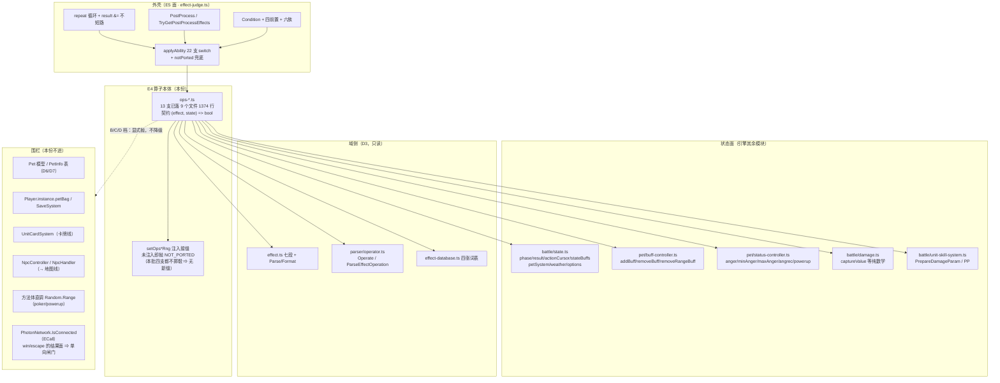
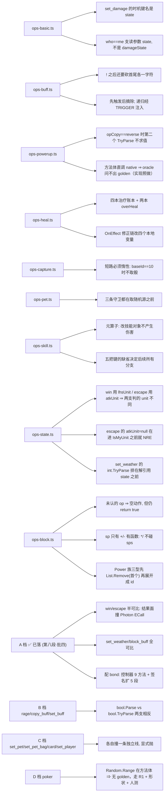

# 战斗引擎子设计 E4 · 22 算子本体（battle-engine-effects.md）

> **定位**：`EffectAbilityHandler.cs`（2284 行）的 **22 支算子本体** —— 一支算子 = `(Effect, BattleState) => bool`，
> **只做"改状态"这一件事**。判定（`Condition`）、外壳（`repeat` / `PostProcess`）、目标选择**都不在本份**（那是 E5）。
>
> 父文档 = `docs/engine/battle-engine-design.md`（**§4.1 算子进度 / §8.1 E4 行 / §8.4(4) 口径修正**）。
> 实现在 `game/core/effect/ops-{basic,buff,powerup,heal,capture,pet,skill}.ts`（**878 行已落**）。
>
> **别与这些重复**：判定与执行外壳 → `docs/engine/battle-engine-judge.md`（E5，含 `applyAbility` 分派 switch）；
> **效果语言 / 数据库**（`Effect` 七段 + 四张词表）→ `docs/domain/domain-effect.md`（D3，**不在本份**，§8.4(4) 已收窄）；
> 逐算子实测与坑 → `docs/engine/port-map.md` 第六/七段；路线 → `docs/engine/kernel-handoff.md §3/§5`；
> **随机源接缝的真值 → `docs/runtime/runtime-components-design.md`（R1）** —— 本份提到的 `setOps*Rng` / `setRandomSkillSource` / `RESIST_RNG`
> 等**九条路**由那条线的 **RB1 九合一**，本份**不**再各自定义口径。
>
> ⚠️ **本份的分档语言里"不可比 / 永不比 / 永久不可比"只描述 golden 覆盖面，不描述要不要实现**（人类决议 ① + 验收口径 `AGENTS.md §1.1`）：
> 掷骰支**照常实现**（随机来自 **R1**），验收 = **同 seed 自复现 + 形状断言 + 人类手测**；
> Photon 的 ECall 闸门（`win`/`escape` 结果面）与随机无关 ⇒ 那一半**照旧**。解释全文见 `docs/engine/oracle-playbook.md §6` 开头的改版块。

---

## 0. 这份文档回答什么

1. 一支算子的**契约**：吃什么、返什么、**看不到什么**（`repeat` / 目标列表 / 判定）。
2. **进度真值**（11 进 golden + 2 半可比 + 1 搬了但进不了 golden + 8 未搬）与**同步纪律**（`PortedAbilities` ↔ `applyAbility`）。
3. 已落 13 支的**落点与形状**（每支记几条"只有照搬才对得上"的怪癖）。
4. **长尾 12 支的施工图**（A 档 4 支已落，余 8 支）：逐支给出 `options` 键 / 突变面 / **撞哪道围栏** / **可比面**。
5. **长尾分档**（A 可进 golden / B 先补能力 / C 撞内容表或别的线 / **D 不比逐值**）—— 这是本份对**下一步排期**的直接输入。
   ⚠️ **D 档原名"永不比"**，2026-10-17 起读作"**不与上游逐值比、但照常实现并换验收手段**"（人类决议 ①，见上面的口径块）；
   分档字母 **A/B/C/D 保留**（它是**排期**分类：前置条件不同），只是 D 档的**后果**从"不做"改成"做，但比形状 + 人手测"。
6. **频次路线**：为什么按频次而不是按文件顺序搬。

---

## 1. 范围与边界

| | |
|---|---|
| **本份覆盖** | `EffectAbilityHandler.cs` 的 **22 支算子**（含兜底 `DefaultAbility`）的本体实现：`ops-*.ts` 的**全部**公开函数 + 各自的 RNG 注入接缝（`setOps*Rng`） |
| **上游** | `MVC/Model/Basic/Effect/EffectAbilityHandler.cs`（2284） |
| **不覆盖** | `Apply` 的**算子分派 switch**（`Effect.cs:314-338`）→ **E5**（`effect-judge.ts` 的 `applyAbility`） |
| | `repeat` 循环 + `PostProcess` + `CheckAndApply` → **E5** |
| | `Effect.Condition` + `EffectConditionHandler.cs`（414，四前置 + 六族）→ **E5** |
| | 目标选择 `target.ts` → **E5** |
| | `Effect` 七段 / `Format` / 四张词表 → **D3**（`docs/domain/domain-effect.md`） |
| | 印记控制器本体（`AddBuff`/`RemoveBuff`/`RemoveRangeBuff` 的六支 copyHandle…）→ **引擎** `pet/buff-controller.ts`（算子**调用**它，不实现它） |
| | 伤害公式 / `captureValue` 的纯数学 → **引擎 E3**（`battle/damage.ts`） |
| | `Effect.cs:391-431`（`GetEffectIdentifier`）→ **D3** |

---

## 2. 上游真值

### 2.1 分派：**一层 switch，唯一入口**

【源码】`Effect.cs:300-344`（`Apply` 内层）｜实现落点 = `game/core/effect/effect-judge.ts` 的 `applyAbility`（**E5 面**）

```csharp
for (int i = 0; i < repeat; i++)
    result &= (type switch { EffectAbility.Win => this.Win(state), … , _ => this.DefaultAbility(state) });
PostProcess(result, state);
return result;
```

- **22 支 = 21 个具名算子 + `DefaultAbility`**（后者同时兜 `none(0)`）；上游 `switch` 里是 **21 个具名 `case` + `_ => DefaultAbility(state)`**。
- 算子看到的**只有** `(effect, state)`；`repeat` 的计数、`PostProcess`、`&=` 的**不短路**累积都在**外壳**。
- ⚠️ 分派用的 `type` 就是 `ability`（D3 §2.2 的别名）⇒ **不是**另一个字段。
- [E5](battle-engine-judge.md) §2.6 已列出分派表；**本份只写"被分派到的那 22 个方法体"**。

### 2.2 进度真值（**开工前必须逐值核对**）

【源码】`tools/oracle-cs/Program.cs:1849`｜【我们】`effect-judge.ts` 的 `applyAbility`

```csharp
static readonly HashSet<int> PortedAbilities = new() { 0, 8, 14, 10, 11, 5, 3, 4, 15, 1, 2, 17, 9 };
```

| 状态 | 支数 | 明细 | 证据面 |
|---|---|---|---|
| **进 golden（可对拍）** | **11** | `none(0)`、`add_status(8)`、`set_damage(14)`、`add_buff(10)`、`remove_buff(11)`、`heal(5)`、`capture(3)`、`pet_change(4)`、`set_skill(15)`、`set_weather(17)`、`block_buff(9)` | `effectapply` 真突变 + 状态签名逐字符比（`block_buff` 靠本轮扩的 `SigPet` 五段 `\|B[]\|BT[]\|C[]\|CT[]\|S<>` 才**看得见**） |
| **搬了但进不了 golden** | **1** | `powerup(7)` | ⚠️ 上游 IL 里 `Powerup` **方法体直接** `call UnityEngine.Random.Range`（`:561`）⇒ dotnet 宿主**方法入口**就抛 `SecurityException`（**与分支无关**）⇒ 放白名单只会把向量洗成"两边同抛"的假绿。**只有 `node --test` 锁形状**；它的下游 (`BattlePet.PowerUp`) 由 `petmut` 的 `powerUp` 族拍过 |
| **半可比** | **2** | `win(1)` / `escape(2)` | 两支的**结果面**都要过 `Unit.IsMyUnit()` ⇒ `PhotonNetwork.IsConnected` ⇒ Photon 静态构造里的 **ECall**（`TypeInitializationException → SecurityException: ECall methods must be packaged into a system module`，与 `powerup` 同根因）⇒ 按 `oracle-playbook.md §6` 的**单向闸门**规矩，那些形状**根本不生成**。⇒ golden 只覆盖 `state==null ⇒ false`（`:41`/`:57`）与 `whosTurn==0 ⇒ atkUnit==null ⇒ NRE`（`:60`）三条；结果面（`phase`/`result.state`/两个 `isDone`/`actionCursor`）由 `effect-judge.test.ts` 用**真 `Unit`**（离线 ⇒ `isMasterUnit`）锁住 |
| **仍 `NOT_PORTED`** | **8** | `rage(6)` / `copy_buff(12)` / `set_buff(13)` / `set_pet(16)` / `set_player(18)` / `poker(19)` / `set_pet_bag(20)` / `card(21)` | 显式抛（**不放行、不给空实现**） |

> **同步纪律（双向）**：`PortedAbilities` 与 `applyAbility` 的"已搬"集合必须**逐值同步**。
> - 白名单**多**了 → oracle 生成阶段抛 `MissingMemberException`（归 **infra**）⇒ "忘了搬"**不会假绿**；
> - 白名单**少**了 → 那支算子被白名单挡住，**少一条真值**（不假绿，但漏测）。
> - ⚠️ **例外一：`powerup(7)`**（上表第二行）—— 它的缺席是**设计**，不是遗漏。
> - ⚠️ **例外二：`win(1)` / `escape(2)`**（上表第三行）—— 它们在白名单里，但**只许发"问得出答案"的形状**；
>   一旦发了走到 `IsMyUnit()` 的形状，会红成"oracle 抛 / TS 不抛"。这是**已知的**单向闸门，不是回归。
> **这两条必须写在文档里**，否则下一个人会"顺手把 7 补进白名单"或"顺手把 win 的结果面向量补回来"。

### 2.3 已落 13 支：落点与形状

| 算子 | 上游 | 行 | 【我们】 | 要记住的形状（细节在文件头 + `port-map.md`） |
|---|---|---|---|---|
| `set_damage(14)` | `:1235-1289` | 55 | `ops-basic.ts` | 时机键名是 **`state`**（**不是** `target_state`）；值 `"last"` ⇒ 换到 `state.lastTurnState`；`who=="me"` 支读的是**参数 `state`**，不是刚换出来的 `damageState` |
| `add_status(8)` | `:627-676` | 50 | `ops-basic.ts` | 与 `set_damage` 同为"耦合最低两支"，用来把"白名单 → 外壳 → 真算子 → 扩签"整条管道跑通 |
| `add_buff(10)` | `:737-863` | 127 | `ops-buff.ts` | ⚠️ **七条 quirk**，头一条：`:746-749` 剥掉 `!` 之后**还要再砍首尾各一字符** ⇒ 列表形态是 `![a/b/c]`（真表实测 `id=![3458/3459]`）；`v.Length-2 < 0` 时 C# 在 `Substring` 抛 ⇒ 同形显式抛 |
| `remove_buff(11)` | `:865-973` | 109 | `ops-buff.ts` | 「**先触发后摘除**」；与 `add_buff` 一起是印记袋唯一的**一对通用写入口**（递归回判定层，经 `TRIGGER` 回调注入） |
| `powerup(7)` | `:474-623` | 150 | `ops-powerup.ts` | ⚠️ **耦合最重**：吃 target 列表 + 状态控制器（`powerup` / min-max 边界）+ 印记袋（45/46/94 三个修饰 + `PowerUp` 自己补的印记）+ `rhsUnit` 的镜像写入。头一条：`:487` 那个合取在 `opCopy=="reverse"` 时**第二个 `TryParse` 不求值** |
| `heal(5)` | `:165-352` | 188 | `ops-heal.ts` | ⚠️ 下游最宽：写 `hp`/`maxHp` + **四本治疗账本**（`skillHeal`/`itemHeal`/`buffHeal`/`healDict` + 两本 `overHeal`）+ 中间插一段 **`OnEffect` 修正链**（读别人挂的 resident 副作用、按 priority 排序、逐条改写本效果的四个本地变量）；`state==null` 支要 `(Pet)effect.invokeUnit` ⇒ **显式抛**（core 无 base `Pet`） |
| `capture(3)` | `:66-106` | 41 | `ops-capture.ts` | ⚠️ `:95` 的 `(baseId==10) \|\| (value >= lhsUnit.RNG())` 短路是**承重的**（`baseId==10` 时**不取骰** ⇒ `unit.random` 不被改写）⇒ 必须**惰性 `\|\|`**，不能复用在 `damage.ts` 里把 `rngValue` 当实参**预求值**的 `isCaptureSuccess` |
| `pet_change(4)` | `:108-163` | 56 | `ops-pet.ts` | ⚠️ **三条守卫都在取随机源与 `ApplyBuffs` 之前**（`state==null` / `target_index<0` / `target=="random" && 袋里没备选`）⇒ 三条都可比；`anger` 两步 `f()` 收窄 |
| `set_skill(15)` | `:1291-1392` | 102 | `ops-skill.ts` | ⚠️ **元算子**：不产生伤害，而改**技能对象**（`id`/`effect`/任意 identifier）⇒ 把 `Skill.SetSkillIdentifier`、四支特殊技工厂、`ListHelper.Random`、`UnitSkillSystem.PrepareDamageParam` 全串起来；五把键的**缺省**（`me`/`null`/`none`/`'+'`/`"0"`）决定后面所有分支 |
| `win(1)` | `:38-53` | 16 | `ops-state.ts` | ⚠️ **半可比**（见 §2.2 例外二）。结果面四笔：`phase = OnBattleEnd` → `result.state = lhsUnit.IsMyUnit() ? Win : Lose` → **链式赋值** `myUnit.isDone = opUnit.isDone = true` → `actionCursor = actionOrder.Count`（**队尾**，不是 `whosTurn`）。`who` 缺省 `me` ⇒ `getUnitById(id)`，**其余任何串**（含大小写不符）⇒ `getRhsUnitById(id)` |
| `escape(2)` | `:54-65` | 12 | `ops-state.ts` | ⚠️ **半可比**。判的是 **`state.atkUnit`**（由 `whosTurn` 定），与 `invokeUnit`/`who` **无关** ⇒ `whosTurn===0` 时 `atkUnit` 是 null，**在进入 `IsMyUnit` 之前**就 NRE（这一条可比，已进 golden）。别顺手改成 `myUnit` |
| `set_weather(17)` | `:1969-1983` | 15 | `ops-state.ts` | ⚠️ `int.TryParse`（**字面**，不认表达式/标识符/小数点）失败 ⇒ `false`，且**排在解引用 `state` 之前** ⇒ `state==null` + 畸形串是**干净 false**。两处 `masterUnit.pet.buffController.IsBuffTypeBlocked(Weather)` 是 **`\|\|`**（任一侧挂 weather 型印记即拒）。⚠️ **不判 `state == null`** ⇒ 合法串 + `state==null` 在 `state.masterUnit` 上 NRE |
| `block_buff(9)`（`BlockOrCopyBuff`） | `:678-736` | 59 | `ops-block.ts` | ⚠️ **本批耦合最重的一支**，四条：① 三个 `Action` 按 `op` 选（`+`/`-`/`*`/`/`），**其余含畸形 `op` = 空动作**（但仍 `return true`，别改成 `false`）；② **`sp_list` 只有 `+`/`-` 有函数**（`:714-720`）⇒ `*`/`/`**不碰** `blockBuffSps`；③ `type_list` 里的 `Power`/`Powerup`/`Powerdown` 先被 **`List.Remove`（只摘首个）** 移出、再展开成 id 列表（`:722-730`，`Power` → powerup∪powerdown 全集）；④ `id_list` 走 `ToIntList('/')` ⇒ 解析失败**整表 null**，让 null 自然流下去抛（与上游 `AddRange(null)` 同形）。⚠️ **不判 `state == null`**（NRE） |

**共同接缝**：会掷骰的算子各有一个 `setOps*Rng(rng | null)` ——
`setOpsBuffRng` / `setOpsPetRng` / `setOpsPowerupRng` / `setOpsSkillRng`（+ `setBuffRemoveRng` 在控制器侧）。
**未注入 ⇒ 显式抛 `NOT_PORTED`**，**不静默取第一项**。
本批四支（`ops-state.ts` / `ops-block.ts`）**一次骰都不掷**，所以没有新接缝。

**观测面**（本批扩的）：`block_buff` 只改印记控制器的五张私有表（`blockBuffIds`/`blockBuffTypes`/`copyBuffIds`/`copyBuffTypes`/`blockBuffSps`），
原来**一个都不在签名上** ⇒ 光靠 `apply=True` 证明不了九个方法被调对。所以这轮把
`snap-mirror.mjs` 的 `sigPet` 与 oracle 的 `SigPet` **同时**扩了 `|B[..]|BT[..]|C[..]|CT[..]|S<..>` 五段，
并给两边 `FakePet`/`BuildPet` 各加了四个**铺垫键**（`blockTypes` / `sps` / `copyIds` / `copyTypes`，
都走**真方法** `BlockBuffWithType`/`BlockBuffWithString`/`CopyBuff`/`CopyBuffWithType`）——
否则 `unblock*`/`uncopy*` 四支**没有起点可摘**，测不出"摘对了没有"。

### 2.4 长尾 12 支：逐支施工图（A 档 4 支已落，余 8 支）

> **读法**：「突变面」= 这支算子会写哪里；「围栏」= 它撞到哪条**本仓明确不做的线**；「可比面」= 能不能进 golden。
> 行数 = 上游 `EffectAbilityHandler.cs` 的区间长度（含签名行）。

#### A 档 · **可进 golden**（零内容表、零存档、零 native）—— ✅ **本批已全部落地**（逐支已在 §2.3）

> 逐支的落点、`options` 键、突变面与怪处已上移到 **§2.3** 的表（它们是"已落"而不是"长尾"了）。这里只留**这一档落地时量出来的修正**：

1. **`win`/`escape` 不是"全可比"，是"半可比"** —— 两支的结果面都过 `Unit.IsMyUnit()`，而它读
   `PhotonNetwork.IsConnected`，Photon 的静态构造在无头宿主里必抛（`StaticReset()` 里的 **ECall**）。
   这**不是**"缺个程序集"（那是加载期的事，会报 `FileNotFoundException`），是**运行期 ECall 不可用**
   ⇒ 与 `powerup`（`:561`）**同一个根因**。按 `oracle-playbook.md §6` 的**单向闸门**口径，那些形状
   **根本不生成**。⇒ 结论：`win`/`escape` 的结果面**只能靠单测**（用真 `Unit`，离线 ⇒ `isMasterUnit`）。
2. **`escape` 的 `whosTurn===0` 支反而是可比的** —— `atkUnit` 取 null 发生在**进入 `IsMyUnit` 之前**
   （`state.phase` 已写、`result.state` 还没写），两端同抛 ⇒ 进 golden，锁住 A3 那条。
3. **`set_weather` / `block_buff` 的 `state==null` 支是"两端同抛"** —— 两支都**不判** null ⇒ 一开始就
   在 `state.masterUnit` / `state.GetUnitById` 上 NRE。这些向量也进 golden（它们是 A3 的直接证据）。
4. **`Powerdown` 的原始串是 `'powerup.neg'`**，不是 `'powerdown.neg'` —— `BuffDatabase.cs:8-33` 的三行是
   `powerup.neg` / `powerup.pos` / `powerup` 分别指 `Powerdown`(-4) / `Powerup`(-3) / `Power`(-2)。
   查不到一律**静默兜 `None(0)`**（不抛）⇒ 写反了会得到一条"看起来对、其实什么都没展开"的假绿向量。
   （这条已由 difftest 当场咬出来：`BT[0]` vs 期望的 `BT[]`。）
5. **`who` 的三元是 `who == "me" ? A : B`** —— 大小写敏感、且**任何**非 `"me"` 的串（含 `""`）都走 `B`。
   别读成 `who == "other"`。

#### B 档 · **先补"数值/印记写面"才可搬**

| 算子 | 上游 | 行 | `options` 键 | 突变面 | 缺口 | 可比面 |
|---|---|---|---|---|---|---|
| `rage(6)` | `:354-473` | 120 | `who` / `type`(默认 `anger`) / `mult`(默认 `0/1`) / `add` / `set` / `min` / `max` / `filter` / `random`(默认 `false`) / `random_count`(默认 `-1`) | `type=="anger"` ⇒ `statusController.minAnger/maxAnger` + `pet.anger +=` **或** `= setAnger`；`type=="pp"` ⇒ 每个匹配技能的 `PP`；中间插一段 **`OnEffect` 修正链**（按 `priority` 排序、逐个 `Operator.Operate` 改本效果的五个本地变量、再 `PostProcess`） | `skillController.allSkills` + `Skill.TryGetSkillIdentifier` + `Skill.PP`（→ **D5**）；`statusController.minAnger/maxAnger/angrec` ✅ 已有 | ⚠️ `bool.Parse(random)` ⇒ 畸形串**抛**；`isRandom` 支走 `ppSkills.Random(randomTypeCount)` **native** ⇒ 那一支**不与上游逐值比**（改发**合成向量** + 断同 seed 复现，走 **R1**；其余可比） |
| `copy_buff(12)` | `:975-1161` | 187 | `id` / `type` / `filter` / `source`(默认 `op`) / `target`(默认 `me`) / `transfer` / `reverse` / `exchange` / `mult` | 四个维度分支（`isId`/`isType` × `isExchange`/普通）+ 末尾 `if (isTransfer) RemoveRangeBuff`；`isId` 支还要 `statusController.{powerup,SetPowerUp}` 与 **`petPowerUp`**（`BattlePet.PowerUp`）做**镜像写入** | `GetProtectBuffTypeId` ✅ 已有；`petPowerUp` ✅ 已有（`state.ts:854`）；`BUFFID_PROTECT_*` ✅ 已有 | ⚠️ **三个 `bool.TryParse`（`transfer`/`reverse`/`exchange`）失败即 `false`**（与 `rage` 的 `bool.Parse` **相反**）；`id` 支里 `IsWithin(-9,-10)` 端序照搬 |
| `set_buff(13)` | `:1162-1234` | 73 | `key`(默认 `""`) / `filter` / `who` / `id` / `type`(默认 `value`) / `op`(默认 `+`) / `value` | `key` 三分支取 `buffList`：`""`（`buffId==0` ⇒ 谓词筛，否则 `GetBuff(buffId).SingleToList()`）/ `"unit"`（`unitBuffs`）/ 其余（**`state.stateBuffs`** 按 key 找）；逐条 `GetBuffIdentifier` → `Operator.Operate` → `SetBuffIdentifier`；⚠️ `type=="id"` 时 **`OnRemoveBuff` 被注释掉（`:1207-1211`，死代码照搬）**，而 **`OnAddBuff` 是活的（`:1215-1219`）**；`info.autoRemove && value<=0` ⇒ 按三分支移除 | `state.stateBuffs` ✅；`unitBuffs` ✅ | ✅ 补完 `unitBuffs`/`stateBuffs` 的谓词访问后可比（无随机） |

#### C 档 · **撞围栏，进不了 golden**

| 算子 | 上游 | 行 | 撞的线 | 说明 |
|---|---|---|---|---|
| `set_pet(16)` | `:1394-1968` | **575**（**最大的一支**） | **`state==null` 半 → Save/编排线（编排线已立 ⇒ `docs/orchestration/orchestration-design.md`）；`state!=null` 半 → D6/D7** | 两半泾渭分明：<br>· `state==null`：`(PetBagMode)int.Parse("pet_bag_mode")` ⇒ `Player.instance.petBag`（`:1410`）/ `YiTeRogueData.instance.petBag`（`:1411`），末尾 **`SaveSystem.SaveData()`（`:1423`）** ⇒ **存档写盘**（不是战斗行为）<br>· `state!=null`：`type` 十来个分支（`id`/`name`/`evReset`/`personality`/`skill*`/`buff`/`record*`/`kizuna`/`state`/`normalSkill*`/`superSkill*`/`dead`/`specialChance`），要 **真 `Pet` 模型 + `PetInfo.database` + `Pet.GetExamplePet` + `ownSkill`** |
| `set_pet_bag(20)` | `:2075-2212` | 138 | **D6/D7** | `type` ∈ {默认, `token`} × `op` ∈ {`+`, `-`, `SET`}；要 `Pet`/`BattlePet.GetBattlePet`、`petSystem.{tokenPetBag,SwapBackupPet,SwapTokenPet,AddNewPet,GetNextCursorCircular}`；`value=="random"` 支还要 `PetInfo.database…Random()`（**native**，共三处：`:2102` 选宠 / `:2109` 选普技 / `:2116` 选必杀）⇒ 这**三支进不了 golden**（⚠️ 决议 ①：**不是"不做"**，实现照做、掷骰走 **R1**，其余支照常可比） |
| `card(21)` | `:2213-2284` | 72 | **卡牌线**（`state.ts` 文件头已登记"卡牌模式不移植"） | 要 `lhsUnit.cardSystem`（`UnitCardSystem`：`GetToken`/`Draw`/`Discard`/`SetSkillIdentifier`）；`type` ∈ {`token`, `draw`}；`draw` 支的 `set` 会逐张卡 `SetSkillIdentifier` |
| `set_player(18)` | `:1984-2030` | 47 | **剧情/UI 线**（**两支除外**） | `action=="set_bgm"`（`:2001`）/ `"set_background"`（`:2006`）两支**只写 `state.options`**（`bgm_path`/`bgm_mod`/`background_path`/`background_mod`）⇒ **这两支可搬**；其余走 `NpcController` / `NpcButtonHandler` / `NpcHandler.GetNpcAction` ⇒ **对话框/剧情**（View 线）。⚠️ 非 bgm 支先判 `state.settings.mode == PVP ⇒ false`；`param_count` 解析失败也 `false` |
| `poker(19)` | `:2031-2074` | 44 | **无表无存档，但方法体直调 native** | ⚠️ `color = 3200 + Random.Range(0,4)` / `point = Random.Range(1,14)`（`:2048-2049`，重掷在 `:2052-2053`），且**循环重掷直到牌不重复** ⇒ **方法体直接** `call Random.Range` = **与 `Powerup`（`:561`）同族** ⇒ **整支进不了 golden**（`type` 只有 `get`/`refresh`，**两支都掷骰**）。⚠️ 2026-10-17 决议 ①：这条**不是"不做"** ⇒ 实现照做（掷骰走 **R1**），验收 = 同 seed 复现 + 形状断言（含"重掷到不重复"的循环界）+ **人类手测** |

### 2.5 长尾分档汇总（**下一步排期的直接输入**）

| 档 | 支 | 前置条件 | 能进 golden？ | 状态 |
|---|---|---|---|---|
| **A** | `win` `escape` `set_weather` `block_buff` | `block_buff` 需**补 9 个控制器方法**（纯列表运算） | ⚠️ `set_weather`/`block_buff` ✅ 全可比；`win`/`escape` **半可比**（结果面撞 Photon ECall） | ✅ **已落**（第八段·批四） |
| **B** | `rage` `copy_buff` `set_buff` | `rage` 需 **D5**（`Skill.PP` / `allSkills` / `TryGetSkillIdentifier`） | ✅ 可（除各自的 native 支） | ⬜ 下一批 |
| **C** | `set_pet` `set_pet_bag` | **D6/D7**（真 `Pet` 模型与表） | ⚠️ 部分（`random` 三支**不与上游逐值比** ⇒ 走 R1，比形状 + 人测） | ⬜ |
| **C′** | `card` | **卡牌线**立项 | ❌ | ⬜ |
| **C″** | `set_player`（除 bgm/背景两支） | **剧情/UI 线** | 仅两支可 | ⬜ |
| **D** | `poker` | —（方法体直调 native ⇒ **oracle 问不出 golden**；⚠️ **不是"不做"**，前置条件为空 ⇒ **随时可搬**，掷骰走 R1） | ❌ golden ⇒ 同 seed 复现 + 形状断言 + **人类手测**（`AGENTS.md §1.1`） | ⬜ |

> **建议次序**（A 档已按此落地）：~~`win` → `escape` → `set_weather` → 补控制器 9 方法 → `block_buff`~~
> → 等 **D5** 落 `Skill.PP` 后 `rage`（第二频次）→ `copy_buff` / `set_buff` → 等 **D6/D7** 才碰 `set_pet`。
> **`card` / `set_player` 非 bgm 支：本轮不做**（各撞一条真前置线：卡牌线 / 剧情-UI 线）。
> ⚠️ **`poker` 从这一行里摘出来**（2026-10-17 决议 ①）：它**没有前置线可撞**，只是**没有 golden** ⇒
> 排期靠后，但**实现照做**（掷骰走 **R1**，见 `docs/runtime/runtime-components-design.md`），
> 验收 = 同 seed 复现 + 形状断言 + **人类手测**（`AGENTS.md §1.1`）。
>
> ⚠️ A 档落地的**唯一修正**：`win`/`escape` 的结果面**进不了 golden**（Photon ECall 单向闸门），
> 原以为"零 native"的判断对这两支不成立 —— 详情见 §2.4 A 档第 2 条与 §2.2「半可比」。

### 2.6 频次路线（**为什么不是按文件顺序**）

【事实】`docs/engine/port-map.md:48`｜`docs/engine/kernel-handoff.md:169-172/254-255`

| 序 | 算子 | 真表频次 | 状态 |
|---|---|---|---|
| 1 | `add_buff` | **2984** | ✅ 已落 |
| 2 | `set_skill` | **1741** | ✅ 已落 |
| 3 | `powerup` | **1346** | ✅ 已落（进不了 golden ⇒ 形状 + 人测；⚠️ 旧措辞"不可对拍"只指 golden 覆盖面） |
| 4 | `set_damage` | **1269** | ✅ 已落 |
| 5 | `heal` | **1027** | ✅ 已落 |
| 6 | `none` | **855** | ✅（兜底 `DefaultAbility`） |
| — | **前 6 合计** | **74.2%** | |
| 7 | `remove_buff` | **772** | ✅ 已落 |
| 8 | `add_status` | **572** | ✅ 已落 |
| 9 | `capture` | — | ✅ 已落（批三**特意反转**围栏） |
| 10 | `pet_change` | — | ✅ 已落（同上） |
| — | `win` / `escape` | — | ✅ 已落（批四，**半可比**） |
| — | `set_weather` / `block_buff` | — | ✅ 已落（批四，全可比） |
| 11 | **`set_pet`** | **289** | ⬜ 长尾第一（撞 D6/D7 + 存档） |
| 12 | **`rage`** | **166** | ⬜ 长尾第二（B 档最大的一支，需 **D5**） |
| … | 其余 8 支 | 递减 | ⬜ |

> **口径**：**按频次推**，不做"顺手全搬"。已落的 14 支（含 `none`）覆盖**绝大多数真表出现次数**；
> 长尾里**只有 `set_pet(289)` 与 `rage(166)` 还值得按频次排期**，其余 6 支的收益很小 ⇒ 由**前置条件**（B/C 档）而不是频次决定。
> ⚠️ 别再断言"长尾零前置" —— `win`/`escape` 就栽在这上面（结果面撞 Photon ECall，见 §2.2）。

### 2.7 支内结构：以 `Rage` 为例的"三段式"

长尾里成规模的四支（`rage` / `copy_buff` / `set_buff` / `set_pet`）都是**同一个骨架**：

```
① 读 options（一串缺省值，决定后面所有分支）
② 取 lhsUnit / rhsUnit（who == "me" ? GetUnitById : GetRhsUnitById）
③ 分派：switch (type) 或一串 if (type == …)
   · 每支里再插一段 Id/Type 维度 × exchange/transfer 维度的四象限
   · 若干支**中途插一条 `OnEffect` 修正链**（读别人挂的 resident 副作用，按 priority 逐条改写本地变量）
④ 收尾：`PostProcess`（在外壳）或就地返回
```

⚠️ **第 ③ 步的"修正链"是本档最容易被抄漏的结构**：它不是判定，而是**同一条效果在落地前被别的效果改写**——
`rage`（改 `rage`/`rec`/`setAnger`/`maxAnger`/`minAnger`）与 `heal`（改四个治疗变量）各有一条，**形状相同、变量不同**。
抄漏的后果是"数值总是少一层修正"，而**对拍会红**（这一条救了我们）。

---

## 3. 目标结构（契约）

```
core/effect/ops-basic.ts      setDamage(effect, state) · addStatus(effect, state)
core/effect/ops-buff.ts       setOpsBuffRng(rng|null) · addBuff(effect, state) · removeBuff(effect, state)
core/effect/ops-powerup.ts    setOpsPowerupRng(rng|null) · powerup(effect, state)
core/effect/ops-heal.ts       heal(effect, state)
core/effect/ops-capture.ts    capture(effect, state)
core/effect/ops-pet.ts        setOpsPetRng(rng|null) · petChange(effect, state)
core/effect/ops-skill.ts      setOpsSkillRng(rng|null) · setSkill(effect, state)

// 契约（全部算子同形）
type Ability = (effect: Effect, state: BattleState | null) => boolean
//   · state===null 的语义**逐支不同**（详见 §5 A3），不许统一
//   · 不接收 repeat / target 列表 / checkPhase
//   · 需要随机时读模块级注入的 Rng；未注入 ⇒ 抛 NOT_PORTED
//   · 未移植的支 ⇒ effect-judge.ts 的 notPorted('算子 X')（不在本目录）

core/effect/ops-state.ts     win(effect, state) · escape(effect, state) · setWeather(effect, state)
core/effect/ops-block.ts     blockOrCopyBuff(effect, state)

// 契约（全部算子同形）
type Ability = (effect: Effect, state: BattleState | null) => boolean
//   · state===null 的语义**逐支不同**（详见 §5 A3），不许统一
//   · 不接收 repeat / target 列表 / checkPhase
//   · 需要随机时读模块级注入的 Rng；未注入 ⇒ 抛 NOT_PORTED
//   · 未移植的支 ⇒ effect-judge.ts 的 notPorted('算子 X')（不在本目录）

// 长尾落点（同目录，未建）
ops-rage.ts     ← rage                               （B 档，需 D5）
ops-copy.ts     ← copyBuff / setBuff                 （B 档）
ops-bag.ts      ← setPet / setPetBag                 （C 档，需 D6/D7）
// poker / card / set_player 非 bgm 支：**不建文件**（撞独立线）
```

---

## 4. 接口（mermaid）

### 4.1 模块位置图



### 4.2 文件↔接口图



---

## 5. 不变量与围栏

| # | 不变量 / 围栏 |
|---|---|
| **A1** | **算子契约唯一**：`(effect, state) => boolean`。**不接收** `repeat` / 目标列表 / `checkPhase` / `checkTurn` |
| **A2** | **`repeat` 与 `PostProcess` 在外壳**（E5）；算子**看不到**自己会被跑几遍。`result &=` 的**不短路**累积也在外壳 |
| **A3** | ⚠️ **`state === null` 的语义逐支不同，不许统一**：`win`/`escape`/`capture`/`pet_change` ⇒ **`false`**；`set_weather`/`poker`/`card`/`rage`/`copy_buff`/`set_buff`/`set_pet_bag` ⇒ **不判 ⇒ NRE**；`set_damage`/`add_status`/`add_buff`/`remove_buff`/`heal`/`set_skill` ⇒ **各自的特判**（`heal` 要 `(Pet)` ⇒ 显式抛）。**上游就是七零八落，照搬** |
| **A4** | **`who` 缺省 `"me"`**，取值恒为 `who == "me" ? state.GetUnitById(invokeUnit.id) : state.GetRhsUnitById(invokeUnit.id)`。【事实】`Get("who", …)` 在 22 支里出现 **18 次**；这句三元的写法出现 **19 次**（有一支读／判两遍） |
| **A5** | ⚠️ **`bool.Parse` 与 `bool.TryParse` 不许混**：`rage` 的 `random` 是 **`Parse`（畸形串抛）**；`copy_buff` 的 `transfer`/`reverse`/`exchange` 是 **`TryParse`（失败即 `false`）**。两者**肉眼几乎一样**，是对拍里最容易翻的一处 |
| **A6** | **算子不自己生成随机**：一律读注入的 `Rng`（= **R1 随机源**，见 `docs/runtime/runtime-components-design.md`；RB1 把现有九条注入路合一）。未注入 ⇒ **显式抛 `NOT_PORTED`**，**绝不静默取第一项/取 0** |
| **A7** | **未搬算子显式抛**（`notPorted('算子 X')`），**不放行、不给空实现、不 quietly `return true`**。静默放行会把"没搬"伪装成"这条效果生效了" |
| **A8** | **进度双同步**：`Program.cs:1849` 的 `PortedAbilities` ↔ `applyAbility` 的已搬集合**逐值同步**。⚠️ **两处例外**：`powerup(7)` 的**缺席**是设计（方法体直调 native ⇒ 只可能假绿），而 `win(1)`/`escape(2)` 的**在场**也只在"问得出答案的形状"上成立（结果面撞 Photon ECall ⇒ 单向闸门）。两条都**不是遗漏** |
| **A8′** | **签名要给新突变面开口子**：某支算子只改"签名上看不见"的地方（`block_buff` 的五张私有表）⇒ 搬它之前必须**先**扩签名（`snap-mirror.mjs` 的 `sigPet` + oracle 的 `SigPet`），否则会拿到一堆"`apply=True` 就绿"的**假绿向量** |
| **A9** | **频次驱动**：长尾按真表频次排期，不做"顺手全搬"；每搬一支**立刻**进 `difftest` 并扩 `PortedAbilities` |
| **A10** | **围栏不许降级**：`Player.instance` / `YiTeRogueData` / `SaveSystem` / `cardSystem` / `NpcController` 一律**抛**；**不**用 `null` 或空数组伪装"空" |
| **A11** | **数值运算不许重算**：`Operator.Operate` / `Parser.ParseEffectOperation` / `damage.captureValue` 一律**调域侧/引擎已有实现**；`rage`/`heal` 的修正链也一样 |
| **A12** | **惰性 `\|\|` / `&&` 是承重的**（`capture` 的 `baseId==10`、`powerup` 的 `opCopy=="reverse"`）—— 把短路改写成预求值会**多掷一次骰**，把 `unit.random` 改写掉 ⇒ 假红 |
| **A13** | **`card` / `set_player` 非 bgm 支 = 本轮不做**（各撞一条**真前置线**：卡牌线 / 剧情-UI 线）。**不许**"先给个简化版"。⚠️ **`poker` 从这条里摘出**（决议 ①）：它**没有前置线**，只是**没有 golden** ⇒ 实现照做（掷骰走 **R1**），只是**排期靠后**；同样**不许**给简化版 |

---

## 6. 现状与缺口

| 件 | 行数 | 状态 |
|---|---|---|
| `ops-basic.ts` | 131 | ✅ `set_damage` + `add_status` |
| `ops-buff.ts` | 314 | ✅ `add_buff` + `remove_buff` |
| `ops-powerup.ts` | 199 | ✅ `powerup`（**值不进 golden**） |
| `ops-heal.ts` | 194 | ✅ `heal` |
| `ops-capture.ts` | 65 | ✅ `capture` |
| `ops-pet.ts` | 109 | ✅ `pet_change` |
| `ops-skill.ts` | 191 | ✅ `set_skill` |
| `ops-state.ts` | 75 | ✅ `win` + `escape` + `set_weather`（`win`/`escape` **半可比**） |
| `ops-block.ts` | 96 | ✅ `block_buff`（靠 §2.3「观测面」那五段签名才可比） |
| `pet/buff-controller.ts` | 369 | ✅（本批补的 9 个方法在 `:145-167`，含模块级 `removeRange` 助手） |
| — | **1374 计** | **13 支算子文件已落**；连同 `none(0)`（走 `DefaultAbility` 外壳）⇒ **22 支里 14 支有实现** = `11 进 golden + 2 半可比(win/escape) + 1 进不了 golden(powerup)`；余 8 支 `NOT_PORTED` |

**缺口（按档排序）**

| 缺口 | 属于 | 说明 |
|---|---|---|
| ~~**`PetBattleBuffController` 的 9 个方法**~~ | ~~A 档前置~~ | ✅ **已补**（第八段·批四）。`blockBuffWithType` / `blockBuffWithString` / `unblockBuff` / `unblockBuffWithType` / `unblockBuffWithString` / `copyBuff` / `copyBuffWithType` / `uncopyBuff` / `uncopyBuffWithType` —— 关键是 `RemoveRange(this, rhs)` 在 `HelperCollections.cs:192-196` 里是**对 rhs 逐项 `lhs.Remove(item)`**（只摘首个匹配），**不是**集合差 |
| **`Skill.PP` / `SkillController.allSkills` / `TryGetSkillIdentifier`** | **B 档前置** | → **D5**（`docs/domain/domain-skill.md`） |
| **真 `Pet` 模型 + `PetInfo.database` + `Pet.GetExamplePet` + `ownSkill`** | **C 档前置** | → **D6**（`docs/domain/domain-pet.md`，✅ 已写 2026-10-17、码未落）/ **D7**（`docs/domain/domain-info.md`，已写、码未落）；`set_pet` 的 `state!=null` 半与 `set_pet_bag` 全靠它。⚠️ **`GetExamplePet` 落在 D6 构造家族的 N 档**（`domain-pet.md §2.2`：它先走带 native `Random` 的 `Pet(int)` 构造 ⇒ **进不了 golden，但照常实现**，随机来自 **R1**；唯一残留是 `basic.getPetDate` ⇒ 能不能救见 D6 §7 **Q4**） |
| **`Player.instance.petBag` / `SaveSystem.SaveData`** | **C 档前置（且不是战斗行为）** | → **Save 线 / 编排线**（编排线已立 ⇒ `docs/orchestration/orchestration-design.md`）；`set_pet` 的 `state==null` 半本质是"**战斗外改宠袋**"，应挂在**编排层**而不是算子里 |
| **`UnitCardSystem`** | **C′ 档** | 卡牌线立项前**不做**（`state.ts` 文件头已登记） |
| **`NpcController` / `NpcHandler.GetNpcAction`** | **C″ 档** | **地图线**（`docs/map/map-design.md`，2026-10-17 已立 = **条件→动作** 的语义正本）+ 剧情/View；`set_player` 只有 bgm/背景两支可搬 |
| **长尾 8 支的 `difftest` 形状** | **全部** | `snap-mirror.mjs` 的 EA 生成区要在搬每支时同步扩（第六/七/八段各做过一轮）。⚠️ **搬之前先问：它的突变面在签名上看得见吗？** 看不见 ⇒ 先扩签名（A8′） |

---

## 7. 待核 / 已知怪癖

| # | 事项 | 证据 |
|---|---|---|
| 1 | **`powerup(7)` 的缺席是设计，不是遗漏** —— 方法体直调 `Random.Range`（`:561`）⇒ 只可能假绿 | 【源码】`Program.cs:1849` + `EffectAbilityHandler.cs:474/561` |
| 2 | ⚠️ **`rage` 用 `bool.Parse`、`copy_buff` 用 `bool.TryParse`** —— 畸形串一个抛一个 false | 【源码】`:374` vs `:1040` |
| 3 | **`win` 用 `lhsUnit.IsMyUnit()`（`:48`）、`escape` 用 `state.atkUnit.IsMyUnit()`（`:60`）** —— `whosTurn===0` 时后者 **NRE**。⚠️ 而 `IsMyUnit()` 本身读 `PhotonNetwork.IsConnected` ⇒ **两支的结果面在无头 oracle 里永远问不出来**（见 #14） | 【源码】`:48` vs `:60` |
| 4 | **`set_weather` 不判 `state == null`** ⇒ 直接 `state.masterUnit` NRE | 【源码】`:1976` |
| 5 | **`block_buff` 的 `Power`/`Powerup`/`Powerdown` 三型先移出、展开成 id 列表**再并进 `id_list` | 【源码】`:722-730` |
| 6 | **`block_buff` 的 `op` 落在 `_` 时三个 `Action` 都是空动作** ⇒ 恒 `return true`（不是 false） | 【源码】`:700` / `:710` / `:718` |
| 7 | ⚠️ **`set_buff` 的 `type=="id"`：`OnRemoveBuff` 被注释掉（`:1207-1211`）、`OnAddBuff` 是活的（`:1215-1219`）** —— **不是两段都注释**，抄错就少一次触发 | 【源码】`:1207-1219` |
| 8 | **`rage`/`heal` 各有一条 `OnEffect` 修正链**（读 resident 副作用、按 priority 逐条改写本地变量；`rage` 改 5 个：`rage`/`rec`/`setAnger`/`maxAnger`/`minAnger`） | 【源码】`:388-435`（rage） / `:200`（heal） |
| 9 | **`capture` 的 `\|\|` 短路承重**：`baseId==10` 时**不取骰** | 【源码】`:95` |
| 10 | **`set_pet` 的 `state==null` 半以 `SaveSystem.SaveData()` 收尾** —— 它是**战斗外**的宠袋编辑 | 【源码】`:1410-1423` |
| 11 | **`poker` 整支进不了 golden**（`get`/`refresh` 两支都掷骰，且循环重掷到不重复）。⚠️ 2026-10-17 决议 ①：这只限 **golden 覆盖面**，**不是"不做"** ⇒ 实现照做、掷骰走 **R1** | 【源码】`:2048-2053` |
| 12 | **`set_player` 的 bgm/背景两支只写 `state.options`** ⇒ 是 `set_player` 里唯一可搬的两支 | 【源码】`:2001` / `:2006` |
| 13 | **`set_pet_bag` 的 `value=="random"` 有「三处」掷 native**（选宠 / 选普技 / 选必杀）⇒ 即便 D6/D7 到位，那三处**不与上游逐值比**（走 **R1**；实现照做，其余支照常可比） | 【源码】`:2102` / `:2109` / `:2116` |
| 14 | ⚠️ **`win`/`escape` 的结果面撞 Photon 的 ECall —— 单向闸门，别去修**。`Unit.IsMyUnit()` ⇒ `PhotonNetwork.get_IsConnected()` ⇒ `PhotonNetwork` 的**静态构造**里 `StaticReset()` 抛 `SecurityException: ECall methods must be packaged into a system module`（外层包成 `TypeInitializationException`）。**不是"缺程序集"**（那是加载期 `FileNotFoundException`），是**运行期 ECall 不可用** ⇒ 与 `powerup(7)` 的 `Random.Range` 同根因。⇒ 按 `docs/engine/oracle-playbook.md §6`，那些形状**不生成**。⚠️ **这条闸门与随机无关**（决议 ① 不改它），但它同样**只限 golden 覆盖面、不限实现** ⇒ `win`/`escape` 的实现照做，结果面靠形状断言 + 人类手测 | 【源码】`Unit.cs:115-118`；【实测】`tools/oracle-cs` 探针（已撤） |
| 15 | ⚠️ **`BuffDatabase` 的 `Powerdown` 原始串是 `'powerup.neg'`，不是 `'powerdown.neg'`** —— 三行是 `powerup.neg`/`powerup.pos`/`powerup` ↔ `Powerdown`/`Powerup`/`Power`。查不到一律**静默兜 `None(0)`**（词表兜底不抛）⇒ 写反了会得到一条"看起来对、其实什么都没展开"的向量（本批被 difftest 当场咬出：期望 `BT[]` 实得 `BT[0]`） | 【源码】`BuffDatabase.cs:8-33` |
| 16 | **`block_buff` 的 `sp_list` 只有 `+`/`-` 有函数** —— `spFunc` 在 `*`/`/`/未认 `op` 上是**空动作** ⇒ `sp_list` 那两把键在复制/取消复制时**完全不碰** `blockBuffSps`。字形上很容易以为"五个键都参与四个动作" | 【源码】`:714-720` |
| 17 | **`BlockBuffWithString` 的 switch 只有一个 `default`** —— 任何**非空**串都 `+1`（默认 `sp_list="none"` 于是 `none=1` 也照落）；而 `UnblockBuffWithString` 只有 `case "op"`、无 `default` ⇒ 别的串什么都不做。**一加一减不对称** | 【源码】`:328-344` vs `:356-368` |

---

## 8. 配对实现（impl）指针

- 本份配对 = 未来的 **`docs/engine/battle-engine-impl.md`** + **`battle-engine-code-map.md`**（阶段一续写）。
- **as-built（现状）**：`docs/engine/port-map.md` 第六段（批一 6 支）/ 第七段（批三 2 支）/ **第八段·批四（A 档 4 支 + 控制器 9 方法 + `SigPet` 扩 5 段）**；路线 = `docs/engine/kernel-handoff.md §3/§5`。
- **为什么本份的"as-built"特别重要**：算子是**唯一**按频次**增量**搬的模块 ⇒ 文档必须能回答"**这支搬了没有、为什么没有**"，
  否则下一个人会重犯两类错：①把 `powerup(7)` 补进白名单（**假绿** —— 两边同抛，什么都没测到，这条纪律不变）；
  ②把"进不了 golden"当成"不用实现"（⚠️ **2026-10-17 起这是反向错误**：`poker` 前置为空、随时可搬，
  只是它的验收**换成** R1 注入 + 同 seed 复现 + 形状断言 + **人类手测**，别再拿"永不比"当理由搁着）。
- **接缝清单**：本份缺的 7 类前置能力（§6）分别属于 **D5** / **D6/D7** / **Save 线** / **卡牌线** / **剧情 UI 线**——
  这是"算子进度"与"别的线进度"之间**唯一的耦合面**。
