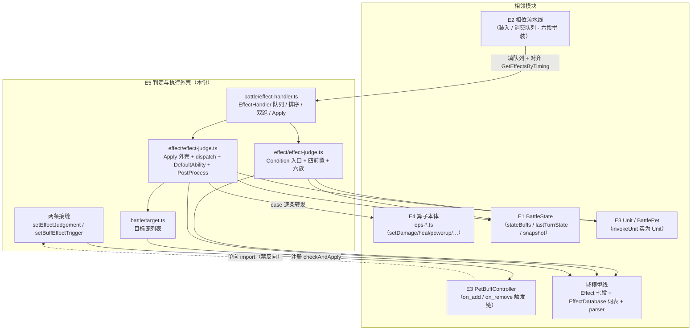
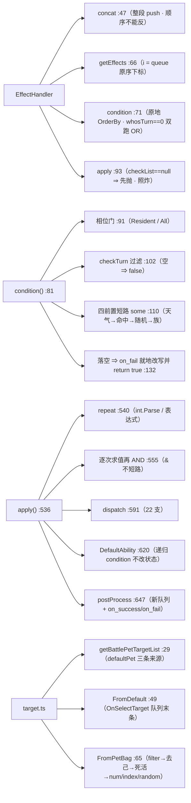

# 战斗引擎子设计 E5 · 判定与执行外壳（docs/engine/battle-engine-judge.md）

> **定位**：效果系统的**中枢** —— 「一批效果怎么排队等判定」`EffectHandler`、**判定入口** `Condition`
> （相位门 / 回合门 / 四个前置 / 六个判定族）、**执行外壳** `Apply`（`repeat` / `DefaultAbility` / `PostProcess`）、
> **22 算子分派**，以及**目标宠列表**。
> 父文档 = `docs/engine/battle-engine-design.md`（**§8.1 E5**）；机制导读 = `docs/engine/battle-engine-overview.md §5`。
>
> **实现在哪**：`game/core/battle/effect-handler.ts`（108）+ `game/core/effect/effect-judge.ts`（711）
> + `game/core/battle/target.ts`（104）。【我们】行号即指这三个文件。
> **上游真值**：`MVC/Model/Basic/Effect/EffectHandler.cs`（75）+ `EffectConditionHandler.cs`（414）
> + `Effect.cs`（`Condition` `:224-293` / `Apply` `:295-343` / `CheckAndApply` `:345-352` / `PostProcess` `:354-389`）
> + `EffectAbilityHandler.cs`（`DefaultAbility` `:13-36`）+ `System/Parser/Parser.cs`（target `:153-200`）。
> **别与这些重复**：**22 个算子的本体** → **E4**（`docs/engine/battle-engine-effects.md`）；队列**何时被填/消费**（时机派发） → **E2**；
> `Effect` 七段数据模型 + `EffectDatabase` 词表 → **域模型线**（`docs/engine/battle-engine-design.md §8.4`）；
> 移植事实 → `docs/engine/port-map.md`；对拍 → `docs/engine/oracle-playbook.md`。
>
> **证据标注**：【源码】= 上游 `.cs`；【我们】= `game/**`。
>
> ⚠️ **口径改版（2026-10-17，人类决议 ①，父文档 `docs/engine/battle-engine-design.md §5.5`）**：
> oracle 侧的 `UnityEngine.Random` **shim 取消**，凡"native 随机 ⇒ 不可比"的措辞**只描述 golden 覆盖面**，
> **不豁免实现与验收**（`AGENTS.md §1.1`）。本份里：随机一律来自 **R1**、墙钟 **R2**、存档面 **R3**
> （`docs/runtime/runtime-components-design.md`）；**"对拍向量在生成阶段挡掉"自该日起只算 as-built**，
> 新批次改发**合成向量** + 断**同 seed 复现**。Photon 的 ECall 闸门（`win`/`escape`）**与随机无关 ⇒ 照旧**。
> 上游**代码逻辑 bug** 按决议 ②：**声明 + 写无 bug 的目标行为**（不再"照抄不修"）。

---

## 0. 这份文档回答什么

1. **`EffectHandler`（队列）** 的六条语义：插入序 = 配对序、`Concat` 的方向、`GetEffects` 的**原序下标**、
   `Condition` 的**原地重排**、`whosTurn == 0` 的**双跑 OR**、`Apply` 的 `checkList` 契约。
2. **一条效果从队到态的全路径**：相位门 → 回合门 → 四前置（短路序） → 判定族 → 落空时 `on_fail` 的就地改写。
3. **六个判定族**各读什么、`state == null`（常驻）时哪些支会抛。
4. **执行外壳**：`repeat` 的两种解析、`bool &=` **不短路**、`DefaultAbility` 的递归判定、`PostProcess` 的新队列。
5. **22 算子的分派表**与各自的 **golden 覆盖面**状态（进 golden / 半可比 / 搬了但进不了 golden / 仍 `NOT_PORTED`）—— ⚠️ 这四种**只说明能不能拿到上游真值**，不说明要不要实现。
6. **目标选择** `target.ts` 的四条会咬人的形状。
7. **两条接缝**（`setEffectJudgement` / `setBuffEffectTrigger`）为什么默认**抛**而不是放行。

---

## 1. 范围与边界

| | |
|---|---|
| **本份覆盖** | `EffectHandler` · `Condition` 入口 + 四前置 + 六族 · `Apply` 外壳 · `applyAbility` dispatch · `DefaultAbility` · `PostProcess` / `TryGetPostProcessEffects` · `target.ts` · 两条接缝 |
| **不覆盖（去别处）** | **算子的函数体**（`setDamage` / `addBuff` / `powerup` / `heal` / `capture` / `petChange` / `setSkill`） → **E4** `docs/engine/battle-engine-effects.md` |
| | 效果队列的**装入与消费时机**（六段拼装顺序、`EffectTiming` 推进） → **E2** |
| | `Effect` 七段数据模型、`Effect.cs` 的构造 / `Parse` / `SetEffects` / `Format` → **域模型线** |
| | `EffectTiming` / `EffectTarget` / `EffectCondition` / `EffectAbility` **词表**（`EffectDatabase.cs`） → **域模型线** |
| | `BattleState` 的 `stateBuffs` / `lastTurnState` / `snapshot()` → **E1** |
| | `BattlePet` / `Unit` / `Buff` 的标识符臂 → **E3** / 域模型线 |
| | 表现侧（判定动画、`OnSelectTarget` 的玩家选目标 UI） → **View 线** |

> **一条容易搞混的线**：`effect-judge.ts` 里**有** `setDamage` 等算子吗？——**没有**。它只**分派**；
> 函数体在 `ops-*.ts`（E4）。**判据**：`effect-judge.ts` 的 `applyAbility`（【我们】`:591`）是一个 `switch`，
> 每个 `case` 一行转发。

---

## 2. 上游真值

### 2.1 执行外壳 `EffectHandler`（队列）

【源码】`EffectHandler.cs`（75）；【我们】`battle/effect-handler.ts`

队列类型 = `List<KeyValuePair<object, Effect>>`，`Key` 是 `invokeUnit`（**实为 `Unit`**，上游类型是 `object`）。

| 成员 | 上游 | 【我们】 | 语义 |
|---|---|---|---|
| `clear()` | — | `:44` | 清队 |
| `concat(rhs)` | `:20-23` | `:47` | **整段 `AddRange`**（共享同一批 `Effect` 引用）并**返回 `this`** |
| `addEffects(invokeUnit, effects)` | `:25-30` | `:53` | `effects == null` ⇒ **直接 return**（技能/印记没配效果是**常态**，不是异常） |
| `removeEffects(filter)` | `:32-34` | `:60` | 滤的是 `pair.Value`，但**按 queue 顺序**逐个问 |
| `getEffects(filter)` | `:36-42` | `:66` | 两个重载；带下标那个的 `i` 是 **queue 里的位置** |
| `condition(state, checkPhase = true)` | `:44-59` | `:71` | 排序 → 逐条判定 ⇒ **返回 `bool[]`** |
| `apply(state, checkList = null)` | `:61-70` | `:93` | 按 `checkList` 逐条执行 |
| `checkAndApply(state, checkPhase = true)` | — | `:105` | `apply(state, condition(state, checkPhase))` |

**四条必抄的语义**：

1. **插入序 = 配对序**。`BattleState.GetEffectHandler(null)` 那条「master 的 handler `Concat` client 的 handler」
   ⇒ 队列是 `[master…, client…]`，**顺序不能反**。
2. **`getEffects` 的下标是原序下标**。上游 `Select` 之后 `Where` 的 `i` 仍是**原 queue 下标** ——
   `BattleState.GetEffectsByTiming` 靠它与 `checkList` 对齐。抄成"过完滤再给新下标"就会错位。
3. **`condition` 会原地重排 queue**（`OrderBy(priority)` 的结果写回），**`apply` 用同一份重排后的序**去对齐
   `checkList`。两步之间**没有任何同步** —— 谁把 `OrderBy` 抄成"返回新表不改原表"，谁就拿到错位的效果。
   （`OrderBy` 稳定；JS `Array.sort` 自 ES2019 起同样稳定 ⇒ 并列 `priority` 保持插入序。）
4. **`whosTurn == 0` 的"双跑 OR"**（【我们】`:72-80`）：

```csharp
// EffectHandler.cs:45-52 —— 双方任一触发即触发
var tempState = state.Snapshot();          // 快照一份
tempState.whosTurn = -1;
var clientCheckList = Condition(tempState); // 按 client 跑一遍
tempState.whosTurn = 1;
var masterCheckList = Condition(tempState); // 按 master 再跑一遍（同一份 queue, 排序又做一次）
return masterCheckList.Select((x, i) => x || clientCheckList[i]);   // 逐位 OR
```

⚠️ 它跑的是**同一份 queue** ⇒ **排序做了两遍**（第二遍已有序，结果同）；`Select((x, i) => …)` 的下标越界
**即抛**（移植体用 `atIndex` 建模，【我们】`:79`）。

**`apply` 的一条死分支（照炸不修）**：

```csharp
// EffectHandler.cs:61-70
public void Apply(BattleState state, List<bool> checkList = null) {
    if (checkList.Count < queue.Count) return;        // :62 —— checkList==null 时先 NRE
    if (checkList == null || checkList.Count ...)     // :66 —— 够不着的死分支
```

⇒ C# 把 null 检查写在**解引用之后**。移植体**照炸**（【我们】`:94` 显式抛 `TypeError`），
不许"顺手修好"（会让抛点与 oracle 不一致）。

### 2.2 `Condition` 入口

【源码】`Effect.cs:224-293`；【我们】`effect-judge.ts:81`

签名：`Condition(effect, invokeUnit, state, checkPhase, checkTurn)`

| 步骤 | 语义 | 【我们】 |
|---|---|---|
| **相位门** | `(state==null && timing==Resident) \|\| (state!=null && (timing==state.phase \|\| (state.phase > Resident && timing==All)))` | `:91` |
| `checkPhase && !isCorrectPhase` | ⇒ **`false`**（不碰 `invokeUnit`） | `:94` |
| **存 `invokeUnit` 进 effect** | 六个判定族读的是**这个**（`effect.invokeUnit`） | `:98` |
| **回合门** | `checkTurn` ⇒ 过滤 `condOptionDictList`（逐项 `IsCorrectTurn`）；**空 ⇒ `false`** | `:101-105` |
| **分派** | `conditionFunc(effect.condition)`（见 §2.4） | `:107` |
| **判定** | `correctCondOptionDictList.some(x => 天气 && 命中 && 随机 && 族)` —— **短路顺序照抄** | `:110-112` |
| **落空 ⇒ 改写** | 见下 | `:115-137` |

**落空 ≠ 返回 false**（【我们】`:114-137`，承接 E4 §5.3）：

```csharp
// Effect.cs:275-290 —— 未触发则永久改写这条效果
if (!result) {
    var post = TryGetPostProcessEffects(
        effect,
        effect.condOptionDictList.Select(x => x?.Get("on_fail")).FirstOrDefault(x => x != null),  // 取原表里第一个非 null
        state);
    if (post == null || !post.Any()) return result;
    effect.target = post[0].target;                                   // 就地覆盖
    effect.condOptionDictList.ForEach(x => x?.Remove("on_fail"));     // 抹掉 on_fail
    effect.ability = post[0].ability;
    effect.abilityOptionDict = post[0].abilityOptionDict;
    return true;                                                      // ⚠ 变成 true
}
```

> 三个细节：① `on_fail` 取的是**原表**（`condOptionDictList`，不是过滤后的 `correctCondOptionDictList`）里
> **第一个非 null**；② 改写的是**同一条 effect 对象**（不是换一条）；③ `on_fail` **被永久抹掉** ⇒ 这条效果
> 第二次判定不会再走这条路。

### 2.3 四个前置检查

【源码】`EffectConditionHandler.cs:13-131`；【我们】`effect-judge.ts:161/178/192/223`

| 检查 | 上游 | 语义 | 关键形状 |
|---|---|---|---|
| `IsCorrectTurn` | `:13-29` | `state==null` **恒真**；`turn_num`（`odd`/`even`/`all`）**先判**；`whosTurn==0` 或 `turn_num` 不过就**只回** `turn_num`；否则再比 `whos_turn`（`me`/`all`）与 `invokeUnit.id` | `:167` 的 `if ((whosTurn==0) \|\| !isTurnNumCorrect) return isTurnNumCorrect` 是**提前返回**，不是兜底 |
| `IsCorrectWeather` | `:31-45` | `state==null` 恒真；`weather=="all"` 放行；否则 `int.TryParse`（**失败即 `false`，不抛**）再 `Operator.Condition` | `:185` |
| `IsAttackAndHit` | `:47-79` | `state==null` 恒真；`whos_attack=="all"` **在解引用 unit 之前**放行；**换场相位**看的是"那一手是不是换场技"；非攻击相位放行；攻击相位才查 `is_hit`（`skillSystem.isHit`）/ `is_move`（`pet.isMovable`），`"all"` 跳过 | `:201` `isAttackPhase(phase)` 是**数值比较**（`EffectDatabase.cs:134-139`） |
| `RandomNumber` | `:81-131` | `random_op` / `random_cmp` **都没配 ⇒ 放行**；`state==null` 用存档侧 `getPlayerRandom()`（仅 `type=="rng"` 才回写）；`state!=null` 用 `lhsUnit.random` 或 native `Range(0,100)`，再叠 **67/68/75/76 印记 + 600014 场印（每片 −15）** | `:232` 的"两个都没配"判定；`:248` 的 `type=="rng"` 支 |

> ⚠️ `random_type=="rng"` 的两支要 `UnityEngine.Random.Range(0,100)` ⇒ **oracle 给不出这一支的 golden**
> （宿主里 native ECall 直接抛；2026-10-17 起 shim 已取消，见文首口径块）。
> **移植体照常实现**：随机来自 **R1**（`setRandomSkillSource` / `setOpsSkillRng` 一族由 **RB1** 九条路合一）。
> 对拍侧**改发显式声明来源的合成向量**，验收 = 同 seed 复现 + 形状断言（区间端点可达）+ **人类手测**；
> 旧写法"对拍向量在生成阶段挡掉"（同 `parser/identifier.ts` 的 `ListHelper.Random`）**只算 as-built**。

### 2.4 六个判定族

【源码】`EffectConditionHandler.cs:133-413`；【我们】`effect-judge.ts:280/311/350/383/442/474`

分派表（【我们】`:144-156`）：

| `EffectCondition` | 值 | 族 | 备注 |
|---|---|---|---|
| `CurrentUnit` | 1 | `unitCondition` | |
| `CurrentPet` / `CurrentToken` | 2 / 3 | `petCondition` | **同族**，`CurrentToken` 族内读 `lhsUnit.token` |
| `CurrentStatus` | 4 | `statusCondition` | |
| `CurrentBuff` | 6 | `buffCondition` | |
| `CurrentSkill` / `LastSkill` | 5 / 7 | `skillCondition` | **同族**，`LastSkill` 换 `lastTurnState` 快照 |
| `Poker` | 8 | `pokerCondition` | |
| （其余，含 `None 0`） | — | `() => true` | **恒真** |

各族要点：

| 族 | 上游 | 读什么 | 关键形状 |
|---|---|---|---|
| `UnitCondition` | `:133-166` | `type` 按 `/` 切多子条件，每子读 `type[i].op` / `type[i].cmp` | `state==null` 两支用**无上下文** `Parser.ParseOperation`；否则两侧都走 `ParseEffectOperation`（`:289`/`:303`） |
| `PetCondition` | `:168-220` | token 族读 `lhsUnit.token`；其余 `who==me` 时**优先** `effect.sourcePet`，否则 `lhsUnit.pet` | `own` 的三段短路（`:336`）；`state==null` 且 `type!="none"` ⇒ **抛**（需 base `Pet`） |
| `StatusCondition` | `:222-260` | `hp` / `anger` / 其余按 `battleStatus`（对照 `initStatus`） | `cmp_value` 是 **`DataType`**（分数走 `ConditionOf`，不是普通比较）；`state==null` ⇒ **抛** |
| `BuffCondition` | `:262-322` | `id` 三种形状：括号过滤器 / `BuffType` 名 / 纯数字；`key` 分流 **unit / state / pet** 三张印记表 | ⚠️ **无 `state==null` 分支**（上游无条件解引用 `invokeUnit` 再 `GetUnitById` ⇒ NRE） |
| `SkillCondition` | `:325-354` | `LastSkill` 换到 `state.lastTurnState`；否则读当前 `skillSystem` | 快照为 `null` ⇒ `bool.Parse(default)`（**会抛**的 `Parse`，不是 `TryParse`）；`LastSkill && state==null` ⇒ NRE（不生成） |
| `PokerCondition` | `:356-413` | `cards` = `group=="poker"` 的印记；四个 `code`：`count` / `color.same.max.count` / `point.same.max.count` / `straight(N)` | `Distinct` 保序 → `OrderBy` 升序 → 数连续段；`GroupBy().Max()` 在 `cards` 空时**抛**（与 `linqMax` 的空表抛同形） |

### 2.5 `Apply` 外壳

【源码】`Effect.cs:295-343` + `EffectHandler.cs` + `EffectAbilityHandler.cs:13-36`；【我们】`effect-judge.ts:536/620/647/658`

```ts
// effect-judge.ts:536 —— 三段：repeat → 逐次算子 → postProcess
const repeatExpr = dictGet(effect.abilityOptionDict, 'repeat', '1')!
let repeat = 1
if (st === null)
  repeat = parseIntOrThrow(repeatExpr)          // state==null: int.Parse ⇒ 非整数串即抛（不认表达式）
else
  repeat = toInt(parseEffectOperation(repeatExpr, ...))   // 否则过标识符链 + (int) 截断

let result = true
for (let i = 0; i < repeat; i++) {
  const one = applyAbility(effect, st)
  result = result && one                          // ⚠ 必须先算再 AND（见下）
}
postProcess(effect, result, st)
```

**`bool &=` 不短路**（【我们】`:551-553`）：C# 的 `result &= (type switch …)` 是**逐次求值**再与
（`&=` 不短路）⇒ `repeat` 次**每一轮都会真跑一次算子**，哪怕上一轮已 `false`，**副作用照样落**。
JS 的 `&&` 会短路掉后面的调用 ⇒ 必须先算出这一轮再 `AND`，否则 `repeat > 1` 时**少跑几轮**。

**`DefaultAbility`**（`EffectAbilityHandler.cs:13-36`；【我们】`:620`）：**只做"条件里那些子效果是否成立"的递归判定，
不改状态**。

- `abilityOptionDict["condition"]` 缺省 / 空 / `none` ⇒ **恒真**。
- 不是 `(…)` 形状 ⇒ 按 `/` 切，每段解析成**技能 id**，展开其 `effects`（`expandSkillEffectIds`，查不到即 NRE）。
- **Fix timing**：子效果 `timing == None` 时借**父效果**的 `timing`（`:637-639`）。
- 递归 `condition(...)`（`checkPhase`/`checkTurn` 默认 `true`）。

**`PostProcess`**（`Effect.cs:354-389`；【我们】`:647`）：

```
key = "on_" + (result ? "success" : "fail")
post = TryGetPostProcessEffects(effect, postExpr, state)
        空/null ⇒ {ok:false}  ← 直接 return
        (…) 形状 ⇒ 直接用解析出的效果
        否则 ⇒ 按 '/' 切展开成技能引用
        子效果 timing==None ⇒ 借父 timing
effectHandler = new EffectHandler()      // ⚠ 新队列，不是当前队列
effectHandler.addEffects(effect.invokeUnit, post.effects)
effectHandler.checkAndApply(state)       // ⇒ 递归回 §2.1/§2.2
```

⚠️ `TryGetPostProcessEffects` 里 `postEffects` 为 `null` 后 `foreach` ⇒ **NRE**（上游形状，不兜底；【我们】`:684`）。

### 2.6 22 算子分派（本体见 `docs/engine/battle-engine-effects.md`，E4）

【源码】`Effect.cs:310-339` 的 switch；【我们】`effect-judge.ts:591`

| 状态 | 支数 | 明细 |
|---|---|---|
| **进 golden（可对拍）** | **11** | `none(0)`、`capture(3)`、`pet_change(4)`、`heal(5)`、`add_status(8)`、`add_buff(10)`、`remove_buff(11)`、`set_damage(14)`、`set_skill(15)`、`set_weather(17)`、`block_buff(9)` |
| **半可比** | **2** | `win(1)` / `escape(2)` —— 结果面过 `Unit.IsMyUnit()` ⇒ `PhotonNetwork.IsConnected` ⇒ Photon 静态构造的 **ECall**（与 `powerup` 同根因，但**与随机无关**，决议 ① 不改这条闸门）⇒ 那些形状**不生成**；golden 只覆盖 `state==null ⇒ false` 与 `whosTurn==0 ⇒ atkUnit==null ⇒ NRE` |
| **搬了但进不了 golden** | **1** | `powerup(7)` —— 上游 IL 直接 `call UnityEngine.Random.Range`，dotnet 宿主**方法入口即抛** `SecurityException`；oracle 白名单**故意不放 7**。⚠️ 这支**已实现**，只是没有上游真值 ⇒ 验收走 R1 + 形状 + 人类手测 |
| **仍 `NOT_PORTED`** | **8** | `rage(6)`、`copy_buff(12)`、`set_buff(13)`、`set_pet(16)`、`set_player(18)`、`poker(19)`、`set_pet_bag(20)`、`card(21)` |

> **两处"白名单必须同步"**（【我们】`:585-590`）：oracle 侧 `tools/oracle-cs/Program.cs:1849` 的
> `PortedAbilities = { 0, 8, 14, 10, 11, 5, 3, 4, 15, 1, 2, 17, 9 }` 必须与这里的"已搬"集合**逐值同步**；
> 白名单越界仍抛 ⇒ 归 infra ⇒ **"忘了搬"不会假绿**。**两处例外**：`powerup(7)`（故意不放）与
> `win(1)`/`escape(2)`（放，但**只许发问得出答案的形状** —— 见 `docs/engine/oracle-playbook.md §6`）。
> 判据：`PORTED` 集合的真值读 `Program.cs:1849`，**不是**本表的文字。

### 2.7 目标选择（`target.ts`）

【源码】`Parser.cs:153-200`；【我们】`battle/target.ts`

```
GetBattlePetTargetList(state, effect, lhsUnit, rhsUnit):
  defaultPet = (invokeUnit.id == lhsUnit.id) ? (effect.sourcePet ?? lhsUnit.pet) : lhsUnit.pet
  switch (effect.target):
    CurrentPetBag → GetBattlePetTargetListFromPetBag
    CurrentToken  → token == null ? [] : [token]          // 没有替身给**空表**，不是含 null 的表
    default       → GetBattlePetTargetListFromDefault     // ⚠ 一切其它 target（含 `pet`）都落这
```

**四条会咬人的形状**（【我们】文件头逐条登记）：

| # | 形状 |
|---|---|
| 1 | `default` 是**静默**兜底：除 `pet_bag` / `token` 之外的一切 `target`（真表里 7910 行的 `pet` 也在内）都走它 ⇒ **"非 pet_bag 的目标解析结果 = 当前上场宠"** |
| 2 | `defaultPet` **可以是 `null`**（`petBag` 的洞、`cursor` 越界前留下的 `null`）⇒ 照样返回**长度 1 的含 `null` 列表** |
| 3 | `index` 支直接 `petBag[targetIndex]`：上界用 **`petBag.Length`**（`IsInRange` 是**开**区间）⇒ 同时**绕过** `targetFilter` 与 dead 过滤，还能取出一个 `null` |
| 4 | `target_type` 含 `random` ⇒ `ListHelper.Random(targetNum, repeat=false)`。⚠️ **两半分开读**：`count > 列表长度` ⇒ 静默返回整表 = **口径**，**照搬**；`target_num` 缺省（`-1`）⇒ `while (result.Count != count)` **永不成立** ⇒ 上游**死循环** = **代码逻辑 bug**（决议 ②）⇒ 目标行为 = **入口显式抛**（同族 `docs/domain/domain-base.md §5 B11`；⬜ 待落码，现移植体照抄那个循环，`target.test.ts` 用假骰子断它不终止） |

**`FromPetBag` 的筛选链**（不可换序）：`filter → 去自己（`target_type` 含 `other`，`Remove` 只删**第一个**引用相等项）→ 死活（含 `dead` 就**只留死的**）→ `random | index | Take(num)`；
`Take` 只在 `target_num >= 0` 时截（`Take(0)` 给**空表**）。

> **关键**：三个输入 `target_type` / `target_filter` / `target_num` **全部**走带 effect 上下文的标识符链
> （`parseEffectOperation` + `getPetIdentifier`）⇒ 拿假实现糊会污染 `target` 与 `condition` 两类真值（**禁区**）。

### 2.8 两条接缝

| 接缝 | 【我们】 | 为什么默认**抛** |
|---|---|---|
| `setEffectJudgement` | `effect-handler.ts:39` | 生产 `JUDGE` 是 `NOT_PORTED`（`:33`）。静默 `true` 会让"接缝没接"伪装成"这条效果判定通过"，对拍里表现为**只有 TS 侧多跑了一段结算** |
| `setBuffEffectTrigger` | `effect-judge.ts:711` | `pet/buff-controller.ts` 的 `on_add`/`on_remove` 触发链要 `CheckAndApply`，而它反过来也 import 判定 ⇒ **反向 import 成环**。故单向 import 控制器、把 `checkAndApply` **注册**进去；没进图的场合接缝保持抛 |

**为什么 `Condition` 与 `Apply` 必须同一增量**（【我们】文件头）：上游 `Apply` 的未移植算子落进
`DefaultAbility` 之前是**先列在 `switch` 里**的，而 `DefaultAbility` 本身**完整可跑**。
如果只搬 `Condition` 不搬 `Apply`：现成的 `phasedrive`/`effectq` 那批"抛在 apply"的向量会**改抛点**
（从 `JUDGE.apply` 的 `NOT_PORTED` 挪到 `condition → apply` 里的真外壳）⇒ 一片本来绿的条子**当场翻红**。

---

## 3. 目标结构（契约）

```
battle/effect-handler.ts
  interface EffectStateView { whosTurn, snapshot() }              // 最小视图：只用到这两个
  interface EffectJudgement { condition(...), apply(...) }
  setEffectJudgement(partial)                                      // 接缝（默认 NOT_PORTED ⇒ 抛）
  class EffectHandler
    queue: [unknown, Effect][]                                     // invokeUnit, effect
    clear() / concat(rhs): this                                    // 整段 AddRange，顺序不能反
    addEffects(invokeUnit, effects|null)                           // null ⇒ return（常态）
    removeEffects(filter: (effect) => boolean)
    getEffects(filter: (effect, i) => boolean): Effect[]           // i = queue 原序下标
    condition(state|null, checkPhase = true): boolean[]            // whosTurn==0 ⇒ 双跑 OR；原地 OrderBy(priority)
    apply(state|null, checkList: boolean[]|null = null): void      // checkList==null ⇒ 先抛（照炸）
    checkAndApply(state|null, checkPhase = true): void

effect/effect-judge.ts
  condition(effect, invokeUnit, state, checkPhase, checkTurn): boolean
  checkAndApply(effect, invokeUnit, state, checkPhase=true, checkTurn=true, sourcePet=null): boolean
  apply(effect, invokeUnit, state): boolean
  postProcess(effect, result, state): void
  tryGetPostProcessEffects(effect, postExpr, state): { ok, effects }
  defaultAbility(effect, state): boolean
  // 四前置
  isCorrectTurn / isCorrectWeather / isAttackAndHit / randomNumber
  // 六族
  unitCondition / petCondition / statusCondition / buffCondition / skillCondition / pokerCondition

battle/target.ts
  type TargetList = (BattlePetView | null)[]
  getBattlePetTargetList(state, effect, lhsUnit, rhsUnit): TargetList
  getBattlePetTargetListFromDefault(state, effect, lhsUnit, rhsUnit, defaultPet): TargetList
  getBattlePetTargetListFromPetBag(effect, lhsUnit, rhsUnit, defaultPet): TargetList
```

---

## 4. 接口（mermaid）

### 4.1 模块位置图



### 4.2 文件↔接口图



---

## 5. 不变量与围栏

| # | 不变量 / 围栏 |
|---|---|
| **J1** | **队列语义**：插入序 = 配对序；`concat(rhs)` 的方向不能反（master 在前）；`getEffects` 的下标是 **queue 原序下标** |
| **J2** | **`Condition` 原地重排 queue，`Apply` 用同一份**；两步之间无同步，抄成"返回新表"即错位 |
| **J3** | **判定落空可能变 `true`**：`on_fail` 存在 ⇒ 就地改写这条 effect（target/ability/abilityOptionDict）+ 抹掉 `on_fail` + `return true` |
| **J4** | **`repeat` 逐次求值、不短路**：每一轮都真跑算子，副作用照样落 ⇒ JS 必须先算再 `&&` |
| **J5** | **`apply` 的 `checkList` 契约**：`null` ⇒ **先抛**（照炸不修）；`checkList.length < queue.length` ⇒ **整批不执行** |
| **J6** | **门与开关**：相位门（`state==null` 只放行 `Resident`；`phase > Resident` 时 `All` 也放行）；`checkPhase` / `checkTurn` 默认 **`true`**；`CheckAndApply` 自己**不**跑 `PostProcess` |
| **J7** | **规则只走 effect 四段**（承接 E4）：本份只**分派**与**判门**，**不得**把战斗规则写进 `if-else`；新增规则 = 加 effect 行 / 加算子 |
| **J8** | **接缝默认抛**：`setEffectJudgement` / `setBuffEffectTrigger` 未注入时**抛**，不许静默 `true`/`false` |
| **J9** | **目标解析不许假实现**：三个输入全走带 effect 上下文的标识符链，否则污染 `target` 与 `condition` 真值 |
| **J10** | **`powerup` 不进 golden**：oracle 白名单故意排除；**白名单必须与"已搬"集合逐值同步**（越界归 infra ⇒ 不假绿） |

---

## 6. 现状与缺口

| oracle kind | 内容 | 状态 |
|---|---|---|
| `effectq` | `EffectHandler` 队列（含 `Concat` / 双跑 / `Apply` 抛点） | ✅ 绿 |
| `effectcond` | `Condition` 入口 + 四前置 + 六族 | ✅ 绿（生产默认 `NOT_PORTED`，harness 按 kind 注入） |
| `effectapply` | `Apply` 外壳 + dispatch | 🟡 **11/22** 进 golden + `win`/`escape` **半可比**（结果面撞 Photon ECall）+ `powerup` 搬了但**进不了 golden**；8 支 `NOT_PORTED` |
| `target` | `GetBattlePetTargetList` 三支 | ✅ 绿 |
| `effectparse` | `Effect` 的 `Parse` / `TryParse`（**域模型线**） | ✅ 绿 |

**缺口**（→ 阶段二 / E4）：

| 缺口 | 说明 |
|---|---|
| **8 支 `NOT_PORTED`** | 落 `notPorted(...)`（**显式抛**，不是静默）：`rage` / `copy_buff` / `set_buff` / `set_pet` / `set_player` / `poker` / `set_pet_bag` / `card`（`win`/`escape`/`set_weather`/`block_buff` 已搬，见 `docs/engine/battle-engine-effects.md`） |
| **`PetCondition` / `StatusCondition` / `Heal` / `PetChange` 的 `state==null` 支** | 需要 base `Pet`（域模型线未立）⇒ 现在**显式抛**；域模型线立完后要接 |
| **`OnSelectTarget` 的玩家侧** | `GetBattlePetTargetListFromDefault` 读的是**队列里最后一条** `OnSelectTarget` 效果；"玩家真的选了哪只"由 View 线提供（E6/View 的交互契约） |
| **`PokerCondition`** | 已搬但依赖 `poker` 算子（`NOT_PORTED`）⇒ 整条链路暂时跑不通 |
| **`set_skill` 的 `random` 支** | 要掷骰 ⇒ `notInjected()` 抛，需 `setOpsSkillRng` 注入（与 `randomNumber` 同口径；⚠️ 这两个注入名由 **RB1** 九条路合一到 **R1**）。⚠️ 别一刀切：`ListHelper.Random` 的**短路支**（`!repeat && count > Count` ⇒ 整表）**不掷骰 ⇒ 仍然可比**（`docs/engine/port-map.md`）；只有真要掷的那条进不了 golden |

---

## 7. 待核 / 已知怪癖

| # | 事项 | 证据 |
|---|---|---|
| 1 | **`EffectHandler.Apply` 的 `checkList == null` 死分支** —— 上游把 null 检查写在解引用之后 ⇒ **照炸不修** | 【我们】`effect-handler.ts:94`；上游 `:62`/`:66` |
| 2 | **`whosTurn == 0` 的"双跑 OR"跑的是同一份 queue** ⇒ 排序做两遍；`Select((x,i)=>…)` 下标越界即抛 | 【我们】`:72-80` |
| 3 | **`Condition` 原地重排 queue** —— 抄成"返回新表"就错位 | 【我们】`:84` |
| 4 | **落空 ⇒ `return true`**（`on_fail` 就地改写）；取的是**原表**里第一个非 `null` 的 `on_fail` | 【我们】`:114-137` |
| 5 | **`repeat` 的 `bool &=` 不短路** ⇒ 每轮都跑算子 | 【我们】`:551-553` |
| 6 | **`RandomNumber` 的"两个都没配 ⇒ 放行"**（不是"配了才判"）；`rng` 支掷 native ⇒ **无 golden**（⚠️ 旧措辞"生成阶段挡掉"只算 as-built：实现走 **R1**，验收 = 同 seed 复现 + 形状 + 人类手测） | 【我们】`:232`/`:221` |
| 7 | **`BuffCondition` 没有 `state==null` 分支**（上游无条件解引用 ⇒ NRE），不生成该形状 | 【我们】`:391` |
| 8 | **`SkillCondition` 的快照 `null` 走 `bool.Parse`（会抛）**，不是 `TryParse` | 【我们】`:454` |
| 9 | **`target` 的 `default` 静默兜底** ⇒ "非 pet_bag/token 的目标 = 当前上场宠"；`index` 绕过 filter 与 dead 过滤 | 【我们】`target.ts:44`/`:100` |
| 10 | **`target_type` 含 `random` 且 `target_num` 缺省 ⇒ 上游死循环**（代码逻辑 bug：按决议 ② **声明 + 修**，目标行为 = 入口显式抛，同族 `docs/domain/domain-base.md §5 B11`；⬜ 待落码。"向量在生成阶段挡掉"自此**只算 as-built**） | 【我们】`target.ts:13-14` |
| 11 | **`Condition`/`Apply` 必须同一增量** —— 拆开会让 `phasedrive`/`effectq` 的**抛点漂移**、绿条翻红 | 【我们】`effect-judge.ts:5-10` |
| 12 | **`powerup(7)` 的 oracle 白名单排除**不是遗漏，是**故意的**（否则洗成"两边同抛"的假绿） | `tools/oracle-cs/Program.cs:1849` + `snap-mirror.mjs:2140` |

---

## 8. 配对实现（impl）指针

- 本份配对 = 未来的 **`docs/engine/battle-engine-impl.md`** + **`battle-engine-code-map.md`**（阶段一续写）。
- **现状**：`game/core/battle/effect-handler.ts` + `game/core/effect/effect-judge.ts` + `game/core/battle/target.ts`
  **均已落地**；事实面 = `docs/engine/kernel-handoff.md §3`，逐 kind 结论 = `docs/engine/port-map.md` 的
  **第五段·步骤 4**（判定/执行外壳）与 **第七段**（按频次搬算子）。
- **算子进度真值**：`tools/oracle-cs/Program.cs:1849` 的 `PortedAbilities`（本份 §2.6 那张表只是它的可读版）。
- **as-built**：以 `docs/engine/kernel-handoff.md §3/§4/§5` 为准（本份不重复）。
