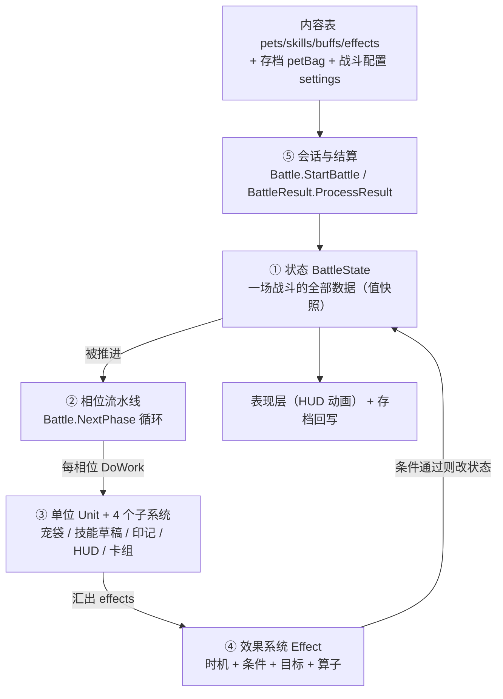
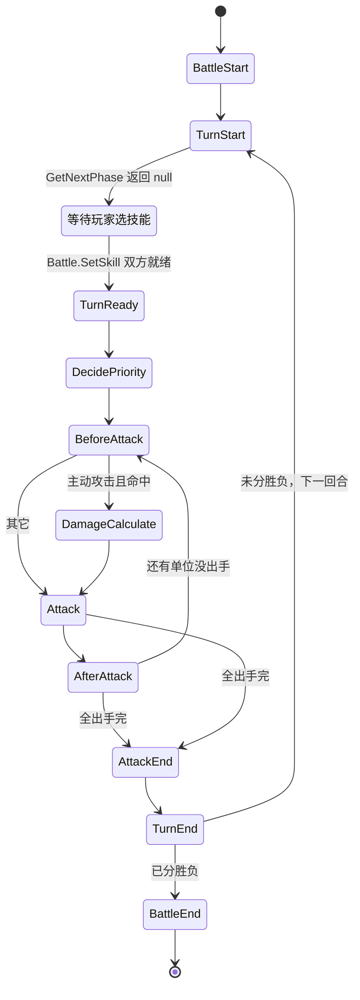
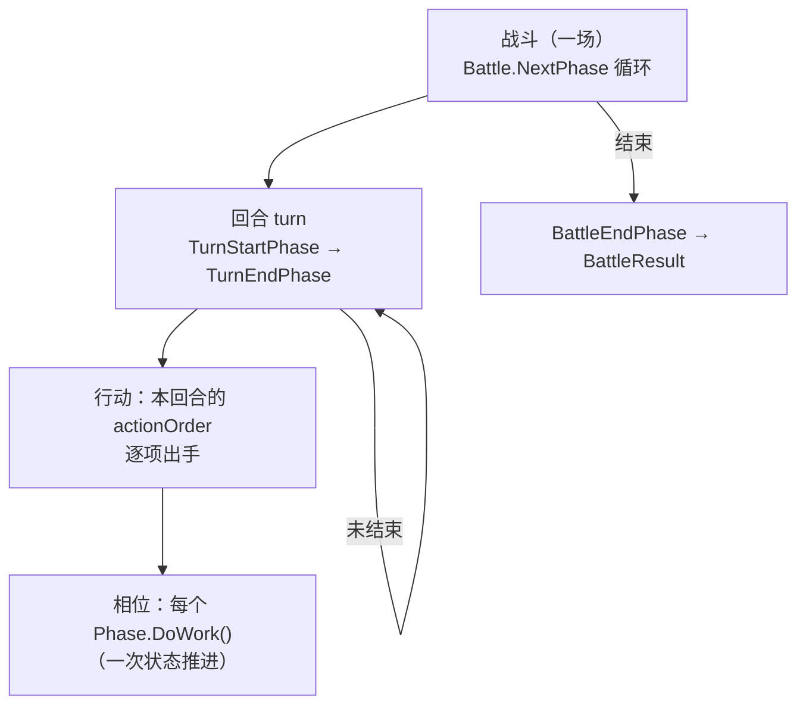
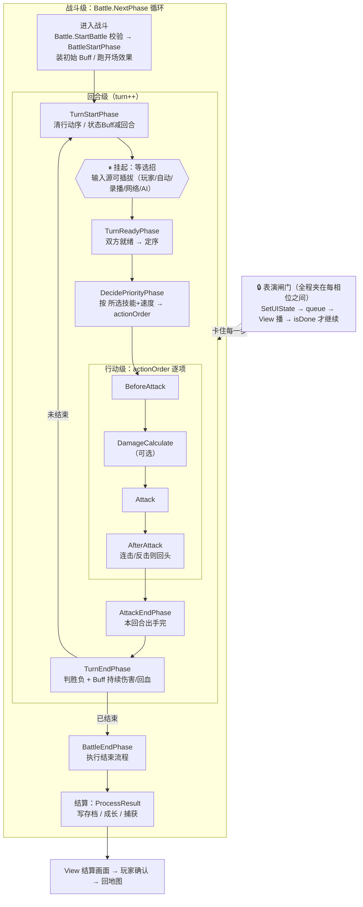
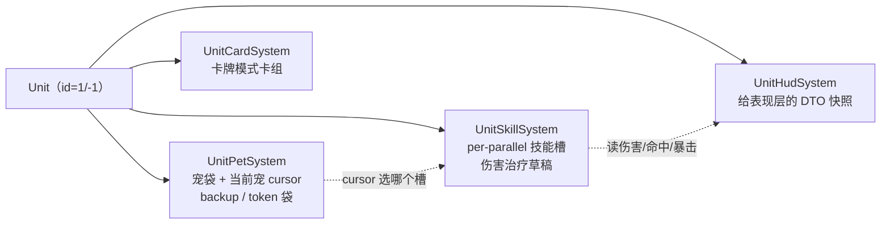
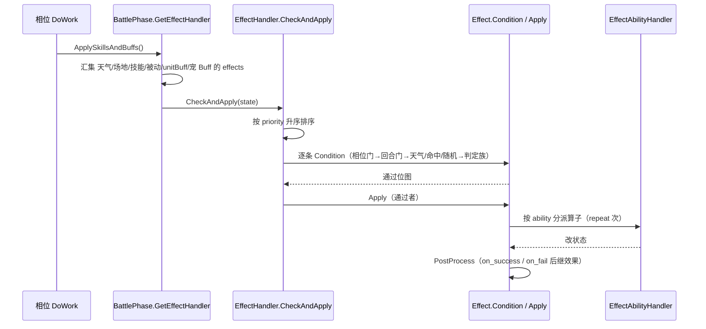
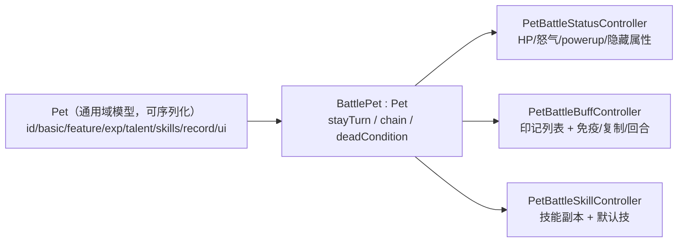

# 战斗引擎总说明（battle-engine-overview.md）

> **定位：这是"读懂用"的说明文档，不是设计决策。**
> 目的是先把**战斗引擎由什么构成、一场战斗怎么跑起来**讲清楚；理解到位之后，再写
> `battle-engine-design.md`（真值 / 目标）与逐块子设计。本文**不替它们做设计选择**。
>
> **证据约定**：【源码】标 `文件:行`，路径相对 `projects/Seer2-Restart-Lite-main/Assets/Scripts/`；
> 【我们】指本仓库 `game/**`。事实以源码为准，凡我未能证实的一律进 §10「待核」。
>
> **别与这些重复**（本线只链接）：
> `docs/engine/port-map.md`（逐算子实测结论集）、`docs/engine/oracle-playbook.md`（怎么对拍）、
> `docs/engine/kernel-handoff.md`（S1–S6 移植路线与当前落点）、`docs/view/scene/battle/view-scene-battle-design.md`（战斗**场景版式**）、
> `docs/runtime/runtime-components-design.md`（**功能组件**：随机源 / 时钟 / 存档面 / 写盘与弹窗 sink ⇒ 引擎只调接口）。

---

## 0. 这份文档回答什么

1. 战斗引擎由**哪几块**构成，各自管什么。
2. 一场战斗**从开战到结算**，代码怎么走。
3. **相位（phase）是什么**，以及**一个回合**里到底发生了什么（§3.0、§3.5）。
4. **效果（effect）**怎么被触发、判定、执行 —— 这是引擎的"规则引擎"核心。
5. 谁和**表现层 / 存档**打交道（边界在哪）。

---

## 1. 一句话概览

上游的战斗引擎是：

> **一个值语义的"战斗状态"对象，被一条硬编码的"相位流水线"逐步推进；
> 每个相位里，把天气/场地/技能/被动/印记里的"效果"汇成一队，
> 逐条做条件判定，通过就执行算子去改状态；改完的状态再喂给表现层与结算。**

五块构成（先建立心智模型）：



| 块 | 上游文件（行数） | 一句话职责 |
|---|---|---|
| ① 状态 | `Scene Specific/Battle/BattleState.cs`（342） | 一场战斗的**全部数据**，值拷贝快照 |
| ② 相位流水线 | `MVC/Model/Battle/BattlePhase.cs`（162）+ `MVC/Model/Battle/Phase/*.cs`（14 个，971） | 驱动状态前进的**时序骨架** |
| ③ 单位 | `Scene Specific/Battle/Unit.cs`（267）+ `UnitComponent/*.cs`（1091） | 一"侧"的聚合：宠袋 / 技能 / 印记 / HUD / 卡组 |
| ④ 效果系统 | `MVC/Model/Basic/Effect/*.cs`（3405） | 规则的**数据化表达**与执行 |
| ⑤ 会话与结算 | `Scene Specific/Battle/{Battle,BattleManager,BattleResult,BattleSettings}.cs`（1156） | 开战入口、结果回写、成长 |

---

## 2. ① 状态：一场战斗的全部数据

`BattleState` 是引擎的"**内存镜像**"——它不干活，只是**被读写的数据**。【源码】`Scene Specific/Battle/BattleState.cs`

| 字段 | 类型 | 含义 | 行 |
|---|---|---|---|
| `turn` | int | 回合计数（"第 N 回合"） | `:12` |
| `whosTurn` | int | 当前行动方：`1`=master（我方）/ `-1`=client（敌方）/ `0`=无 | `:14` |
| `phase` | `EffectTiming` | 当前时机（驱动 effect 条件） | `:15` |
| `actionOrder` | `List<int>` | 本回合出手顺序，元素 = `sign(unitId)*(cursor+1)` | `:23` |
| `actionCursor` | int | 出手顺序游标（初值 −1） | `:24` |
| `masterUnit` / `clientUnit` | `Unit` | 双方单位 | `:22` |
| `settings` | `BattleSettings` | 战斗配置副本 | `:26` |
| `result` | `BattleResult` | 结果对象 | `:27` |
| `stateBuffs` | `List<KVP<string,Buff>>` | 全场状态级 Buff（含初始 Buff） | `:18` |
| `weather` / `weatherBuff` | int / `Buff` | 天气与天气 Buff | `:16-17` |
| `lastTurnState` | `BattleState` | 上一回合快照（供 `last.` 表达式回溯） | `:10` |
| `reports` | `Queue<string>`（cap 30） | 战斗播报 | `:19` |
| `options` | `Dictionary<string,string>` | 状态表达式可选项 | `:20` |
| `parallelTurn` | int | 双打并行子回合计数（当前基本不用） | `:13` |

**派生属性**（读的时候用）：`isAllUnitDone`（`:176`，= `actionCursor >= actionOrder.Count`）、
`isAllUnitReady`（`:182`）、`isAnyPetDead`（`:187`）、`atkUnit`/`defUnit`（`:34-35`，由 `whosTurn` 反查）。

> **关键设计：值快照**。构造 `BattleState(settings, masterTurn, clientTurn)`（`:37`）会深拷贝双方的 `Unit`；
> 相位推进时 `lastState = new BattleState(currentState)`（`Battle.cs:259`）再取新状态。
> 所以"上一回合""上一状态"是**真拷贝**，不是引用 —— 这既支持 `last.` 回溯，也支持**对名单式回滚**（`OnHitUndo` 等）。

**配置** `BattleSettings`：`seed`、`isEscapeOK/isCaptureOK/isItemOK`、`petCount`、`parallelCount`（单打=1/双打>1）、
`starLimit`、`modeId/mode`（`BattleMode` 枚举 `:184-194`：Record/Normal/SelfSimulation/PVP/SPT/Special/YiTeRogue/Card）、
`ruleId/rule`（`BattleRule`：Anger/PP）、`weather`、`initBuffs` 等。【源码】`Scene Specific/Battle/BattleSettings.cs`

**结果** `BattleResult`：`state`（`BattleResultState`：Fighting/Win/Lose/MyEscape/OpEscape/CaptureSuccess/Timeout）、
`gainExpPerPet`、`gainEVStoragePerPet`、`capturePet`、`learnedSecretSkills`、`endState`。【源码】`Scene Specific/Battle/BattleResult.cs`

---

## 3. ② 时序：相位流水线怎么转

### 3.0 相位是什么（概念先行）

> 一句话：**相位 = 战斗时钟上一个"有名字的刻点"。** 引擎走到它时，先把所有挂在这个刻点上的规则跑一遍，再决定下一个刻点是谁。

**为什么需要它**：这套引擎把战斗规则写成了**数据**（`Effect` 的第一个字段就是 `timing`）。
一条效果要能说"**在出手前触发**"，引擎就必须有一个**带名字的时间坐标** —— **相位就是这个坐标**。
没有相位，`Effect.timing` 无从落地。

**三个视角看同一个东西**：

| 视角 | 相位是什么 |
|---|---|
| 时间 | 战斗的一个时刻（回合开始 / 出手前 / 命中 / 伤害计算 / 出手后 …） |
| 控制流 | 引擎推进的**一小步**：一次 `DoWork()` |
| 结构 | 一个类（`BeforeAttackPhase`）：一小段硬编码规则 + 它对应的时机 |

**最小完整样例**（`MVC/Model/Battle/Phase/BeforeAttackPhase.cs`，就是"出手前"那个相位）：

```csharp
public class BeforeAttackPhase : BattlePhase {
    public BeforeAttackPhase() {
        this.state = new BattleState(battle.currentState);  // :9  拿一份状态拷贝（事务性）
        this.phase = EffectTiming.OnBeforeAttack;           // :10 声明"我现在是哪个时刻"
    }
    public override void DoWork() {
        ...
        base.DoWork();                                      // :24 跑到点的效果（OnBeforeAttack）
        CheckAccuracy();                                    //     命中判定
        phase = EffectTiming.OnAttackStart;                 // :27 换成下一个时刻
        ApplySkillsAndBuffs();                              // :28 再跑一批（OnAttackStart）
    }
    public override BattlePhase GetNextPhase() { ... }      // :31 下一步去哪
}
```

**五条性质**：

| 性质 | 说明 |
|---|---|
| **幂等汇集** | 同一时刻的规则**全都**跑（先后不写死），先后由每条效果的 `priority` 排（`EffectHandler.cs:54`） |
| **事务性** | 每相位 `state = new BattleState(拷贝)`，`Battle.NextPhase` 留 `lastState` ⇒ 可回溯（支持 `last.` 表达式与对名单回滚） |
| **可让出** | `GetNextPhase()` 返回 `null` = 停下把控制权交回外部（如"回合开始"等选招） |
| **一击多刻** | 一个相位类内部可连点几个时机（上面样例就是 `OnBeforeAttack → OnAttackStart`） |
| **有旁路** | 14 个相位里主链 11 个；另 3 个会**打破主链**，甚至**自环** |

**相位 ≠ 回合 ≠ 动作**（最容易混的三层）：

| | 量级 | 举例 |
|---|---|---|
| **回合** turn | 一次"双方各选一招" | 第 1 回合 |
| **动作** action | 一只宠的一次出手 | 我方首发宠攻击 |
| **相位** phase | **动作内部的一小段时刻** | "出手前" |

→ **一次出手 = 4 个相位**：`BeforeAttack` → `DamageCalculate` → `Attack` → `AfterAttack`。
所以规则能插进去：一个"出手前让对手减怒"的印记挂 `OnBeforeAttack`，一个"受击后反弹"的被动挂 `OnAfterDamageCalculate`；
两者都**不改控制流**，只是挂到不同的刻点上。

**时机比主链相位更宽**：`EffectTiming` 有 **32 个取值**，主链相位只用到约 20 个；剩下的**负值是"事件型时机"**
（`OnAddBuff` / `OnRemoveBuff` / `OnBeforeEffect` / `OnEffect` / `OnAfterEffect` …），**不绑主链**，
由代码在"加/减印记"等处**临时点燃**。

> **相位（主链）= 引擎按序走到的时刻；时机（全部）= 相位时刻 + 事件时刻；效果只认"时机"，不认"是不是主链相位"。**

### 3.1 基类只给两个钩子

`BattlePhase` 是抽象骨架，子类只填两件事：【源码】`MVC/Model/Battle/BattlePhase.cs`

```csharp
public virtual void DoWork()  { ApplySkillsAndBuffs(); SetUIState(...); }   // :23-26  —— 这一步干什么
public virtual BattlePhase GetNextPhase() => null;                          // :28-30  —— 下一步是谁（null = 停）
```

- 每个相位把 `state.phase` 设成自己的 `EffectTiming`（属性 `phase`，`:13-19`），
  `ApplySkillsAndBuffs()` 就跑该时机的效果。
- **`GetNextPhase()` 返回 `null` = "停下，把控制权交回玩家/循环"**。

### 3.2 没有注册表：硬编码单链

**没有相位列表、没有索引、没有 `Next()`/`Previous()`**。相位之间是**硬编码单链**：
每个相位的 `GetNextPhase()` 直接 `new 下一个相位()`。

唯一的驱动循环在 `Battle.NextPhase()`：【源码】`Scene Specific/Battle/Battle.cs:250-277`

```csharp
while (currentPhase != null) {
    currentPhase.DoWork();                            // :255
    lastState    = new BattleState(currentState);     // :259  快照
    currentState = currentPhase.state;                // :260
    currentPhase = currentPhase.GetNextPhase();       // :261
}
// :263-275 无限循环兜底：链太长或某方 chain>100 ⇒ 强制 BattleEndPhase + result=Error
```

### 3.3 相位主链



**14 个相位**（`MVC/Model/Battle/Phase/`）：主链 11 个 + 旁路 3 个。

| 相位 | 做什么（说人话） | 时机 |
|---|---|---|
| `BattleStartPhase` | 装初始 Buff（特性/纹章/initBuffs）、跑开场效果 | OnBattleStart |
| `TurnStartPhase` | 回合开始：`turn++`、清行动序、状态 Buff 减回合 → **暂停等玩家** | OnTurnStart |
| `TurnReadyPhase` | 双方选完技，锁定 | OnTurnReady |
| `DecidePriorityPhase` | **决定谁先出手**（生成 `actionOrder`） | OnDecidePriority |
| `BeforeAttackPhase` | 出手前：合法性检查、连击开始、命中判定 | OnBeforeAttack → OnAttackStart |
| `DamageCalculatePhase` | 纯计算：伤害参数 → 计算 → 最终伤害（**非必经**） | OnDamageParamCalculate → … → OnFinalDamageCalculate |
| `AttackPhase` | 真正打出去：扣怒气、落伤害、驱动 HUD 飘字 | OnAttackReady → OnAttack |
| `AfterAttackPhase` | 收尾：回怒气、扣连击、交棒；反击则插队 | OnAfterAttack |
| `AttackEndPhase` | 本回合所有单位出手完，`whosTurn=0` | OnAttackEnd |
| `TurnEndPhase` | 回合结算：判胜负、Buff 持续伤害/回血 | OnTurnEnd → OnAfterTurnEnd |
| `BattleEndPhase` | 结算画面：`ProcessResult` | OnBattleEnd |
| `PassivePetChangePhase`（旁路） | 阵亡后的强制换宠；`GetNextPhase` 可**自环** | OnPassivePetChange |
| `RoundStartPhase` / `RoundEndPhase`（旁路） | **仅卡牌模式**，由 View 直接构造调用 | OnRoundStart / OnRoundEnd |

### 3.4 四层时间尺度（战斗 / 回合 / 行动 / 相位）



| 层 | 负责者 | 机制 |
|---|---|---|
| 战斗 | `Battle` | 持 `currentState`/`currentPhase`，`NextPhase()` 循环 |
| 回合 | `BattleState.OnTurnStart()`（`:138`） | `turn++`（`:154`）、清并重建 `actionOrder`（`:156`） |
| 行动 | `actionOrder` + `GiveTurnToNextUnit()`（`:190`） | `actionCursor++` 取下一出手项，设 `whosTurn` |
| 相位 | 每个 `BattlePhase.DoWork()` | `ApplySkillsAndBuffs()` + `SetUIState()`；`GetNextPhase()` 决定下一步 |
| 出手顺序 | `DecidePriorityPhase.GetActionOrder()`（`:40`） | 排序键：是否有效行动 → 是否主动 → `vipriority` → `priority` → 速度 → 随机 |

> **暂停点**：`TurnStartPhase.GetNextPhase()` 返回 `null`（`Phase/TurnStartPhase.cs:21`）。
> 玩家选招后走 `Battle.SetSkill(...)`（`Battle.cs:285`）：若有宠阵亡则先插 `PassivePetChangePhase`（`:348-359`），
> 双方都就绪 `isAllUnitReady`（`:382`）才 `new TurnReadyPhase()` 并 `NextPhase()`（`:386-387`）。

### 3.5 一场战斗的完整流程（校正版）

> **常见误解**：把流程读成**线性 8 步**（进入 → 回合 → 选招 → 计算 → 表演 → 新回合 → 结束 → 结算）。
> 真实形状是 **四层嵌套 + 表演闸门 + 选招接口**。



**三处校正**：

1. **不是线性，是四层嵌套**（见 §3.4）。"根据选择计算"其实是**行动级的内层循环** —— 按 `actionOrder` 一只一只打，每只宠各跑一趟 `BeforeAttack → [DamageCalculate] → Attack → AfterAttack`（连击/反击则回头）。
2. **表演不是"计算之后的一步"，而是全程并行、且会卡住引擎**：
   每个相位末尾 `SetUIState(state)` → 入队 `queue` → View 播动画 → `BattleManager.isDone` 轮询 → **播完引擎才继续**（`BattleManager.cs:22,170`）。
3. **"双方选择技能"不是相位，是"引擎挂起等人"**：`TurnStartPhase.GetNextPhase()` 返回 `null`（`Phase/TurnStartPhase.cs:21`）即停。之后输入源**可插拔**：

   | 输入源 | 入口 |
   |---|---|
   | 玩家点选 | `BattleManager.SetSkillSelectMode` → `Battle.SetSkill(skill, isMe)` |
   | 自动战斗 | `CheckAutoSkill` → `SetSkill(skill, true)` |
   | 录播回放 | 读 `battleRecord.actionList` → `SetSkill` |
   | PVP 对手 | `PVPSetSkillToOthers` → RPC |
   | 敌方 AI 兜底 | `PassivePetChangePhase` 内给敌方自动选默认技 |

**逐点对照**：

| 直觉流程 | 校正 |
|---|---|
| 进入战斗 | ✅ `BattleStartPhase`（之前还有 `CanStartBattle` 校验首发血量） |
| 回合的循环 | ✅ 但回合里还嵌着**行动循环**与**相位** |
| 双方选择技能 | ⚠️ 不是相位，是**挂起点**；输入源可插拔 |
| 根据选择和数据模型计算 | ✅ = `DecidePriorityPhase`（定序）+ **行动循环**（每单位 4 个相位） |
| 表演和结算计算 | ⚠️ 拆开：**表演**是全程闸门；**回合内结算**在 `TurnEndPhase` |
| 新的回合 | ✅ `TurnEndPhase` 未结束 → 回 `TurnStartPhase` |
| 结束战斗 | ⚠️ **判"结束"有两个点**：`TurnEndPhase.CheckBattleEnd`（回合末）+ **无限循环兜底**（`chain>100` ⇒ `result=Error`，`Battle.cs:263-275`） |
| 结算战斗 | ⚠️ **分两段**：① 引擎内 `ProcessResult` 写存档/成长；② 之后才是 View 结算画面 + 玩家确认 → 回地图 |

**两点补充**：

- **结束原因不止胜/负**：`BattleResultState` = `Win / Lose / MyEscape / OpEscape / CaptureSuccess / Timeout / Error`。
- **有"旁路"会打破这个干净的循环**：阵亡强制换宠（`PassivePetChangePhase`，可**自环**）、卡牌模式的 `RoundStart`/`RoundEnd`（不走主链，由 View 直接构造）。

---

## 4. ③ 单位：一"侧"里有什么

### 4.1 `Unit` = 一方（不是一只宠）

`Battle.cs:181-182` 只建两个 Unit：`new Unit(masterPetBag, 1, settings)` 与 `new Unit(clientPetBag, -1, settings)`。
`id` 就是阵营号（`1`=我方 / `-1`=敌方）。它**聚合四个子系统**：【源码】`Scene Specific/Battle/Unit.cs`



| 子系统 | 职责 | 关键 API |
|---|---|---|
| `UnitPetSystem`（194） | 宠袋、当前宠 `cursor`、备胎袋/寄生袋、换宠、回合开始清理 | `SwapBackupPet`（`:37`）、`SwapTokenPet`（`:55`）、`GetParallelPetBag(n)`（`:138`） |
| `UnitSkillSystem`（332） | 每回合的伤害/治疗草稿与命中/暴击计算，供表达式引擎读写 | `CalculateAccuracy`（`:161`）、`PrepareDamageParam`（`:174`）、`CalculateDamage`（`:201`） |
| `UnitHudSystem`（313） | **表现层快照**（不是事件总线，见 §4.2） | `OnAttack`（`:88`）、`OnHit`（`:101`）、`OnTurnEnd`（`:170`）、`OnBattleEnd`（`:206`） |
| `UnitCardSystem`（252） | 卡牌模式：手牌/牌库/墓地、抽弃、`OnRoundStart/End` | `Draw`（`:171`）、`Use`（`:226`）、`Shuffle`（`:216`） |

> `Unit.skillSystem` 按 `petSystem.cursor` 选槽：`(parallelCount<=1) ? parallelSkillSystems[0] : parallelSkillSystems[cursor]`（`Unit.cs:17`）。

### 4.2 与表现层的边界：**拉取，不是推送**

`UnitHudSystem` **没有**事件/委托/回调。它是 Model 侧的 **DTO 状态袋**：

- Model 侧相位**写**它（`AttackPhase.cs:53,101`、`TurnEndPhase.cs:98`、`BattleEndPhase.cs:26` …）；
- View 侧 `BattleAnimView.SetUnit` **读**它的字段（`petAnimType`、`CurDamageInfo`、`CurHealInfo`、`CurCaptureInfo`、`CurOtherSidePetReactionInfo`）。【源码】`MVC/View/Battle/Components/Anim/BattleAnimView.cs:41-88`

→ 这条"**写 DTO / 读 DTO**"的缝，就是我们的 `game/core/battle/views.ts` + `view-battle-stage.js` 要对上的口径。

### 4.3 回合开始的扇出

`BattleState.OnTurnStart` → `masterUnit/clientUnit.OnTurnStart` → 各自的
`petSystem.OnTurnStart`（宠袋）→ `parallelSkillSystems.ForEach(OnTurnStart)`（清草稿）→
`hudSystem.OnTurnStart(pet)` → `ReduceBuffTurn`（印记减回合）。【源码】`Unit.cs:65-74`

---

## 5. ④ 效果系统：规则怎么变成数据

这是引擎最"高级"的部分：**战斗规则不是写死的 if-else，而是表格里的数据**，由引擎按**时机**触发、按**条件**筛选、按**算子**执行。

### 5.1 一条 effect = 七段

【源码】`MVC/Model/Basic/Effect/Effect.cs`（`DATA_COL = 7`，`:10`）

| # | 段 | 类型 | 含义 |
|---|---|---|---|
| 1 | `timing` | `EffectTiming` | **什么时候**触发（对应相位） |
| 2 | `priority` | int | 同时机内的执行优先级（越小越先，派发前排序 `EffectHandler.cs:54`） |
| 3 | `target` | `EffectTarget` | 目标类别 |
| 4 | `condition` | `EffectCondition` | 判定族（决定用哪个 Condition 函数） |
| 5 | `condOptions` | `List<Dict>` | 判定参数 |
| 6 | `ability`（别名 `type`） | `EffectAbility` | **算子**（执行族） |
| 7 | `abilityOptions` | `Dict` | 算子参数 |

参数里还有派生的 `target_type` / `target_filter`（`:20-21`），以及 `{0}/{1}` 占位替换（`:207-217`）。

### 5.2 `EffectTiming`：引擎的"触发时机表"

【源码】`MVC/Model/Basic/Effect/EffectDatabase.cs:142-152`

**正相位**（按数值序，与主链一一对应）：
`None 0` · `Resident 1`（常驻/被动）· `OnBattleStart 2` · `OnTurnStart 3` · `OnTurnReady 4` · `OnDecidePriority 5` ·
`OnBeforeAttack 6` · `OnAttackStart 7` · `OnDamageParamCalculate 8` · `OnBeforeDamageCalculate 9` · `OnDamageCalculate 10` ·
`OnAfterDamageCalculate 11` · `OnFinalDamageCalculate 12` · `OnAttackReady 13` · `OnAttack 14` · `OnAfterAttack 15` ·
`OnAttackEnd 16` · `OnTurnEnd 17` · `OnAfterTurnEnd 18` · `OnBattleEnd 999` · `All −999`（通配）。

**事件型相位**（负值，不绑主链）：
`OnPassivePetChange −1` · `OnSelectTarget −2` · `OnAddBuff −3` · `OnRemoveBuff −4` ·
`OnBeforePetChange −5` · `OnAfterPetChange −6` · `OnRoundStart −7` · `OnRoundEnd −8` ·
`OnBeforeEffect −9` · `OnEffect −10` · `OnAfterEffect −11`。

> 相位类把 `state.phase` 设成自己的时机（如 `BattleStartPhase.cs:11 = OnBattleStart`），
> 于是"这个相位该跑哪些 effect"就自动对上了（`Effect.cs:227` 用 `timing == state.phase` 过滤）。

### 5.3 一趟 effect 的生命周期



三步：【源码】`MVC/Model/Basic/Effect/EffectHandler.cs`
1. `Condition(state, checkPhase)` → 位图（`:44-59`）。**若 `whosTurn==0`，会把 `whosTurn` 分别当 `1`/`-1` 各判一次，结果按位 OR**（`:45-52`）——"无人在行动"时双方都算。
2. `Apply(state, checkList)`（`:61-70`）。
3. `CheckAndApply = Apply(Condition())`（`:72-74`），这是**统一入口**。

### 5.4 判定面（Condition）

【源码】`MVC/Model/Basic/Effect/EffectConditionHandler.cs`（414 行，static）

外层到内层：**相位门 → 回合门 → 前置检查 → 判定族 → `on_fail` 后置改写**。

- 前置检查：`IsCorrectTurn`（`:13`，`turn_num` all/odd/even + `whos_turn` me/op/all）、
  `IsCorrectWeather`（`:31`）、`IsAttackAndHit`（`:48`）、`RandomNumber`（`:81`，rng/op，受多个 Buff 修正）。
- 判定族 9 个：`None` / `CurrentUnit` / `CurrentPet` / `CurrentToken` / `CurrentStatus` / `CurrentBuff` /
  `CurrentSkill` / `LastSkill` / `Poker`（枚举 `EffectDatabase.cs:166-176`）。
- **`on_fail` 改写**：判定不通过时，取第一条带 `on_fail` 的 option，**就地改写成另一条效果**并置通过（`Effect.cs:274-290`）——
  "条件不满足就换一种行为"就是这么做出来的。

### 5.5 算子清单（Ability，22 个）

【源码】`MVC/Model/Basic/Effect/EffectAbilityHandler.cs`（2284 行，static）

| 算子 | 语义 | 行 | 我们 |
|---|---|---|---|
| `none` | 无实体能力，只跑内嵌子效果判定 | `:13` | （走 `DefaultAbility` 外壳，非独立算子文件） |
| `set_damage` | 改写伤害流水（skill/item/buff 分组） | `:1235` | ✅ 批一 |
| `add_status` | 增减战斗/初始属性数值 | `:627` | ✅ 批一 |
| `add_buff` | 添加印记（unique/random 取 id；场地/单位/状态） | `:737` | ✅ 批一 |
| `remove_buff` | 移除印记（按 key/id/type/filter/random_count） | `:865` | ✅ 批一 |
| `powerup` | 增减能力等级 | `:474` | ✅ 批一 |
| `heal` | 治疗/设血/设上限/回血量修正 | `:165` | ✅ 批一 |
| `set_skill` | 替换技能 / 改技能参数 / 挂效果到技能 | `:1291` | ✅ 批二 |
| `win` | 直接判胜负（结束战斗） | `:38` | ⚠️ 批四（**半可比**：结果面撞 Photon ECall） |
| `escape` | 逃跑 | `:54` | ⚠️ 批四（**半可比**，同上） |
| `capture` | 捕捉判定（血量/印记修正 + RNG） | `:66` | ✅ 批三（掷点支**不与上游逐值比** ⇒ 走 **R1**，见本表下的口径块） |
| `pet_change` | 换宠（继承/遗留 Buff、怒气、换场相位） | `:108` | ✅ 批三（`random` 支同上） |
| `rage` | 增减怒气 / PP | `:354` | ⬜ 批五（需 **D5** 的 `Skill.PP`） |
| `block_buff` | 屏蔽/解除屏蔽/复制/取消复制印记 | `:678` | ✅ 批四 |
| `copy_buff` | 复制/转移/反转/交换印记与能力等级 | `:975` | ⬜ 批五 |
| `set_buff` | 改写已存在印记的标识值 | `:1162` | ⬜ 批五 |
| `set_pet` | 改写宠物属性/技能/换身（最庞杂） | `:1394` | ⬜ 等 **D6** + **D7** 落码（文档均已成文：`docs/domain/domain-pet.md §3.4` B1–B7 · `docs/domain/domain-info.md §3.3` B2–B6；`set_pet` 的写侧 23+1 支臂在 `domain-pet.md §2.4`） |
| `set_weather` | 设置天气 | `:1969` | ✅ 批四 |
| `set_player` | 玩家侧操作（BGM/背景/NPC 按钮），PVP 不生效 | `:1984` | ⬜ 仅 bgm/背景两支可搬 |
| `poker` | 扑克抽牌/刷新 | `:2031` | ⬜ **没排上**（⚠️ 旧写法"明确不做"**作废**：方法体直调 native ⇒ 只是**没有 golden**，实现照做、掷骰走 **R1**；前置条件为空 ⇒ 随时可搬） |
| `set_pet_bag` | 增删/替换背包宠与 token 宠 | `:2075` | ⬜ 等 **D6** + **D7** 落码（同上；`random` 三支掷 native ⇒ **进不了 golden，但照常实现**，走 **R1**——背包/token 的持有人在 E3 的 `UnitPetSystem`，域侧只提供 `Pet` 本体，见 `docs/domain/domain-pet.md §1`） |
| `card` | 卡牌系统抽牌/弃牌/token | `:2213` | ⛔ 明确不做（撞卡牌线） |

> "我们"列以 `docs/engine/kernel-handoff.md` §3 的落点为准（as-built：`13/22` 进 golden +
> `win`/`escape` 半可比 + `powerup` 搬了但**进不了 golden**；余 8 支见 `docs/engine/battle-engine-effects.md §2.2/§2.5`）。

> ⚠️ **口径块（2026-10-17，人类决议 ①②③；真值在 `docs/engine/battle-engine-design.md §5.5`）**：
> 本表"可比 / 半可比 / 进不了 golden"三档**只说明能不能拿到上游真值**，**不说明要不要实现**
> （验收口径 `AGENTS.md §1.1`）。掷骰 = **R1**、墙钟 = **R2**、存档读写 = **R3** / 写盘 = **R4** /
> 提示弹窗 = **R5**（`docs/runtime/runtime-components-design.md`）；`win`/`escape` 撞的是 **Photon** 的
> ECall 闸门，**与随机无关**、照旧。上游**代码写错** ⇒ **声明 + 写无 bug 的目标行为**（决议 ②），
> 与"数据错字照搬（V2）"分开读（`docs/arch-docs.md §4.1`）。

### 5.6 effect 从哪来：CSV + id 复制

- 加载：`ResourceManager.LoadEffects`（`System/ResourceManager.cs:709`）读 `effect.csv`；
  每行 8 列（第 0 列 id，其余 7 列按 `\` 拆成多条 effect，`:674`）。
- **`+10000` 复制**：id ∈ `[0,10000]` 的效果会额外生成一份 **id+10000、`timing=None`** 的副本（`:725-731`）——
  供"需要时再指定时机"的调用点用（`Effect.cs:384-385` 处理 `None` 继承）。
- 查询：`Effect.GetEffect(id)` 返回**拷贝**（`Effect.cs:118`），避免全局表被就地改写。

---

## 6. 宠的两层：通用域模型 vs 战斗包装

**这是最重要的一条边界，决定"什么算战斗引擎"。**

`BattlePet` 是 **`Pet` 的子类 + 三个战斗控制器的组合**。【源码】`MVC/Model/Basic/Pet/Battle/BattlePet.cs:8-14`



| 战斗专属（只在战斗里有意义） | 通用域模型（出战斗也要用：面板/图鉴/存档） |
|---|---|
| `stayTurn` / `chain`（`BattlePet.cs:10`） | `Pet` 的全部字段（`Pet.cs:16-30`，**XML 序列化** `[XmlRoot("pet")]` `:11`） |
| 三个 controller（`:12-14`） | `Status` 的成长数学与性格系统（`Status.cs:8-392`、`GetPetNormalStatus` `:385`） |
| HP / 怒气 / powerup / 隐藏属性（`StatusCtrl.cs:10-14`） | `Skill` 内容模型（`Skill.cs`） |
| 运行期元素覆写（`BuffCtrl.cs:55-66`） | `Pet.initBuffs` 等**内容定义**（`Pet.cs:53`） |
| 技能循环/固有技副本、PP 重置（`SkillCtrl.cs`） | |

**入场**：存档宠 `Player.instance.petBag` → `BattlePet.GetBattlePet(pet)` → `new BattlePet(_pet)`（深拷贝 `Pet`）；
Boss 走 `BossInfo` → `new BattlePet(bossInfo)`（从内容表新建）。
**战斗 HP 初值取存档 `currentStatus.hp`，maxHp 取 `normalStatus.hp`，初始怒气 20。**（`StatusCtrl.cs:54-66`）

**出场**：`BattleEndPhase` → `BattleResult.ProcessResult(state)` 只回写**我方出战宠**的
HP / 胜负记录 / EV / 经验 / 隐藏技能，最后 `SaveSystem.SaveData()`（⚠️ 目标 = **R4** 写盘 sink，内核只调接口）；
**印记、怒气、powerup、战斗内元素覆写、技能 PP 一律丢弃**。模拟战不回写、PVP 只记结果、异界模式只回写 HP。

【源码】`Scene Specific/Battle/BattleResult.cs:61-237`

> `Status.cs` 里同时定义了通用 `Status`（`:8`）和战斗用的 `BattleStatus`（`:394`） —— **边界在文件内部**，读的时候注意。

---

## 7. ⑤ 会话与结算

> **子设计**：本节的逐行真值、契约与围栏见 **E6** `docs/engine/battle-engine-session.md`（这里只给心智模型）。

- **开战入口**：`Battle.StartBattle(info)`（`Battle.cs:204`）→ `CanStartBattle` 校验（`：222`）→ `new Battle(info)` → `SceneLoader.ChangeScene(SceneId.Battle)`。
  `BattleInfo` 由地图/剧情/门/野怪提供（`settings` + `playerInfo`/`enemyInfo` + `win/loseHandler`）。
- **场景驱动**：`BattleManager.Start` → `battle.OnBattleStart()` → `NextPhase()`（`BattleManager.cs:45`）。
- **表现层队列**：`BattlePhase.SetUIState` → `BattleManager.SetState`（入队 `queue`）→ `ProcessQuery` 出队 → 分发到 `systemView` + 各 `unitView`（`BattleManager.cs:76-97`）；`isDone` 轮询动画完成。
- **结算**：`BattleEndPhase` → `result.ProcessResult` → 回写存档 → `BattleResultView` 展示 → 玩家确认 → `ChangeScene(SceneId.Map)`。

---

## 8. 我们这边的落点（现状对照）

| 上游块 | 我们 | 现状（以 `kernel-handoff.md §3` 为准） |
|---|---|---|
| ① 状态 `BattleState` | `game/core/battle/state.ts`（867） | `statecopy/stateid/stateset/stateflag` 绿 |
| ② 相位 `Phase/*` | `game/core/battle/phase.ts`（1030） | `phaseq/phasedrive` 绿 |
| ③ 单位 | `game/core/battle/unit-skill-system.ts`（349） | `skillsys` 绿 |
| ④ 效果 | `game/core/effect/{effect,effect-database,effect-judge,ops-*}.ts` | `effectparse/buffinfo` 绿；判定外壳绿；算子 6/22 |
| ⑤ 会话结算 | `game/logic/{session,settle}.js` + `logic/phases/*.js` + `game/app/battle/driver/coreBattleDriver.js` | 产品层，S5 才把 `ProcessResult` 搬进 core（**逐条见 E6** `docs/engine/battle-engine-session.md`） |
| 视图出口 | `game/core/battle/views.ts`（579） | `views` 绿 |
| 数值 | `game/core/pet/{status,element,linear}*`、`core/buff/*` | `normalstatus/elemrel/…` 绿 |

> **路径会变**：`kernel-handoff.md §80` 记录了 `logic/**` 的三分终局（规则数值搬进 core / 重复公式去重 / 会话层改名），S5 执行。

---

## 9. 建议的阅读路线

1. **先读 §1–§2** 建立"五块构成 + 状态"的整体感；
2. 再读 §3（**§3.0 相位概念 → §3.5 完整流程**）建立"时序骨架"感；
3. 再读 §4 弄清"一方"里有什么；
4. 再读 §5 弄清"规则怎么变成数据"；
5. 最后读 §6 弄清"哪些是战斗专属、哪些是通用域模型"（决定模块边界）。
6. 想动手时查 `kernel-handoff.md`（下一步做什么）、`port-map.md`（事实是什么）、`oracle-playbook.md`（怎么对拍）。

---

## 10. 待核 → 已逐条核实

> 下表是**去源码坐实后**的结论（2026-10-17）。原"待核"里**第 1 条我判断错了**，已改正。

| # | 事项 | 核实结论 | 证据 |
|---|---|---|---|
| 1 | `OnPriorityReady` | ❌ **我原判断错**。它**被 `/* */` 注释掉了**（不是活代码）⇒ 既不是死引用，也**不影响编译**。该相位实际只跑 `OnDecidePriority` | `Phase/DecidePriorityPhase.cs:22-25` |
| 2 | `EffectHandler.Apply` 的 null 分支 | ✅ **确认为真**。默认参数 `checkList = null`，但 `:62` **先解引用** `.Count` ⇒ 无参调用会 **NullReferenceException**；又因 `:62` 已保证 `Count >= queue.Count`，`:66` 的 `checkList == null` 判定**恒为假（死分支）** | `MVC/Model/Basic/Effect/EffectHandler.cs:61-70` |
| 3 | `UnitHudSystem` 拷贝构造 | ✅ **确认为真**。`:31-32` 两行被注释 ⇒ 拷贝后 `petAnimType` 回落 `Idle`（字段初值 `:6`）、`CurOtherSidePetReactionInfo` 为 `null` | `Scene Specific/Battle/UnitComponent/UnitHudSystem.cs:26-33` |
| 4 | `RoundStart`/`RoundEnd` 不在主链 | ✅ **确认为真**。全仓**仅** `BattlePetSkillView.cs:271,281` 构造它们；**没有任何** `GetNextPhase()` 返回它们 | 全仓 grep（含 `return new Round…` = 0 命中） |
| 5 | `parallelTurn` | ✅ **确认为真，且更彻底**。只有**声明**（`:13`）+ **拷贝**（`:63`）；唯一使用点在 `GiveTurnToNextUnit` 的 `/* */` 注释块内 ⇒ **实际是死字段** | `BattleState.cs:13, 63, 217-238` |
| 6 | 其它"未列枚举但被引用"的时机名 | ✅ **只有一个异常**。全仓 `EffectTiming.X` 共 **33** 个不同名：32 个是枚举成员（与 `timingConvDict` 的 32 条键**一一对应、无缺漏**），第 33 个就是注释里的 `OnPriorityReady`。**无其它漏网** | 枚举 `EffectDatabase.cs:142-152`；dict `:8-42`；全仓 grep |

**额外发现（对设计有用）**：`BattleState.GiveTurnToNextUnit`（`BattleState.cs:190-239`）里，
旧的"双打并行"逻辑（`parallelTurn++`、按 `GetNextCursorCircular` 轮流换 cursor）**整块被注释掉了**，
现行代码改成：`settings.parallelCount > 1` 时，`actionUnit.petSystem.cursor = |actionOrder[cursor]| − 1`，
`rhsUnit.petSystem.cursor = skill.options["parallel_target_index"]`（`:206-210`）。
→ 双打的"出手槽位"现在是**由 `actionOrder` 与技能参数共同决定**，不再是自增的 `parallelTurn`。

---

## 11. 下一步

本文只负责**读懂**。之后按顺序：
1. ✅ 你读完并确认心智模型没跑偏 —— **`docs/engine/battle-engine-design.md`（总设计）已定稿**（§10 六问已决议）；
2. ✅ **子设计 P0 已完成**：**E1** `docs/engine/battle-engine-state.md`（状态 + 配置 + 结果 + 队伍）、
   **E2** `docs/engine/battle-engine-phases.md`（14 相位流水线 + 队列六段 + 暂停/插入点）；
3. ✅ **子设计 P1 已完成**：**E3** `docs/engine/battle-engine-units.md`（Unit/队伍/账本 + 战斗数值五段）、
   **E4** `docs/engine/battle-engine-effects.md`（22 算子本体 + 长尾 A/B/C/D 分档）、
   **E5** `docs/engine/battle-engine-judge.md`（判定 + 执行外壳 + dispatch + 目标 + 算子进度）；
4. ⬜ **剩一笔**：**E7** 出口（内核 → 表现的只读契约）。✅ **E6** `docs/engine/battle-engine-session.md` 已写（会话编排与结算）。
   地图见 `battle-engine-design.md §8.1`。
   **域模型边界**（Q2）已读源坐实 → `battle-engine-design.md §8.4`；
   **「域模型与求值线」立项时机 = 现在（E5 后、E4 前）** → `battle-engine-design.md §10 Q7`。
