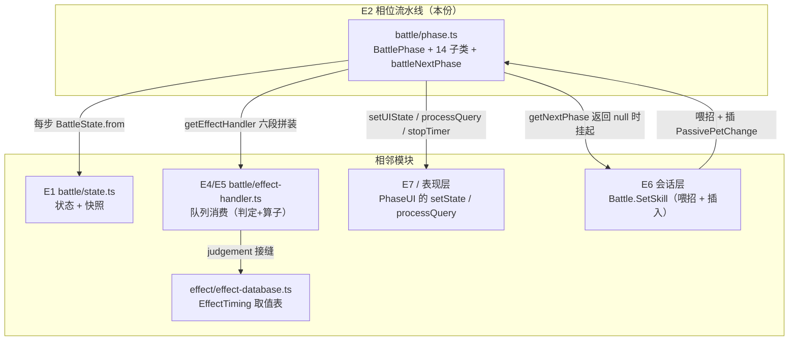
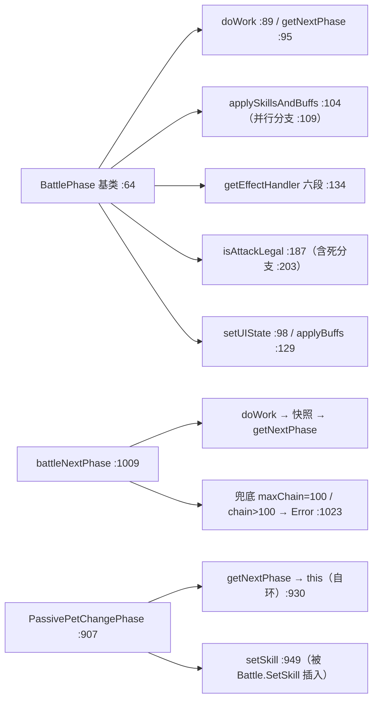

# 战斗引擎子设计 E2 · 相位流水线（docs/engine/battle-engine-phases.md）

> **定位**：战斗引擎的**时序骨架** —— `BattlePhase` 基类、**14 个相位**、`EffectTiming` 的**推进序**、
> **效果队列的六段拼装**、以及"引擎挂起"的**暂停点 / 插入点**。
> 父文档 = `docs/engine/battle-engine-design.md`（**§8.1 E2**）；机制导读 = `docs/engine/battle-engine-overview.md §3`（含 **§3.0 相位概念**）。
>
> **实现在哪**：`game/core/battle/phase.ts`（1030 行）＋ `game/core/battle/effect-handler.ts`。【我们】行号即指这两个文件。
> **上游真值**：`MVC/Model/Battle/BattlePhase.cs` + `MVC/Model/Battle/Phase/*.cs`（14 个）＋ `Scene Specific/Battle/Battle.cs`。
> **别与这些重复**：移植事实/口径 → `docs/engine/port-map.md`；对拍操作 → `docs/engine/oracle-playbook.md`。
>
> **证据标注**：【源码】= 上游 `.cs`；【我们】= `game/**`。
>
> ⚠️ **口径（2026-10-17，人类决议 ①②③；父文档 `docs/engine/battle-engine-design.md §5.5`）**：
> 相位层碰到的**外部能力一律走接口**，不在核心层直调 —— 随机 = **R1**、墙钟 = **R2**、存档读写 = **R3** /
> 写盘 = **R4**、提示与弹窗 = **R5**（`docs/runtime/runtime-components-design.md`）。
> "native 随机 ⇒ 进不了 golden"只描述**对拍覆盖面**，**不豁免实现与验收**（`AGENTS.md §1.1`）；
> 上游**代码逻辑 bug** ⇒ **声明 + 写无 bug 的目标行为**（决议 ②）。

---

## 0. 这份文档回答什么

1. `BattlePhase` 基类给了哪**两个钩子**、哪几个**属性**、哪几条**受保护的公共步骤**。
2. **14 个相位**各自做什么、把 `state.phase` 设成什么、下一步去哪。
3. 驱动循环 `battleNextPhase` 的形状（含**死循环兜底**）。
4. **效果队列的六段拼装顺序**（同 priority 的执行序）。
5. 引擎在哪**挂起等输入**（暂停点）与被**插队**（插入点）。
6. 哪些相位现在是 **`NOT_PORTED` 显式抛**，哪些已落地。

---

## 1. 范围与边界

| | |
|---|---|
| **本份覆盖** | `BattlePhase` 与 14 个子类的**控制流**；`battleNextPhase` 驱动；`getEffectHandler` 队列拼装；并行分支；`DecidePriority` 的排序链 |
| **不覆盖（去别处）** | 状态容器与快照 → **E1**（`docs/engine/battle-engine-state.md`） |
| | effect 的**判定与算子**（队列**消费**时发生什么） → **E4/E5** |
| | `EffectTiming` 的**取值表** → `docs/engine/battle-engine-overview.md §5.2`（真值在 `effect/effect-database.ts`） |
| | 表现层出口（`SetUIState` 的对端） → **E7** |
| | 会话层怎么喂招 → **E6**（本份只定"**暂停/插入**两端"） |

---

## 2. 上游真值

### 2.1 基类：两个钩子 + 受保护步骤

【源码】`MVC/Model/Battle/BattlePhase.cs`；【我们】`phase.ts:64-256`

| 成员 | 【我们】行 | 说明 |
|---|---|---|
| `state` / `resultState` | `:66-67` | 上游两个都是 **public 字段**；`resultState` 在相位层无人读写（驱动层预备） |
| `get battle()` | `:69-72` | 经**接缝** `PHASE_BATTLE`（`setPhaseBattle` 注入）；未注入 ⇒ 抛 |
| `get UI()` | `:75` | `= battle.ui`（对端 = `BattleManager`） |
| `get/set phase()` | `:78-79` | `state==null` 时 getter 兜 `None`、setter **静默不写也不抛** |
| `get battleSettings()` | `:82-86` | `battle.settings`（= `currentState?.settings`）为 `null` 时**抛**（`:65/:150` 的解引用点） |
| **`doWork()`** | `:89-92` | 基类只有两步：`applySkillsAndBuffs()` + `setUIState(currentState)` |
| **`getNextPhase()`** | `:95` | 默认 `null` ⇒ **停下，把控制权交回循环/玩家** |
| `setUIState(lastState = null)` | `:98-100` | `UI.setState(lastState, state)`；上游 `lastState` 缺省 `null` ⇒ 表现层**先塞 null 哨兵** |
| `applySkillsAndBuffs()` | `:104-126` | 拼装并应用效果队列；**并行分支**见 §2.6 |
| `applyBuffs()` | `:129-131` | `getEffectHandler(null, false)`（**不带**技能效果） |
| `getEffectHandler(invokeUnit, addSkillEffect=true)` | `:134-180` | 队列拼装，见 §2.5 |
| `isAttackLegal()` | `:187-255` | 出招合法性（`BeforeAttackPhase` 用），见 §2.2 |

**两个死代码/怪癖（必须保留原样）**：

1. `isAttackLegal` 里 `whosTurn === 0` 那条分支（`:203-210`）是 **死代码** —— 上游在上面 `:100` 就已解引用 `atkUnit.pet`（`null` ⇒ 先炸）。**删了它等于悄悄改上游形状**。
2. `applyBuffs()` 的怪癖：走 `null` 分支后 `addSkillEffect=false` **不会传下去**，每个 unit 仍带技能效果拼装（`:128`）。

### 2.2 14 个相位

【源码】`MVC/Model/Battle/Phase/*.cs`；【我们】`phase.ts`（行号见下）

| 相位 | 设的时机 | 做什么（摘要） | `getNextPhase` | 【我们】 |
|---|---|---|---|---|
| `BattleStartPhase` | `OnBattleStart` | `SetInitBuffs()` + 应用效果 | `→ TurnStartPhase` | `:265` |
| `TurnStartPhase` | `OnTurnStart` | `state.onTurnStart()` + 基类 + `UI.processQuery()` | **`null`（暂停）** | `:307` |
| `TurnReadyPhase` | `OnTurnReady` | `UI.stopTimer()`（无 autoSkillOrder 时）+ 基类 | `→ DecidePriorityPhase` | `:325` |
| `DecidePriorityPhase` | `OnDecidePriority` | 应用效果 → **`SetActionOrder()`** → `giveTurnToNextUnit()` | `→ BeforeAttackPhase` | `:356` |
| `BeforeAttackPhase` | `OnBeforeAttack` → `OnAttackStart` | 战报 → 合法性 → `OnChainStart` → 命中判定 → **换时机再应用** | 分歧：`→ DamageCalculate` / `→ Attack` / `→ AttackEnd` | `:435` |
| `DamageCalculatePhase` | `OnDamageParamCalculate → … → OnFinalDamageCalculate` | 纯计算（伤害参数 → 计算 → 最终） | `→ AttackPhase` | `:497` |
| `AttackPhase` | `OnAttackReady` → `OnAttack` | 扣怒气、落伤害、驱动 HUD | `→ AfterAttack` / `→ AttackEnd` | `:529` |
| `AfterAttackPhase` | `OnAfterAttack` | 回怒气、扣连击、交棒；反击则**插队** | `→ BeforeAttack` / `→ AttackEnd` | `:705` |
| `AttackEndPhase` | `OnAttackEnd` | `whosTurn = 0` + 基类 | `→ TurnEndPhase` | `:876` |
| `TurnEndPhase` | `OnTurnEnd` → `OnAfterTurnEnd` | `whosTurn=0` → **`CheckBattleEnd()`** → 应用 → `RaiseAnger` → `OnBuffEffected` → **换时机再应用** | `→ BattleEnd` / `→ TurnStart` | `:773` |
| `BattleEndPhase` | `OnBattleEnd` | `ProcessResult`（结算） | **`null`（停）** | `:891` |
| `RoundStartPhase`（旁路） | `OnRoundStart` | `whosTurn=0`、`myUnit.pet.anger += 15` | **`null`（停）** | `:288` |
| `RoundEndPhase`（旁路） | `OnRoundEnd` | 卡牌模式用 | （旁路） | 见 `Phase/RoundEndPhase.cs` |
| `PassivePetChangePhase`（旁路） | `OnPassivePetChange` | `doWork` **为空**；换宠 + **自环** + 回写 battle 世界字段 | **`this`（自环）** / `→ TurnReadyPhase` | `:907` |

> **主链 11 个 + 旁路 3 个。**旁路**不进**主链：`RoundStart`/`RoundEnd` 仅卡牌模式由 **View 直接构造**
> （`BattlePetSkillView.cs:271,281`）；`PassivePetChange` 由 **`Battle.SetSkill` 插入**（`Battle.cs:347-357`）。

### 2.3 驱动循环 `battleNextPhase`

【源码】`Scene Specific/Battle/Battle.cs:250-277`；【我们】`phase.ts:1009-1030`

```text
while (battle.currentPhase !== null) {
  battle.currentPhase.doWork()
  if (battle.currentPhase === null) break        // DoWork 期间把 currentPhase 置 null 的口子，照搬
  battle.lastState    = BattleState.from(currentState)   // ← 每步快照（E1 §2.2）
  battle.currentState = battle.currentPhase.state
  battle.currentPhase = battle.currentPhase.getNextPhase()
  round += 1
  // 保守兜底：轮数 > maxChain*(OnAfterAttack - OnBeforeAttack + 1) 或任一方 chain > 100
  //   ⇒ currentPhase = BattleEndPhase；result.state = Error；抛 NOT_PORTED（ProcessResult 摸随机/墙钟/存档/弹窗 ⇒ 走 R1·R2·R4·R5）
}
```

- **`maxChain = 100`**（`:1010`）。
- 兜底分支抛 `NOT_PORTED`：`ProcessResult` 摸 `Random.InitState(DateTime.Now.Ticks)` + 存档 + Hintbox（View 静态）。
  ⚠️ **旧措辞"摸 native / 应指外部线"作废**（决议 ①③）：这三件事在目标设计里是**三个接口** —— 墙钟+seed = **R2**、
  落盘 = **R4**、提示/弹窗 = **R5**（`docs/runtime/runtime-components-design.md`；文案取词与显示归 View）。
  ⇒ 仍是 **S5 的活**，但**不是"不可做"**：核心层只调接口，不直调 Unity/存档静态。

### 2.4 一个相位类可走**多个时机**

`BeforeAttackPhase.doWork`（`phase.ts:435+`）：先 `OnBeforeAttack`（基类应用）→ `CheckAccuracy` → **`phase = OnAttackStart`** → 再应用。
`TurnEndPhase.doWork`（`:783-802`）：`OnTurnEnd` → … → **`phase = OnAfterTurnEnd`** → 再应用。

> ⇒ **相位（类）≠ 时机（值）**。`EffectTiming` 共 **32** 个值（正相位 + 负事件），主链相位只用到其中约 20 个。

**⚠️ 孤儿帧教训**（`phase.ts:796-799`）：`TurnEndPhase` 在 `OnBuffEffected()` 末尾已把 `this.state` **换成新一帧**，
所以换时机时**绝不能复用 doWork 开头的 `st`** —— 那会把时机写进**旧帧**（打印停在 17，上游是 18）。
C# 每次 `state.Phase` 都是**现取字段**。驱动向量实测坐实。

### 2.5 效果队列的六段拼装顺序（`getEffectHandler`）

【源码】`BattlePhase.cs:60-94`；【我们】`phase.ts:134-180`

```
① 天气        st.weatherBuff.effects
② 场地/状态    st.stateBuffs（非 ignore）逐条 .effects
③ 技能        addSkillEffect && invokeUnit.skill !== null → skill.effects
④ 被动        passiveSkills 里 type===被动 且 isSkillCostEnough(x.id, st.settings) → effects
⑤ 单位 Buff   invokeUnit.unitBuffs（非 ignore）→ effects
⑥ 宠 Buff     pet.buffs（非 ignore）→ effects
```

- **六段顺序 = 同 priority 效果的执行序，一段不能换。**
- `invokeUnit === null` ⇒ 两方 `Concat`，**master 在前**（`:137-139`）。
- 怪癖：`:73-79` 的 `state != null` 卫包住**天气与场上印记**（`BattleState.cs` 版没有这层卫）；`:84-85` 被动筛选**在此实际执行**，
  代价判读的是 `state.settings`（**不是** `battle.settings`）。
- 队列消费（`EffectHandler.checkAndApply`）→ **E4/E5**（本份只管拼装）。

### 2.6 并行分支（双打）

【我们】`phase.ts:109-123`

```
if (settings.parallelCount > 1 && state.whosTurn === 0)
   逐 cursor 位 apply（master 整串先于 client），结束后 cursor 回位（atIndex(petBagCursor, 0)）
else
   整局一次性 apply
```

- 双打槽位**不再靠自增**（`parallelTurn` 是死字段，见 `docs/engine/battle-engine-overview.md §10#5`）：
  出手槽位由 `actionOrder` 与技能参数 `parallel_target_index` 共同决定（`BattleState.cs:206-210`）。

### 2.7 `DecidePriorityPhase` 的六级稳定排序链

【源码】`DecidePriorityPhase.cs:38-57`；【我们】`phase.ts:379-392`

```
1. 键 = (skill===null || pet===null) ? -1 : 0          降序     ← null 键兜成 -1
2. 键 = skill.isAction ? 1 : 0                          降序     ← ⚠️ 直接解引用 ⇒ null-skill 在此 NRE
3. 键 = skill.vipriority                                降序
4. 键 = skill.priority                                  降序
5. 键 = negSpeed * pet.statusController.getCurrentStatus(powerup, powerdown).spd   降序
6. 键 = rng.nextInt(0, 100)                             升序     ← 全局骰子，tiebreak
→ order[i] = trunc(sign(unit.id) * (cursor + 1))；若 order.direction < 0 ⇒ 整序 reverse
```

- **每级一次稳定排序**（LINQ `OrderByDescending/ThenByDescending` 链）⇒ 抛点落在**本级物化到那个元素时**（`linqSortBy`，`phase.ts:347-351`）。
- `negSpeed`（`phase.ts:381`）：若 `stateBuffs` 里有 `id === 600013` ⇒ 取 `-1`，否则 `1`。
  第 5 级排序方向**恒为降序**，乘 `-1` 即把序**整体倒过来** ⇒ 这就是"**速度反转**"印记的实现方式。
  （同一 id 也用在伤害侧：`damage.ts:166/188/218` 的 `neg`。）
- 第 6 级是 `UnityEngine.Random.Range(0,100)` 的**全局骰子**；无头体借 `masterUnit.randomSource` 作接缝。
  ⚠️ **决议 ①**：这条接缝今后归 **R1**（`masterUnit.randomSource` 是 **RB1** 要九合一的注入路之一）。
  **只有"掷之前"的形状发得出向量**（首步 `Apply` 撞 JUDGE / 排序键 NRE ⇒ throw-only，见 §6 状态表）；
  真走到这一级的向量**进不了 golden** ⇒ 实现照做，验收 = 同 seed 复现 + 排序形状断言 + **人类手测**。

### 2.8 暂停点与插入点

| 类型 | 位置 | 谁驱动 |
|---|---|---|
| **暂停（yield）** | `TurnStartPhase.getNextPhase → null`（`phase.ts:322`） | 等**选招输入源**（5 种，见父 §6.4）；`Battle.SetSkill` 喂招 |
| **暂停（yield）** | `BattleEndPhase.getNextPhase → null`（`:904`） | 等结算确认（→ E6） |
| **暂停（yield）** | `RoundStartPhase.getNextPhase → null`（`:304`） | 卡牌模式，View 驱动 |
| **自环（loop）** | `PassivePetChangePhase.getNextPhase → this`（`:930`） | 阵亡强制换宠链 |
| **插入（insert）** | `Battle.SetSkill` 里若有人阵亡 ⇒ 先插 `PassivePetChangePhase`（`Battle.cs:347-359`） | 玩家选招后 |

**`PassivePetChangePhase` 的两条硬口径**（`phase.ts:923-925`）：
① 先**各自求值两个** `GetPassiveChance` 再比 `||`（TS 的 `||` 会短路 ⇒ 必须提前算完，否则**抛点错位**）；
② 它是**全场唯一 `doWork` 为空、不借 timing** 的相位（`:921`）。

---

## 3. 目标结构（契约）

```
phase.ts
  interface PhaseUI      { setState(last, current); processQuery(processOne?); stopTimer();
                           setBottomBarInteractable?(interactable); setOptionActive?(index, active) }
  interface PhaseBattle  { readonly settings; currentState; lastState;
                           readonly autoSkillOrder; readonly ui; currentPhase }
  setPhaseBattle(get: () => PhaseBattle): void            // 接缝

  class BattlePhase
    state / resultState
    get battle() / get UI() / get/set phase() / get battleSettings()
    doWork() / getNextPhase()
    protected setUIState(lastState = null)
    protected applySkillsAndBuffs() / applyBuffs()
    protected getEffectHandler(invokeUnit, addSkillEffect = true): EffectHandler
    protected isAttackLegal(): boolean

  class BattleStartPhase extends BattlePhase        // :265
  class RoundStartPhase extends BattlePhase         // :288   旁路
  class TurnStartPhase extends BattlePhase          // :307   ← 暂停
  class TurnReadyPhase extends BattlePhase          // :325
  class DecidePriorityPhase extends BattlePhase     // :356
  class BeforeAttackPhase extends BattlePhase       // :435
  class DamageCalculatePhase extends BattlePhase    // :497
  class AttackPhase extends BattlePhase             // :529
  class AfterAttackPhase extends BattlePhase        // :705
  class TurnEndPhase extends BattlePhase            // :773
  class AttackEndPhase extends BattlePhase          // :876
  class BattleEndPhase extends BattlePhase          // :891   ← 暂停
  class PassivePetChangePhase extends BattlePhase   // :907   ← 自环

  battleNextPhase(battle: PhaseBattle): void        // :1009  驱动循环 + 兜底

effect-handler.ts
  interface EffectStateView { snapshot(): … }
  interface EffectJudgement { condition(...); apply(...) }        // ⚠️ 形参面 → E5
  setEffectJudgement(j: Partial<EffectJudgement>): void           // 接缝
  class EffectHandler { addEffects / concat / removeEffects / getEffects / clear / checkAndApply }
```

---

## 4. 接口（mermaid）

### 4.1 模块位置图



### 4.2 文件↔接口图



---

## 5. 不变量与围栏

| # | 不变量 / 围栏 |
|---|---|
| **P1** | **硬编码单链**：`getNextPhase()` 直接 `new 下一个相位()`，**无注册表**（父 §5.1，Q3 已决议） |
| **P2** | **每步值快照**：驱动序里 `lastState = BattleState.from(currentState)` 不能省（E1 §2.2） |
| **P3** | **六段拼装顺序不许换**（§2.5）——同 priority 的执行序即由此决定 |
| **P4** | **死分支/怪癖**：`isAttackLegal` 的 `whosTurn===0` 死分支、`applyBuffs` 的 `addSkillEffect` 不外传。⚠️ 2026-10-17 起这条**要分开读**（决议 ②）：**口径/数据差异 ⇒ 保留**；**代码逻辑 bug ⇒ 声明 + 写无 bug 的目标行为**（分工见 `docs/arch-docs.md §4.1`） |
| **P5** | **换时机用现取 `this.state`**，禁止复用 doWork 开头的帧引用（§2.4 孤儿帧） |
| **P6** | **短路口径**：涉及两次求值再 `\|\|` 的地方（如 `PassivePetChange`）必须**提前算完**，否则抛点错位 |
| **P7** | **`NOT_PORTED` 显式抛**，绝不静默继承基类 `doWork`（`phase.ts:263`） |
| **P8** | **围栏**：`cardSystem`（Card 模式读 `hand` 处抛）、`hudSystem`（只写展示字段，不进签名）、`ProcessResult`（S5） |

---

## 6. 现状与缺口

| 项 | 状态 |
|---|---|
| `phaseq`（相位构造/形状） | ✅ 绿 |
| `phasedrive`（**推进 + 队列消费**） | ✅ 绿（第六段·批一后已打**真状态签名**，不再是 throw-only） |
| 直线组相位的 `DoWork` | ✅ 已落地（`TurnStart` / `TurnReady` / `AttackEnd` / `AfterAttack` 等） |
| `DecidePriorityPhase.doWork` | 🟡 对拍向量只发 **throw-only** 形状（首步 `Apply` 撞 JUDGE 围栏 / 排序键 NRE / native Random） |
| `BeforeAttackPhase` 分支 | 🟡 分支组：部分形状进对拍 |
| `BattleStartPhase.SetInitBuffs` | ⛔ `NOT_PORTED`（`buffController`/成就/`OnAddBuff` 围栏） |
| `RoundStartPhase.doWork` | ⛔ `NOT_PORTED`（`ReduceBuffTurn` / `cardSystem` 围栏） |
| `BattleEndPhase.doWork` | ⛔ `NOT_PORTED`（`ProcessResult` → **E6 / S5**；它要的三件外部能力 = **R2 / R4 / R5**，见 §2.3） |
| `ProcessResult` 死循环兜底分支 | ⛔ `NOT_PORTED`（⚠️ 旧措辞"摸 native Random/存档 + Hintbox"**作废**：掷骰 = **R1**、seed/墙钟 = **R2**、落盘 = **R4**、提示弹窗 = **R5**，核心层只调接口 ⇒ 这是**排期**问题，不是"不可做"） |

**缺口**（→ 阶段二）：**旁路相位的 DoWork**（`RoundStart`/`RoundEnd` 卡牌）、`PassivePetChange.setSkill` 的尾块（要 S6 真表）。

---

## 7. 待核 / 已知怪癖

| # | 事项 | 证据 |
|---|---|---|
| 1 | `DecidePriorityPhase.cs:23` 引用的 `EffectTiming.OnPriorityReady` **在注释块内** ⇒ 不是死引用、不影响编译 | `docs/engine/battle-engine-overview.md §10#1` |
| 2 | `RoundStart`/`RoundEnd` **只被 View 构造**（`BattlePetSkillView.cs:271,281`），**无** `GetNextPhase` 返回它们 | 全仓 grep |
| 3 | `TurnEndPhase` 的 `hud → Photon` 闸门：`UnitHudSystem.OnTurnEnd` 先读 `PhotonNetwork.IsConnected` ⇒ oracle `TypeInitializationException`。**进入条件** = 任一 unit 的 `totalBuffHeal − totalBuffDamage ≠ 0` | `docs/engine/kernel-handoff.md §5b`（**移植体不建模这个抛**：hud 是表现层） |
| 4 | `BattleStartPhase` / `RoundStartPhase` / `BattleEndPhase` 目前**整体抛** `NOT_PORTED` ⇒ 端到端跑整场时需绕行或按段补 | `phase.ts:284/301/901` |
| 5 | `EffectTiming` 的**负值"事件型时机"**（`OnAddBuff` 等）**不绑主链**，由代码临时点燃 | `docs/engine/battle-engine-overview.md §5.2` |

---

## 8. 配对实现（impl）指针

- 本份配对 = 未来的 **`docs/engine/battle-engine-impl.md`** + **`battle-engine-code-map.md`**（阶段一续写）。
- **现状**：`game/core/battle/phase.ts` **已落地**（`phaseq`/`phasedrive` 绿）；事实面 = `docs/engine/kernel-handoff.md §3`，
  逐 kind 结论 = `docs/engine/port-map.md` 的 **S3 第四段（驱动层）** 与 **第六段·批一**。
