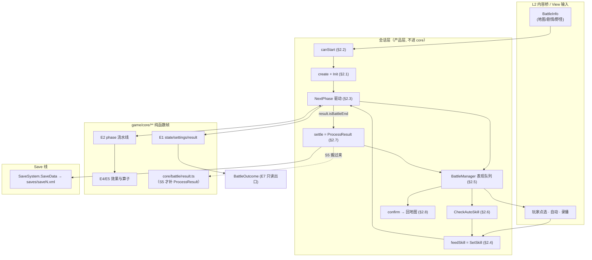
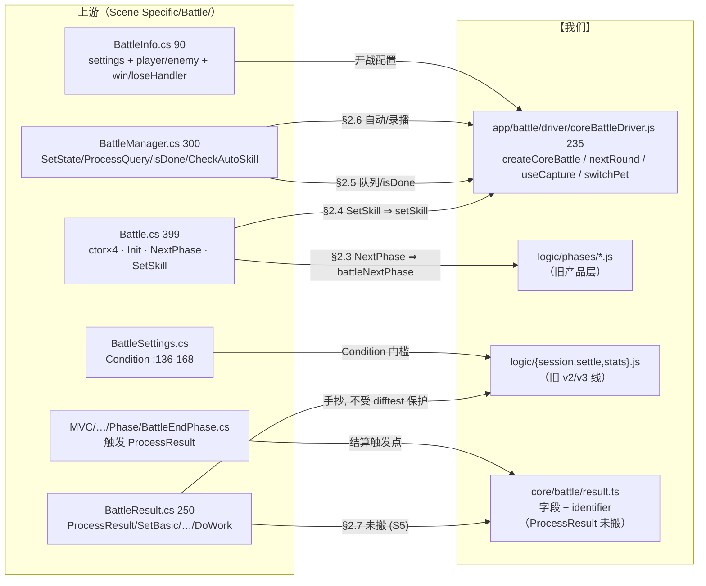

# 战斗引擎子设计 E6 · 会话编排与结算（docs/engine/battle-engine-session.md）

> **定位**：引擎**最外面那一圈** —— 一场战斗「怎么开起来、谁来喂招、什么时候算结束、结束后往哪写」。
> 内核（E1 状态 / E2 相位 / E3 单位 / E4–E5 效果）只回答"推进一帧会发生什么"；
> **本份回答"帧与帧之间谁在驱动、玩家/自动/录播/网络的输入从哪个口子进来、结果怎么落回存档"**。
> 父文档 = `docs/engine/battle-engine-design.md`（**§8.1 E6**）；机制导读 = `docs/engine/battle-engine-overview.md §7`。
>
> **上游真值**：`Scene Specific/Battle/Battle.cs`（399）+ `BattleManager.cs`（300）
> + `BattleResult.cs`（`ProcessResult` `:61-113` + `SetBasic/SetRecord/SetTalent/SetExp/SetSkill/DoWork` `:115-237`）
> + `BattleSettings.cs`（`Condition` `:136-168`、`isPVP`/`isAutoOK` `:19-20`）
> + `Map/Entities/Battle/BattleInfo.cs`（90）+ `MVC/Model/Battle/Phase/BattleEndPhase.cs`（结算触发点）。
> **别与这些重复**：状态/配置/结果**字段** → **E1**（`docs/engine/battle-engine-state.md`，§2.5/§2.6）；
> 相位控制流 / 暂停点 / 插入点 → **E2**（`docs/engine/battle-engine-phases.md §2.8`）；
> 单位与队伍内部机制 → **E3**；算子 → **E4/E5**；表现 DTO 的**字段语义** → **E7**；
> 存档 XML 形状与写盘机制 → `docs/save/save-design.md` + `save-xml-spec.md`。
>
> **证据标注**：【源码】= 上游 `.cs`；【我们】= `game/**`。
>
> ⚠️ **口径（2026-10-17，人类决议 ①②③；父文档 `docs/engine/battle-engine-design.md §5.5`）**：
> 本份是"外部能力集中出现的那一层"，四类副作用**一律只调接口**（决议 ③），真值与命名以
> **`docs/runtime/runtime-components-design.md`** 为准 —— **R1** 随机源 / **R2** 时钟 / **R3** 存档读写面 /
> **R4** 写盘 sink / **R5** 提示与弹窗 sink。本份只回答**何时**调、传什么参数，**不**回答怎么落 XML
> （→ `docs/save/save-design.md`）与文案怎么取（→ View 线）。
> ⚠️ "native `Random` / 墙钟 ⇒ 进不了 golden"**只描述对拍覆盖面**，不豁免实现与验收（`AGENTS.md §1.1`）；
> 上游**代码逻辑 bug** ⇒ **声明 + 写无 bug 的目标行为**（决议 ②）。

---

## 0. 这份文档回答什么

1. **一场战斗的四个构造入口**（`Pet[]` / `BattlePet[]` / `BattleInfo` / PVP `Hashtable`）与 `Init` 里那几笔"补丁"。
2. **开战三段校验** `StartBattle → TryStartBattle → CanStartBattle`：卡在哪、报什么文案。
3. **驱动循环** `NextPhase` 的形状与那条**无限循环兜底**（`chain > 100` ⇒ `result = Error`）。
4. **`SetSkill` —— 全引擎唯一的输入接缝**：五种输入源怎么汇进来、为什么它会**自己递归**、旁路换宠从哪插。
5. **`BattleManager` 的表现队列**：`SetState` 入队 → `ProcessQuery` 出队 → `isDone` 轮询 ⇒ 引擎被表现**卡住**的那条链。
6. **自动战斗** `CheckAutoSkill` 的选招序（超杀 / 普技 / 道具）。
7. **`ProcessResult` 结算回写全链**：`SetBasic / SetRecord / SetTalent / SetExp / SetSkill` 各自的判据、门槛与写盘时机。
8. **出口**：`BattleOutcome` 该给谁（Save 线 / View 线）、哪些**不许**进内核。

---

## 1. 范围与边界

| | |
|---|---|
| **本份覆盖** | `Battle`（构造 / `Init` / `NextPhase` / `SetSkill` / `StartBattle` 三段）·`BattleManager`（表现队列 / 选项态 / 自动战斗 / 确认出口）·`BattleSettings.Condition`（开战门槛）·`BattleResult.ProcessResult` 全链（结算与成长） |
| **不覆盖（去别处）** | `BattleState`/`BattleSettings`/`BattleResult` 的**字段与读视图** → **E1** |
| | 14 个 phase 的 `DoWork`/`GetNextPhase` 内部 → **E2**（本份只调 `battleNextPhase`，不建模其中一步） |
| | `Unit` / `UnitPetSystem` / 三 controller / `BattlePet` → **E3** |
| | 规则判定与算子 → **E4/E5** |
| | `BattleUnitView` / `BattleSystemView` / `Hintbox` / `SceneLoader` / 动画协程 → **View 线**（`docs/view/view-design.md`）；内核只**产** `BattleState` 快照。⚠️ 但"**弹一条提示**"这个**动作**归 **R5**（决议 ③ ⇒ 内核调接口、只给 key + args），**显示**才归 View |
| | `SaveSystem.SaveData()` **怎么落 XML** → `docs/save/save-design.md`；本份只说**什么时候**调；⚠️ **调**这个动作 = **R4** 写盘 sink（决议 ③） |
| | `YiTeRogue*` / 卡牌模式 / Photon 联机 → **围栏**（见 §5） |
| **归属（Q2 规则）** | `Scene Specific/Battle/{Battle,BattleManager,BattleResult,BattleSettings}.cs` ⇒ 引擎（会话层）；但**实现落点是产品层**（见 §6），不是 `game/core/**` |

**一句话边界**：内核 = **纯函数帧**（给 `state` 产下一个 `state`）；会话 = **有副作用的那一圈**
（读存档建队、等输入、轮询表表演完、写回存档）。两者**不许合并** —— 合并就再也对拍不了。

---

## 2. 上游真值

### 2.1 四个构造入口与 `Init`

【源码】`Scene Specific/Battle/Battle.cs`

| 入口 | 签名 | 用途 | 我们 |
|---|---|---|---|
| ① | `Battle(Pet[] myPetBag, Pet[] opPetBag, BattleSettings)` `:22-28` | 存档宠直建（测试/内部） | 产品层 |
| ② | `Battle(BattlePet[] player, BattlePet[] enemy, BattleSettings)` `:30-33` | 已建好的战斗宠 | 产品层 |
| ③ | `Battle(BattleInfo)` `:38-57` | **正经入口**：地图/剧情/野怪给 `BattleInfo` | 产品层（§6 的 driver 等价物） |
| ④ | `Battle(Hashtable roomHash, …)` `:65-103` | PVP 从 Photon 房间属性建 | ⛔ **围栏** |

- 入口 ①/②/③ 都先做 `Take(settings.petCount)` —— **`petCount` 是硬上限**，敌方袋**不截**
  （`opPetBag` 直接 `Select` 全收，`:54`）⇒ 敌我不对称，照搬。
- **`BattlePet.GetBattlePet(x)` 是深拷**：存档 `Pet` → 战斗 `BattlePet`（`Pet` 副本 + 战斗态）。
  `Pet` 本身是域模型线（D6）的东西；内核只吃 `PetBag`。
- 入口 ③ 的三岔（`:47-52`）：`YiTeRogue` ⇒ 读 `YiTeRogueData.instance.battlePetBag`（**围栏**）；
  `playerInfo` 空 ⇒ 读 `Player.instance.petBag`；否则读 `playerInfo` 造 Boss。**`Pet[] → BattlePet` 与
  `BossInfo → BattlePet` 是两条不同的建宠路径**，落点都是同一个 `BattlePet`。

**`Init`（`:105-185`）的五笔，前三笔是纯会话、后两笔是"补丁"**：

| # | 行 | 做什么 | 口径 |
|---|---|---|---|
| 1 | `:107` | `Player.instance.currentBattle = this` | **全局单例回指** ⇒ 表现层与规则都靠它反查当前战斗（围栏：产品层的 `Player`） |
| 2 | `:108` | `Random.InitState(settings.seed)` | **种子在这里落地** ⇒ 内核 RNG 的**唯一**种子来源；`settings.seed` 是存档/房间给的。⚠️ 目标设计：seed 交给 **R1**（我们**不**碰进程级 native 随机），会话侧只**传** seed（`docs/runtime/runtime-components-design.md`） |
| 3 | `:110-125` | 卡牌模式补丁 | ⚠️ **整块被 `/* */` 注释掉** ⇒ 死代码（`pet.statusController.anger = 35` / `normalSkill` 随机 4 条 / `superSkill` 挑必杀）。**别照搬** |
| 4 | `:127-135` | **精靈大亂鬥**：`initBuffs` 里含 `Buff.BUFFID_PET_EXCHANGE` ⇒ 双方袋**合并后随机对半砍** | 用 `ListHelper.Random(count, false)` —— ⚠️ "托管链"只说明**它不是方法体直调 native**；链内部仍掷 `Random.Range` ⇒ **掷了就拿不到 golden**（本形状 `count = 半数 ≤ Count`，不走短路支）。实现照做、骰子走 **R1**，验收 = 同 seed 复现 + 形状（长度/来源袋分布）+ 人类手测。只有**短路支**（`!repeat && count > Count` ⇒ 整表）才照常可比（`docs/engine/port-map.md`） |
| 5 | `:137-178` | `!isPVP` 的两笔补丁：<br>（a）**大亂鬥还原**：我方每只 `loopSkills = null` + `buffs.RemoveAll(id == -3)`；<br>（b）**佛洛伊德/尼尔**：`isCaptureOK && worldId == 0 && op[0] 无 -2 印记 && Random.Range(0,256) < 1` ⇒ 敌 1 号换成特定 Boss | ⚠️ 两条怪处见 §7 #1/#2 |

- `:180-184` 三行定乾坤：`lastState = null`；`Unit masterTurn = new Unit(masterPetBag, 1, settings)`、
  `Unit clientTurn = new Unit(clientPetBag, -1, settings)`；`currentState = new BattleState(settings, …)`；
  `currentPhase = new BattleStartPhase()`。**`id = 1` = 主（我方）/ `id = -1` = 客（敌方）**，这是 `IsMyUnit()` 的离线判据（E4 §7 #14）。

### 2.2 开战三段校验

【源码】`Battle.cs:204-248`

```
StartBattle(info)                    // 统一入口, 失败弹 Hintbox
  └─ TryStartBattle(info, out msg)   // 真逻辑
       ├─ CanStartBattle(info, out msg)
       └─ new Battle(info) + SceneLoader.ChangeScene(SceneId.Battle)
```

`CanStartBattle` 的三道：

| 序 | 判据 | 失败文案 |
|---|---|---|
| 1 | `battleInfo == null` | `"战斗配置不存在。"` |
| 2 | `playerInfo` 空 **且**（`Player.instance?.petBag` 空 ‖ `petBag[0] == null` ‖ `petBag[0].currentStatus.hp == 0`） | `"首发精灵血量耗尽，快去恢复精灵吧！"` |
| 3 | `settings.Condition(petBag.Take(petCount), out msg)` | `msg`（来自 `filterLimit` 表达式） |

- 第 2 条是 **`&&`**：`playerInfo` 非空（即配置里指定了出战宠）时**不查**存档首发血。
- `settings.Condition`（`BattleSettings.cs:136-168`）逐只跑 `PetIdentifierReadView` 的过滤器，
  失败文案取自 `filterLimitDesc`；**这是开战前唯一读 `Pet` 的规则**（周目/星级/等级门槛都在这）。
- S5 之后 `Condition` 要吃**真 `Pet`**（域模型线 D6），现在是产品层手抄。

### 2.3 驱动循环 `NextPhase` 与无限循环兜底

【源码】`Battle.cs:250-277`

```
NextPhase():
  while (currentPhase != null):
      currentPhase.DoWork()
      if (currentPhase == null) break                # DoWork 里可能把 currentPhase 置 null
      lastState = new BattleState(currentState)      # ← 快照: "上一帧"
      currentState = currentPhase.state              # ← 相位算出来的新状态
      currentPhase = currentPhase.GetNextPhase()     # ← null ⇒ 循环自然结束 = 挂起
      round += 1
      if round > 100 * span  ||  myUnit.pet.chain > 100  ||  opUnit.pet.chain > 100:
           currentPhase = new BattleEndPhase()
           currentState.result.state = Error
           currentState.result.ProcessResult(currentState)
           Hintbox(...).SetOptionCallback(ChangeScene(Map))
           return                                     # ← 直接返回, 不再循环
```

- **这是全引擎唯一的驱动循环**（`battleNextPhase`）。`OnBattleStart()`（`:279-282`）就是裸调 `NextPhase()`。
- **`GetNextPhase()` 返回 `null` 不是结束，是"挂起等输入"**（E2 §2.8）—— `NextPhase` 的 `while` 退出后
  **控制权交回调用者**（玩家点招 ⇒ 再进 `SetSkill`；自动/录播 ⇒ 由 `BattleManager` 再喂）。
- **兜底判据三条并联**（`||`）：
  ① `round > maxChain * (OnAfterAttack - OnBeforeAttack + 1)` = `100 * (15 - 6 + 1)` = **1000**（`EffectTiming` 实测值，见 `effect-database.ts:20-23`）；
  ② `currentState.myUnit.pet.chain > 100`；③ `currentState.opUnit.pet.chain > 100`。
  注意 ②/③ 读的是 **`myUnit.pet`/`opUnit.pet`（当前在场宠）**，不是 `atkUnit` —— `whosTurn == 0` 时也没有 NRE 风险。
- 兜底的三笔副作用**顺序固定**：置 `BattleEndPhase` → `result.state = Error` → **立刻 `ProcessResult`**...
  然后 `return`。⇒ `BattleEndPhase.DoWork` **不会再跑**（因为没继续循环）⇒ `ProcessResult` 只被调用一次。
  ⚠️ 但 `Hintbox` 回调里才 `ChangeScene(Map)`，**View 侧的结算画面不走**（`SetUIState(null)` 也没发生）。
- `lastState = new BattleState(currentState)` 与 `currentState = currentPhase.state` 的先后，
  决定"表现层看到的 diff 是哪一段" —— 这是 E2/E7 的共同前提，**不许调换**。
- 【我们】`game/core/battle/phase.ts:1009-1030` 已照搬整个循环与**兜底判据**；兜底的三笔副作用里，
  **前两笔（置 `BattleEndPhase` + `result.state = Error`）已落**，第三笔 `ProcessResult` + `Hintbox`
  **显式抛 `NOT_PORTED`**（`:1027`）—— 与 §2.7 的 S5 是同一件事。⚠️ 旧措辞"摸 native `Random` 与存档 + View 静态"
  **作废**：这四件事在目标设计里是四个接口（**R1 / R2 / R4 / R5**），所以这是**排期**问题，不是"不可做"。

### 2.4 `SetSkill` —— 全引擎**唯一**的输入接缝

【源码】`Battle.cs:285-392`（107 行，本份最重的一段）

**五种输入源全部汇到这里**（导读 §3.5 那张表）：

| 输入源 | 谁调 `SetSkill(skill, isMe)` |
|---|---|
| 玩家点选 | `BattleManager.SetSkillSelectMode` → UI 回调 |
| 自动战斗 | `CheckAutoSkillCoroutine` → `SetSkill(skill, true)`（§2.6） |
| 录播回放 | `BattleManager.ProcessQuery` 的 `BattleMode.Record` 分支（`:119-127`） |
| PVP 对手 | RPC → `SetSkill`（**围栏**） |
| 敌方兜底 | `SetSkill` **内部**（`:361-380`，`!isPVP && opUnit.skill == null`） |

**逐段拆解**（顺序不可换）：

| # | 行 | 条件 | 行为 | 返回 |
|---|---|---|---|---|
| 0 | `:287-288` | `currentState == null` | 直接退 | `false` |
| 1 | `:290-304` | 恒 | 定 `unit`/`rhsUnit`；`parallelCount > 1` ⇒ `parallelSkillSystems[sourceIndex].skill = skill` + `TakeSkillCost(skill, settings, sourceIndex)`（`sourceIndex` 取 `skill.options["parallel_source_index"]`，缺省 `"0"`）；否则 `unit.SetSkill(skill)` | — |
| 2 | `:307-323` | `isMe` 且 `!skill.IsSelectReady()` | **要目标**：`GetSelectableTarget(petBag, cursor, parallelCount)`；若 `skill.isAction` 或目标表里有 `true` ⇒ `UI.SetSkillSelectMode(true)` + `UI.SelectOption(1)` + `return false`（**等玩家点目标**）；否则把每条 `IsSelect()` 效果的 `target_index` 写 `"none"` ⇒ **递归** `SetSkill(skill, isMe)` | `false` / 递归 |
| 3 | `:325-340` | `isMe` 且 `parallelCount > 1` 且 `!unit.isReady` | `UI.PVPSetSkillToOthers(skill)`；`GetNextCursorCircular()` 换 `cursor`（逃跑技除外）⇒ `UI.SetState(null, currentState)` + `UI.ProcessQuery(true)` | `false` |
| 4 | `:342-344` | `isMe` | `UI.SetSkillSelectMode(false)` + `UI.SetBottomBarInteractable(false)` + `UI.PVPSetSkillToOthers(skill)` | — |
| 5 | `:348-359` | `parallelCount <= 1` 且 `currentState.isAnyPetDead` | `unit.SetSkill(null)`（**先抹掉刚设的招**）⇒ `currentPhase ??= new PassivePetChangePhase()` ⇒ `((PassivePetChangePhase)currentPhase).SetSkill(skill, isMe)`（**把招存进旁路相位**）⇒ `currentPhase = currentPhase.GetNextPhase()`；若 `currentPhase.phase != OnPassivePetChange` ⇒ `NextPhase()` | `false` |
| 6 | `:361-380` | `!isPVP` 且 `opUnit.skill == null` | 敌方自动选招：`parallelCount = min(settings.parallelCount, opUnit.petSystem.alivePetNum)`；逐槽 `GetDefaultSkill()`；若 `opUnit.pet.isDead` ⇒ 换成 `Skill.GetPetChangeSkill(cursor, nextCursor, true)`（单打）或 `null`（双打）；双打再 `SetParallelIndex(cursor, 我方第一个活的袋下标)`；`opUnit.SetSkill(defaultSkill)`；双打推进 `cursor` | — |
| 7 | `:382-389` | `currentState.isAllUnitReady` | 双方 `parallelSkillSystems.ForEach(EnsureSkillNotNull)`（**双打空槽兜底**）⇒ `currentPhase = new TurnReadyPhase()` ⇒ `NextPhase()` | `true` |
| 8 | `:391` | 其它 | — | `false` |

**四处必须照搬的设计**：

- **第 2 段的自我递归**：目标未定时**不返回错误**，而是"设 UI 选择模式 + 递归"。递归时
  `IsSelectReady()` 已为真（因为 `target_index` 已被写入），所以**递归只发生一层**。
  ⚠️ 抄成"循环"会改变 `UI.SelectOption(1)` 与 `SetSkillSelectMode` 的调用次数。
- **第 5 段是**"**旁路换宠**"的入口（E2 §2.8 的插入点）—— 它是 `SetSkill` **内部**插的，
  不是相位链自己走到那儿的：手里的招先交给 `PassivePetChangePhase` 存着，换完宠再回来。
  `currentPhase.GetNextPhase() != OnPassivePetChange` 这个判断就是**旁路会不会自环**的分叉：
  自环 ⇒ 不调 `NextPhase()` ⇒ 又回到等输入。
- **第 6 段只对 `!isPVP` 生效**：PVP 下敌方招从网络来（围栏）；离线才由这里兜底。
- **`isMe` 的三笔 UI 调用（第 4 段）在 `parallelCount > 1` 且 `!isReady` 时被跳过**（第 3 段先 return）——
  ⇒ 双打是"一只一只设招"，每设完一只都要 `ProcessQuery(true)` 重画。

### 2.5 `BattleManager` —— 表现队列与会话状态机

【源码】`Scene Specific/Battle/BattleManager.cs`（**`Manager<BattleManager>` 单例 + `StartCoroutine`** ⇒ 整体是 View 侧）

| 成员 | 行 | 语义 |
|---|---|---|
| `battle => Player.instance.currentBattle` | `:12` | 从全局单例反查 |
| `isDone => allUnitViews.All(x => x?.isDone ?? true)` | `:22` | **没视图就算"演完了"**（`?? true`）⇒ 纯逻辑单测里恒 `true` |
| `currentState => (currentUIState == null) ? null : new BattleState(currentUIState)` | `:24` | ⚠️ **每读一次深拷一份** |
| `queue : Queue<BattleState>` | `:26` | 待播的状态队列 |
| `Start()` → `battle.OnBattleStart()` | `:45-48` | 开战起点 = **场景 Start**（不是 `StartBattle`） |
| `SetState(lastState, currentState)` | `:76-82` | `lastState == null` ⇒ **先入队一个 `null`**（信号："整场重画"），再入队 `currentState` |
| `SetCurrentUIState(newState)` | `:84-91` | 分发到 `systemView` + 两侧 `unitView`，再 `currentUIState = newState` |
| `ProcessQuery(processOne=false)` | `:97-168` | **出队 → 分发 → 起协程等播完 → 递归再出队** |
| `ProcessQuery` 的空队列分支 | `:99-129` | 队列空 ⇒ 亮底栏 + `SelectOption` + 选项可用性 + `CheckAutoSkill()` + 录播喂招 |
| `CheckQueryDoneCoroutine` | `:170-181` | `while (!isDone) yield WaitForSeconds(0.2)` ⇒ **表现卡住引擎**的那条链 |
| `OnConfirmBattleResult` | `:62-74` | PVP 发 Leave；`ShowPetSecretSkillResult()` 为真 ⇒ 先看秘技；否则 `ChangeScene(Map)` |

**出队分支的细节**（`:132-146`）：

```
newState = queue.Dequeue()
if (newState == null):
    currentUIState = null
    newState = queue.Dequeue()          # ← 第 2 次出队, 不判空
    if newState.result.isBattleEnd:
        分发 → ProcessResult(newState.result) → return     # ← 结算画面, 不再递归
SetCurrentUIState(newState)
```

⇒ **"战斗结束"这个信号走的是 `SetState(null, …)` 那条 null 路径**（`BattleEndPhase` 里
`SetUIState(null)` 后又 `UI.ProcessQuery()`），所以 `queue` 里**成对出现** `null` + `终局态`。
抄错成"只看 `result.isBattleEnd`"会漏掉 `currentUIState = null` 这一笔。

**选项态**（底栏那排钮）**只由会话层算**：`SelectOption(死了 ? 1 : 0)`、`SetOptionActive(2, isCaptureOK)`、
`isItemOK` 或我方死 ⇒ `SetOptionActive(2/3, false)`、`!isItemOK`、`parallelCount > 1 && 队列空` ⇒ `SetOptionActive(4, 活)`。
⇒ 内核**不**知道"哪个钮能点"（E7 只是给读数）。

### 2.6 自动战斗 `CheckAutoSkill`

【源码】`BattleManager.cs:183-242`

- 入口判据：`queue.Count > 0` ⇒ 不自动；`!currentUIState.settings.isAutoOK` ⇒ 不自动
  （`isAutoOK = !isPVP && parallelCount <= 1 && mode != Card`，`BattleSettings.cs:20`）⇒ **PVP / 双打 / 卡牌不适用**。
- `battle.autoSkillOrder` 空 ⇒ 退出；否则 `cursor = autoSkillOrder[autoSkillCursor]`。
- **`cursor` 的语义是"第几个槽"**：`cursor == 0` ⇒ 超杀；`cursor.IsWithin(1, 4)` ⇒ 普技
  （`normalSkills[cursor - 1]`）；否则 ⇒ **道具** `new Item(cursor, Item.Find(cursor) == null ? 0 : 1)`。
- 超杀可用性：`(isAutoSuperSkill || cursor == 0) && superSkill != null && (superSkill.anger <= pet.anger || pet.buffController.GetBuff(61) != null)`
  —— `GetBuff(61)` 是**无限怒气**印记（E3）。
- 道具支：`Item.IsUsable` + 时机落在 `[OnBattleStart, OnBattleEnd]` + `isCaptureOK || 非捕捉类`
  ⇒ `Skill.GetItemSkill(item)` + **`Item.Remove(item.id)`（只在 `!isSimulate` 时真摘）**，否则 `GetNoOpSkill()`。
- 收尾两笔：`(skill.anger > pet.anger) && !isAnySkillOK` ⇒ 兜成无操作；
  `(!isSuperSkill || cursor == 0)` ⇒ `autoSkillCursor = (autoSkillCursor + 1) % autoSkillOrder.Count`
  ⇒ **超杀槽不自增**（连打超杀直到没怒气）。
- `isDone`/`isAutoOK`/`Item.Remove` 全是**产品层**的东西 ⇒ 内核只认 `setSkill(skill, isMe)` 这一句。

### 2.7 `BattleResult.ProcessResult` —— 结算回写全链

【源码】`BattleResult.cs:61-113` + `:115-237`；触发点 = `BattleEndPhase.DoWork`（`MVC/Model/Battle/Phase/BattleEndPhase.cs`）

**触发点有两处**（都走 `ProcessResult`）：

1. `BattleEndPhase.DoWork` → `state.result.ProcessResult(state)` + 两侧 `hudSystem.OnBattleEnd(…)` +
   `SetUIState(null)` + `UI.ProcessQuery()`（⇒ 走 §2.5 的 null 路径进结算画面）；
2. `Battle.NextPhase` 的**无限循环兜底**（§2.3，`result.state = Error` 之后）。

**主链（顺序即语义，不许换）**：

| # | 行 | 判据 | 行为 | 写盘 |
|---|---|---|---|---|
| 1 | `:62-63` | 恒 | `Random.InitState((int)DateTime.Now.Ticks)` + `Player.instance.random = Random.Range(0, 100)`（⚠️ 目标 = **R2** 给墙钟 + **R1** 给这颗骰；它**只**影响 `Player.instance.random`，不许当战斗种子 ⇒ 见 §5 **S2**） | — |
| 2 | `:64` | 恒 | `this.endState = new BattleState(endState)`（**深拷**，战斗现场另存） | — |
| 3 | `:66-67` | `state == Error` | **`return`** | ❌ **不写盘** |
| 4 | `:69-79` | `mode == YiTeRogue` | 逐只 `pet.currentStatus.hp = Mathf.Min(pet.normalStatus.hp, battlePet.hp)` | ❌ **不写盘** |
| 5 | `:81-86` | `mode == PVP` | `battleRecord.originalResultState = …` | — |
| 6 | `:88-89` | `isSimulate` | **`return`** | ❌ 不写盘（PVP 构造默认 `isSimulate = true` ⇒ **PVP 实际只写 #5 那一笔**） |
| 7 | `:91-92` | 恒 | `SetBasic` + `SetRecord` | — |
| 8 | `:94-97` | `!isMyWin` | **`return`** | ✅ 写盘（**输/逃/超时**止步于此 ⇒ 无 EV/exp/秘技） |
| 9 | `:99-106` | `CaptureSuccess` | `capturePet = new Pet(baseId, settings.captureLevel, feature.hasEmblem)` + `basic.gender` + **`Pet.Add(capturePet)`**（⚠️ 这支 `Pet(int,…)` 构造 = D6 构造家族的 **N 档**：进不了 golden，但**照常实现**、随机来自 **R1** ⇒ `docs/domain/domain-pet.md §2.2`） | ✅ 写盘 + **`return`**（⇒ 连捕捉也不跑 EV/exp） |
| 10 | `:108-112` | 恒（赢且非捕捉） | `SetTalent` → `SetExp` → `SetSkill` | ✅ 写盘 |

> ⚠️ 本表的**「✅ 写盘」在目标设计里 = 调 R4**（`SaveSystem.SaveData()` 的替身；§2.8 三处落点）。
> 核心层**不**自己落 XML，只调接口（决议 ③）；XML 形状与事务归 `docs/save/save-design.md`。

**五笔 `DoWork` 的判据**（`DoWork` 本身 `:228-237`：只遍历 **`fightPetCursors`**，`pet`/`battlePet` 任一 `null` 跳过）：

| 笔 | 行 | 每只宠做什么 | 门槛 |
|---|---|---|---|
| `SetBasic` | `:115-122` | `autoHealAfterBattle` ⇒ `hp = normalStatus.hp`；否则 `hp = Min(normalStatus.hp, battlePet.hp)` | 无 |
| `SetRecord` | `:124-139` | `isOpWin` ⇒ `record.loseFightNum++`；`isMyWin` ⇒ `record.winFightNum++` | **`pet.level >= 60`**（否则整只跳过） |
| `SetTalent` | `:141-170` | 读 `battleEvMult/Chance/Buff` 三记录（`int.Parse`，`Chance` 读出来**减 1**）；`Chance <= 0` ⇒ 摘 `feature.afterwardBuffIds` 里的 `battleEvBuffId` + 清两条记录；`talent.AddEVStorage(gainEVStoragePerPet * mult)`；**`totalEV >= 510`** ⇒ 再摘一次 | 无 |
| `SetExp` | `:172-204` | 同上读 `battleExpMult/Chance/Buff`（读 `mult` 用 **`uint.Parse`**、`Chance` 仍 `int.Parse - 1`）；`pet.GainExp(gainExpPerPet * mult)`；**`level >= maxLevel`** ⇒ 摘 | 无 |
| `SetSkill` | `:206-226` | `pet = Player.instance.petBag[cursor]`（**袋下标 = `myUnit.petSystem.cursor`，不是 `fightPetCursors`**）；`secretSkillInfo` 里**未学过的**逐条 `Condition(pet, endState)` ⇒ `LearnNewSkill` + 记进 `learnedSecretSkills` | **`pet.level >= 60`** |

**两个"全场一笔"的量**（不逐宠）：

- `gainEVStoragePerPet = endState.opUnit.petSystem.petNum`（`:142`）—— **敌方宠数**（不是活的，是 `petNum`）。
- `gainExpPerPet`（`:172-175`）：

  ```
  totalExp = (uint) Σ_{x ∈ 敌方袋, x ≠ null} (x.exp.info.beatExpParam / 255f) * PetExpSystem.GetLevelExp(x.level, x.exp.expType)
  gainExpPerPet = totalExp / (uint) fightPetCursors.Count          // uint 整除
  ```

  ⚠️ **`beatExpParam / 255f` 是 float 除法**、`.Sum()` 是 **float 累加**、最后 **`(uint)` 截断**
  （C# 的 `(uint)` 对 float 是**向零截断**，不是 `Mathf.Floor` —— 负值才有差别，但照搬以免漂移）；
  ⚠️ `gainExpPerPet` 是 **uint 整除**（不是 `/f`）。

**写盘**：`SaveSystem.SaveData()` 出现在 `:95` / `:104` / `:112` 三处（＋ `RecordBattle` 里一处）。
`Error`(#3) 与 `YiTeRogue`(#4) 与 `isSimulate`(#6) **一路早退、一笔不写**。

### 2.8 出口：现在回哪、以后回哪

| 出口 | 现在 | 上游 |
|---|---|---|
| 回地图 | `BattleManager.OnConfirmBattleResult` → `SceneLoader.ChangeScene(SceneId.Map)` | `BattleManager.cs:62-74` |
| 秘技先看 | `systemView.ShowPetSecretSkillResult()` 为真 ⇒ **不换场景**，先播秘技 | 同上 |
| 存档 | `SaveSystem.SaveData()`（§2.7 三处） | `BattleResult.cs:95/104/112` |
| 战斗记录 | `BattleMode.Record` 的 `battleRecordStorage` + `AddAction` | `Battle.cs:187-202`（`RecordBattle`，**调用点已被注释**）+ `BattleManager.cs:119-127`/`:299` |
| 胜负回调 | `BattleInfo.winHandler` / `loseHandler`（`NpcButtonHandler` 列表） | `BattleInfo.cs:20-24`（**`Battle` 自己不读它**，由地图/剧情侧消费） |

⚠️ **`Battle.RecordBattle` 的调用点被注释掉了**（`Battle.cs:101-102`）⇒ 现在走的是
`BattleManager` 那条 `BattleMode.Record` 的**回放**分支（读 `currentBattleRecord.actionList`），
不是 `Battle` 的**录制**分支。别把两边混起来。

---

## 3. 目标结构（契约）

**落点判断（重要）**：会话层**不进 `game/core/**`**。理由是它长在
`Player.instance` / `SaveSystem` / `SceneLoader` / `Manager<T>` 协程 / Photon 上，**全是副作用**，
进了 core 就没有差分 oracle 可用（`core` 的纪律见 `docs/arch-code.md §3`）。
**终局**（`docs/engine/kernel-handoff.md §80` 的三分口径）：

| 类 | 现在 | 终局 | 时机 |
|---|---|---|---|
| **规则数值** | `ProcessResult/SetBasic/SetRecord/SetTalent/SetExp/SetSkill` | **搬进 `core/battle/result.ts`**（补 `:3` 登记的那批） | **S5** |
| 重复公式 | `logic/stats.js` 的 `calcMaxHp`/`calcStat` | 改调 `core/pet/status.ts#getPetNormalStatus` | 可即做 |
| **存档 / 事务 / 掷点 / 编排** | `logic/session.js`、`logic/phases/**`、`app/battle/driver/**` | **留产品层**并改名（`logic` 与 core＝"逻辑内核"撞名） | 可延后 |

**目标契约（S5 之后的形状）** —— 给 `core/battle/result.ts` 补的**纯函数**：

```ts
// core/battle/result.ts  (现在只有 §2.6 的字段 + getResultIdentifier)
export interface ProcessResultDeps {          // 全部注入 ⇒ 无 Player.instance / 无 SaveSystem
  now: () => Date                               // ⚠️ = **R2**（`RuntimeClock` 的形状，`setRuntimeClock(() => fixedDate)`；替 `DateTime.Now.Ticks`）
  rng: Rng                                      // ⚠️ = **R1**（`Rng` 的方法集与开闭区间归 D1；替 `Player.instance.random = Random.Range(0,100)`）
  petBag: PetReadWriteView[]                    // ⚠️ = **R3** 的读写面（替 `Player.instance.petBag`）
  settingsData: { autoHealAfterBattle: boolean }
  levelExp(level, expType): number            // PetExpSystem.GetLevelExp
  maxLevelOf(pet): number
  gainExp(pet, v): void                       // Pet.GainExp
  addEVStorage(pet, v): void                  // Pet.Talent.AddEVStorage
  addPet(pet): void                           // Pet.Add（捕捉落档）
  learnSecretSkill(pet, skill): void
  secretSkillInfoOf(pet): { skill, condition(pet, state): boolean }[]
  // ⬜ 待补：写盘 = **R4**（§2.7 的 `SaveSystem.SaveData()` 三处）、提示/弹窗 = **R5**（§2.2/§2.3 的 `Hintbox`）
  //         ⇒ 名称与默认行为以 `docs/runtime/runtime-components-design.md` 为准（决议 ③：核心层只调接口）
}
export function processResult(result: BattleResult, endState: BattleState, deps: ProcessResultDeps): void
```

**会话层契约（产品层，不进 core）**：

```ts
// game/session/…  (现在 = game/app/battle/driver/coreBattleDriver.js + logic/phases/**)
interface BattleSession {
  canStart(info, saveView): { ok: boolean; error?: string }     // ↔ CanStartBattle (§2.2)
  create(info, opts): SessionState                             // ↔ Battle(info) + Init (§2.1)
  drive(): { state, suspended: boolean }                       // ↔ NextPhase (§2.3), suspended = GetNextPhase()==null
  feedSkill(skill, isMe): boolean                              // ↔ SetSkill (§2.4) —— 唯一输入口
  isOver(): boolean                                            // ↔ result.isBattleEnd
  outcome(): BattleOutcome                                     // ↔ result（E7 的只读出口）
  settle(outcome): void                                        // ↔ ProcessResult (§2.7) —— S5 搬进 core 后这里只做写盘
  confirm(): void                                              // ↔ OnConfirmBattleResult (§2.8)
}
```

**`BattleOutcome`（结算出口 DTO）** = `result.state` + `capturePet`（读视图）+ `gainExpPerPet`
+ `gainEVStoragePerPet` + `learnedSecretSkills` + `endState`（深拷）—— 前四个字段**只由 `ProcessResult` 写**，
所以**在 S5 搬完之前它们一直是 0/null**（`core/battle/result.ts:6-8` 有明确禁令：别给它们接假实现）。

---

## 4. 接口（mermaid）

### 4.1 模块位置图



### 4.2 文件↔接口图



---

## 5. 不变量与围栏

| # | 不变量 / 围栏 |
|---|---|
| **S1** | **内核只吃帧、不认会话**：`game/core/**` **不得** import `Player` / `SaveSystem` / `SceneLoader` / `Manager<T>` / 协程 / DOM；会话层**不得**把规则写进自己（规则 = effect 行 + 算子）。 |
| **S2** | **种子唯一来源 = `Init` 的 `Random.InitState(settings.seed)`**（`:108`）。⚠️ 但 `ProcessResult` 头**又用当前时间重置了一次**（`:62`）—— 那一笔只影响 `Player.instance.random` 这一颗骰，**不许**拿它当"战斗 RNG 种子"。⚠️ 目标设计：`settings.seed` → **R1** 的 seed（每局新 seed 还是恒取存档值 = runtime 线 **Q1** 待拍板）；`:62` 那笔的墙钟 → **R2**，**不**回灌 R1 的战斗种子。 |
| **S3** | **挂起 ≠ 结束**：`GetNextPhase() == null` 是"等输入"（E2 §2.8）；结束一律看 `result.isBattleEnd`。 |
| **S4** | **`SetSkill` 是唯一输入口**（五种输入源都汇到这里）⇒ 新增输入源（AI/网络/回放）**必须**走它，**不许**直接改 `state`。 |
| **S5** | **`SetSkill` 的目标递归只发生一层、且必须保持 `UI.SelectOption(1)` + `SetSkillSelectMode` 这对调用**；抄成循环 = 表现行为变化。 |
| **S6** | **旁路换宠从 `SetSkill` 内部插**（`:348-359`）：先 `unit.SetSkill(null)` 再把招交给 `PassivePetChangePhase`；`GetNextPhase().phase == OnPassivePetChange` ⇒ **不**调 `NextPhase()`（自环）。 |
| **S7** | **出队必须成对处理 `null`**：`SetState(lastState==null, …)` 先入队 `null` ⇒ 结算画面靠 `null` 路径触发；判"结束"不能只看 `result.isBattleEnd`。 |
| **S8** | **表现卡住引擎是上游行为**：`isDone`（视图播完）为假 ⇒ `CheckQueryDoneCoroutine` 每 0.2s 轮询 ⇒ **引擎停在那**。无头/单测里"没有视图 ⇒ `isDone == true`"（`?? true`）⇒ 该闸门自动开。 |
| **S9** | **兜底兜底再兜底**：`NextPhase` 的无限循环兜底（`round > 1000` 或 `pet.chain > 100`）会**置 `Error` + 立刻 `ProcessResult` + `return`**；它**不**进 `BattleEndPhase.DoWork` ⇒ `ProcessResult` 恰好一次。 |
| **S10** | ⚠️ **`ProcessResult` 的早退顺序固定**：`Error`（不写盘）→ `YiTeRogue`（不写盘）→ `PVP` 记一笔 → `isSimulate`（不写盘）→ `SetBasic+SetRecord` → **`!isMyWin` 写盘并止步**（无 EV/exp/秘技）→ **`CaptureSuccess` 写盘、`Pet.Add`、止步** → `SetTalent+SetExp+SetSkill` 写盘。**换序就改语义**。 |
| **S11** | **只结算"上过场的宠"**：五笔 `DoWork` 一律遍历 **`fightPetCursors`**（初值 `Range(0, parallelCount)`，只能 `Add`）⇒ 没上场的宠不涨 EV/exp。**唯一例外 `SetSkill`**（秘技）按 **`petSystem.cursor`** 取存档宠。 |
| **S12** | **`gainExpPerPet` 是 uint 整除**、`beatExpParam / 255f` 是 float、`Sum()` 后 `(uint)` 向零截断 —— 三处收窄都不许"顺手规范化"。 |
| **S13** | **围栏（明确不做）**：① Photon/网络（PVP 构造、`PVPSetSkillToOthers`、断线事件）；② 卡牌模式（`RoundStart/RoundEnd` 由 View 直接构造，E2 §7）；③ `YiTeRogue*`（异界袋与奖励）；④ `SceneLoader`/`BattleUnitView`/**弹窗的显示本身**；⑤ `Item.Remove`（自动战斗里的道具消耗）；⑥ `Pet.Add`（存档侧副作用，只能在 `deps` 里注入）。⚠️ ④ 的**一半已被决议 ③ 改判**：`Hintbox`/`AddHintbox` 不再是"整条不做"，内核**要调**提示/弹窗 = **R5**（只给**文案 key + args**，取词与显示归 View）；"不做"的只剩**显示**那一半。⑥ 走注入（存档侧 = **R3/R4**）；⑤ 仍未搬，**将来要搬也只能是注入的 item 面**（`game/core/**` 里没有道具逻辑，已实测），**不许**直调 `Item` 静态。**★ 2026-10-17 更新**：道具线**已立** ⇒ `docs/item/item-design.md` **就是那个"注入的 item 面"的正本**（§4.1 落点 / §4.3 使用路径 / **ITC1** 改掉 `Remove` 抛错） |

---

## 6. 现状与缺口

**上游 → 【我们】对照**（as-built 以 `docs/engine/kernel-handoff.md §3/§80` 为准）：

| 上游块 | 【我们】 | 状态 |
|---|---|---|
| `Battle.NextPhase` / `OnBattleStart` | `game/core/battle/phase.ts#battleNextPhase` `:1009-1030` | ✅ 循环与兜底判据已落；兜底的 `ProcessResult` 尾显式抛 `NOT_PORTED`（`:1027`，与 §2.7 同根） |
| `Battle.SetSkill` | `game/app/battle/driver/coreBattleDriver.js` 的 `nextRound`/`pickSkill` | 🟡 **简化版**：只支持"整回合喂招"（快照 → `setSkill` × 2 → `battleNextPhase`），**没有**目标递归 / 双打/录播/PVP。**★ 2026-10-19 补**：`isAnyPetDead` 那道旁路（`:348-359`）**已在回合粒度上等价接上** —— `nextRound()` 首行 `mustChangePet()` 闸门 + 场景强制跳换宠页（正本 = `docs/view/scene/battle/view-scene-battle-impl.md §16`）；**`PassivePetChangePhase` 类本身仍未被驱动层构造**（它要 S6 真表，`setSkill` 尾块 `:95-103` 抛 `NOT_PORTED`）⇒ 走的是"闸门 + UI 强制"，不是相位自环 |
| `Battle.Init` | 同上（`createCoreBattle` 里手工建 `settings`/`Unit`/`BattleState`） | 🟡 **跳过 `BattleStartPhase`**（其 `setInitBuffs` 抛 `NOT_PORTED`）；没有精靈大亂鬥/佛洛伊德补丁 |
| `Battle.CanStartBattle` + `settings.Condition` | `logic/settle.js` / `logic/session.js` | 🟡 产品层手抄，**不受 difftest 保护** |
| `BattleManager.SetState`/`ProcessQuery`/`isDone` | `game/app/view/battle/**` + `rbattleScene.js` | 🟡 View 线（`docs/view/view-handoff` 系）实现，**不建模 `null` 配对协议**（直接按 `isOver()` 分支） |
| `BattleManager.CheckAutoSkill` | — | ⬜ 未落（重启线目前只有手动/单测路径） |
| `BattleResult.ProcessResult` 全链 | `game/logic/settle.js`（手抄）+ `restartSession.js`（S5-v3 存档） | 🟡 **`core/battle/result.ts:3` 明确登记"未搬"**；手抄部分**是当前最大的未对拍面**（`kernel-handoff.md §80`） |
| 结算画面确认 → 回地图 | `restartFighterStage.js` / `rbattleScene.js` | 🟡 View 线 |
| PVP / 卡牌 / 异界 | — | ⛔ 围栏 |

**缺口（→ 阶段二 / S5）**：

| 缺口 | 属于 | 说明 |
|---|---|---|
| **`ProcessResult` 六笔搬进 `core/battle/result.ts` + 挂 oracle** | **S5 头号** | 现在"一边标未搬、一边有 JS 手抄" ⇒ 手抄无差分保护。搬完才能把 exp→level 曲线从 `rules.json` 的 A/B 形状换成重启权威（`kernel-handoff.md §80` 的溯源戳） |
| **`SetSkill` 的目标递归 / 双打槽位** | 会话层 | driver 现在是"回合粒度"，`SetSkill` 的 107 行只消费了 `unit.SetSkill` 那一句。**旁路换宠已按回合粒度等价接上**（2026-10-19，`mustChangePet()` 闸门，见 `view-scene-battle-impl.md §16`）—— 但那是**闸门 + UI 强制**（
`isAnyPetDead` ⇒ 不推进回合 + 场景跳「精灵」页 + 锁其余页签 + 换宠页禁死宠），**不是真的 `PassivePetChangePhase` 自环**；差在粒度（回合 vs 选招）与"换完宠后那手招"的行为，见 §16「已知取舍」 |
| **`BattleManager` 的 `null` 配对协议** | 会话层 | View 侧现在按 `isOver()` 直判 ⇒ 与上游的 `queue` 语义**不等价**（丢的是"整场重画"这一帧） |
| **自动战斗 `CheckAutoSkill`** | 会话层（可选） | 上游有；重启线暂无入口。搬的话要连 `autoSkillOrder`/`Item.Remove` 一起 |
| **录播 `BattleMode.Record`** | 会话层（可选） | 上游 `BattleManager.cs:119-127` + `BattleRecord.AddAction`；`Battle.RecordBattle` 的**调用点已注释** |
| **`settings.Condition` 换真 `Pet`** | **D6** | 开战门槛（周目/星级/等级）现在走产品层过滤器 |

---

## 7. 待核 / 已知怪癖

| # | 事项 | 证据 |
|---|---|---|
| 1 | **佛洛伊德/尼尔补丁里的 `case 1` 是死分支** —— 外层条件已经写死 `worldId == 0`，`switch` 又去比 `worldId` ⇒ `case 1` **永不达** | `Battle.cs:150` vs `:166-175` |
| 2 | **`Random.Range(0, 256) < 1` = 1/256**，且它在**四项 `&&` 的最后一环** ⇒ 前三项不成立时**不掷**（`Player.instance` / `GetBuff` 也就不会被求值）。⇒ 这一支**实现照做**、骰子走 **R1**；**不掷**的形状照常发得出向量，**掷了**的那一枚进不了 golden（≠ 不做） | `Battle.cs:150` |
| 3 | **卡牌模式补丁整块被注释**（`:110-125`）⇒ 那些行为（初始怒气 35 / 随机 4 普技）**现在不存在**，别照搬 | `Battle.cs:110-125` |
| 4 | **两个入口对 `petCount` 的处理不对称**：我方 `Take(petCount)`，**敌方不截** | `Battle.cs:24-25` / `:32` / `:50-54` |
| 5 | **`NextPhase` 兜底里 `result.state = Error` 之后立刻 `ProcessResult`，然后 `return`** ⇒ `BattleEndPhase.DoWork`（会再调一次 `ProcessResult` + 发表现）**不跑**；同时 `Hintbox` 的换场景回调**不是同步的** ⇒ 兜底路径**没有结算画面**。⚠️ 这是**上游行为**，"要不要补上结算画面"属**产品决策** ⇒ 记本份**待拍板 P2**（见 §7 末） | `Battle.cs:263-275` |
| 6 | **`ProcessResult` 头两行是"用当前时间重设种子并掷一颗骰"**（`Random.InitState(Ticks)` + `Player.instance.random = Range(0,100)`）—— 在同一函数里，`Error` 早退**也不影响它已经跑过**。⚠️ 目标形状：墙钟 = **R2**、这颗骰 = **R1**，两者由 `deps` 注入（§3），**不**碰进程级 native 随机 | `BattleResult.cs:62-63` |
| 7 | **`SetRecord` 与 `SetSkill` 有 `level >= 60` 门槛**；`SetTalent`/`SetExp` **没有**等级门槛，但有各自的 `>= 510` / `>= maxLevel` 摘印记条件 | `:126` / `:213` vs `:164` / `:198` |
| 8 | **`SetTalent` 的 `battleEvChance` 读出来先减 1**；`SetExp` 的 `battleExpMult` 用 **`uint.Parse`**（负数/畸形串会抛，`int.Parse` 也行但口径不同） | `:152` / `:185-186` |
| 9 | **`gainEVStoragePerPet` 取 `opUnit.petSystem.petNum`**（敌方**总数**，不是存活的、也不是上场的） | `:142` |
| 10 | **`SetSkill`（秘技）取宠的下标是 `petSystem.cursor`**，不是 `fightPetCursors` ⇒ 它只可能给**当前在场那只**发秘技 | `:207-208` |
| 11 | **`CaptureSuccess` 分支止步**：`Pet.Add(capturePet)` **之后**不跑 EV/exp/秘技（而上游其它"赢"的路要跑） | `:99-106` |
| 12 | **`SetSkill` 的第 5 段先 `unit.SetSkill(null)`**，把招塞给旁路相位 —— 若旁路自环，**刚设的招就留在相位里**等着被用 | `Battle.cs:350-354` |
| 13 | **`BattleManager.currentState` 每次读都 `new BattleState(currentUIState)`**（深拷）⇒ 别在循环里把它当缓存用 | `BattleManager.cs:24` |
| 14 | **`isDone` 的 `?? true`**：视图缺失 → 视为已播完 ⇒ 无头环境里表现闸门**自动开**（这也是 driver 能跑通的原因） | `BattleManager.cs:22` |
| 15 | **`ProcessQuery` 里 `ProcessResult(newState.result)` 走的是 `null` 那条路径**（`:133-143`），且此后**不再递归**（没有 `SetCurrentUIState`） | `BattleManager.cs:132-146` |
| 16 | **`Battle.RecordBattle` 的调用点被注释**（`:101-102`）⇒ "录制"没接上，"回放"走 `BattleManager` 那条 | `Battle.cs:101-102` / `BattleManager.cs:119-127` |
| 17 | **`isAutoOK` 与 `isPVP` 是算属性**（`mode` 现查）⇒ `parallelCount > 1` 或卡牌模式下自动战斗**恒不可用** | `BattleSettings.cs:19-20` |
| 18 | **`BattleInfo` 的 `winHandler`/`loseHandler` 不由 `Battle` 读**：胜负回调是**地图/剧情侧**的消费点 | `BattleInfo.cs:20-24` |

> **E6 待拍板（产品决策，不是口径问题）** —— ⚠️ 本清单编号用 **PD1–PD3**，**不占** E2 不变量 `P1–P8`、也不占全局「人类决议」圆圈号（索引 `AGENTS.md §5`）。
> 决议 ② 只覆盖"**代码写错**"（⇒ 声明 + 写无 bug 的目标行为），
> 下面三条是**行为缺失**，改不改会影响玩家可见结果，**须人类点头**才写进目标设计：
> - **PD1** = §7 条 1 的 `case 1` 死分支（外层已写死 `worldId == 0`）⇒ 目标行为是否"补上 `case 1` 的换 Boss"，还是**照它的实际行为**（永不达）建模？**先按后者**（真值 = 实际发行行为），除非人另有令。
> - **PD2** = §7 条 5 的兜底路径**没有结算画面** ⇒ 要不要补（补 = 改 View 线 + `R5` 的回调形状）。
> - **PD3** = §7 条 11 的"捕捉成功不跑 EV/exp/秘技" ⇒ 是设计还是漏？（上游其它"赢"的路要跑）。
>
> ⚠️ 这三条**都不是**"进不了 golden"的问题 —— 它们能不能对拍是另一回事，先定**要做成什么**。

---

## 8. 配对实现（impl）指针

- 本份配对 = 未来的 **`docs/engine/battle-engine-impl.md`** + **`battle-engine-code-map.md`**（阶段一续写）。
- **现状事实面**：`docs/engine/kernel-handoff.md §3`（落点）+ **§80**（`logic/**` 三分口径 = S5 验收口径）。
- **会话层现状落点**：`game/app/battle/driver/coreBattleDriver.js`（235）+ `game/app/battle/driver/{tables,hostPetView,phaseUi}.js`；
  旧产品层 `game/logic/{session,settle,stats}.js` + `game/logic/phases/*.js`。
- **存档侧**：`SaveSystem.SaveData` 的落点 = `docs/save/save-design.md` / `save-xml-spec.md`（本份只说**何时**调）。
- **相关子设计**：E1（§2.5 `BattleSettings` / §2.6 `BattleResult` 字段）· E2（§2.8 暂停与插入）· E7（出口 DTO 字段语义）。
- **as-built**：以 `docs/engine/kernel-handoff.md §3/§80` 为准（本份不重复）。
