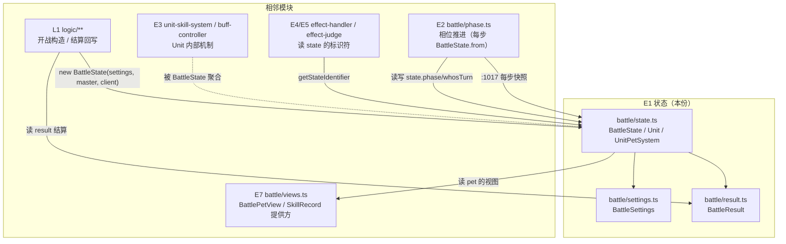
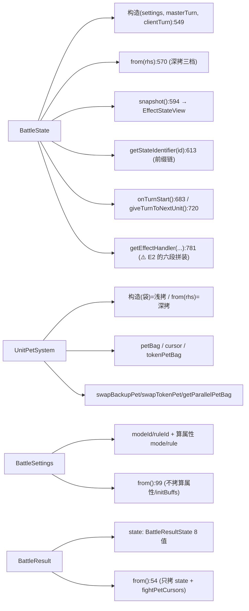

# 战斗引擎子设计 E1 · 状态（docs/engine/battle-engine-state.md）

> **定位**：战斗引擎的**状态面** —— 一场战斗的**全部数据**（`BattleState`）、它的**配置**（`BattleSettings`）、
> 它的**结果**（`BattleResult`），以及"值快照"这条语义的落地。
> 父文档 = `docs/engine/battle-engine-design.md`（**§8.1 E1**）；机制导读 = `docs/engine/battle-engine-overview.md §2`。
>
> **实现在哪**：`game/core/battle/{state.ts, settings.ts, result.ts}`。【我们】行号即指这些文件。
> **上游真值**：`Scene Specific/Battle/{BattleState.cs, BattleSettings.cs, BattleResult.cs, Unit.cs, UnitComponent/UnitPetSystem.cs}`。
> **别与这些重复**：移植事实/口径 → `docs/engine/port-map.md`；对拍操作 → `docs/engine/oracle-playbook.md`；
> 路线与落点 → `docs/engine/kernel-handoff.md`。
>
> **证据标注**：【源码】= 上游 `.cs`（标 `路径:行/函数`）；【我们】= `game/**`；【推断】= 未证实。

---

## 0. 这份文档回答什么

1. `BattleState` **存了什么**（字段全表）与"**值快照**"的**三档深浅**。
2. 状态怎么被**读写**：`getStateIdentifier` / `setStateIdentifier` 的前缀链与**必须照搬的怪癖**。
3. 回合怎么**起手**（`onTurnStart`）与"**交棒**"（`giveTurnToNextUnit`）。
4. `BattleSettings` / `BattleResult` 的字段与**属性现算**口径。
5. 哪些是**围栏**（不移植但显式留缝）。

---

## 1. 范围与边界

| | |
|---|---|
| **本份覆盖** | `BattleState` / `BattleSettings` / `BattleResult` 三个类；`UnitPetSystem` 的**队伍视角**（`petBag` / `cursor` 的读写） |
| **不覆盖（去别处）** | `Unit` 与 4 个子系统的**内部机制** → **E3**（`battle-engine-units.md`） |
| | 相位推进与时机派发 → **E2**（`docs/engine/battle-engine-phases.md`） |
| | 规则的判定/算子 → **E4/E5** |
| | 结算回写（`ProcessResult`） → **E6**（本份只描述 `BattleResult` 的**字段与读视图**） |
| | 存档 XML 形状 → `docs/save/save-xml-spec.md`（`BattleSettings`/`BattleResultState` 见其 §2.19/§2.21） |

---

## 2. 上游真值

### 2.1 `BattleState` 字段全表

【源码】`Scene Specific/Battle/BattleState.cs`；【我们】`game/core/battle/state.ts:526-867`

| 字段 | 类型 | 含义 | 【我们】行 |
|---|---|---|---|
| `lastTurnState` | `BattleState \| null` | 上一回合快照（供 `last.` 表达式回溯） | `:527` |
| `turn` | int | 回合计数 | `:529` |
| `parallelTurn` | int | ⚠️ **死字段**：只声明 + 拷贝，唯一使用点在注释块内（见 §7） | `:530` |
| `whosTurn` | int | 当前行动方：`1`=master / `-1`=client / `0`=无 | `:531` |
| `phase` | `EffectTiming` | **当前时机**（驱动 effect 条件） | `:532` |
| `weather` | int | 天气 id | `:533` |
| `stateBuffs` | `[string, Buff][]` | 全场状态级 Buff（初值 = `settings.initBuffs` 现解析） | `:534` |
| `reports` | `string[]` | 战斗播报（`AddReport` 自己维持 ≥30 出队） | `:536` |
| `options` | `Map<string,string>` | 状态表达式可选项（`order_direction` 等） | `:537` |
| `masterUnit` / `clientUnit` | `Unit` | 双方单位（**拷贝构造**，与外部袋脱钩） | `:539-540` |
| `actionOrder` | `number[]` | 本回合出手序，元素 = `sign(unitId) * (cursor + 1)` | `:541` |
| `actionCursor` | int | 出手序游标（初值 `-1`） | `:542` |
| `settings` | `BattleSettings` | 配置副本 | `:544` |
| `result` | `BattleResult` | 结果对象 | `:545` |

**派生属性**（现算，不拷贝）：`isAllUnitDone`（`:598`）、`isAllUnitReady`（`:599`）、`isAnyPetDead`（`:600`）、
`myUnit`/`opUnit`（`:603-604`，**仅 PVP 问 `isMasterClient`**）、`atkUnit`/`defUnit`（`:605-606`，由 `whosTurn` 反查）、
`weatherBuff`（`:596`）。

**常量**：`FLOAT_MIN_VALUE = -3.4028234663852886e38`（`state.ts:49`，= `float.MinValue`，是**多处兜底返回值**）。

### 2.2 值快照：**三档深浅，上游是刻意的，别统一**

【源码】【我们】`state.ts:9-14`（文件头「三档深浅」）

```
BattleState.from(rhs)   →  lastTurnState / stateBuffs / settings / result / 两个 Unit  全深拷
                           reports / options / actionOrder                             新容器
Unit.from(rhs)          →  petSystem 深拷（每只宠 new BattlePet）/ parallelSkillSystems 深拷 / unitBuffs 深拷
UnitPetSystem(原袋)      →  只 Array.Copy ⇒ 引用浅拷     ← 「初始袋共享外部数据」的实现方式
UnitPetSystem(rhs)      →  逐只深拷                       ← 「快照各自独立」的实现方式
```

> **同一个类两个构造，一浅一深** —— 这不是疏忽，是"初始袋共享外部数据、快照各自独立"的实现方式。

- **入口构造**：`new BattleState(settings, masterTurn, clientTurn)`（`:549`）—— 两个 Unit 走 `Unit.from`，
  `stateBuffs` 取 `settings.initBuffs` 的 getter（**每次现解析出新对象**）。
- **拷贝构造**：`BattleState.from(rhs)`（`:570`）—— 相位推进每步都调它（`phase.ts:1017`）。
- **`snapshot()`**（`:594`）：`EffectStateView` 的实现，供 `EffectHandler.Condition` 在 `whosTurn==0` 时跑两遍。

> **不变量 E3**（父 §5.2）：**禁止**跨相位持有 `state` 引用。反例教材 = `phase.ts:799` 的"孤儿帧"修复。

### 2.3 标识符读取（`getStateIdentifier`）：前缀顺序即语义

【源码】`BattleState.cs:80-118`；【我们】`state.ts:613-664`

前缀链（**顺序不能换**）：`last.` → `option(…)` → `settings.` → `result.` → `buff(…)` → 裸键 `switch`。

**两个必须照搬的怪癖**（`state.ts:608-612` 注释）：

1. **`TryTrimStart` 每次都会重写 `trimId`**（前缀不匹配时原样返回）⇒ 只有**最后一个**前缀分支（`buff`）
   能在括号匹配失败时把 `trimId` 留在**削过**的状态 ⇒ `id="buffturn"` 会带着 `trimId="turn"` 落到 `switch`
   **读出 `turn` 的值**。**这不是 bug 能修，是语义。**
2. `buff` 查不到 ⇒ `float.MinValue`；查到但键不认识 ⇒ 回落 `Identifier.GetNumIdentifier`（兜 `0`）。

裸键 `switch` 含 `turn` / `actionCursor` / `order.direction` / `phase` / `weather` / `whosTurn`（`state.ts:652-659`），
未命中 ⇒ `float.MinValue`。

**写入侧 `setStateIdentifier`（`:665-681`）也是两条独立的路**：
① `option[…]` 分支落在**削过前缀**的 `trimId` 上；
② 裸 `switch` **只认原 id**，且整个 `switch` 里只有一个 case —— `order.direction` 会**递归**去写
`option[order_direction]`。⇒ `SetStateIdentifier('order.direction', v)` 先"什么也不写"，再递归写 option；其余 id **全是 no-op**。

### 2.4 回合起手与交棒

| 【源码】 | 【我们】 | 做什么 |
|---|---|---|
| `BattleState.cs:138` | `state.ts:683` `onTurnStart()` | 见下 |
| `BattleState.cs:190` | `state.ts:720` `giveTurnToNextUnit()` | `actionCursor++` 取下一出手项，设 `whosTurn`；见 §7 的**双打改法** |
| `BattleState.cs:176/182/187` | `state.ts:712-714` | `allUnitDone` / `allUnitReady` / `anyPetDead` |
| `BattleState.cs:120/128` | `state.ts:758/771` | `isGoFirst` / `isGoLast` |

**`onTurnStart` 的顺序（不能换）**（`state.ts:683-710`）：

```text
① 改写上一帧快照 —— 全场**唯一**一处：turn>0 时先斩掉 lastTurnState.lastTurnState（只留一层历史），
   再把当前帧拷成 phase=OnTurnEnd 的快照挂上去；turn==0 时不建快照，改补**两条登场战报**（战报队列的前两项）
② turn++
③ whosTurn=0 / actionOrder=[] / actionCursor=-1 / setStateIdentifier('order.direction', 1)
④ 状态 Buff 逐个 turn--（>0 的才减），再 filter 掉 turn===0 的
⑤ 补一条「第 N 回合」战报
⑥ masterUnit.onTurnStart(this) → clientUnit.onTurnStart(this)
```

### 2.5 `BattleSettings`

【源码】`Scene Specific/Battle/BattleSettings.cs`；【我们】`game/core/battle/settings.ts:59-204`

字段（`:60-79`）：`seed` · `isMod` · `isSimulate` · `isEscapeOK` · `isCaptureOK` · `isItemOK` · `captureLevel` ·
`petCount` · `parallelCount` · `starLimit` · `filterLimit` / `filterLimitDesc` · `time` · `bgm` · `modeId` · `ruleId` ·
`weather` · `initBuffExpr`。

| 口径 | 说明 |
|---|---|
| **`mode` / `rule` 是 `modeId` / `ruleId` 的算属性**（`:87-90`） | 与 XML 落点一致（`[XmlElement]` 存 id） |
| **枚举** | `BattleMode`：`Record / Normal / SelfSimulation / PVP / SPT / Special / YiTeRogue / Card`（`:21-24`）；`BattleRule`：`Anger / PP`（`:27`） |
| **属性现算、不拷贝** | `isPVP` / `isAutoOK` / `isReveal` / `isLimited`（`:82-85`）；`from()` **不拷**它们，也**不拷** `initBuffs`（只拷 `initBuffExpr` 原文） |
| **`isPVP` 走 identifier 视图**（`:81-82`） | 所以 **`Record` 也算 PVP** |
| **构造** | 上游无参构造取**墙钟**；移植体把 `seed` **交给调用方** —— S4 的同种子重放正靠它（`:92-95`） |
| **兜底** | `getSettingsIdentifier` 兜 `float.MinValue`；**未开放捕捉时 `captureLevel` 读作 `-1`**（`:121-122`） |

### 2.6 `BattleResult`

【源码】`Scene Specific/Battle/BattleResult.cs`；【我们】`game/core/battle/result.ts:31-85`

| 成员 | 说明 | 【我们】行 |
|---|---|---|
| `state` | `BattleResultState` | `:32` |
| `fightPetCursors` | `Set<number>`，初值 `Range(0, parallelCount)` | `:33` |
| `capturePet` | `PetIdentifierReadView \| null`（被捕获宠的读视图） | `:34` |
| `isBattleEnd/isKO/isEscape/isCapture/isMyWin/isOpWin` | 现算派生 | `:36-43` |

- **`BattleResultState` 全取值**：`Error -1` / `Fighting 0` / `Win 1` / `Lose 2` / `MyEscape 3` /
  `OpEscape 4` / `CaptureSuccess 5` / `Timeout 99`（`:19-21`）。
- **拷贝构造只拷 `state` 与 `fightPetCursors`**，`capturePet` 一律回 `null`（`:53-60`）。
- **`getResultIdentifier`**：`capturePet.` 前缀在 `switch` **之前** ⇒ "`capturePet.`" 后接什么都交给宠侧；
  `capturePet` 为 `null` 时统一给 `-1`（`:62-66`）。
- **`ProcessResult`（结算回写）不在本份** → **E6**（S5）。

---

## 3. 目标结构（契约）

```
state.ts
  interface NetFence        { isMasterClient(): boolean }              // 联机身份接缝，默认「未连接」
  setNetFence(p: Partial<NetFence>): void
  type PetBag = (BattlePetView | null)[]

  class UnitPetSystem                                                   // 队伍（队伍视角，本份用）
    constructor(originalPetBag: PetBag)                                 // 浅拷（共享外部袋）
    static from(rhs): UnitPetSystem                                     // 深拷（快照）
    get pet() / get token() / get petNum() / get alivePetNum() / get deadPetNum()
    swapBackupPet(index): boolean / swapTokenPet(index): boolean / addNewPet(pet): void
    onTurnStart(thisUnit, state): void / refreshStayTurn(): void
    getParallelPetBag(parallelCount) / getParallelPetBagCursor(parallelCount)
    getNextCursorCircular(…)
    getPetSystemIdentifier(id): number / tryGetPetSystemIdentifier(id)

  class Unit                                                            // ⚠️ 内部机制 → E3
    constructor(petBag, idNum, settings, rng)
    static from(rhs): Unit

  class BattleState implements EffectStateView
    constructor(settings, masterTurn: Unit, clientTurn: Unit)
    static from(rhs): BattleState
    snapshot(): BattleState
    getStateIdentifier(id): number / setStateIdentifier(id, value): void
    onTurnStart(): void / giveTurnToNextUnit(): void
    allUnitDone() / allUnitReady() / anyPetDead()
    getUnitById(id) / getRhsUnitById(lhsId) / isGoFirst(lhsUnit) / isGoLast(lhsUnit)
    applySkillsAndBuffs() / applyBuffs() / getEffectHandler(...) / getEffectsByTiming(...)
    addReport(report): void
    // 派生属性：weatherBuff / isAllUnitDone / isAllUnitReady / isAnyPetDead / myUnit / opUnit / atkUnit / defUnit

  petPowerUp(pet, status, lhsUnit, state, isSet): void

settings.ts
  BattleMode / BattleRule (const + type) / SettingsHost / setSettingsHost / PetIdentifierView
  interface BattleSettingsFields { …与 XML 字段一一对应… }
  class BattleSettings { 字段 + mode/rule 算属性 + from() + getSettingsIdentifier(id) }

result.ts
  BattleResultState (const + type)
  interface PetIdentifierReadView
  class BattleResult { state / fightPetCursors / capturePet + from() + getResultIdentifier(id) }
```

---

## 4. 接口（mermaid）

### 4.1 模块位置图



### 4.2 文件↔接口图



---

## 5. 不变量与围栏

| # | 不变量 / 围栏 |
|---|---|
| **S1** | **值语义**：相位推进每步 `BattleState.from`；**任何跨相位共享引用都是 bug**（父 §5.2） |
| **S2** | **三档深浅不许统一**（§2.2）：`BattleState.from` 深、`UnitPetSystem(原袋)` 浅、`UnitPetSystem(rhs)` 深 |
| **S3** | **标识符前缀顺序不许换**；`buff` 分支的"削过头"怪癖（§2.3 怪癖 1）**必须保留** |
| **S4** | **算属性不落拷贝**：`myUnit`/`opUnit`/`isPVP`/`isAllUnitDone` 等**每次现算**；`BattleResult.from` 不拷 `capturePet` |
| **S5** | **RNG 经注入**：`Unit` 带一份 `randomSource`（`random` 是**存档字段**、`rng` 是环境）—— 承接父 **E6**；⚠️ 这份注入今后统一来自 **R1**（`docs/runtime/runtime-components-design.md`，**RB1** 九合一） |
| **S6** | **围栏（显式留缝，不静默）**：`hudSystem` / `cardSystem`（读 `cardSystem.hand` 处**抛**）、`Photon`（默认答"未连接"⇒ 完整退化）、`UnityEngine.Random`（全走注入 `Rng`） |
| **S7** | **本文件 headless**：不出现 `Database.instance` / `Player.instance` / `UnityEngine` / `Photon`（`state.ts:26`） |

---

## 6. 现状与缺口

| oracle kind | 内容 | 状态 |
|---|---|---|
| `statecopy` | 三档深浅拷贝构造 | ✅ 绿 |
| `stateid` | `getStateIdentifier` 前缀链 | ✅ 绿 |
| `stateset` | `setStateIdentifier` | ✅ 绿 |
| `stateflag` | 派生布尔 | ✅ 绿 |
| `statedrive` | 状态驱动（组合） | ✅ 绿 |
| `settings` | `BattleSettings` | ✅ 绿 |
| `result` | `BattleResult`（`ProcessResult` 除外） | 🟡 部分 |
| `petbag` | `UnitPetSystem` 队伍 API | ✅ 绿 |

**缺口**（→ 阶段二）：

| 缺口 | 说明 |
|---|---|
| `ProcessResult` / `SetExp` | `result.ts:3` 已登记"未搬"；`logic/settle.js:5` 是**手抄**（不受 difftest 保护）。**S5** 搬进 `core/` → **E6** |
| `Unit` 的内部机制 | 本份只给队伍视角；`Unit.addBuff/removeBuff/calculateDamage` 等 → **E3** |
| `getEffectHandler` 六段拼装 | 挂在 `BattleState` 上但属**相位面**，本份只登记 → **E2 §2.5** |
| `parallelTurn` 死字段 | 保留（照搬），见 §7 |

---

## 7. 待核 / 已知怪癖（读源坐实）

| # | 事项 | 证据 |
|---|---|---|
| 1 | **`parallelTurn` 是死字段**：只有声明（`BattleState.cs:13`）+ 拷贝（`:63`）；唯一使用点在 `GiveTurnToNextUnit` 的 `/* */` 注释块内 ⇒ 保留但无行为 | 全仓 grep（见 `docs/engine/battle-engine-overview.md §10#5`） |
| 2 | **双打槽位不再靠自增**：`GiveTurnToNextUnit` 现行改成 `parallelCount > 1` 时 `cursor = \|actionOrder[cursor]\| − 1`、`rhsUnit.cursor = skill.options["parallel_target_index"]`（`:206-210`） | `state.ts:720-745` |
| 2b | **交棒的两个兜底**：① `cursor` 出界 ⇒ **先置 `whosTurn = 0` 再 return**（`parallelTurn` 根本不在这条路上累加）；② 任一方当前宠为 `null` ⇒ **递归**再推一格（`isDone` 已被写成 `false`，递归**不还原**它） | `state.ts:729-737` |
| 3 | **`Status.cs` 文件内跨界**：通用 `Status`（`:8`）与战斗 `BattleStatus`（`:394`）同文件 ⇒ **切域模型边界时注意** | 影响父 §8.4 / E3 |
| 4 | **`stateBuffs` 的 key 语义**（`"buffturn"` 之类）与 `getStateIdentifier` 的 `buff(…)` 分支耦合 | `state.ts:635-650` |

---

## 8. 配对实现（impl）指针

- 本份配对 = 未来的 **`docs/engine/battle-engine-impl.md`** + **`battle-engine-code-map.md`**（阶段一续写）。
- **现状**：`game/core/battle/{state,settings,result}.ts` **已落地**，事实面见 `docs/engine/kernel-handoff.md §3`，
  逐 kind 对拍结论见 `docs/engine/port-map.md`。
- **as-built**：以 `docs/engine/kernel-handoff.md §3` 与 `docs/engine/port-map.md` 的 S3 各节为准（本份不重复）。
