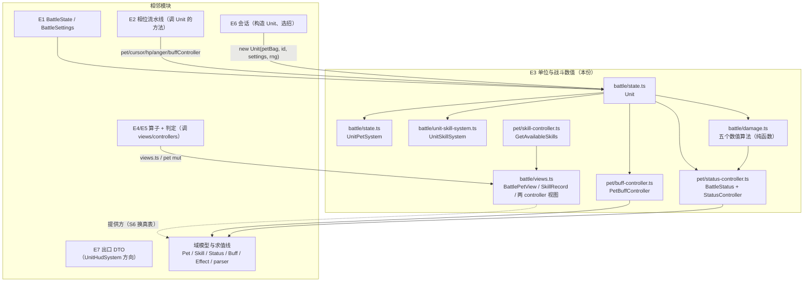
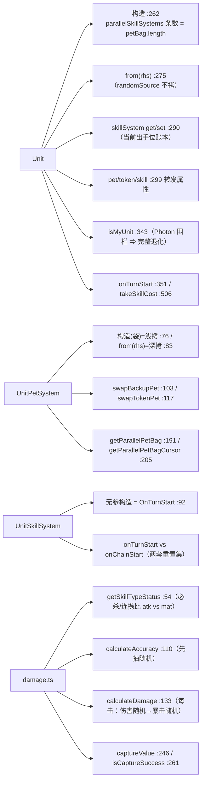

# 战斗引擎子设计 E3 · 单位与战斗数值（docs/engine/battle-engine-units.md）

> **定位**：战斗引擎的**主体对象面** —— 「一方」`Unit`、它的**队伍**（`UnitPetSystem`）与**回合内账本**
> （`UnitSkillSystem`）、战斗侧**宠包装**（`BattlePet` + `BattleStatus` + 三 controller），以及**战斗数值**
> （类型→攻防 / 命中 / 伤害 / 先手 / 捕捉）。
> 父文档 = `docs/engine/battle-engine-design.md`（**§8.1 E3**）；机制导读 = `docs/engine/battle-engine-overview.md §4/§6`。
>
> **实现在哪**：`game/core/battle/{state.ts(Unit/UnitPetSystem), unit-skill-system.ts, damage.ts, views.ts}` +
> `game/core/pet/{status-controller.ts, buff-controller.ts, skill-controller.ts}`。【我们】行号即指这些文件。
> **上游真值**：`Scene Specific/Battle/Unit.cs` + `UnitComponent/{UnitPetSystem,UnitSkillSystem}.cs` +
> `MVC/Model/Basic/Pet/Battle/{BattlePet,PetBattleStatusController,PetBattleBuffController,PetBattleSkillController}.cs` + `Pet/Status.cs`(`BattleStatus`)。
> **别与这些重复**：移植事实/口径 → `docs/engine/port-map.md`；对拍操作 → `docs/engine/oracle-playbook.md`；
> **线归属（哪些不属本份）→ `docs/engine/battle-engine-design.md §8.4`**。
>
> **证据标注**：【源码】= 上游 `.cs`；【我们】= `game/**`。

---

## 0. 这份文档回答什么

1. **`Unit`（一方）** 字段与方法全表，以及"**谁是本人**"（`isMyUnit`）的分支口径。
2. **`UnitPetSystem`**：队伍、`cursor`、**token（替身）袋**、换场（`swapBackupPet` / `swapTokenPet`）。
3. **`UnitSkillSystem`**：回合内账本的字段，以及**两套重置集**（`OnTurnStart` ≠ `OnChainStart`）。
4. **`BattlePet : Pet` + `BattleStatus` + 三个 `PetBattle*Controller`** 的职责与"哪一个读到哪"。
5. **战斗数值五段**（类型→攻/防 · 命中 · 伤害 · 先手 · 捕捉）的公式与**随机数消耗顺序**。
6. **视图接缝**（`views.ts` 的三个 View 接口）—— 它与**域模型线**的分界点在哪。
7. 哪些是**围栏**，哪些**未移植**（S6 待换）。

---

## 1. 范围与边界

| | |
|---|---|
| **本份覆盖** | `Unit` · `UnitPetSystem` · `UnitSkillSystem` · `BattlePet`/`BattleStatus`/三 controller · 五个数值算法 · `views.ts` 的三个 View 接口 |
| **不覆盖（去别处）** | 战斗**状态容器**与快照 → **E1**（`docs/engine/battle-engine-state.md`） |
| | 相位推进 / 时机派发 → **E2**（`docs/engine/battle-engine-phases.md`） |
| | 效果的**判定与算子**（含 `target`） → **E4/E5** |
| | 会话编排（开战构造 `Unit` / 选招 / 结算成长） → **E6** |
| | `UnitHudSystem` 的 DTO → **E7**（`battle-engine-views.md`） |
| | **通用** `Pet` / `Skill` / `Status`（成长·性格·`GetPetNormalStatus`）/ `Buff*` / `Effect` 数据模型 / `parser` 通用臂 → **域模型与求值线**（`docs/engine/battle-engine-design.md §8.4`） |

> **归属提醒**（§8.4）：`PetBattle*Controller` / `BattleStatus` / `BattlePet` **全部属引擎**（本份）；
> 它们的**通用底座**（`Status` / `Skill` / `Buff`）属**域模型线**。本份只**消费**后者，**禁反向依赖**。

---

## 2. 上游真值

### 2.1 `Unit`（一方）

【源码】`Scene Specific/Battle/Unit.cs`；【我们】`state.ts:248-525`

| 字段 | 类型 | 含义 | 【我们】 |
|---|---|---|---|
| `id` | int | `1` = master / `-1` = client | `:250` |
| `random` | int | 本帧的骰子值（**进拷贝构造**，是存档语义） | `:251` |
| `parallelCount` | int | 出手位数（来自 `settings`） | `:252` |
| `petSystem` | `UnitPetSystem` | 队伍 | `:253` |
| `parallelSkillSystems` | `(UnitSkillSystem \| null)[]` | 每个出手位一本账 | `:254` |
| `unitBuffs` | `Buff[]` | 单位级 Buff | `:255` |
| `isDone` | bool | 本回合是否已出手 | `:256` |
| `randomSource` | `Rng` | ⚠️ `UnityEngine.Random` 的进程内替身 —— **不进拷贝构造**。⇒ 归 **R1**（这个接缝名由 **RB1** 九条注入路合一，`docs/runtime/runtime-components-design.md`） | `:259` |

**构造**（`:262`）：`parallelSkillSystems` 的**条数** = `parallelCount <= 1 ? 1 : petBag.length`
（⚠️ 是 **`petBag.length`**，不是 `parallelCount`）；`hudSystem`/`cardSystem` **不建**（围栏，见 §5）。

| 方法 | 【我们】 | 说明 |
|---|---|---|
| `skillSystem` get/set | `:290/:294` | 指向**当前出手位**的账本（`parallelSkillSystems[cursor]`） |
| `pet` / `token` / `skill` | `:299-301` | 都是 `petSystem` / `skillSystem` 的转发（**属性**，不是快照） |
| `setSkill(_skill, settings)` | `:306` | 写账本 + 收技能代价（`takeSkillCost`） |
| `isMovable` | `:313` | `pet.buffController.isMovable`（**会被印记改写**） |
| `isReady` / `ready()` | `:317/:320` | 出手就绪（技能已选 + PP 够 + …） |
| `isMasterUnit()` | `:340` | `id === 1` |
| `isMyUnit()` | `:343` | ⚠️ 上游读 `Photon` 身份 ⇒ 移植体默认答"未连接"⇒ **完整退化**（§5） |
| `roll()` | `:348` | `random = randomSource.nextInt(0, 100)` |
| `onTurnStart(state)` | `:351` | 双 Unit 逐帧起手（E1 §2.4 的第 ⑥ 步调到它） |
| `reduceBuffTurn(id='turn')` | `:362` | 单位级 Buff 减回合 |
| `isSkillCostEnoughForRule(rule)` | `:377` | 按 `BattleRule`（`Anger` / `PP`）判定 |
| `addBuff(newBuff)` / `removeBuff(pred)` | `:388/:438` | 单位级 Buff 增删（**触发链走注入接缝**） |
| `onChainStart()` | `:444` | 转发 `skillSystem.onChainStart()` |
| `calculateAccuracy(rhs)` | `:449` | → `damage.ts`（§2.5） |
| `prepareDamageParam(rhs)` | `:456` | → `damage.ts` |
| `calculateDamage(rhs)` | `:471` | → `damage.ts` |
| `isSkillCostEnough(skillId, settings)` | `:485` | 技能代价判定（含被动例外） |
| `takeSkillCost(skill, settings, cursor=-1)` | `:506` | **实际扣**（怒气 / PP）；被动免收 |

> **本类的设计口径**：`Unit` 只**编排**，算法一律在 `damage.ts` 的**纯函数**（显式入参）里 —— 这是
> oracle 能静态调用的前提，也是 `core/` 的无头门禁。移植体**不重复**算法。

### 2.2 `UnitPetSystem`（队伍）

【源码】`Scene Specific/Battle/UnitComponent/UnitPetSystem.cs`；【我们】`state.ts:68-247`

| 成员 | 说明 | 【我们】 |
|---|---|---|
| `petBag` | 队伍袋（**可含 `null` 洞**） | — |
| `tokenPetBag` | **替身袋**（`token` 技能产生的假宠） | — |
| `cursor` | 当前出手位（`giveTurnToNextUnit` 写它，见 E1 §2.4/§7） | `:72` |
| `specialChance` | 特殊换场概率（初值 `1`） | `:73` |
| `pet` / `token` | `atIndex(petBag, cursor)` —— ⚠️ **越界给 `null` 而非抛** | `:95/:96` |
| `petNum` / `alivePetNum` / `deadPetNum` | 三个计数（过滤 `null`） | `:98-100` |
| `swapBackupPet(index)` / `swapTokenPet(index)` | 后备换场 / 替身换场 | `:103/:117` |
| `addNewPet(pet)` | 入场追加 | `:133` |
| `onTurnStart(thisUnit, state)` | 队伍级起手 | `:159` |
| `refreshStayTurn()` | 刷新 `stayTurn` | `:183` |
| `getParallelPetBag(parallelCount)` / `getParallelPetBagCursor(parallelCount)` | 双打的两个袋视图 | `:191/:205` |
| `getNextCursorCircular(...)` | 环形推 cursor | `:211` |
| `getPetSystemIdentifier(id)` / `tryGetPetSystemIdentifier(id)` | 标识符链的 `petBag` 臂 | `:230/:240` |

**两个构造的深浅不同**（E1 §2.2）：`UnitPetSystem(原袋)` **只 `Array.Copy`（引用浅拷）**；
`UnitPetSystem(rhs)` **逐只深拷**（每只调 `BattlePet.clone()`）。同一个类一浅一深，是刻意的。

### 2.3 `UnitSkillSystem`（回合内账本）

【源码】`UnitComponent/UnitSkillSystem.cs`；【我们】`battle/unit-skill-system.ts:44+`

**字段**：`skill` / `counterSkill`（技能 + 反击技）；六个 float（`level/atk/def/weatherBuff/sameElementBuff/elementRelation`，
**写入即 `f()` 收窄**）；`isCounter` / `isHit` / `isCritical`；`comboDamageInfoList`（逐击明细）；
`damageDict` / `healDict`（键 = 来源，如 `"skill"` / `"buff-1003"`）；九个累计标量
（`skillDamage/skillHeal/skillOverHeal/itemDamage/itemHeal/itemOverHeal/buffDamage/buffHeal`）。

- **无参构造就是一次 `OnTurnStart`**（`unit-skill-system.ts:92`）。
- `NORMAL_HP_TYPE = ['skill','item','buff']`（`:50`）—— 效果层判"这一击算不算常规伤害"。
- **两套重置集不许合并**（`:44` 头注释）：

| | `OnTurnStart` | `OnChainStart` |
|---|---|---|
| `skill` / `counterSkill` / `isCounter` | **清** | **清** |
| `damageDict` / `healDict` | **整体清空** | **只清 `"skill"` 前缀的键**（`Where + ToDictionary` 重建 ⇒ **保留插入序**） |

> 抄成同一个函数 ⇒ **连锁技的第二击会把第一击的印记伤害抹掉**。

### 2.4 `BattlePet : Pet` + `BattleStatus` + 三 controller

【源码】`Basic/Pet/Battle/*.cs` + `Pet/Status.cs:394-520`；【我们】`pet/status-controller.ts`、`pet/buff-controller.ts`、`pet/skill-controller.ts`

| 上游 | 职责 | 【我们】 |
|---|---|---|
| `BattlePet : Pet` | 战斗侧包装：`stayTurn` / `chain` / 三 controller / `hp` / `maxHp` / `anger` / `isDead` / `isMovable` / `isToken` / `PowerUp` / `OnTurnStart` | **未移植**（`views.ts` 的 `BattlePetView` 顶替，S6 换真表） |
| `PetBattleStatusController` | **数值总账**：`initStatus` / `battleStatus` / `powerup` / 怒气 / 六维增减 | `pet/status-controller.ts:92` |
| `BattleStatus : Status` | 战斗态六维（**含隐藏维** `hit/cri/eva/cdf/rec/angrec`） | `pet/status-controller.ts:28` |
| `PetBattleBuffController` | **印记解释器**：`element` / 块与拷贝 / `AddBuff` / `RemoveBuff` / `AddRangeBuff` | `pet/buff-controller.ts:71` |
| `PetBattleSkillController` | **主动技表筛选**（`GetAvailableSkills(anger)` / `GetDefaultSkill`） | `pet/skill-controller.ts` |

**`anger` 住在哪**（三处，别搞混）：`BattlePet.anger`（`:43`，转发）→ `PetBattleStatusController._anger`（`:14`，**初值 20**，`:85`）；
另外 **`Skill.cs:26` 的 `anger, pp, maxPP`** 是**通用技能表自带**的战斗语义字段（→ 域模型线，见 §8.4(3)）。

**`PetBattleStatusController` 的两个消耗点**（也是它的存在理由）：
`UnitSkillSystem` 经 `getCurrentStatus(skill.powerup, skill.powerdown)` 取**攻防**；
经 `getCurrentPowerup(...).accuracyBuff` 取**命中加成**。

> **`PetBattleStatusController` / `PetBattleSkillController` 对战斗状态类型（`BattleState`/`EffectTiming`/`Photon`）
> 零引用**（读源实测）—— 它们是"**不依赖战斗状态**的战斗组件"。归属引擎的依据是**上游目录与类名**，
> 不是依赖方向。`PetBattleBuffController` 有 15 处战斗类型引用（触发链那一面）。

### 2.5 战斗数值（五段）

【我们】`battle/damage.ts`（**全部为显式入参纯函数**）

| 段 | 上游 | 【我们】 | 要点 |
|---|---|---|---|
| **类型 → 攻/防** | `BattlePet.cs:145-175` `GetSkillTypeStatus` | `damage.ts:54` | 物理→`(atk,def)`；特殊→`(mat,mdf)`；必杀/连携→**比 `atk` vs `mat`**，相等时取**平均维** `(spd,hp)`；其余落 `(0,1)`（**除数不能是 0**）。返回值出函数即被 `(int)` **截断过一次** |
| **伤害参数** | `UnitSkillSystem.cs:174-185` | `damage.ts:88` | `level = (2L+10)/250f`（分子**整数**运算）；`atk/def` 过 `Mathf.Max(., 1)` |
| **命中** | `UnitSkillSystem.cs:161-172` | `damage.ts:110` | ⚠️ **先抽随机再算命中**；`options["accuracy"]` 存在则**整体替换**，且**过标识符链**（`"100"` 这种字面量也走） |
| **伤害** | `UnitSkillSystem.cs:201-224` | `damage.ts:133` | ⚠️ 每一击**先抽伤害随机 `(0.85,1)` 再抽暴击随机 `(0,100)`** —— 顺序反了就毁掉"同种子重放" |
| **先手排序** | `DecidePriorityPhase.cs:40-57` | `damage.ts:194/215` | 六级链（详见 **E2 §2.7**）；live 在 `damage.ts` 但属**相位面** |
| **捕捉** | `EffectAbilityHandler.cs:66-106` | `damage.ts:246/261` | `captureValue` 分档 + `isCaptureSuccess`（`baseId==10` 无条件成功短路） |

**伤害乘法链（逐项 `f()` 收窄，顺序照抄）**：

```
base = ((level * (atk / def)) * power) + 2          // atk/def 是普通 float 除法 (def=0 ⇒ Inf, 不抛)
dmg  = ((((base * sameElementBuff) * elementRelation) * weatherBuff) * random) * (isCrit ? 2 : 1)
damage = ceilToInt(dmg)                              // 每一击各自 ceil 后再累加
critKey = (critical + cri) - cdf;  isCrit = critKey >= criRandom
```

> **`atk / def` 不是 `Status` 的乘倒数**（域模型线 `status.ts`）；这里是**字段除法**。混用即末位 ULP 分叉。
> `weatherBuff` / `elementRelation` / `sameElementBuff` 三者都来自 `prepareDamageParam`（**已收窄为 float**）。

### 2.6 视图接缝（`views.ts`）

【我们】`battle/views.ts`。**三个 View 接口 = 引擎与"提供方"的分界线**：

| 接口 | 【我们】 | 对端（S6 换真表前 → 之后） |
|---|---|---|
| `BattlePetView` | `:542` | 产品实现 = `game/app/battle/driver/hostPetView.js`（L3）→ **真 `BattlePet`**（测试里另有 `FakePet` 替身） |
| `PetSkillControllerView` | `:472` | 转发 → `pet/skill-controller.ts` |
| `PetBuffControllerView` | `:499` | 转发 → `pet/buff-controller.ts` |
| `SkillRecord`（extends `SkillView`） | `:62` | `JsonSkillTable` → 真 `Skill` |

**三处必须是属性而不是快照字段**（`:531` 注释）：`anger`（转发到控制器）、`battleElement`/`subBattleElement`
（转发到 `buffController.element`，**会被印记改写**）、`isDead`（走 `deadCondition`）。

> **约定**：`views.ts` 的分工是"**纯判定搬进来、数据留给提供方**" —— 这样 S3 的快照语义能先跑，
> 而后一批只要**提供数据**、不必重新决定语义。（`views.ts` 的**出口侧**属 **E7**。）

---

## 3. 目标结构（契约）

```
battle/state.ts
  class UnitPetSystem                                   // 队伍
    cursor / specialChance / petBag / tokenPetBag
    constructor(originalPetBag)                          // 浅拷（共享外部袋）
    static from(rhs)                                     // 深拷（逐只 BattlePet.clone）
    get pet / get token / get petNum / get alivePetNum / get deadPetNum
    swapBackupPet(index) / swapTokenPet(index) / addNewPet(pet)
    onTurnStart(thisUnit, state) / refreshStayTurn()
    getParallelPetBag(parallelCount) / getParallelPetBagCursor(parallelCount) / getNextCursorCircular(...)
    getPetSystemIdentifier(id) / tryGetPetSystemIdentifier(id)

  class Unit                                             // 一方
    id / random / parallelCount / petSystem / parallelSkillSystems / unitBuffs / isDone / randomSource
    constructor(petBag, idNum, settings, rng)
    static from(rhs)                                     // randomSource 不进拷贝
    get/set skillSystem / get pet / get token / get skill
    setSkill(_skill, settings) / isMovable / isReady / ready()
    isMasterUnit() / isMyUnit() / roll()
    onTurnStart(state) / reduceBuffTurn(id)
    isSkillCostEnoughForRule(rule) / isSkillCostEnough(skillId, settings) / takeSkillCost(skill, settings, cursor)
    addBuff(newBuff) / removeBuff(pred) / onChainStart()
    calculateAccuracy(rhs) / prepareDamageParam(rhs) / calculateDamage(rhs)

battle/unit-skill-system.ts
  type DamageAtkPet / DamageDefPet
  class UnitSkillSystem                                    // 回合内账本；无参构造 = 一次 OnTurnStart
    skill / counterSkill / isCounter / isHit / isCritical / comboDamageInfoList
    level atk def weatherBuff sameElementBuff elementRelation   (六个写入即 f() 的访问器)
    damageDict / healDict / skillDamage … buffHeal
    onTurnStart() / onChainStart()                         // ⚠️ 两套重置集
    static readonly NORMAL_HP_TYPE = ['skill','item','buff']

battle/damage.ts
  SkillType / SkillView / DamageParam / ComboHit / PriorityUnit / ActionOrderRow
  getSkillTypeStatus(skill, atkSC, defSC): [number, number]
  prepareDamageParam(skill, atkPet, defPet, weatherBuff=1): DamageParam | null
  calculateAccuracy(skill, atkPet, defPet, rng): { isHit, accuracy, random }
  calculateDamage(skill, param, atkPet, defPet, rng, hits=[]): { skillDamage, isCritical, hits }
  sortActionOrder(rows) / getActionOrder(...)              // 相位面（E2），live 在此
  captureValue(probText, hp, maxHp, hasCaptureDebuff) / isCaptureSuccess(value, rngValue, targetBaseId)

battle/views.ts
  interface SkillRecord extends SkillView / BattlePetView / PetSkillControllerView / PetBuffControllerView
  getSkillIdentifier / setSkillIdentifier / tryGetSkillIdentifier / cloneSkill / noOpSkill / escapeSkill
  petChangeSkill / petChangeSkillWithTiming / randomSkill / getSkill
  isActionSkill / isAttackSkill / isNullOrEmptySkill / isSelectSkill / isSelectReady
  skillPP / setSkillPP / setSkillEffects / setSkillEffect / addSkillEffects / setSkillParallelIndex
  setSkillTable / setSkillNumHost / setRandomSkillSource

pet/status-controller.ts   (⚠️ 目标位置 core/battle/，见 §8.4(5))
  class BattleStatus extends Status / class StatusController
  BATTLE_TYPE_NAMES = 六维 + HIDDEN_TYPE_NAMES(hit/cri/eva/cdf/rec/angrec)
  getCurrentStatus / getHiddenStatus / getCurrentPowerup / getPowerUp / getStatusIdentifier
  setPowerUp / setMinPowerUp / setMaxPowerUp / addPowerUp / multInitStatus / addInitStatus
  addBattleStatus / multCurrentStatus / addCurrentStatus / addHiddenStatus

pet/buff-controller.ts     (⚠️ 同上)
  class PetBuffController / unitBuffController(unit)
  element/subElement / 六 block·copy / getBuff / getRangeBuff
  addBuff / addRangeBuff / removeBuff / removeRangeBuff / block*/unblock*
  setBuffEffectTrigger(接缝) / setBuffResistRng / setBuffRemoveRng

pet/skill-controller.ts    (⚠️ 同上)
  getAvailableSkills(view, anger, withSuper=true): SkillRecord[]
```

---

## 4. 接口（mermaid）

### 4.1 模块位置图



### 4.2 文件↔接口图



---

## 5. 不变量与围栏

| # | 不变量 / 围栏 |
|---|---|
| **U1** | **属性而非快照**：`anger` / `battleElement` / `subBattleElement` / `isDead` / `isMovable` / `isToken` 必须**现读**，否则印记与换场会被快照冻住 |
| **U2** | **一浅一深不许统一**：`UnitPetSystem(原袋)` 浅、`UnitPetSystem(rhs)` 深（E1 §2.2） |
| **U3** | **两套重置集不许合并**（§2.3）；`UnitSkillSystem` 无参构造必须**就是**一次 `OnTurnStart` |
| **U4** | **随机数消耗顺序**：命中"先抽后算"、每击"伤害随机→暴击随机"。S4 同种子重放的第一判据 |
| **U5** | **float 收窄**：`UnitSkillSystem` 六个字段写入即 `f()`；伤害乘法链逐项 `f()`；`atk/def` 是**字段除法**不是 `Status` 乘倒数 |
| **U6** | **算法不进 `Unit`**：`Unit` 只编排；公式一律在 `damage.ts` 的显式入参纯函数里（oracle 可静态调） |
| **U7** | **围栏（显式留缝）**：`hudSystem` / `cardSystem` 不建（读 `cardSystem.hand` 处**抛**）；`Photon` 默认答"未连接"⇒ `isMyUnit` 完整退化；`UnityEngine.Random` 全走注入 `Rng`（= **R1**；⚠️ 注入是**手段**，"没有 golden"不是**不实现**的理由 ⇒ `AGENTS.md §1.1`） |
| **U8** | **单向依赖**：本份消费域模型线（`Status`/`Skill`/`Buff`/`Effect`），**禁反向**（§8.4） |

---

## 6. 现状与缺口

| oracle kind | 内容 | 状态 |
|---|---|---|
| `petbag` | `UnitPetSystem` 队伍 API（含深浅拷） | ✅ 绿 |
| `giveturn` / `gofirst` | 交棒与先后手 | ✅ 绿 |
| `skillsys` | `UnitSkillSystem`（字段/重置/拷贝/identifier） | ✅ 绿 |
| `statusctrl` | `BattleStatus` + `StatusController` | ✅ 绿 |
| `petmut` | 宠侧读写（`PowerUp` 等） | 🟡 部分 |
| `damage` / `accuracy` | 伤害与命中 | ✅ 绿 |
| `capture` | 捕捉 | ✅ 绿 |
| `skilltable` / `buffinfo` | `Skill` / `Buff` 装载 | ✅ 绿 |

**缺口**（→ 阶段二）：

| 缺口 | 说明 |
|---|---|
| **真 `BattlePet` / `Pet` / `Skill` 对象** | 现由 `views.ts` 的 `BattlePetView` / `SkillRecord` / `FakePet` 顶替；**S6** 把宠表接进 oracle 时换真表（判据一个字不用动） |
| **`PetBattleBuffController` 的剩余面** | `AddBuff`/`RemoveBuff` 的 `state != null` 支已搬；其余（如 `UnblockBuff` 的 `RemoveRange` 语义）**未搬** |
| **`PetBattleSkillController` 其余方法** | 只搬了 `GetAvailableSkills`；`GetDefaultSkill` 等**未搬** |
| **`UnitHudSystem`** | 属 **E7**（出口） |
| **`UnitCardSystem`** | Card 模式围栏，**不移植**（读 `cardSystem.hand` 处抛） |
| **`core/pet/*-controller.ts` 位置** | 引擎件寄在域模型目录，待**阶段二机械迁移**到 `core/battle/`（§8.4(5)） |

---

## 7. 待核 / 已知怪癖

| # | 事项 | 证据 |
|---|---|---|
| 1 | **`parallelSkillSystems` 条数 = `petBag.length`**（不是 `parallelCount`）—— 抄成 `parallelCount` 会让双打的第二/三个出手位没有账本 | `state.ts:265` 注释 |
| 2 | **`isMyUnit` 的 Photon 退化的后果**：`Record` 模式**也算 PVP**（`isPVP` 走 identifier 视图，E1 §2.5）⇒ 无头体下 `myUnit`/`opUnit` 的取向由 `setNetFence` 决定 | E1 §2.1/§2.5 |
| 3 | **`BattleStatus` 与通用 `Status` 同文件**（`Status.cs:8` / `:394`）—— 归属按**类**切，移植产物已分开 | §8.4(3) |
| 4 | **`Skill.cs:26` 的 `anger/pp/maxPP`**：通用表带战斗字段，域模型线的 `Skill` 照带 | §8.4(3) |
| 5 | **`PetBattleStatusController` / `PetBattleSkillController` 零战斗状态依赖** —— 别用"零依赖"当归属判据 | §2.4 实测 |
| 6 | **`SpecialChance` / `token` 袋**的上游语义尚未逐条对拍（`swapTokenPet` 有向量但覆盖窄） | `petbag` kind |

---

## 8. 配对实现（impl）指针

- 本份配对 = 未来的 **`docs/engine/battle-engine-impl.md`** + **`battle-engine-code-map.md`**（阶段一续写）。
- **现状**：`game/core/battle/{state,unit-skill-system,damage,views}.ts` + `game/core/pet/{status,buff,skill}-controller.ts`
  **均已落地**；事实面 = `docs/engine/kernel-handoff.md §3`，逐 kind 结论 = `docs/engine/port-map.md` 的 **S2/S3** 各段。
- **as-built**：以 `docs/engine/kernel-handoff.md §3/§4/§5` 为准（本份不重复）。
