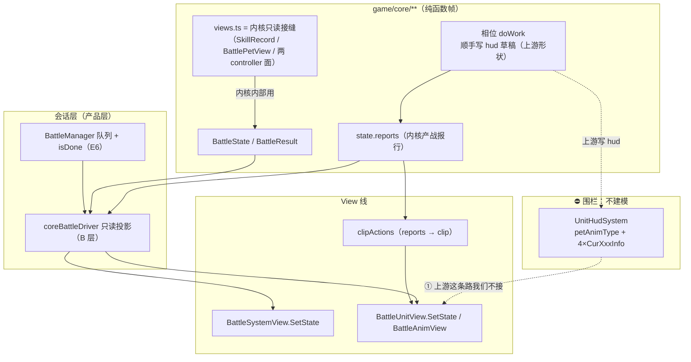
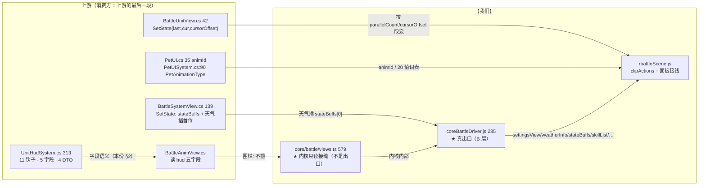

# 战斗引擎子设计 E7 · 出口契约（`docs/view/scene/battle/view-scene-battle-impl.md §9`）

> **定位**：内核 → 表现的**唯一接缝**。引擎算完一帧，**哪些值可以给表现读、以什么形状、什么语义、
> 谁负责把这些值变成动画** —— 本份把这些钉死。内核**不认识的**只有一件事：屏幕。
>
> 父文档 = `docs/engine/battle-engine-design.md`（**§8.1 E7**）；机制导读 = `docs/engine/battle-engine-overview.md §3.5/§7`。
>
> **上游真值**：`Scene Specific/Battle/UnitComponent/UnitHudSystem.cs`（313，**表现草稿本**）
> + `MVC/Model/Battle/BattlePhase.cs`（`SetUIState` `:110-124`，**唯一写 hud 的地方**）
> + `MVC/View/Battle/BattleUnitView.cs`（42）+ `MVC/View/Battle/BattleSystemView.cs`（139）（**消费方**）
> + `MVC/Model/Basic/Pet/Components/PetUI.cs`（`animId` `:35`）+ `Pet/System/PetUISystem.cs`（`PetAnimationType` `:90-109`）。
> **【我们】**：`game/core/battle/views.ts`（579，**内核侧只读接缝**）+ `game/app/battle/driver/coreBattleDriver.js`（235，**会话投影**）。
>
> **别与这些重复**：队列与 `null` 配对 / `isDone` 轮询 / 选项态 → **E6** `docs/engine/battle-engine-session.md §2.5`；
> `Unit` / `UnitSkillSystem` 的账本与 `ComboDamageInfo` 的**产生** → **E3**；
> 相位何时 `SetUIState` → **E2** `docs/engine/battle-engine-phases.md §2.8`；
> 舞台/精灵/面板怎么画、SWF 怎么装 → **View 线**（`docs/view/scene/battle/view-scene-battle-design.md`、`docs/view/scene/battle/view-scene-battle-impl.md`、`docs/view/scene/room/view-scene-hud-design.md`）。
> 出口 DTO 里**技能那一半的字段真值**（`skill.petAnimType` / `animSpeed` / `soundId` / 描述文本的**生成**）
> → **域模型线 D5** `docs/domain/domain-skill.md §2.1`（已拍板：**取值属域、渲染属 View**；本份只定"谁在什么时机读它"）。
>
> **证据标注**：【源码】= 上游 `.cs`；【我们】= `game/**`。

---

## 0. 这份文档回答什么

1. **出口有三段**：相位末 `SetUIState` → `BattleManager.SetState`（E6） → `systemView`/`unitView.SetState`；本份只定**第三段的字段语义**。
2. **`UnitHudSystem` 是"每单位一册的表现草稿本"**：**11 个钩子**（谁在哪个相位调）+ **5 个展示字段**。
3. **四个 `XxxInfo` DTO** 的字段与语义（含 `DamageInfo.ComboDamageInfoList` 那条**均分算法**）。
4. **`petAnimType` 的 20 个取值**与它被谁写、被谁读；为什么**拷贝构造会把它丢掉**。
5. ⚠️ **`views.ts` 不是"出口"** —— 它是**内核侧只读接缝**（给 `state.ts`/算子用的宠/技/印记面）。本份要澄清这个命名陷阱，并给出**真正的出口清单**（三层）。
6. **围栏的代价**：`UnitHudSystem` 在 core **不建模** ⇒ 表现层只能从**战报文本 + 状态 diff** 反推动画，并在结构上不可能拿到 `CurDamageInfo` 等四个 DTO。

---

## 1. 范围与边界

| | |
|---|---|
| **本份覆盖** | `UnitHudSystem` 的钩子/字段/DTO 语义 · `BattleUnitView.SetState` / `BattleSystemView.SetState` 的**读点** · `PetAnimationType` 词表 · 【我们】`views.ts` 的接口清单与分寸 · **出口三层**的分工与围栏 |
| **不覆盖（去别处）** | `SetUIState` 的**时机**与队列、`isDone`、`null` 配对 → **E6 §2.5** |
| | `ComboDamageInfo` 的**产生**（`UnitSkillSystem.comboDamageInfoList`）→ **E3** |
| | 舞台 SWF / 精灵动画 / 面板几何 / clip 词表 → **View 线**（`docs/view/scene/battle/view-scene-battle-design.md` §7、`docs/view/scene/battle/view-scene-battle-impl.md` §9） |
| | `PetUI`/`PetSoundInfo`/`PetTransformInfo` 的消费 → **View 线**（域线只保留它们的**数据形状**，见 `docs/domain/domain-design.md §9 W3`）。⚠️ 这三张表**要不要建 L2 桥 = 已决：建**（人类决议 ④ ⇒ `docs/domain/domain-info.md` 的施工批 **B5**），验收以**人类手测**为主 |
| | `BattleResultView`（结算画面）的字段 → **E6 §2.7** 给了 `BattleResult`，画面本身是 View 线 |
| **归属（Q2 规则）** | `UnitHudSystem.cs` 住在 `Scene Specific/Battle/UnitComponent/` ⇒ **名义上属引擎**；但它的**全部**字段只被 View 读 ⇒ 我方判定为**围栏（不在 core 建模）**（设计 §4 表已登记为 ⛔） |

**一句话边界**：内核产**状态**，不产**表现**。出口 = "哪些内核状态**允许**被读、怎么读"，
不是"内核替表现算好动画"。凡是"算给屏幕看的"（颜色、`+` 号、连击拆分、动画 id），**一律不进内核**。

---

## 2. 上游真值

### 2.1 出口三段

```
① 相位末（每个相位自己调）
     BattlePhase.SetUIState(lastState)                       MVC/Model/Battle/BattlePhase.cs:110-124
② 会话层（E6 §2.5）
     BattleManager.SetState(lastState, currentState)         入队（null 先入队）
     BattleManager.SetCurrentUIState(newState)               出队后分发
③ 视图层（本份）
     BattleSystemView.SetState(lastState, currentState)      系统级
     BattleUnitView.SetState(lastState, currentState, cursorOffset)   单位级
```

**① 只写 hud 草稿本，不碰视图** —— `BattlePhase.SetUIState` 里那几行：
`atkUnit.hudSystem.OnUseItem(atkUnit, atkUnit.skill, true)`（`:116`）、
`defUnit.hudSystem.OnUseItem(defUnit, atkUnit.skill, false)`（`:117`），
以及每个相位自己写在 `DoWork` 里的 `OnAttack/OnHit/OnTurnEnd/OnBattleEnd`（见 §2.2 表）。
⇒ **hud 是"相位顺手写的草稿"，视图是"读到草稿再画"**。中间隔着 E6 的队列 ⇒ 表现滞后于内核帧。

### 2.2 `UnitHudSystem` —— 11 个钩子 + 5 个字段

【源码】`Scene Specific/Battle/UnitComponent/UnitHudSystem.cs`

**5 个展示字段**（这就是出口的全部内容）：

| 字段 | 类型 | 谁读 |
|---|---|---|
| `petAnimType` | `PetAnimationType`（`get` 公开 / `set` **private**） | `BattleAnimView` `:41/44/51/55` |
| `CurDamageInfo` | `DamageInfo?` | `BattleAnimView` `:70-72` |
| `CurCaptureInfo` | `CaptureInfo?` | `BattleAnimView` `:62-64` |
| `CurHealInfo` | `HealInfo?` | `BattleAnimView` `:78-80` |
| `CurOtherSidePetReactionInfo` | `OtherSidePetReactionInfo?` | `BattleAnimView` `:86-88` |

⚠️ **`set` 是 private，但相位能直接赋 `CurXxxInfo` 字段**（字段 public、`petAnimType` 属性 private set）
⇒ 上游的形状是"**字段随便写、动画类型只能经钩子**"。抄成"全都是只读属性"会让 `AttackPhase.cs:126/130`
那两处 `hudSystem.CurHealInfo = new HealInfo(...)` 写不进去。

**11 个钩子（谁在哪个相位调）**：

| # | 钩子 | 调用点 | 干什么（净效果） |
|---|---|---|---|
| 1 | `OnTurnStart(pet)` | `Unit.cs:71`（`UnitPetSystem.onTurnStart` → `hudSystem.OnTurnStart`） | 清三个 DTO；按 `hp/maxHp` 与 `isDead` 定 `petAnimType` |
| 2 | `OnPassivePetChange(pet)` | `Phase/PassivePetChangePhase.cs:78` | `petAnimType = Idle` |
| 3 | `OnUseItem(unit, skill, isAtkUnit)` | `BattlePhase.cs:116-117` | 攻击方：若 `skillSystem.heal > 0` 或技能里有 `Heal` 效果 ⇒ 写 `CurHealInfo`；防守方：若是捕捉技 ⇒ 写 `CurCaptureInfo` |
| 4 | `OnUseItemUndo()` | `BattlePhase.cs:122-123` | 清 `CurCaptureInfo` / `CurHealInfo` + `petAnimType = Idle` |
| 5 | `OnAttack(unit, isAtkUnit)` | `Phase/AttackPhase.cs:53-54` | 攻击方：`petAnimType = thisUnit.skill.petAnimType` |
| 6 | `OnAttackUndo()` | `Phase/AttackPhase.cs:59-60` | `petAnimType = Idle` |
| 7 | `OnHit(unit, isAtkUnit, damage, heal)` | `Phase/AttackPhase.cs:101-102` | 攻击方：写 `CurDamageInfo`（+ `CurOtherSidePetReactionInfo`）与 `CurHealInfo`；防守方：**什么都不做** |
| 8 | `OnHitUndo(isAtkUnit)` | `Phase/AttackPhase.cs:110-111`、`:138-139` | 清四个字段 + `petAnimType = Idle` |
| 9 | `OnTurnEnd(unit, rhsUnit)` | `Phase/TurnEndPhase.cs:98-99` | 见下 |
| 10 | `OnTurnEndUndo()` | `Phase/TurnEndPhase.cs:104-105` | 清四个字段 |
| 11 | `OnBattleEnd(isWin)` | `Phase/BattleEndPhase.cs:26-27` | 清四个字段 + `petAnimType = isWin ? Win : Lose` |

⚠️ **`OnHit` 里读 `thisUnit.skillSystem.skill.isAttack`**（不是 `thisUnit.skill`）—— `skillSystem.skill` 是
`UnitSkillSystem` 的**快照技能**，两者在换场/`SetSkill` 之间会分叉。照搬，别"统一"成 `thisUnit.skill`。

⚠️ **`OnTurnEnd` 直接读写 `unit.skillSystem.totalBuffHeal / totalBuffDamage`** 并按
`isMe = thisUnit.IsMyUnit()` 写 `DamageInfo` —— **这正是 E2 §7 记录的那道 Photon 闸门**：
无头 oracle 里 `IsMyUnit()` ⇒ `PhotonNetwork.IsConnected` ⇒ `TypeInitializationException`（E6 §7 #14 / E4 §7 #14）。
⇒ 挂 17 号时机的效果在本仓**只能这样绕**：账本中性、或同 unit 上净额为 0 的 damage+heal 成对（`oracle-playbook §6`）。

### 2.3 四个 DTO 的字段与语义

【源码】`UnitHudSystem.cs` 内嵌四个 class（`CaptureInfo :253-263` / `DamageInfo :265-295` /
`OtherSidePetReactionInfo :297-321` / `HealInfo :323-357`）

**`DamageInfo`**（`:265-295`）—— 8 个字段，**构造器 9 个参数**：

| 字段 | 语义 |
|---|---|
| `IsMe` | `thisUnit.IsMyUnit()`（⚠️ Photon 闸门） |
| `DamageType` | 技能伤害 `true` / buff 伤害 `false` |
| `Damage` | 伤害值（**已取 `Mathf.Abs` 的**：`OnTurnEnd` 传 `Abs(rhsResult)`） |
| `IsHit` / `IsCritical` | 命中 / 暴击 |
| `ElementRelation` | 属性相克关系（决定颜色） |
| `ComboDamageInfoList` | 连击逐段表（见下） |
| `AttackPetBaseId` / `AttackPetAnimId` | `pet.basic.baseId` / `pet.ui.animId` |

**连击均分算法**（`GetComboDamageInfoList` `:150-156` + `GetEvenComboDamageInfoList` `:158-190`）——
**本份唯一一段"算数"**，两条门槛 + 一条均分：

```
comboCount = skillSystem.comboDamageInfoList.Count
  ≤ 1            ⇒ 返回 null                       （:151-153，注意是 null 不是空表）
finalDamage = Mathf.Max(damage, 0)                 （:155，负数归 0）

maxComboDamageDisplayCount = 30                    （:160）
comboCount = Mathf.Min(sourceCount, 30)            （:162，超 30 段就只显示 30 段）
baseDamage      = finalDamage / comboCount         （int 整除）
remainingDamage = finalDamage % comboCount
for i in [0, comboCount):
    comboDamage = baseDamage + (i < remainingDamage ? 1 : 0)        ← 余数摊到**前**几段
    start = (long)i * sourceCount / comboCount                      ← 源段分组边界
    end   = (long)(i + 1) * sourceCount / comboCount
    isCritical = 该组内**任一**段暴击 ⇒ true                        ← break, 不是 all
```

⇒ 这是"把 N 段源伤害压缩成 M 段显示"的**纯算数**：`int` 整除、余数前置、`long` 防溢出、**`any` 语义**。
⚠️ **落点判断**：它住在 `UnitHudSystem`（表现草稿本）⇒ **不进 core**；
但它比其它 DTO 构造"重"，所以在本份**如实记下算法**（作为**上游真值**留档）—— ⚠️ **算法正本 = `docs/view/battle-split.md §2.3`**（**2026-10-17 已成文**，缺文已从 `docs/arch-docs.md §8` 移出）。

**`OtherSidePetReactionInfo`**（`:297-321`）—— 只一个字段 `ReactionAnimType`，算法就四条分支：

```
DamageType === true  →  IsHit ? (IsCritical ? BeCriticalStruck : Hurt) : Evade
DamageType === false →  Idle
```

**`HealInfo`**（`:323-357`）—— 4 个成员 + 3 个**纯表现**派生：

| 成员 | 语义 |
|---|---|
| `Heal` / `IsMe` / `Type` | 数值 / 我方 / 类型串（`item` / `element` / `pink` / `white` / …；构造时 `null ⇒ string.Empty`） |
| `IsForceShowHeal` | `!string.IsNullOrEmpty(Type)` ⇒ **有 type 就强制显示**（哪怕 heal 是 0） |
| `HealText` | `(heal >= 0 ? "+" : "") + heal`（⚠️ **`0` 也带 `+`**） |
| `TypeColor` | `type switch`：`element` = `#ED780E`、`pink` = `#FF40FF`、`white` = `Color.white`、其它 = `heal >= 0 ? #77E20C : Color.red` |

**`CaptureInfo`**（`:253-263`）—— 只一个字段 `CaptureAnimType`（**两种动画：成功 / 失败**，缺省 `None`）。
⚠️ 但**上游没有地方区分成功/失败**：`OnUseItem` 只在 `atkSkill.isCapture` 时 `new CaptureInfo(atkSkill.captureAnimType)`
⇒ "成功还是失败"由**技能的 `captureAnimType`**（表数据）决定，不是由 `result.isCapture` 决定。
**这是`CaptureSuccess=5` 那条 `result` 与实际动画不同源的旁证**（`result` 走 E6 §2.7，动画走技能表）。

### 2.4 `petAnimType` 与 `PetAnimationType`

【源码】`MVC/Model/Basic/Pet/System/PetUISystem.cs:90-109`

`None 0` / `Idle 1` / `Dying 2` / `Win 3` / `Lose 4` / `CaptureSuccess 5` / `CaptureFail 6` /
`Hurt 7` / `Evade 8` / `Physic 9` / `Special 10` / `Property 11` / `Super 12` / `SecondSuper 13` /
`BeCriticalStruck 14` / `Morph 15` / `Present 16`（**共 17 个**，`:0-16`）。

**谁写它**：`OnTurnStart`（死 ⇒ `Lose`；`hp/maxHp < 0.2` ⇒ `Dying`；否则 `Idle`）、
`OnPassivePetChange`（`Idle`）、`OnAttack`（**`skill.petAnimType`** ⇒ 9/10/11/12/13 那批发型）、
`OnTurnEnd`（同 `OnTurnStart` 的三分）、`OnBattleEnd`（`Win`/`Lose`）、以及四个 `Undo`（回 `Idle`）。
**谁读它**：`BattleAnimView.cs:41/44`（`Dying|Lose` ⇒ 状态动画）、`:51/55`（`Physic|Special|…` ⇒ **技能动画**）。
⇒ `CaptureSuccess/CaptureFail/Morph/Present` 这些值**在本文件里没人写**（写了也是别的系统）—— 别硬凑。

⚠️ **拷贝构造会把它丢掉**（`:26-33`：两行被 `/* */` 注释）⇒ **快照里的 `petAnimType` 一定回落 `Idle`、
`CurOtherSidePetReactionInfo` 一定回 `null`**，而 `CurDamageInfo/CurCaptureInfo/CurHealInfo` 三个**会跟着快照走**。
这条是 `docs/engine/battle-engine-overview.md §10 #3` 已核实的事实，也是"哪些表现态是**瞬时的**、哪些**跨帧留存**"的唯一依据。

### 2.5 视图层消费什么（第三段）

【源码】`MVC/View/Battle/BattleUnitView.cs`（42）+ `BattleSystemView.cs`（139）

| 消费方 | 读什么 |
|---|---|
| `BattleUnitView.SetState(last, cur, cursorOffset)` `:19-33` | 按 `parallelCount` 从 `last/current.myUnit\|opUnit.petSystem.GetParallelPetBag(pc)[cursorOffset]` 取**上一帧/本帧的宠**；转发给 `statusView.SetPet(lastPet, curPet)`、`petNumView.SetPetBag(curUnit.petSystem.petBag)`、`animView.SetUnit(lastUnit, curUnit, cursorOffset)`、`buffView.SetBuff(curUnit.unitBuffs)` |
| `BattleAnimView`（消费方） | **`currentUnit.hudSystem`** 的五个字段（§2.2 的读点） |
| `BattleSystemView.SetState(last, cur)` | `stateBuffs`（`cur.stateBuffs.Select(x => x.Value)`）+ **`weather != 0` 时把 `weatherBuff` 插到 `stateBuffs[0]`**；再转发 `resourceView` / `optionView` / `weatherView` / `stateBuffView` / `audioView` |
| `BattleSystemView.OnTimerDone` | 超时兜底：`myUnit.pet.isDead` ⇒ 换宠技，否则 `GetDefaultSkill(anger)` ⇒ **回喂 `battle.SetSkill(skill, true)`**（⇒ 这是 E6 §2.4 第六种输入源） |

- **`unitBuffs` 是"场地/单位印记"**（`Unit.cs:30`），与 `BattlePet.buffs`（宠身上）**不是一回事** ——
  `buffView.SetBuff(curUnit.unitBuffs)` 与 `BattleAnimView` 读的 hud 字段在同一层，别混。
- `ParallelPetBag(cursorOffset)` 说明"**一个视图只画一个槽**"（双打 = 多个 `BattleUnitView`），
  这正是 E6 §2.5 `allPlayerViews/allEnemyViews` 按 `cursorOffset` 分配的那套。
- `BattleSystemView.SetState` 的**天气插首位**是关键顺序：`stateBuffs` 的显示序 = `[天气] + 场地印记`。
  【我们】driver 的 `stateBuffs()` / `weatherBuff()` 两个出口就是按这条拆的（§3）。

---

## 3. 目标结构（契约）

### 3.1 先澄清：`views.ts` 不是出口

【我们】`game/core/battle/views.ts`（579）的**名字**容易骗人 —— 它是
「`state.ts` 需要的**战斗侧视图接缝**」（文件头原话），即**内核内部**给 `Unit`/算子用的
`SkillRecord` / `PetSkillControllerView` / `PetBuffControllerView` / `BattlePetView` 四个面。
⇒ 它**不是**给表现层的出口；表现层**不许** import 它（`docs/arch-code.md §3` 的硬规则）。

**出口的三层（本份的真结论）**：

| 层 | 是什么 | 谁维护 | 举例 |
|---|---|---|---|
| **A. 内核只读接缝** | `game/core/**` 暴露给**会话层**的类型与函数 | 引擎线（E1–E5） | `BattleState` 的派生属性、`result`、`weatherBuff`、`reports` |
| **B. 会话投影** | `coreBattleDriver.js` 上的**只读出口**（纯转发，零算数） | 会话层（E6）+ View 线 | `settingsView()` / `myBag()` / `skillList()` / `weatherInfo()` / `bagCounts()` / `reports()` |
| **C. View 自算** | 只有表现才关心、**不许进内核**的派生 | View 线 | `clipActions` 从 `reports` 文本反推 clip、血条百分比、`HealText` 的 `+` 号、颜色表 |

**契约（B 层的纪律，View 线已按这条实现）**：

```js
// game/app/battle/driver/coreBattleDriver.js —— 每一个出口都是「转发 + 命名」，零本地判定
driver.state / lastState        // 内核快照（只读；driver 内部另给 BattleState.from 的深拷给 UI）
driver.myPet() / opPet()        // 当前在场宠
driver.myBag() / opBag() / opCursor() / myCursor() / bagCounts(side)
driver.settingsView()           // BattleSettings 的只读投影（mode/rule/isReveal/isAutoOK/isCaptureOK/isItemOK/isEscapeOK/parallelCount/petCount）
driver.stateBuffs() / weatherBuff() / weatherInfo()
driver.skillList(pet) / availableSkills(pet) / hasUsableSkill(pet) / isAngerInfinite(pet)
driver.rule() / turn() / reports() / buffsOf(side) / isOver() / outcome()
driver.onRender(cb) / emitRender()
```

⇒ **判据**：出口里的函数**体**必须能一眼看完（转发、`map`、`filter` 都行；`if` 分支超过一条就该问"这算不算规则"）。
违规的例子（**不许做**）：把"这个技能能不能用"在 driver 里重算一遍（必须走 `skillController.getAvailableSkills`）。

### 3.2 出口**不许**包含什么

| 不许 | 为什么 | 替代 |
|---|---|---|
| `hudSystem` / `CurDamageInfo` / `CurHealInfo` / `CurCaptureInfo` / `CurOtherSidePetReactionInfo` / `petAnimType` | 上游这五个是**表现草稿本**，我去建模就等于把"给屏幕看的"塞进内核（E3/设计 §4 已判为围栏） | 表现从 **`reports` 文本 + 状态 diff** 反推（§6） |
| 颜色 / `+` 号 / 连击拆分 / 动画 id | 纯表现（`HealInfo.TypeColor` / `HealText` / `GetEvenComboDamageInfoList` / `PetUI.animId`） | View 线自算；**算法正本 = `docs/view/battle-split.md`**（§2.3 连击均分 / §2.4 治疗派生；**2026-10-17 已成文**） |
| 面板可用性（哪个钮能点） | 会话层已算过（E6 §2.5） | 读 `driver.settingsView()` + `isOver()` |
| 存档写盘 / 场景切换 | 副作用 | 会话层（E6 §2.7/§2.8） |
| `UnitHudSystem` 的**钩子**（`OnHit` 等） | 它们由相位在合适的时机调；表现层**收到的是快照**，不是"事件流" | 相位 `doWork` 里推 `reports`（内核已有），表现 diff 之 |

### 3.3 表现层的"无事件流"补偿

上游是 **hud 草稿本 + `SetState(last, cur)`** ⇒ 表现能同时看到 `lastState` 与 `currentState`；
下游帧之间**没有逐动作事件**。【我们】保留了这个形状（`onRender(last, cur)`），
并把"这回合发生了什么"压成**战报文本行**（`state.reports`，内核产）：

```
热血兔 使用了 冲顶
对【变异蘑菇】造成了 128 点伤害
【热血兔】激活了专属动作 …
```

⇒ `clipActions`（`game/app/scenes/rbattleScene.js:110-133`）按**新行差**匹配正则切 clip。
**这是围栏的显式代价**，必须在文档里承认：**它的保真度低于上游的 hud 草稿本**
（上游能拿到 `IsCritical`/`ElementRelation`/`ComboDamageInfoList`，我们只能从文本猜 `hit`/`super`）。
⇒ 若将来要提保真度，**唯一不违规的路径**是让**相位**在推进时多写结构化战报字段（内核侧），
**不是**在 View 层加重正则。

---

## 4. 接口（mermaid）

### 4.1 模块位置图



### 4.2 文件↔接口图



---

## 5. 不变量与围栏

| # | 不变量 / 围栏 |
|---|---|
| **V1** | **内核产状态、不产表现**：`game/core/**` **不得**出现颜色、`+` 号、clip 名、动画 id、面板可用性。判据见 `docs/arch-code.md §3` 的 headless 门禁（`UnityEngine`/`Photon`/`Player.instance` 只允许在**注释**里）。 |
| **V2** | **表现层不许 import `game/core/**`**（`docs/arch-code.md §3` 硬规则）；只经**会话投影**（B 层）与内容桥（`game/content.js`）读数。 |
| **V3** | **出口函数零判定**（§3.1）：能一眼看完；出现新 `if` 分支就要问"这算不算规则"，算规则就进内核。 |
| **V4** | **`UnitHudSystem` 不建模**（围栏）⇒ 表现层**结构上拿不到** `CurDamageInfo` 等四样；这条不许用"给 core 加 hud 字段"绕过。 |
| **V5** | **`views.ts` 的四个接口是内核接缝、不是出口**：新增表现需求**不许**改 `views.ts` 的接口（那会牵动 E1–E5 的对拍基线）；要加出口就加在 B 层（driver）。 |
| **V6** | **`petAnimType` 的跨帧语义固定**：快照后回落 `Idle`、`CurOtherSidePetReactionInfo` 回 `null`，另外三个 DTO **跟着快照走**（§2.4）；若要改，先改 `UnitHudSystem` 的拷贝构造语义并在 View 线登记。 |
| **V7** | **天气插 `stateBuffs[0]`**（`BattleSystemView.SetState`）：显示序 = `[天气] + 场地印记`；【我们】拆成 `weatherBuff()` 与 `stateBuffs()` 两个出口，**顺序由 View 侧拼**。 |
| **V8** | **`lastState` 与 `currentState` 必须成对给**：表现靠"上一帧 vs 本帧"判增量（`BattleUnitView.SetState`）；只给 `currentState` 会丢掉"变化方向"。E6 §2.5 的 `null` 配对（整场重画）就是这条的边界情形。 |
| **V9** | **"无事件流"是已知代价**（§3.3）：`reports` 文本 → clip 的反推**保真度低于**上游 hud 草稿本；提保真度的**唯一**不违规路径 = 内核侧多写**结构化战报字段**。 |
| **V10** | **围栏**：`BattleResultView`（结算画面）/ `BattlePetNumView` / `BattleWeatherView` / `BattleOptionView` / `BattleResourceView` / `BattleAudioView` / `BattleStatusView` / Timer 的**画法**全部是 View 线；本份只说"它们该读什么"。 |

---

## 6. 现状与缺口

| 上游块 | 【我们】 | 状态 |
|---|---|---|
| `BattlePhase.SetUIState`（写 hud 草稿） | `game/core/battle/phase.ts` —— 相位在 `doWork` 里**只推 `reports`**，**不写 hud** | ✅ 有意为之（`phase.ts:23/217/624` 注释：hud 字段"不进签名"） |
| `UnitHudSystem`（11 钩子 + 5 字段 + 4 DTO） | — | ⛔ **围栏，不建模** |
| `BattleAnimView`（读五字段） | `game/app/view/battle/**`（`restartFighterStage.js` 装 SWF + 切 clip） | 🟡 View 线；**输入是 `reports` 差值**，不是 hud 字段 |
| `BattleUnitView.SetState` | `driver.onRender((last, cur, pending) => …)` + `renderAll()` | 🟡 View 线；**按 `driver.myPet()/opPet()` 直读**，没有 `cursorOffset` 那套多视图分发（双打未落） |
| `BattleSystemView.SetState`（`stateBuffs` + 天气插首位） | `driver.stateBuffs()` + `driver.weatherBuff()` | ✅ 已落（U5/B4，`docs/view/scene/battle/view-scene-battle-impl.md §9`） |
| `PetAnimationType` 17 值 + `PetUI.animId` | View 线自算（clip 词表在 `restartFighterStage.js`） | 🟡 View 线 |
| `GetEvenComboDamageInfoList`（连击均分） | — | ⬜ **未落**（表现层连击显示）；算法正本 = **`docs/view/battle-split.md §2.3`**（2026-10-17 已成文）；落地批 = 该份 **SPB2** |
| `HealInfo` 的 `TypeColor`/`HealText`/`IsForceShowHeal` | — | ⬜ 未落（当前 HUD 是瞬时态，无飘字） |

**缺口（阶段二 / View 线）**：

| 缺口 | 属于 | 说明 |
|---|---|---|
| **连击显示（均分算法）** | View 线 | §2.3 那段是**唯一有算法的 DTO 构造**；落在 View 层，但要按 §2.3 的 `int` 整除 / 余数前置 / `any` 暴击 逐条抄 |
| **飘字（伤害/治疗/暴击/属性色）** | View 线 | 需要 §2.3 的四张颜色表与 `HealText` 的 `+` 规则 |
| **双打的多视图分发（`cursorOffset`）** | View 线 | `BattleUnitView.SetState` 的第三参；现在 driver 是单视图直读 |
| **`OnTimerDone` 的超时兜底喂招** | 会话层（E6 §2.4 第六种输入源） | 上游在 `BattleSystemView`，我们未落（无 PVP/计时器） |
| **结构化战报字段**（提保真度的唯一合规路径） | **内核侧** | 若 `reports` 文本反推不够用，就在相位里多推结构化字段（V9），**不是**加重 View 正则 |

---

## 7. 待核 / 已知怪癖

| # | 事项 | 证据 |
|---|---|---|
| 1 | **`petAnimType` 的 setter 是 private，但 `CurXxxInfo` 是 public 字段** —— 相位能直接赋后者；抄成全只读会让 `AttackPhase.cs:126/130` 写不进去 | `UnitHudSystem.cs:19-23` vs `:5-11` |
| 2 | **拷贝构造把 `petAnimType` 与 `CurOtherSidePetReactionInfo` 丢掉**（两行被注释）⇒ 快照后回落 `Idle` / `null`，而另三个 DTO 跟着快照走 | `:26-33`（`overview.md §10 #3` 已核实） |
| 3 | **`OnHit` 读的是 `thisUnit.skillSystem.skill`**（快照技），不是 `thisUnit.skill` —— 两者会分叉 | `:97` |
| 4 | **`OnHit` 只在 `isAtkUnit` 时写 DTO**；防守方那一次调用是**空的** ⇒ "谁挨打"由**攻击方**的 hud 记 | `:88-121` |
| 5 | **`GetComboDamageInfoList` 段数 ≤ 1 返回 `null`**（不是空表）；超 30 段**只显示 30 段**；余数摊到**前**几段；组内暴击是 **`any`** | `:150-190` |
| 6 | **`HealText` 对 `heal == 0` 也给 `"+"` 前缀**（`heal >= 0` 判的是 `>=`） | `:347` |
| 7 | **`IsForceShowHeal` 只看 `Type` 非空** —— 有 type 时 `heal == 0` 也强制显示 | `:335` |
| 8 | **`CaptureInfo` 的动画类型来自技能表**（`atkSkill.captureAnimType`），**不是** `result.isCapture` ⇒ 捕捉动画与捕捉结果**不同源** | `:83-86` vs E6 §2.7 第 9 行 |
| 9 | **`OnTurnEnd` 里 `IsMyUnit()`** ⇒ 无头 oracle 的 Photon 闸门（E2 §7 / E4 §7 #14 / E6 §7 #14 同一条） | `:192-203` |
| 10 | **`petAnimType` 的 `CaptureSuccess/CaptureFail/Morph/Present` 在本文件里没人写** —— 别在移植时硬凑一个写点 | `:41-46`/`:52-54`/`:192-203`/`:216-226` |
| 11 | **`BattleSystemView.SetState` 把 `weatherBuff` 插到 `stateBuffs[0]`**（`weather != 0` 才插）⇒ 显示序 = `[天气] + 场地印记` | `BattleSystemView.cs:123-127` |
| 12 | **`views.ts` 的 `PetSkillControllerView.getAvailableSkills` 是"规则算法"而不是容器** —— 它是唯一一个把规则挂在"视图"接口上的成员（实现在 `pet/skill-controller.ts`） | `views.ts:479-485` + `phase.ts:23` |
| 13 | ⚠️ **从 D7 移交来的上游 bug 声明**（决议 ②）：`PetUISystem.GetPetTransformInfo(petId, type)` **把 `type` 整个丢掉**（只转发 `skinId`），分流实际发生在 `GetPositionByType(type)` ⇒ 参数是装饰。目标行为 = **按 `type` 取**（或显式去掉这个参数），View 线落码时**不许**照搬这条装饰。D7 只留证据、不搬 `PetUISystem` | `PetUISystem.cs:33-36`；`docs/domain/domain-info.md §7` 条 12 |
| 14 | ⚠️ **提示/弹窗不是"出口"**：出口 = 表现层**读**内核状态；"内核主动弹一条提示"是**调用**，走 **R5** sink（决议 ③：只给**文案 key + args**，取词与显示归 View）。⇒ 新增表现需求时先问"**是读还是弹**"：读 ⇒ B 层加出口；弹 ⇒ 调 **R5**，**不许**在 `game/core/**` 里出现 `Hintbox` | `docs/runtime/runtime-components-design.md §5 R5` + `docs/engine/battle-engine-session.md §5 S13 ④` |

---

## 8. 配对实现（impl）指针

- 本份配对 = 未来的 **`docs/engine/battle-engine-impl.md`** + **`battle-engine-code-map.md`**（阶段一续写）。
- **【我们】落点**：
  - **A 层（内核只读接缝）**：`game/core/battle/views.ts`（579）—— 接口清单见 §3.1；**不是出口**（V5）。
  - **B 层（会话投影 = 真出口）**：`game/app/battle/driver/coreBattleDriver.js`（235），逐出口清单见 `docs/view/scene/battle/view-scene-battle-design.md §7` 与 `docs/view/scene/battle/view-scene-battle-impl.md §9`。
  - **C 层（View 自算）**：`game/app/scenes/rbattleScene.js`（`clipActions` `:110-133`、`renderAll`）+ `game/app/view/battle/**`。
- **View 线权威**：`docs/view/scene/battle/view-scene-battle-design.md`（§7 数据契约）·`docs/view/scene/battle/view-scene-battle-impl.md`（§9 driver 出口增补）·`docs/view/scene/room/view-scene-hud-design.md`/`docs/view/scene/room/view-scene-hud-impl.md`·`docs/view/scene/battle/view-scene-battle-stage.md`。
- **相关子设计**：E2（§2.8 何时 `SetUIState`）· E3（`comboDamageInfoList` 的产生）· E6（§2.5 队列/`isDone`/选项态、§2.7 `BattleResult`）。
- **as-built**：以 `docs/engine/kernel-handoff.md §3` 与 `docs/view/*` 为准（本份不重复）。
