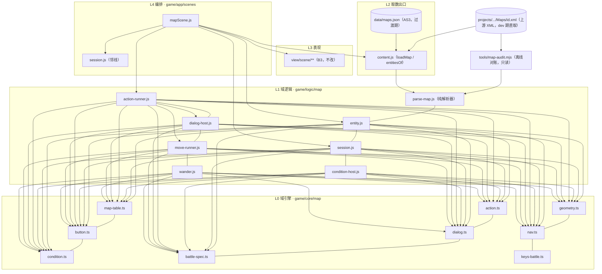

# 地图线代码地图（map-code-map.md）

> **父文档**：`docs/map/map-impl.md`（落地计划 / 施工批 / as-built）。
> **真值**：`docs/map/map-design.md`（+ 子设计 M1–M8，见 `docs/map/map-design.md §9.1`；**M8 = 角色外观（design 已成文 · impl 计划 = `map-impl.md §3.10` · `MDB8-a`–`d` 手测通过 · `MDB8-e`/`f`/`g`/`f2` 代码已落 2026-10-20 · e §8.17 ✅ 已通过（人类 2026-10-21「全部测试通过」） · f 的 §8.18 已随 ★M9-c 退役、不可测（等价判据 = `§8.23` ✅） · g §8.19 ✅ 已通过（人类 2026-10-21「全部测试通过」） · f2 的 §8.20（修「双角色」）已随 ★M9-c 退役、不可测（等价判据 = `§8.23` ✅））**）。
> **结构面**：`docs/arch-code.md §2`（各层文件与入口）/ `§3`（依赖规则）/ `§3.1`（L0 内部分区）。
> **邻线写法范本**：`docs/save/save-code-map.md`、`docs/orchestration/orchestration-code-map.md`。
> **证据标注**：`docs/arch-docs.md §4`（【样本】【源码】【推断】，冲突优先级 **样本 > 源码 > 推断**）。
> **状态**：⬜ 阶段一续产物（批 × 落地见 §7）· ⚠️ **本份登记的是"目标表"**；**MB1 已落码（2026-10-18）**，实况/偏差一律以
> `docs/map/map-impl.md §7.3.1` 为准（`docs/arch-docs.md §5`）。
> ⚠️ **本线有存量落地代码**（`game/app/scenes/mapScene.js` 的光口与两步走 · `tools/build-map-index.mjs` 的旧桥），
> 它们的 **as-built** 写在 `docs/map/map-impl.md §7`，本份只登记"现状"。

---

## 0. 一句话

本线把**地图规则**从"住在 SWF 里"（今天：`game/maprunner/MapRunner.as` 承担寻路 + 光口 + 野怪，宿主 `mapScene.js` 只做叠加层）
搬成 **L0 纯函数 + L2 桥 + L1 宿主**三件：**画面仍归 B3**（`docs/view/scene/room/view-scene-map-content.md`），
本线只给"有什么 / 会发生什么 / 怎么走到下一张图"。

---

## 1. 现状（实测 2026-10-18）

| 文件 | 行数 | 现在是什么 | 问题（对应 design §3） |
|---|---|---|---|
| `game/data/maps.json` | 259 条 | **AS3 血统**桥产物（`tools/build-map-index.mjs`，48 行） | ⚠️ **读的是 MQ1 判给"素材侧"的那一套**；`entities` **只是一个数字**（`<entities>` 标签计数）；**无 `npcs[]` / 无 `dialogs[]` / 无 `conditions[]`** |
| `game/data/wild.json` | —— | ❌ **我方合成表**（`tools/build-wild-index.mjs`，91 行；头注自陈「原版野怪来自服务端 1103、不可得 ⇒ 本表是我方合成」） | ✅ **已断（`MDB11`，2026-10-21）= 运行时零引用**：文件与生成脚本**留盘当历史产物**，但 `mapScene.js` **不再 fetch**、也不再喂给 AS3（`wild: ''` ⇒ `WildPet` 零生成）。⚠️ 本行 2026-10-18 起写"退场"，**运行时直到本批才真断** ⇒ as-built `docs/map/map-impl.md §7.3.33`。野怪数据真值 = 重启侧 `<wild>`（`docs/map/map-move.md §3.4`）；与 `battles[]`（Unity）**不是同一条**（M7 **MWI9**） |
| `game/core/map/**` | **7 文件**（`map-table.ts` / `button.ts` / `condition.ts` / `action.ts` / `dialog.ts` / `battle-spec.ts` / `keys-battle.ts`） | ✅ **已落**：`map-table.ts`（`identifierOf` / `isModId` / `isMirrorId` / `parseAssetRef`）+ `button.ts`（两词表 / 两枚举 / `uiEventOf`）（**MB2**）+ **`condition.ts`**（14 臂 + 三值 + `splitOrClause`）（**MB3**）+ **`action.ts`**（`ActionIntent` + `resolve` + 模式门）（**MB4**）+ **`dialog.ts`**（`parseDialogBranches`/`resolveBranch`/`choicesOf`/`renderContent`）（**MB6**，2026-10-19）+ **`battle-spec.ts`**（`buildSpec` + 开工三门）+ **`keys-battle.ts`**（`battle.` 键表）（**MB7**，2026-10-19） | 其余（`geometry` / `nav`）= **MB8 ⏸ 搁置** · `wander` = **MB9** |
| `game/logic/map/**` | **7 文件**（`parse-map.js` / `condition-host.js` / `action-runner.js` / `entity.js` / `session.js` / `dialog-host.js` / ＋A2 的 `js-view.js`·`actor-view.js`） | ✅ **已落**：`parse-map.js` = **纯解析器**（**MB1** 方案 C；★**MB7 加 `battles[]` 列**）+ **`condition-host.js`** = `MapEnv` 适配器（**MB3**）+ **`action-runner.js`** = 决议执行器（**MB4**）+ **`entity.js`** = 片段串→`ButtonSpec` + 运行时实体表（**MB5**）+ **`session.js`** = 传送/昼夜/落点/光口合并的**纯决议**（**MB5**）+ **`dialog-host.js`** = 对话无栈状态机 + `{expr:}`/`[expr]` 前缀表（**MB6**，2026-10-19） | 其余（漫游 `wander`）= **MB9**（`move-runner`/`geometry`/`nav` = **MB8 ⏸ 搁置**） |
| `game/app/scenes/mapScene.js` | **712** | ✅ **已有**：光口（`PORTAL_*` / `drawPortals` / `onStageMove` 悬浮说明）+ 两步走（`mapWalk`→`mapArrive`→`mapEnter`→`gotoMap`）+ 野怪点击（`startWildFight`） | 全部**建在 AS3 血统上**（`maps.json` 的 `pos` / `swf`）；**没有"条件 → 动作"这条链**；图 id 无单一真值（SWF 侧持图，宿主只报回 `camX/camY`） |
| `game/app/content.js` | **214 → ~205** | L2 内容桥单出口（`loadContent()` + `restart*` 系列） | ✅ **已补（MB1 → 方案 C，2026-10-18）**：**`loadMap(id)`**（按需 fetch 单图 Unity XML + 现场解析 + 补 swf 链；**不缓存**）+ `entitiesOf(record)`（吃记录）；❌ 退役 `mapList`/`mapTableOf` 与 boot 第 8 张表；⚠️ **旧桥 `maps.json` 仍在**（B3 的画面/光口位置），两套血统互不覆盖 |
| `game/swfshape.mjs` | —— | **运行时**从 SWF 矢量记录解析 `path_mc` 栅格（`walkGridOf(swf, 10)`） | ⏸ **2026-10-18 通行面搁置 ⇒ 这仍是现役机制**（M7 `MDB7-a` 的"预产进桥"转为待重启） |
| `game/maprunner/MapRunner.as` | 768 | **AS3 血统的寻路 + 光口 + ~~野怪~~**（`GRID_SIZE=10` / A* / `HOT_R=26` / `ARRIVE_R=18`） | ⏸ **2026-10-18 通行面搁置 ⇒ "由 `core/map/{nav,geometry}.ts` 接管"转为待重启**；**现役继续由它承担走位与通行面**（M7 / impl **D5**）；⚠️ **野怪那一格已随 `MDB11` 断粮**（宿主喂 `wild: ''` ⇒ `setWild` 空 ⇒ 零 `WildPet`，`impl §7.3.33`）⇒ **本批一字未改、不重编译**（那套 AS3 状态机 = 运行时不可达死码；走位已由 ★M9 puppet 提线） |

---

## 2. 目标文件表

> **层**：`docs/arch-code.md §2`。**状态**：新建 / 改 / 复用 / 不改。**归属批**：见 `docs/map/map-impl.md §2`（design 批号 `MB*` / `MDB*` 原样引用）。

### 2.1 内容面（L1 解析器 + L2 取数出口 + 离线工具）—— **方案 C**

> ⚠️ **方案 C（人类 2026-10-18）**：地图**不再有构建期产物**（`game/data/unity/maps.json` 已退役）；
> 改为**进一张图时现场取那一条 Unity XML、现场解析**。

| 文件 | 层 | 状态 | 导出 / 产物 | 归属批 |
|---|---|---|---|---|
| `game/logic/map/parse-map.js` | L1 | ✅ **已落（MB1 · 方案 C，2026-10-18；★MB7 加 `battles[]` 列，2026-10-19）** | `parseMapXml(rawXml, {file,id,audit})` → `MapRecord`（§5.1 字段；含七类实体 + 四张处理器表的**原始 XML 片段串** + `teleports[]` 五列）· `stripComments` · `as3ResourceNameOf` / `as3InitOf`（AS3 只读适配器）· `swfCandidatesFor` · `pickSwf(candidates, existsAsync)`。**零 IO / 零 fetch / 零 DOM**。⚠️ MB2 起 `resIdKind` **下沉 L0**（`map-table.ts` 的 `parseAssetRef`），本地实现已删。**★MB7（`MDB6-a`）**：`buildNpc` 把 `<battle>` 容器 → **结构化 `rec.battles[]`**（`battleBranchOf`：`{id, settings(18 列宽松缺省 `settingsOf`), player\|null, enemy, winHandler[], loseHandler[]}`；`content` 列**不建** = 双重死列）+ 解析期登记 `battleBranchDup`（同 NPC 重号，实测 0）/ `battleBranchNoEnemy`（`BTC5`） | **MB1**（`MDB1-a…d` + `MDB5-a` 折入）· **MB2**（下沉）· **MB7**（`battles[]`） |
| `game/app/content.js` | L2 取数出口 | ✅ **已落（MB1 · 方案 C）** | **`loadMap(id)`**（`async`：`fetch` 单图 Unity XML + AS3 config → 调 `parse-map.js` → 补 `swf`/`swfOk`/`fightMapOk`；**不缓存**）· `entitiesOf(record)` · `emptyEntities()`（**宇宙权威单一出口**） | **MB1**（`MDB1-d`） |
| `tools/map-audit.mjs` | 工具（离线） | ✅ **已落（MB1 · 方案 C；★MB7 加战斗审计，2026-10-19）** | CLI；读全库 272 张 `projects/.../Maps/*.xml` → 跑**同一份** `parse-map.js` → **打印**判据表（§8.1）；**只读、不产产物**（`writeFileSync` 零命中）。**★MB7 全局计数**：`battle-branch-unreferenced`（只读登记 = **154**：147 数字门系 + 7 具名）· `battle-action-dangling`（★报警 = **8** 条 `hell`，`BTC8`/`BTQ2`）· 分支总数 **680** / 动作总数 **543** | **MB1**（`MDQ5`；`MDI9` 已作废）· **MB7**（`MDB6-a` 跨图审计） |
| ~~`game/data/unity/maps.json`~~ | —— | ❌ **已退役（2026-10-18）** | 旧 MB1 的构建期大表（2.35 MB / 272 条） | —— |
| ~~`tools/build-map-entities.mjs`~~ | —— | ❌ **已退役**（`git mv` → `tools/map-audit.mjs`） | 旧 MB1 的产桥工具 | —— |
| `game/data/unity/manifest.json` | L2 | ✅ **已去 `counts.maps`（方案 C）** | 地图不产 JSON ⇒ 不再记账；六张 CSV 表的 `counts`/`strides` 照旧 | —— |
| `game/data/maps.json`（旧桥）+ `tools/build-map-index.mjs` | L2 | **不改**（过渡期并存） | AS3 血统：B3 的**画面与光口位置**仍吃它 | ——（**D2/D3**，合并条件见 `docs/map/map-design.md §7.2 MDQ4`） |
| `game/data/wild.json`（+ `tools/build-wild-index.mjs`） | L2 | ✅ **已断（`MDB11`）**：运行时零引用（文件留盘） | 我方合成野怪表 | ✅ 单一来源 = `MapRecord` 的 `wild` 列（重启真值 `<wild>` **110 只 / 53 图**，人类 2026-10-18 订正 ⇒ **2026-10-21 落到底**）；⚠️ 旧消费方指针（`mapScene.js:62-64, 590, 621-623`，行号早已漂移）**已整条删除** = `wildOf` / `fetch` / `startWildFight` / `numericIdOfWild` / `content.js` 的 `pruneWildPool` ⇒ as-built `docs/map/map-impl.md §7.3.33`；`battles[]` 是另一条（M6/M7 **MWI9**） |
| `game/data/equip-index.json`（+ `tools/build-equip-index.mjs`） | L2（M8 数据桥） | ✅ **已落（M8-a，2026-10-20）** | `items` **1,864** 条 `{name,slot,suit}` + `ride.byPetResourceId` **31** / `ride.byChipBackId` **29**；源 = `items.json` + `PetRideShopConfig__setting.xml`；**构建期产物、勿手改**（`note` 自陈） | **M8-a**（as-built `map-impl §7.3.15`） |
| `game/data/actor/equip/manifest.json`（+ `tools/build-actor-assets.mjs`） | L2（M8 数据桥） | ✅ **已落（M8-a，2026-10-20）** | 改服缓存里的装备包清单 `{packs,missing}`：**12 包 / 18 文件 / 108 缺件**（29 坐骑 × 2 + 10 色默认 × 5）；本机 `.bin`/`.swf` 不入库（`.gitignore`）；缓存经 `tools/serve.mjs --cache=` 的 `/game-cache/` 只读路由取 | **M8-a**（as-built `map-impl §7.3.15`） |

### 2.2 L0 域引擎（`game/core/map/**`，纯函数）

| 文件 | 状态 | 导出（目标） | 归属批 |
|---|---|---|---|
| `game/core/map/map-table.ts` | ✅ **已落（MB2，2026-10-18）** | `MapRecord` / `EntityKind` / `AssetRef` / `ENTITY_KINDS` / `MAP_IDENTIFIER_KEYS` · `identifierOf(map,key)` · `isModId(id)` · `isMirrorId(id)` · `parseAssetRef(raw)` | **MB2**（⚠️ `parseAssetRef` 的六形状分类**从 `game/logic/map/parse-map.js` 的 `resIdKind` 搬来**（**本地实现已删**），**一份实现**） |
| `game/core/map/button.ts` | ✅ **已落（MB2，2026-10-18）** | `ButtonSpec`（`source` 必填）· `ButtonEventType` · `NpcAction` · `ButtonSource` · `BUTTON_EVENT_TYPE` · `NPC_ACTION` · `PET_ACTIONS` · `uiEventOf(b)` | **MB2**（`MDB2-a`） |
| `game/core/parser/operator.ts` | **复用（不新建第二份）** | `splitCondition` / 6 算子（已 101 行，`docs/map/map-condition.md §6`） | ✅ **已按此落（MB3，2026-10-18）**（**D4**；`condition.ts` 只**再导出**它，不抄第二份） |
| `game/core/map/condition.ts` | ✅ **已落（MB3，2026-10-18）** | `Truth` · `MapEnv`（+ `PetView`/`BattleView`/`MapRng`/`KeyValueBag`）· `splitOrClause`（**括号感知 `\|`**，`CSI2`）· `parseConditions(texts)` · `evalCondition(expr, env)` · `and3`/`or3` · **A1–A15 十五臂** · 再导出 `splitCondition` | **MB3**（`MDB3-a…e` **一次落齐**；as-built `docs/map/map-impl.md §7.3.4`） |
| `game/core/map/keys-battle.ts` | ✅ **已落（MB7，2026-10-19）** | `battle.` 两半键表（`settingsIdentifier` 14 键 + `resultIdentifier` 8 键 + `capturePet.` 透传）· 两个哨兵（`mode` `Record(-1)`→`PVP(2)`、`captureLevel` 在 `!capture`→`-1`）· 未知键 ⇒ `FLOAT_MIN` · `battleIdentifier(snapshot,key)`（剥 `state.` 前缀、路由 `result.`/`settings.`/裸键按设置）· `makeBattleView(snapshot)` → `env.battleState` | **MB7**（`MDB6-e`）—— ✅ MB3 的"问路"（`env.battleState.identifier`）+ MB7 的键表**已接齐**；L4 `buildMapEnv` 一律注入 `makeBattleView(session.lastBattle)`（无上一场 ⇒ 全键 `FLOAT_MIN`，**统一 BTC11、无 NRE**）；`turn`/`me.`/`op.` 等活战斗态键快照没有 ⇒ 恒 `FLOAT_MIN`（**等 E1/E5**，已登记）|
| `game/core/map/action.ts` | ✅ **已落（MB4，2026-10-18）** | `ActionIntent`（**13** 变体）· `MapMode` / `SHOOT_TYPE_ID` / `isShootButton` / `modeGateOk` · `NpcParamTarget` / `SetItemOp` / `SET_ITEM_OPS` / `HintboxKind` / `GetPetOp` · **`resolve(handler, env, opts?)`** → `ActionIntent \| null`（门序 = **模式门 → 条件门 → 动作**）· 18 动作分派 | **MB4**（`MDB2-b…d`；⚠️ 签名多了可选第三参 `opts`（`mode`/`conditions`）—— 见 `docs/map/map-impl.md §7.3.5` 偏差 ①；as-built `§7.3.5`） |
| `game/core/map/dialog.ts` | ✅ **已落（MB6，2026-10-19）** | `parseDialogBranches(lexed, log)` · `resolveBranch(branches, param0)` → `DialogBranch\|'close'\|'missing'` · `choicesOf(branch)`（附挂→上一条可见项；`idx0`⇒`orphan-branch`）· `renderContent(raw, resolveExpr, log)`（`{expr:}` 走注入的**一张前缀表**、永不变异 raw、`random*` 拒 = `DLI6`）· 类型 `LexedBranch`/`Resolution`/`Choice`/`DialogBranch` | **MB6**（`MDB4-a…e`；★输入 = L1 `lexDialogBranch` 的**纯记录**、非 XML 串（`dialog.ts` 零第三方依赖 ⇒ XML 留 L1，`MP3`）；as-built `docs/map/map-impl.md §7.3.9`） |
| `game/core/map/battle-spec.ts` | ✅ **已落（MB7，2026-10-19）** | `buildSpec(npc, branchId, mapId)` → `BattleSpec\|null`（同 NPC 内解引用 `BTI3`；敌**不裁到 `count`** `BTI2`）· `canStartBattle(spec, probe)` 开工三门（① 配方空敌⇒`hint` 不静默 `BTC8` / ② 首发可用查**上场对象** `BTC4` / ③ `settings` 准入、★无 `debugMode` 旁路）· 类型 `BossInfo`/`BattleSettings`/`BattleBranch`/`BattleSide`/`BattleSpec`/`GateProbe`/`GateResult` | **MB7**（`MDB6-b/c`；★`seed==null` ⇒ 内核不碰时钟 `BTI5`；今天 `probe` 一律 `'unknown'` ⇒ ②③放行（宠血量/Mod/星级 = **D6** 结账）；as-built `docs/map/map-impl.md §7.3.10`） |
| `game/core/map/geometry.ts` | ⏸ **搁置** | `parsePoints` · `containsPoint` · `intersectsCircle` · `triangulate` | **MB8**（⏸ **2026-10-18：通行面搁置 ⇒ 不发码**） |
| `game/core/map/nav.ts` | ⏸ **搁置** | `findPath` · `hasLineOfSight` · `nearestReachable`（栅格 A* + **统一足印**） | **MB8**（⏸ 同上；玩家走位**继续由 `MapRunner.as` 承担**） |

⚠️ **`core/map/**` 的硬约束**：零上层 import（`MP3`）、不读 JSON（`MP1`）、不碰时钟/随机/渲染（`MP2`）。
⚠️ **命名以子设计为准**：本表 `nav.ts` 取 M7 §3.2 的写法（design §4.1 的 `navigator.ts` 是同物，以更细者为准，`docs/arch-docs.md §3`）。

### 2.3 L1 域逻辑（`game/logic/map/**`，无 DOM）

> ⚠️ **`parse-map.js` 也在 `game/logic/map/`**，但它属**解析面** ⇒ 行在 **§2.1**（不重复列）。
> ⚠️ **文件名一律 `.js`**（**2026-10-18 订正**）：`game/core/**` 才是「`.ts` 权威 + `tools/build-core.mjs` 生成同名 `.js`」；
>    `game/logic/**` 与 `game/app/**` **零构建、浏览器直吃 `.js`**（`docs/arch-code.md §7.1`）。
>    本节此前把 L1 目标文件全写成 `.ts`，是**本线自己的笔误**（`build-core` **不扫** `game/logic/`，`.ts` 放这儿会**没人执行**）。

| 文件 | 状态 | 导出（目标） | 归属批 |
|---|---|---|---|
| `game/logic/map/entity.js` | ✅ **已落（MB5，2026-10-18）** | `buildEntities(record)` → 运行时实体表（**登记先于 `auto`**，`MNI5`；吃 `loadMap` 给的**记录**，不自己取数）· `parseButtonFragment(fragment, source)`（**XML 片段串 → `ButtonSpec`**，含 `<condition>`/`<param>`/`<action>` 抽取，`MDI10`）· `autoSpecsOf(e)`（`type==='Auto'`，**非 UI 事件**，`MNI1`）· `uiSpecsOf(e)` | **MB5**（`MDB5-c`；as-built `docs/map/map-impl.md §7.3.6`） |
| `game/logic/map/session.js` | ✅ **已落（MB5，2026-10-18）** | **纯决议、零 import、不取数**（`M-5`；`walkTo`/`enterMap` 副作用依 **D5** 仍留 SWF+mapScene 消息链 ⇒ 本件只出判断）：`decideTeleport(mapId)`（`mapId===0`⇒`notOpen`，`TPQ4`）· `decideMirror(record, targetExists)`（`invalidSwitch`/`missingMirror`/`mirror`，`§3.4`）· `landingSpot(targetRecord, spawn)`（`spawn ?? init` 唯一一条，`§3.3`）· `mergePortals(as3, unity, log, unityNormalized)`（**D3** 两血统取列：pos/name=AS3、target=Unity；**★A2/obs-3** 加第 4 参 `unityNormalized` ⇒ **AS3 ∪ Unity 并集**，补"AS3 无、Unity 有"的光口如 `990`；本件仍**坐标无关**、归一化由 L4 传入） | **MB5 / A2**（`MDB5-b/d/e`；as-built `docs/map/map-impl.md §7.3.6`/`§7.3.7`） |
| `game/logic/map/js-view.js` | ✅ **新建（A2，2026-10-19）** | **缺 SWF 画面的图的 JS 回退渲染所需的纯数学**（无 DOM / 无 fetch / 不 import app，`M-5`）：`bgKeyOf(rec)`（=`resId ?? id`，对齐 `ResourceManager.cs:601/631`）· `bgUrlOf(rec)`（`Resources/Maps/bg/{key}.png`，实测 272/272 覆盖）· `fitBg(bgW,bgH,...)`（`contain` 矩形，letterbox）· `unityToStage(ux,uy,rect,flipY)`（**路线 A** 一条换算，`flipY` = 唯一需人眼校的开关）· `buildJsView(rec,rect,{flipY})` → `{spots, start, name}`（光口/起点归一化进 `rect`；不上屏）。画布/取图/点击/走位循环全在 L4 | **A2**（as-built `docs/map/map-impl.md §7.3.7`；围栏例外见 §2.4 的"本线零像素 A2 例外"） |
| `game/logic/map/actor-view.js` | ✅ **新建（A2b，2026-10-19）** | **JS 回退图把角色黄点换成原版小赛尔**所需的**纯解析**（无 DOM / 无 fetch / 不 import app，`M-5`；`DataView`/`Uint8Array`/`TextDecoder` 是 ES 内置、合法）：`parsePack(u8)`（**大端 u16** 解 `game/data/actor/*.bin` = head(`frameW,H,totalFrames,anchorX,Y`) + AMF3 锚定切片取 `labels`(`i`/`l`) + info(`unitW,H,frameNum, 每条 key,ox,oy,w,h,si`) + **PNG 字节**（`rest` 实测是带 alpha PNG，**非 SWF**）；`cols` 从 **PNG IHDR** 纯算）· `pickFrame(pack,f)`（照搬 `FrameSequence.as:93` 的 **`key<=f` 用 break**、`f<1`→null）· `standFrame(bodyPack)`（=`labels.standDown.start`，兜底 25→1）· `labelStartFrame(pack,label)`（标签首帧；装备层站立静姿，**ALC13**）· `localShadowFrame(shadowPack)`（本机阴影恒取 `local` 帧，**ALC14**；⚠️ 原 `SHADOW_FRAME` 按 BODY 帧取模 = 会闪出 vip 光轮，已于 `MDB8-b2` 第二轮删除）· `vipShadowFrame(shadowPack,tick)`（VIP 光轮取 `vip` 3–39 循环，**MDB8-b3**）· `frameRect(pack,rec)`（裁帧源矩形 `{sx=(si%cols)*unitW, sy=(si/cols|0)*unitH, sw=rec.w, sh=rec.h}`，纯数学留 L1、L4 只喂 `drawImage`）。（**M8-b 起本件只留解析**：旧 7 槽常量 `ACTOR_PACKS`/`DOWN_ORDER`/`UP_ORDER` 已删除，11 槽深度序与槽→部件映射归 `actor-look.js`。）`fetch`/`createImageBitmap`/`drawImage` 合成全在 L4 | **A2b**（as-built `docs/map/map-impl.md §7.3.8`；围栏例外见 §2.4）· ✅ **M8 = `map-impl.md §3.10`（`a`–`d` 手测通过：数据桥 + L1 纯计划 / JS 路 11 槽渲染 + 帧动画 + 光轮/阴影切换 / 会话态 / 坐骑速度 + 浮动；`e`/`f` 代码已落 2026-10-20 = 素材清单 + 缺包日志 / SWF 叠层；e §8.17 ✅ 已通过（人类 2026-10-21「全部测试通过」） · f 的 §8.18 已随 ★M9-c 退役、不可测（等价判据 = `§8.23` ✅） · `g` 代码已落 = 存档 `<equip>`，§8.19 ✅ 已通过（人类 2026-10-21「全部测试通过」））**：另建 L1 `game/logic/map/actor-look.js` 出**11 槽外观计划**（纯函数，`ALI1–ALI6` / `ALC1–ALC14` / `M8-P1–P7`）；本件 `parsePack` 直接吃装备包（**只解析、不改**）；见 `docs/map/map-actor-look.md §8` |
| `game/logic/map/actor-look.js` | ✅ **新建（M8-a，2026-10-20）** | **11 槽外观计划所需的纯函数**（无 DOM / 无 fetch / 不 import app，`M-5`；数据表由 L4 注入，本件**不取数**）：`SLOT`/`MIRROR_TO`/`PART_OF_SLOT`/`MOUNT_HIDDEN_SLOTS`/`MOUNT_OFFSET_Y`/`MOUNT_SPEED_FACTOR`/`DOWN_ORDER`/`UP_ORDER`/`DEFAULT_COLORS` · `colorIndexOf` · `resourceIdOf(suitId, slot)`（`"1"+pad3+pad2`，**6 位**，`ALI1`）· `packSuffixOf({slot,isAccessory})`（`_0` 主件 / `_1` 镜像；左槽 10→2 / 9→6 / 11→3）· `defaultRefsOf(color)`（12 色默认 5 件；色 10/11 = suit **39/40**）· `mergeDefaultEquip(color, equipVec, itemIndex)` → `{refs, warnings}`（`ALI3`）· `mountEquipIdOf(ridingPetInfo, rideTable)` → refId\|0（`ALC2` 不反查）· `slotOrder(direction)`（上/下两套深度序，`ALI5`）· `buildLookPlan(opts)` → `LookPlan{signature, direction, color, layers[], hiddenSlots, mount, offsetY, speedFactor, warnings}`（注入 `equip-index.json` + `actor/equip/manifest.json`）。**兜底**：自定义件缺包 → 同色默认（腰带/翅膀/坐骑跳过），同色默认再退蓝/红裸装。**装载/合成/绘制全在 L4（`b` 起）** | **M8-a 已落并手测通过**（as-built `docs/map/map-impl.md §7.3.15`；impl 计划 `§3.10.2`；真值 `docs/map/map-actor-look.md §8.2`）；本件**不装载**，装包/合成在 L4（`b` 起） |
| `game/logic/map/npc-art.js` | ✅ **新建（B3，2026-10-19）** | **NPC 真美术上屏所需的纯换算**（无 DOM / 无 fetch / 不 import app，`M-5`；与 `js-view.js` 同层同规）：`npcArtUrl(npc)`（**三类 `resId`→`Resources/` PNG 映射**，实测 604 只 npcs 只落 `npcId`238→`Npc/<id>.png` / `path`346→`Resources/<resId>[.png]` / `none`20⇒`null`；`builtin/mod/expr` 实测 0 条）· `npcHasArt` · `npcSizeInStage(npc,rect)`（Unity `size`→舞台像素，缺/`(0,0)`⇒`null` 让 L4 退 natural）· `NPC_ANCHOR={ax:0,ay:1}`（左下角贴 `pos`，对齐上游 `Npc.prefab` pivot=(0,0)；第二条人眼校常量，接 `flipY`/`ACTOR_SCALE` 先例）· `ART_ROOT` · ★**`MDB10`（2026-10-21）新导出 `talkImageUrl(id)`**（野怪**对话气泡表情** id → 绝对 URL：基址 `Assets/StaticResources/Sprites/Map/talk%20bubble/`〔目录带空格 ⇒ 必写 `%20`；`tools/serve.mjs` 静态服务已 `decodeURIComponent`，**服务端零改动**〕；上游 `NormalizeImageId` 同口径 = **去尾部扩展名 + 禁 `..`**；扩展名按目录**完美二分** `emoji/toon/*⇒.png` / `emoji/meme/*⇒.jpg`；白名单外/畸形 ⇒ **`null`** ⇒ L4 **不出泡 + 一行日志**、**不伪造、不退回文本**）。**画布装载/点击/走位全在 L4** `mapScene.js`（`#npc` 层 + `NPC_CACHE`/`ensureNpcSprite`/`drawNpcs`）；⚠️ 本行旧句"**只 JS 路**、SWF 路 NPC 仍不显示 = **BCQ1(A)**"**已过期**（B3 impl §7.1 追认修订，人类 2026-10-19：**JS 路 + SWF 路都画** ⇒ 见本表 §2.4 那条围栏扩展）。★**`MDB12`（2026-10-21）新导出 `petAppearanceId(npc)`**：`resIdKind==='path'` 且形如 `Pets/pet/<数字>`（**`.png` 可有可无** — `visual="animation"` 那 14 条就不带扩展名）⇒ 返回**重启形象 id**（帧包桥的入参），其余 ⇒ `null`；⚠️ **只问 `wild` 的 NPC**（判据在 L4）⇒ 普通 NPC 一律走不到帧包通路；`npcArtUrl`/`npcSizeInStage`/`NPC_ANCHOR`/`talkImageUrl` **一字未改**（PNG 支路与气泡仍归它们）。归属 **View 线 B3**、数据面仍吃地图线 `entity.buildEntities`（本件只 `resId`/`resIdKind`/`size`/`active`/`name` 消费方；`nameColor`/`namePos` 是本次给 `buildEntities` 加的透传） | **B3**（`docs/view/scene/room/view-scene-map-content-impl.md`；围栏扩展见本表 §2.4 "B3 NPC 真美术" + `AGENTS §4` 第 13/14 条） |
| `game/logic/map/condition-host.js` | ✅ **已落（MB3，2026-10-18）** | `createMapEnv(src)`（`MapEnvSource` → `MapEnv`，**纯适配、不取数**，规则 `M-5`）· `mapViewOf(record)`（A2）· `EMPTY_BAG` · `UNIMPLEMENTED_PET`（**D6 落地前的宠占位**）· `evalConditionTexts(texts, src)` | **MB3**（`MDB3-b`；as-built `docs/map/map-impl.md §7.3.4`） |
| `game/logic/map/action-runner.js` | ✅ **已落（MB4，2026-10-18）** | `run(intents, ctx)`（面板 C2 / 提示 A3 / 道具 / 宠 D6 / 战斗 E6 / 写盘 **收口一次**，`MNI8`）· `MAX_CALLBACK_DEPTH`（= **16**，`MNQ3`）· sinks 表（缺项 ⇒ `no-sink` 登记）· `callback` 链再入 | **MB4**（as-built `docs/map/map-impl.md §7.3.5`；⚠️ 载荷 = `ActionIntent` 本身，见偏差 ④） |
| `game/logic/map/dialog-host.js` | ✅ **已落（MB6，2026-10-19）** | 无栈状态机 `(npcId, branchId)`（`DLI1`，**只适配、不取数、无 DOM/fetch**）：`openDialog(entity, param0, env, log)` → 可渲染 payload（`{kind:'close'\|'missing'\|'branch', branch:{id,speakerName,contentText,presentation}, choices:[{description,choice}]}`）· `branchesOf`（`lexDialogBranch`→`parseDialogBranches`）· `choiceView`（可见性 = OR≠false，`DLQ5`）· `clickChoice`（点击期全满足者出决议、不短路，`DLI5`）· `makeExprResolver(env)`（`{expr:}`/`[expr]` 的**一张前缀表**：`item[..].num`/`item_yite[..]`/裸数；`random*` 拒 = `DLI6`；未知 ⇒ `null` 非 0） | **MB6**（`MDB4-c/d/e`；渲染归 L4 `mapScene` 自绘最小浮层 = **决策一 A**，正式排版仍归 A3；as-built `docs/map/map-impl.md §7.3.9`） |
| `game/logic/map/move-runner.js` | ⏸ **搁置** | 把 `walk`/`arrive`/`unreachable` 决议接宿主（**按 deltaTime**） | **MB8**（⏸ **2026-10-18：通行面搁置**） |
| `game/logic/map/wander.js` | ✅ **已落（MB9，2026-10-19 → ★`MDB10` 2026-10-21 收窄）** | 漫游目标选取 + 卡住检测（按 deltaTime，`MWI6`）+ 待机。**纯步进 + 注入 `rand`**（决议① R1，本件不自带时钟/随机）：`seedWander(npc)`（仅 `<wild><movement mode="wander">` ⇒ 初态，`stationary`/普通 NPC ⇒ `null`）· `stepWander(state, movement, dtSec, rand)`（`idle` 停 `idle="min,max"` 秒 → 选新 `target`（距离 `step="min,max"`、钳 `home` 半径 `radius` 内）→ `move` 段按 `speed` px/s 直线挪 → 回 `idle`；`bob`/`face` cosmetic）。⚠️ **`talk` 决议已不在本件**（★`MDB10`：旧 `state.bubble` 字段与 `stepWander` 的 `talk` 形参**已删除、不留垫片** ⇒ 气泡调度独立成 `logic/map/talk.js`；~~理由 = SWF 路野怪不漫游、不该为气泡伪造 `_wander`~~ ⇒ **该理由已随 `MDB11` 消失**（SWF 路现在也有 `_wander`），**但两件仍不合并**：走位与气泡是两个独立生命周期，各自一条 rAF）。⚠️ **无碰撞**：通行面判断恒真（"哪里都能走"，人类 2026-10-18 —— 不吃 `nav.js`/`geometry.js`）⇒ 野怪**可能穿墙**（`AGENTS §4` 第 7 条 / `map-impl §3.9` 人眼确认项）。**★`MDB11`（2026-10-21，人类点名 ③）：走位不再只 JS 路 = JS/SWF 两条路都播 `_wander`**（旧口径"SWF 路野怪照 `MapRunner.as` 自己溜达"已作废，因为 AS3 那套同日断粮 ⇒ `mapScene.js` 的 `startWanderLoop`/`stepWanderLoop` 去掉 `M.jsMode` 闸，SWF 路改成"**这帧真有怪挪动才 `draw()`**"）。**本件现职责 = 野怪走位的纯数学**（`seedWander`/`stepWander`，零 DOM / 零 fetch）；画、装载、rAF、命中、气泡全在 L4。as-built `docs/map/map-impl.md §7.3.11`（+ `§7.3.32` = 迁出 · **`§7.3.33` = 两条路**） | **MB9**（→ 气泡半边 **MDB10** / 两条路半边 **MDB11**） |
| `game/logic/map/talk.js` | ✅ **新建（MDB10，2026-10-21）** | 野怪**对话气泡的纯调度**（无 DOM / 无 fetch / 随机与时钟外部注入 = 决议① R1/R2）：`seedTalk(npc, rand)` ⇒ `wild.talk.self` 里**有 ≥1 条有效条目（`text` 非空 或 `image` 非空）**才建 `{text,image,timer,next}`，否则 `null`；`stepTalk(st, talk, dtSec, rand, canStart)` ⇒ 在显只倒计时、归零把**图与文一起清空**；`next` 到点 ⇒ 重排 `next` → 摇 `chance` → **从全部有效条目均匀挑一条**（★人类 2026-10-21 拍板 = **照上游：图与文同一个池子** ⇒ ≈3/4 表情、≈1/4 台词，文本条目不删只稀释）；`{image}` **只写原样 id**（**不拼 URL** ⇒ URL 归 `npc-art.talkImageUrl`，由 L4 解析）。`canStart` = **驻停才起新泡**（上游 `OnRestStarted` 口径）。★**两条渲染路都跑**（人类拍板 ①；旧实现只在 JS 路 ⇒ 89/110 只不冒泡）。装载/绘制/点击全在 L4 `mapScene.js`（`TALK_CACHE`/`ensureTalkSprite`/`drawNpcImageBubble`/独立 `talkRaf`） | **MDB10**（as-built `docs/map/map-impl.md §7.3.32`、手测 `§8.26`；真值 `docs/map/map-move.md §2.7`） |
| `game/logic/map/pet-view.js` | ✅ **新建（MDB12，2026-10-21）** | 野怪**帧包**（`swf/pet/normal/<n>.swf` = **帧序列包**、与小赛尔部件包同容器）上屏所需的**纯换算**（无 DOM / 无 fetch / 不 import app，`M-5`；与 `wander.js`/`talk.js` 同规）：`PET_LABEL_ALIAS`（走/站 × 上/下 的**中文别名表** = 实测 6 个包用中文词）· `resolveLabel(pack,action)`（兜底链：别名 → 同族另一向 → 另一族 → 包内任意标签 → 全帧区间；**永不抛**，照 AS3 `WildPet.as:189-202`）· `petAction(moving,up)`（**只有上下两族包 ⇒ 左右只镜像**）· `petFrame(pack,action,tick)`（区间内循环）· `petHitRect(pack)`（`{anchorX/frameW, anchorY/frameH, frameW, frameH}` = 上游 `drawHot` 的**整格热区**、**原生像素**〔人类 ③〕）· `petDrawShift(pack,rec)`（= AS3 `render:345-346` 的 `ox-anchorX / oy-anchorY`）。**复用不复制**：`actor-view.js` 的 `parsePack`/`pickFrame`/`frameRect`（L1→L1 同层 import，先例 = `dialog-host.js:20`）；模块内 `WeakMap` 存归一化词表（键 `trim` ⇒ 治 `背面走路␣`）、**不改写 `pack`**。**fetch/画布/点击/走位循环全在 L4** `mapScene.js`（`PET_CACHE`/`ensurePetPack`/`petHitOf`/`drawPetFrame`）；⚠️ **只服务 `wild` 的 NPC**（判据在 L4），普通 NPC 走不到这条路 ⇒ **分布/漫游/战斗数据通路一字未改**（`MDB11` 口径）。★**`MDB13`（同日 2026-10-21）在本件追加四段纯换算**（细节行为全在 L4）：`SHADOW_BASE_W=40` + `petShadowScale(pack)`（= 上游 `scale=frameW/40`）· `PET_PERSONAL_ALIAS=['personal','free']` + `personalRange(pack)`（**只本族、无兜底 ⇒ 缺素材返回 `null`、不播**）+ `petFrameOnce(range,tick,max)`（**播一遍** + 时长上限）· `petLevel(n)`（真值 = `<battle>` 敌方 `level` → 名字 `Lv\d+` → `null`）+ `petLabelText(n)`（`Lv{等级|???} {剥掉 Lv 前缀的名字}`）· `MARK_TOP_PAD=20` + `petMarkTop(height)`（= 上游 `-height+20`）；阴影与「!」的偏移**复用 `petDrawShift`**（同一条 `ox-anchorX / oy-anchorY` 式子 ⇒ **不留第二份同形数学**） | **MDB12**（as-built `docs/map/map-impl.md §7.3.34`、手测 `§8.28`；真值 `docs/map/map-move.md §2.9/§3.4`） |

### 2.4 L3/L4 接线

| 文件 | 层 | 状态 | 改动 | 归属批 |
|---|---|---|---|---|
| `game/app/scenes/mapScene.js` | L4 | ✅ **改（MB5 + A2，2026-10-19）** | ① ✅ **光口换血统**（`spotsOf` 喂 `session.mergePortals`：pos/name=AS3、target=Unity，**D3**；★A2 先 `normalizeUnityTeleports` 按整舞台矩形把 Unity `pos` 归一化喂第 4 参 ⇒ **AS3∪Unity 并集** obs-3）+ 落点 `landingSpot(unity, consumeSpawn())`；② ✅ **进图现场取 Unity 记录**（`loadUnityInto`→`M.unity` 与 AS3 `M.map` 并存，**D2**）+ `buildEntities`→**先登记后 `auto`**（`MNI5`，`registerAndRunAuto`）；③ ✅ **`auto`/点击派发 → `resolve`→`action-runner.run`**（`makeRunCtx` 只接 **`teleport` sink**；`onNpcClick` 挂 `window` **待 B3 上屏**）+ **昼夜按钮**（`#dayNightBtn`，仅 `switch===±1` 显，`onMirrorClick`）；④ ✅ **对话/战斗接线（MB6/MB7，2026-10-19）**：`makeRunCtx` sinks 补 **`openDialog`**（→ `dialog-host.openDialog` → **自绘最小对话浮层** `renderDialogBox`/`closeDialogBox` = **决策一 A**；选项点击 ⇒ `clickChoice` 全满足者 → **同一台** `resolve→run`，含对话里的 `battle`/`teleport`/`setItem` 出路）+ **`battle`**（→ `startMapBattle`：`buildSpec`+`canStartBattle` 三门 ⇒ `openHintbox` 或写 `session.battleOrigin` 复用 `#/rbattle` **单敌遭遇**）；`teleport`/`openDialog` 执行前撤浮层；**战后链** `runPostBattleChain`（`registerAndRunAuto` 末尾；同图判定 `BTQ1` ⇒ `env.battleState=makeBattleView(lastBattle)` → `isMyWin`/`isOpWin` 跑 `winHandler`/`loseHandler` → 其余登记 `result-state-unhandled` `BTC3`，用完清 `battleOrigin`）；**提示盒接线仍归 A3**（`openHintbox` 复用既有面板）；⑤ ✅ **A2 单一入口 `renderMap(id,{pushHist})`**（现场取图一次 → `swfOk` 分流）+ **SWF 路落点改喂 AS3 `initAs3`**（obs-1-a，灭"落地打怪"）+ **`enterJsMode` JS 回退渲染**（`swfOk===false`：`#bgc` 画 bg、复用 `#ov`/`#portal`、静态相机 + 自由走 rAF + 点光口先走到再切图；不画实体）+ 昼夜诊断行；⑦ ✅ **A2b 角色 sprite**（`syncLook`/`drawActor` 在 `#ov` 用部件包合成小赛尔、`LOOK_PARTS` 素材缓存〔M8-b 起按 11 槽计划装包，键 = `source:pack:suffix`〕、`draw()` 的 `M.pos` 分支被 `M.jsMode` 门住 ⇒ SWF 路仍画原黄点；件在 `enterJsMode` 触发、`leaveJsMode` 只递增 `gen` 不删缓存）；⑧ ✅ **B3 NPC 真美术上屏（2026-10-19）**：`enterJsMode` 建 `#npc` 层、`leaveJsMode` 拆层（`NPC_CACHE` 留复用、`npcGen` 递增作废在飞）；`draw()` 的 NPC 分支 = 有真图且 loaded 者投 `M.npcHit`（`ensureNpcSprite` 按 URL 缓存 + `npcSizeInStage`/natural×`NPC_FALLBACK_SCALE`）、`none`/缺图/在装者退 `M.npcMarkers` 占位橙点；`drawNpcs()` 画 sprite + 头顶中文名（`npcColorCss`/`npcVec2`，`NPC_ANCHOR` 左下角锚定）；`jsClick` 命中优先级 = sprite 矩形 → 占位圆 → 光口 → 走位（点真 NPC = `onNpcClick` 那台机）。换算件在 L1 `npc-art.js`；**只 JS 路**（BCQ1·A）；⑨ ✅ **MB10 记录最后所在的房间（2026-10-19）**：`renderMap` 改成 **`session.currentMapId` 的唯一写者**（取到该图 Unity 记录才换，异图时旧号挪进 `lastMapId`；照搬上游 `NormalLoadingScreen.cs:41`）并**返回布尔**；`mount` 的进图入口改为 **`map=` 优先**（不再要求「在下拉里且 `swfOk!==false`」——分流反转后那批 JS 图都在下拉外，从前会被丢回下拉首项 = 出生点），取不到记录才退回下拉当前项；新增 `rememberRoom()` 于 `startMapBattle`/`startWildFight` 切战斗场景前写 `session.lastPos`。 | **MB5–MB7 / A2 / A2b / B3 / MB10**（as-built `docs/map/map-impl.md §7.3.6`/`§7.3.7`/`§7.3.8` + `docs/view/scene/room/view-scene-map-content-impl.md §10`）· ✅ **M8（`map-impl.md §3.10`；`a`–`d` 手测通过 · `e`/`f`/`g` 代码已落 2026-10-20）**：`a` 批新增 `installActorLookDebug()`（`mount` 装 `APP.actorLook`、`unmount` 删）—— `dump()` 只读打印 3 组计划；`b` 批把 JS 路角色切换成 11 槽合成（`syncLook`/`loadLookParts`/`drawActor` + fallback 链 + `M8-I2` 坐骑缺包降级，手测钩子 `APP.actorLook.preview/clear`）；`c`–`f` 已落会话态/坐骑视觉/素材清单/SWF 叠层；`g` 已落存档（`mergeBack` 写根级 `<equip>`，`equip/unequip/ride/unride` 变更即 `session.save()`）；**SWF 路也画（`ALQ2=B` 已拍板）** = `draw()` 的 SWF 分支由黄点改为整只 canvas 角色（**有自定义外观且部件全就绪时**；无装备/缺包仍黄点），位置吃 `mapState{x,y,camX,camY,moving}`；见 `docs/map/map-actor-look.md §8` / as-built `map-impl §7.3.23` |
| `game/app/session.js` | L4 | ✅ **改（MB7 战后链 + MB10 回原房间，2026-10-19；余为编排线邻线）** | ① ✅ **`currentMapId`/`lastMapId` = 「最后所在房间」单一真值（MB10 · 2026-10-19）**：**唯一写者 = 地图场景 `renderMap`**（取到记录才换，失败=换图中止，照搬 `NormalLoadingScreen.cs:41`）；⚠️ 场景态**不入档**（同上游 `Player` 单例）；② ✅ **`battleOrigin` / `lastBattle` 只读窗口已落**（MB7 · **BTQ1**/**BTI9**：`battleOrigin={mapId,npcId,branchId}` 一次性、`lastBattle` 保到下次开工 `BTI10`；`reset()` 一并清）；③ **活动键值袋读写** `activityData(id)` / `setActivityData(id,key,value)`（人类 2026-10-18 拍板 ①，袋 = 既有 `<activityStorage>`，见 `docs/map/map-impl.md §5.1 R-8`）；④ ✅ **新增 `lastPos = {mapId,x,y}`**（MB10 · 开工那一刻的房间 + 舞台坐标；回图命中同房 ⇒ `rbattleScene.exitToMap` 补 `spawn=x,y`，复用 TPQ5 一次性落点口；`reset()` 一并清） | 邻线 + **MB7 / MB10**（战后链与「回原房间」两半本线已接；活动袋仍提接缝请求） |
| `game/app/view/scene/**`（B3） | L3 | **不改**（B3 画面文件本线仍不动） | 背景 / 遮罩 / 实体表现 / 相机 / 光口美术 / 脚标 / 气泡渲染 / 寻路虚线预览 | ——（`docs/view/scene/room/view-scene-map-content.md`） |

> ⚠️ **"本线零像素"围栏的 A2 例外（人类 2026-10-18 拍板；角色 sprite = A2b 加档，人类 2026-10-19）**：对**没有可玩 SWF 画面的图**（`content.loadMap` 运行时探针 `swfOk===false`，实测 102/272，如 `90/50000/1010/-131`），地图线**自己**在 **L4 `mapScene.js`** 用 JS 画 **bg + 角色 sprite + 可点光口**（并行新通路，`enterJsMode`），让它"能看能走能传送"。
> - **只在 SWF 跑不起来时走**：`swfOk===true` 的图**逐字节不变**（仍 Ruffle + `MapRunner.as`）。
> - **不碰 `game/maprunner/MapRunner.as`**（围栏 §4.1 / D5）；JS 路是**独立通路**。
> - **画三件**：bg（`#bgc`）+ 光口（复用 `#portal` 的 `teleport.png`）+ **角色**——**A2b**：角色由**黄点**升级为**原版小赛尔**（L1 `game/logic/map/actor-view.js` 纯解析 `game/data/actor/*.bin` 8 部件包 → L4 `createImageBitmap`+`drawImage` 在 `#ov` 合成）；⚠️ **M8-b2 起已升级为 11 槽外观 + 帧动画 + 4 向 + 左右翻转**（见 `map-impl §7.3.18`）；`swfOk===true` 图仍走原黄点分支。**★B3（2026-10-19）**：JS 路**另起 `#npc` 层**画 **NPC 真 sprite + 头顶中文名**（`resId`→`Resources/` PNG 三类映射、96.7% 覆盖、缺图退占位橙点、**只在 `swfOk===false` 图** ⇒ **BCQ1(A)**），替换 MB6 增补的占位橙点（见下方"B3 NPC 真美术"围栏扩展）。**★MB9（2026-10-19）**：带 `<wild><movement mode="wander">` 的野怪遭遇 NPC（在重启数据里就是一只 `<npc>`、B3 已连它一起上屏）现于 JS 路**在 `radius` 内漫游**（L1 `game/logic/map/wander.js` 纯步进 + L4 常驻 rAF，**无碰撞 ⇒ 可能穿墙**，`AGENTS §4` 第 7/15 条），点击/命中面随 live 位（`map-impl §7.3.11`）。**农场/动物/虫/巢 sprite 仍一律不画**（A 组子系统 + 各自实体批仍在）。
> - **无寻路 / 无跟随相机**：静态相机（`contain` 把整图放进 1200×660）+ 自由走（= MB8 搁置同口径）。
> - 换算 = 路线 A（Unity `960×540` → 舞台像素，**Y 翻转是唯一需人眼校的常量**，做成 `flipY` 开关）；坐标件在 **L1 `game/logic/map/js-view.js`**（纯数学、无 DOM）。**A2b 第二个人眼校常量 = `ACTOR_SCALE`**（机器人在大 bg 上相对尺寸，默认 `1`、可切 `rect.dw/1200`，人测定夺）。
> - 提前吃下 B3 上屏通道的一小片（**仅 `swfOk=false` 图**）；as-built 见 `docs/map/map-impl.md §7.3.7`（A2）/**`§7.3.8`（A2b 角色 sprite）**。
>
> ⚠️ **"本线零像素"围栏的 MB6 对话浮层扩展（决策一 A · 人类 2026-10-19）**：NPC 未上屏（B3 围栏仍在）⇒ 对话/战斗的**触发面 = 调试控制台 `window.onNpcClick(npcId,'click')`**。为让对话**看得见、点得动**（主验收 = 人手测，决议 ⑦），**MB6 在 L4 `mapScene.js` 自绘一个最小 DOM 对话浮层**（说话人名 + 正文（`{expr:}` 已插值 + `color`/`b` 白名单转义）+ 可点选项 + 关闭；`renderDialogBox`/`closeDialogBox`）。这是**同一片 L4 自绘区**（与 A2/A2b 的 bg/角色/光口并列）里**再画的一个调试触发面浮层**，**非像素级美术**——正式对话排版仍归 **A3**。**不画实体（NPC/野怪）围栏不变**；B3 上屏后此浮层由正式对话 UI 取代。
>
> ⚠️ **"本线零像素"围栏的 **B3 NPC 真美术上屏**扩展（View 线 B3 · 人类 2026-10-19 "开工"）**：接 **§4.11 A2/A2b** + **§4.12 MB6** + **§4.13 占位标记** 一路开下来的**同一片 L4 自绘区**，再扩一格 = 把 MB6 增补的**占位橙点升级为 NPC 真 sprite**。做法 = L1 `game/logic/map/npc-art.js`（三类 `resId`→`Resources/` PNG 映射、纯换算）+ L4 `mapScene.js` 新建 `#npc` canvas 层（z-index 1、DOM 序在 `#portal` 之后 `#ov` 之前 ⇒ sprite 压在角色/调试栅格之下）+ `NPC_CACHE`/`ensureNpcSprite`（按 URL 缓存、跨图复用，仿 `ACTOR_CACHE`）+ `drawNpcs`（sprite + 头顶中文名 `fillText`，BCQ2·A）+ `jsClick` 命中面从固定 16px 圆升级到 sprite 矩形（点画出来的 NPC = `onNpcClick` 那台机，不再敲控制台）。**边界**：① **JS 路 + SWF 路都画**（B3 impl §7.1 追认修订，人类 2026-10-19：JS 路首批已落；`swfOk===true` 的 SWF 图**也画 NPC** = 用 `unityToStage(…, {mapX,mapY,mapW,mapH})`（`mapReady` 界 + `mapState` 相机）盖顶层、**不碰 `MapRunner.as`**；代价 = **前景遮挡穿帮 + 可能双绘 = 已知、留后续 B 批**；SWF 路**光口/角色/HUD/走位仍逐字节不变**，只 NPC 这格被扩）；② **缺图/`none`（实测 20 条）⇒ 退占位橙点、不伪造**；③ **位置/锚点/缺 size 缩放 = 人眼校常量**（`flipY`/`NPC_ANCHOR`/`NPC_FALLBACK_SCALE` 同族，`AGENTS §4.10`）；④ 只画 `active`、`<anim>`/`<gif>` 只静帧。**★MB9（2026-10-19）**：带 `<wild><movement mode="wander">` 的野怪遭遇 = 一只 `<npc>`，随 B3 已经上了屏并可点开战，本批**只加 JS 路漫游**（`n._wander?.pos ?? n.pos`、无碰撞、`radius` 内）【⚠️ **"只 JS 路"已于 `MDB11` 作废 = 两条路都播**】，不改绘制过滤；**农场/动物 sprite 仍不画**。正本 = `docs/view/scene/room/view-scene-map-content-impl.md`（B3 配对 impl，追认 §7.1 / as-built §10）+ `docs/map/map-impl.md §7.3.11`（MB9 漫游）。**★MDB10（2026-10-21）图像对话气泡的边界判定**：气泡与 sprite/名字**画在同一片 `#npc` 叠加层**上 ⇒ 该层已由 **B3 授权**（`AGENTS §4.14` ① / 上面那条 ①），本批只是"同一层上多画一点" ⇒ **不碰 `game/maprunner/**`、不重编译 AS3 ⇒ 不需要新的围栏例外**；SWF 路的**光口/角色/HUD/走位仍逐字节不变**（气泡不改变走位与相机，`talkRaf` 只在气泡出现/消失的跳变帧调 `draw()`）。as-built = `docs/map/map-impl.md §7.3.32`。**★MDB11（2026-10-21）野怪那一格的边界收口**：SWF 图上的野怪**只剩我们这片 `#npc` 叠加一个来源**（AS3 合成路已断粮：`wild: ''` ⇒ `WildPet` 零生成）⇒ ① **不碰 `MapRunner.as`、不重编译 AS3**（旧 `Lv+名字` 脚标层 `#lbl` 与 `drawLabels()` **整条拆除**）；② 野怪**游荡改由 JS 两条路都播**（人类点名 ③），SWF 路的代价 = **"这帧真有怪挪动才 `draw()`"**（怪动窗口 ≈ 0.35–0.76s，待机 2–3s 不画 ⇒ 不引入新的成本类别）；③ 当年 B3 登记的"**双绘**"那一格**同时消掉**（AS3 不再画它的宠物），但 **`content_mc` 里烘焙进图的怪**照旧 = **仍在的已知缺陷**（`AGENTS §4.14` ①）。as-built = **`docs/map/map-impl.md §7.3.33`**、手测 **`§8.27`**。**★MDB12（2026-10-21）野怪这一格的「素材」边界**：`#npc` 层画的野怪**来源**改为 **Flash 帧包优先 / 重启 PNG 兜底**（`resId`→形象 id→`pet_appearance_swf.csv`→`swf/pet/normal/<n>.swf`，**JS 侧用现成 `parsePack` 解包**、原生像素、走/站两态 + 左右镜像），**图层机制 / z 序 / 点击优先级链 / 数据通路全不变**（B3 拥有图层、地图线拥有数据与素材选择 = `AGENTS §4.14` 边界）；⚠️ **仍不碰 `game/maprunner/**`、不重编译 AS3、零 Ruffle 新用法** ⇒ **不需要新围栏例外**；`MapRunner.as` 侧**依旧不 fetch** 这些包（AS3 零生成不变），只是 **JS 侧恢复按需 fetch**。as-built = **`docs/map/map-impl.md §7.3.34`**、手测 **`§8.28`**。
>
> ⚠️ **围栏再扩一格 · NPC 可点占位标记（人类 2026-10-19 选 A · `AGENTS §4` 第 13 条）**：上面那条让人**只能敲控制台**测对话/战斗，太别扭 ⇒ 批准在**同一 JS 回退通路**给每只 NPC 于 `#ov` 画一个**最小可点占位标记**（`draw()` 内 `M.jsMode` 分支：圆点 + 名字，坐标 = Unity `pos` 经 `js-view.unityToStage(…, M.jsView.rect)`、与光口同源、畸形 `pos` 跳过；命中存 `M.npcMarkers`；`jsClick()` 先按 `npcMarkers` ~16px 命中 ⇒ `onNpcClick(id,'click')`）。**边界**：**仅 `swfOk===false` 的 JS 图**（相机 `0,0`、矩形已知）——**SWF 图逐字节不变、不叠加，仍用控制台触发**；标记是**占位图形、非正式美术**（NPC 美术映射 + 真上屏通道仍归 **B3**）；"不画实体正式 sprite"围栏不变。正本 = `AGENTS §4` 第 13 条 + `docs/map/map-impl.md §7.3.9`。
>
> ⚠️ **★swf 优先（人类 2026-10-20 点名选「C 翻转+安全兜底」，反向推翻上述 2026-10-19「分流反转」· AGENTS §4 第 16 条）**：进图改按 **game/data/map_swf.csv**（单一真值：map_id,name,png_seq,swf_seq）分流 —— loadMap 经 mapSwfIdOf(id) 解析该图 swf 文件名：**有 swf 映射（u.swfOk）⇒ enterSwfMode（Ruffle + MapRunner.as）；否则 ⇒ enterJsMode（背景 = Unity 目录 PNG）**。**SWF_ANNOTATED_IDS 名单退役**；**选项 C 兜底** = SWF 画面 ruffle().load 失败 / 25s 未回 mapReady ⇒ enterSwfMode 内自动退回 enterJsMode（不黑屏）。as-built 追认见 map-impl.md §7.3.14。
> ⚠️ **★分流反转 · 背景素材默认吃 Unity PNG（人类 2026-10-19 点名 · `AGENTS §4` 第 16 条）**：上面 A2 例外块里「**只在 SWF 跑不起来时走**；`swfOk===true` 的图**逐字节不变**（仍 Ruffle + `MapRunner.as`）」的**分流默认被人类推翻**。新默认 = **所有图一律走 JS 路、背景默认加载 Unity 目录 PNG**（`Resources/Maps/bg/{resId??id}.png`，实测 272/272 覆盖）；**只有"注明采用 swf"的图才走 SWF 路**（Ruffle + `MapRunner.as`）。**注明机制 = `game/app/scenes/mapScene.js` 的显式登记名单 `SWF_ANNOTATED_IDS`**（图 id 字符串进名单 = 注明；名单为空 ⇒ 当前全部图走 PNG 路）。**边界**：① 注明了但盘上没有可玩 SWF（`swfOk===false`）⇒ **退回 PNG 路 + 日志一行**，不黑屏；② SWF 路本身（`enterSwfMode`/`worldLoad`/`loadMapRunner`/`MapRunner.as`）**代码逐字节不动**，只是不再默认进入 —— 上文所有「SWF 路逐字节不变」的边界**对注明图仍然成立**；③ 原 `swfOk===false` 图的 JS 路行为（bg/角色/光口/NPC/漫游）不变，PNG 图缺盘时 `img.onerror` 仍日志、JS 仍可走可传；④ 附带效果 = 未注明的图不再有 SWF 动态场景/遮罩/网格走位（= 人类点名的代价，如实登记）。as-built = `docs/map/map-impl.md §7.3.13`。
>
> ⚠️ **★M8 外观叠层 · SWF 图也显示装备/坐骑（`ALQ2=B` · 人类 2026-10-20 拍板 · `AGENTS §4` 第 17 条）**：接 A2/A2b 的同一片 L4 自绘区，**再扩一格**——
> **SWF 路（`swfOk===true`）也画 11 槽角色**：复用既有 `#ov` 层（`z-index:2`，已在 Ruffle 之上），
> `draw()` 的 `M.pos` 分支在 **`canDrawActor()` 为真**（有装备/坐骑、自定义包齐）时由**黄点**改为 `drawActor(octx, M.cam.x + M.pos.x, M.cam.y + M.pos.y, LOOK_SCALE, LOOK_DY)`；
> 位置**不新开通道**：`MapRunner.as:610` 每 6 帧 `mapState{x,y,camX,camY,moving}` → `mapScene.js:934` 的 `M.pos`/`M.cam`（与黄点同源）。⚠️ **★M9 起 puppet 路已改道**：`M.pos` = JS 逐帧自给、`mapState` 只取 `camX/camY` 校准（旧链 `x/y/moving` 消费与 `M.pos` 覆写已由 `MDB9-c` 删除，as-built `map-impl §7.3.27`）。
> **边界**：① **f 批不碰 `game/maprunner/**`**；`f2` 经人类 2026-10-20 点名「修」**只加 `actorVisible` 显隐回调 + 重编译**（授权例外之二，与 §4.16④ 相机例外并列）；② **无装备/坐骑时仍画黄点**（SWF 基线不变）；
> ③ 缺包 ⇒ 不叠、保留黄点 + 日志（不伪造）；（⚠️ **★M9-c（2026-10-20 拍板 A·退役）后本条 ②③ 的旧链口径已退役**：`puppet=0` 入口删除、puppet 是**唯一 SWF 通路** ⇒ 角色**一律 canvas**（黄点只剩计划未就绪的顶到位）、缺包画裸装小赛尔 fallback、`actorVisible` 结算的 JS 侧调用已删（AS3 装载即恒隐）；见下方 M9 块与 `map-impl §7.3.26/§7.3.27`）；④ **帧动画**：`ALQ7` 已由 A 改 B，JS 路已按 24fps 播放（`MDB8-b2`；各层同 tick 按自己标签区间循环 + 整体镜像 + 装备层站立静姿/阴影 `local` 帧，2026-10-20 两轮手测修补；`MDB8-b3` = 光轮/阴影手动切换 `ground('halo'|'shadow')`），f 批已复用同一 `drawActor` 与 24fps 循环；⚠️ **旧链 4Hz 回报 + `swfFollowPoint` 指数平滑（f2 同日修补 ①）已由 ★M9 取代、c 批删除** ⇒ puppet 路位置 JS 逐帧自给；**朝向判定靠位置差首版推断（滞后 = 已知缺陷）**；
> ⑤ **已知缺陷、如实登记、人眼校**（★M9-c 后终态）= **双角色露边**（底层 SWF 裸装角色仍在动）✅ **由 M9 根治**（puppet 位 AS3 装载即恒隐，`map-impl §7.3.26`；f2 的 `actorVisible` 结算 = 上一代修法 `§7.3.25`，JS 侧调用已随 `MDB9-c` 删除）+ **走位一抖一抖（4Hz 台阶）** ✅ **由 M9 根治**（JS 逐帧产生位置 + `puppetCam`/`puppetSync`，不消费 4Hz 回报；f2 修补① `swfFollowPoint()` 平滑已删）+ **仅换色不触发叠层** ✅ **由 M9 消除**（puppet 路角色一律 canvas、无装备也画）+ **仍保留** = **前景遮挡穿帮**（`front_mc` 盖不住 `#ov`，与 B3 SWF NPC 同族）+ **朝向滞后**（同 B3 SWF NPC 族）。
> ⑥ 只本机玩家；其他玩家/正式面板归 A 组与 C1/C2。
> 正本 = `docs/map/map-actor-look.md §8.4` + `AGENTS §4` 第 17 条；impl 计划 = `docs/map/map-impl.md §3.10.7`（`MDB8-f` **代码已落 2026-10-20**；as-built = `§7.3.23`，手测 = `§8.18`）+ **`§3.10.7b`**（`MDB8-f2` 双角色修复，as-built = `§7.3.25`，手测 = `§8.20`）。

**不改**：`game/core/**` 其余分区（战斗/域/底座）、`game/data/unity/*.json` 既有六表、`game/maprunner/**`（S8 之前）。
⚠️ **`game/maprunner/**` 的三处人类授权例外**：① §4.16④ 相机修复（as-built `map-impl §7.3.16`）；② `MDB8-f2` 的 `actorVisible` 显隐回调（as-built `map-impl §7.3.25`）；③ `MDB9` puppet 协议（`setPos`/`walkReached`/`mapClickWant`/`mapWantWalk` + `puppet` 参数 + `mapReady` 追加字段，设计 `map-swf-puppet.md` ✅ 过审，as-built `map-impl §7.3.26`）。除此之外一字不改。
⚠️ **`game/logic/save/**` 的唯一例外 = `MDB8-g`**：只加我方扩展块 `<equip>`（`codec.js` 描述子 + `schema.js` 的 `fresh/validate`），存档字节口径与既有节点一律不动（正本 `save-xml-spec §2.22`，as-built `save-impl §9.5`）。

> ✅ **★M9 已评审通过 · SWF 路角色提线化（地图与角色相分离）（人类 2026-10-20 点名 D + 「照抄 JS 图」过审）· `MDB9-a` 已落并手测通过 · `c` 已拍板 A·退役并落码**：根因 = `MapRunner.as:617` 每 6 帧回报 `mapState`（24fps ⇒ ≈4Hz），canvas 平滑补不回采样率 ⇒ SWF 图走动抖动。实现 = **JS 逐帧产生走位事实**（复用 `stepJs` 数学 + 本地相机钳位 `puppetCam`）、**AS3 退为背景 + 相机从者**（puppet 协议 `setPos(x,y,moving)->"camX,camY"` / `walkReached` / `mapClickWant` / `mapWantWalk`；`mapReady` 追加 `x,y,sw,sh,puppet`；默认开、`&puppet=0` 回旧链）。该协议 = `game/maprunner/**` **第三处授权例外（成立）**。**puppet 路黄点退役：角色一律 canvas 叠层（含裸装/换色/缺包 fallback）、SWF 自带裸装恒隐**。as-built = `map-impl §7.3.26`；手测 = `map-impl §8.21` **✅ 已通过（人类 2026-10-20「nice, 现在ok了」：抖动根治达成）**；`b`（交互改道回归：清单 = `§8.22`、代码审计 = 四条链路结构兼容零新增码、**✅ 已过人肉回归 2026-10-20「都过」**）/`c`（旧链退役收口 + 本围栏改写正本）**✅ 已拍板 A·退役（2026-10-20「A · 退役」）、落码并手测通过（as-built `map-impl §7.3.27`、手测 `map-impl §8.23` ✅ 2026-10-20「整体结账」= ★M9 全线结账）**。正本 = `docs/map/map-swf-puppet.md`。

---

## 3. 上游件 ↔ 我们的文件（逐条对照）

| 上游（`projects/Seer2-Restart-Lite-main/Assets/Scripts/`） | 我们 | 说明 |
|---|---|---|
| `Map.cs`（图模型 + 通行面） | `core/map/map-table.ts` + `core/map/geometry.ts` | 纯函数；未知键 → `0`（`MP7`） |
| `MapEntities.cs` + `Entities/Npc/NpcInfo.cs` | **现场解析器** `logic/map/parse-map.js`（`MapRecord` 的七类实体）+ `logic/map/entity.js` | 解析器存**原始 XML 片段**，语义在 L0（`MDI10`） |
| `Entities/Npc/NpcButtonHandler.cs`（**基石对象** + 两张词表 + 两个枚举） | `core/map/button.ts` | 类型 + 词表 + `uiEventOf`（`MNI1`：`auto` ⇒ `null`） |
| `Entities/Npc/NpcHandler.cs`（`GetButtonEvent` / `GetNpcCondition` / `GetNpcAction` / `GetNpcEntity`） | `core/map/{button,condition,action}.ts` | **门序不许倒**：模式门 → 条件 → 动作（`MNI3`） |
| `Entities/Npc/NpcConditionHandler.cs` + `System/Parser/{Operator,Identifier}.cs` | `core/map/condition.ts`（✅ **已落 MB3**）+ **复用** `core/parser/operator.ts` + `core/map/keys-battle.ts`（⚠️ **缓到 MB7**） | 14 臂 + 三值 `boolean \| 'unknown'`（`CSI4`）；L1 适配 = `logic/map/condition-host.js` |
| `Entities/Npc/NpcActionHandler.cs`（481 行，18 动作） | `core/map/action.ts`（**只出决议**）+ `logic/map/action-runner.js` | `MQ4`：核心层不执行、不写盘、不弹窗 |
| `Entities/Dialog/DialogInfo.cs` + `DialogManager.cs`（非 story 半边） | `core/map/dialog.ts` + `logic/map/dialog-host.js` | 无栈状态机（`DLI1`）；story 半边 = A 组出局（`DLQ1`） |
| `Entities/Teleport/{TeleportInfo,TeleportHandler}.cs` | `logic/map/session.js`（+ 桥 `teleports[]`） | 两步走位 + 落点规则一条（`spawn ?? initialPos`）；`mapInitPos` 键袋**不照搬**（`TPQ5`） |
| `Entities/Battle/{BattleInfo,BossInfo}.cs` | `core/map/battle-spec.ts` | 出 `BattleSpec`；战斗循环归 E 线 |
| `MapNavigator.cs` + `MapGeometry.cs` | `core/map/{nav,geometry}.ts` | 栅格 A* + 足印 + LOS + 最近可达点；**不对拍**（`MWQ3`） |
| `MapWildNpc*`（5 件 / 1,078 行） | `logic/map/wander.js` + **桥的 `wild` 列**（重启真值） | 调度归本线、**表现归 B3**（`MWI10`）；⚠️ **无碰撞**（通行面不判断）；⚠️ 位置上标（Unity 坐标 → 画面）待 `docs/view/scene/room/view-scene-map-content.md §8.2` 的讨论 |
| `MapManager.cs:18-48`（`LoadMap`/`LoadPlayer`） | **编排线**（宿主） | 本线只保留"把 map 交给控制器"的接线点 |
| `MapMusic.cs` | **编排线**（音频缝） | 本线**不碰** |
| `MVC/View/Map/**`（8 件 / 1,094） | **B3** | 本线**不画一个像素**（⚠️ A2 唯一例外 = `swfOk=false` 图的 JS 回退渲染在 **L4 `mapScene.js`**，仍**不碰 B3/`MapRunner.as`**，见 §2.4 "A2 例外"） |

---

## 4. 依赖方向（可当 lint 判据）

⚠️ **方案 C 起**：`content.js`（L2）**按需** `fetch` 单图 XML → 调 **L1 `parse-map.js`** 解析；`tools/map-audit.mjs` **离线**跑同一份解析器。
❌ 图中旧的 `tools/build-map-entities.mjs → data/unity/maps.json` 一线**已退役**（人类 2026-10-18）。

⏸ **图中 `geometry.ts` / `nav.ts` / `move-runner.js` 三件 2026-10-18 起搁置**（通行面不实现 ⇒ 玩家走位仍由 `MapRunner.as` 承担）；
⚠️ **`wander.js` 例外：MB9 照做**（人类 2026-10-18：不判断通行 = "哪里都能走" ⇒ 漫游无碰撞），**其余节点照旧**。

✅ **图中已落的（截至 MB6+MB7 + B3，2026-10-19）**：`parse-map.js`（MB1 · 方案 C）· `map-table.ts`/`button.ts`（MB2）· **`condition.ts` + `condition-host.js`（MB3）** · **`action.ts` + `action-runner.js`（MB4）** · **`entity.js` + `session.js` + `mapScene.js` 接线（MB5）** · **`dialog.ts` + `dialog-host.js` + L4 对话浮层（MB6）** · **`battle-spec.ts` + `keys-battle.ts` + `parse-map` 的 `battles[]` + `map-audit` 战斗审计 + 战后链接线（MB7）** · **`npc-art.js` + `#npc` 层 + `mapScene` NPC 真美术上屏（B3，View 线；只 JS 路）**。
✅ `keys-battle.ts` **已落（MB7）**：A7 的"问路"（MB3）+ 键表（MB7）接齐，`buildMapEnv` 恒注入 `battleState`（无上一场 ⇒ 全键 `FLOAT_MIN`，**统一 BTC11**）；⚠️ `session.js` 的 `walkTo`/`enterMap` 副作用**依 D5 仍留 SWF+mapScene 消息链**（本件只出决议）；⚠️ NPC **上屏（旧：要等 B3 ⇒ 现 ✅ B3 已落，见下）**：在 B3 之前对话/战斗的人手测触发 = **调试 `window.onNpcClick`**；**★B3 已落（2026-10-19）= JS 路 + SWF 路都画**（§7.1 追认：SWF 图 `swfOk===true` 也盖顶层画 NPC、不碰 `MapRunner.as`）⇒ JS/SWF 两路 NPC 均画真 sprite、**鼠标点即走 `onNpcClick` 那台机**（不再只靠控制台）；⚠️ **SWF 路遮挡穿帮/可能双绘 = 已知、留后续 B 批**（做对遮挡要改 MapRunner）；⚠️ **多宠带 `<settings>` 的正式战斗规格 + 板凳敌方宠（`-1`/`403` 的 7/9 只）交 E6**、本批复用 `#/rbattle` 单敌遭遇（决策二，如实登记）。

**规则**：

| # | 规则 | 核对方式（人工 grep，**不写脚本**） |
|---|---|---|
| **M-1** | **L0 零上层 import**（`MP3`） | `grep -rn "from '\.\./\.\./logic\|from '\.\./\.\./app\|from '\.\./logic\|from '\.\./app" game/core/map/` ⇒ **空** |
| **M-2** | **L0 不直调上游静态**（`MP3`） | `grep -rnE "Item\.|Pet\.|Panel\.|SaveSystem\.|Activity\.|Mission\.|Player\.instance" game/core/map/` ⇒ **空**（注释/字符串里的出处说明除外，`docs/arch-code.md §3` 规则 1） |
| **M-3** | **L0 不读 JSON / 不 fetch**（`MP1`） | `grep -rn "fetch\|\.json" game/core/map/` ⇒ **空** |
| **M-4** | **一份分派表**（`CSI3`/`DLI7`） | `grep -rn "namespace\|前缀分派" game/` 里地图条件/对话插值/战斗键**只有** `core/map/condition.ts` + `core/map/keys-battle.ts` 两处；**不新建** `core/map/operator.ts` |
| **M-5** | **L1 不 import L3/L4** | `grep -rn "from '\.\./\.\./app" game/logic/map/` ⇒ **空** |
| **M-6** | **app 只经 `content.js` 取地图数据**（`docs/arch-code.md §3` 规则 4；**方案 C**） | `grep -rn "projects/Seer2-Restart-Lite-main" game/app/` ⇒ **只** `content.js` 命中（上游 XML 目录常量只此一处）；`grep -rn "data/unity/maps\|build-map-entities" game/app/` ⇒ **空**（旧产物已退役） |
| **M-7** | **解析器 / 工具不回写源** | `grep -rn "writeFileSync\|writeFile(" tools/map-audit.mjs game/logic/map/` ⇒ **空**（对账工具只读、只打印） |
| **M-8** | **两套血统互不覆盖**（`docs/arch-code.md §3` 规则 6） | `game/data/maps.json`（AS3，文件）与本线的**运行时现场解析**（无文件）**各自独立**；`grep` 不出交叉写 |

> 虚线/规则核对的是"依赖方向"；**画面与中文**一律经 DOM 出（`MP4`，B3 的地盘）。

---

## 5. 接口表（签名 / 消费者 / 未装时）

### 5.1 `MapRecord`（`game/logic/map/parse-map.js` 的产出；**运行时随 `loadMap` 得到**）

> 字段清单的**正本** = `docs/map/map-data.md §3.2`（列名归一化规则）；这里只列**消费方**。
> ⚠️ **方案 C 起**：不再是"某个 JSON 文件的每一条"，而是**现场解析**的返回值。

| 字段 | 类型 | 消费方 |
|---|---|---|
| `id` / `name` / `category` / `weather` | `int` / `string\|null` / `int` / `int` | `map-table.ts` `identifierOf` · B3 的地图名（`MP4` 归 DOM） |
| `switch`（**收窄 `0\|1\|-1`**）/ `dream` | `0\|1\|-1` / `bool` | `logic/map/session.js` 的 `mirror()`（M5 §3.4） |
| `init` / `initUnity` / `initAs3` | `{x,y}\|null` | `session.js` 落点（**只读 Unity 那一列**，`MDI3`） |
| `resId` / `pathId` / `geometry` / `bgColor` / `music` / `anim` / `fightMap` / `fightMapColor` | 混合 | `map-table.ts`（`anim` 键按数据面，`MDQ3`）· 素材层（B3）· 编排线音频缝 |
| `swf` / `swfOk` | `string` / `bool` | B3 的 `mapFail`"缺图"路径（`MQ2` 四级回退） |
| `entities.{teleports,npcs,farms,animals,ponds,insects,nests}[]` | 数组 | `entity.js`（七类；排期只按 `npc`+`teleport`，`MDI6`） |
| `entities.npcs[].handlers.{dialog,battle,eventHandler,callbackHandler}` | `string[]`（**原始 XML 片段串**） | L0 解析器（`MDI10`：桥不解析语义） |
| `entities.teleports[]` | `{id,name,pos,color?,targetMapId}` | `session.js`（**无落点维**，`TPQ1`） |
| `_source` | `string`（`"Unity:Maps/<file>"`） | 审计 |

### 5.2 L0 接口

| 接口 | 签名 | 消费者 | 未装/未调用时 |
|---|---|---|---|
| `identifierOf(map, key)` | `→ number` | `condition.ts` A2 臂（经 `condition-host.js` 的 `mapViewOf`） | 未知键 ⇒ `0`（照抄兜底，`MP7`）；⚠️ **A2 的 8 键白名单在 `condition.ts` 里判**（不在这一层） |
| `isModId(id)` / `isMirrorId(id)` | `→ boolean` | 素材层 / `session.js` | **两类分开命名**，不许混一个布尔（`MC4`） |
| `uiEventOf(b)` | `ButtonSpec → ButtonEventType \| null` | `mapScene` 的事件绑定 | `auto` ⇒ `null`（走进图批处理，`MNI1`） |
| `splitOrClause(s)` | `→ string[]`（**括号感知** `\|`） | `parseConditions` 内部（**也导出**） | ✅ **已落（MB3）**；上游是朴素 `Split('\|')`（`CSI2` 补） |
| `parseConditions(texts)` / `evalCondition(expr, env)` | `→ ConditionExpr` / `→ boolean \| 'unknown'` | `action.ts` / `dialog.ts`（**构造期解析一次、点击期只求值**，`CSI6`） | ✅ **已落（MB3）**；`'unknown'` ⇒ **不触发 + 登记**（`CSI4`） |
| `and3` / `or3` | `(Truth, Truth) → Truth` | `evalCondition` 内部（**也导出**） | ✅ **已落（MB3）**；真值表见 `docs/map/map-condition.md §3.3` |
| `MapEnv` / `PetView` / `BattleView` / `MapRng` / `KeyValueBag` / `Truth` | 见 `docs/map/map-condition.md §3.4` | `condition-host.js`（L1 填） | ✅ **已落（MB3）**；⚠️ `npcRuntime` 可缺省、`items.count`/`player.*` 允许 `'unknown'`（§7.3.4 偏差 ②③） |
| `resolve(handler, env, opts?)` | `→ ActionIntent \| null`（门序：**模式门 → 条件门 → 动作**；任一不过 ⇒ `null`） | 调用方（L4 `mapScene`）→ `action-runner.js` | ✅ **已落（MB4）**；畸形参数 ⇒ `unimplemented` + 登记（`MNI6`）；⚠️ 可选第三参 `opts{mode,conditions}`（§7.3.5 偏差 ①） |
| `isShootButton(b)` / `modeGateOk(b, mode)` | `→ boolean` | L4 的「第二条入口」（`Where(typeId=="shoot")`）+ `resolve` 内部 | ✅ **已落（MB4）**；模式是**抽象位**，内核不读会话（`§8` 第 8 条） |
| `parseDialogBranches(xml)` / `resolveBranch(bs, p0)` / `choicesOf(b)` / `renderContent(raw, env)` | 见 `docs/map/map-dialog.md §3` | `dialog-host.js` | 悬空 ⇒ `'missing'` + 登记（`DLI2`） |
| `BattleSpec` / `gate(三门)` | 见 `docs/map/map-battle-trigger.md §3.2/§3.3` | **E6** | 三门不过 ⇒ 一条 `hint` 决议，**不切场景** |
| `findPath(walk, from, to, opts)` | `→ Vec2[] \| null` | `move-runner.js` | `null` ⇒ `unreachable` 决议（`MP5`） |

### 5.3 L2 取数出口（`game/app/content.js`）

| 接口 | 签名 | 消费者 | 未装/失败时 |
|---|---|---|---|
| `loadMap(id)` | `Promise<MapRecord \| null>` | `mapScene` / `session.js` | `null` ⇒ 走 `mapFail`"缺图"路径（✅ **已落 MB1 · 方案 C**；图 404 / 解析失败都返回 `null`） |
| `loadEquipIndex()` | `Promise<{items,ride} \| null>` | `mapScene`（M8-a 调试入口；`b` 起渲染） | 懒加载一次；失败 ⇒ `null` + `console.warn`，外观退默认裸装（✅ **已落 M8-a**） |
| `loadActorManifest()` | `Promise<{packs,missing}>` | `mapScene`（M8-a 调试入口；`b` 起渲染） | 懒加载一次；失败 ⇒ 空 manifest（按缺件处理）+ `console.warn`（✅ **已落 M8-a**） |
| `entitiesOf(record)` | `→ Entities` | `mapScene` → B3 | 传 `null` ⇒ 空七类（✅ **已落**；七类**总是齐全**、缺的是空数组） |
| ~~`mapTableOf(id)` / `mapList()`~~ | —— | —— | ❌ **已退役（方案 C）**：改为 `await loadMap(id)`（**不缓存**；跨图清单不做，人类 2026-10-18 b） |

### 5.4 L1 接口

| 接口 | 签名 | 消费者 | 未装时 |
|---|---|---|---|
| `enterMap(mapId, {spawn})` | `Promise<void>` | `mapScene.gotoMap` / 编排线 | 无 `spawn` ⇒ 用目标图 `init` |
| `walkTo(pos)` / `onArrive()` | —— | `mapScene`（步两步走） | `unreachable` ⇒ R5 提示，**不切图** |
| `run(intents, ctx)` | `→ Promise<void>` | `mapScene`（点击后） | ✅ **已落（MB4）**：未实现动作 ⇒ `unimplemented` 日志，**不动状态**；**写盘收口一次**（`MNI8`，`ctx.save` 缺省 ⇒ 不落）；`callback` 链深上限 16（`MNQ3`） |
| `createMapEnv(src)` | `MapEnvSource → MapEnv` | `mapScene`（**唯一填来源的地方**；规则 `M-5`） | ✅ **已落（MB3）**；缺来源 ⇒ **保守兜底**（能说 `'unknown'` 的绝不说 `0`，§7.3.4 偏差 ④） |
| `mapViewOf(record)` | `MapRecord → {identifier(key)}` | `createMapEnv` 的 `src.map` | ✅ **已落（MB3）**；A2 的 8 键白名单在 L0 判 |
| `evalConditionTexts(texts, src)` | `→ boolean \| 'unknown'` | 临时/一次性判定（**每次重解析**） | ✅ **已落（MB3）**；⚠️ 按钮场景请用"构造期 `parseConditions` 一次"（`CSI6`） |

---

## 6. 与邻线文件的接触点

| 本线文件 | 对面文件 | 接触面 |
|---|---|---|
| `game/logic/map/parse-map.js` | `projects/Seer2-Restart-Lite-main/Assets/Resources/Data/Maps/*.xml`（**上游真值**，dev 期直取）+ `swf/map/config/*.xml`（AS3 只读适配器）+ `swf/map/*.swf`（存在判据） | **读侧**：`parseMapXml(xml)` / `as3ResourceNameOf` / `as3InitOf`；⚠️ **取数仍在 `content.loadMap`（fetch 在那里）**，本件只吃字符串 |
| `logic/map/action-runner.js` | `game/app/view/mech/view-overlays.js`（A3）/ `game/app/view/panels/host.js`（C2） | ⚠️ **载荷 = `ActionIntent` 本身**（`(intent, api) => …`；`api.runCallbackTags([tag])` 供"选项确认"回调）—— design 的 `openHintbox({title,content,optionNum,onConfirm})` / `openPanel(name,args)` 是 **A3/C2 的渲染形状**，按 **MQ7** 由它们自行取字段（`docs/map/map-impl.md §7.3.5` 偏差 ④） |
| `logic/map/action-runner.js` | `game/logic/save/repository.js`（L1）/ `game/app/session.js`（L4） | 写盘**收口一次**（`MNI8`；`R4` 未建档时经 `session.save()`） |
| `core/map/battle-spec.ts` | `docs/engine/battle-engine-session.md`（E6） | 出去 = `BattleSpec`；回来 = `BattleResult` |
| `logic/map/condition-host.js` | `docs/domain/domain-pet.md`（D6）/ `docs/item/item-design.md` | `petBag` / `firstPet` / `item[]` 的取值面 |
| `logic/map/session.js` | `game/app/router.js` / `game/app/session.js` | 路由 `#/map?slot=N&map=…`（槽位 + 目标图）；`spawn` 走 `changeScene` 入参（`OR4`/`TPQ5`） |
| `logic/map/wander.js` | `docs/runtime/runtime-components-design.md`（R1/R2） | 目标点 / 待机 = R1；逐帧移动 / 卡住检测 = R2（★`MDB10` 起**气泡概率不在本件**） |
| `logic/map/talk.js` | `docs/runtime/runtime-components-design.md`（R1/R2） | 起泡间隔 / `chance` 摇签 / `self` 挑选 = **R1**；`interval`/`duration` 倒计时 = **R2**（`rand` 与 `dtSec` 一律 L4 注入，本件不自带） |
| `mapScene.js` | `game/app/view/scene/room/view-scene-map-content.md`（B3） | 实体表 / 光口 / 出口名 / 脚标 / 气泡数值 —— **数据面归本线、像素归 B3**（`MP4`） |

---

## 7. 状态（批 × 落地）

> 批序与依赖见 `docs/map/map-impl.md §2`。本表只记"落没落"；**实况 / 偏差 / 人手测项**一律写
> `docs/map/map-impl.md §7`（`docs/arch-docs.md §5`）。

| 批 | 状态 | 备注 |
|---|---|---|
| **MB1** 现场解析骨架（`MDB1-a…d` + `MDB5-a`） | ✅ **已落码（2026-10-18 · 方案 C）** | 落 `game/logic/map/parse-map.js` + `content.loadMap(id)` + `tools/map-audit.mjs`；❌ `game/data/unity/maps.json` / `build-map-entities.mjs` **退役**。实况 / 偏差 4 条 / 判据数字见 `docs/map/map-impl.md §7.3.2`（旧构建期版的 as-built 留 `§7.3.1`，**已作废**）；⚠️ `battles[]` + 两个 battle 审计**改挂 MB7** |
| **MB2** 基石类型（`MDB2-a`） | ✅ **已落码（2026-10-18）** | `game/core/map/map-table.ts` + `game/core/map/button.ts`（+ 生成 `.js`）；`parse-map.js` 的 `resIdKind` **下沉 L0**（本地实现已删）。实况 / 偏差 3 条见 `docs/map/map-impl.md §7.3.3` |
| **MB3** 条件求值（`MDB3-a…e`） | ✅ **已落码（2026-10-18）** | `game/core/map/condition.ts`（**A1–A15 十五臂** + `splitOrClause`）+ `game/logic/map/condition-host.js`（**L1 适配器**，只适配不取数）。实况 / 偏差 4 条 / 改判表见 `docs/map/map-impl.md §7.3.4`；⚠️ **可玩面随 MB4/MB5**；⚠️ `keys-battle.ts` **未落**（A7 的键表留 MB7，今天恒 `'unknown'`）；⚠️ **`CSC8` 已按数据订正**（平键里的 `[...]` 是常态） |
| **MB4** 动作决议 + 执行器（`MDB2-b…e`） | ✅ **已落码（2026-10-18）** | `game/core/map/action.ts`（**13** 变体 `ActionIntent` + `resolve` 门序 模式→条件→动作）+ `game/logic/map/action-runner.js`（`run` 写盘收口一次 + `callback` 链深 16）。18 动作按 `MNQ4`：**9 真实现** + `battle` + `callback` + **`setActivity` 只写袋**，其余 ⇒ `unimplemented`（**23** 个 `reason`）。实况 / 偏差 6 条 / 改判表见 `docs/map/map-impl.md §7.3.5`；⚠️ **可玩面随 MB5**（接缝今天多数无消费者） |
| **MB5** 会话 + 传送接线（`MDB5-b…e`） | ✅ **已落码（2026-10-18）** | `game/logic/map/entity.js`（片段串→`ButtonSpec` + 实体表）+ `game/logic/map/session.js`（`decideTeleport`/`decideMirror`/`landingSpot`/`mergePortals` **纯决议**）+ `mapScene.js` 接线（Unity 并存 / spots 换血统 / 昼夜按钮 / 先登记后 auto / `teleport` sink / `onNpcClick` 派发口）。过渡期两步走仍走现有 `mapWalk`/`mapEnter`（impl **D5**）。实况 / 偏差 6 条见 `docs/map/map-impl.md §7.3.6`；⚠️ **NPC 上屏等 B3** ⇒ 可手测 = 光口传送/昼夜/`auto`（§8.2 + §8.4）；sinks 只接 `teleport`（其余 `no-sink`） |
| **MB6** 对话（`MDB4-a…e`） | ✅ **已落码（2026-10-19，与 MB7 同批）** | `game/core/map/dialog.ts`（L0 纯）+ `game/logic/map/dialog-host.js`（L1 无栈状态机 + `{expr:}`/`[expr]` 一张前缀表）+ L4 `mapScene.js` **自绘最小对话浮层**（决策一 A）；触发面 = 调试 `onNpcClick`（NPC 未上屏，B3 围栏仍在）。as-built `docs/map/map-impl.md §7.3.9`；**§8.5** 可测 |
| **MB7** 地图战斗触发（`MDB6-a…e`） | ✅ **已落码（2026-10-19，与 MB6 同批）** | `core/map/battle-spec.ts`（`buildSpec` + 开工三门）+ `core/map/keys-battle.ts`（`battle.` 键表）+ 桥 `parse-map.js` 的 `battles[]` 列 + `map-audit.mjs` 战斗审计（8/154）+ 战后链（`session` `battleOrigin`/`lastBattle` + `rbattleScene` 回图前落快照 + `mapScene` `startMapBattle`/`runPostBattleChain`，复用 `#/rbattle` 单敌遭遇决策二）。as-built `docs/map/map-impl.md §7.3.10`；**§8.6** 可测；⚠️ 多宠带 settings/板凳敌方宠 = **E6**（如实登记） |
| **B3** NPC 真美术上屏（View 线 · 邻线登记，因改 `mapScene.js` + 围栏） | ✅ **已落码（2026-10-19）· JS 路 + SWF 路（§7.1 追认）** | **View 线 B3**（`docs/view/scene/room/view-scene-map-content-impl.md`），本文件登记 = 它改了地图线的 `mapScene.js` 与"不画实体"围栏。`game/logic/map/npc-art.js`（新建 L1，三类 `resId`→`Resources/` PNG 映射 96.7%）+ `entity.buildEntities` 加 `nameColor`/`namePos` 透传 + `mapScene.js` 的 `#npc` 层/`NPC_CACHE`/`drawNpcs`/点击 sprite 矩形命中。**首批只 JS 路（BCQ1·A）→ 人类 2026-10-19 追认改选「也画 SWF 路」**：SWF 图 `swfOk===true` 用 `unityToStage(…, {mapX,mapY,mapW,mapH})`（`mapReady` 界 + `mapState` 相机）盖顶层画 NPC、**不碰 `MapRunner.as`**；SWF 路**光口/角色/HUD/走位仍逐字节不变**、只有 NPC 叠加；⚠️ **遮挡穿帮/可能双绘 = 已知缺陷、留后续 B 批**（见 impl §7.1）。门禁：`map-audit` 旧数字逐字不变（`npc=604`/`resId path=346·npcId=306·none=20`/battle 680·543·8·154）。as-built 见 B3 impl `§10`（追认修订 `§7.1`） |
| **MB8** 移动 / 几何 / 寻路（`MDB7-b…d`） | ⏸ **搁置**（人类 2026-10-18：**通行面暂不实现**） | 玩家走位**继续交 `MapRunner.as`**；要重启先定"通行面来源" |
| **MB10** 记录最后所在的房间（人类 2026-10-19 直接点名 · 无 MDB 编号） | ✅ **已落码（2026-10-19）** | `session.currentMapId`/`lastMapId` 改成真值（**唯一写者 = `mapScene.renderMap`**，照搬 `NormalLoadingScreen.cs:41`）+ `mount` 回图入口 `map=` 优先（含 `swfOk===false`/不在下拉的 JS 图）+ `rememberRoom()` 于两条开工路径写 `session.lastPos` + `rbattleScene.exitToMap` 命中同房补 `spawn=x,y`（复用 TPQ5 一次性落点口）。as-built `docs/map/map-impl.md §7.3.14`；**§8.10** 可测；⚠️ **房间号不入档**（同上游 `Player` 单例）、传送落点口径 `spawn ?? init` 未动 |
| **MB9** 漫游 NPC（`MDB7-e`） | ✅ **已落码（2026-10-19）** | `game/logic/map/wander.js`（新建 L1：`seedWander`/`stepWander` **纯步进** + 注入 `rand`/`dtSec`，无 DOM/fetch/import-app + ~~**talk 气泡调度**~~〔★`MDB10` 2026-10-21 **已从本件迁出** = `logic/map/talk.js`，见本表 **MDB10** 行〕）+ L4 `mapScene.js` 接线（`registerAndRunAuto` 仅 `M.jsMode` 播态、画环取 `_wander.pos ?? pos`、独立 `wanderRaf` 循环、`leaveJsMode` 停、`drawNpcs` 画**头顶文本气泡**）。✅ **照做**（人类 2026-10-18：通行面不判断 ⇒ "哪里都能走" ⇒ **无碰撞漫游**）；⚠️ 观感上野怪可能穿墙（§8.8 第 4 条等人眼确认）；⚠️ **只 JS 路**（SWF 路野怪照 `MapRunner`、不叠游荡）；⚠️ **文本气泡已做、图像气泡未做**（⇒ `self` 的 `{image}` 跳过。**原因更正 2026-10-21**：先前写"`Resources/emoji/toon` 盘上为空"是看错了树 —— 素材**在盘且已入库** = `Assets/StaticResources/Sprites/Map/talk bubble/emoji/toon/` 24 png + `meme/` 7 jpg，正本 `docs/map/map-move.md:319/:324`、`docs/asset-inventory.md` **AS42** ⇒ 未做的原因 = **运行时还没接这条读取路**（后批））⇒ as-built `docs/map/map-impl.md §7.3.11`。**✅ 该"后批"已随 `MDB10`（2026-10-21）落地** ⇒ 见下一行 |
| **MDB10** 野怪**图像**对话气泡（`§7.3.30` 预登记的那条"新批"照单落地） | ✅ **已落码（2026-10-21）· `map-impl §8.26` ✅ 已通过（人类 2026-10-21「全部测试通过」）** | 人类 2026-10-21 两条拍板：① **两条渲染路都出**（旧调度只在 `M.jsMode` ⇒ 110 只里 89 只根本不冒泡）；② **照上游 = 图与文同一个池子均匀随机**（≈3/4 表情 / ≈1/4 台词）。新建 L1 **`game/logic/map/talk.js`**（`seedTalk`/`stepTalk`，纯调度、`rand`/`dtSec` 外部注入 = 决议① R1/R2）；`wander.js` **收窄成只管走位**（`state.bubble` 与 `stepWander` 的 `talk` 形参删除、不留垫片）；`npc-art.js` 新导出 **`talkImageUrl(id)`**（`Sprites/Map/talk bubble/{id}` + 上游 `NormalizeImageId` 口径、`toon⇒png`/`meme⇒jpg`、畸形 ⇒ `null` **不伪造**）；L4 `mapScene.js` = 两条路播种 `_talk` + `TALK_CACHE`/`ensureTalkSprite` + `npcHit.bubble` 从 `string` 改 `{text,image}` + **`drawNpcs` 拆两遍**（顺带修"邻居盖掉气泡"）+ 新 `drawNpcImageBubble` + 独立 `talkRaf`（**只在跳变帧** `draw()`）。⚠️ **不碰 `game/maprunner/**` ⇒ 不需新围栏例外**（`#npc` 层已由 B3 授权）；`game/core/**` 零改动 ⇒ 无重生成物。as-built `docs/map/map-impl.md §7.3.32`；真值 `docs/map/map-move.md §2.7` |
| **MDB11** 野怪分布**单一来源** = Unity `<npc><wild>`（断合成路） | ✅ **已落码（2026-10-21）· `map-impl §8.27` ✅ 已通过（人类 2026-10-21「全部测试通过」）** | 人类 2026-10-21 点名「只采用 Unity 端的野怪分布逻辑，先不引入其它逻辑」+ 三条拍板（① 彻底收口 / ② 空图就没有 / ③ 漫游两条路都走）⇒ `mapScene.js` **`wild: ''`** 喂给 AS3（`setWild("")` ⇒ `WildPet` **零生成**、不再 fetch `/swf/pet/normal/*`）+ 删 `wildOf`/`startWildFight`/`numericIdOfWild`/`mapWild`/`mapPets`/`mapWildFight`/`drawLabels` + **`#lbl` 脚标层整条拆除**（含 `index.html` 一行 CSS）+ `content.js` 的 `pruneWildPool` 删除；`wander.js` 的 `M.jsMode` 闸**解除**（两条路都播、SWF 路"怪动帧才重绘"）；顶栏「N 只野怪」改吃现图真值、下拉 `⚔N` 计数**移除不伪造**。⚠️ **零 `game/maprunner/**` 改动 ⇒ `WildPet.as` 留成不可达死码、不重编译**（★M9-c 同款处置）；`wild.json` + `build-wild-index.mjs` **留盘、运行时零引用**。as-built `docs/map/map-impl.md §7.3.33` |
| **MDB12** 野怪**素材** = Flash 帧包优先（分布不变） | ✅ **已落码（2026-10-21）· `map-impl §8.28` ✅ 已通过（人类 2026-10-21「全部测试通过」）** | 人类 2026-10-21 点名「野怪分布按重启设定，但**素材**能否还是取自 swf 而不是重启 png？」+ 四条拍板（① JS 自己解帧包 / ② 现在抓 34 个缺包 / ③ **原生像素** / ④ **走/站两态 + 镜像**）⇒ 新建 L1 **`game/logic/map/pet-view.js`**（别名表 / 动作 / 帧号 / 锚点与整格命中面，复用 `actor-view` 的 `parsePack`/`pickFrame`/`frameRect`）+ `npc-art.petAppearanceId`（`resId`→形象 id）+ L4 `mapScene.js`（`PET_CACHE`/`PET_FPS=12`/`ensurePetPack`/`petHitOf`/`drawPetFrame` + 投位支路 + **命中矩形改每项自带 `ax/ay`** + `stepWanderLoop` 的"挪动**或**帧变才 `draw()`"闸）；抓包 = **既有** `tools/fetch-pet-normal.mjs`（`swf/pet/normal` **48→82**）。⚠️ **分布 / 漫游 / 点击 / 战斗一字未改**（`MDB11` 口径原样）；`pet_appearance_swf.csv` 无对应物的 **15 种 / 30 只 / 15 图 ⇒ 仍走重启 PNG、不伪造**；**零 `game/maprunner/**`、不重编译、零 `game/core/**`、`game/index.html` 零改动**。as-built `docs/map/map-impl.md §7.3.34` |
| **★MDB13** 野怪**四件细节** = 脚下阴影 / `personal` 驻停小动作 / `Lv` 脚标 / 惊讶特效 | ✅ **已落码 + 手测通过（2026-10-21 · `map-impl §8.29` ✅，人类「test ok」= 一揽子通过、未逐条拆分回报）⇒ 本线当前无待测项** | 人类 2026-10-21 点名「**接下来做野怪的 4 条：脚下阴影、待机小动作、惊讶特效、等级脚注**」⇒ 把 `MDB12` 登记为"不做"的那四条 ❌ **补齐**（`AGENTS §4.19` 随本批改写）。四条拍板：① 惊讶 = **点了先播完再开战**（≈0.8 s）；② 脚标 = **整串移到脚下、撤野怪头顶名**（非野怪 NPC 不动）；③ `personal` = **每次驻停播一次**；④ **四件一起落完再测**（⇒ 四个提交 `-a`/`-b`/`-c`/`-d`、手测合并一份）。**L1 `game/logic/map/pet-view.js`**（同件扩四段，仍**零 DOM / 零 fetch**）= `SHADOW_BASE_W`/`petShadowScale` · `PET_PERSONAL_ALIAS`/`personalRange`/**无兜底**/`petFrameOnce` · `petLevel`/`petLabelText`（**先剥名字的 `Lv` 前缀**）· `MARK_TOP_PAD`/`petMarkTop`；**L4 `mapScene.js`** = `lookSharedOf`（借共享裸装包、与玩家角色**同一份缓存** ⇒ 零新素材）+ `shadowSilhouette`（离屏**一次性**压黑剪影，不用 `ctx.filter`）+ `drawPetShadow`（在 `flip` **之外** ⇒ 阴影不镜像）+ `_pet.pRange/pStart/wasMoving`（复用 `PET_FPS` 累加器、不另开时钟）+ `M.npcHit` 两个 push 点带 `wild/lvText/mark` + 脚下金字白边脚标（`h.wild ⇒` 跳过头顶名）+ `petClick`（三处点击唯一入口，非野怪**逐字节透传**）+ `drawPetMark` + **独立 rAF** `startMarkLoop/stepMarkLoop/stopMarkLoop`（`PET_MARK_FPS=30` ⇒ 23 帧 ≈0.77 s；`leaveJsMode()` 里停环**并摘全部 `mark`/`frozen`**）。⚠️ **范围**：阴影与 `personal` = **只帧包支路**；惊讶与脚标 = **两条支路都盖**。⚠️ **两条有意偏离上游**：`personal` 触发时机（上游"久站才播"`checkIdleState:293-299`）· **不复刻**"叫角色走过来"（`actorMoveClose:248-254`）。⚠️ **两条顶替**：`UI_PetShadow.swf` / `UI_FightSuprise.swf` 官服 **404** ⇒ 借 `UI_ActorShadow.bin` / `UI_SurpriseMark.bin`。**零 `game/maprunner/**`、不重编译、零 `game/core/**`、`game/index.html` 零改动** ⇒ as-built `docs/map/map-impl.md §7.3.35`、手测 **`§8.29` ✅ 已通过**（`-a` `c9a5ce8` / `-b` `e0f082f` / `-c` `3a2600a` / `-d` `0dbd785`；⚠️ `-d` 的**代码主体**被并线 `00bac48` 连暂存区卷走 ⇒ 归属如实登记见 `§7.3.35`） |
| **M8** 角色外观（穿戴装备 / 骑乘坐骑）（`MDB8-a…h` + `f2`） | ✅ **`a`–`d` 手测通过 · `e`/`f`/`g`/`f2` 代码已落（2026-10-20）· e §8.17 ✅ 已通过（人类 2026-10-21「全部测试通过」） · f 的 §8.18 已随 ★M9-c 退役、不可测（等价判据 = `§8.23` ✅） · g §8.19 ✅ 已通过（人类 2026-10-21「全部测试通过」） · f2 的 §8.20（修「双角色」）已随 ★M9-c 退役、不可测（等价判据 = `§8.23` ✅）· **`h` 代码已落（2026-10-21，`ALQ10=A`/`ALQ11=A` 缺件过滤 + 「颜色」组）· §8.24 ✅ 已通过（2026-10-21，人类「ok, done good」）** | 资料索引 = `docs/map/map-actor-look.md`（11 槽模型 / 两套数字空间 / 部件包格式 / 坐骑 = 槽 3 / 上游行号 / 数据链 / 素材清单 / `ALC1–ALC14`）。**拍板**：存档加 `<equip>`（`save-xml-spec §2.22`）+ SWF 图叠 canvas 角色（f 批不碰 `MapRunner`；`f2` 经人类点名授权加 `actorVisible` 显隐开关）；`ALQ3–ALQ8` 按建议默认（`ALQ7` 改 B）。施工批 = `a…g` + `f2`（新增 **f** SWF 叠层、**g** 存档接线、**f2** 双角色修复）；**`a` 已落并手测通过 = 数据桥 + L1 纯计划**（`logic/map/actor-look.js` · `game/data/equip-index.json` 1,864 条 / 骑乘 48 行·29 装备 · `game/data/actor/equip/manifest.json` 12 包/18 文件/108 缺件 · `content.loadEquipIndex/loadActorManifest` · `serve.mjs /game-cache/` 只读路由 · `APP.actorLook.dump()` 3 组计划），as-built `map-impl §7.3.15`；**`b` 已落 = JS 路 11 槽渲染**（`mapScene.js` 的 `syncLook`/`loadLookParts`/`drawActor` + fallback 链 + `M8-I2`；`actor-view.js` 只留解析；手测钩子 `APP.actorLook.preview/clear`），as-built `map-impl §7.3.17`；**`b2` 已落 = 帧动画 + 4 向**（L1 `cycleFrame/labelOf/stepDirection` + L4 常驻 24fps rAF、切标签各回 `start`、**各层同 tick 但按自己的标签区间循环**、`UP_ORDER`、**整体镜像翻转**），as-built `map-impl §7.3.18`；⚠️ **同日两轮手测修补**：「idle 停顿 / 朝左不翻」⇒ 坐骑不再被装备件 25–97 拖住 37 tick、镜像改为外层 `ctx.scale(flip,1)`；「光轮闪阴影 / 套装站立射箭」⇒ 阴影恒取 `UI_ActorShadow` 的 `local` 帧（ALC14）、装备层站立只取标签首帧（ALC13）；**`b3` 已落 = 光轮/阴影手动切换**（L1 `vipShadowFrame` + L4 `GROUND_MODE`/`groundElapsed` 独立时钟 + `APP.actorLook.ground('halo'|'shadow')`，默认阴影、两态互斥），as-built `map-impl §7.3.19`；**`g` 已落 = 存档 `<equip>`**（codec 根级末块 `EquipLook` + `schema.fresh/validate` + `mergeBack` 写回（空 = `null` 整段省略）+ `equip/unequip/ride/unride` 变更即 `session.save()`），as-built `map-impl §7.3.24`；**`f2` 已落 = SWF 裸装角色显隐（修「双角色」）**（`MapRunner.as` 加 `actorVisible` 回调 + 重编译 `mapRunner.swf`；`mapScene.js` 的 `draw()` 与叠层**同帧结算**：canvas 角色真正画出 ⇒ 隐藏底层 ActorView、黄点回退 ⇒ 恢复），as-built `map-impl §7.3.25`；**同日手测修补 ① = 叠层位置平滑跟随**（人类反馈「移动一抖一抖」⇒ `swfFollowPoint()` 指数平滑 + 大跳/到站/首帧吸附，**不碰 `MapRunner.as`**），as-built 同 `§7.3.25`、手测 `§8.20` 第 7 条；**`map-impl §8.17`（e）/ `§8.19`（g）✅ 已通过（人类 2026-10-21「全部测试通过」= 一揽子通过）；`§8.18`（f）/ `§8.20`（f2）已随 ★M9-c 退役、不可测（等价判据 = `§8.23` ✅）；素材采集已随 `MDB8-e2` 补齐 ⇒ M8 手测全清**；本表此前各批**均未动**装备/坐骑外观 |
| （既有）光口 + 两步走 + 出口名 | ✅ **已落**（邻线 B3 期，建在 AS3 血统上） | as-built 见 `docs/map/map-impl.md §7` |
| （既有）`tools/build-map-index.mjs` 旧桥 | ✅ **已落** | 过渡期并存（**D2**） |

---

## 8. 人工核对清单（发码后逐条 grep，**不写脚本**）

1. `grep -rn "from '\.\./\.\./logic\|from '\.\./\.\./app" game/core/map/` ⇒ **空** —— **M-1**（`MP3`）；
2. `grep -rnE "Item\.|Pet\.|Panel\.|SaveSystem\.|Activity\.|Mission\." game/core/map/` ⇒ **空** —— **M-2**；
   ⚠️ **2026-10-18 加注（MB4 实检发现）**：这条**字面**正则**不可能为空** —— 它亦命中 **`firstPet.`**（`condition.ts` 的 **A4 臂真前缀**，**代码里就有**）与 **MB3 的两处注释**（`Activity.Find` / `Pet.GetPetIdentifier`）
   ⇒ 该门的**真义 = "无静态直调"**（`MP3`）；带词界的写法（如 `(^|[^A-Za-z])(Item|Pet|Panel|SaveSystem|Activity|Mission)\.`）**留待人类定**（**不顺手改验收面**）；MB4 实检见下。
3. `grep -rn "fetch\|\.json" game/core/map/` ⇒ **空** —— **M-3**（`MP1`）；
4. `ls game/core/map/` ⇒ **无 `operator.ts`**（复用 `core/parser/operator.ts`）—— **M-4**（`CSI3`，"一份分派表"）；
5. `grep -rn "projects/Seer2-Restart-Lite-main" game/app/` ⇒ **只** `content.js` 命中（上游 XML 目录常量只此一处）；`grep -rn "data/unity/maps\|build-map-entities" game/app/` ⇒ **空** —— **M-6**；
6. `grep -rn "writeFileSync\|writeFile(" tools/map-audit.mjs game/logic/map/` ⇒ **空**（只读、不产）—— **M-7**；
7. `node tools/map-audit.mjs` 的对账日志（`docs/map/map-impl.md §8.1`）：
   `记录数=272` · `负 id=26` · `portal-inbound-none=95` · `portal-isolated=54` · `invalid-switch=1`（`71`）·
   `wild=110/53` · `swf 回退=4/134/32` · `swf-missing=55`（可 resolve 48）—— ✅ **全部已对账（2026-10-18）**；
   ⚠️ `battle-action-dangling=8` · `battle-branch-unreferenced=154`（含 147 数字）**已改挂 MB7**（MB1 不产：要对 action 的 `param` 做引用扫描，踩 `MDI10` 分水岭）；
8. `grep -rn "isShootMode" game/core/map/` ⇒ **空**（内核不碰模式，`DLI8`/`MC3` 目标）。
9. **L1 文件名一律 `.js`**：`grep -rnE "\b(entity|session|condition-host|action-runner|dialog-host|move-runner|wander)\.ts\b" docs/ game/ tools/` ⇒ **空**
   —— `build-core` **只扫 `game/core/`** ⇒ `game/logic/**` 放 `.ts` 会**没人执行**（**2026-10-18 订正**，见 §2.3 头上那条 ⚠️）。

**✅ MB3 落码时的实检（2026-10-18）**：第 1 · 3 · 4 · 6 · 8 · 9 条**全部为空**（`condition.ts` 只 import `../parser/operator.ts` · `./map-table.ts` · `../strutil.ts`；
`condition-host.js` 只 import `../../core/map/{map-table,condition}.js`，**不碰 `app/`**）；第 7 条的判据数字**逐条不变**（本批没碰解析器）；
⚠️ 第 5 条**与 MB3 无关**（`content.js` 的上游路径常量），照旧；⚠️ **第 2 条**当时记作"空"**不确**（见上注：`firstPet.` 在代码里）—— **以本行为准**。

**✅ MB4 落码时的实检（2026-10-18）**：第 1 · 3 · 4 · 6 · 8 · 9 条**全部为空**
（`action.ts` 只 import `./condition.ts` · `./button.ts` · `../strutil.ts`；`action-runner.js` 只 import `../../core/map/action.js`，**不碰 `app/`**）；
第 7 条的判据数字**逐条不变**（本批没碰解析器）；⚠️ **第 2 条**：命中**全在 MB3 的 `condition.ts`/`condition.js`**（`firstPet.` 前缀 + 两处注释），
本批 `action.ts`/`action.js` **零命中**；⚠️ 第 5 条**与 MB4 无关**，照旧。（细节 = `docs/map/map-impl.md §7.3.5` 偏差 ⑤。）

---

## 9. 待办与指针

- ✅ **四条拍板已结（人类 2026-10-18）**：① `activity` 键值袋 **做**（= **复用存档的 `<activityStorage>`**，`docs/map/map-condition.md §7.2 CSQ4`）⇒ **`MDB3-d` 解阻**；
  ② **通行面搁置**（⏸ MB8：`walk` 列 / `geometry` / `nav` / `move-runner`）**但 MB9 漫游照做**（不判断通行 = "哪里都能走"）；
  ③ **过渡期"光口位置 AS3 / 目标图 Unity"接受**；④ **实体表现用 SWF 美术素材**。另：**注释一律忽略**（`swfFromComment` 取消，③ 只认 `<id>.swf`）。
  impl 级 `MIP1–MIP4` 全部结账见 `docs/map/map-impl.md §9`。
- ✅ **MB1 已按方案 C 重落（2026-10-18）**：`parse-map.js` + `content.loadMap(id)` + `tools/map-audit.mjs`（无构建期产物、不做小索引、不缓存）。
- ✅ **MB2 / MB3 / MB4 已落（2026-10-18）**：`map-table.ts`/`button.ts`（L0 基石）· `condition.ts`（L0 条件）+ `condition-host.js`（L1 适配）· **`action.ts`（L0 动作决议）+ `action-runner.js`（L1 执行器）**。
  另顺带**订正**：§2.3 十处 L1 目标文件名 `.ts` → `.js`（旧路径**零残留**，见 §8 第 9 条）。
- ✅ **MB5 已落（2026-10-18 · 第一个"玩家能感觉到"的批）**：`logic/map/entity.js`（片段串→`ButtonSpec` + 运行时实体表）+ `logic/map/session.js`（传送/昼夜/落点/光口合并的**纯决议**）+ `mapScene.js` 接线（光口换血统 / 昼夜按钮 / 先登记后 `auto` / `teleport` sink / `onNpcClick` 派发口）。as-built `docs/map/map-impl.md §7.3.6`（偏差 6 条）。⚠️ **NPC 上屏等 B3** ⇒ 点 NPC 触发对话/战斗/传送今天**人手测不了**（不是死账）；本批可手测 = **光口传送 / 昼夜 / `auto`**（`#log` 观测）。
- ✅ **MB6 + MB7 已落（2026-10-19 · 同批，第二个"玩家能感觉到"的批）**：**MB6** `core/map/dialog.ts`（L0 纯）+ `logic/map/dialog-host.js`（L1）+ L4 `mapScene.js` **自绘最小对话浮层**（决策一 A）；**MB7** `core/map/battle-spec.ts`（三门）+ `core/map/keys-battle.ts`（`battle.` 键表）+ 桥 `battles[]` 列 + `map-audit` 战斗审计（8/154）+ 战后链（`session` `battleOrigin`/`lastBattle` + `rbattleScene` 回图前落快照 + `mapScene` `startMapBattle`/`runPostBattleChain`，复用 `#/rbattle` **单敌遭遇**决策二）。as-built `docs/map/map-impl.md §7.3.9`（MB6）/ `§7.3.10`（MB7）。⚠️ **NPC 上屏等 B3** ⇒ 对话/战斗的人手测触发 = 调试 `window.onNpcClick`；⚠️ **多宠带 `<settings>` 正式规格 + 板凳敌方宠（`-1`/`403` 的 7/9 只）交 E6**（不伪造、不是死账）；`probe` 恒 `'unknown'` ⇒ 门②③放行 = **D6**；`turn`/`me.`/`op.` 键恒 `FLOAT_MIN` = **E1/E5**。
- **下一步**：**M8 `MDB8-a`–`d` 已落并手测通过（2026-10-20，d = 人类「it worked good」）= 数据桥 + L1 纯计划 + JS 路 11 槽渲染 + 帧动画/4 向 + 光轮/阴影切换 + 会话态 + 坐骑速度/浮动（b2 同日两轮修补：idle 停顿/整体镜像 + 光轮闪阴影/套装站立射箭）**；**`MDB8-e`（素材清单 + 缺包日志）/`MDB8-f`（SWF 叠层）/`MDB8-g`（存档 `<equip>`）代码已落（as-built `map-impl §7.3.22`/`§7.3.23`/`§7.3.24`）⇒ **e/g（`§8.17` / `§8.19`）✅ 已通过（人类 2026-10-21「全部测试通过」= 一揽子通过）；f（`§8.18`）已随 ★M9-c 退役、不可测（等价判据 = `§8.23` ✅）；游戏内采集已随 `MDB8-e2` 补齐（采集单 = `map-actor-look §5.5`））**；M8 `a`–`g` 代码已全落、**手测全清（`h`/`i` 已随 2026-10-21「ok, done good」结账、`e`/`g` 已随 2026-10-21「全部测试通过」结账、`f`/`f2` 的旧链面退役不可测）**⇒ M8 全线收口（批序 = `map-impl.md §3.10`，整条清单 = `map-actor-look.md §11`）；**MB8 ⏸ 仍搁置**（通行面不实现，走位仍交 `MapRunner.as`）；其余 MB9 / B3 / MB10 均已落（见 §2.4）。
- **as-built 回填位置**：`docs/map/map-impl.md §7`（每批落地后）。
- **父文档回执**：`docs/map/map-impl.md §10`。
