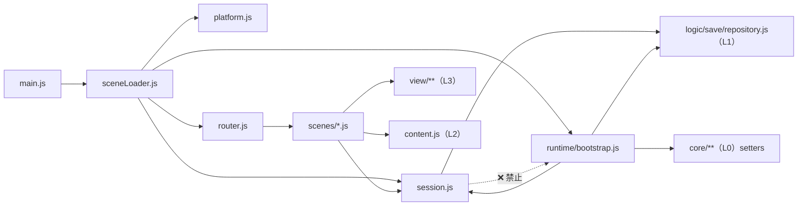

# 编排线代码地图（orchestration-code-map.md）

> **父文档**：`docs/orchestration/orchestration-impl.md`（落地计划 / 施工批 / as-built）· 真值 `docs/orchestration/orchestration-design.md`。
> **结构面**：`docs/arch-code.md §2`（L4 的文件与入口）/ `§3`（依赖规则）。
> **邻线同类文件**：`docs/save/save-code-map.md`（存档线的写法范本）。
> **状态**：✅ **已通过人类评审（2026-10-18，与 impl 同批；ORP1–ORP6 全部拍板）**。**第一刀已落码（2026-10-18）** ⇒ 第一刀那一行状态已翻；其余批仍"未发码"（表中状态列只有"现状 / 目标 / 未发码 / 已落"几种值）。
> ⚠️ **随 ORP3 重写**：会话**只有 XML 档**（v2/v3 直接废弃）⇒ 导出里**没有** `legacy`/`adoptXml`（改为 `adopt`），**ORB3 作废**。

---

## 0. 一句话

本线把 L4 编排层从「**散在场景里**」（`router.js` 37 行 + `state.js` 5 行 + 场景内的会话逻辑）收成
**四个文件 + 一个装配点**：`session.js`（状态）· `sceneLoader.js`（换场景）· `platform.js`（平台）· `runtime/bootstrap.js`（外部能力）；
`main.js` 只做引导。

---

## 1. 现状（实测 2026-10-18）

| 文件 | 行数 | 现在是什么 | 问题（对应 design §3） |
|---|---|---|---|
| `game/app/main.js` | 16 | 判 Ruffle → 补 `#/title` → `route()`；末尾 `rvDemo` 调试按钮 | 无启动编排（状态机/装配点都没有） |
| `game/app/router.js` | 39 | hash 解析（`:13-17`）+ `SCENES` 表（`:10`）+ `go()` + `hashchange` | 只有"挂载"半边，没有 last/next、没有加载层挂钩 |
| `game/app/state.js` | 5 | `APP = { lastResult, scene }` | 跨场景只这 2 个字段；真正的会话住在地图场景里 |
| `game/app/scenes/mapScene.js` | 760 | **含会话**：`SAVE`/`SESSION`/`RST`/`S`/`A` + `initSession()`（`:106-151`）+ `saveNow()`（`:98`） | 违反 **OR1**：游戏级状态住在场景里；`unmount` 就作废 |
| `game/app/scenes/battleScene.js` | 650 | 15 处 `SESSION`（官方血统战斗） | 直接摸 L1 会话模块 |
| `game/app/scenes/rbattleScene.js` | 441 | 10 处 `RST` + 3 处 `SESSION`（重启血统） | 同上；且自己 `localStorage` 落盘（`:160-168`） |
| `game/app/scenes/{title,login}Scene.js` | 23 + 23 | B5 的 STB-a/b/c（**已落**）：切画布模式 + 挂 `view/start/*` | 批 C 要接 `repository`（未接） |
| `game/app/battle/driver/coreBattleDriver.js` | 235 | 装 4 条缝（`:55-58`）+ `playerRandom` **局部变量**（声明 `:42`、用法 `:58`） | 装配散落；`player.random` **恒 0**（不是存档值） |
| `game/app/battle/driver/tables.js` | 54 | 装 4 个 registrar（`:32,33,45,47`） | R7 的第 5 个（`setElementGroups`）**孤儿** |
| `game/app/content.js` | 214 | L2 内容桥单出口（`loadContent()` 等） | ✅ 符合规则 4 |

**实测规模**：`game/app/**` 编排侧（`main/router/state/scenes`）= **16 + 39 + 5 + 1 897 = 1 957** 行，其中地图场景 **760** 行里约 **49** 行是会话逻辑（`:103-151`：模块级状态 + `initSession()`）。

---

## 2. 目标文件表

| 文件 | 层 | 状态 | 导出（目标） | 归属批 |
|---|---|---|---|---|
| `game/app/main.js` | L4 | 改 | （无导出；只写引导） | ORB1 / ORB4-a |
| `game/app/session.js` | L4 | **新建** | `session`（单例对象）、`ensureLoaded`、`adopt`、`active`、`takeResult`、`readRandom`/`writeRandom`/`readPlayerData`、`save`、`setOverlay`/`subscribeOverlay`、`reset` | **第一刀**（会话 = XML 单一血统；`readRandom` 三支经 ORB4-a） |
| `game/app/sceneLoader.js` | L4 | **新建** | `boot`、`changeScene`、`current`、`last`、`onBeforeChange` | ORB2（`boot` 由 ORB4-a 先落） |
| `game/app/platform.js` | L4 | **新建** | `init`、`setCursor`、`screenSize`、`onlineMode` | ORB1 |
| `game/app/runtime/bootstrap.js` | L4 | **新建** | `bootstrapRuntime({storage})`、`runtimeStatus` | **ORB4-a**（`storage` 归属 + R3 的值）/ ORB4-b（补其余六缝 + R4/R5 建档） |
| `game/app/runtime/clock.js` | L4 | 新建 | （R2 的真实现） | ORB4-b |
| `game/app/runtime/hint.js` | L4 | 新建 | （R5 → `openHintbox`） | ORB4-b |
| `game/app/services/clock.js` | L4 | 新建 | `start/pause/resume/stop` | ORB4-b |
| `game/app/services/net.js` | L4 | 新建 | `get/download` | ORB4-b |
| `game/app/services/audio.js` | L4 | 新建 | `playMusic/playSound/playEffect/capture/restoreMusic` | ORB4-b |
| `game/app/view/mech/loadingScreen.js` | L3 | 新建（视觉归 A1） | `show/hide/setText` | ORB5 |
| `game/app/router.js` | L4 | 改（**减弱职责**） | `SCENES`、`parseHash`、`route`、`go`（保留） | ORB2 |
| `game/app/state.js` | L4 | 改（**转发**） | `APP`（转发到 `session`） | ORB1 |
| `game/app/scenes/*.js` | L4 | 改 | 各场景 `mount/unmount`（签名不变） | 第一刀 / ORB2 |

**不改**：`game/core/**`（L0，**本线零改动**）、`game/logic/save/**`（L1，只调 `repository`）、`game/data/**`（L2）、`game/app/view/**`（L3，除 ORB5 的加载屏）。

---

## 3. 依赖方向（可人工核对）

**规则**（`docs/arch-code.md §3` 的 L4 细则）：

| # | 规则 | 核对方式（人工 grep，**不写脚本**） |
|---|---|---|
| L4-1 | 只许向下：L4 → L3/L2/L1/L0 | 在 `game/app/*.js` 里 `grep "from '\.\./logic\|from '\.\./core\|from '\./view"` 均应命中 |
| L4-2 | **`session.js` 不得 import**：`bootstrap.js`、`scenes/**`、`view/**` | `grep -n "import" game/app/session.js` 只出现 `../logic/save/repository.js` |
| L4-3 | **`bootstrap.js` → `session.js` 单向**（禁反向，否则成环） | `grep -n "session" game/app/session.js` **不应**出现 `bootstrap` |
| L4-4 | **场景不得触碰存档**：`grep -rn "localStorage" game/app/scenes/` 应为空，且 **不 import** `logic/save/**`（只经会话 ⇒ **OR1/OR5**） | 档只经会话：读 `session.active`、写 `session.save()` |
| L4-5 | **`storage` 只在装配点创建**（**OR7**） | `grep -rn "createFsStorage\|createLocalStorageAdapter\|createMemStorage" game/app/` **仅** `runtime/bootstrap.js` |
| L4-6 | **存档单一入口**：app 只经 `repository.js`（`docs/arch-code.md §3` 规则 5） | `grep -rn "logic/save/" game/app/` 只命中 `session.js` 与 `runtime/bootstrap.js` |
| L4-7 | **服务互不认识**（**OR6**）：三件之间**互不 import** | `grep -n "services/" game/app/services/` 为空 |

> 虚线 = **禁止存在**的边（画出来是为了核对，不是依赖）；其余实线都是上层调下层 / 同层单向。

---

## 4. 接口表（签名 / 消费者 / 默认行为）

> ⚠️ **关于 `session.` 前缀（2026-10-18 明确；当天已连踩两次，见 impl §7.1 偏差 11/12）**：`game/app/session.js` 是「**一个 `session` 对象**（只装字段：`gid`/`storage`/`data`/`state`/`active`/`random`/`currentMapId`/`overlay`…）
> + **一批并列的模块级导出函数**」的**混合形状**。下表的 `session.X(...)` 只是"会话模块的 X"的简写，**落地时按下面三条写**：
> ① 读/写**字段** ⇒ `import { session } from './session.js'`（`session.gid` / `session.active` / `session.storage`…）；
> ② 调**动作** ⇒ 点名 import 函数（`import { ensureLoaded, adopt, ensureTables } from './session.js'`）；
> ③ ⚠️ **不要** `import * as session` 再读字段 —— 命名空间里只有**导出名**，没有对象字段；同名函数还会**撞车**
>    （实例：`export const active = () => session.active` 让 `session.active` 读到**函数** ⇒ `rbattleScene` 跳过读档并崩在 `state.team`；该别名**已删**）。
> **对象上并没有那些动作函数** ⇒ 写成 `session.adopt(...)` 会抛 `TypeError`。

| 接口 | 签名 | 消费者 | 未装/未调用时 |
|---|---|---|---|
| `ensureLoaded({gid = 0})` | `Promise<Active>` | `mapScene.mount`（经 `session.ensureLoaded`） | 幂等；槽位 = **路由** `#/map?slot=N`（**批 C 已落**，不再是"临时桥"）；未载入前 `session.active` 为 `null` |
| `ensureTables()` | `Promise<tables>` | `loginScene`（**批 C**，缺档造默认档要 `tables`） | 只读一次（`ensureMeta` 记忆化）；⚠️ 模块导出 |
| `adopt({gid, data})` | `void` | `loginScene`（**批 C**） | ⚠️ `session.js` 的**模块导出**，不是 `session` 对象的方法 |
| `session.readRandom()` / `writeRandom(v)` | `number` / `void` | `coreBattleDriver`（R3 的**值**） | 会话未载入 ⇒ `null`（**ORB4-b** 落独立 setter 后改为抛，runtime §5 R3） |
| `session.readPlayerData(key)` | `number｜null` | 同上 | 同上 |
| `session.save(reason)` | `Promise<void>` | 场景的**变更点**（`active.save()` 内部调）· 批 C 的 View · 将来的 R4 适配 | 未载入 ⇒ no-op |
| `session.takeResult()` | `any｜null` | `mapScene.applyBattleResult` | 返回 `null`（**OR4**：一次消费） |
| `session.setOverlay(v)` | `void` | View 面板/将 M4 | 订阅方自行决定 HUD（**OR8**） |
| `sceneLoader.changeScene(name, {params, network})` | `Promise<void>` | 场景、`main.js` | — |
| `sceneLoader.onBeforeChange(fn)` | `unsub` | ORB5 加载层 | — |
| `platform.setCursor(tex｜null)` | `void` | `changeScene` / 地图线 | 空实现（光标今天不存在） |
| `bootstrapRuntime({storage})` | `Promise<void>` | `sceneLoader.boot` | **幂等**；重复调只重装 |
| `runtimeStatus()` | `object` | 手测诊断 | — |

---

## 5. 与邻线文件的接触点

| 本线文件 | 对面文件 | 接触面 |
|---|---|---|
| `session.js` · `runtime/bootstrap.js` | `game/logic/save/repository.js` | 六函数（`docs/save/save-code-map.md §2.5`）+ `isEmpty`/`MAX_SAVE_COUNT` |
| `runtime/bootstrap.js` | `game/logic/save/storage.js` | `createFsStorage()`（唯一创建点） |
| `runtime/bootstrap.js` | `game/core/parser/identifier-effect.ts`、`game/core/battle/{phase,effect-handler}.ts`、`game/core/buff/*.ts`、`game/core/effect/effect.ts` | R1–R7 的 setter（`docs/runtime/runtime-components-design.md §5`）。⚠️ **ORB4-a 一个都不直接调**：R3 的"值"经 `coreBattleDriver.js:58` 的委托实现；其余随 ORB4-b 进 `bootstrap.js` |
| `runtime/hint.js`（ORB4-b） | `game/app/view/panels/hintbox.js:36` | `openHintbox({title, content, optionNum, onConfirm})` |
| `scenes/loginScene.js`（批 C） | `game/app/view/start/loginView.js` | `mount(el, {onEnterMap})`（`game/app/view/start/loginView.js:27`） |
| `scenes/*.js` | `game/app/content.js` | `loadContent()` / `petConfig` / `restart*`（L2 单出口） |
| `sceneLoader.js` | `game/app/router.js:10` | `SCENES` 表（**保留**，ORC2 已符合） |

---

## 6. 状态（批 × 落地）

| 批 | 状态 | 备注 |
|---|---|---|
| **第一刀 = ORB1 × ORB4-a**（会话 XML 单一血统 + 平台接口 + `storage` 归属 + R3 的值） | ✅ **已落（2026-10-18）** | 本份 §3.2 / §3.3；**解锁 B5 批 C**；实况/偏差见 impl §7 |
| ORB2 场景切换器 | ⬜ 未发码 | 要点级 |
| ~~ORB3 宇宙分流上移~~ | ❌ **作废**（ORP3：v2/v3 直接废弃） | 本份 §3.4 |
| ORB4-b 服务三件 + 归位 | ⬜ 未发码 | 要点级 |
| ORB5 加载层薄版 | ⬜ 未发码 | 要点级 |
| （既有）`router.js` 名字映射 | ✅ 已符合 ORC2 | `game/app/router.js:10` |
| （既有）B5 的 STB-a/b/c | ✅ 已落（邻线） | `docs/view/scene/start/view-scene-start-impl.md §9` |

**as-built 归属**：本表只记"落没落"；**实况/偏差/人手测项**一律写 `docs/orchestration/orchestration-impl.md §7`（`docs/arch-docs.md §5`）。

---

## 7. 人工核对清单（发码后逐条 grep，**不写脚本**）

1. `grep -rn "createFsStorage" game/app/` ⇒ **1 处**（`runtime/bootstrap.js`）—— **OR7**；
2. `grep -rn "localStorage" game/app/scenes/` ⇒ **空** —— **OR1/OR5**；
3. `grep -rn "logic/save/" game/app/` ⇒ 只 `session.js` + `runtime/bootstrap.js` —— 规则 5；
4. `grep -n "import" game/app/session.js` ⇒ 不含 `bootstrap` / `scenes` / `view` —— 无环；
5. `grep -rn "location.hash *=" game/app/` ⇒ **1 处**（`router.go` 或 `sceneLoader.changeScene`，**二选一**，不许两处）—— **OR2**；
6. `grep -rn "setRuntime\|registerTables\|installBattleHost\|setSaveRequest\|setHintSink" game/app/` ⇒ 全在 `runtime/bootstrap.js`（ORB4-b 完成后）—— **OR7**。
