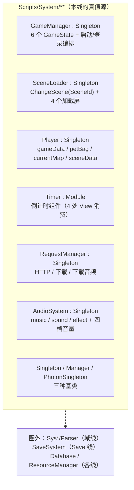

# 编排线设计（orchestration-design.md）

> **父文档**：`docs/architecture.md`（§1 不变量 / §2 分层 / §4 指针表）· 结构面 `docs/arch-docs.md §0.1/§2`、`docs/arch-code.md §1/§2/§3`（L4 编排层）。
> **邻线（本线只借不抄）**：
> A1 `docs/view/mech/view-shell.md`（**加载层的视觉与三段式**）· Save 线 `docs/save/save-design.md` + `docs/save/save-code-map.md`（**`GameData` 格式与"修饰"规则**）；
> 运行时线 `docs/runtime/runtime-components-design.md`（**R1–R7 七条缝 + §6 装配点**）· 域线 `docs/domain/domain-design.md` · 引擎线 `docs/engine/battle-engine-design.md`。
> **状态**：✅ **已写 + 已通过人类评审**（2026-10-17）。**ORQ1–ORQ7 全部拍板** ⇒ **§6 即本线决议表**（含已采纳的结论）。
> ⚠️ **本轮（2026-10-17）增量**（从地图线 M4 `docs/map/map-dialog.md` **DLQ3** 回执进来，**不动已拍板的 ORQ 表**）：
> 新增 **§2.9 怪癖 ORC4**（`DialogManager` 的两个跨层副作用）+ **§4.3 模态处置** + **不变量 OR8**（⚠️ **OR8 待人类评审**）。
> ⚠️ **同轮第二笔增量**（从地图线 **M5** `docs/map/map-teleport.md §9` 回执进来，同样**不动 ORQ 表**）：
> 新增 **§2.10 怪癖 ORC5**（`MapManager.LoadPlayer` 每次进图复位射击态 ⇒ `isShootMode` 有**三个写入者**、没有一个声明者）+
> §2.3 键袋段的**死键反面例 `mapTeleportList`（1 写 / 0 读）** + §7 人手测第 **7** 行。M5 的 **TPQ5**（`spawn` 走入参、不进键袋）＝ **OR4 的实例**。
> **配对 `impl` 已写**（**2026-10-18，阶段一续第一份，待人类评审**）：`docs/orchestration/orchestration-impl.md` + `docs/orchestration/orchestration-code-map.md`。。
> **立线决定**：`totalk.md` **T2·4**（人类 2026-10-17 拍板"先立编排线"；原列为"唯一结构性缺口"）。
> **编号**（`docs/arch-docs.md §7` 口径）：本线**局部**编号 = **OR1–ORn**（不变量）/ **ORB1–ORBn**（施工批）/ **ORQ1–ORQn**（待拍板）/ **ORC1–ORCn**（上游怪癖登记）。
> ⚠️ 圆圈数字 **①–⑧ 只指「人类决议」**（索引 = `AGENTS.md §5`），与上面四套无关。
> **目录口径**：线名 `orchestration`，目录 `docs/orchestration/`（登记 `docs/arch-docs.md §0.1`）。

---

## 0. 这份文档回答什么

1. **"编排层"不是新概念 —— 它早就在代码里，只是一直没有 design。** `docs/arch-code.md §2` 的表里那一行
   **「L4 编排 | `game/app/scenes/**`、`router.js`、`state.js` | 场景挂载、输入、宇宙分流」** 就是它。
   ⇒ 本份补的是**这一层的真值、不变量与落点**，不是发明一个新模块。
2. **上游这层叫 `Scripts/System/**`：七件，≈930 行。** 它是全仓**最大的耦合中枢** ——
   `Player.instance` 被调 **251 处**（`AudioSystem.instance` 40 · `SceneLoader.instance` 31 · `GameManager.instance` 12 · `RequestManager.instance` 8）。【实测】
3. **为什么必须立**：三条现有文档的箭头**指向这里就断**（`docs/domain/domain-design.md:63`、`docs/domain/domain-skill.md:367`、
   `docs/engine/battle-engine-effects.md:159` 与 `:397` 都写"→ Save 线 / **编排线**"，而那条线当时不存在）。
   不立就**继续产生悬空引用**；且这一条**与"要不要做工坊/PVP"无关**（游戏得能启动、能换场景、能放声音）。
4. **目标形状**：给 L4 一份能落地的设计 —— ① **谁持有游戏级状态**（会话）② **什么时候切场景**（切换器）
   ③ **启动顺序**（它是运行时线 §6「一个装配点」的**宿主**）④ **三件服务**（时钟 / 请求 / 音频）各自一个缝。

---

## 1. 范围与边界

| 圈里（本文定） | 圈外（谁定） |
|---|---|
| **L4 编排**的产物与落点：会话 / 场景切换器 / 服务三件 | 加载屏的**外观与三段式** → **A1** `docs/view/mech/view-shell.md §2.2`（本线只定**何时调**） |
| **启动顺序**与**状态机**（要不要、长什么样） | `GameData` 的 XML 格式、`finishNewGame` / `maybeDailyLogin` / `applyVersionUpdates` 的**规则** → **Save 线** `docs/save/save-design.md §5` |
| 「游戏级状态」的**持有者**与**跨场景递数据**的契约 | 存档**字段**与 `SettingsData`（音量四档的**存储**）→ **Save 线** `docs/save/save-impl.md` / `docs/save/save-xml-spec.md` |
| 服务三件（时钟 / 请求 / 音频）的**缝与默认行为** | 核心层需要的外部能力（R1–R7）的**签名与默认** → **运行时线** `docs/runtime/runtime-components-design.md §5` |
| 换场景时**谁卸载谁挂载**、`location.hash` 的唯一写者 | 单个场景**画什么** → `docs/view/scene/**`、`docs/view/view-design.md` |
| 平台接口（屏幕尺寸 / 鼠标光标 / 在线开关）的**开关位** | 联机本身（Photon，48 处）→ **T2·7**（范围未定，见 §6 **ORQ5**） |

**三条边界要说清**（否则必出"同一事实散两处"）：

1. **`SceneLoader` / `LoadingScreen`：视觉归 A1，调用序归本线。**
   A1 已经写了 `SceneLoader` 的持有物、`ShowLoadingScreen(sceneId)`、三段式、四个加载屏子类的花样
   （【源码】`docs/view/mech/view-shell.md §2.2`；原始 `Scripts/System/SceneLoader.cs:10-99`、`Scripts/Scene Specific/Loading/LoadingScreen.cs:8-62`）。
   ⇒ **本线不重抄那份几何与三段式**，只补 A1 缺口表第 1 行承认的那件事：**"我们无对应物（`router.go` 直接换场景）"** 该怎么补。
2. **`GameManager.GameLogin` 的"修饰"归 Save 线、"调用序"归本线。**
   `docs/save/save-design.md §5` 已逐条登记 `GameLogin` 里那些修饰（版本迁移、`petBag` resize、每日登录、调试模式白送）；
   本线只定**它们按什么顺序、在什么时机被调**（§4.2）。
3. **本线是运行时线 §6「一个装配点」的宿主。**
   `docs/runtime/runtime-components-design.md §6` 已定目标形状：**一个装配点、一个顺序**
   （`game/app/runtime/bootstrap.js`：R7 先 → R1/R2/R3 → R4/R5 → R6 每局一次）。
   ⇒ **那个"什么时候调 bootstrap"的答案在本线**（§4.2）；缝本身**不重定义**。

---

## 2. 上游真值

### 2.0 全貌



| 件 | 文件 | 行 | 被谁调（【实测】调用点数） |
|---|---|---|---|
| `GameManager` | `Scripts/System/GameManager.cs` | 175 | `GameManager.instance` **12** |
| `SceneLoader` | `Scripts/System/SceneLoader.cs` | 110 | `SceneLoader.instance` **31**（其中 `ChangeScene` **19**） |
| `Player` | `Scripts/System/Player.cs` | 96 | **`Player.instance` 251** |
| `Timer` | `Scripts/System/Timer.cs` | 80 | 4 处 `[SerializeField] Timer`（全在 View） |
| `RequestManager` | `Scripts/System/RequestManager.cs` | 161 | `RequestManager.instance` **8** |
| `Singleton` 三基类 | `Scripts/System/Singleton.cs` | 58 | 子类 **16 个**（`Manager<T>` 8 · `Singleton<T>` 7 · `PhotonSingleton<T>` 1） |
| `AudioSystem` | `Scripts/System/AudioSystem.cs` | 250 | `AudioSystem.instance` **40** |
| （平台工具）`Utility` | `Scripts/Helper/HelperUtility.cs` | 42 | `Utility.` **42** |

### 2.1 `GameManager`：6 状态机 + 启动/登录编排

- **`GameState`**（`GameManager.cs:167-175`）：`Quit=-1 / Init=0 / Login=1 / Play=2 / Fight=3 / MiniGame=4`。
- **`ChangeState(newState)`**（`:49-78`）：先 `OnBeforeStateChangedEvent`（`:51`），赋值 `state`，打一行 `Debug.Log("New State: …")`，
  `switch` → `GameQuit` / `GameInit` / `GameLogin` / `GamePlay`（`Play` 与 `MiniGame` **共用这一支**）/ `GameFight`，再 `OnAfterStateChangedEvent`；
  未知状态**抛 `ArgumentOutOfRangeException`**（`:75`）。
- ⚠️ **怪癖 ORC1（登记，不照抄）**：**这个状态机今天在空转** ——
  ① `state` **没有任何读者**（全仓 `grep GameManager.state` = 0 命中）；
  ② 两个事件 `OnBeforeStateChangedEvent` / `OnAfterStateChangedEvent` **零订阅者**；
  ③ 三个处理函数体是空的：`GameInit() { }`（`:80-83`，里面只剩注释掉的 `GetVersionData()`）、`GamePlay() { }`、`GameFight() { }`（`:130-131`）。
  ⇒ 真正推动场景的是**加载屏子类**里那两句：`NormalLoadingScreen.cs:41` 与 `FightLoadingScreen.cs:20`（见 §2.2）。
  **目标行为：我们保留"启动顺序 + 场景切换"，不照抄一个没人读的枚举**（落在 **OR6** 与 §4.1）。
- **`GameLogin()`（`:90-128`）= 登录侧的编排主序**（⚠️ 明细规则归 Save 线，本处只记**顺序**）：
  `Mission.RemoveLegacyModEntries()` → 版本不同则 5 个 `*.VersionUpdate()` → 写回 `gameData.version` →
  `petBag` 长度不足 `PET_BAG_SIZE` 则 resize → 跨天则 3 个 `*.DailyLogin()` → 写 `lastLoginDate` →
  `debugMode` 白送（全宠 / 全道具 99999 / 金币钻石 2e7）→ **`SaveSystem.SaveData()`** → `ChangeState(Play)`。
  ⚠️ 它一口气吃了 **Mail / Mission / Activity / Pet / BattleRecord** 五条**今天不存在**的线
  （= `totalk.md` **T2·10** 邮件 / **T2·16** 任务 / **T2·17** 活动，见 §6 **ORQ4**）。
- **`GetVersionData()`（`:133-164`）**：`versionDataRoute` = 在线取 Dropbox、离线取 `Data/System/version.xml`；
  失败**降级**：在线失败 ⇒ 关掉 `onlineMode` 改读本地 ⇒ 本地也失败 ⇒ `new VersionData()` + `RequestManager.OnRequestFail("获取本地版本档案失败，请重新启动游戏")`。
  成功 ⇒ 写 `GameManager.versionData` + **`Database.instance.Init()`**。
- 平台开关位：`debugMode` / `onlineMode`（`:9-10`）、`serverUrl = "Data/"`（`:11`）、`platform`/`gameFilePostfix`（`:12-13`）、三个 Dropbox 直链（`:14-37`）。
  ⚠️ **我们不复刻 Dropbox 直链**（那是在线模式/发行渠道的事）；`debugMode` 白送对应我们今天的 `restartOn()` 调试白名单（**有意保留，便于手测**）。

### 2.2 `SceneLoader`：场景切换 + 加载屏（**视觉部分见 A1**）

- **`SceneId`**（`SceneLoader.cs:102-110`）：`Title=0 / Login=1 / Map=2 / Battle=3 / Room=4 / Game=5`。
- **`ChangeScene(SceneId index, bool network = false)`**（`:29-35`）：`PhotonNetwork.AutomaticallySyncScene = network` →
  `lastSceneId = nextSceneId` → `nextSceneId = (int)index` → `OnBeforeLoading()`。
- **`OnBeforeLoading`**（`:56-67`）：`ShowLoadingScreen(nextSceneId)`（`:57`）→ **`ResourceManager.instance.UnloadResources()`**（`:59`）+
  `Resources.UnloadUnusedAssets()` → 三段式 `OnBeforeLoading → OnLoading → OnAfterLoading` → `OnFinishLoading()` ⇒ `HideLoadingScreen()`。
  ⚠️ **`ChangeSceneAsyncPhoton`（`:77-90`）整段被注释掉** ⇒ `network=true` 那条路今天**没有实现**（登记：本线只留 `{network}` 开关位，见 §6 **ORQ5**）。
- ⚠️ **怪癖 ORC2（登记）**：`SceneManager.LoadSceneAsync(sceneIndex)` **直接吃枚举值当 build index**
  （`LoadingScreen.cs:29`）。今天对得上纯属**顺序巧合**：
  `ProjectSettings/EditorBuildSettings.asset` 的顺序 = `Title, Login, Map, Fight, Room, Game`（序号 0–5）
  【源码】上面两个文件 —— 而**枚举成员叫 `Battle`、场景文件叫 `Fight.unity`**（**名字不一致**）。
  ⇒ **目标行为**：我们的场景**按名字**注册（`SCENES` 表），不吃隐式序号（今天 `router.js:8` 已经是名字映射 ⇒ **已符合**，登记即可）。
- ⚠️ **换图的真实流程藏在加载屏里**（`NormalLoadingScreen.cs:10-45`）：**先查表拿 `Map` 对象，再换场景** ——
  `Database.instance.GetMap(currentMapId, 成功, 失败)`；成功则 `lastMapId/lastMap ← 当前`、`currentMapId/currentMap ← 新`；
  **失败则把错误写进加载文字并 `yield break`（换场景中止！）**；`LoadSceneAsync` 之后才 `ChangeState(Play | MiniGame)`。
  ⇒ 而 `MapManager.Init()`（`Scripts/Scene Specific/Map/MapManager.cs:23-30`）**只消费** `Player.instance.currentMap`（不查表）。
- 加载屏取法（`:91-99`）：`index < 0` ⇒ `transparentLoadingScreen`；`index >= loadingScreens.Length(4)` ⇒ `defaultLoadingScreen`；
  即 **`Title/Login/Map/Battle` 有专属屏，`Room/Game` 落到默认屏**。【源码】`SceneLoader.cs:12,91-99`

### 2.3 `Player`：全局会话单例（**本线最重的一件**）

`Player : Singleton<Player>`（`Player.cs:9-96`）一个对象上挂着**四类东西**：

| 类 | 字段 | 说明 |
|---|---|---|
| **存档镜像** | `gameDataId`、`gameData`（`GameData`）、`nickname => gameData.nickname`、`petBag ⇄ gameData.petBag`、`petBagCursor`、`pet => petBag[petBagCursor]` | ⚠️ **`petBag` 是 `gameData.petBag` 的别名**，不是第二份数据 |
| **场景/导航态** | `currentMapId = 70`、`lastMapId`、`currentMap`、`lastMap`、`currentNpcId`、`currentMissionId`、`currentMiniGame`、`follower` | `currentMap`（`Map` 对象）的**唯一写入者是加载屏**（§2.2）；`TeleportHandler` / `LoginManager` 只写 `currentMapId` |
| **战斗态** | `currentBattle`、`currentBattleRecord` | 每局生灭 |
| **场景级 KV** | `static sceneData`（`Get/Set/RemoveSceneData`）+ `random` / `isShootMode` 两个**披着属性外衣的 KV** | 见下 |
| **随机** | `random`（`:30-34`）= `sceneData["random"]`，**除以 4** 当队里有 `Buff.GetEmblemBuff(x).id == 20_0051` 时 | ⚠️ 这就是运行时线 §2 说的"**持久骰子** `Player.instance.random`"（`Identifier.cs:15-26`：读 `:21`，写时**先 `Random.Range(0,100)` 播种**再返回 `:25-26`）⇒ **语义复刻，序列不复刻**（决议 ①） |

- ⚠️ **怪癖 ORC3（登记）**：`SetSceneData` 里有**两个特例键**（`:63-89`）——
  `"seed"` ⇒ 顺手把**鼠标光标**换成该道具图标（`Utility.SetCursor`）；`"shootMode"` ⇒ 换准星光标，
  且**当前图是 990 时直接 `return`（写不进去）**。⇒ 一个"设值"函数在改**光标**。
  **目标行为**：KV 与 IDE 副作用**分开**（KV 归会话；光标归平台接口 `setCursor()`，见 §4.1）。
- `random` 的初始化：`Start()` 里 `random = Random.Range(0, 100)`（`:45-49`）⇒ 上游**墙钟/真随机**播种。
- `OnApplicationQuit` 里的存档保存**被注释掉了**（`:51-57`）—— 即"退出即存"**今天不生效**。
- ⚠️ **键袋里的死键（从地图线 M5 回执进来，**TPC9**）＝ 本线的反面例**：按字面量全量枚举 `Player.(Set|Get|Remove)SceneData("…")` ⇒
  **袋里共 10 个键，其中 3 个"有写无读"**：
  | 键 | 写 | 读 | 症状 |
  |---|---|---|---|
  | `mapTeleportList` | `MapSceneView.cs:477` | **0** | 每图装配光口都塞一本字典，**从来没人拿**，且 `Teleport` 不清 ⇒ 换图后挂着**指向已销毁 `GameObject`** 的条目 |
  | `PetSelect` | `PetSelectHintboxController.cs:13` | **0** | 写的是**选中的 Pet 对象**；而真正被消费的是**紧挨着的那条键** `PetSelectIndex`（`FusionModel.cs:31/38` 读，融合线 = **C 组排期 ②** 的唯一入口）⇒ **对象版从来没人拿** |
  | `is_mod_exist` | `ResourceManager.cs:57` | **0** | 一个 bool 塞进**场景级**袋（它根本不是场景级事实）⇒ 语义放错了格子 |
  对照同袋的 `mapNpcList`（**1 写 / 7 读**：`MapSceneView.cs:285` 写，
  `DialogView.cs:868/884/919/941` + `NpcController.cs:151` + `NpcConditionHandler.cs:23` + `DialogManager.cs:78` 读）——
  **同一个袋子里一半是活的、一半是死的**，而**袋子的 API 看不出差别**。
  ⇒ **目标口径**：会话里的**每一项状态必须至少有一个具名读取方**；`spawn`（原 `mapInitPos`）按 M5 **TPQ5** 改走 `changeScene` 的**入参**、不进键袋（**OR4** 的实例）。

### 2.4 `Timer`：可复用的倒计时组件（**消费方全在 View**）

- `Timer : Module`（`Timer.cs:7-80`）：`speed` / `currentTime` / `startTime` / `isPaused` / `isDone`
  + `IText secondText`（**一个文本回调**）+ `onStartEvent` / `onDoneEvent`；
  `Update()` 里 `currentTime -= speed * Time.deltaTime`，到 0 调 `Done()`；
  接口 = `SetSpeed / SetTimer(sec, spd, start) / GetTime / StartTimer / Pause / Unpause / Done / Restart`（`Mathf.CeilToInt` 显示）。
- **四个消费方**：`MVC/View/Battle/BattleSystemView.cs:10`（回合超时，`OnTimerDone` ⇒ 喂默认技，见 `docs/engine/battle-engine-views.md`）、
  `MVC/View/Battle/Components/Anim/BattleSkillBubbleAnimView.cs:9`、`MVC/View/Basic/MiniGame.cs:13`、`MVC/View/Room/RoomSettingsView.cs:13`。
- ⚠️ **与运行时线 `R2 时钟` 不是同一件**：R2 = **核心层要一个 `now()`**（注入进 `core/**`，`docs/runtime/runtime-components-design.md §3.2`：今天 **0 个实现、2 处默认抛**）；
  `Timer` = **上层一个可暂停/可加速的倒计时**。⇒ 本线**不重定义 R2**。

### 2.5 `RequestManager`：HTTP / 下载 / 下载音频

- 四个入口（`RequestManager.cs:30-159`）：`Get(uri, onSuccess, onFail)`、`GetDownloadSize(uri, onReceive)`（HEAD 读 `Content-Length`）、
  `Download(uri, path, onSuccess, onFail, onProgress)`（**`DownloadHandlerFile` 直接落盘** + 逐帧进度）、
  `DownloadAudioClip(uri, …)`（`UnityWebRequestMultimedia` + `AudioType.MPEG`）。
- 默认失败行为：`OnRequestFail(text)` = **弹一个 Hintbox**（标题"提示"，14px，1 个选项）(`:23-28`)。
  ⇒ 即 **"请求失败 ⇒ 弹窗"** 的默认接线（对应运行时线 **R5 提示 sink**）。
- ⚠️ **我们的现状**：`game/app/content.js` 等**直接 `fetch`**，没有这一层（也没有进度/落盘/失败弹窗的默认）。

### 2.6 `AudioSystem`：三路音源 + 四档音量 + **身份幂等**

- 三个 `AudioSource`（`AudioSystem.cs:29-31`）：`musicSource`（BGM）/ `soundSource`（一次性 `PlayOneShot`）/ `effectSource`（环境音）。
- **`AudioVolumeType`**（`:248-250`）：`None / BGM / UI / BattleBGM / BattleSE`；`GetVolume()` 读 `Player.instance.gameData.settingsData.*` 并 **`/ 10f`**（0–10 折成 0–1，`:36-46`）。
- **BGM 身份幂等**（`:53-76`）：`PlayMusicTracked(clip, volumeType, identity)` —— 若 **同一个 clip + 同音量 + 正在播 ⇒ 返回 false（不重播）**，否则换 clip 重播；
  `identity` 缺省时按 clip 名兜底（`BuildClipMusicIdentity`，`:197-200`）。
- **切场景续播**：`CaptureMusic()`（`:78-91`）/ `TryRestoreMusic(snapshot, expectedCurrentIdentity, restorePlayback)`（`:93-120`）——
  存**clip/time/volume/isPlaying/identity**，回来后按 identity 校验再续播（`musicSource.time` clamp 到 `length - 0.01`）。
  消费点：`MVC/View/Map/MapSceneView.cs:41` 的 `refreshBGM = (SceneLoader.instance.GetLastScene() != SceneId.Map) || …`（**换图不打断 BGM**）。
- 身份构造（`:122-195`）：`BuildMapMusicIdentity(map)` = `"map-bgm:<category>/<bgm>"`；
  `BuildResourceMusicIdentity(source, path)` 对 `mod/auto/story` 三类**算文件 SHA256**（带 length+writeTicks 缓存）⇒ `"resource-content:sha256:<hash>"`。
  ⇒ **Mod 换了一个同名的 mp3，身份就会变**（这是刻意设计的"内容身份"，不是路径身份）。
- ⚠️ **我们的现状：`game/` 里音频 0 行**（`grep "new Audio\|Howl\|\.play()"` = 0 命中）【实测】。

### 2.7 基类与平台工具

- **`Singleton.cs:8-58`** 三个基类：`Manager<T>`（**不** `DontDestroyOnLoad`，随场景生灭）、`Singleton<T>`（**有** `DontDestroyOnLoad`）、`PhotonSingleton<T>`（`MonoBehaviourPunCallbacks` + `DontDestroyOnLoad`）。
  ⚠️ **`Manager<T>` 的重入策略是"销毁后来者"**（`if (instance != null) { Destroy(gameObject); return; }`）—— 即"**先到先得**"；
  三个基类的 `OnApplicationQuit` 都清 `instance` 并 `Destroy(gameObject)`。
- **`Module`（`MVC/View/Basic/Module.cs:7-11`）**：所有 Controller 的基类，只有两个便捷方法 —— `OpenPanel(panelName)` → `Panel.OpenPanel`、**`GoToMap(mapId)` → `TeleportHandler.Teleport(mapId)`**。
  ⇒ **"换图"的公开入口就一个**（本线的场景切换器要对齐它，见 OR2）。
- **`Utility`（`Helper/HelperUtility.cs:1-42`，声明在 `namespace UnityEngine`）**：`GetScreenSize` / `SetScreenSize` / **`InitScreenSizeWithRatio(w,h)`**（按屏幕比例反算窗口尺寸，Windows 再乘 4/5）/ **`SetCursor(Texture2D)`**（hotspot = 贴图中心）。
  ⚠️ 与 D7 登记的 `GetSortPriority`（同住 `Helper/`、同声明在 `namespace UnityEngine`）是**同一族的正名问题**（见 `docs/domain/domain-info.md §5 G12`）——本线的 `setCursor` 落点**不搬那个文件**，只搬**行为**（§4.1）。

### 2.8 边界外：同目录里**不属于本线**的文件（目录 ≠ 线）

| 文件 | 归谁 | 依据 |
|---|---|---|
| `System/Parser/{Identifier,Parser,Operator}.cs`（548+198+163） | **域线 D1** | `Identifier` 是 `pet.<x>` / `domain.` 表达式的求值器，`docs/domain/domain-base.md` 已认领 |
| `System/SaveSystem.cs`（1073） | **Save 线** | `docs/save/save-design.md` / `save-impl.md` |
| `System/Database.cs`（232） | **各线查表的公共面** | `GetMap`/`GetEffect`/`GetBuff` 等，被域线 `docs/domain/domain-effect.md` 等引用 |
| `System/ResourceManager.cs`（1307） | **各线（美术/表装载）** | `LoadXML` 被各处用；本线只用它的 `UnloadResources()`（属于"换场景编排"，§2.2） |
| `System/Data/{GameData,SettingsData,VersionData,YiteRogueData}.cs` | **Save 线**（`YiteRogueData` → **T2·9**） | 存档字段 |
| `Scripts/Scene Specific/*/*Manager.cs` | 各自场景线（Map → **渲染** `docs/view/scene/room/view-scene-map-content.md` + **写侧语义** `docs/map/map-design.md`；Battle → 引擎/View；Room → **T2·7**；Title/Login → **T2·6**；MiniGame → **T2·21**） | 按"场景归场景线" |

⚠️ **本表有一条例外**：`Scene Specific/Map/Entities/Dialog/DialogManager.cs` 的**对话语义**确实归地图线 M4
（`docs/map/map-dialog.md`），但它顺手做的**两个跨层副作用**是**会话/编排层**的 —— 见下一节 **ORC4**。

### 2.9 `DialogManager` 藏在"开对话"里的两个跨层副作用（**ORC4**，从地图线 M4 回执进来）

> 来源：`docs/map/map-dialog.md` **DLC9** / **DLQ3**（地图线判定"**不归本线**"，箭头指到这里）。

上游 `DialogManager.OpenDialog`（`Scene Specific/Map/Entities/Dialog/DialogManager.cs:82-96`）与 `OpenStoryDialog`（`:101-113`）各自**无条件**做了两件与"对话内容"无关的事：

| # | 副作用 | 位置 | 后果（可核） |
|---|---|---|---|
| ① | `Player.instance.isShootMode = false` | `:83` / `:101` | **开对话 ⇒ 退出射击模式**。⚠️ `:83` 在 `info == null ⇒ CloseDialog()` 的分支**之前**（`:85-88`）⇒ **连"用 null 关对话"都会把射击模式关掉**；且**关闭时不会恢复**（`CloseDialog` `:288-299` 里没有再写回）⇒ 玩家**必须重新点一次射击**才能继续，这是一条单向门。地图线 M2 的射击门（`docs/map/map-design.md` **MC3**）与 M5 的传送都被它被动影响 |
| ② | `UILayer.gameObject.SetActive(!active)` | `:60` / `:70`（两个对话层共用同一个 `UILayer`） | **开对话 ⇒ 整个 HUD 层隐藏**；`CloseDialog` 经 `:296-297` 把两个对话层都置 false ⇒ `UILayer` 恢复 true。⇒ 这既是"模态"的实现方式，也是**一处隐藏的双层互斥**：普通层与 story 层各自 `SetActive` 时都会**反写同一个 HUD 层** |

- ⚠️ 同处还有一条**本线要记账的会话状态没清干净**：`CloseDialog` 只写 `Player.instance.currentNpcId = 0`（`:298`），
  **不清 `:22` 的 `currentNpc`** ⇒ 关闭后 `DialogManager.instance.currentNpc` 仍指上一个 NPC（地图线登记为 **DLC10**，语义归 M4；**本线只关心"会话里允许留脏字段"这件事本身**）。
- 【实测】我们这边**没有对话**：`game/` 全仓 `dialog` **0 命中**（`docs/map/map-dialog.md §6`）⇒ 两个副作用今天**无处可发生**，趁早立规则成本为零。

### 2.10 进图时的隐式复位（**ORC5**，从地图线 M5 回执进来；与 **ORC4 ①** 同族但**不同处**）

> 来源：`docs/map/map-teleport.md §9`（M5 判"这是会话/编排层的副作用"，箭头指到这里）。
> ⚠️ **为什么不并进 §2.9 的表**：那张表的标题与判据都是"**开对话**这一件事顺手做的两件与对话内容无关的事"；本条发生在**另一件完全不同的事**（进图）里，
> 两处**写成同一句副作用**（`Player.instance.isShootMode = false`）⇒ **合并成一行会掩盖"有几个地方在写它"这个真问题**。

- **真值**：`MapManager.Init()`（`:23-30`：`PetTest(); LoadMap(); LoadPlayer();`，由 `Start()` `:18-21` 驱动）里的
  `LoadPlayer()`（`:39`）**第一行无条件**写 `Player.instance.isShootMode = false`（**`:41`**）—— 与"上一张图是不是射击图""玩家是不是刚点过射击"**都无关**。
  同函数随后还做两件会话侧的事：`SetPlayerPosition(GetSceneData("mapInitPos", map.initPoint))` 与 `RemoveSceneData("mapInitPos")`（`:45-47`，M5 §2.4 的落点消费端）。
- **合起来看 = `isShootMode` 一共有三个写入者**：`OpenDialog`/`OpenStoryDialog`（**ORC4 ①**）、`LoadPlayer`（本条）、以及 `SetSceneData("shootMode", …)`（**ORC3** 的光标特例）。
  ⇒ **射击态没有一个声明者** ⇒ 这正是 **OR8**（盖层/输入态单声明者）要防的形状；只是**射击态比盖层更散**。
- **目标行为**（不照搬）：进图**不重置**射击输入态；输入态是**会话的当前场景属性**，由 `changeScene('map', {mapId})` 时的**目标图是否射击图**决定（地图线 M2/**MC3** 的门），
  而不是由"发生过一次进图"决定。⇒ **§4.3 的处置表要能同时回答"对话开着"与"刚换图"两种时刻谁来裁决输入态**（本条给它补了第二种时刻）。
- 【实测】我们今天**既无对话、也无射击模式**：`game/` 全仓 `isShootMode` / `shootMode` **0 命中**（与 `dialog` 一样）⇒ 与 ORC4 同：**趁早立规则成本为零**。

---

## 3. 我们的现状（实测）

**L4 已经存在，但很薄**（`docs/arch-code.md §2` 的表行）：

| 上游件 | 我们今天有什么 | 缺口 |
|---|---|---|
| `GameManager` 状态机 | **无**。启动顺序 = `main.js:4-8`（判 `RufflePlayer` 在不在 → `route()`） | 无游戏级状态、无启动编排（**探针退役后 `main.js` 只剩 13 行**） |
| `SceneLoader` | `game/app/router.js`（37 行）：hash 路由 + `SCENES = {map, battle, rbattle}` + `go(name, params)`；**已满足 ORC2 的目标行为**（按名字，不吃序号） | 无加载层、无 last/next 语义、无"换场景时卸载资源"（今天是 `unmount` 里的 `innerHTML=''`） |
| `Player`（会话） | ⚠️ **散在场景里**：`mapScene.js:97-151` 的 `SAVE` / `SESSION` / `RST` / `S` + **`A`（`activeStore`：v2/v3 宇宙分流）**；跨场景只有 `state.js` 的 `APP = { lastResult, scene }`（**2 个字段**） | **游戏级状态住在地图场景内** ⇒ 换出地图就没人持有（`unmount` 直接作废）；`initSession()` 是**懒加载 + 缓存在模块级变量** |
| `Timer` | **无** | 无超时/倒计时原语 |
| `RequestManager` | **无**（`content.js` 直接 `fetch`） | 无进度、无落盘、无失败默认（R5 的消费方也缺） |
| `AudioSystem` | **无（0 行）** | 全程无声（连"换图不打断 BGM"这个行为都没有可挂的地方） |
| 平台接口 | `game/index.html:10-12`（舞台 1200×660 写死）+ `game/app/ui.css` | 无屏幕尺寸/光标/在线开关位（光标今天**不存在**；`seed` 特例也没处放） |

【实测】`game/app/` 编排侧总规模：`router.js` 37 行 + `main.js` 13 + `state.js` 5 + `scenes/{map,battle,rbattle}Scene.js`（**mapScene 760 行最大** / battleScene 650 / rbattleScene 441）。
⇒ **一句话**：我们把"**宇宙分流 + 会话**"塞进了**地图场景**，把"**跨场景递数据**"缩成了**一个字段**。

---

## 4. 目标形状（本线要落什么）

### 4.1 三件产物（落点 `game/app/`，**不改 L0/L1/L2**）

| 产物 | 建议落点 | 对应上游 | 负责什么 | **不**负责什么 |
|---|---|---|---|---|
| **① 会话** | `game/app/session.js`（进程单例） | `Player`（`:9-96`） | **活跃档/宇宙**（今天的 `A`）、**跨场景 handoff**（今天的 `APP`）、`currentMap`/`currentBattle`、**场景级 KV**（`sceneData` 的位置）、**模态单值 `overlay`**（§4.3 / **OR8**） | 档的**格式与规则**（Save 线）；**光标**副作用（归平台接口）；盖层的**视觉**（A1/A3） |
| **② 场景切换器** | `game/app/sceneLoader.js`（包住今天的 `router.js`） | `SceneLoader`（`:29-99`） | **唯一**的换场景入口：`changeScene(sceneId, {params, network})`；先 `unmount` 后 `mount`；last/next；**换场景时的资源卸载时机**；加载层挂钩点 | 加载屏**长什么样**、三段式（**A1**） |
| **③ 服务三件** | `game/app/services/{clock,net,audio}.js` | `Timer` / `RequestManager` / `AudioSystem` | 各自的**一个缝** + 默认行为（见下） | R1–R7 的**签名**（运行时线 §5）；音量字段的**存储**（Save 线） |
| （平台接口） | `game/app/platform.js` | `Utility`（`Helper/HelperUtility.cs`） | `setCursor(tex\|null)`、`screenSize()`、`onlineMode` 开关位 | —— |

**服务三件的缝（建议形状，待评审）**：

| 服务 | 缝（最小集） | 默认行为 | 消费方（今天/将来） |
|---|---|---|---|
| 时钟 | `clock.start({sec, speed, onDone, onTick})` / `pause` / `resume` / `stop` | 无消费者 ⇒ **不启动**（不空转） | 战斗回合超时（`docs/engine/battle-engine-views.md` 的 `OnTimerDone`）、小游戏（**T2·21**） |
| 请求 | `net.get(url, {onFail})` / `net.download(url, {onProgress, onFail})` | `onFail` 缺省 = **走 R5 弹窗 sink**（对齐上游 `OnRequestFail` 的"弹 Hintbox"） | `content.js` 的表读取、将来 Mod/资源下载 |
| 音频 | `audio.playMusic(clip, kind, identity)` / `playSound` / `playEffect` + `capture/restoreMusic` | 音量读 Save 线的 `settingsData`（四档 `/10`）；**identity 相同且在播 ⇒ 不重播** | 地图 BGM（"换图不打断"）、战斗 BGM/SE（`docs/view/scene/battle/view-scene-battle-impl.md`） |

### 4.2 启动顺序（**本线是运行时线 §6 那个装配点的宿主**）

```
main.js                     // 唯一引导（今天 13 行，只判 Ruffle 在不在）
  └─ sceneLoader.boot()
       ├─ platform.init()        // 屏幕尺寸/光标/在线开关（上游 Utility + GameManager 开关位）
       ├─ runtime/bootstrap.js   // ★ 运行时线 §6 的装配点：R7 → R1/R2/R3 → R4/R5
       │                         //   （ORB4-a 先只落 storage 的归属）
       └─ changeScene(首个场景)   // 今天恒为 map（将来 Login/Title ⇒ 见 ORQ4）
            └─ 场景 mount 时 session.load({gid})   // 读**唯一血统 = XML 档**（经 Save 线 repository；不再有 v2/v3 分流）
                 │                                  //   = 上游 GameManager.GameLogin「进图那一刻」；槽位来自路由（`#/map?slot=N` / 批 C 的登录场景）
                 └─ 按 docs/save/save-design.md §5 的次序做"修饰"
                      （版本迁移 → petBag resize → 每日登录 → debugMode 白送）
```

- ⚠️ **2026-10-18 修订（随人类拍板「v2/v3 直接废弃」⇒ 编排线 **ORP3**）**：**装配点必须早于读档**。
  上游 `GameData` 是**静态/进程内**的，读档不需要外部存储；我们的档住在 `repository` + `storage` 适配器后面，
  而 **`storage` 的唯一创建点就是装配点**（`game/app/runtime/bootstrap.js`，见 `docs/runtime/runtime-components-design.md §6`）
  ⇒ 顺序修订为 **`platform.init()` → `bootstrap.js` → `changeScene`**（**读档在"进图那一刻"、不在开机时** ——
  上游 `GameManager.GameLogin` 也是进场景时调的，且**槽位住在路由里** ⇒ 只有场景知道该读哪一槽；本线 **D8**、
  `docs/orchestration/orchestration-impl.md §2.3/§2.7`）。
  连带的：设计初稿写的"宇宙分流 v2/v3 在这里定"**作废**（**ORQ7 作废**，见 §6）。
- ⚠️ **不照抄上游那个空转状态机**（ORC1）：我们用"**启动顺序 + 场景切换**"表达同样的因果，
  不引入一个没有读者的 `GameState` 枚举；**若将来真需要"游戏级状态"**（例如联机大厅、断线重连），
  再按**有读者的**需求设计（登记 **ORQ6**）。
- ✅ **换图的调用序**（对齐 §2.2 的加载屏行为；其中**"查表失败 ⇒ 不换场景"**是从上游 `NormalLoadingScreen.cs:31-32` 的 `yield break` 学来的唯一硬约束）：
  `sceneLoader.changeScene('map', {mapId, targetPos})` → 会话写 `currentMapId` → **查表**（`content.js`；失败 ⇒ 不换 + 提示）
  → `unmount` 旧场景 → `mount` 新场景 → `setCursor(null)`（清掉上一张图的准星，修 ORC3 的跨图残留）。

### 4.3 模态（overlay）的处置：**盖层开着时谁有权改 HUD**（接 **ORC4** / 地图线 **DLQ3** 的回执）

上游把"模态"实现成了**副作用**（谁想弹层，谁就去改别人的状态）。目标形状 = **会话持有一个单值 `overlay`，只有会话能改 `UILayer` / 射击模式**：

| 面 | 上游 | **目标** | 依据 |
|---|---|---|---|
| **谁能声明"有盖层开着"** | 每个 `Manager` 各自 `SetActive` | `session.overlay: null \| 'dialog' \| 'story' \| 'panel:<id>'` —— **单值、不是栈**（与地图线 **DLI1** 的"对话无栈"同口径：翻页是**换值**不是压栈）；置值/归零**只经会话** | **ORC4** ②（`DialogManager.cs:60` `:70` 两个对话层**反写同一个 `UILayer`** ⇒ 隐式互斥） |
| **HUD 的可见性** | 开层 ⇒ `UILayer.SetActive(false)`，关层 ⇒ 恢复 | **由 `overlay` 推导，不由打开方执行**：会话置 `overlay` ⇒ View（A1/A3）**订阅**并自己切层。⇒ 打开方**拿不到** `UILayer` 引用（根治"两层互相反写"） | 边界：层的**长什么样**归 A1 `docs/view/mech/view-shell.md`，本线只定**谁有权切** |
| **射击模式** | `OpenDialog` 无条件 `isShootMode = false`（`:83`，且在 `info==null` 分支**之前**）⇒ **单向门，关闭不恢复** | **不照搬**：`overlay != null` 期间**地图输入门**（M2/**MC3**）一律**不接受射击输入**；`isShootMode` **保持原值**，盖层一关就自动回到射击态。对话选项本身**一律不查射击门**（地图线已定此口径，与发行数据等价 —— `type="shoot"` 25 条从未进过对话容器） | 决议 ②（声明 + 不照搬）；`docs/map/map-dialog.md §2.6` 表第 6 行 |
| **NPC 会话字段** | `CloseDialog` 清 `currentNpcId` 不清 `currentNpc`（`:298` vs `:22`） | 会话里**成对字段一起归零**；`overlay` 归 `null` 时**同一次写**里把 `dialogNpc` 一并清 | **DLC10**（语义归 M4，**本线管"会话不许留脏字段"**） |

- ⚠️ **这条不等对话落地**：今天 `game/` 里对话 0 行（§2.9），但**面板（A3/C2）已经在切层**了 —— 先立"只有会话能声明模态"，
  将来 M4 落地时**直接接**，不必再返工一次（同 **OR1** 的上移思路）。
- ⚠️ **本线仍不定义**：盖层的视觉/动画/点击背景是否可关（→ A3 `docs/view/mech/view-overlays.md`；地图线 **DLQ4** 已定"存在 `closeDialog` 出路才可点背景关"）。

### 4.4 目录与引用

- 建 `docs/orchestration/`；本文件 = 总设计兼导读；配对 impl = `docs/orchestration/orchestration-impl.md`（阶段一续）。
- 登记处：`docs/arch-docs.md §0.1`（目录树）+ `§6`（每线索引）+ `§8`（待补）；`docs/architecture.md §2/§4`；`AGENTS.md §4`。
- **顺手销账**：那 4 处「→ Save 线 / 编排线」的悬空箭头现在有了落点（`docs/domain/domain-design.md:63`、`docs/domain/domain-skill.md:367`、
  `docs/engine/battle-engine-effects.md:159` 与 `:397`）⇒ 已各自补一句"编排线已立 ⇒ `docs/orchestration/orchestration-design.md`"。

---

## 5. 不变量（OR1–ORn）

| # | 不变量 | 破了会怎样 | 今天的状态 |
|---|---|---|---|
| **OR1** | **场景不得持有游戏级状态**：场景只**读**会话、只经会话**改**；不得自己 `localStorage` 读档/落档 | 换出该场景状态就丢（今天的 `mapScene` 就是） | ❌ 违反：`mapScene.js:97-151` |
| **OR2** | **换场景只有一个入口**（`changeScene`），且 **`location.hash` 只由它写** | 两处写 hash ⇒ 卸载/挂载不成对、监听泄漏 | 部分：`router.go` 是唯一写者 ✅，但它不做卸载编排的另外半边 |
| **OR3** | **先 `unmount` 后 `mount`**，且 `unmount` 必须**幂等**（可重入、可对不存在的场景调） | 旧场景监听/`ruffle-player` 泄漏 | ✅ 今天已如此（`router.js:23-28`） |
| **OR4** | **跨场景递业务结果只经会话**（`APP.lastResult` 是正解）；**URL query 只许放入场参数**（`wild`/`level`/`map`），不许塞结果 | 结果被 URL 记忆/可被伪造、刷新后重放 | ✅ 今天已如此（`mapScene.applyBattleResult` 消费一次即清） |
| **OR5** | **档的读写时机归本线，格式与规则归 Save 线**；本线不得自己拼 XML | 两套格式真值 | 部分（今天是 `SESSION`/`RST` 两套并存，见 `docs/save/save-impl.md`） |
| **OR6** | **服务互不认识**（音频不调请求、时钟不调场景）；服务不得持有场景引用 | 反向依赖、成环 | ✅（服务都还不存在，趁早立） |
| **OR7** | **一切"外部能力"经运行时线 R1–R7 的缝**；本线只当**装配点的宿主**，不得另开第二条注入路径 | 出现第二套 `setRuntimeXxx` | 部分（今天装配散在 `coreBattleDriver.js`/`tables.js`，运行时线 §6 已登记） |
| **OR8**（⚠️ **本轮新增，待评审**） | **模态（盖层）只有一个声明者**：`session.overlay` 单值，**只有会话能改 HUD 可见性与输入门**；打开方（对话 / 面板 / 剧情）**不得**自己 `SetActive`、**不得**顺手改别的层的输入状态 | 上游那两个反写（`UILayer` 双写 + `isShootMode` 单向门）会跟着每一个新盖层复发一次 | ✅ 今天**无处可违反**（对话 0 行）⇒ 趁早立，见 §4.3 / **ORC4** |

---

## 6. 决议表 · 缺口与拍板（ORQ1–ORQ7）

> ⚠️ **本表即本线的"决议表"**：人类 2026-10-17 拍板 **ORQ1–ORQ7 全部采纳下列建议**。
> **编号纪律**：`ORQ1–ORQ7` 是本线**局部**编号，**不是**圆圈数字「人类决议 ①–⑧」（索引 = `AGENTS.md §5`）。

| # | 问题 | 事实（可核） | **结论**（✅ 2026-10-17 拍板） |
|---|---|---|---|
| **ORQ1** | **加载层做不做**（A1 缺口表第 1 行） | 上游 = `SceneLoader` + 4 个加载屏子类（`Scene Specific/Loading/**`，5 文件 318 行）+ 三段式；我们 = `router.go` 直接换场景 | ✅ **做薄版**：一个全屏盖层 + "正在载入地图/场景资源"两句话 + **失败不换场景**（对齐 `NormalLoadingScreen.cs:20-32`）；**进度条/数字贴图不做**（`Room/Game` 图都没有）。视觉正本 = A1 `docs/view/mech/view-shell.md §2.2/§7` |
| **ORQ2** | **音频做不做、从哪来** | 上游 `AudioSystem` 250 行 + 40 处调用；我们 **0 行**；重启的音频在 `ResourceManager`/AssetBundle（已被剪） | ✅ **先做缝、不做内容**（缝 < 100 行）；音源优先**原版 AS3/SWF 音频**（与 D7"三张表"同血统口径 + **人类决议 ④** 的"数据桥"思路） |
| **ORQ3** | **`Timer` 归本线还是归 View（A3）** | `Timer : Module` 住在 `Scripts/System/`，但**四个消费方全在 View** | ✅ **归本线**（跨场景共享原语）。⚠️ 将来若要改归 A3，**整块平移**（不阻塞；届时改 `docs/view/mech/view-overlays.md` 与本份 §2.4 两处指针） |
| **ORQ4** | **六场景里我们做几个** | 我们 3 个（map/battle/rbattle）vs 上游 6 个；缺 `Title`/`Login`/`Room`/`Game`，且 `GameLogin` 还要 Mail/Mission/Activity 三条线 | ✅ **先按"暂不做"记账** ⇒ **已写入 `docs/architecture.md §1.1 范围记账`**（四场景各一行 + 上游位置）。做的时候按 §0.1「新增一条线」照常立（`Title/Login`→**T2·6**+B5；`Room`→**T2·7**+B6；`Game`→**T2·21**+B7）；⚠️ **2026-10-18 修订**：`Title` / `Login` **已按此路径立**（**T2·6** + **B5** ⇒ `docs/view/scene/start/`，人类拍板）—— 不再算"暂不做" |
| **ORQ5** | **在线模式（Photon，48 处）** | `GameManager.onlineMode` + `SceneLoader` 的 `network` 参数 + `PhotonNetwork.*` 48 处 | ✅ **归 T2·7**（= 同一场范围决定）⇒ 同样记入 `docs/architecture.md §1.1`"暂不做"；本线只留**开关位**与 `changeScene(..., {network})` 的形状 |
| **ORQ6** | **要不要"游戏级状态机"** | 上游那个**在空转**（**ORC1**：state 无读者、事件无订阅、三个空方法） | ✅ **不要**。用"启动顺序 + 场景切换"表达（§4.2）；等**真有消费者**（联机大厅/断线重连/小游戏）再设计 |
| **ORQ7** | **宇宙分流（v2/v3）要不要上移进会话** | 今天 `restartOn()` 的 `A = activeStore` 住 `mapScene.js:106-151`；`docs/save/save-impl.md` 已有 v2/v3 两套真值 | ✅ **要上移**（这是 **OR1** 的实施面，治"游戏级状态住在地图场景里"这个病）；上移后地图场景只拿 `A` 当**入参**，不再自己 `initSession()`。落 **ORB3**<br>⚠️ **2026-10-18 修订（人类拍板 ⇒ 编排线 ORP3）**：**v2/v3 两套档直接废弃、只留 XML 档** ⇒ **本行作废**（没有"两套档"可分流）；"地图场景不自己 `initSession()`"这半条由**第一刀**直接落掉（`docs/orchestration/orchestration-impl.md §3.2`），**施工批 `ORB3` 取消** |

---

## 7. 等人手测确认项（**决议 ⑦**：不许记成死账）

本线大部分**还没有码**（§4 是目标形状）⇒ 下面这几条是**将来落地后必测**的骨架；今天只有第 3、4 条**当场可测**：

| # | 什么时候测 | 看什么 | 期望 |
|---|---|---|---|
| 1 | 会话上移后 | 进图 → 换图 → 进战斗 → 回图，再 F5 | 档不丢、`APP.lastResult` 只被消费一次（日志只出一次 `✦ 战果:`） |
| 2 | 场景切换器落地后 | 连续快速切换 `#/map` ↔ `#/rbattle` 多次 | 不残留 `ruffle-player`、日志不重复、`unmount` 不报错 |
| 3 | **今天就能测** | 地图顶栏「重启内核战斗」开关切 v2/v3 后**重载页面** | 两个宇宙的档**互不串**（`localStorage` 键各归各） |
| 4 | **今天就能测** | 进出 `#/battle` / `#/rbattle` 后回 `#/map` | 地图 HUD/背包引用**不残留旧场景**（今天的 `unmount` 已作废 `HUD/BAG/ITEMBAG`，回归测一次） |
| 5 | 音频缝落地后 | 换图（大地图连跳两张图） | BGM **不打断**（对齐 `MapSceneView.cs:41` 的 `refreshBGM`）；音量四档生效 |
| 6 | **模态（§4.3 / OR8）落地后**（对话 M4 或任一新面板先落地时） | 进入**射击模式**（M2/MC3 那条门）→ 打开对话/面板 → **关掉它** | ① 盖层开着时射击输入**无响应**；② **关闭后射击模式仍在**（上游会被 `DialogManager.cs:83` 静默退出，且"用 null 关对话"也退）；③ HUD 层**恢复可见**且不会两个层互相反写（**ORC4** ②）；④ 关闭后 `session.dialogNpc` 为 `null`（**DLC10**） |
| 7 | **ORC5 处置落地后**（射击模式 + 传送/换图都落地时；可与地图线 M5 §7.3 的**换图类用例**（第 1/3/6 条）**同一次测**） | 在**非射击图**进入射击态 → 走一个光口换到**另一张非射击图** → 再换到**射击图** | ① 换图**不**把射击态清零（上游 `MapManager.cs:41` 每次进图无条件清）；② 射击态**只由"当前图是不是射击图"决定** ⇒ 进射击图才开火门、进普通图才关；③ 日志里 `isShootMode` 的写点**只有一个声明者**（会话），不是三个（**ORC4 ① / ORC5 / ORC3**） |

---

## 8. 子地图与配对 impl 指针

**本线暂不拆子设计**，理由三条（与 `docs/runtime/runtime-components-design.md` 同款判断）：

1. **总量小**：七件 ≈930 行，最重的一件（`Player`）只有 96 行；
2. **两件的正本已在别的线**：加载层视觉 → `docs/view/mech/view-shell.md`（A1）；`GameData` 的修饰规则 → `docs/save/save-design.md §5`；
   本线只需定"调用序 / 持有者 / 缝的宿主"，**再拆会制造第二份真值**；
3. **io 面窄**：三件服务各一个缝（§4.1），没有 View 那种"逐面板几何"的量。

若将来**音频**或**加载层**长成独立模块（例如要做 Mod 音频内容身份、或六场景各有专属加载屏），再按 A 族的做法拆
（届时落 `docs/orchestration/orchestration-<x>.md`）。

- **`docs/orchestration/orchestration-impl.md`（✅ 已成文 2026-10-18）** 的节：① 会话上移（`mapScene.js:97-151` → `game/app/session.js`）；
  ② 场景切换器（`router.js` → `sceneLoader.js`：last/next + 卸载时机 + 加载层挂钩）；③ 服务三件 + 平台接口；④ 启动顺序接线（`main.js`）。
  ⚠️ **impl 对本草案的唯一改动**：把 **ORB4 切成 `ORB4-a`（装配点宿主 ⇒ `storage` 归属 + R3 的值 = 解锁 View B5 批 C）/ `ORB4-b`（服务三件 + 其余缝归位 + R4/R5 建档）**，
  并把批序调成 **第一刀 = `ORB1 × ORB4-a` 合并** →（B5 批 C）→ `ORB2` → `ORB4-b` → `ORB5`，**`ORB3` 作废**
  （理由见该文件 **D1/D2/§9**：**ORP3** 拍板 v2/v3 直接废弃 ⇒ 无宇宙分流可搬；`storage` 是会话的入参 ⇒ ORB1 与 ORB4-a 拆不开）。
- **施工批（草案，待 impl 定稿）**：
  **ORB1** 平台接口 + 会话壳（先把 `A`/`APP` 搬出去，**行为逐字节不变**）→
  **ORB2** 场景切换器（把 `router.go` 包住，卸载时机显式化）→
  ~~**ORB3** ORQ7 宇宙分流上移~~（**2026-10-18 作废**：v2/v3 废弃 ⇒ 无对象，见 §6 ORQ7 修订注） →
  **ORB4** 服务三件（时钟/请求/音频）+ 接 `runtime/bootstrap.js`（运行时线的装配点）→
  **ORB5** 加载层（若 ORQ1 拍"做薄版"）。
  ⚠️ 顺序理由：**ORB1/ORB2 是纯搬运 + 显式化**（不引入新行为 ⇒ 可回归）；**ORB4 必须晚于 ORB1**（会话是缝的宿主之一）。
- 承接：`docs/arch-code.md §2/§3`（L4 层与依赖规则）、`docs/runtime/runtime-components-design.md §6`（装配点）、
  `docs/save/save-impl.md`（档的读写接口）、`docs/view/mech/view-shell.md §2.2/§7`（加载层）。
