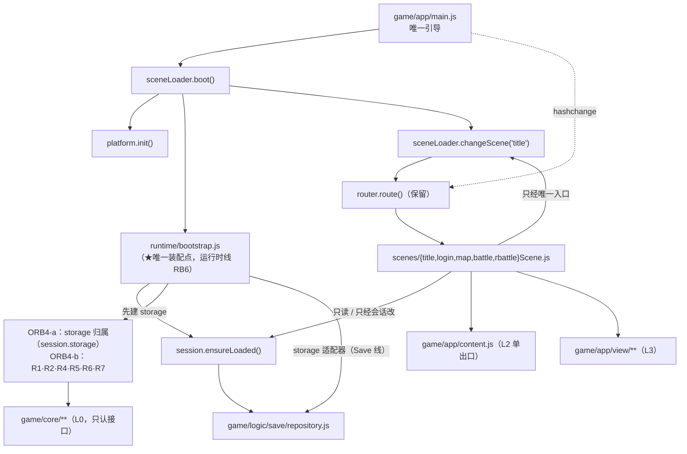

# 编排线落地计划（orchestration-impl.md）

> **父文档 / 真值**：`docs/orchestration/orchestration-design.md`（总设计兼导读：OR1–OR8 / ORQ1–ORQ7 / ORC1–ORC5 / §4 目标形状）。
> **结构面**：`docs/arch-code.md §2`（L4 编排层的实际文件与入口）/ `§3`（依赖规则）。
> **邻线（本线只调接口，不复制真值）**：
> Save 线 `docs/save/save-impl.md` + `docs/save/save-code-map.md`（**`repository.js` 六函数 + `storage` 三适配器**）
> · 运行时线 `docs/runtime/runtime-components-design.md`（**R1–R7 契约 + §6 装配点**）
> · View A1 `docs/view/mech/view-shell.md`（加载层视觉）· View B5 `docs/view/scene/start/view-scene-start-impl.md`（**批 C 的调用方**）
> · 地图线 `docs/map/map-move.md`（换图/通行）· 引擎线 `docs/engine/battle-engine-views.md`（战斗宿主）。
>
> **状态**：✅ **已通过人类评审（2026-10-18）** —— **ORP1–ORP6 全部拍板**（见 §9；其中 **ORP3 改了建议**：**v2/v3 直接废弃、只留 XML 档**，本份已按此重写 §2.2/§3.1/§3.2 并把 **ORB3 作废**）。
> ⚠️ **新开一条待定**：**ORP7**（§9.0）—— "废弃 v2/v3" 落到**内存模型**时，纯函数复用与否（§3.2 ④ 末尾）⇒ **这一条定了才能发码**。
> ✅ **第一刀 = `ORB1` × `ORB4-a`（合并）已落码（2026-10-18）** ⇒ as-built 见 §7；**待人手测**（§5 第 1–6 条）。
> ⏳ 未做：ORB2 · ORB4-b · View B5 批 C（§7 ④）。
>
> **编号纪律**（与 `AGENTS.md §5` 一致）：
> 施工批沿用 design §8 草案的 **ORB1–ORB5**（**不重编**；只把 ORB4 切成子批 **ORB4-a / ORB4-b**，与 `STB-a…f` / `MDB5-a…e` 同款写法）；
> 本份**新增的待拍板**用 **ORP1–ORP7**（⚠️ **本地编号，不是人类决议 ①–⑧**）；
> 落地决策用 **D1–D9**（本地表内序号，不跨文档引用）。

---

## 0. 这份文档回答什么（与 design 的分工）

| 问题 | 在哪 |
|---|---|
| 目标形状、不变量、谁拥有什么、哪七件缝、决议 | **design**（`docs/orchestration/orchestration-design.md`） |
| **哪个文件、什么签名、什么顺序、谁先谁后、怎么回滚、请人测什么** | **本份** |
| 存档格式与"修饰"规则 | Save 线（`docs/save/save-design.md §5`） |
| 缝的签名与默认行为 | 运行时线（`docs/runtime/runtime-components-design.md §5`） |

**一句话结论（本份要落成的事）**：让「游戏级状态」离开地图场景（`game/app/session.js`）、让「换场景」只有一个入口（`game/app/sceneLoader.js`）、
让「外部能力」只有一个装配点（`game/app/runtime/bootstrap.js`），并把启动顺序钉在 `game/app/main.js`。
其中**第一刀（ORB1 + ORB4-a）同时解锁 View B5 的批 C**（选档 / 建号 / 导入 / 进图）。

---

## 1. 落地决策（D1–D9）

| # | 决策 | 内容 | 依据 | 需人拍板 |
|---|---|---|---|---|
| **D1** | **批序**（✅ 人类 2026-10-18 认可） | **第一刀 = `ORB1` × `ORB4-a` 合并**（会话要 `storage` 作入参、`storage` 要会话作宿主 ⇒ 拆不开）→ *（View B5 批 C）* → `ORB2` → `ORB4-b` → `ORB5`；**`ORB3` 作废**（v2/v3 不再上移，直接废弃） | design §8 的「ORB4 必须晚于 ORB1」＋ **ORP3 拍板**（v2/v3 直接废弃 ⇒ 无「宇宙分流」可搬） | ✅ 已拍板 |
| **D2** | **ORB4 切两刀** | `ORB4-a` = 装配点宿主（**`storage` 归属**）+ **R3 的「值」归位**；`ORB4-b` = 服务三件（时钟/请求/音频）+ R1/R2/R5/R6/R7 归位 + **R4/R5 两个新 sink 建档**（core 里今天一个缝都没有） | design §4.1 的「无消费者不启动」、ORQ6；R3 **有**消费者（判定读 `player.random`，见 `docs/runtime/runtime-components-design.md §3.3`），`storage` 归属是 **B5 批 C 的唯一硬前置**，而时钟/请求/音频**今天零消费者**、R4/R5 **core 内无接缝** | ✅ 已拍板（ORP2） |
| **D3** | **`bootstrap.js` 归属** | 文件 = **运行时线 RB6** 的产物（`docs/runtime/runtime-components-design.md §6`）；编排线**只当唯一调用者/宿主**（`main.js` → `sceneLoader.boot()` → `bootstrapRuntime()`），**不另开第二条注入路径**（**OR7**） | OR7；运行时线 §6"一个装配点、一个顺序" | **ORP2** |
| **D4** | **单一血统 = XML**（✅ 人类 2026-10-18 拍板 ⇒ **ORP3**） | 会话**只认 XML 档**（`saves/save{gid}.xml`）；**v2（`game/logic/session.js`）与 v3（`game/logic/restartSession.js`）在 app 侧直接废弃**（零引用；文件暂留供既有测试/工具用，**不删不改**）；`game/logic/save/**` 是唯一存档真值 | 人类 2026-10-18（ORP3）；Save 线 **S-决策 1**（XML 真档） | ✅ 已拍板 |
| **D5** | **切换器包住 router** | `sceneLoader.js` **包住** `router.js`（保留 hash 解析与 `SCENES` 表），**不重写**路由；`location.hash` 仍只有一个写者（**OR2**） | `game/app/router.js:13-17`（解析）、`:10`（表）；OR2 | — |
| **D6** | **平台接口独立成文件** | `game/app/platform.js`：`setCursor` / `screenSize` / `onlineMode`；**不进 core**（core 不许知道 DOM/光标） | design §4.1（平台接口行）；`docs/runtime/runtime-components-design.md §3.2`（光标今天不存在） | — |
| **D7** | **模态只立字段** | 只立 `session.overlay`（单值 + 订阅点），**不接消费者**（今天对话 0 行）⇒ OR8 的真验证等 M4/新面板落地 | design §4.3、OR8 | ✅ 已拍板（ORP6） |
| **D8** | **启动顺序**（**⚠️ 偏离 design §4.2 初稿，已回改 design**） | `main.js` → `sceneLoader.boot()` → `platform.init()` → **`bootstrapRuntime()`（建 `storage`）** → `changeScene(首个场景)`；**读档不在这里** ⇒ 由**场景**按路由槽位调 `session.ensureLoaded({gid})`（= 上游 `GameManager.GameLogin` 的"进图那一刻"） | design §4.2 **2026-10-18 修订注**；两条理由：① `storage` 是读档的入参，而**装配点是 `storage` 的唯一创建点**（上游 `GameData` 是静态的，没有这个次序需求）；② **槽位住在路由里**（`#/map?slot=N`；批 C 的登录场景同样经路由/`adopt`）⇒ 只有场景知道该读哪一槽 | **ORP3 的连带**（已随该答复生效） |
| **D9** | **首个场景 = `#/title`** | 空 hash 时 `main.js` 补 `#/title`（**已落**，STB-a），本线**不**改这个默认 | `AGENTS.md §4`（STQ4）；`game/app/main.js:9` | — |

---

## 2. 接口级落地

### 2.1 模块图（目标形状）



**依赖方向（只许向下）**：`main.js` / `sceneLoader.js` / `session.js` / `platform.js` / `runtime/bootstrap.js` / `scenes/**` **都是 L4**；
L4 可 import L3（view）、L2（`content.js`）、L1（`game/logic/**`）、L0（`game/core/**`）。
**同一层内单向**：`session.js` **不许** import `bootstrap.js` / `scenes/**`；`bootstrap.js` 可 import `session.js`（**禁止反向** ⇒ 否则成环）。
细则表见 `docs/orchestration/orchestration-code-map.md §3`。

### 2.2 `game/app/session.js`（会话 = 进程单例）

**定位**：上游 `Player : Singleton<Player>`（`projects/Seer2-Restart-Lite-main/Assets/Scripts/System/Player.cs:9-96`）的对应物；
**唯一**持有进程级状态的地方（**OR1**：场景不得持有游戏级状态）。

> ⚠️ **2026-10-18 拍板（**ORP3**）**：**只认 XML 档**（`saves/save{gid}.xml`）。**v2 / v3 两套 JSON 档直接废弃** ——
> 本模块**不提供**「旧血统」通道；两套旧档的**读写函数**（`loadSession`/`saveSession`、`loadRestartSession`/`saveRestartSession`）在 `game/app/**` **零调用**
> （文件暂留供既有测试/工具，**不删不改**；退役账见 `docs/save/save-impl.md §1`）。
> ⚠️ 它们的**纯内存函数**（`findPet`/`addPet`/`settleRestart`/`makeRestartPet` …）**是否复用**未定 ⇒ **§3.2 ⑤ / ORP7**（这是"废弃"落到内存模型时的真实分叉）。

| 组 | 字段 | 说明 |
|---|---|---|
| **活跃档** | `gid: 0..2｜null`、`storage`（Save 线适配器，**由装配点注入**）、`data`（`GameData`） | `gid == null` ⇒ 未载入；`data` 的形状归 Save 线（`docs/save/save-code-map.md §2.2`） |
| **视图适配器 `active`** | `{ isRestart, state, save(), hpMax(pet), nameOf(pet), swfIdOf(pet), consumeItem(id,n), addItem(id,n) }` | **形状照今天的 `A`**（`game/app/scenes/mapScene.js:101` 的注释）⇒ 三个场景只换**取值来源**、不改渲染；`isRestart` 恒 `true`（XML = 重启血统）。`state` 的字段映射见 §3.2 |
| **场景级 KV** | `sceneData`（`Map`）、`random`、`isShootMode` | 上游是 `private static Dictionary`（`Player.cs:37`）⇒ **不入档**（§2.6 订正③） |
| **导航** | `currentMapId`（默认 70）、`lastMapId`、`mapQuery`、`lastPos` | 上游 `Player.cs:23-24`；✅ **2026-10-19 地图线 MB10 已接上唯一写者** = `mapScene.renderMap`（取到该图记录才换，照搬 `NormalLoadingScreen.cs:41`），战后回图读它回原房间 + 原位置（`lastPos`）—— as-built `docs/map/map-impl.md §7.3.14` |
| **战斗** | `currentBattle`、`lastResult` | `lastResult` = 今天 `APP.lastResult`（**OR4**：只经会话递、消费一次即清） |
| **模态** | `overlay: null｜'dialog'｜'story'｜'panel:<id>'`（**单值**） | **OR8**；置值/归零只经 `setOverlay()`（**本批不接消费者**，ORP6） |
| **随机** | `random`（进程级 int，默认 `null`） | 上游 `Player.cs:30-35` + `:45-49`；**不入档**（§2.6 订正③） |

| API | 签名 | 谁调 | 语义 |
|---|---|---|---|
| `ensureLoaded({gid = 0})` | `Promise<Active>` | 各场景 `mount`（第一刀的**临时桥**） | **幂等**：已载入即返回。`repository.load(storage, {gid, login: true})` ⇒ 建 `active`。⚠️ **批 C 到位后**改为「登录场景选定槽位后 `adopt()`」，本函数的自动 `gid=0` 退化为 `#/map` 直进捷径 |
| `adopt({gid, data})` | `void` | **批 C** 的 `loginScene` | 选定 / 新建 / 导入后交会话（`storage` 已在装配点注入） |
| `active` | `Active｜null` | 三个场景、`view/**` | 只读视图；`null` = 未载入 |
| `takeResult()` | `any｜null` | `mapScene` | `= APP.lastResult` 的一次性消费（**OR4**） |
| `readRandom()` / `writeRandom(v)` | `number` / `void` | `coreBattleDriver`（R3 的**值**） | 上游 `Identifier.cs:15-26`：`[old]` 读、`[new]` 先掷再写（见 §2.6） |
| `readPlayerData(key)` | `number｜null` | 同上 | 上游 `Identifier.cs:66-74`：`shoot` / `achievement`（**入档**） |
| `save(reason)` | `Promise<void>` | 场景的**变更点**（见下） | `repository.save(storage, gid, data)`；**不节流** |
| `setOverlay(v)` / `subscribeOverlay(fn)` | `void` / `unsub` | View（A1/A3）、将来 M4 | **OR8**：HUD 可见性由订阅方自己切 |
| `reset()` | `void` | 测试 / 登出 | 回到未载入态（**不**触碰磁盘） |

**`save()` 的粒度（✅ 人类 2026-10-18 拍板 ⇒ **ORP5**：仿照重启代码的粒度）**：
今天 v3 的写盘**就挂在变更点上**（`game/app/scenes/mapScene.js:236` 背包改动后、`:309` 用掉一个道具后、战果结算处各写一次），**无节流、无定时器**。
⇒ 会话的 `save()` **同粒度**：**每次"改过档"的那个动作立刻异步落盘一次**；不做 debounce，也不做批量。
（将来若出现"每帧改一次"的调用点，再按运行时线 **Q2** 重新定，登记为偏差。）

### 2.3 `game/app/sceneLoader.js`（ORB2）

| API | 签名 | 说明 |
|---|---|---|
| `boot(opts)` | `Promise<void>` | 启动序（§2.7）：`platform.init` → **`bootstrapRuntime`（先建 `storage`）** → `changeScene(首个场景)`（**不读档**；读档 = 场景的事，见 D8） |
| `changeScene(name, {params, network})` | `Promise<void>` | **唯一**换场景入口（**OR2**）：查 `SCENES[name]` → 写 hash → 旧场景 `unmount()`（**先**）→ 新场景 `mount(params)`（**后**） |
| `current()` / `last()` | `name｜null` | last/next 语义（对齐 `SceneLoader.cs:29-35`） |
| `onBeforeChange(fn)` | `unsub` | **ORB5** 的加载层挂钩点（A1 的视觉不在这里） |

**不做的**：加载屏长什么样（A1）、进度条数字、`Room`/`Game` 场景、Photon 的 `network` 实现（只留开关位 ⇒ **ORQ5**）。

### 2.4 `game/app/platform.js`

| API | 签名 | 依据 |
|---|---|---|
| `init()` | `void` | 上游 `Utility`（`projects/Seer2-Restart-Lite-main/Assets/Scripts/Helper/HelperUtility.cs`） |
| `setCursor(tex｜null)` | `void` | 修 **ORC3**（`seed` 特例的跨图残留）/ 清准星（design §4.2 的 `setCursor(null)`） |
| `screenSize()` | `{w, h}` | `game/index.html:10-12` 舞台 1200×660 **写死** ⇒ 本件只**暴露**，不改舞台 |
| `onlineMode` | `boolean`（开关位） | 上游 `GameManager.cs:10`；**我们恒 `false`**（**ORQ5**） |

### 2.5 `game/app/services/{clock,net,audio}.js`（**ORB4-b**，本份只给要点）

按 design §4.1 的"服务三件"表落**缝 + 默认行为**：时钟**不启动不空转**；请求的 `onFail` 缺省走 R5；
音频 **identity 相同且在播 ⇒ 不重播**（"换图不打断 BGM"）。三件**互不认识**（**OR6**）。今天**零消费者** ⇒ 与 ORB4-b 一起落。

### 2.6 `game/app/runtime/bootstrap.js`（★ 跨线接缝）

> **归属**：文件 = 运行时线 **RB6**（`docs/runtime/runtime-components-design.md §6`）；**调用者** = 本线的 `sceneLoader.boot()`（**OR7**：不开第二条注入路径）。
> **ORB4-a 只落"批 C 真正需要的那一件"＝ `storage` 的归属**（＋ R3 的**值**归位，一行委托），其余七件缝按 RB6 的顺序在 **ORB4-b** 补齐 —— 不重建第二份装配序。

| 序 | 缝 | ORB4-a 落不落 | 真实现落点 | 默认行为（未装） |
|---|---|---|---|---|
| 1 | **R7** `registerTables` | ❌（今天在 `game/app/battle/driver/tables.js:32,33,45,47`，归 ORB4-b） | 同文件归位 | 装配期抛（runtime §5 R7） |
| 2 | **R1** `setRuntimeRng` | ❌（每局实例仍在 `coreBattleDriver.js:58` 造（`createRng(seed)`）；R1 的"进程级来源"等 Q1） | `core/rng.ts`（算法归 D1） | 抛 |
| 3 | **R2** `setRuntimeClock` | ❌（今天零消费者；`date.*` 命中即抛） | `app/runtime/clock.js`（ORB4-b） | 抛 |
| 4 | **R3** `store`（`readRandom/writeRandom/readPlayerData`） | ✅ **只归位"值"**（数据源 ⇒ `session`；**不新建 setter**，见下） | `session.js` 的三个方法 | 抛 |
| 5 | **R4** `requestSave(reason)` | ❌ **core 里今天连缝都没有**（`grep -rn "setSaveRequest\|requestSave" game/core` = **0**）⇒ 建档 + 第一个消费者 = 运行时线 **RB3** 的活，归 ORB4-b | `app/runtime/save.js`（ORB4-b） | no-op（runtime §5 R4） |
| 6 | **R5** `setHintSink` | ❌（同上，0 命中；View 的 `openHintbox`（`game/app/view/panels/hintbox.js:36`）由 View 直接调） | `app/runtime/hint.js`（ORB4-b） | 抛 |
| 7 | **R6** `installBattleHost` | ❌（今天 `coreBattleDriver.js:55-57` 装 3 缝，归 ORB4-b） | 同文件归位 | 抛 |

**导出**：`export async function bootstrapRuntime({ storage })`（**幂等**：重复调用只重装，不重复建对象）+ `export function runtimeStatus()`（诊断用，**不进**产品路径）。
`bootstrapRuntime` 在 ORB4-a 里做的事只有两件：**① 建 `storage`（唯一创建点）并挂到会话上 `session.storage = storage`；② 回执 `runtimeStatus()` 里能查到"装了什么/没装什么"**。

```js
// ORB4-a 的形状（薄，但已是"唯一装配点"）
import { createFsStorage } from '../../logic/save/storage.js'   // game/logic/save/storage.js
import { session } from '../session.js'

export async function bootstrapRuntime({ storage = createFsStorage() } = {}) {
  session.storage = storage          // ← 全仓唯一决定"存档放哪"的一行（OR7）
  return runtimeStatus()
}
export function runtimeStatus() { return { storage: !!session.storage, seams: { r3: 'delegated', r4: 'not-installed' } } }
```

**R3 的语义（照搬上游；订正③ 已于 2026-10-18 落进 runtime 原文与代码注释）**：

- `readRandom()` ⇒ `sceneData['random']`（`Player.cs:30-35` 的 getter）；
- `writeRandom(v)` ⇒ `sceneData['random'] = v`（`Identifier.cs:19-22`：`[new]` 先 `Random.Range(0,100)` 播种再返回）；
- `readPlayerData(key)` ⇒ `gameData[key]`，只有 `shoot`（`GameData.cs:43`，派生）与 `achievement`（`:42`）两个真键；其余键上游落到 `GetNumIdentifier`（`Identifier.cs:68-74`）；
- ⚠️ **订正③（本份发现；✅ 人类 2026-10-18 拍板 ⇒ **ORP4：「直接更改为正确表述」）**：`docs/runtime/runtime-components-design.md §5 R3` 原写的"**random 是存档里的一个 int**"**不成立** ——
  **已改**：runtime §5 R3 的「语义」行**原句已替换**为"进程级的一个 int（`Player.cs:37` 的 `private static`，**不进 XML、跨存档共享**）"，表末的「⚠️ 待订正」行**已删**；
  `game/core/parser/identifier.ts:11` 的注释**已改**（并按 `AGENTS.md §3` 重生成 `game/core/parser/identifier.js`）。
  上游 `random` 住在 `private static Dictionary<string, object> sceneData`（`Player.cs:37`、`:59-90`），**不是** `GameData` 的字段，也不进 XML（两份真机夹具里无 `random` 键）。
  它在 `Player.Start()`（`:45-49`，播种在 `:48`）用 `Random.Range(0,100)` **每进程播种一次**，**跨存档共享、不落盘**；
- ⚠️ **`/4` 怪癖**：getter 在队里有 `Buff.GetEmblemBuff(x).id == 20_0051` 时**除以 4**（`Player.cs:32`）。
  `GetEmblemBuff` 今天**未移植**（全仓 `grep` 仅 `game/core/battle/phase.ts:281` 一句注释）⇒ ORB4-a **先落不带 `/4` 的版本**，登记为待补（**不许静默**）。

### 2.7 `game/app/main.js` 的新引导

```js
// 目标形状（伪代码，实际落码在 ORB1/ORB4-a）
import { boot } from './sceneLoader.js'
if (!window.RufflePlayer?.newest) showRuffleError()
else await boot()   // platform.init → bootstrapRuntime(建 storage) → changeScene('#/title')
// 读档在**进图那一刻**（地图场景调 session.ensureLoaded；= 上游 GameManager.GameLogin），不在开机时
```

- 今天：`game/app/main.js:4-11`（13 行，判 Ruffle → 补 `#/title` → `route()`）；
- 目标：**保留** Ruffle 判定与 `#/title` 默认（D9），把"挂路由"换成 `boot()`；`:15-16` 的 `rvDemo` 按钮是**调试入口**，保留但移出主路径。

---

## 3. 施工批

### 3.1 总表

| 批 | 目标 | 触达（新建 / 改） | 解锁 | 细化程度 |
|---|---|---|---|---|
| **第一刀 = `ORB1` × `ORB4-a`**（**合并落**，D1） | 会话（**XML 单一血统**）+ `storage` 归属 + R3 的「值」归位 + 平台接口 | 新 `session.js`、`platform.js`、`runtime/bootstrap.js`；改 `main.js`、`scenes/{map,battle,rbattle}Scene.js`、`state.js`、`battle/driver/coreBattleDriver.js` | **View B5 批 C**（选档/建号/导入/进图）＋ v2/v3 在 app 侧摘除 | **本份写细** |
| *（B5 批 C）* | 选档/建号/导入/进图 | 见 `docs/view/scene/start/view-scene-start-impl.md §9.6` | 人手测真流程 | 邻线 |
| **ORB2** | 场景切换器（包住 router） | 新 `sceneLoader.js`；改 `router.js`、各场景 `mount/unmount` 签名 | OR2/OR3 + ORB5 的挂钩 | 要点级 |
| ~~**ORB3**~~ | **作废**（**ORP3** 拍板：v2/v3 直接废弃 ⇒ 没有"宇宙分流"可上移） | — | — | 不再保留 |
| **ORB4-b** | 服务三件 + R1/R2/R5/R6/R7 归位 | 新 `services/{clock,net,audio}.js`、`runtime/{clock,hint}.js`；改 `tables.js`、`coreBattleDriver.js` | 战斗超时 / 小游戏 / BGM | 要点级 |
| **ORB5** | 加载层薄版（**ORQ1**） | 新 `view/mech/loadingScreen.js`（视觉 A1）；改 `sceneLoader.js` | "失败不换场景" | 要点级 |

### 3.2 第一刀的会话半（`ORB1`；**XML 单一血统**）

**目的**：`mapScene.js:103-151` 今天自己 `import('/game/logic/restartSession.js')` / `import('/game/logic/session.js')` 做宇宙分流并造 `A`
⇒ 把**活跃档**搬进会话，三场景改为**只读会话**。**渲染逻辑一行不改**（形状照旧）。

**① 视图适配器映射表（本批的**真风险** = 这张表；`A.state` 的取值全部从 `GameData` 现算）**

| 视图今天用 | 今天（v3 `state`） | XML `GameData` 来源 | 把握 |
|---|---|---|---|
| `A.isRestart` | `true` | 恒 `true`（XML = 重启血统） | ✅ |
| `A.state.trainer.name` | `state.trainer.name` | `data.nickname`（`schema.js` 的 `isEmpty` 同源） | ✅ |
| `A.state.trainer.coins` | 自造字段 | `itemStorage` 里 `id === 1` 的 `num`（`GameData.cs:15-27`；真档 `save-lite4.9.2-played.xml:482` = `47000`） | ✅ |
| `A.state.trainer.diamonds` | 自造字段 | `itemStorage` 里 `id === 2` 的 `num`（`GameData.cs:28-39`；同档 `:483` = `100`） | ✅ |
| `A.state.team` | `state.team` | `petBag` 非空项（12 槽） | ✅ |
| `A.state.box` | `state.box` | `petStorage` | ✅ |
| `A.state.items` | `state.items[{id,count}]` | `itemStorage`（去掉 id 1/2 两枚货币）的 `{id, num}` ⇒ 视图侧映射 `num → count` | ✅（字段名换算） |
| `A.state.trainer.level` | `state.trainer.level` | **XML 无此字段** ⇒ 暂取**队首宠等级**（`petBag` 第一个非空项的 `exp.level`） | ⚠️ **推断**（登记为偏差，请人测核对） |
| `A.state.dex` | `state.dex{id:{seen,caught}}` | **XML 无图鉴** ⇒ 返回 `{}` ⇒ HUD 的"图鉴 N 抓到"片段**暂时不显示**（图鉴线 = C 组 ③，未立） | ⚠️ **缺失**（登记为偏差） |
| `A.state.petStorage`（`projectBagView` 用） | `state.box` | `petStorage` | ✅ |
| `A.hpMax(pet)/nameOf/swfIdOf/consumeItem/addItem` | v2/v3 自由函数 | 同口径：L1 的 `hpMax`/`nameOf`/`swfIdOf` 与 `addItem/consumeItem`（**只换数据源**：裸 `data.petBag`/`itemStorage`） | ⚠️ 逐函数照搬，落码时逐个核 |

**② 步骤**

| # | 做什么 | 落点 |
|---|---|---|
| 1 | 新 `game/app/session.js`：字段/API 见 §2.2；`active` 由 `data` 现算（映射表 ①） | 新文件 |
| 2 | 地图场景：`initSession()` 改为取**路由槽位**（`#/map?slot=N`）⇒ `session.ensureLoaded({gid})`；删 `SAVE_KEY`/`saveNow()`/`localStorage` 读写；`:145-148` 的三字段回填改从 `A.state.trainer` 取（今天的写法已如此，只是来源换）；遇怪恒 `#/rbattle`（删 `roco.battle.engine` 开关） | `scenes/mapScene.js:85-152`/`:568-586`/`:669-690` |
| 3 | 两个战斗场景：`SESSION`（`battleScene.js:12`、`rbattleScene.js:12`）/ `RST`（`rbattleScene.js:159`）→ `session.active` | `scenes/{battle,rbattle}Scene.js` |
| 4 | `APP.lastResult` 转发会话（`takeResult()` 一次清）；`APP.scene` 保留 | `state.js` |
| 5 | 光标 / 舞台尺寸 / 在线开关 → 独立文件（只**暴露**，不改样式） | 新 `platform.js` |

**③ 槽位从哪来（临时桥，批 C 到位即收）**：槽位住在**路由**里 —— `#/map?slot=N`（无参 ⇒ `0`），地图场景在 `mount` 里调
`session.ensureLoaded({ gid })`（缺档由 Save 线契约 `newGame` 造默认档并落盘）。批 C 到位后由 `#/login` 选槽进图（同一条路），
本捷径降级为开发入口；`ensureLoaded` 已支持**换槽**（`session.gid !== gid` ⇒ 重读那一槽，`adopt({gid, data})` 亦照此用）。

**④ 写侧也要投影（**本条是发码前清点出来的，别漏**）**

`A` 不只有读面：三个场景把 v2/v3 的模块当作**内存玩法模型**在用 ——

| 场景 | 用到什么（实测） |
|---|---|
| `scenes/battleScene.js` | **15 处 `SESSION`**：`loadSession`（`:476`/`:569`）、`countItem`（`:326`/`:335`）、`syncHp`（`:406`）、`findPet`（`:454`）、`saveSession`（`:368/384/404/407/425/507`）—— 战斗里的 `wild.S` 是 **v2 形活档** |
| `scenes/rbattleScene.js` | **10 处 `RST`**：`loadRestartSession`（`:160`）、`makeRestartPet`（`:289`）、`addPet`（`:291`）、`settleRestart`（`:295`）、`consumeItem`（`:348`）、`saveRestartSession`（`:162`）—— 战果结算直接改 `state.team/box` 的 `level/exp/hp` |
| `scenes/mapScene.js` | `A` 的构造（`:113-142`）+ 道具增减（`:236`/`:309`）；`applyBattleResult` 消费 `APP.lastResult` |

⇒ **XML 单一血统 = 必须有双向投影**（不只是"读侧映射"）：

| 方向 | 做什么 | 落点 |
|---|---|---|
| **读** | `GameData` → 内存 `state`（v3 形：`trainer/team/box/items/dex`） | `session.js` 的 `active` |
| **写** | `save()` 时把内存态**合并回** `data`：宠的 `level`/`exp.totalExp`/`currentStatus.hp`、`itemStorage` 的 `num`、货币（id 1/2） | 同上；**只覆盖这几个字段，其余 XML 子树原样保留**（保真优先） |
| **映射（已核，真档 `played.xml`）** | 宠：`petId ← pet.id`、`level ← pet.exp.level`、`hp ← pet.currentStatus.hp`（第 1 只 = `37`，`:84`）；`uid` **XML 没有** ⇒ 内存里按槽位造 `p<i>` | — |
| **⚠️ 待定** | `v3.exp`（级内经验）↔ XML `exp.totalExp` 的换算（要 `rules.json` 的 `expCurve`）；`dex`（XML 无 ⇒ 恒 `{}`，HUD 片段隐藏，已在 ① 登记）；进化（v3 `evolve.pending` 已按人类 2026-10-18 拍板**丢弃** ⇒ 结算里的 `applyEvolutionRestart` 恒 no-op） | — |

**内存模型两条走法（**= ORP7**，需你选一条）**：

- **A（推荐 · 最小风险）**：**复用** `game/logic/restartSession.js` 的**纯函数**当内存模型
  （`findPet`/`addPet`/`settleRestart`/`makeRestartPet`/`consumeItem`…），**只**不调它的 `loadRestartSession`/`saveRestartSession`
  ⇒ 玩法与今天 v3 完全一致，档只走 XML。代价：`game/app/**` 仍 import 该文件（**"废弃"= 废弃它的档，不是废弃它的函数**）。
- **B（纯净）**：在 `game/app/` 新写一份最小内存模型（同样的四个操作）⇒ `game/app/**` 对 v2/v3 **零 import**。
  代价：新写 + 行为要与 `settleRestart` 对齐（经验/升级/进化口径），**这是 D6 域的活**，本线容易写歪。

**⑤ 判据（grep 门禁，`docs/arch-code.md §3` 同款）**

```bash
# ① 旧档的读写函数彻底不走 app（ORP7 无论 A/B 都必须为 0）
grep -rn "loadSession\|saveSession\|loadRestartSession\|saveRestartSession" game/app/   # 期望：0
# ② 若 ORP7 选 B（纯净）⇒ import 也不许有；选 A ⇒ 允许 import 纯函数
grep -rn "logic/session.js\|logic/restartSession.js" game/app/     # A: 仅 restartSession.js；B: 0
grep -rn "localStorage" game/app/scenes/                            # 期望：0（落盘只经 storage 适配器）
grep -rn "initSession" game/app/                                    # 期望：0
grep -rn "createFsStorage" game/app/                                # 期望：1（runtime/bootstrap.js）
```

**回归（人测）**：§5 第 1–4 条。

### 3.3 ORB4-a（`storage` 归属 + R3 的值归位 = **批 C 解锁点**）

**新建** `game/app/runtime/bootstrap.js`（形状见 §2.6 —— **只落 `storage` 的归属 + R3 的"值"归位**，其余缝留 ORB4-b）：

```js
export async function bootstrapRuntime({ storage = createFsStorage() } = {}) {
  session.storage = storage          // ① 全仓唯一决定"存档放哪"的一行（OR7）
  return runtimeStatus()             // ② 诊断：装了什么 / 没装什么
}
```

⚠️ **落法（如实说明两个今天的形状限制）**：

1. **R3 今天没有独立 setter** —— 它和 R1（`rng`）、R2（`getDate`）挤在同一个 `IdentifierHost`
   （接口 `game/core/parser/identifier.ts:9-19`、setter `game/core/parser/identifier-effect.ts:72`，唯一装配点 `game/app/battle/driver/coreBattleDriver.js:58`）。
   ⚠️ 顺带一个真实现状：`:58` 只给了**前四项**，`getDate` **根本没给** ⇒ `date.*` 命中时今天抛的是 `TypeError`（不是设计里的"随机源/时钟未装配"抛）；
   R2 归 ORB4-b 时一并补上。
   ⇒ ORB4-a **不**新开第二个 setter（那正是 **OR7** 禁止的第二条注入路径），而是把 `:58` 那一行**改成委托会话**
   （`getPlayerRandom: () => session.readRandom()` …），`rng` 仍每局新建（R1 的"每局一个实例"不变）；
   缝的**形状合并**（三支合一 + 独立 `setRuntimeStore`）留给运行时线 **RB3** 在 **ORB4-b** 落。
2. **R4 在 core 里连缝都不存在**（`grep -rn "setSaveRequest\|requestSave" game/core` = **0** 命中）⇒
   "建档 + 接第一个消费者"是运行时线 **RB3** 的活，**不**在 ORB4-a 里假装装上；批 C 的落盘**根本不需要 R4**
   （它由 View 直接调 `repository.save`，见 `docs/view/scene/start/view-scene-start-impl.md §9.6`）。

**改**：

| 文件 | 改动 |
|---|---|
| `game/app/main.js` | `await boot()`（§2.7） |
| `game/app/battle/driver/coreBattleDriver.js` | `:42` 的 `playerRandom` 局部变量（`:58` 是用法） → `session.readRandom/writeRandom/readPlayerData`（**删掉那个恒 0 的局部变量**） |
| `game/app/sceneLoader.js`（ORB2 前的最小版） | 只为 `boot()` 存在：`platform.init` → **`bootstrapRuntime`** → `route()`（D8 的次序；**不读档**） |

**判据**：

1. **唯一装配点**：`grep -rn "createFsStorage" game/app/` **仅** `runtime/bootstrap.js` 一处（⇒ **OR7**、"storage 归属"落地）；
2. **唯一存档入口**：`game/app/**` 触达存档只经 `game/logic/save/repository.js`（`docs/arch-code.md §3` 规则 5）；
3. **档真有落点**：进图后 `saves/save0.xml` **被创建/更新**（`storage` = `fs` 适配器；用 `node tools/serve.mjs` 才能写）；同时 **v2/v3 的 `localStorage` 键不再被读写**（ORP3）；
4. **`random` 语义**：`random[old]`/`random[new]` 在会话里跨战斗持续（不再每局归 0）。

**请人测**（决议 ⑦）见 §5。

### 3.4 ORB2 / ORB4-b / ORB5（要点级，发码前再细化；**ORB3 已作废**）

- **ORB2**：`changeScene` 唯一入口 + `unmount` 先于 `mount`（**OR3**：`unmount` 幂等）；`router.js` 的 `SCENES` 表**保留**（ORC2 已符合：按名字不吃序号）；换场景时 `platform.setCursor(null)`（修 ORC3 的跨图残留）。
- ~~**ORB3**~~：**作废**（**ORP3** 拍板 v2/v3 直接废弃）。原意"把 `restartOn()` 的宇宙分流移进会话"**没有对象**了 ——
  分流的目的是"同时支持两套档"，而现在**只有 XML 一套**；"地图场景不自己 `initSession()`"这一条由第一刀（§3.2）直接落掉。
- **ORB4-b**：按 runtime §6 的顺序补齐 `R7 → R1/R2 → R5 → R6`，并**新建 R4/R5 两个 sink**（core 里今天 0 缝 ⇒ 建档 + 接第一个消费者 = runtime **RB3**）；三件服务按 design §4.1 的缝落；`setNetFence` / `setSkillNumHost` 两个孤儿按 **RT4** 处理（给消费者或删）。
- **ORB5**：薄版加载层（全屏盖层 + 两句话 + **查表失败不换场景**，对齐 `NormalLoadingScreen.cs:20-32`）；视觉正本 = `docs/view/mech/view-shell.md §2.2/§7`。

---

## 4. 与邻线的接口契约（回执 / 请求）

| 对方 | 本份要它给的 | 本份给它的 |
|---|---|---|
| **Save 线** | `repository.{load,save,newGame,exportXML,importXML,clear}` + `createFsStorage()` + `isEmpty`/`MAX_SAVE_COUNT`（`docs/save/save-code-map.md §2.5`） | **`storage` 的归属方**（`runtime/bootstrap.js` 唯一创建）；`load({login:true})` 的调用点 = 批 C 的"进图" |
| **运行时线** | RB6 的装配点形状（`docs/runtime/runtime-components-design.md §6`）、R3 的独立 setter（RB3） | **订正③**（`random` 不入档，§2.6）＋ 装配点的**宿主**（`main.js`/`sceneLoader.boot()`） |
| **View A1** | 加载层的视觉与三段式（`docs/view/mech/view-shell.md §2.2/§7`） | `sceneLoader.onBeforeChange()` 挂钩点 + "失败不换场景"的判定位 |
| **View B5（批 C）** | 槽位/建号/导入的调用序（`docs/view/scene/start/view-scene-start-impl.md §9.6`） | `session.storage`（**不**各自 `createFsStorage()`）、`adopt({gid, data})`（**`session.js` 的模块导出**，见 §7 偏差表末条）、`changeScene('map')` |
| **Save 线（退役面）** | — | **回执**：**v2（`game/logic/session.js`）也随 v3 一起在 app 侧退役**（**ORP3**）⇒ 退役账见 `docs/save/save-impl.md §1`（v2 与 v3 同列，均**不迁移**） |
| **地图线** | 换图的取数接口（`content.js` 的 **`loadMap(id)`**，方案 C 已落；异步） | `changeScene('map', {mapId, targetPos})`；"取不到图 ⇒ 不换场景" |

---

## 5. 请人测（**决议 ⑦**：AI 不写测试、不跑脚本；这是给人手测的清单）

⚠️ **怎么起**：`node tools/serve.mjs`，然后开
`http://<host>:<port>/#/map`（**默认入口 `#/title` 的"进图"出口要到批 C 才接**，所以本轮请走 `#/map`；`#/map?slot=0|1|2` 可指定查哪一槽）。
⚠️ 改了 JS 请**硬刷新**（`Ctrl+Shift+R`）再验（`docs/arch-code.md §7.1`：dev server 不发 `Cache-Control`）。

| # | 什么时候测 | 怎么测（真流程） | 看什么 | 期望 |
|---|---|---|---|---|
| 1 | **第一刀落地后** | `#/map` 直进 → 打一场 → 回图 → **F5** | 顶栏昵称 / 等级 / 金币 / 钻石 + 背包 | 与改造前**肉眼等价**（值现在来自 `saves/save0.xml`；等级是**推断件**，见 §3.2 ①） |
| 2 | **第一刀落地后** | 背包里改一次 → 用掉一个道具 → 打完一场 | `tools/serve.mjs` 的日志 / 目录时间戳 | 每次**变更点**写一次盘（`save()` 不节流，**ORP5**）；没有"点一下写十次" |
| 3 | **第一刀落地后** | 打开 DevTools → **Ctrl+Shift+F** 全局搜 `createFsStorage` | `game/app/**` | **只有 1** 处命中（`runtime/bootstrap.js`），场景里没有 |
| 4 | **第一刀落地后** | 连打两场战斗 | 战报里的随机判定 | 不"每局从 0 开始"（`random[old]` 跨战斗持续） |
| 5 | **第一刀落地后** | DevTools 全局搜 `loadRestartSession` / `saveSession`（旧档读写） | `game/app/**` | **0** 命中（旧档读写退场，**ORP3**）；若 **ORP7 选 A**，仍会看到 `restartSession.js` 的**纯函数** import（这是预期的） |
| 6 | **第一刀落地后** | 看浏览器 DevTools → Application → Local Storage | 旧 v2/v3 的键 | **仍在，但游戏不再读**（进度以 XML 档为准 —— 这是 **ORP3** 的预期后果） |
| 7 | **ORB2 落地后** | 连续快速切 `#/map` ↔ `#/rbattle` 多次 | 控制台 / 舞台 | 不残留 `ruffle-player`、不重复日志、`unmount` 不报错（design §7 第 2 条） |

⚠️ **不是**"我跑过脚本全绿"就算过 —— 上面每一条都要**人**按真流程点一遍（`AGENTS.md §1.1`）。

---

## 6. 缺口 · 风险 · 回滚

| # | 风险 | 症状 | 兜底 |
|---|---|---|---|
| 1 | **适配器映射错了**（§3.2 ① 那张表） | **静默显示错值**（金币/钻石/等级/背包数量对不上），不报错 ⇒ 最难发现 | 表里 3 行已标"推断/缺失"；as-built 逐条记；请人测 §5 第 1 条**逐项核对数字** |
| 1b | 某处仍按 v3 字段名读（`state.items[].count` vs `num`、`state.dex`） | `undefined` 混进 UI | `state.js` 转发导出保留；映射**只在 `session.js` 一处**做（不许在场景里补） |
| 2 | `bootstrap.js` 被两个调用方调 | 两套 storage / 两次装缝 | `bootstrapRuntime` **幂等** + `runtimeStatus()` 诊断；判据见 §3.3 第 1 条 |
| 3 | R3 的 `/4` 怪癖未落 | 带徽章（`20_0051`）的队随机判定的分布偏高一档 | 已在 §2.6 登记；待 `GetEmblemBuff` 移植后补 |
| 4 | **旧进度"看不见"** | 玩家在 v2/v3 里的存档不再被读（`localStorage` 键还在） | **ORP3 的预期后果**（人类 2026-10-18 拍板：**直接废弃、不迁移**）；请人测 §5 第 6 条确认是"预期"而不是"崩了" |

**回滚**：每批都是**独立提交**；ORB1/ORB4-a 都是"只加文件 + 换取值来源"，回滚 = `git revert` 单个提交，不需要数据迁移。

---

## 7. as-built

> 纪律见 `docs/arch-docs.md §5`：as-built 与上文冲突时**以 as-built 为准**。
> ⚠️ **本节不含"验收结论"** —— 按 `AGENTS.md §1.1`（决议 ⑦），验收 = **人类跑起来手测**；这里只记"做了什么 / 看到什么 / 与计划的偏差"。

### 7.1 第一刀（`ORB1` × `ORB4-a`）—— **已落码（2026-10-18）**，待人手测

**① 落地表**

| 文件 | 动作 | 行数 | 关键导出 / 职责 |
|---|---|---|---|
| `game/app/session.js` | **新建** | 322 | `session`（单例）· `ensureLoaded({gid})` · `adopt({gid,data})` · `ensureTables()`（**批 C 加的**，供缺档造默认档）· `save()` · `takeResult` · `readRandom`/`writeRandom`/`readPlayerData` · `setOverlay`/`subscribeOverlay` · `reset`；**双向投影**（`stateFromData` / `mergeBack`）在这一个文件里 |
| `game/app/platform.js` | **新建** | 35 | `init` · `setCursor`/`currentCursor` · `screenSize` · `onlineMode` · `platformStatus` |
| `game/app/runtime/bootstrap.js` | **新建** | 41 | `bootstrapRuntime({storage})`（★唯一装配点：`session.storage = createFsStorage()` + 进程级 `random` 播种）· `runtimeStatus()` |
| `game/app/sceneLoader.js` | **新建** | 52 | `boot()` · `changeScene(name,params)` · `onBeforeChange` · `bootStatus`（ORB2 再补 last/next 与卸载时序） |
| `game/app/state.js` | 改 | 12 | `APP.lastResult` → **会话代理**（getter/setter）；`APP.scene` 保留 |
| `game/app/main.js` | 改 | 20 | `route()` → `await boot()`（D9 的 Ruffle 判定与 `#/title` 默认保留） |
| `game/app/scenes/mapScene.js` | 改（+28 / **−90**） | 760→698 | 删 `SAVE_KEY`/`saveNow`/v2+v3 分流/`roco.battle.engine` 开关 + 勾选框；`initSession()` = 按**路由槽位** `session.ensureLoaded({gid})`；遇怪恒 `#/rbattle` |
| `game/app/scenes/rbattleScene.js` | 改（+26 / **−56**） | 441→411 | `state`/`save` 来自会话；删 v2 分支（4 处 `SESSION`/`LOGIC`/`SETTLE` 记账）与 4 个旧血统 import；遇怪设 `isRestart = true` |
| `game/app/battle/driver/coreBattleDriver.js` | 改 | 1 行 | `:58` 的 R3 值改为**委托会话**（`getPlayerRandom/setPlayerRandom`）⇒ `random` **不再每局归 0** |

**② 静态核对（**不是**验收）**

| 检查 | 命令 | 结果 |
|---|---|---|
| 旧档读写退出 app | `grep -rn "loadSession\|saveSession\|loadRestartSession\|saveRestartSession" game/app/` | 仅 **`battleScene.js`**（AS3 遗留页，偏差 1）与**注释**命中 ⇒ 主流程 0 |
| v2/v3 import | `grep -rn "logic/session.js\|logic/restartSession.js" game/app/` | `session.js`（**纯函数**，ORP7=A）+ `rbattleScene.js`（纯函数）+ `battleScene.js`（v2，偏差 1） |
| 场景不碰 localStorage | `grep -rn "localStorage" game/app/scenes/` | 仅 `battleScene.js`（偏差 1）与注释命中 |
| `storage` 唯一创建点 | `grep -rn "createFsStorage" game/app/` | **1**（`runtime/bootstrap.js`） |
| 语法 | `node --check`（转 `.mjs` 后） | 9 个改动/新文件全过 |

**③ 偏差（逐条）**

1. **`#/battle`（AS3/v2 战斗页）未接线**：`game/app/scenes/battleScene.js` 仍走 `game/logic/session.js` + `localStorage` 的 v2 档。
   主流程已不再路由到它（地图遇怪恒 `#/rbattle`），只剩手输 URL 可达 ⇒ **本轮不动它**，等 AS3 线结账统一处置（`docs/architecture.md §1.1` 里 AS3 线仍在其位）。
2. **训练家等级 = 队首宠等级**（XML 无 `trainer.level`；映射表 ① 的推断件）。
3. **图鉴恒空**：`state.dex = {}`（人类 2026-10-18：`dex`/`evolve.pending`/`battle` 直接丢）⇒ HUD 的"图鉴 N 抓到"恒 0（§3.2 ① 已登记）。
   —— ⚠️ **原条目里的"进化恒不触发"已作废**（人类 2026-10-19 拍板"进化落盘 + 保留旧招"，见下条 ⑧）。
   `evolve.pending` 仍**不落盘**（读档清空），但结算内的 `detectEvolveRestart → applyEvolutionRestart`
   在**同一局内**成对发生，落盘由 `petXmlOf` 兜住 ⇒ 进化不再只活一局。
4. **`petBag[6..11]` 用"原位记录"保真**：载入时记住后备槽原位（`__bagSlot`），存盘时**先回原位**；只有新抓的/换过位的宠才占新的后备槽，装不下才进 `petStorage`
   ⇒ 第三方真档的 `petBag` 布局逐格保持（不会"把 `petStorage` 前 6 只搬进 `petBag`"）。
5. **落盘粒度 = 变更点同步写、不节流**（ORP5，证据 `mapScene.js:236/309` 的原行为）；`A.save()` 是**异步**、失败只 `console.error`（写盘是副作用，不打断 UI）。
6. **内存模型复用 `restartSession.js` 的纯函数**（**ORP7 = A**，人类 2026-10-18 拍板）：`session.js` / `rbattleScene.js` 仍 import 它；
   但**旧档读写（`load*`/`save*`）零调用** —— 这就是"v2/v3 废弃"的落法。
7. **旧 v2/v3 的 `localStorage` 键仍在浏览器里**（不再被读）：**ORP3 的预期后果**，请人手测确认是"预期"而非"崩了"（§5 第 6 条）。
8. **进化落盘（人类 2026-10-19 拍板 · 修 bug "进化后刷新就失去进化"）**：
   `restartSession.applyEvolutionRestart` 只改**内存** `pet.petId`，而原 `petXmlOf()` 回写档时只覆盖 `exp.level`/`exp.totalExp`/`currentStatus.hp`
   三个字段、**从不写 `<id>`** ⇒ 读档 `memPet()` 认 `xml.id` ⇒ 进化只活一局（人类 2026-10-19 报障）。
   **目标行为（照上游 `Pet.cs:212-233` 的 `Pet(int evolvePetId, Pet originalPet)`）**：
   `petXmlOf()` 发现 **内存 `petId` ≠ 档里 `<id>`** = 这只宠进化过 ⇒ 在写回时把整棵 `Pet` 子树搬到新形态：

   | 写什么 | 写成什么 | 依据 |
   |---|---|---|
   | `<id>`、`basic@id`、`feature@id`、`exp@id`、`talent@id`、`skills@id`、`resist.id` | **新形态 id** | 上游每个子结构都用 `new Xxx(evolvePetId, …)` 重建 |
   | `ui@id` | **新形态的皮肤 id**（`restartUiOf().skinId`） | 上游 `new PetUI(info.ui.defaultSkinId, info.ui.baseId, …)` |
   | `ui@baseId` | **新形态的种族 id**（`restartUiOf().baseId`） | 同上；⚠️ 它是**种族**不是形态 id —— 实测 838 形态里只320 个 `baseId===id`，迪兰→迪迪兰→迪兰特→迪兰特斯 恒为 `baseId=1` |
   | `skills.ownSkillId` / `normalSkillId` / `superSkillId` | **保留旧招 + 按新形态表和当前等级补学** | 人类 2026-10-19 拍板 = 照上游 `new PetSkill(evolvePetId, level, originalPetSkill)` |
   | `currentStatus` 的**六维** | **按新形态重算**（新形态 baseStatus + 档里的 iv/ev/性格） | 上游 `currentStatus = new Status(normalStatus)`（Pet.cs:230）；**hp 另夹到上限内保留战果**（战斗后已损耗） |
   | `basic` 的 **height/weight** | **按新形态重掷** = `base + rand(0,5)` | 上游 `new PetBasic(evolvePetId, …)`：`base + Random.Range(0, 6)`（闭区间 ⇒ 上界 +5）。实测 345 条等级进化边里 338 条会明显跳变 |
   | `backupPet` | **不写**（保持原样） | ⚠️ 上游 `Pet(evolvePetId, original)`（Pet.cs:212-233）**不碰** `backupPet`，只有 `Devolve()`（:661）给「待选退化体」临时挂一个且**不落盘**；真机档两份 lite_4.9.2 里 `backupPet` 出现 **0 次** ⇒ 退化链走 `PetExpSystem.GetEvolveChain(baseId, id)` **现算**、不靠存档 |

   **收口位置** = `session.js` 的 `petXmlOf()` 一个 choke point ⇒ 不论进化来自结算升级还是将来的地图 `evolvePet` 动作，都走这一条；
   **幂等** = 搬完 `x.id === m.petId`，下次写回不再进该分支；**非进化路径逐字节不变**（只升级不动 `petId` ⇒ `skills` 子树原样）。
   **对拍**：六维公式 `getPetNormalStatus(level, baseStatus, iv, ev, personality)`（上游 `Status.cs:385-391`）已用**真机档 6/6 只宠**的 `currentStatus` 精确复现 ⇒ 公式与字段口径确认无误。
   **身高体重的随机源**：种子由 `(新形态, 旧形态, uid)` 派生（`createRng`）⇒ **幂等**，同一只宠反复落盘掷出同一组身高体重、不会每次刷新都变；
   掷完 `x.id` 已改成新形态，所以种子里的「旧形态」必须在改之前捕获（本实现用函数开头的 `const from = x.id`）。
   ⚠️ **仍与上游的差别（人类 2026-10-19 拍板：按上游不写）**：`backupPet` **不落盘** —— 这不是遗漏，是上游行为（见上表）。
   ⇒ **后果 = 退化读不回来**：退化（`Devolve`）在本仓是**未接线**的另一件事，接线时它会按 `GetEvolveChain` 现算候选形态，**不需要** `backupPet`。
9. **`#/map?slot=N` 已能按槽读档**：登录场景（批 C）现在只需把 `slot` 交给路由（`go('map',{slot})`）或 `adopt({gid,data})`（模块导出）；
   `ensureLoaded` 已支持换槽。⇒ **批 C 的工作量因此缩小**（不再需要跨场景 `APP.gid` 临时桥）。
10. **平台层的 `setCursor` 是"记状态的空实现"**（网页端无硬件光标）—— 不假装已实现（`docs/runtime/runtime-components-design.md` 的"21 个缝"同款口径）。
11. **R3 的「值」只接了两项**：`random`（读/写，跨战斗持续）与 `achievement`（读档）；`shoot` 恒 `0`（`session.isShootMode` 已立字段，但**今天没人翻它** —— 上游由 `GameManager`/`MapManager` 设，对应地图线 M-quirks 的射击模式门，**未接**，见 `docs/orchestration/orchestration-design.md` **ORC5**）。
12. **⚠️ 修一处 API 形状误用（2026-10-18 人类手测首报的 bug）**：批 C（`loginScene`）照本份 §4 的接口表写成 **`session.adopt({gid,data})`**
    ⇒ 进图抛 **`session.adopt is not a function`**。根因 = **`game/app/session.js` 是"对象 + 一堆并列的模块导出"混合形状**：
    `adopt`/`ensureTables`/`ensureLoaded`/`save`/`takeResult`/`readRandom`/… 都是**模块级导出**，`session` 对象上只有
    `gid`/`storage`/`data`/`state`/`active`/`random`/`isShootMode`/`currentMapId`/… 这些**字段**。
    ⇒ 已改：`loginScene` 点名叫 `import { session, adopt, ensureTables }` 后直接调 `adopt(...)`；本份 §4 的接口表与 `orchestration-code-map.md §?` 的
    `session.adopt(...)` 写法**全部改成 `adopt(...)` 并注明"模块导出"**。**教训**：字段走点名 `import { session }`、动作走点名 import 的函数；
    ⚠️ **不要 `import * as session` 去读字段**（见下条偏差 12）。同一类误写在本份 §2.2 的示例与 `state.js` 的注释里都出现过（注释已改）。
13. **⚠️ 修第二处同族 bug（2026-10-18 人类手测首报：战斗黑屏）**：`#/rbattle` 挂载即抛
    `TypeError: Cannot read properties of undefined (reading 'team')`（`rbattleScene.js` `mountHud`）⇒ 黑屏。三条根因**同批修掉**：
    ① **命名空间读字段**：`rbattleScene.js` 用 `import * as session`，而 `session.active` 读到的是**同名导出函数**
    `export const active = () => session.active`（本轮**已删**）⇒ 真值 ⇒ `if (!session.active) await ensureLoaded()` **被跳过**（永远不读档）
    且 `session.active.state` 恒 `undefined` ⇒ 崩在 `state.team[0]`。同族误用还有 `mapScene.js` 的 `session.gid`（恒 `undefined`：
    只是让"同槽复用"短路失效，靠 `ensureLoaded` 幂等兜住，**未暴露**）。⇒ 三处改成点名 import：
    `rbattleScene`/`mapScene` 用 `import { session, ensureLoaded }`（字段 + 函数分开取），`coreBattleDriver` 用 `import { readRandom, writeRandom }`；
    `session.js` 尾部补"用法纪律"三条注释，`docs/orchestration/orchestration-code-map.md §4` 顶部同步改口径。
    ② **战斗回图不带槽位**（同批新发现的真 bug）：地图侧遇怪只传 `slot`（= **野怪在图里那格的序号**，结算用），**没传存档槽**；
    战斗侧 `exitToMap()` 又硬写 `location.hash = '#/map'` ⇒ 回图时 `sessionGid()` 读到 `0` ⇒ **读完 0 号档**（在 1/2 号档上打完一场会"进度串档/像没保存"）。
    ⇒ 修：`mapScene.startWildFight` 的 `rq` 增 **`gid: sessionGid()`**（存档槽）；`rbattleScene` 按 `gid` 决定"是否重读"（同槽复用同一份内存态、F5 直进也读得回），
    并存 `retParams = {slot: gid, map: back?}` ⇒ `exitToMap()` 发 `#/map?slot=N&map=…`。
    ③ **顺带的收口**：`rbattleScene` 里 `go('map', …)` 的旧写法换成 `exitToMap()`（单一出口），删掉不再使用的 `go` import。
    ⚠️ **`slot` 与 `gid` 是两件事**（同名不同义，别再合并）：`slot` = 野怪格序号（战斗结算用），`gid` = 存档槽 0..2（会话/路由用）。

**④ 未做**：ORB2（场景切换器的 last/next、卸载时序显式化、加载层挂钩）· ORB4-b（R2 时钟 / R4 写盘 sink 建档 / R5 弹窗 sink 建档 / R6/R7 归位 / 音频·请求服务三件）· `session.overlay` 的消费者（ORP6：先不接）· ~~View B5 批 C~~ ⇒ ✅ **已于 2026-10-18 落码**（见 `docs/view/scene/start/view-scene-start-impl.md §9`）；⏳ **ORB2 仍未发码** —— `loginScene` 的进图用的是 `router.go`（避 `sceneLoader → router → scenes → sceneLoader` 循环 import，见 B5 impl §9.2 偏差 11）。

**⑤ 请人测**：§5 第 1–7 条（第 7 条要等 ORB2）。

---

## 8. 回执台账

| 对方 | 事项 | 状态 |
|---|---|---|
| 运行时线 `docs/runtime/runtime-components-design.md §5 R3` | **订正③**：`random` 不入档（进程级 `Player.sceneData`） | ✅ **已改原文（2026-10-18，ORP4）**：语义行替换 + 「待订正」行删除 |
| 代码注释 | `game/core/parser/identifier.ts:11`（同错措辞） | ✅ **已改**（并重生成 `identifier.js`，`node tools/build-core.mjs`） |
| 运行时线 `docs/runtime/runtime-components-design.md §6` | 装配点的**宿主** = `main.js` → `sceneLoader.boot()`；文件归 RB6 | ✅ **已拍板（ORP2）**；RB6 的 impl 一节待运行时线写（本线不越界） |
| Save 线 `docs/save/save-impl.md §1` + `save-design.md §9/§10`（退役段） | **v2 与 v3 一起在 app 侧退役**（**ORP3**，不只是 v3）；文件保留供既有测试/工具 | ✅ **已同步（本轮）**：`save-impl.md §1`、`save-design.md §9` + §10 ② |
| Save 线 `docs/save/save-impl.md §6.1`（装配点）+ `§9.4 (5)`（未做） | `storage` 的装配点**有了归属**（`game/app/runtime/bootstrap.js`） | ✅ 已登记 |
| View B5 `docs/view/scene/start/view-scene-start-impl.md §6.4/§9.6` | 批 C 的 `storage` 从 `session.storage` 取；选档后 `adopt({gid, data})`（替掉 `APP.gid` 临时桥） | ✅ 已同步（本轮改） |
| `docs/orchestration/orchestration-design.md §6 ORQ7` | ORQ7「宇宙分流上移」**作废**（v2/v3 直接废弃） | ✅ 已加修订注（本轮改） |
| `docs/arch-docs.md §0.1 / §6 / §8` | 本份与 `orchestration-code-map.md` 成文 | ✅ 已登记 |
| `AGENTS.md §4` | 编排线段：impl + code-map 已成文；**ORP1–ORP6 已拍板**（含 v2/v3 废弃） | ✅ 已登记 |

---

## 9. 待拍板（**ORP1–ORP6**）→ ✅ **人类 2026-10-18 全部拍板**（⚠️ 本地编号，不是人类决议 ①–⑧）

| # | 问题 | **人类答复（2026-10-18）** | 落到哪里 |
|---|---|---|---|
| **ORP1** | 批序 | ✅ **认可** ⇒ 采纳"**第一刀 = `ORB1` × `ORB4-a` 合并**" | **D1** / §3.1（**D1 已按合并重写**） |
| **ORP2** | `bootstrap.js` 归属 | ✅ **认可**（文件 = runtime RB6；编排线只当宿主） | **D3** / §2.6 / §3.3 |
| **ORP3** | v2/v3 血统何时退场 | ⚠️ **改了建议**：**v2/v3 直接废弃，采用 XML 档**（我原建议的"先并存、跑通再议"**被否**） | **D4 重写** / §2.2 / **§3.2 重写** / **ORB3 作废** |
| **ORP4** | R3 的措辞订正 | ✅ **直接更改为正确表述** | runtime §5 R3 **原句已替换**、`identifier.ts:11` 注释已改、§2.6 订正③ 已结账 |
| **ORP5** | R4 / 批 C 的落盘粒度 | ✅ **仿照重启代码的粒度** = **变更点同步写、不节流**（证据 `mapScene.js:236/309`） | §2.2「`save()` 的粒度」段 + §5 第 2 条 |
| **ORP6** | `session.overlay` 先不接消费者 | ✅ **行**（先不接） | **D7** / §2.2 |

### 9.0 新开一条（**发码前清点出来，待你定**）

| # | 问题 | 我的建议 | 影响 |
|---|---|---|---|
| **ORP7** | "v2/v3 直接废弃"落到**内存模型**该怎么算（§3.2 ⑤） | **A：复用 `restartSession.js` 的纯函数当内存模型，只废它的 `load/save`**（档 = XML；玩法不变） | 选 B ⇒ 要在编排线里重写 settle/exp/捕获，等于提前做 D6 的活，风险与工作量都大 |

### 9.1 ORP3 的连带改动（**本轮按人类答复重写的地方**，如实留档）

| 位置 | 原来（我的建议版） | 现在（人类拍板版） |
|---|---|---|
| 会话的档来源 | `blood: 'xml'｜'v2'｜'v3'` 三态并存 | **只有 XML**；`gid`/`storage`/`data`（§2.2） |
| `A` 适配器 | "照旧绑 v2/v3 的自由函数，**只搬不移**" | **值全部从 `GameData` 现算** ⇒ **§3.2 ① 新增一张映射表**（含 3 处"推断/缺失"） |
| ORB1 与 ORB4-a | 两批分开（ORB1 先） | **合并成第一刀**（`storage` 是会话入参 ⇒ 拆不开） |
| ORB3 | "把宇宙分流上移进会话" | **作废**（没有两套档要分流） |
| 第一刀的中间态 | "v2/v3 不动 ⇒ 老玩法照跑" | **XML 档接管** ⇒ 新增**临时桥**（`#/map` 自动 `gid=0`，§3.2 ③），批 C 后收 |
| 请人测 | 第 1/2 条测"v2 与 v3 各一次、互不串" | 改为测**数字与改造前等价** + "旧 v2/v3 进度不再被读（预期）"（§5） |
