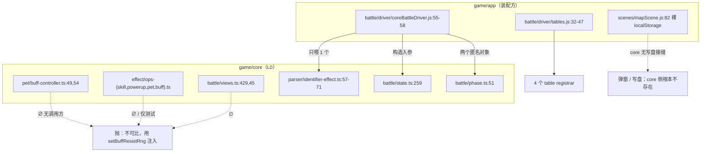
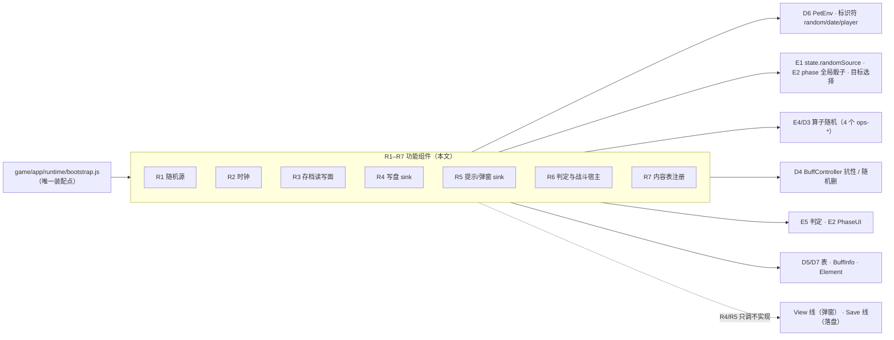

# 运行时功能组件设计（runtime-components-design.md）

> **父文档**：`docs/architecture.md`（跨线总览 · §4 指针表）· 结构面 `docs/arch-docs.md §0.1/§2`、`docs/arch-code.md §3`（依赖规则）·
> **邻线（本线只借不抄）**：D1 `docs/domain/domain-base.md`（`Rng` 接口与算法真值）· D6 `docs/domain/domain-pet.md §3.2`（`PetEnv` 注入契约）·
> Save 线 `docs/save/save-design.md`（存档格式）· View 线 `docs/view/view-design.md`（弹窗外观）·
> 引擎线 `docs/engine/battle-engine-design.md §5.6`、`docs/engine/oracle-playbook.md`（对拍口径）·
> D0 `docs/domain/domain-design.md §1`（不变量 V1–V7）
> **状态**：✅ 已写，待人类评审。**配对 `impl` 未写**（阶段一续）。
> **本线立线的两条人类决议（2026-10-17）** —— ⚠️ **编号沿用全局「人类决议」①–⑧**（**索引在 `AGENTS.md §5`**，原文散见 `AGENTS.md §1.1` / `§2` / `§4`、`docs/arch-docs.md §4.1`；
> 本线**局部**编号是 **RT1–RT7 / RB1–RB6 / Q1–Q5**，与决议编号不同一套，同款声明见 `docs/domain/domain-info.md §8` 末）：
> **决议 ①** 随机数生成**不需要**启 Unity、**不需要**与 JS 逐值一致 —— 所以它是一条被降级的验收，不是一座过不去的桥（§7）。
> **决议 ③** **核心层只调用接口**；写入存档和弹窗由外部接口完成（§5 R4/R5）。

> ⚠️ **命名与目录**：线名 `runtime-components`，目录 `docs/runtime/`（有意省略 `-components`，与 `save-xml-spec.md` 同类的短目录）。
> 配对文件将是 `docs/runtime/runtime-components-impl.md`。登记于 `docs/arch-docs.md §0.1`。

> ⚠️ **本份不管什么**：不管 `Rng` 有哪些方法、区间开闭如何（那是 D1 `game/core/rng.ts:9-20` 的真值），
> 不管存档字段格式（Save 线），不管弹窗长什么样（View 线），不管判定算子的语义（E5/D3）。
> **本份只管一件事**：核心层需要的外部能力**有哪几件、每件一个缝、缝的默认行为、以及怎么验收**。

---

## 0. 这份文档回答什么

1. **现状是"每件能力被拆成 N 个各自命名的 setter"** —— 光是"给我一个随机数"就有 **10 条路**（§3.1），
   其中 **6 条没有任何调用方**（连测试都没有）。这不是设计，是逐段移植时的临时围栏累积。
2. **有两件能力至今根本没有实现** —— 时钟（0 个实现，2 处默认抛，§3.2）与写盘/弹窗 sink（core 内 0 个接缝，§3.3/§3.4）。
   决议 ③ 要的就是把后者**补成接缝**，而不是继续在 core 里注释"这里上游会弹窗"。
3. **同一份默认实现被抄了两遍** —— `parser/identifier-effect.ts:57-71` 与 `battle/views.ts:44-54`
   是两份逐字重复的 `IdentifierHost` 抛体（§3.7）。
4. **`currentBattle` 有两套形状** —— `parser/identifier-effect.ts:83` 与 `battle/phase.ts:51` 各自声明了一个"战斗宿主"接口（§3.5）。
5. **目标形状**：七件（R1–R7），**一件一缝**（§5），装配集中在一个 app 侧入口（§6），验收以**人类手动测试**为主、对拍为辅（§7）。

---

## 1. 范围与边界

| 圈里（本文定） | 圈外（谁定） |
|---|---|
| 能力清单（哪几件）与每件的一个接缝（名字、签名、时机） | `Rng` 的方法集与开闭区间语义 → **D1** `docs/domain/domain-base.md` + `game/core/rng.ts:1-49` |
| 缝的**默认行为**（抛 / 零值 / 未装配即失败） | 弹窗的外观、层级、按钮 → **View 线** `docs/view/view-design.md` |
| **谁来装配**、装配顺序、无头测试怎么给替身 | 存档的字段与 XML 格式 → **Save 线** `docs/save/save-design.md` |
| 随机臂的**验收口径**（不比 Unity、只比同 seed 复现） | 对拍 harness 的向量与门禁操作 → `docs/engine/oracle-playbook.md` |
| 与 V1–V7 的一致性（本线的不变量 RT1–RT7） | 具体算子/判定语义 → **E5** `docs/engine/battle-engine-judge.md`、**D3** |

**为什么单独立一条线**：这些能力**跨所有线**（引擎 E1–E7、域 D1–D7、View、Save 都要用），
放在任何一条线里都会让其余线"引用兄弟线的细则"。按 `docs/arch-docs.md §0.1`，横切面自立目录。

---

## 2. 上游真值（C# 侧的"功能组件"长什么样）

上游**没有**"功能组件"这个概念 —— 它直接摸全局。这正是要复刻的**障碍**，也是本文的**动机**：

| 能力 | 上游形态（真值源） | 语义要点 | 我们是否逐值复刻 |
|---|---|---|---|
| 随机 | `UnityEngine.Random.Range(int,int)` = **闭区间**；`(float,float)` = 左闭右开 | native ECall，进程外直接 `SecurityException: ECall methods must be packaged into a system module.` | **否**（决议 ①） |
| 随机（列表） | `ListHelper.Random()` | 等概率取一个 | **否**（同上） |
| 随机（整局） | `Random.InitState((int)DateTime.Now.Ticks)`（`BattleSettings.cs:58,63`；`BattleResult.cs:62`） | 墙钟播种 ⇒ 上游自己也不可复现 | **否**：seed 改显式入参（`game/core/battle/settings.ts:12` 已这样处理） |
| 持久骰子 | `Player.instance.random`（一个存档里的 int） | `random[old]` 读、`random[new]` 写（`Identifier.cs:20-26`） | **是**（语义，不是序列） |
| 时钟 | `DateTime.Now`（`Identifier.cs:41-53`，**本地时区**） | `date.year/month/day/...` | **是**（语义） |
| 玩家数据 | `Player.instance.gameData` | `player.<k>` 读 | **是** |
| 提示/弹窗 | `Hintbox`（View 静态） | core 侧只出现在注释与早退分支（如 `Battle.cs:263-268`） | 是（接缝） |
| 写盘 | 存档线 | 上游在战斗结算里直接改存档 | 是（接缝） |

**证据口径**：`路径:行`；源码 > 推断；本节行号已在 2026-10-17 对 `Assets/Scripts/System/Parser/Identifier.cs`、
`Assets/Scripts/MVC/Model/Basic/Battle/**` 实测复核。

---

## 3. 现状普查（as-built · 全部实测）

> 这一节是本文最硬的部分：**逐条 `grep` 出来的行号**，不是计划。判据列写 `∅` = **全仓无任何调用方**（含测试）。

### 3.1 随机源：一个能力，10 条路

| # | 缝 | 位置 | 覆盖的臂 | app 是否装配 |
|---|---|---|---|---|
| 1 | `setBuffResistRng` | `game/core/pet/buff-controller.ts:49`（抛点 `:224-225`） | Buff 抗性 `Random.Range(0,100)` | **∅** |
| 2 | `setBuffRemoveRng` | `game/core/pet/buff-controller.ts:54`（抛点 `:358-359`） | `RemoveRangeBuff` 随机删 | **∅** |
| 3 | `setOpsSkillRng` | `game/core/effect/ops-skill.ts:49`（抛点 `:50`） | `SetSkill` 的 random 支 | **∅** |
| 4 | `setOpsPowerupRng` | `game/core/effect/ops-powerup.ts:50`（抛点 `:52-53`、`:59`、`:152`） | 随机 powerup / custom pdf | 仅测试 |
| 5 | `setOpsPetRng` | `game/core/effect/ops-pet.ts:35` | 宠侧算子随机 | 仅测试 |
| 6 | `setOpsBuffRng` | `game/core/effect/ops-buff.ts:56`（抛点 `:58-59`） | Buff 算子随机 | 仅测试 |
| 7 | `setRandomSkillSource` | `game/core/battle/views.ts:429`（抛点 `:434`） | `Skill.GetRandomSkill`（**连 id 上下界一起注入**） | **∅** |
| 8 | `HOST.rng` | `game/core/parser/identifier-effect.ts:58-63` | 标识符 `random` 臂 | ✅ `coreBattleDriver.js:58` |
| 9 | `SKILL_NUM_HOST.rng` | `game/core/battle/views.ts:45-50` | 技能标识符 `random` 臂 | **∅** |
| 10 | `randomSource` | `game/core/battle/state.ts:259`、`:266`（拷贝构造 `:284`；消费 `:348`、`:451`、`:477`、`phase.ts:387`、`target.ts:97`） | 全局骰子（先手/目标/命中） | ✅ `coreBattleDriver.js:67-68`（构造入参） |

**四种不同的传输机制**：模块级 `let`（1–6）、注入对象带参数（7）、`IdentifierHost` 字段（8–9）、构造入参（10）。
抛错文案还各自写着"不可比，用 setXXXRng 注入" —— 这套理由已被决议 ① 作废。

### 3.2 时钟：0 个实现

| 事实 | 位置 |
|---|---|
| 默认体直接抛 | `game/core/parser/identifier-effect.ts:69` `getDate: () => notPorted('date. 要 DateTime.Now')`；`game/core/battle/views.ts:53` |
| 契约已声明 | `game/core/parser/identifier.ts:14-15`（注释要求**本地时区**） |
| 消费点 | `game/core/parser/identifier.ts:59`（`date.` 前缀） |
| 墙钟的上游播种 | `BattleSettings.cs:58,63` ⇒ TS 侧已改显式入参（`game/core/battle/settings.ts:12`、`:60`、`:92`、`:101`） |

⇒ **`date.*` 标识符发行数据一旦命中就是硬崩**，且今天没有任何实现接得上。

### 3.3 存档侧：三支散在同一个 host

| 支 | 位置 | 备注 |
|---|---|---|
| `getPlayerRandom` | `parser/identifier.ts:12`、`:32`；默认体 `parser/identifier-effect.ts:67`、`battle/views.ts:51`；判定侧再包一层 `effect/effect-judge.ts:236` | 上游 `Player.instance.random` |
| `setPlayerRandom` | `parser/identifier.ts:13`、`:35`；`effect/effect-judge.ts:71`、`:244` | **core 里唯一的"写存档"动作**，且只写这个 int |
| `getPlayerData(key)` | `parser/identifier.ts:17`、`:68`；默认体 `parser/identifier-effect.ts:70`、`battle/views.ts:54` | 上游 `Player.instance.gameData` |

### 3.4 写盘与弹窗：core 内**不存在**接缝

- 弹窗：core 里 `Hintbox` 只出现在注释和一个早退抛错里（`game/core/battle/phase.ts:1006-1007`、`:1027`）。
  真正的提示是**返回数据**（`game/core/battle/settings.ts:174` 的 `condition() → {ok, message}`），
  UI 在 `game/app/view/panels/hintbox.js`。**没有任何 core→UI 的调用面。**
- ★ 更糟的是**文案本身住在 core**：`game/core/battle/settings.ts:179`、`:182` 直接返回
  `'无法使用Mod精灵进行本体关卡的挑战哦\n<color=#ffbb33>橘色名字</color>的是Mod精灵'` 这类带富文本标记的中文字符串
  ⇒ R5 的接缝要把"文案 + 渲染标记"换成 **key + args**（取词与标记归 View 线）。
- 写盘：core 完全不写盘；落盘在场景层裸调 `localStorage`（`game/app/scenes/mapScene.js:82`、`:99-121`；`game/app/scenes/rbattleScene.js:160-168`）。
- ⇒ **决议 ③ 要求的两个 sink（R4 写盘、R5 弹窗）今天要新建**，不是"整理现成的"。

### 3.5 判定与战斗宿主：五缝 · 两套形状

| 缝 | 位置 | 状态 |
|---|---|---|
| `setEffectJudgement` | `game/core/battle/effect-handler.ts:28`、`:39` | ✅ `coreBattleDriver.js:55` |
| `setPhaseBattle` | `game/core/battle/phase.ts:51`（接口 `PhaseBattle`）、`:62`（抛点 `:71`） | ✅ `coreBattleDriver.js:56` |
| `setIdentifierBattle` | `game/core/parser/identifier-effect.ts:83`（接口 `EffectIdentBattle`）、`:84`（抛点 `:86-88`） | ✅ `coreBattleDriver.js:57` |
| `setSettingsHost` | `game/core/battle/settings.ts:33`（接口 `[debugMode, pvpReveal]`）、`:40` | **仅测试**（app 未装配 ⇒ `pvpReveal()` 走默认抛） |
| `setNetFence` | `game/core/battle/state.ts:52`、`:61` | **∅** |

★ **两套 `currentBattle` 形状**：`phase.ts:51` 的 `PhaseBattle`（8 成员）与 `identifier-effect.ts:83` 的 `EffectIdentBattle`（1 成员 `currentState`）。
app 侧因此喂了**两个不同的匿名对象**（`coreBattleDriver.js:56-57`），二者读的是同一个 `battle.currentState`。

### 3.6 内容表注册：五个 registrar，一个孤儿

| 缝 | 位置 | app 装配 |
|---|---|---|
| `setEffectTable` | `game/core/effect/effect.ts:32` | ✅ `app/battle/driver/tables.js:32` |
| `setSkillTable` | `game/core/battle/views.ts:452` | ✅ `tables.js:33` |
| `setBuffTables` | `game/core/buff/buff-info.ts:64` | ✅ `tables.js:45` |
| `setBuffHost` | `game/core/buff/buff.ts:39` | ✅ `tables.js:47` |
| `setElementGroups` | `game/core/parser/identifier-effect.ts:678` | **∅** |

### 3.7 重复实现（两份逐字相同的默认抛体）

`game/core/parser/identifier-effect.ts:57-71` 与 `game/core/battle/views.ts:44-54`：同样的 5 个 `rng` 方法 + 同样 4 个宿主方法，
只有抛错文案的措辞不同（`notPorted(...)` vs `noNumContext(...)`）。**两份都要被替换。**

### 3.8 无头门禁：脚本化前，规则本身不自洽

`docs/arch-code.md §3` 硬规则 1 写的是「`grep -E "UnityEngine|Player.instance|Photon|Database.instance" game/core/**` 必须**空输出**」。
实测：`game/core/**.ts` **63 命中**，其中非注释开头的只有 4 行，且都在 `game/core/effect/effect-judge.test.ts:262,889,968,969` 的
`throw new Error('native UnityEngine.Random')` **字符串里** ⇒ **真实违反 0 处**，但**按字面规则今天就不通过**（§8 待拍板 Q5）。

### 3.9 汇总

| 指标 | 实测 |
|---|---|
| 注入/装配缝总数（本文口径的 7 件范围内） | **21** |
| 其中**全仓无调用方**（`∅`） | **8**（§3.1 #1#2#3#7#9、§3.5 `setNetFence`、§3.6 `setElementGroups`、`setSkillNumHost`） |
| 其中仅测试装配 | **5** |
| app 真正装配 | **8** |
| 缺实现的能力 | **3**（时钟 / 写盘 sink / 弹窗 sink） |
| 逐字重复的默认体 | **2** |

---

## 4. 图

### 4.1 现状：一件能力，N 个缝（只画随机 + 宿主）



### 4.2 目标：一件一缝



---

## 5. 七件组件的契约

> 统一口径：**一件 = 一个 `installXxx()` / 一个 host 对象**；**默认行为 = 抛**（延续现状纪律，静默零值会把"没装"伪装成"结果就是 0"）；
> 签名是**目标形状**，具体 `impl` 由 `docs/runtime/runtime-components-impl.md` 落（阶段一续）。

### R1 随机源（`RuntimeRng`）

| 项 | 口径 |
|---|---|
| 取代 | §3.1 的 **#1–#9**（9 条路 → 1 条） |
| 接口 | `setRuntimeRng(rng: Rng)`；消费方一律 `runtimeRng()` 取（缺省抛，消息只说「随机源未装配」，**不再写"不可比"**） |
| 保留 | **#10 `state.randomSource`** 保留为**每局一个实例**的显式入参（它是快照/序列语义的一部分，不是全局服务）；但它的**来源**改由 R1 提供 |
| 算法 | **不在本文** —— 归 D1 `game/core/rng.ts`，接口与开闭区间语义不变（`docs/domain/domain-base.md`） |
| 决议 ① | **不追求与 Unity 逐值一致**；oracle 侧的 `UnityEngine.Random` shim **取消**（不再是"探一次→炸→剔除"，而是"不需要探"） |
| 验收 | 同 seed ⇒ 同序列（自复现），加**分布形状**自测（区间开闭、`pick` 空数组返回 `undefined`） |

### R2 时钟（`RuntimeClock`）

| 项 | 口径 |
|---|---|
| 新增 | 今天是 0 实现（§3.2）⇒ 本件是**新建**，`app` 侧给真实现 |
| 接口 | `getDate(part): number`（`year/month/day/hour/minute/second`），**本地时区**，对齐 `Identifier.cs:41-53` |
| 决定性 | **禁止**进入任何进快照或对拍的路径；测试要稳定就**显式冻结**（`setRuntimeClock(() => fixedDate)`），不得在 core 里塞默认 `Date.now()` |
| 顺带 | `BattleSettings` 的 seed 播种（上游 `DateTime.Now.Ticks`）继续走显式入参，不回退到墙钟 |

### R3 存档读写面（`RuntimeStore`）

| 项 | 口径 |
|---|---|
| 取代 | §3.3 三支（`getPlayerRandom` / `setPlayerRandom` / `getPlayerData`）**合一**，并**消灭两份重复体**（§3.7） |
| 接口 | `readRandom(): number` · `writeRandom(v)` · `readPlayerData(key): number \| null` |
| 语义 | `random` 是**进程级的一个 int**（上游 `Player.sceneData["random"]`：`projects/Seer2-Restart-Lite-main/Assets/Scripts/System/Player.cs:37` 的 `private static Dictionary` ⇒ **不是 `GameData` 字段、不进 XML、跨存档共享**；每进程在 `Player.Start()`（`:45-49`，播种在 `:48`）掷一次）；读写语义照搬 `Identifier.cs:15-26` 的 old/new 顺序（`[old]` 读、`[new]` 先 `Random.Range(0,100)` 播种再返回） |
| 与 D6 的关系 | D6 的 `PetEnv.store/save`（`docs/domain/domain-pet.md §3.2`）**即本件**，不另立一套 |

### R4 写盘 sink（`SaveRequest`）— **新建**

| 项 | 口径 |
|---|---|
| 动机 | 决议 ③：核心层只调接口，写盘由外部完成；现状 core 完全无此接缝（§3.4） |
| 接口 | `requestSave(reason: 'battleEnd' \| 'petChange' \| 'bag' \| string): void`（**fire-and-forget，不返回、不抛**） |
| 语义 | "告诉宿主：我改过状态了，请落盘"。**落盘时机、节流、序列化全归 Save/View 线** |
| 默认 | 缺省实现 = no-op（**本件是唯一允许 no-op 默认的**：没落盘是可观察的，不会伪装成数字错误） |

### R5 提示/弹窗 sink（`Hint`）— **新建**

| 项 | 口径 |
|---|---|
| 动机 | 决议 ③；现状 core 只在注释里"要弹窗"，或把文案当数据返回（`settings.ts:174`） |
| 接口 | `showHint(spec: {text?: string; key?: string; args?: unknown[]; level: 'info' \| 'warn' \| 'error'}): void`；需要用户选择时才 `askHint(spec): 'ok' \| 'cancel'`（**同步形状**，上游 `Hintbox` 即同步模态） |
| 语义 | core **只给文案 key 与参数**，取词与渲染归 View 线（`docs/view/view-design.md`） |
| 落点 | `game/core/battle/phase.ts:1027` 那条死循环早退分支 = 第一个真实消费者（上游 `Battle.cs:263-268` 就是 ProcessResult + `Hintbox`） |
| 默认 | 缺省 = 抛（弹窗缺失 = 用户看不见错误，必须可见） |

### R6 判定与战斗宿主（`RuntimeJudge` / `RuntimeBattleHost`）

| 项 | 口径 |
|---|---|
| 合并 | `setEffectJudgement` + `setPhaseBattle` + `setIdentifierBattle` → **一个** `installBattleHost(get: () => BattleHostView)` |
| 关键 | **两套 `currentBattle` 形状合一**：`EffectIdentBattle`（1 成员）并入 `PhaseBattle`（8 成员），由 `PhaseBattle` 作超集 |
| 判定 | `setEffectJudgement` 作为**可选装配**保留（无头纯形状测试要能不开判定），但从 host 对象里取，不再单缝 |
| 围栏 | `setNetFence`（`state.ts:61`）无调用方 ⇒ 要么给消费者要么**删**（RT4） |
| 重复体 | §3.7 两份默认体 → 由 R1+R2+R3 组合出的**一份** `defaultThrowingHost()` |

### R7 内容表注册（`registerTables`）

| 项 | 口径 |
|---|---|
| 合并 | 5 个 registrar（§3.6）→ 一个 `registerTables(tables: ContentTables)`；缺任一项 ⇒ 装配期就抛（**不是**运行时首碰才抛） |
| 孤儿 | `setElementGroups` 无调用方 ⇒ 本件顺手补装配（`app/battle/driver/tables.js` 缺了它），或按 RT4 删缝 |
| 与 D7 的关系 | 表的**字段真值**与 L2 桥在 `docs/domain/domain-info.md`；本文只管"注册"这一动作 |

---

## 6. 装配（谁在什么时候把缝喂上）

**现状**：散在 `coreBattleDriver.js:55-58`（4 缝）+ `tables.js:32,33,45,47`（4 缝）+ 场景层裸 `localStorage`。

**目标**：**一个装配点、一个顺序**：

```
game/app/runtime/bootstrap.js
  R7 registerTables   // 表先到位，后续任何一次解析才不会拿到空表
  R1 setRuntimeRng    // seed 由调用方给（存档 or 每局新值 ⇒ 待拍板 Q1）
  R2 setRuntimeClock
  R3 setRuntimeStore
  R4 setSaveRequest
  R5 setHintSink
  R6 installBattleHost // 每局战斗一次（它随 battle 生灭，不是一次性）
```

- ⚠️ **2026-10-18 编排线回执（编排线 **ORP2** 已拍板）**：装配点的**文件**归本线 **RB6**，**调用时刻 / 宿主**归编排线
  （`main.js` → `sceneLoader.boot()`，`docs/orchestration/orchestration-design.md §4.2`）。
  并且顺序上有一条硬约束：**`storage` 的创建必须早于读档** —— 它是本装配点**唯一**的创建处（`createFsStorage()`），
  而会话的 `ensureLoaded()` 要拿它当入参 ⇒ 编排线 **D8** 把 `bootstrap` 排在 `session.load` **之前**
  （上游 `GameData` 是静态的，没有这个需求）。**ORB4-a 只落 `storage` 的归属 + R3 的「值」委托**
  （经 `coreBattleDriver.js:58`），R4/R5 的缝与其余六件仍在 **RB3 / ORB4-b**。
- **无头测试**用 `testRuntime(overrides)` 造替身：默认给**冻结时钟 + 固定 seed + 记录型 sink**，
  测试要断言"没装配会怎样"时必须显式撤缝（放哪 = 待拍板 Q4）。
- **一局一个实例**的（R6 的 battle host、每局 `randomSource`）与**进程单例**的（R1–R5、R7）分开，不得混在一个 setter 里。

---

## 7. 与对拍 / 验收的关系（决议 ① + 人类主测口径）

**旧口径**：native Random ⇒ 永久不可比 ⇒ 随机臂从对拍向量里剔除，并在报告里写"不可比"。
**新口径**：

| 变化 | 说明 |
|---|---|
| 随机**不比 Unity 的值** | 决议 ① 明说"不需要启 Unity、不需要逐值一致" ⇒ 对拍里随机臂**不再是缺口，而是不再需要** |
| oracle shim 取消 | `tools/oracle-cs/Program.cs:195-206` 的注释与"探一次→炸→剔除"策略随之作废（要同步改的文档：`docs/engine/oracle-playbook.md`、`docs/engine/port-map.md`、`docs/domain/domain-base.md §2.6`、`game/core/rng.ts:5-6` 的头注释） |
| 改成自复现验收 | 同 seed ⇒ 同序列；随机臂做**形状**自测（区间开闭、边界值、空输入） |
| 对拍降级为辅助门 | 它只保证"数字不回归"；**主要验收手段 = 人类手动测试并反馈**（口径写进 `AGENTS.md §1.1`） |
| 随机以外的臂照旧 | `date.*` / `player.*` / 存档读仍要走 R2/R3，不可用"不可比"当理由跳过 |

⇒ 因此 §3.1 那些"不可比，用 setXXXRng 注入"的抛错文案是**遗留措辞**，RB1 一并改。

---

## 8. 不变量 · 施工批 · 待拍板

### 8.1 本线不变量（RT1–RT7）

| # | 不变量 | 判据 |
|---|---|---|
| RT1 | 核心层**不自己落盘、不自己弹窗**，只调 R4/R5 | `grep -r "localStorage" game/core` 空 |
| RT2 | **一件一缝**：七件各一个装配入口；新增能力先登记本文再写码 | 本文 §5 表 vs setter 清单 diff 为空 |
| RT3 | 默认行为**抛，不给静默零值**（R4 例外，允许 no-op） | 每个 host 的默认体可 grep 到 `throw` |
| RT4 | **无孤儿缝**：每个 setter 至少有 1 个装配调用方（测试不算） | 一次性脚本：对每个 `set*/install*` 在非 core、非测试目录找调用方 |
| RT5 | 时钟**不进决定性路径**，除显式冻结 | `date.` 臂的消费向量在报告里标"合成" |
| RT6 | 随机**不比 Unity**，只比同 seed 复现 | §7 |
| RT7 | 无头门禁继续生效，但**规则文本要可执行**（见 Q5） | `grep -vE` 版：剥离注释与字符串后零命中 |

### 8.2 施工批 RB1–RB6

| 批 | 内容 | 触达 |
|---|---|---|
| RB1 | 9 条随机路 → R1；抛错文案去掉"不可比"；oracle shim 注释作废 | `pet/buff-controller.ts`、`effect/ops-*.ts`、`battle/views.ts`、`parser/identifier-effect.ts`、`tools/oracle-cs/Program.cs` |
| RB2 | R2 时钟真实现（app）+ 冻结替身（测试） | `parser/identifier*.ts` 默认体、`game/app/runtime/` |
| RB3 | R3 三支合一 + 删两份重复体；R4/R5 两个新 sink 建档并接上第一个消费者 | `parser/identifier-effect.ts:57-71`、`battle/views.ts:44-54`、`battle/phase.ts:1027`、`app/view/panels/hintbox.js` |
| RB4 | R6 合并 + 两套 `currentBattle` 形状合一 | `battle/phase.ts:51`、`parser/identifier-effect.ts:83`、`coreBattleDriver.js:56-57` |
| RB5 | R7 合并 + 补 `setElementGroups` 装配 + 处理 `setNetFence`/`setSkillNumHost` 孤儿 | `effect/effect.ts:32`、`buff/buff-info.ts:64`、`buff/buff.ts:39`、`battle/views.ts:452` |
| RB6 | 一个装配点 `app/runtime/bootstrap.js` + `testRuntime()`；RT4/RT7 门禁脚本化 | `game/app/**`、`tools/` |

**顺序要求**：RB1 → RB3 之前，`date.`/`player.` 臂不发真值向量（沿用 D6 的 B6 口径，但**理由**从"不可比"换成"接缝未建"）。

### 8.3 待拍板（Q1–Q5）

1. **Q1 · 每局 seed 的来源**：读存档里那个 int（与 `random[old]` 同源）还是每局新值（对齐上游 `DateTime.Now.Ticks`）？影响"同一场战斗能否重放"。
2. **Q2 · R4 的粒度**：`requestSave` 立即落盘 / 节流 / 只在结算时？（上游在战斗中途就改存档，见 Save 线）
3. **Q3 · R5 是否阻塞**：上游 `Hintbox` 有模态回调吗？若有，`askHint` 的同步形状要改成回调。
4. **Q4 · `testRuntime()` 放哪**：`game/core/testkit.ts`（L0，会被 build-core 生成）还是 `game/test/`（非 L0）？我倾向后者 —— L0 不该自带替身。
5. **Q5 · 无头门禁的规则文本**（§3.8）：`docs/arch-code.md §3` 硬规则 1 写的"必须空输出"今天就不成立。建议改为
   **「剥离注释与字符串字面量后，对四个符号零命中」**，并脚本化为 `tools/check-headless.mjs`。**这条要拍板**，因为门禁归 `arch-code.md` 管，本文不擅自改口径。

---

## 9. 配对 `impl`

本文只定**能力清单、一件一缝的契约、默认行为、验收口径与施工批**。
落地细节（每个 `Rng` 调用点的签名适配、`bootstrap.js` 的模块图、替身工厂、门禁脚本）→
`docs/runtime/runtime-components-impl.md`（**未写**，阶段一续；as-built 纪律见 `docs/arch-docs.md §5`）。
