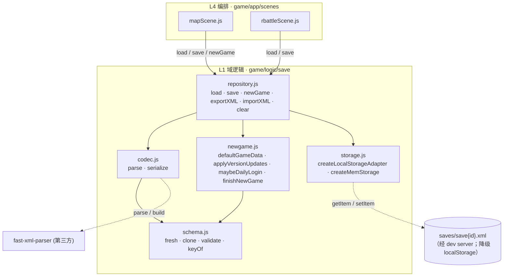
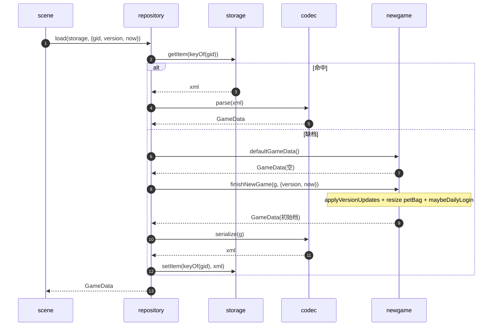

# 重启存档 · 代码映射（save-code-map.md）

> 子文档 of `docs/save/save-impl.md`（**实现文档**）。本文只回答：**要实现哪些接口、函数名、参数、返回，
> 该函数对外部做什么操作**，以及**文件路径与接口函数的关系图**。
> 上游/格式真相见 `docs/save/save-xml-spec.md`。

## 0. 说明：外部操作的分类

| 标记 | 含义 |
|---|---|
| `纯` | 无副作用，输入→输出 |
| `突变` | 改动传入的对象（如 `GameData`）|
| `IO` | 读写 `storage`（localStorage / mem / 文件）|
| `渲染` | 操作 DOM —— **本模块一律没有**（存档属 Model 层，只处理数据；渲染由 view 消费状态后自行完成）|

> 「外部操作」栏在本模块只会出现 `纯 / 突变 / IO`，**不会出现"渲染处理"** —— 这本身是本模块的架构约束。

---

## 1. 模块与职责

| 文件 | 职责 | 依赖 |
|---|---|---|
| `game/logic/save/schema.js` | 数据形状、常量、`fresh`/`validate` | 无 |
| `game/logic/save/codec.js` | XML 字符串 ⇄ `GameData` | schema、fast-xml-parser |
| `game/logic/save/newgame.js` | 初始档生成 + 版本迁移修饰 | schema |
| `game/logic/save/storage.js` | storage 适配器（fs / localStorage / mem） | 无 |
| `game/logic/save/repository.js` | **app 唯一入口** | codec/newgame/storage |

依赖方向：`scene → repository → {codec,newgame,storage} → schema`。**反向 import 一律禁止**。

---

## 2. 接口表

### 2.1 `storage.js`

| 函数 | 参数 | 返回 | 外部操作 |
|---|---|---|---|
| `createFsStorage(base)` | `base: string`（如 `/saves`）| `Storage` | `IO`（HTTP GET/PUT）|
| `createLocalStorageAdapter(prefix)` | `prefix: string` | `Storage` | `IO`（降级）|
| `createMemStorage(init?)` | `init?: Record<string,string>` | `Storage` | `纯`（测试）|

**`Storage` 接口**（三实现同形）：

| 方法 | 参数 | 返回 | 外部操作 |
|---|---|---|---|
| `getItem(k)` | `k: string` | `string \| null`（**Promise**）| `IO` |
| `setItem(k,v)` | `k: string, v: string` | `void`（**Promise**）| `IO` |
| `removeItem(k)` | `k: string` | `void`（**Promise**）| `IO` |

> ⚠️ **`k` 是仓库相对路径**（`schema.keyOf(gid)` = `saves/save{gid}.xml`），**不是**裸文件名；
> `createFsStorage(base)` 的 `base` = **站点根前缀**（默认 `''` = 同源根）⇒ 浏览器里就是 `fetch('/saves/save0.xml')`。
> 三实现**都返回 Promise** ⇒ 调用方一律 `await`。细则（含"防双前缀"）见 `docs/save/save-impl.md §9.4 (4) ⑥⑦`。

### 2.2 `schema.js`

| 函数/常量 | 参数 | 返回 | 外部操作 |
|---|---|---|---|
| `PET_BAG_SIZE` / `MAX_SAVE_COUNT` / `COIN_ID` / `DIAMOND_ID` | — | `number` | — |
| `fresh()` | — | `GameData` | `纯` |
| `clone(g)` | `g: GameData` | `GameData` | `纯` |
| `validate(g)` | `g: GameData` | `{ ok: boolean, errors: string[] }` | `纯` |
| `keyOf(gid)` | `gid: number` | `string`（工程内路径 `saves/save{gid}.xml`）| `纯` |

### 2.3 `codec.js`

| 函数 | 参数 | 返回 | 外部操作 |
|---|---|---|---|
| `parse(xml)` | `xml: string` | `GameData` | `纯` |
| `serialize(g)` | `g: GameData` | `string` | `纯` |

**内部值格式器**（纯）：

| 函数 | 参数 | 返回 |
|---|---|---|
| `formatDateTime(d)` / `parseDateTime(s)` | `Date` / `string` | `string` / `Date` |
| `formatNumber(n)` | `number` | `string`（float 最短往返）|
| `personalityName(i)` / `personalityIndex(s)` | `number` / `string` | `string` / `number`（中文枚举 ↔ 序号）|
| `elementNameFor(parentField, typeName)` | 上下文 | `string`（处理 `Item` vs `item`）|

### 2.4 `newgame.js`

| 函数 | 参数 | 返回 | 外部操作 |
|---|---|---|---|
| `defaultGameData(opts?)` | `opts?: { coin=2000, diamond=0, rng? }` | `GameData` | `纯` |
| `applyVersionUpdates(g, from, to)` | `g: GameData, from: string, to: string` | `Event[]` | `突变` |
| `maybeDailyLogin(g, now)` | `g: GameData, now: Date` | `Event[]` | `突变` |
| `finishNewGame(g, opts)` | `g: GameData, opts: { version, now }` | `GameData` | `突变` |

### 2.5 `repository.js`（**app 唯一入口**）

| 函数 | 参数 | 返回 | 外部操作 |
|---|---|---|---|
| `load(storage, opts?)` | `storage: Storage, opts?: { gid=0, version, now }` | `GameData` | `IO` + `突变`（缺档则造档并落盘）|
| `save(storage, gid, g)` | `storage, gid: number, g: GameData` | `void` | `IO` |
| `newGame(storage, opts?)` | `storage, opts?: { gid=0, coin, diamond, version, now }` | `GameData` | `IO` |
| `exportXML(g)` | `g: GameData` | `string` | `纯` |
| `importXML(storage, gid, xml)` | `storage, gid: number, xml: string` | `{ ok, errors, data? }` | `IO` + `纯` |
| `clear(storage, gid)` | `storage, gid: number` | `void` | `IO` |

**`load` 的行为契约**（对应上游 `SaveSystem.LoadData`）：
1. 读 `keyOf(gid)`；命中 → `codec.parse` → 校验 → 返回。
2. 未命中 → `newGame`（= `defaultGameData` + `finishNewGame`）→ `serialize` → `setItem` → 返回。
3. `version` 与当前不一致 → `applyVersionUpdates` 后回写（对应 `GameManager.GameLogin`）。

---

## 3. 文件路径与接口函数

---

## 4. `load` 时序（缺档自动造档 = 上游 `LoadData` 回退）

---

## 5. 依赖规则（可当 lint 判据）

1. `schema.js` 不 import 本目录其余文件、不 import app/view。
2. `codec.js` 只 import `schema` + 第三方库；**不得** import `newgame`/`repository`。
3. `repository.js` 不 import 任何 `game/app/**`（否则 Model 反向依赖 View）。
4. `game/app/**` **只**经 `repository.js` 触达存档；不得直接 `codec`/`storage`。
5. 本模块**零 DOM**（无 `document`/`window`；`storage` 由外部注入）。

---

## 6. 状态

- 本文是**设计态**（to-be）。实现落地后在 `docs/save/save-impl.md §9`（as-built）登记偏差，本文保持为"计划"。
  - ✅ **2026-10-18 批 A 已落**（`schema.js` + `codec.js` + `newgame.js`）：**对本文的偏差有 8 条**，
    逐条见 `docs/save/save-impl.md §9.3 (4)`（写侧不用库 builder · `defaultGameData` 加 `tables`/`petFactory` ·
    `finishNewGame` 加 `opts.events` · `formatDateTime` 实现在 schema 等）。
  - ✅ **2026-10-18 批 B 已落**（`storage.js` + `repository.js` + `tools/serve.mjs` + `game/index.html` 的 importmap）：
    **对本文的偏差 8 条**，逐条见 `docs/save/save-impl.md §9.4 (4)`（`load` 加 `opts.login` · 再导出 `isEmpty`/`MAX_SAVE_COUNT` ·
    `importXML` 原样字节落盘 · **键口径与"防双前缀"** · 三适配器统一返回 Promise 等）。**§2 的表格仍是契约**（§2.1 的上表已按实况补了 `k`/`base`/Promise 三处注）。
- **真存储 = 工程目录** `saves/save{id}.xml`；适配器与写端点见 `docs/save/save-impl.md §6`。
- **无 `migrate.js`**：本轮无存量档，冷启动即新建 XML 档（见 `docs/save/save-impl.md §1/§6`）。
- 无 `[XmlArrayItem]` 列表的**子项元素名**按源码规则**定案**（= 类名），见 `docs/save/save-xml-spec.md §4`。
- **字节口径与夹具（2026-10-18 锁定）**：真机真档 = **无 BOM / 无 `encoding=` / CRLF / 末尾无换行**；
  夹具 `tools/fixtures/save-lite4.9.2-{played,default}.xml`，实证登记见 `docs/save/save-xml-spec.md §6`。
- **`storage` 装配点归编排线**（人类 2026-10-18 已决）：本目录只出适配器实现 + 接口，**不自己 new / 不自己选环境**
  （见 `docs/save/save-impl.md §6.1`、`docs/orchestration/orchestration-design.md §6`）。
- **写端点** `tools/serve.mjs`（`GET/PUT/DELETE /saves/*`）：✅ **2026-10-18 已落地（批 B）**，实况见 `docs/save/save-impl.md §9.4`。
