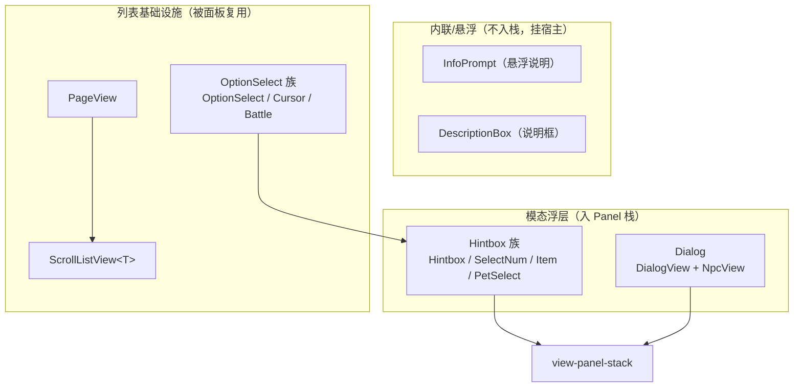
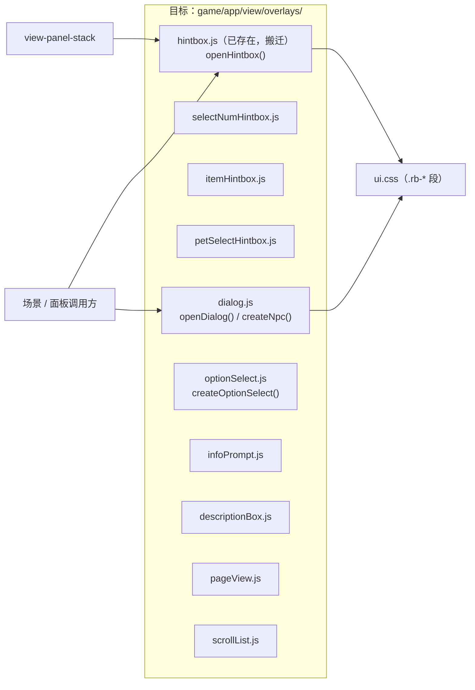

# View 子设计 · 浮层原语（view-overlays.md）

> 子文档 of `docs/view/view-design.md`（§8 子文档地图 A3）。
> 本文定 **跨场景复用的浮层原语**：提示框族、对话框、选项条族、悬浮说明、列表/分页基础设施。
> **不含**：Panel 栈机制（→ `view-panel-stack.md`）、具体业务面板（→ `docs/view/panel/view-panels-*.md`）。
> ⚠️ **与运行时线的接缝**：核心层"弹一条提示"是**调用** = **R5** sink（`docs/runtime/runtime-components-design.md §5 R5`、`docs/engine/battle-engine-session.md §5 S13 ④`）——
> 内核**只给文案 key + args**，取词与显示归本线；本份的 `openHintbox` 等就是 R5 的**装配实现**候选（装配点 = 该文档 §6）。
> 证据标注：【样本】/【源码】/【推断】。上游路径相对 `projects/Seer2-Restart-Lite-main/Assets/`。

---

## 1. 范围与边界

浮层 = **不属于任何单一场景** 的通用 UI 构件。按上游分类：

| 族 | 上游 | 归本文 |
|---|---|---|
| 提示框 | `Hintbox` / `HintboxView` / `HintboxController` / `HintboxModel`；变体 `SelectNumHintbox` / `ItemHintbox` / `PetSelectHintbox` | ✅ |
| 对话框 | `DialogView` / `NpcView` / `DialogManager` | ✅ |
| 选项条 | `OptionSelectView` / `CursorOptionSelectView` / `BattleOptionSelectView` | ✅（战斗专用者只登记归属） |
| 悬浮说明 | `InfoPrompt` / `DescriptionBox` | ✅ |
| 列表/分页 | `PageView` / `ScrollListView<T>` | ✅ |

---

## 2. 上游真值

### 2.1 提示框族（Hintbox）

- **`Hintbox : Panel`**，类在 `Resources/Panels/Hintbox/Scripts/Hintbox.cs`（即 prefab 旁的脚本）。
- 三件套：`MVC/View/Utility/Hintbox/HintboxView.cs` + `MVC/Controller/Utility/Hintbox/HintboxController.cs` + `MVC/Model/Utility/Hintbox/HintboxModel.cs`。
- **静态入口**（全程最常用）：`Hintbox.OpenHintbox()`、`Hintbox.OpenHintboxWithContent(content, size)` —— 全代码库到处在用。
- `HintboxController` 的 API：【源码】`HintboxController.cs:14-31`

| 方法 | 作用 |
|---|---|
| `SetOptionNum(int)` | 0=无按钮 / 1=确认 / 2=确认+取消 |
| `SetSize(x, y)` | 盒体尺寸（默认 320×240） |
| `SetTitle(text="提示", fontsize=20, font=Zongyi)` | 标题 |
| `SetContent(text, fontsize, font)` | 正文 |
| `SetOptionCallback(Action, isConfirm=true)` | 回调（confirm / cancel 分开设） |

- `HintboxView` 的字段：`background`（遮罩）、`rect`、`cornerRect`/`bottomRect`、`optionModule[]`、`title`/`content`、`outline`、
  `confirmButtonSingle` / `confirmButton` / `cancelButton`。【源码】`HintboxView.cs:7-33`
- **变体**（都是独立 Panel，同一套打开机制）：
  - `SelectNumHintbox`（数字选择）、`ItemHintbox`（物品数量）、`PetSelectHintbox`（精灵选择：`View/Panel/PetSelectHintboxView.cs` + `Controller/Panel/PetSelectHintboxController.cs` + `Model/Panel/PetSelectHintboxModel.cs`）。

### 2.2 对话框（DialogView / NpcView）

- **`DialogView : Module`**：`initTextColor=#FCE D69`、`hoverTextColor=#77E20C`；`npcName` / `content`；
  `contentRect` / `functionRect` / `replyRect`；`stdIconSize=150×150`；`icon` + `gif`（`UniGifImage`）。
  API：`OpenDialog(DialogInfo, animateStoryText=true)`、`CompleteStoryTextReveal()`、`RunAfterStoryTextReveal(Action)`、
  `CancelStoryTextReveal()`、`SetReplyClickHandler(Action<NpcButtonHandler>)`、`SetStorySpeakerIconClickHandler`、`SetStorySpeakerHint`。
  【源码】`MVC/View/Utility/Dialog/DialogView.cs:11-26,81-362`
- **`NpcView : Module`**：地图上的 NPC/野怪实体视图：`rect` / `image` / `button` / `nameText` / `animCamera` / `gif`；
  `SetNpcInfo(NpcInfo)`、`SetRaycastTarget(bool)`、`SetPosition`、`SetRotation`、`SetSize`、`SetRect(pos,size,rot)`、`SetColor`、`SetName`。
  【源码】`MVC/View/Utility/Dialog/NpcView.cs:10-80`

### 2.3 选项条族（OptionSelectView）

```
OptionSelectView : Module            ── Select(int) / SetInteractable(int, bool)   【OptionSelectView.cs:6-12】
 └── CursorOptionSelectView           ── + cursorImage + optionRects（光标停靠）    【CursorOptionSelectView.cs:6-11】
      └── BattleOptionSelectView      ── 战斗底栏页签簇（归 view-scene-battle-design）
```
【源码】`MVC/View/Utility/Option Select/*.cs`

### 2.4 悬浮说明（InfoPrompt / DescriptionBox）

- **`InfoPrompt : IMonoBehaviour`**：鼠标悬浮时的说明条。`SetText(content, align, lineSpacing)`、
  `SetInfoPromptWithAutoSize(content, align, lineSpacing, showAtRight)`；**内容感知**：`SetSkill` / `SetCard` / `SetBuff` /
  `SetItem` / `SetPlant(ItemInfo, …)` / `SetPlant(Plant)` 直接吃领域对象排版。【源码】`InfoPrompt.cs:7-186`
- **`DescriptionBox : MonoBehaviour`**：更大的说明框。`SetBoxPosition(pos)` / `SetBoxSize(size, preferredSizeX/Y)` / `SetText(content)`。【源码】`DescriptionBox.cs:6-23`
- 二者被 **`UIModule` 持有**（`UIModule.cs:7-24`）—— 所以每个面板/场景自带一份。
- **上游的用点**（非穷举）：地图**传送点**悬浮 = `TeleportHandler.cs:27` 的 `SetInfoPromptWithAutoSize(info.name, MiddleCenter)`，文案取 XML `<teleport name>` 而**不是**目标图名 ⇒ 见 `docs/view/scene/room/view-scene-map-content.md §2.4`。

### 2.5 列表/分页（PageView / ScrollListView）

- **`PageView : Module`**：`currentPageText` / `lastPageText` / `prevButton` / `nextButton` / `jumpPageInputField`；
  `GetJumpPage()`、`SetPage(page, lastPage, firstPage=0)`。【源码】`PageView.cs:6-17`
- **`ScrollListView<T> : Module`**：`prefabHeight` / `prefab` / `scrollContentRect`；`SetStorage(List<T>, Action<int>)`。【源码】`ScrollListView.cs:7-13`

---

## 3. 我们的现状

| 原语 | 现状 | 落点 |
|---|---|---|
| Hintbox | ✅ 已实现（几何照 prefab 实测） | `game/app/view/panels/hintbox.js` + `ui.css` 的 Hintbox 段 |
| SelectNum / ItemHintbox / PetSelectHintbox | ❌ 缺 | — |
| Dialog / Npc | ❌ 缺 | — |
| OptionSelect 族 | ❌ 缺 | — |
| InfoPrompt / DescriptionBox | ⚠️ **半成品**：只有**一个 DOM 切片** = 传送点出口名的 `#prompt`（实时黑底/白字 14px/跟光标/浮最上，规格照重启 `Prefabs/Info Prompt.prefab`）；**没有** `<UIModule>` 持有 / 内容感知排版 / `DescriptionBox`。`mapScene.js` 的 `#bagtip` 仍是**另一套**自制 tooltip，**不是** `InfoPrompt` | `game/app/scenes/mapScene.js` 的 `#prompt`（`onStageMove`）、`game/index.html` 的 `#prompt` 样式 |
| PageView / ScrollListView | ❌ 缺 | — |

**Hintbox 已落地的细节**（作为其余原语的样板）：

- 结构照 `Panels/Hintbox/Panel.prefab`（遮罩）+ `"Panel Without Background".prefab`（盒体）**逐值抄**：
  `Panel.prefab` 根 = 全屏 `Image`（`UISprite` 黑 `a=.5`）→ 实例化的 Hintbox **默认带遮罩**；
  盒体 320×240 居中、`Image` 黑 `a=1` + `Outline(白 3,−3)`（→ CSS `box-shadow` 四向投影）。
- 类名契约：`.rb-scrim` / `.rb-box` / `.rb-view` / `.rb-bottom-decorate` / `.rb-corner-decorate` / `.rb-title` / `.rb-content` /
  `.rb-options` / `.rb-btn`(`--single`/`--confirm`/`--cancel`)。【源码】`ui.css:32-79`、`hintbox.js:16-70`
- 三态精灵 = prefab 的 `SpriteState`：`normal` / `hover(Highlighted)` / `click(Pressed)` → CSS `--n/--h/--p`。【源码】`ui.css:70-76`
- **一处口径提醒**：`optionNum` 默认 **2**（prefab 序列化值）vs `HintboxModel.optionNum` 初值 **1** —— 两个都真实存在，我们跟 prefab。【源码】`hintbox.js:33-35`
- 已知偏差：盒体圆角用 `border-radius` 近似 Unity 九宫格；字体用系统 CJK 顶替 `Zongyi`(综艺体)/`Arial`。【源码】`ui.css:46-47`

---

## 4. 目标契约（DOM 类名与 API）

| 原语 | API（目标） | DOM 根类 | 备注 |
|---|---|---|---|
| Hintbox | `openHintbox({title, content, optionNum, onConfirm, onCancel, withBackground})` | `.rb-scrim` + `.rb-box` | ✅ 已冻结（`hintbox.js`）｜**R5 sink 的装配实现候选**（见文档头） |
| SelectNumHintbox | `openSelectNum({min, max, init, onConfirm})` | 待定 | 需读 `Panels/SelectNumHintbox` |
| ItemHintbox | `openItemHintbox({item, max, onConfirm})` | 待定 | 需读 prefab |
| PetSelectHintbox | `openPetSelect({pets, onSelect})` | 待定 | 需读 prefab |
| Dialog | `openDialog(info, {onReply})` | 待定 | 逐字显字 `CompleteStoryTextReveal` 要保留 |
| Npc | `createNpc(el, info)` | 待定 | 地图实体用（与 `docs/view/scene/room/view-scene-map-content.md` 交叉） |
| OptionSelect | `createOptionSelect(root, opts)` | 待定 | `Select(i)` / `SetInteractable(i, bool)` |
| InfoPrompt | `setInfoPrompt(content/skill/buff/item, align)` | ⚠️ 已有 `#prompt`（`mapScene.js` 里就地实现，非独立模块） | 内容感知排版仍待做；**拆 `scene/room` 时搬到 `game/app/view/overlays/infoPrompt.js`** |
| DescriptionBox | `setDescriptionBox(text)` | 待定 | |
| PageView | `createPageView(root, {page, lastPage, onJump})` | 待定 | |
| ScrollListView | `createScrollList(root, {prefabHeight, render, onPick})` | 待定 | 泛型 → JS 回调 |

> **统一纪律**：所有浮层都经 `openPanel`（栈成员）或作为**悬浮件**挂在自己的 Panel 根上（`InfoPrompt`/`DescriptionBox` 同上游，不单独入栈）。

---

## 5. 浮层族分类图



---

## 6. 文件 ↔ 接口图



---

## 7. 缺口 / 待核

| # | 缺口 | 处置 |
|---|---|---|
| 1 | 提示框族里只有 Hintbox；SelectNum/Item/PetSelect + Dialog/Npc + OptionSelect 族 + `DescriptionBox` + PageView/ScrollListView **全缺** | 逐原语补（需读对应 prefab 实测几何） |
| 2 | `InfoPrompt` 只有**传送点出口名**这一个切片（`mapScene.js` 的 `#prompt`）；`mapScene.js` 的 `#bagtip` 是**另**一套自制 tooltip，与上游 `InfoPrompt` 不同源 | 两件事分别办：① 把 `#prompt` 抽成 `overlays/infoPrompt.js`（内容感知排版一起做）；② `#bagtip` 登记为**有意偏离**或改造为 `InfoPrompt` |
| 3 | `DialogView` 的**逐字显字**（`CompleteStoryTextReveal`/`Cancel`/`RunAfter`）是行为契约，容易漏 | 设计时单列"打字机"行为 |
| 4 | `BattleOptionSelectView` 归战斗（`docs/view/scene/battle/view-scene-battle-design.md`），但基类 `OptionSelectView` 归本文 | 交叉登记，避免重复 |
| 5 | `ScrollListView<T>` 是泛型（C#）→ JS 需回调化 | 设计时定 `render(item)` / `onPick(i)` 契约 |

---

## 8. 配对 impl 指针

- **`docs/view/view-impl.md`（待写）** 的 `overlays` 节：逐原语几何（照 prefab 实测）、类名冻结、迁移 `hintbox.js`。
- 承接：`docs/view/ui-handoff.md`（U0 实测与偏差）、`docs/view/mech/view-panel-stack.md`（栈机制）。
