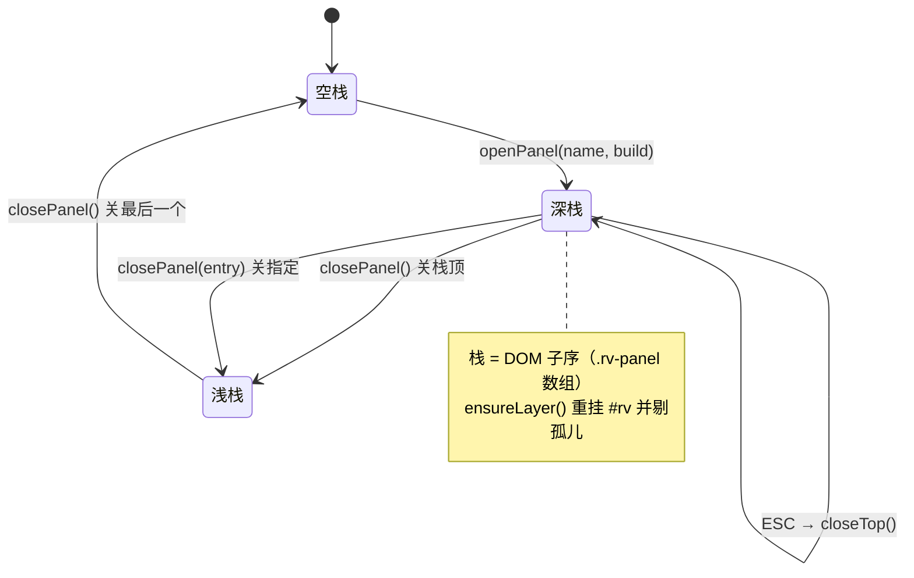
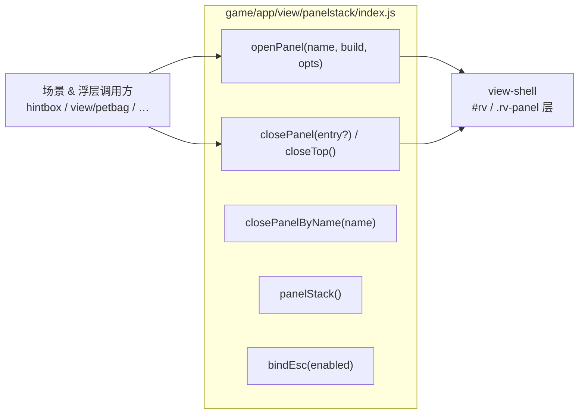

# View 子设计 · Panel 模态栈（view-panel-stack.md）

> 子文档 of `docs/view/view-design.md`（§8 子文档地图 A2）。
> 本文只定 **Panel 的入栈/出栈机制**：宿主、栈、命名、置顶、关闭、遮罩、ESC、参数化、回调。
> **不含**：Panel 里画什么（→ `docs/view/panel/view-panels-*.md`）、舞台缩放（→ `view-shell.md`）、浮层原语（→ `view-overlays.md`）。
> 证据标注：【样本】/【源码】/【推断】。上游路径相对 `projects/Seer2-Restart-Lite-main/Assets/`。

---

## 1. 范围与边界

| 属本文 | 不属本文 |
|---|---|
| `openPanel` / `closePanel` / `closeTop` 的语义 | 具体面板的 DOM（→ `docs/view/panel/view-panels-*.md`） |
| 命名规则（类名 ↔ prefab 名） | 浮层盒体几何（→ `view-overlays.md`） |
| 置顶 / 栈序 / ESC 关栈顶 | 面板读取哪些 M 状态（→ 各面板文档） |
| 遮罩、`onCloseEvent`、参数化 identifier | 场景内容层（→ `docs/view/scene/room/view-scene-map-content.md` 等） |

---

## 2. 上游真值（`MVC/View/Basic/Panel.cs`）

### 2.1 打开 = 实例化 prefab + 置顶

```csharp
public static T OpenPanel<T>() where T : Panel {              // Panel.cs:14-26
    string name = typeof(T).Name.TrimEnd("Panel");            // PetBagPanel → "PetBag"
    GameObject canvas = GameObject.Find("Canvas");
    GameObject prefab = ResourceManager.instance.GetPanel(name);
    GameObject obj = Instantiate(prefab, canvas.transform);
    obj.transform.SetAsLastSibling();                        // 置顶 = 入栈
    return obj.GetComponentInChildren<T>();
}
```
- **命名规则**：`OpenPanel` 名 = **类名去 `Panel` 后缀** = `Resources/Panels/<Name>/` 目录名。
- 入栈靠 **`Transform` 的子序**（`SetAsLastSibling`），**没有独立的栈数据结构**。【源码】`Panel.cs:14-26`

### 2.2 字符串入口的三个前缀

【源码】`Panel.cs:28-75`

| 语法 | 语义 |
|---|---|
| `"null"` / `"none"` | 等价于 **关栈顶**（`CloseTopPanel()`） |
| `"[Mod]" + name` | 走 Mod 面板：`panelName = "Mod"`，实例后 `SaveSystem.TryLoadPanelMod(name)` + `((ModPanel)panel).SetPanelData(...)` |
| `"[Refresh]"` | 先 `ClosePanel<ModPanel>()` 再开 |
| `"Name[key=value][key2=value2]"` | 逐对解析 → `panel.SetPanelIdentifier(key, value)`；`WorldMap[world=3]`、`MiniMap12` 即此 |

### 2.3 关闭 = 关栈顶 / 按类型关 / 销毁

```csharp
public static void CloseTopPanel() {                          // Panel.cs:95-104
    Panel panel = null;
    foreach (Transform child in canvas.transform)
        panel = child.GetComponentInChildren<Panel>() ?? panel;   // 取"最后一个含 Panel 的子物体"
    panel?.ClosePanel();
}
public virtual void ClosePanel() {                            // Panel.cs:106-115
    onCloseEvent?.Invoke();                                   // 先回调
    if (background != null) Destroy(background.gameObject);    // 再销毁遮罩
    Destroy(gameObject);
}
```
- `ClosePanel<T>()`：`FindFirstObjectByType<T>()` 后关它（按类型关，不一定是栈顶）。【源码】`Panel.cs:77-82`
- `SetActive(bool)`：切 `background ?? gameObject` 的显隐；`SetBackgroundColor(Color)` 改遮罩色。【源码】`Panel.cs:117-131`
- `ESCButton` 是 prefab 上的字段（`Panel.cs:10`）—— 面板自带 ESC 钮。

---

## 3. 我们的现状（`host.js` 已实现最小可用栈）

`game/app/view/panels/host.js`：

| 函数 | 签名 | 行为 | 出处 |
|---|---|---|---|
| `openPanel` | `(name, build) → entry` | `ensureLayer()` → 建 `.rv-panel` → `stack.push` → `build(el, {close})` | `host.js:61-70` |
| `closePanel` | `(entry?) → void` | 无参 = 关栈顶；出栈 + `el.remove()` | `host.js:73-78` |
| `panelStack` | `() → string[]` | 栈内面板名（测试用） | `host.js:80` |

- **已有**：栈序、置顶（`append` 天然置顶）、按 entry 关、孤儿清理（`ensureLayer` 把 `!isConnected` 的剔出）。
- **与上游的差异**：上游 `Instantiate(prefab)`；我们 `build(el, api)` **由调用方手写 DOM**（D2 决策：不写 prefab→DOM 转换器）。
- **`el` 就是 960×540 逻辑画布**（`host.js:60` 注释）。

---

## 4. 目标契约（本文冻结）

```js
// game/app/view/panelstack/index.js
openPanel(name, build, opts?) -> entry      // opts: { scrim?: bool, params?: Record<string,string>, onClose?: fn }
closePanel(entry?)            -> void      // 无参 = 关栈顶
closeTop()                    -> void      // 显式别名（对上 CloseTopPanel）
closePanelByName(name)        -> void      // 对上 ClosePanel<T>
panelStack()                  -> string[]
setPanelIdentifier(entry, k, v) -> void     // 对上 SetPanelIdentifier
bindEsc(enabled)              -> void      // ESC → closeTop()
```

**同名去重（`openPanel` 的语义 · 人类拍板 2026-10-17 · 决议号 = `docs/view/panel/view-panels-pet.md §11 VP3`；本节是它的**正本**）**

- `openPanel(name, …)` 时若栈内**已有同名 entry** ⇒ **先关旧的**（出栈 + `el.remove()` + 触发其 `opts.onClose`），**再挂新的 ⇒ 屏幕上同名面板只有一份，且是最新那一份**。
- ⚠️ **不是隐藏**：旧的 DOM 与回调一起销毁。理由：现状 `host.js` 的 `stack.push` 无 name→entry 映射【实测】，叠两层会同时存在两套事件闭包，后开的会吃掉前一层的 ESC。
- 上游**没有这条**（上游 `OpenPanel` 每次都 `Instantiate` 一份，叠不叠由调用方自觉）⇒ 这是**我们加的纪律**，不是照搬。
- 需要"同一面板两个实例"的场景（目前没有）应当**换 name**（如 `WorldMap[world=3]` 走 `opts.params`，仍算同名 ⇒ 一样被去重）。

| 上游 | 目标对应物 | 备注 |
|---|---|---|
| `OpenPanel<T>()` | `openPanel(name, build)` | 名字显式传（我们不靠反射取类名）；**同名 ⇒ 先关旧的**（上面那条） |
| `Instantiate(prefab)` | `build(el, api)` | **已知偏差**：手写 DOM |
| `SetAsLastSibling()` | `host.append(el)` | 天然置顶 |
| `CloseTopPanel()` | `closeTop()` / `closePanel()` | |
| `ClosePanel<T>()` | `closePanelByName(name)` | |
| `SetPanelIdentifier(k,v)` | `opts.params` / `setPanelIdentifier` | 供 `WorldMap[world=…]` 类复用 |
| `onCloseEvent` | `opts.onClose` | `closePanel` 时先回调 |
| `[Mod]` / `[Refresh]` | **暂不支持** | Mod 热加载是扩展点，见 §7 |

---

## 5. 栈状态图



---

## 6. 文件 ↔ 接口图



---

## 7. 缺口 / 待核

| # | 缺口 | 处置 |
|---|---|---|
| 1 | **ESC 未绑** | 上游靠 prefab 的 `ESCButton`；我们需统一 `bindEsc` → `closeTop()` |
| 2 | **参数化 identifier 未实现** | 上游 `[key=value]` + `SetPanelIdentifier`；我们暂靠调用方闭包传参 |
| 3 | ~~**遮罩不统一**~~ | **✅ 已落地（2026-10-21）**：`openPanel` 默认 `scrim:true` ⇒ 垫一层全画布 `.rv-scrim`（`pointer-events:auto` + 黑 a=.5，上游 Panel.prefab 遮罩对应物）挡背后误触；`scrim:false` 白名单 = `rb-hud`（常驻 HUD 需点地图）/ `Hintbox`（自带 `.rb-scrim` 避免双暗）/ `rst-title`·`rst-login`·`rbattle`（整屏场景根，背后无交互元素、遮罩会无端压暗）。落点 = `game/app/view/panels/host.js` + `game/app/ui.css` 的 `#rv .rv-scrim`。 |
| 4 | **`[Mod]` / `[Refresh]` 不支持** | Mod Panel 是热加载扩展点；**本线可不做**（登记为有意省略） |
| 5 | **`ensureLayer` 与场景 `innerHTML=''` 的耦合** | 现状靠每次弹面板重挂；需文档化纪律，避免场景直接清 `#rv` |
| 6 | **目录搬家** | 栈逻辑应从 `view/panels/host.js` 拆到 `view/panelstack/`，fit 部分归 `view/shell/` |
| 7 | ~~**同名面板可叠两层**（`host.js` 的 `stack.push` 不查 name）~~ | **✅ 已决（人类 2026-10-17 · VP3）**：`openPanel` **先关旧的、只留最新**（正本 = 本文 §4 的"同名去重"）；落地在搬家时写进 `panelstack/index.js`（`docs/view/view-impl.md` 的 `panelstack` 节） |

---

## 8. 配对 impl 指针

- **`docs/view/view-impl.md`（待写）** 的 `panelstack` 节：`host.js` 拆分、API 冻结、ESC/遮罩落地、**同名去重（§4）**、迁移调用方。
- 承接：`docs/arch-code.md §3`（依赖方向）。
