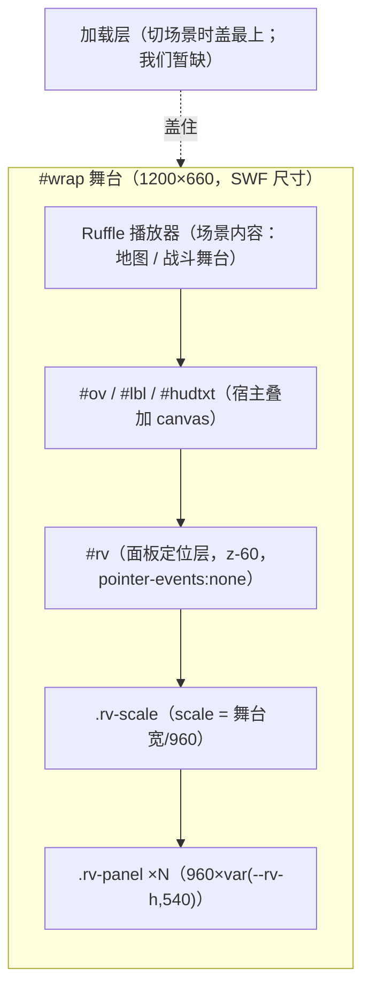
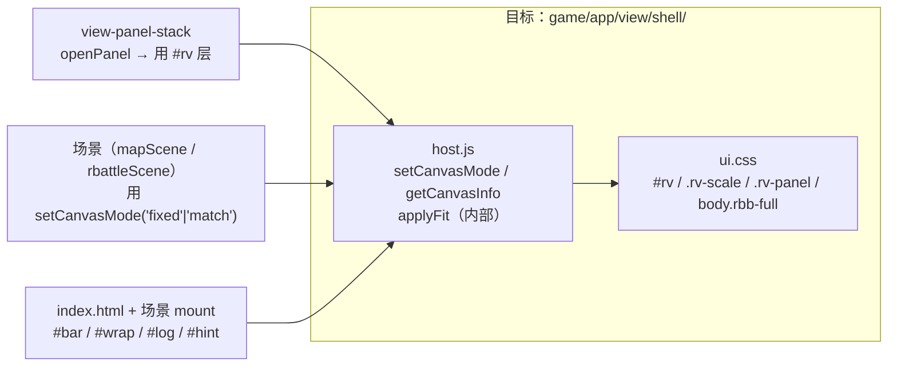

# View 子设计 · 舞台与层栈（view-shell.md）

> 子文档 of `docs/view/view-design.md`（§8 子文档地图 A1）。
> 本文只定 **舞台 / 坐标口径 / 缩放 / 层栈 z 序 / 场景骨架 / 加载层**。
> **不含**：Panel 模态栈机制（→ `view-panel-stack.md`）、浮层原语（→ `view-overlays.md`）、各场景内容（→ `docs/view/scene/room/view-scene-map-content.md` 等）。
> 证据标注：【样本】/【源码】/【推断】。上游路径相对 `projects/Seer2-Restart-Lite-main/Assets/`；我们的路径相对仓库根。

---

## 1. 范围与边界

| 属本文 | 不属本文 |
|---|---|
| 参考分辨率、缩放规则、逻辑像素口径 | Panel 的入栈/出栈（→ `view-panel-stack.md`） |
| 场景骨架 DOM（`#bar`/`#wrap`/`#log`/`#hint`） | 舞台里画什么（→ 场景层文档） |
| 层栈 z 序（谁是背景、谁盖谁） | 单个 HUD 区域的版式（→ `docs/view/scene/room/view-scene-hud-design.md`） |
| 加载层（切场景时的盖屏） | 浮层的盒体几何（→ `view-overlays.md`） |

---

## 2. 上游真值

### 2.1 参考分辨率与缩放（六场景一致）

- **`CanvasScaler`：`m_ReferenceResolution = 960×540`，`m_MatchWidthOrHeight = 0`（纯按宽缩放）**，六个场景一致。
  【源码】`Assets/Scenes/{Title,Login,Map,Fight,Room,Game}.unity` 的 CanvasScaler（**我们的实测值记在 `docs/view/ui-handoff.md` 与 `game/app/ui.css:4-7`**，本仓库非 git、样本转述）。
- **每个场景一个名为 `Canvas` 的 `GameObject` + `EventSystem`**；Panel 全部挂在它下面。
  【源码】`Scripts/MVC/View/Basic/Panel.cs:17,47,97`（`GameObject.Find("Canvas")`）。
- Unity 画布**默认居中于屏幕** —— 缩放后若高度溢屏，是**上下对称**地裁，不是贴顶。
  【源码】`game/app/view/panels/host.js:53-55` 的既有实测注释（重启 UGUI 行为）。

### 2.2 加载层

- `SceneLoader` 是 `Singleton`，持有 `canvas` + `defaultLoadingScreen` + `transparentLoadingScreen` + `loadingScreens[4]`。
- 切场景：`ChangeScene(SceneId)` → `OnBeforeLoading()` → `ShowLoadingScreen(nextSceneId)`
  （`canvas.SetActive(true)`，把对应 `sceneId` 的加载屏打开、其余关掉）→ `UnloadResources` → **三段式**
  `OnBeforeLoading → OnLoading → OnAfterLoading` → `HideLoadingScreen()`。
  【源码】`Scripts/System/SceneLoader.cs:13-75`
- `LoadingScreen` 基类：`background` + `loadingProgressNumbers[3]`（数字贴图进度）+ `loadingSlider` + `loadingText`；
  `ShowLoadingProgress(p)` 按 `ceil(p*100)` 换两张数字贴图；`ChangeSceneCoroutine` 走 `SceneManager.LoadSceneAsync` 并 `/0.9` 归一。
  【源码】`Scripts/Scene Specific/Loading/LoadingScreen.cs:8-52`
- 子类各有花样：`NormalLoadingScreen`、`LoginLoadingScreen`、`RoomLoadingScreen`（override `OnBeforeLoading`，联机准备）、
  `FightLoadingScreen`（`OnBeforeLoading` + `WaitSecondsCoroutine(1.5s)`，`OnAfterLoading` + `1.2s` 停顿）。【源码】`Scene Specific/Loading/*.cs`

### 2.3 场景 z 序（以战斗为例，已实证）

`Fight.unity` 顶层 = `Fight Background`（`SpriteRenderer`，`sortOrder = −1`）→ `Main Camera`（正交 `size = 5`）→ `Canvas`。
【源码】`docs/view/scene/battle/view-scene-battle-design.md §3`（实证记录）。地图同构：背景在相机之下、HUD 在 `Canvas` 上。

---

## 3. 我们的现状与目标

### 3.1 现状：`host.js` 已经是"缩放 + 备层"的原型

`game/app/view/panels/host.js`（注释自述"只干三件事：备层 / 按 CanvasScaler 口径缩放 / 面板栈"）：

| 事实 | 值 | 出处 |
|---|---|---|
| 参考分辨率 | `REF_W = 960`、`REF_H = 540` | `host.js:5` |
| 两种画布模式 | `fixed`（逻辑高恒 540，按舞台高居中 = 地图 HUD 口径）/ `match`（逻辑高 = 舞台高/缩放，上下不裁 = 战斗版式口径） | `host.js:9-13` |
| 缩放 | `s = wrap.clientWidth / 960`；`fixed` 用 `translateY((wrapH − 540*s)/2) scale(s)`；`match` 用 `scale(s)` + 变量 `--rv-h` | `host.js:23-36` |
| 层 | `#rv` → `.rv-scale` → `.rv-panel` | `host.js:40-58` |
| 重算 | `ResizeObserver` 监听 `#wrap`（防瞬态高度缓存导致贴底节点被裁） | `host.js:51,53-55` |

`game/app/ui.css`：

| 选择器 | 值 | 出处 |
|---|---|---|
| `#rv` | `absolute; inset:0; 1200×660; z-index:60; pointer-events:none` | `ui.css:13-15` |
| `#rv .rv-scale` | `absolute; origin 0 0` | `ui.css:16` |
| `#rv .rv-panel` | `960 × var(--rv-h, 540px)` | `ui.css:19` |
| `body.screen-full …` | 全局**屏幕大小开关**（full 模式：隐藏页面 chrome + 由 `screen.js` 把 #wrap 等比缩放铺满窗口）；所有场景共用，由 `game/app/screen.js` 驱动 | `ui.css:21-26` |

### 3.2 舞台尺寸与变换（已拍板）

**舞台 = 1200×660**。理由（人类拍板）：**美术素材来自原版 SWF 网页游戏**，其舞台即 1200×660。
Unity 的 **960×540** 只是**设计坐标**，落到 1200×660 需要一个**显式变换**。

#### 变换 `T`：U(960×540) → S(1200×660)

| 量 | 值 | 依据 |
|---|---|---|
| 统一缩放 `k` | `S.w / U.w = 1200/960 = 1.25` | 宽度对齐，同上游 `m_MatchWidthOrHeight = 0` |
| `U` 经 `T` 后占 | `1200 × 675`（= `540 · k`） | |
| 高度溢出 | `675 − 660 = 15px`（每边 7.5） | 两套纵横比 `16:9` ≠ `20:11` |

溢出只有两种诚实口径（**改的是"逻辑高"，不是把 UI 拉变形**）：

| 口径 | 公式 | 结果 | 适用 |
|---|---|---|---|
| **contain（`match`）** | `s = S.w/U.w`；逻辑高 `= S.h/s = 528` | 1200×660 恰铺满、**无裁切**；贴底元素落 `y=528` ⇒ 物理 660 | **Unity 忠实口径**（`matchWidth` 的真实行为） |
| **裁切（`fixed`，现状）** | 逻辑高恒 `540`；`s = 1.25` | 1200×675、**上下各裁 7.5px** | 地图 HUD 的既路口径（已按 540 排好版） |

- **禁止非等比拉伸**（`sx=1.25`、`sy=1.2222`）——会把 UI 压扁 2.2%。美术同理：背景 SWF 已按 1200×660 原生，**不参与**本变换。
- **一处待拍板**：是否把 UI 统一到 faithful 的 `contain/528` 口径（要求地图 HUD 同步改掉"540 假设"）。见 §7 #2。

### 3.3 场景骨架 DOM（现状）

来自 `game/index.html` + `mapScene.js`：

```
#rvbar / h1        ← 顶部标题（调试/开发用）
#bar               ← 场景自带工具条（mapScene 注入 BAR：地图/角色下拉 + 重载/返回/栅格/状态 + 引擎开关）
#wrap              ← 舞台容器（1200×660；场景 mount 时 innerHTML 重写）
#log               ← 调试日志（被 body.rbb-full 隐藏，但 selftest 仍读它的 textContent）
#hint              ← 一行状态提示
```

- **`#wrap` 会被场景 `mount/unmount` 整体重写**（`innerHTML=''`），所以 `host.js` 每次弹面板都 `ensureLayer()` 重建 `#rv` 并把被清掉的残留面板剔出栈。【源码】`host.js:38-58`、`mapScene.js:604,661`

### 3.4 窗口缩放与长宽比（游戏窗口功能，已拍板）

**规则**：舞台内所有逻辑坐标**恒为 1200×660**；缩放/比例只改**视口 → 舞台**的变换，**绝不改舞台内坐标**（UI 不吃外面的数）。

视口（浏览器窗口 / 容器）`Vw×Vh` 可变，适配模式：

| 模式 | 公式 | 效果 |
|---|---|---|
| **contain（默认）** | `s = min(Vw/1200, Vh/660)` | 舞台全部可见，多出的方向留边 |
| **cover** | `s = max(Vw/1200, Vh/660)` | 铺满，超出裁切 |
| **stretch** | `sx = Vw/1200, sy = Vh/660` | 非等比（**默认禁用**；仅"保持原长宽比"时等价 contain） |

- **缩放（zoom）**：`s = s_contain × z`，`z ∈ {0.75, 1, 1.25, 1.5, 2}` 或滚轮连续；`z > 1` 时配 CSS 平移/滚动。
- **改长宽比**：用户可选目标比例（`20:11`（原版）/ `16:9` / `4:3` / `21:9`）；选定后把视口**可用区域**按该比例划定，再套 `contain`/`cover` —— 这就是"调整游戏窗口"。
- **与 `host.js` 的关系**：现有 `applyFit` 只是"视口 → 舞台"的一个具体实现（`s = wrapW/960`，`fixed`/`match`）；本节公式是它的**显式化 + 扩展**。实现时把 `s` 换成 `stageScale(Vw, Vh, mode, z)`。
- **已落地（人类 2026-10-19）**：`full` 屏幕模式（由 `game/app/screen.js` 驱动）即本表的 **contain** —— 舞台逻辑坐标恒 1200×660，整 `#wrap` 经 `transform: scale(min(Vw/1200, Vh/660))` 等比铺满窗口（多出的方向留黑边）；`fixed` 模式 = 缩放 1（原尺寸，body flex 居中）。取值写入 `localStorage['seer2.screenMode']`，控制面板（⚙ → 屏幕大小）可实时切换，所有场景共用同一个游戏屏幕。这是 §7 #3 里 contain 那一档的实现；cover / stretch / zoom / aspect 仍未做。
- **不变量**：无论视口/比例/缩放怎么变，`T`（§3.2）与面板逻辑坐标不变 —— 二者是**两层正交变换**（视口→舞台、舞台→Unity 设计坐标）。

---

## 4. DOM 契约（本文负责的部分）

| 元素 / 类 | 契约 | 谁维护 |
|---|---|---|
| `#wrap` | 舞台；逻辑尺寸恒 1200×660；物理显示尺寸由全局 `screen.js` 决定（fixed=原尺寸 / full=contain 缩放铺满窗口） | `screen.js` + 场景 `mount` |
| `#rv` | 面板定位层；`z-index:60`；`pointer-events:none` | `host.js` |
| `.rv-scale` | 缩放载体；`transform: scale(s)`（+ `fixed` 的 `translateY`） | `host.js` |
| `.rv-panel` | 单个面板根；逻辑 `960×var(--rv-h,540px)` | `view-panel-stack` |
| `body.screen-full` | 全局屏幕大小开关（full 模式）；由 `game/app/screen.js` 统一驱动，**所有场景共用同一个游戏屏幕** | `screen.js` |
| `#bar` / `#log` / `#hint` | 场景工具条 / 日志 / 提示（`screen-full` 下隐藏） | 场景 |

**纪律**：`#rv` 与 `.rv-panel` 放行指针，只有真正占地方的元素（遮罩/盒体/按钮）才收 —— Unity 侧同理，只有 `RaycastTarget` 的图形挡点击。【源码】`ui.css:10-11`

---

## 5. 层栈图



---

## 6. 文件 ↔ 接口图



---

## 7. 缺口 / 待核

| # | 缺口 | 说明 | 处置 |
|---|---|---|---|
| 1 | **加载层缺失** | 上游 `SceneLoader` + `LoadingScreen` 三段式，我们无对应物（`router.go` 直接换场景） | 需 design+impl；**盖屏的视觉与三段式**归本文；⚠️ **调用序 / 装配（何时切、先 `unmount` 后 `mount`、`last/next`）归编排线** `docs/orchestration/orchestration-design.md`（2026-10-17 立，§2.2 指本文为视觉正本；其 **ORQ1** 待拍"做不做薄版"） |
| 2 | **UI 口径归一（待拍板）** | 舞台 1200×660 **已定案**（§3.2）；但 UI 是否统一到 faithful 的 `contain/528` 口径、放弃 `fixed` 的"540 假设"未定 | 待人类拍板 |
| 3 | **窗口缩放：contain 已落地，其余未做** | `full` 模式 = §3.4 的 contain 缩放，经 `screen.js` 落到 #wrap（人类 2026-10-19 拍板：屏幕大小=单一配置，两取值 fixed/full）；视口适配原本只有 `host.js.applyFit` 的 `fixed`/`match` | cover / stretch / zoom / aspect 仍未实现 |
| 4 | 场景骨架 DOM 不统一 | `#bar` 由各场景自己注入 `innerHTML`（`mapScene.js` 的 `BAR` 常量），无统一骨架 | 建议抽 `shell/scaffold`（未排期） |
| 5 | `#rv` 目标目录 | 现与 Panel 栈同处 `view/panels/host.js`；应归 `view/shell/` | 施工时搬家（登记） |
| 6 | 背景/精灵 SWF 不参与变换 | 美术已按 1200×660 原生，**不参与** `T`（§3.2 禁止非等比拉伸） | 已定案，仅登记 |

---

## 8. 配对 impl 指针

- **`docs/view/view-impl.md`（待写）** 的 `shell` 节：`host.js` 拆分（fit ↔ stack 分离）、`setCanvasMode` 契约冻结、加载层实现。
- 承接：`docs/arch-code.md §3`（依赖方向）、`docs/view/ui-handoff.md`（UI 线 U0 的原始实测）。
