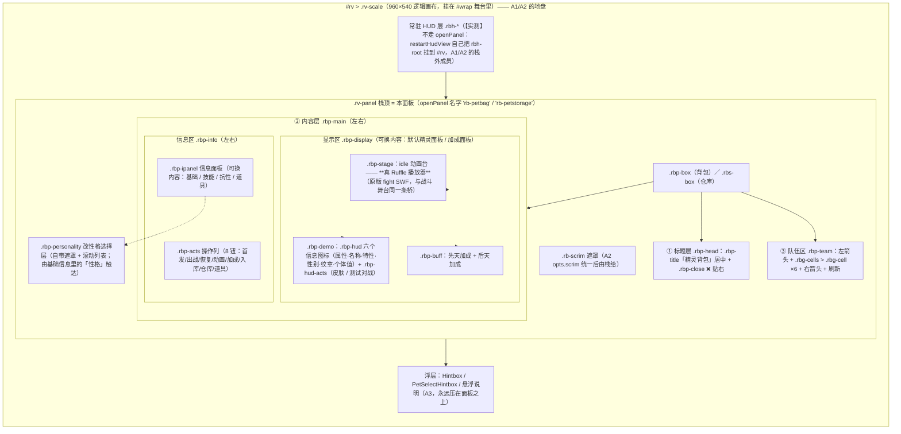
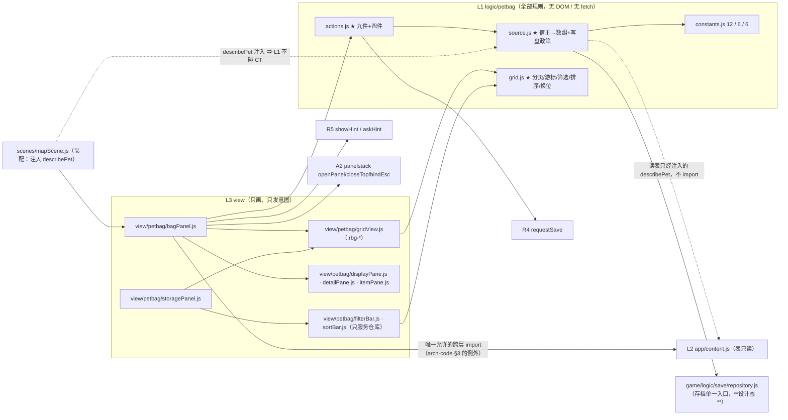

# View 子设计 · 精灵面板族（C1：背包 + 仓库深写）

> 子文档 of `docs/view/view-design.md`（§8 子文档地图 **C1**）。骨架按父文档 §8 末的九条走，映射见下面的**表 0**。
> **本份的成色**：**精灵背包 + 精灵仓库两个面板 = 深设计**（有代码分析底座）；
> 其余 **11 个精灵 Panel 只登记边界与归属**（§1.3）—— 它们**还没有分析底座**，硬写就会变成"面板有按钮但没有可点的东西"（`totalk.md` 清单 A 的警告）。
> **不含**：面板入栈/出栈机制（→ `docs/view/mech/view-panel-stack.md` A2）· 浮层原语 Hintbox/分页条（→ `docs/view/mech/view-overlays.md` A3）·
> 舞台/坐标/缩放（→ `docs/view/mech/view-shell.md` A1）· `Pet` 对象与内容表（→ D6 `docs/domain/domain-pet.md`、D7 `docs/domain/domain-info.md`）·
> 存档字段与形状（→ `docs/save/save-design.md`、`docs/save/save-xml-spec.md`）· 道具怎么用（→ **`docs/item/item-design.md`**（2026-10-17 立）；面板 = C2）·
> PVP 规则（→ **T2·7** / B6 `view-room.md`）· 肉鸽规则（→ **T2·9**）。
> **证据标注**：【源码】= 上游 `.cs`（`路径:行`）；【样本】= prefab / scene 的序列化值；【实测】= 可复算数字或可复跑命令；【推断】= 由前两者导出。
> **路径口径**：上游相对 `projects/Seer2-Restart-Lite-main/Assets/`；我们的相对仓库根。
> **上游 bug 政策**：**声明 + 不照搬**（**人类决议 ②**，`docs/arch-docs.md §4.1`）⇒ 本份的"不照搬清单"在 **§2.2**，逐条证据在 `docs/view/panel/petbag/restart-petbag-panel.md §8`（该文件的 **A1–A16**，与本文编号体系无关）。
> **验收口径**：**主 = 人类手动测试**（**决议 ⑦**，`AGENTS.md §1.1`）⇒ §12；数字回归/grep 门禁只答"有没有回退/分层破没破"。
> **⚠️ 编号纪律**：本份**本地待拍板 = VP1–VP8**（**V**iew-**P**et），引用时写 `docs/view/scene/battle/view-scene-battle-design.md:223 §11 VP2`；
> **八条已于 2026-10-17 由人类全部拍板**（§11 现在是决议表，不再是问题表）。
> **不许**用 ①–⑧（那是 `AGENTS.md §5` 的人类决议）、**不许**用 A/n（那是分析报告与 T2 的号）。

**表 0 · 父文档骨架 ↔ 本文件节号**

| 骨架 | ① 范围/边界 | ② 上游真值 | ③ DOM 与类名 | ④ 数据接线（零算数） | ⑤ 资产权威 | ⑥ 依赖方向 | ⑦ 交互/事件 | ⑧ 缺口/待核 | ⑨ 配对 impl |
|---|---|---|---|---|---|---|---|---|---|
| 本文件 | §1 | §2（+ §3 现状） | §4（层栈图） | §5 + §6 | §8 | §9（文件↔接口图） | §7 | §11（VP1–VP8） | §13 |

---

## 1. 范围与边界

### 1.1 属本文 / 不属本文

| 属本文 | 不属本文 |
|---|---|
| 背包/仓库两面板的**分区、DOM 结构、类名契约** | 面板怎么入栈/ESC/遮罩（A2 已冻结） |
| **"背包这三个字指哪个数组"**的单一真值（§5.1） | `petBag`/`petStorage` 的**字段与 XML 形状**（Save 线） |
| 网格机器（分页/游标/筛选/排序/换位）的**接口与不变量**（§5.2） | Hintbox/分页条/悬浮说明的盒体几何（A3） |
| **九件操作的目标行为**（§6） | 战斗里怎么用这只宠（引擎 E6 / `docs/engine/battle-engine-session.md`） |
| 筛选栏、排序栏、详情区、格子头像三层素材的**口径**（§6.3、§8） | 使用道具的效果结算（C2 / **T2·5**） |
| 面板与**写盘 sink / 弹窗 sink** 的接缝（§7.3） | R4/R5 自身的契约细节（`docs/runtime/runtime-components-design.md §5`） |

### 1.2 面板族的宿主（同一个机器被谁用）

上游把**一个** `PetBagPanel` 复用给了 **六个**宿主；本设计照搬这个结构，但把"宿主"变成**显式参数**：

| 宿主 id | 上游怎么来的 | 我们的 source 指向 | 可写盘？ |
|---|---|---|---|
| `normal` | 【样本】`Resources/Panels/PetBag/Panel.prefab:1263 mode: 0`（地图角落按钮 `Scripts/MVC/Controller/Map/Components/MapPetCornerController.cs:21-24`） | Save 线 `petBag[12]` + `petStorage` | ✅ 经 R4 `requestSave('bag')` |
| `pvp` | 【样本】`Scenes/Room.unity:3490-3492`（override `mode: 1`） | 房间给的候选数组（**不是**存档） | ❌ |
| `dictionary` | 【样本】`Resources/Panels/PetDictionary/Panel.prefab:13634-13636`（`mode: 2`） | **全部宠的只读枚举**——⚠️【**VP5 已被人类 2026-10-19 点名反转**】图鉴**面板**已立项 = `docs/view/panel/dex/dex-design.md`（全量枚举由 `content.restartAllPets()` 补上）；但**本 host 支（示例宠背包 + 测试对战）仍不做**（design DX12 / §8 DX0-d） | ❌（只读，永不写盘） |
| `yiterogue` | 【样本】`Resources/Panels/YiTeRogue/Panel.prefab:5505-5507`（`mode: 3`） | 肉鸽自带 `petBag[6]`（`docs/save/save-design.md` 的 `YiTeRogueData`） | ❌（由肉鸽线自己落盘） |
| `door` | 【源码】`Scripts/MVC/Controller/Panel/DoorController.cs:78-88` 关面板后 `petBag.Take(petNum)` | `normal` 的**只读前 N** | ❌ |
| `story` | 【源码】`Scripts/MVC/View/Story/StoryPanel.cs:485` 剧情可直接开面板 | `normal` 的**只读** | ❌ |

⇒ **本份最重要的一条**：宿主 id 决定"背包"指哪个数组、以及**允不允许写盘**。上游这两件事是散在三个 `switch` 里的（A5），本份收成**一处**（§5.1）。

### 1.3 精灵面板族 13 个 Panel 的归属（本份只深写前 2 个）

| Panel（`Resources/Panels/`） | 本份处置 | 归属 / 前置 |
|---|---|---|
| **`PetBag`** | ✅ **深设计（§4–§8）** | 证据底座 = `docs/view/panel/petbag/restart-petbag-panel.md` |
| **`PetStorage`** | ✅ **深设计（与背包共用网格机器）** | 同上 §5 |
| `OldPetBag` | ⛔ **不搬**（遗留副本，仍引用同一脚本；活跃预制是 `PetBag/`）【样本】`OldPetBag/Panel.prefab:6800` | 登记即可 |
| `PetDictionary`（图鉴） | ✅ **已立本族第三份** = `docs/view/panel/dex/`（分析报告 + 设计 + impl；**2026-10-19 人类点名反转 VP5**） | 图鉴**规则**已由 `dex/dex-design.md` 接管（**T2·19** 的账转到那里结） |
| `PetSelectHintbox` | 🔶 只登记（= 上阵满位时的"选一只换"浮层） | 浮层本体归 **A3** |
| `SecretSkill`（隐藏技能面板） | ⛔ 不在本份 | 数据/谓词 = D7；入口 = `docs/view/panel/petbag/restart-secret-skill-learning.md`；面板归 C1 的**下一轮** |
| `MainPetEvolve` / `MainPetWakeup` | ⛔ 不在本份 | 无分析底座 ⇒ 先补一份**代码分析报告**（住本面板子目录，落位口径见 `docs/arch-docs.md §0.1`）（**T2** 清单 A 之外的新账） |
| `SoulPet`（= `SpriteKing` 面板，类名 `SpriteKing`、打开 id `SoulPet`；HUD「灵兽」钮 —— 同一面板两名，见报告 A1） | ✅ **已立本族第四份** = `docs/view/panel/godpet/`（分析报告 + 设计 + impl；**2026-10-19 人类点名"实现 HUD 中'灵兽'图标的面板"**，2026-10-19 落码） | 面板半边（3×3 灯位 / 领取约瑟 / 兑换商店 / 规则）**已落码待手测**；三颗挑战钮（6v6/2v2/1v1）的**多老大战斗**仍锁 **A 组围栏**（`BattleMode.SPT/Special`，godpet design GP2′ / 报告 A6），诚实"待建"提示 |
| `Fusion` / `FusionRecipe` | ⛔ | **T2·15 融合**（且 `domain-info.md §3.3 B7` 把配方推到"等 Item 族"） |
| `TwelveRound` | ⛔ | **T2·14 卡牌模式**（`docs/view/scene/battle/view-scene-battle-design.md:223` 明写不覆盖）；⚠️ 原行曾把 `SpriteKing` 一并列此为卡牌模式 = **误并**：`SpriteKing` 实为灵兽面板（id `SoulPet`），已移到上方 godpet 行（报告 A1 声明的"两名易误读"正是此处） |

---

## 2. 上游真值（只链接，不复述）

### 2.1 真值在分析报告的哪一节

**真值全文在 `docs/view/panel/petbag/restart-petbag-panel.md`**，本份只引用节号：

| 需要的事 | 去读 |
|---|---|
| 本体位置 / 三层分布 / 脚本住在 `Scripts/` 之外 | 该文件 **§1.1** |
| 四路复用的序列化证据 | 该文件 **§1.2** |
| `PetBagMode` 六值分住两个面板 | 该文件 **§1.3** |
| "背包指哪个数组"的三份 `switch` | 该文件 **§2.1** |
| 12 格 = 常量 + 三处 `Array.Resize` | 该文件 **§2.2** |
| 仓库是**筛选视图**不是容器 | 该文件 **§2.3** |
| 网格机器（分页/末尾页/排序先于筛选/单选/游标/拖拽） | 该文件 **§3** |
| 九件操作逐条 + 仓库四件 | 该文件 **§4 / §5** |
| 筛选与排序（上游三筛选**互斥** + 括号 DSL） | 该文件 **§6**（⚠️ 我们**改成叠加**，见 §6.3 · VP1 已决） |
| 一格三层素材 + 预取协程 | 该文件 **§7** |

### 2.2 不照搬清单（决议 ②：上游代码逻辑 bug ⇒ 声明 + 写无 bug 的目标）

| 上游号 | 症状一句话 | 我们的目标行为 | 落在本文 |
|---|---|---|---|
| **A1** | 打开面板 = 写一次存档 | **开面板永不写盘**；写盘只由 §6 的"会改数据的操作"触发，且走 R4 | §6.1、§7.3 |
| **A2** | "恢复体力"只恢复当前页 6 格，文案却报"完全恢复" | 恢复 = **整个 `petBag[12]`**；文案随范围 | §6.1 行 3 |
| **A3** | "入库"的保护判据取的是**本页筛选后**的计数 | 判据 = **真实宠袋非空计数**（`petBag` 全长） | §6.1 行 6 |
| **A4** | `petBag?[cursor[0]]` 用页内游标索引全长数组 | **不提供该属性**（详情区只认 grid 交出的对象） | §5.2 |
| **A5** | 同一段 `mode switch` 抄三遍 | **一个 `petBagSource` 选择器**，三处共享 | §5.1 |
| **A6** | `Lock/UnLock` 判断写反 + 零调用方 | **不搬**；PVP 禁选**本代不做**（VP7 已决） | §10、§11 VP7 |
| **A7** | 两套 `capacity` 各算各的 | **单一容量真值**；灌入长度不符 ⇒ **抛**，不静默截断 | §5.2 |
| **A8** | "重置"漏了星级 | `Reset()` = **三项全清** | §6.3 |
| **A9** | 预取超时当完成 / 空集不跑 Init | 空集**也**跑 init；超时 = 部分就绪，可重跑 | §7.4 |
| **A10** | "锻炼"链在发行版里根本没接上（按钮只做 UI 显隐） | **不留死链**：面板没有的操作就不建按钮（⚠️ 补：真正死的是 `ToBestPet` 链，`Train` 钮本身是活的 = 我们的「加成」，见 §4.1 更正 2） | §6.1 行 D |
| **A11** | 进化写回硬编码 `Player.instance.petBag` | **写回来源集合本身**（由 source 提供，不认死数组） | §6.1 行 D |
| **A12** | 队规模 6 硬编码三处 + `petBagCursor` 压缩后不调整 | 规模常量**只从 Save 线取**；游标随裁剪**重算** | §5.3 |
| **A13** | 放生/收藏的门只在 View 灰化，Model 不判 | **规则在 L1**，View 只负责灰化 | §6.1 仓库四件 |
| **A14** | 排序下拉越界 ⇒ 静默变"正序 ID" | 显式 `none` ⇒ **保持原序**；非法值不兜底 | §6.3 |
| **A15** | `normalHp == 0` ⇒ 血条 NaN 宽 | 分母 0 ⇒ **条宽 0**（不出现 NaN） | §4 格子 |
| **A16** | PVP 赛前整块换新 `record` ⇒ `evolveBan`/`elite`/`iconFrame`/胜负计数一起丢 | **逐键重置**（要洗什么写什么） | §6 宿主 `pvp` 的注 |

⚠️ **本表只收"代码逻辑 bug"**。**不是 bug、要照搬**的机制（分页 6 格、单选不可取消、排序先于筛选、末尾页语义、图标三层素材的除数口径）在 §5–§8 里按**目标设计**写，不列缺陷。

---

## 3. 我们的现状（【实测】2026-10-17，设计前必须知道的差集）

| 东西 | 现状 | 与目标的差 |
|---|---|---|
| `game/app/view/panels/restartPetBagView.js` | 有：`create(container, A, opts)`（`:8`）→ `{update, destroy}`（`:156`）；列表 + 六维/技能/进化详情 + **入队/入仓/放生**三操作；CSS `rbp-*`（`game/app/ui.css:310-353`） | **无分页 / 无筛选 / 无排序 / 无拖拽 / 无仓库面板 / 无预览** ⇒ 是 U4 的**过渡件**（`docs/view/ui-handoff.md` U4 行已自认"图鉴/EV/筛选/排序/分页待补"）。⚠️ **2026-10-17：本过渡件已删**，背包/仓库已按 §4.3 搬到 `game/app/view/petbag/**`（本行是**设计前快照**，保留以记差集） |
| 数据形状 | `game/logic/restartSession.js:27` 的 `team: []` / `box: []`，常量 `TEAM_MAX=6`、`BOX_MAX=240`（`:8-9`） | ⚠️ **与上游不同形**：上游 = `petBag` **定长 12**（前 6 应战 / 后 6 候选，空槽 `xsi:nil`）+ `petStorage` 无限仓库（`docs/save/save-design.md §7`、`docs/save/save-xml-spec.md:29-30`）⇒ **本份按 Save 线设计**，v3 `team/box` 的迁移归 impl（§13） |
| 存档入口 | 视图裸调 `A.save()`（调用点 `game/app/scenes/mapScene.js:258`；`A.save` 的实现在同文件 `:102` = `RST.saveRestartSession(localStorage, st)`，战斗场景同族 `rbattleScene.js:162`） | `game/logic/save/**`（`repository.js`）**今天不存在**（`docs/save/save-code-map.md:182` 自述"本文是设计态"）⇒ §9 的依赖图按**目标态**画，并在 §11 登记 |
| 面板栈 | `game/app/view/panels/host.js`：`openPanel(name,build)`（`:61`）· `closePanel(entry?)`（`:73`）· `panelStack()`（`:80`）；**无 ESC、无统一遮罩、无 `setPanelIdentifier`** | A2 §4 已冻结目标契约与目录 `game/app/view/panelstack/` ⇒ 本份**只消费**，不重定义 |
| 写盘 / 弹窗接缝 | **不存在**：`requestSave` / `showHint` / `askHint` 全仓 0 定义；弹窗靠 `game/app/view/panels/hintbox.js:36 openHintbox(...)` 直调 | 运行时线 **R4/R5**（`docs/runtime/runtime-components-design.md §5`，明写"今天要新建，不是整理现成的"）⇒ §7.3 |
| 内容桥 | `game/app/content.js` 有 `petConfig` / `restartHpMax` / `restartNameOf` / `restartEvolveOf` … **没有任何"枚举全部宠"或"背包容量/顺序"的 getter** | 图鉴宿主（`dictionary`）需要全量枚举 ⇒ ⚠️ **缺口已于 2026-10-19 补**：图鉴立项（`docs/view/panel/dex/dex-design.md`）带来 `content.restartAllPets()`（§1.2 `dictionary` 行 + design §4 落点表） |

---

## 4. 我们的 DOM 与类名契约（骨架 ③）

### 4.1 层栈图与分区真值（本面板在栈里的位置）



- **z 序纪律**：`遮罩 < 面板 < 浮层`。背包面板**之上只允许 A3 的浮层**（确认框、换宠选择）。
  **同名不叠两层**（**VP3 已决 · 人类 2026-10-17**）：`openPanel(name)` 若栈内已有同名 entry ⇒ **先关旧的、只留最新这一层**（旧的 DOM 与回调一并销毁，不是隐藏）。
  该规则的**正本在 A2**（`docs/view/mech/view-panel-stack.md §4` 已按此增补），本份只消费。

**分区真值（VP4 已决 · 人类 2026-10-17 ⇒ ⚠️ 2026-10-17 二次校正：以人类实测为准）**

> ⚠️ **初版把 IA 画错了；本节按人类实测重写。**
> 初版（本表旧版 + 分析报告 §1.5 的末段）依据 `Resources/Panels/PetBag/Panel.prefab` 里 9 个嵌套块的 `m_AnchoredPosition` 推断出"**上面一整条横排网格 + 下面左边详情 + 右边竖排按钮列**"。
> 但那些实例用的是**中心 / 自适应锚**（`m_AnchoredPosition` **不是屏幕坐标**）⇒ 逐块解锚点**解不出真实版面**，旧结论是**误推**。
> **人类对照重启实际渲染效果**给出的分区（正本 = **`docs/view/panel/petbag/petbag-panel-desc.md`**）是**上中下三层**：
> **① 标题层**（标题「精灵背包」居中 + ❌ 贴右）→ **② 内容层**（左右：**显示区** ｜ **信息区**〔**操作列** + **信息面板**〕）→ **③ 队伍区**（左箭头 + 6 只 + 右箭头 + 刷新）。
> ⇒ 修正三处：网格不是"顶部整条"而是**底部队伍区**；详情不是"左下"而是**信息区里的信息面板**；左侧还多一个初版整个漏掉的**显示区**（精灵动画台 + 加成面板）。

**三层 / 四区 ↔ prefab 块 ↔ 本份**（块尺寸 = prefab 硬事实；层级与相对位置按人类描述）：

| 层 / 区 | 上游块（prefab） | 里面有什么 | 本份 |
|---|---|---|---|
| ① 标题层 | 根 `Panel`（`Background` + `Esc Button 40×40`） | 标题居中 + 右上关闭 | ✅ 标题层（` .rbp-title` 居中 + `.rbp-close` 贴右） |
| ②·显示区·默认精灵面板 | `Pet Demo 300×340` | `Pet 960×540`（idle 动画台）+ HUD：`Name`(名称) · `Demo Group`(`Element` 属性 / `SubElement` / `Gender` 性别 / `Emblem` 纹章) · `Feature`(特性) + `Feature 7 star` · `Individual Value`(个体值) + `Tool Group`(`Skin` 皮肤 / `Test 2`·`Test -2` 测试对战) | ✅ **本份由 ⛔ 改 ✅**（初版整体省略 = 错，见 §10）。⚠️ **idle 动画台已改判为"有素材、真动画"**（二次校正，见下"更正 3"）：走**原版 Flash `swf/fight/{swfId}.swf`**（`swfId` 由 `content.swfIdOf` 桥出），**与战斗舞台同一条桥**；缺 Ruffle/素材才降级静态 PNG（§7.4/§11） |
| ②·显示区·加成面板 | `Pet Buff 300×340` | `Default`(先天加成) `Default Buff 225×110` + `Afterward`(后天加成) `Afterward Buff 225×110` | ✅ **本份由 🔶 改 ✅**（并入显示区，按「加成」钮切换内容；数据源 D2/D4，画"注入的清单"） |
| ②·信息区·操作列 | `Pet Bag Button Group 85×340`（8 钮 64×32） | `First`→首发 · `Fight`→出战 · `Heal`→恢复 · `Follow`→**动画** · `Train`→**加成** · `Home`→入库 · `Storage`→仓库 · `Item`→道具 | ✅ §6.1（八钮**全部有实现**；`Follow`/`Train` 的绑定见下"两处更正"） |
| ②·信息区·信息面板（容器） | `Pet Detail 603×325`（`Top Bar 510×40`） | 页签 `Status`(基础) / `Skill`(技能) / `Resist`(抗性)（各 `117×35`）+ 子面板 `Basic 510×264` / `Skill` / `Resistance` / `Item` / `Data` / `Skin` | ✅ 信息面板（页签换内容） |
| ②·信息区·基础信息子面板 | `Pet Data` + `Pet Status` | 左**信息区**：`Id`(序号) · `Level`(等级) · `Exp Level Up`(升级所需经验) · `Evolve Level`(进化等级) · `Personality`(性格) · `Height`(身高) · `Weight`(体重) · `Get Pet Date`(相遇时间) + 好感度图标（hover 显示当前值）；右**能力区**：`Status Box 222×222` 六维 + `EV Box 180×35`（`Start`/`Reset`/`Max`/`Adjust Button 90×25`）学习力 + 性格加成 | ✅ 见下"基础信息子面板"注 |
| ②·信息区·技能信息子面板 | `Pet Current Skill` + `Pet Special Skill 0×90` | 当前携带的 **4 个常规技能 + 必杀技**（必杀技横条 + `Prev`/`Next`）；钮 `Reset Button`(**调整技能**) · `Secret Skill Button`(**隐藏技能**) | ✅ 展示 + ✅ **可换位**：本行由 **`docs/view/panel/petbag/skill-panel-design.md`（设计）+ `skill-panel-impl.md`（实现 · 2026-10-19 已落码）** 接管 —— 技能页签是**入口页**（只读的当前 4 常规 + 必杀 + 两颗钮）；点「调整技能」⇒ **盖起第二层面板**（上游那块 `Pet Swap Skill`，**820×270**：当前技能区 / 分隔线 / 备用技能区（翻页）/ 底部提示语 + 返回；**秘技区按人类 2026-10-19 拍板的方案 B 留位不实现**）+ 换位 + 立即存盘（数据 = 档里的 `ownSkillId`/`normalSkillId`/`superSkillId`，不再表算）；`Secret Skill Button`(**隐藏技能**) 仍是**面板入口**，目标面板归 **D7 / `docs/view/panel/petbag/restart-secret-skill-learning.md`**（登记 §10） |
| ②·信息区·抗性信息子面板 | `Pet Resistance 510×264` | 三态 `Disabled` / `Locked` / `Content`（`Damage Icon` 3 行 · `Damage Value` · `Buff Blocks` · `Buff Value` · `Confirm`/`Reset`/`Max`/`Help`） | 🔶 **暂空置**（人类：目前无内容；本份画**空态占位**，不伪造数据） |
| ②·信息区·精灵道具面板 | `Pet Item 510×264` | `Top Bar` 页签 `All` / `Grow` / `Emblem` / `Battle` / `Skin`（各 `131×64`，x = −160/−80/0/80/160）+ `Box 384×192`（**3 行 6 列 = 18 格**）+ `Prev`/`Next 33×46` | 🔶 **接线在本份、内容归 C2 / T2·5**（页签标签取人类实测，见下"页签注"） |
| ③ 队伍区 | `Pet Bag Storage -12×124`；根 `Swap 40×40`（`StaticResources/Sprites/Map/flip.png`） | `Pets 948×124`（**一行 6 格**）+ `Page 728×124`（`Prev`/`Next 22×30`）+ `First 90×55`；`Swap` = 刷新钮 | ✅ §5.2 网格机器（**横排一条；人类说的"队伍 6 只"= 这一行 6 格**；`Swap` = 「刷新」，见 §6.1 行 B 与 §12 项 6）。**✓ 2026-10-17 二轮：每格版式 = 头像构成背景图 + 底部信息条〔等级 + 血条〕**（desc 1.3 已由人类本人补写 ⇒ §4.1 更正 5） |
| 浮层 | `Pet Personality 600×360`（自带 `Background Cover 960×550` + `Esc Button 35×35`）· `Panels/SelectNumHintbox/Panel -1138×547` · `Resources/Prefabs/Info Prompt 95×30` | 改性格选择层 / 数量选择 / 悬浮说明 | 🔶 消费 A3（本份带 `personalityPane`） |

**⚠️ 两处对分析报告的更正**（回写 `docs/view/panel/petbag/restart-petbag-panel.md §1.6/§4`）：

1. **`Follow` 钮不是装饰钮**：`Prefabs/Pet Bag Button Group.prefab:1316-1317` 的 `m_MethodName: SetPetAnim` 把它绑到 `PetBagController.SetPetAnim`（`:121-124` 切预览动画模式）⇒ **它就是人类说的「动画」钮**。
   分析报告 §1.6 当年按**脚本目录** grep 字串 `Follow` 没命中 ⇒ 误判"无绑定"。**绑定住在 prefab 的 `m_MethodName` 里**，判据改用 prefab。（`Player.instance.follower` 是牧场 `Animal` 这一点仍然成立，但那与这颗钮无关。）
2. **`Train` 钮不是死链钮**：`Prefabs/Pet Bag Button Group.prefab:931-932` 绑 `SetPetTrain`；`PetBagController.SetPetTrain`（`:126-131`）在 `Pet Demo` 与 `Pet Buff` 两块之间**互换显隐**（`PetFeatureController.cs` 的 guid 只出现在 `Pet Buff.prefab` 与根 `Panel.prefab`，【实测】）⇒ **它就是人类说的「加成」钮**（显示区切到加成面板）。
   ⚠️ A10 只说对了一半：**死的是 `ToBestPet` 那条满配链**（`PetBagController.cs:133-142`，无人订阅），**不是这颗钮**。本份按"Demo ↔ Buff 切换"实现，**不接** `ToBestPet`。

**⚠️ 2026-10-17 人类手测反馈的「动画 + 版式」修正（本份已同步 · 二次校正）**

3. **idle 动画台不是占位 —— 有素材、是真的**：初版判"本代无动画素材 ⇒ 静态 PNG 占位"**过保守**。
   原版 Flash `swf/fight/{swfId}.swf`（1606 个）含 `待机` / `物理攻击` / `被打` / `胜利` / `必杀` / … 状态（**实测** `getAvailableStates()`），
   装载口径**与战斗舞台逐字相同**（`/game/petContainer.root.swf?url=/swf/fight/{swfId}.swf` + `petRenderCallbacksReady` 握手，见 `game/app/view/battle/restartFighterStage.js`；
   桥外还挂着 vendored `vendor/seer2-pet-animator` 同法组件为旁证）⇒
   显示区改为**真 idle 动画**（默认 `待机`，循环），**`动画` 钮改成真切演出状态**（`待机→被打→胜利→必杀`，取该 SWF 实有的那几个）。
   只有**无 Ruffle / 素材 404** 时才回退**静态 PNG + 一行提示**（不伪造）。
   ⚠️ **逐宠取景未接**：上游按**逐宠逐动画**的 `pos`/`scale` 表摆宠（`PetTransformInfo`，数据 = 运行时下载的 `PetAnimation/pet/transform.csv`，**本仓没有**）⇒
   本代用**固定取景**（`scaleX/Y=1.9`、`offset(宽/2, 高×0.46)`；实测 petId 1/300/500 三档体型均不裁切，但**小体型偏小**）⇒ 登记为缺口（impl §11），**正解 = D7 的 `PetTransformInfo` 数据桥**。
   ⚠️ **实现约束**（实测）：Ruffle 播放器**一脱离 DOM 即销毁**（`append` 到新父会被 `disconnectedCallback` 撕掉）⇒ 动画台外壳 `.rbp-stage` 必须**跨 render 常驻**，故 `.rbp-display` 的 DOM 为 `[.rbp-stage | .rbp-demo | .rbp-buff]` 三兄弟（谁显由 displayMode 定）。
4. **版式三修**（人类对照实机 A/B）：
   ① **面板高度吃满画布**：`.rbp-box` 高 `472px → 524px`（960×540 画布上下各留 8px，与 fixed 模式 ~7.5px 居中裁切互不打架）；
   ② **② 内容层随之变高**：`264px → 318px`（行高 32 / 1fr / 122 / 18 + 行距 6）；
   ③ **操作列 8 钮不再越界**：8 钮实高 ~271px ≤ 内容层 318px（行距 `5px→4px`）。
   ⚠️ 这条是**人类手测反馈**驱动（决议 ⑦：手测为主）⇒ 逐字落 `docs/view/panel/petbag-impl.md §12.3`。
5. **队伍格版式 = 头像构成背景图 + 底部信息条（等级 + 血条）**（人类 2026-10-17 **二轮**实测 ⇒ 正本 `docs/view/panel/petbag/petbag-panel-desc.md:37-40` 由**其本人**补写，本份只消费）：
   6 只的**每一格**里，**头像铺满整格当背景图**（`.rbg-bg`，`inset:0`；`frame → mask → icon` 三层仍照 §8 顺序，只是尺寸由 `64×64` 改为**撑满整格**）；
   底部压一条**信息条**（`.rbg-strip`，高 `17px`、底半透明渐变）内放 **等级**（`.rbg-lv`，`Lv<n>`）+ **血条**（`.rbg-hp`，**弹性宽度**，填充按 `m.hpFrac` 走**百分比**）。
   ⇒ **血条信息就住在队伍格里**（人类："精灵血条的信息应当在这里"）；**精灵名字不再常驻格内**，退为整格 `title`（hover 才出）——
   人类描述里格内只有"头像背景 + 等级 + 血条"三样。
   ⚠️ 背包与仓库**共用** `.rbg-cell` ⇒ **两边同构**（仓库同此版式）；旧格子（名字一行 + `84px` 定宽居中血条、`.rbg-name`）**整条删掉**。
   ⚠️ 弹性血条用 `cellView.js` 内的局部 `hpBar()`（**不往共享的 `_kit.js` 加新导出**，见 `docs/arch-code.md §7 本地服务缓存`），`bar()` 的 px 口径**未动** ⇒ 地图 HUD 与详情血条逐像素不变。

**基础信息子面板注**：`Pet Data` 的 8 行字段 + `Pet Status` 的六维/学习力是**上游既有**（【实测】`Prefabs/Pet Data.prefab` / `Pet Status.prefab`）；人类描述里的**好感度图标**（hover 显示当前值）→ 上游是 `PetInfoController.ShowPetKizuna`（根 `Panel.prefab:2907-2908`，指向 **T1 羁绊**）⇒ 本份**留图标位**，数值待 D6/D7 接。
⚠️ **`Adjust Button`（学习力分配）**：人类明确它是**展示项**（"分配学习力"在能力区里），本份**只读展示六维/学习力**，编辑规则未定 ⇒ 不建可点钮（§10 登记）。

**页签注（精灵道具面板）**：prefab 的 5 个页签子物体叫 `All`/`Grow`/`Emblem`/`Battle`/`Skin`；人类实测读到的顺序是 **全部 / 培养 / 纹章 / 战斗 / 其他** ⇒ 前四个一致，**第 5 个人类读作「其他」**（上游子物体名 `Skin`）⇒ 本份标签取**人类实测**（`其他`），并留**待手测确认**（§12 的「拍板后需顺带确认」段）。

- **一格（`.rbg-cell`）的内部结构**（照搬上游三层素材语义，见 §8；**版式按人类 2026-10-17 二轮实测**，见 §4.1 更正 5）：
  **背景层** `.rbg-bg`（撑满整格）= `frame`（头像框）→ `mask`（遮罩，压在 `icon` 上）→ `icon`（宠头像）；
  **角标** `elem`（元素点）+ `mark`（新获得 / 首发；⚠️ **禁选角标不做** = VP7）；
  **底部信息条** `.rbg-strip` = `lv`（等级）+ `hp`（血条）。
  ⚠️ `name`（名字）**不再常驻格内** ⇒ 退为整格 `title`（hover 提示）；旧 `.rbg-name` 已删。
  **目标**：血条分母 0 ⇒ 宽度 **0**（修 A15）；空格子画 `空槽` 而不是"未知"（上游把 null 格画成"未知"是**图鉴**语义，背包的空格应该可点"入队"）。

### 4.2 类名前缀（延续 `ui.css` 现有约定：短前缀 + 角色，BEM 修饰 `--on/--off`）

| 前缀 | 归属 | 现状 |
|---|---|---|
| `rbp-*` | 背包面板 | **已有**（`game/app/ui.css:310-353`）⇒ 保留，新分区续名 |
| `rbs-*` | 仓库面板 | 【实测】`ui.css` 内 **0 命中** ⇒ 本份启用 |
| `rbg-*` | 网格机器（背包/仓库共用格子与分页外壳） | 【实测】**0 命中** ⇒ 本份启用 |
| `rb-*` / `rbh-*` / `rbb-*` / `rbi-*` | Hintbox / HUD / 战斗 / 道具背包 | 已占用，**不动** |

### 4.3 文件落点（目标态）

```
game/app/view/petbag/            # L3：只画 DOM、只发意图事件
  index.js            # create(container, A, opts) 装配入口（source/grid/actions ↔ 视图；取词 TEXT 表）
  bagPanel.js         # 背包外壳：① 标题层 / ② 内容层（左显示区 + 右信息区）/ ③ 队伍区 —— 分区按 §4.1 表
  displayPane.js      # 显示区：默认精灵面板（真 idle 动画台 + HUD 六项 + 皮肤/测试对战）／加成面板（先天+后天）
  idleStage.js        # idle 动画台：装载原版 fight SWF（petContainer + Ruffle，同战斗舞台的桥）+ 切演出状态 + 缺素材降级
  detailPane.js       # 信息面板：页签「基础/技能/抗性」+ 各自子面板（基础=左信息区+右能力区）
  itemPane.js         # 精灵道具面板（道具钮切出）：标签行 全部/培养/纹章/战斗/其他 + 3 行 6 列网格
  storagePanel.js     # 仓库外壳（同一 .rbg-* 网格构件 + 收藏/放生/取出 + 筛选/排序）
  gridView.js         # .rbg-* 的 DOM 实现：左箭头 + 一行 6 格 + 右箭头（消费 L1 grid 状态，自己不算页）
  cellView.js         # 一格三层素材
  filterBar.js        # 三筛选（**叠加**，VP1）+ Reset（只服务**仓库**，只发事件，不筛数据）
  sortBar.js          # 排序下拉（只服务**仓库**，只发事件）
  personalityPane.js  # 改性格选择层（遮罩 + 滚动列表，由**基础信息里的「性格」行**触发）
game/logic/petbag/               # L1：背包的全部规则（无 DOM、无 fetch）
  source.js           # ★ petBagSource（宿主 id → 数组 + 写盘政策）  —— 单一真值
  grid.js             # ★ 网格机器（分页/游标/单选/筛选/排序/换位/删格退页）
  actions.js          # ★ 九件操作 + 仓库四件（每个返回新状态 + 是否要写盘）
  constants.js        # BAG_SIZE=12 · TEAM_SIZE=6 · PAGE_SIZE=6 · 空槽 = null
```

⚠️ **操作列 = 8 个钮**（§4.1 表 · desc 1.2.2.1）：`首发 / 出战 / 恢复 / 动画 / 加成 / 入库 / 仓库 / 道具`。
其中 **`动画` = 上游 `Follow` 钮的绑定（`SetPetAnim`）、`加成` = 上游 `Train` 钮的绑定（`SetPetTrain`）** ⇒ 这两个**不再是"不建"的死钮**（§4.1 的"两处更正"）。
**改性格**不在操作列里（它在**基础信息子面板的「性格」行**触发）；**一键换队**也不在操作列里（它是**队伍区的「刷新」钮**）。
⚠️ **原 `game/app/view/panels/restartPetBagView.js` 是过渡件**（`docs/view/ui-handoff.md` D1：已完工的原版/过渡面板降级为过渡件，不是终局）⇒ **已按本 § 搬家并删除**（2026-10-17），落地记录见 `docs/view/panel/petbag-impl.md`（含 as-built §12）。

---

## 5. 数据接线（骨架 ④：面板零算数）

### 5.1 `petBagSource` —— 一份真值代替三份 `switch`（解 A5）

```js
createPetBagSource({ host, bag, storage, persist })
//   host    : 'normal' | 'pvp' | 'dictionary' | 'yiterogue' | 'door' | 'story'
//   bag     : 该宿主的"背包"数组引用（长度必须 == BAG_SIZE，除非 host 自己规定别的长度）
//   storage : 仓库数组（仅 normal / dictionary 用得到；其余传 null）
//   persist : 'repository' | 'host' | 'none'    ← 谁能写盘，写盘归谁
```

| 规则 | 内容 |
|---|---|
| **S1 单点** | "背包指哪个数组"只在这一个函数里决定。View、grid、actions **全部**从它取，**禁止**自己 `switch(host)`。 |
| **S2 写盘** | `persist !== 'repository'` 时，actions 一律**不请求写盘**（修 A1 的"开面板即写盘"与 PVP 那一路的多余落盘）。 |
| **S3 无 SetMode** | 上游 `PetBagPanel` 的 `mode` 是 `[SerializeField]`（【源码】`Resources/Panels/OldPetBag/Scripts/PetBagPanel.cs:17`）且**没有 `SetMode`** ⇒ PVP 只能事后灌数据（【源码】`Scripts/Scene Specific/Room/RoomManager.cs:96-97`）；我们要求**构造时就必须给 host**，事后只能 `setBag()`。 |
| **S4 写回来源集合** | 所有换/进化/改性格**写回 `bag`/`storage` 这两个引用本身**，不认死数组（修 A11 的 `Player.instance.petBag` 硬编码）。 |
| **S5 图鉴宿主** | `host === 'dictionary'` ⇒ `bag` = 全量宠枚举（**只读**），`persist = 'none'`。⚠️ **本 host 支仍不走 `source.js`**：图鉴 = **独立只读面板**（`docs/view/panel/dex/dex-design.md` §8 **DX0-d**：不内嵌背包 ⇒ 示例宠背包 / 测试对战都不做），全量枚举由 **L2 `content.restartAllPets()`** 提供；`source.js` 的 host 联合类型里 `'dictionary'` **保留位**（签名不变，实现时不改）。 |

### 5.2 `grid` —— 网格机器（照搬上游机制，收成单一容量真值）

```js
createGrid({ capacity, items, pageSize, pageMode })
  → { items(), page(), pageCount(), cursor(), selectedItem(),
      select(i), setFilter(fn), setSorter(fn), resetFilters(),
      swap(from, to), remove(i), setPage(n), next(), prev() }
```

| 不变量 | 目标行为 | 上游对照 |
|---|---|---|
| **G1 单一容量** | `capacity` 与 `pageSize` **只有一份真值**；灌入数组长度 ≠ `capacity` ⇒ **抛错**（不 `Array.Resize`） | 上游两套 capacity（A7）+ 三处 `Array.Resize`（`docs/view/panel/petbag/restart-petbag-panel.md §2.2`） |
| **G2 游标只有一套** | `cursor` = **页内下标**；跨层需要全局下标时由 grid 自己换算并**只经 `selectedItem()` 暴露对象**，不对外露全局数 | 上游 `globalCursor` 存在却没用（A4） |
| **G3 排序先于筛选** | `sorter` 先、`filter` 后（顺序不可换，否则分页边界会抖） | 【源码】`Scripts/MVC/Model/Utility/SelectModel.cs:16-17` |
| **G4 单选不可取消** | 再点同一格**不取消**（详情区必须始终有内容）；这是**设计**不是 bug | 【源码】`Scripts/IClass/ISelectableArray.cs:99-115` |
| **G5 换页不丢选中** | 翻页**不清空**选中；若选中项被筛掉才回落 `select(0)` | 上游换页丢选中（§3） |
| **G6 删格退页** | 删除导致该页只剩 1 件时，刷新后回到上一页（`count % pageSize == 1` 语义保留） | 【源码】`Scripts/MVC/Model/Utility/SelectModel.cs:137-141` |
| **G7 拖拽两端非空** | 换位两端**都非空**才允许（空格子不许拖） | 【源码】`MVC/Model/Pet/Basic/PetSelectModel.cs:31-37` |
| **G8 末尾页** | 末页格数 < `pageSize` 时空槽照画（**不压缩**，否则换位下标会漂） | 上游 `PageMode{NewPage,Indent,Scroll}` + `GetLastPage`（§3） |

⚠️ `PageMode` 上游只有 `NewPage` 被背包用（【样本】`Resources/Panels/PetBag/Prefabs/Pet Bag Storage.prefab:419-421 pageMode: 0`）⇒ 本设计**只实现 `NewPage`**，其余两档不建（避免造没人走的分支）。

### 5.3 常量（解 A12）

| 常量 | 值 | 权威 | 说明 |
|---|---|---|---|
| `BAG_SIZE` | **12** | `docs/save/save-design.md §7`（`petBag` 定长 12） | 上游 `Scripts/MVC/Model/Basic/Pet/PetInfo.cs:9` |
| `TEAM_SIZE` | **6** | 同上（前 6 = 应战编队） | 上游散在三处硬编码 ⇒ 收成一处 |
| `PAGE_SIZE` | **6** | 本份（= `grid.pageSize`） | 上游 prefab 序列化值；**一页 6 格 = 队伍区一行 6 只**（§4.1 ③） |
| 出战位游标 | `petBagCursor` | Save 线 | **背包被裁剪时必须重算**（上游不重算 ⇒ 【推断】错位，`docs/view/panel/petbag/restart-petbag-panel.md §9` 项 9） |

---

## 6. 操作列 8 钮 + 队伍区刷新 + 仓库四件的目标行为（骨架 ④ 展开）

**纪律**：每件操作 = **L1 `actions.js` 的一个函数**，返回 `{ ok, write:'bag'|null, hint?:{key,args} }`；
View **只发意图、只画结果**，不在 DOM 里算 HP、判空位、拼数组（**面板零算数**，同 `docs/view/ui-handoff.md` U2 的 `captureView.js` 先例）。

### 6.1 操作列 8 钮（desc 1.2.2.1）+ 非操作列的动作 + 仓库四件（目标行为）

**操作列 8 钮**（顺序照 desc：首发、出战、恢复、动画、加成、入库、仓库、道具）：

| # | 钮 | 上游（见分析报告节号） | **我们的目标行为** | 写盘 |
|---|---|---|---|---|
| 1 | **首发** | §4 行 2（上游挪到**页内**第 0 格） | **挪到全局第 0 位**（首发 = 队伍首发 = 出战位 `petBag[0]`）；⚠️ 上游行为是否算 bug **待人类手测确认**（§12 的「拍板后需顺带确认」段） | 条件 |
| 2 | **出战** | §4 行 3 | 前 `TEAM_SIZE` 有空位 ⇒ 填第一空位；满 ⇒ `askHint`（R5）选一只换；门 = **出战区**（不是"只看前 6 格"的巧合） | ✅ |
| 3 | **恢复** | §4 行 5（只恢复当前页 = **A2**） | **恢复整个 `petBag`**；文案与范围一致（`showHint('bag.healAll')`）；地图角落治疗与它同一谓词 | ✅ |
| 4 | **动画** | §4 末"另有三件"·`SetPetAnim`（**= prefab 的 `Follow` 钮绑定**，§4.1 更正 1） | **真切演出状态**（`PetAnimationType` 语义）：默认进 `待机`（循环），点一次切到 `被打/胜利/必杀` 里 SWF 实有的下一个（§4.1 更正 3）。⚠️ 与战斗舞台同一装载桥；**无 Ruffle/素材才**降级静态 PNG + 提示 | — |
| 5 | **加成** | §4 末"另有三件"·`SetPetTrain`（**= prefab 的 `Train` 钮绑定**，§4.1 更正 2） | **显示区在「默认精灵面板 ↔ 加成面板」之间切换**（照搬"两块 UI 互换显隐"）。⚠️ **不接** `ToBestPet` 那条真死链（A10 只对了一半） | — |
| 6 | **入库** | §4 行 7（判据取本页筛选后 = **A3**） | 判据 = **`petBag` 全长非空计数**；拒绝文案同上游语义但条件正确；成功后该页尾格补空 | ✅ |
| 7 | **仓库** | §4 行 9、§5 | `openPanel('rb-petstorage', …)`，**复用同一 grid 构件**；关闭回调里背包 `refresh()`（不做"重灌整个数组"的暴力刷新） | — |
| 8 | **道具** | §4 行 9 附注·`TogglePetItemPanel` | **信息区切到「精灵道具面板」**（§4.1 表的 1.2.2.2 第 2 项）；**内容 = 空壳**，等 C2 / **T2·5**（登记 §11） | — |

**不在操作列、但仍是本面板的动作**：

| # | 动作 | 上游 | **我们的目标行为** | 写盘 |
|---|---|---|---|---|
| A | **换位**（拖 / 点） | §4 行 1 | `grid.swap(slotA, slotB)`（L1 能力）；页内下标换算由 grid 做（G2）。⚠️ **本代不接拖拽 UI**（desc 没提；登记 §11） | 条件 |
| B | **一键换队**（前 6 ↔ 后 6） | §4 行 4（Controller 直接改数组、规模硬编码） | **队伍区的「刷新」钮**（⚠️ 人类把它读作"刷新"，上游 = `SwapPetTeam` ⇒ 待手测，§12 的「拍板后需顺带确认」段）；规模取 `constants.js`；备用区全空 ⇒ `showHint('bag.teamEmpty')` | ✅ |
| C | **改性格** | §4 行 8 | **基础信息子面板的「性格」行**触发改性格层（§4.1 表）；规则在 L1；`host ∈ {pvp,dictionary}` 不写盘（照搬上游"这两路不落盘"，它是对的） | 条件 |
| D | **满配 / 锻炼**（`ToBestPet`） | §4 行 6、**A10/A11** | **面板不做**（上游那条链是**真死链**，我们不新建死按钮）；满配属**调试注入面**（**T2·4**）。进化若被别的操作触发 ⇒ 按 A11 写回来源集合 | — |

**仓库四件**（R1–R4，在 `openPanel('rb-petstorage')` 里）：

| # | 操作 | 上游 | **我们的目标行为** | 写盘 |
|---|---|---|---|---|
| R1 | **取出**（仓库→背包） | §5 行 1 | 门 = `petBag` **有任意空槽**（12 格，与背包侧"出战只看前 6"是**两条不同规则**，照搬）。⚠️ **反方向那条**（获得宠时满 12 溢出进仓库）= **存档侧**的活（**VP8 已决** ⇒ `docs/save/save-design.md §7`） | ✅ |
| R2 | **交换取出** | §5 行 2 | 满位 ⇒ `askHint` 选一只回换；**不再动预览动画**（上游关了就没人开回来，§5 行 2 注） | ✅ |
| R3 | **放生** | §5 行 3（门只在 View 灰化 = **A13**） | **门在 L1**：`host=normal` 且 `record.elite !== true` 才可；View 灰化只是**表现** | ✅ |
| R4 | **收藏 / 取消收藏** | §5 行 4 | 写 `record` 的**一个键**（不是容器，见 `docs/view/panel/petbag/restart-petbag-panel.md §2.3`「仓库是筛选视图」）⇒ 归 Save 线 + D7 的 record 键清单 | ✅ |

### 6.2 上游挂在同一 Controller、本份**有意不做**的

| 项 | 处置 |
|---|---|
| **战斗测试入口**（`TestBattle` / `OpenBattleTestPanel`，门 = 新手引导完成） | **登记不实现**：属 **R6 判定宿主** + 引擎线（面板不该带后门）。显示区 HUD 的「测试对战」钮**画出但只发提示**（§11） |
| **满配 `ToBestPet` 链** | **真死链**（A10）：**不建钮、不建提示**（§6.1 行 D） |

⚠️ **更正**：初版 §6.2 把 **预览动画切换（`SetPetAnim`）** 与 **页签显隐（`SetPetTrain`）** 也列成"不实现" —— 那是**误判**：它们是 prefab 上**活的两颗钮**（`Follow`/`Train`），现在分别落到操作列的 **动画 / 加成**（§6.1 行 4/5、§4.1 更正 1/2）。

### 6.3 筛选与排序（**长在仓库里**，不在背包）

| 项 | 目标行为 | 待拍板 |
|---|---|---|
| 位置 | **只服务仓库面板**（desc 的背包面板**没有**筛选/排序；上游那三条路径也都在 `Controller/Pet/Storage/**` 下）；背包里**不画**筛选/排序 | **已决** |
| 三筛选（元素 / 星级 / 名字-ID） | **叠加（AND）**——【人类拍板 2026-10-17 · VP1】上游是**互斥**（每加一个就 reset 另一个，`docs/view/panel/petbag/restart-petbag-panel.md §6`），我们**有意不照搬**：三条谓词同时生效、各自独立可开可关。⚠️ 这条与 A8 无关：A8 是"Reset 漏了星级"，**`Reset()` 仍须三项全清**。上游"加一个就清另一个"的那套互斥调用**不实现** | **已决** |
| 星级语义 | **恰好 N 星**——【人类拍板 2026-10-17 · VP2】照搬上游 `star.IsInRange(star, star + 1)`（`Scripts/MVC/Controller/Pet/Storage/PetStarFilterController.cs:19-22`）。不做"≥ N" | **已决** |
| 名字 / ID / 括号表达式 | 括号 DSL（`(level>50)`）= **D7 的 identifier** 地盘 ⇒ 本份只留**接口位** `setFilter(predicate)`，解析器不写在 View | — |
| 排序 | 键集合 = 上游五键（ID 正/逆、等级、星级…）+ **显式 `none` = 保持原序**；下拉越界 ⇒ **不静默兜底成 ID 序**（修 A14） | — |
| 排序兜底 | 比较函数**不许**吃 `null` 宠（上游用 `DateTime.MinValue` 当哨兵，而**同一函数在 `:61` 已经先过滤掉 null** ⇒ 死分支，见 `docs/view/panel/petbag/restart-petbag-panel.md §5` 的"进入时排序"行）⇒ 我们的仓库源**先过滤空槽再排** | — |

---

## 7. 交互 / 事件契约（骨架 ⑦）

### 7.1 面板对外只暴露这几个事件（View → L1）

```
操作列:  onFirst({slot})   onDeploy({slot})   onHeal()    onAnim()   onBuff()
         onStore({slot})   onOpenStorage()    onItem()
队伍区:  onPage({n})       onTeam()            （onTeam = 刷新钮 = 一键换队）
信息面板: onTab({id})      onPersonality()      onSkillAct({kind})
显示区:  onHudAct({kind})  （skin / battleTest）
通用:    onSelect({cell})  onClose()
```

- 每个**改数据**的事件处理器 = `actions.js` 里的一个函数；**处理器的返回值唯一决定下一步**（重画 / 写盘 / 弹窗）。
- ⚠️ **没有** `onTrain`（§6.1 行 D 的真死链）、**没有** `onLock`（A6 的死 API）。
- `onAnim` / `onBuff` / `onItem` / `onTab` / `onHudAct` / `onSkillAct` = **视图态切换或登记缺口**（不写盘）：它们只重画显示区/信息面板或弹提示（§11）。

### 7.2 与 A2 / A3 的接缝（本份只消费）

| 需要 | 用哪个 | 出处 |
|---|---|---|
| 开/关/栈顶/按名关 | `openPanel(name, build, opts)` / `closeTop()` / `closePanelByName(name)` / `bindEsc(true)` | `docs/view/mech/view-panel-stack.md §4` |
| 遮罩 | `opts.scrim = true`（背包 = 模态，必须压住 HUD） | 同 §7 缺口 3 |
| 二次确认（放生 / 换宠 / 满位选择） | `askHint({key, args, level:'warn'})`（R5） | `docs/runtime/runtime-components-design.md §5` R5 |
| 分页条 / 悬浮说明 | A3 的原语，本份不自带几何 | `docs/view/mech/view-overlays.md` |

### 7.3 写盘与弹窗（决议 ③：核心层只调接口）

| 接缝 | 目标调用 | 今天的事实 |
|---|---|---|
| **R4 写盘** | `requestSave('bag')`（fire-and-forget，不返回不抛） | 【实测】`requestSave` 全仓 0 定义 ⇒ 视图裸调 `A.save()`（`game/app/scenes/mapScene.js:102`） |
| **R5 弹窗** | `showHint({key,args,level})` / `askHint(...)`；**文案 = key + args**，取词归 View | 【实测】只有 `openHintbox({...})`（`hintbox.js:36`），且传的是**中文字符串** |
| **R3 存档面** | 背包经 `repository.js` 拿 `petBag/petStorage`，**不碰 `localStorage`** | 【实测】`game/logic/save/**` 不存在（设计态，`docs/save/save-code-map.md:182`） |

⇒ 本份的**落地前置** = R4/R5 建档（运行时线 **RB3**）+ Save 线 `repository.js`。两条都没落地前，面板先接在 **v3 stub 存档形状**上（**它已是新 IA 本体、不是过渡件** —— 过渡件 `restartPetBagView.js` 已删；未接项见 `docs/view/panel/petbag-impl.md §12` as-built）。

### 7.4 加载纪律（修 A9，DOM 版）

1. **空背包也要跑 init**（上游 `yield break` 会跳过整个初始化）。
2. 图标走**本地 PNG**（`Resources/Pets/icon/{petId}.png`，`docs/view/ui-handoff.md` U3 补记已定案）⇒ **无动画预取**问题；
   需要懒加载时用 ``，**不建**"5 秒超时当完成"的等价物。
   ⚠️ **例外 = idle 动画台**（§4.1 更正 3）：它装载**原版 fight SWF**（异步），用 `petRenderCallbacksReady` 握手 + 超时降级；
   这是**唯一**一处"等素材"，且**不阻塞**面板首帧（无回调 ⇒ 超时后落静态 PNG + 一行提示）。
3. 打开面板 ⇒ **零写盘**（A1）；若首帧数据没到，画空格子 + 一次 `refresh()`，不画遮罩进度。

---

## 8. 资产权威（骨架 ⑤）

| 资产 | 权威 | 口径 |
|---|---|---|
| 宠头像 | 重启客户端**本地 PNG** `Resources/Pets/icon/{petId}.png` | 已定案（`docs/view/ui-handoff.md` U3 补记：**头像**走 SWF + 迷你 Ruffle 的路线作废 —— `res/pet/icon/*.swf` 是**资源容器**、时间线空；⚠️ 但 **idle 动画台**是另一类素材（`swf/fight/*.swf`，时间线有内容）⇒ 仍走 Flash SWF，见本表末行）。**两处消费** = ① 网格格子的**背景图**（队伍区/仓库格，**头像构成背景图**，§4.1 更正 5）② 显示区的**降级静态图**（缺 Ruffle / SWF 404 时） |
| 元素颜色 / 名称 | `game/app/content.js` 的 `petConfig` / `elementNameOf` | L2 单一出口（`docs/arch-code.md §3` #4） |
| 头像框 / 遮罩（`iconFrame` / `iconMask`） | **道具表的 icon**（上游 `Item.GetItemInfo(frameId).icon`，`Scripts/MVC/View/Pet/Basic/Button/PetSelectBlockView.cs:86-91`） | ⇒ **属 T2·5 Item 线**（**已立** ⇒ `docs/item/item-design.md`；图标口径见其 **ITQ3**）；本份只定义"框存在时怎么画" |
| 框/图标的尺寸偏移 | 上游 record 存 `"x,y"` 像素字符串，**除以 90（按钮）/ 80（图标）**再按比例放大（【源码】`Scripts/MVC/View/Pet/Basic/Button/PetSelectBlockView.cs:90` 与 `:123`） | ⚠️ **不继承这两个除数**【人类拍板 2026-10-17 · VP6】⇒ 我们的口径 = **百分比**（`1.0` = 原尺寸，`+0.12` = 放大 12%），不再有"除以 90/80"的魔数。⚠️ 这是**有意偏离上游数据口径**（**不是** V2 那个"数据错字照搬"家族，`docs/domain/domain-design.md §1 V2`）：若哪天要吃上游存档，**转换发生在 Save 线**（把 `"x,y"` 像素按 `/90`、`/80` 换算成百分比），View 侧永远只认百分比。键与换算归 `docs/save/save-xml-spec.md` + D7 `docs/domain/domain-info.md` |
| 角标（新获得 / 首发 / 禁选 `ban/pick`） | `ban/pick` 来自**房间**（Photon 属性） | ⇒ **禁选本代不做**【人类拍板 2026-10-17 · VP7】：既不实现锁定格，也不画 `ban/pick` 角标（上游那条判断本身写反 = A6）。房间线（**T2·7** / B6）要做时**新写**，本份不留半截接口 |
| **idle 动画台**（显示区默认精灵面板） | 上游 = `Pet Demo` 子预制的 3D/动画台（`PetAnimationType` 17 值） | ✅ **真动画**：装载原版 Flash `swf/fight/{swfId}.swf`（`petContainer.root.swf` + Ruffle，与战斗舞台同桥），默认 `待机` 循环；**缺 Ruffle / 素材 404 才**回退**静态 PNG**（`Resources/Pets/icon/{petId}.png`）+ 一行提示（§6.1 行 4 · §4.1 更正 3 · `idleStage.js`） |
| **HUD 六项信息图标**（属性/名称/特性/性别/纹章/个体值） | 属性/名称 = `content.js`；其余 | ⚠️ v3 宠形状只有 `{uid,petId,level,exp,hp}` ⇒ **特性/性别/纹章/个体值**拿不到 ⇒ 画 **「—」**（**不伪造**，§11）；填入接口 = 装配层注入的 `hudOf(pet)`，等 D6/D7 接 |
| 性格图标 / 皮肤 / 打击音 | 皮肤 = **决议 ④ 的三张表**（D7 `B5` 数据侧） | 消费侧 = **T2·19**，不属本份（显示区的「皮肤」钮**只发提示**，§6.2） |

---

## 9. 依赖方向与门禁（骨架 ⑥）



| 规则 | 判据（可 grep） |
|---|---|
| **V-1 分层** | `grep -E "require\|import" game/logic/petbag/**` 里**不得**出现 `game/core/`、`game/app/`、`localStorage`、`document` |
| **V-2 零算数** | `game/app/view/petbag/**` 里**不得**出现 `hp/`、`maxHp`、`slice(`、`sort(` 之类的数值/集合运算（血条只许 `style.width = f(比例)`，比例来自注入） |
| **V-3 存档单点** | `grep -rn "localStorage" game/app/view/petbag` ⇒ **空**（承 `docs/arch-code.md §3` #5） |
| **V-4 无死 API** | `Lock/UnLock`（A6 写反的 API）**不实现**；`SetPetTrain`/`Follow`/`ToBestPet` 这些**上游标识符**不得出现在**本族**代码里（我们只用中文钮名 动画/加成 表达同一颗 prefab 钮的语义）⇒ **口径收窄到本线**：`grep -rnE "Lock\|UnLock\|SetPetTrain\|ToBestPet\|Follow" game/app/view/petbag/ game/logic/petbag/` 应当 **0 命中**。⚠️ **不许拿全 `game/**` 当门**（`battle-kernel.js` 的 `PackLock*`、`ops-buff.js` 的 `isFieldLocked` 等是**无关同名词**，全文 grep 恒非空） |
| **V-5 写盘只在动作里** | `grep -c "requestSave" game/app/view/petbag/**` ⇒ **0**（写盘由 L1 返回 `write:'bag'`，装配层执行） |

> 与 `docs/arch-code.md §3` 的关系：#3 单向向下 / #4 L2 单一出口 / #5 存档单一入口 是本节三条判据的来源；
> `game/logic/petbag/` 属 **L1**（它不是域模型也不是引擎 ⇒ **不进 `game/core/`**，按 §3.1 的"归属按上游目录判"，上游 `PetBagModel` 住 `MVC/Model/Panel/`，不在 `Basic/Pet/**` 也不在 `Battle/**`）。

---

## 10. 上游不搬的东西（有意省略，别当漏项）

| 省略 | 理由 |
|---|---|
| `OldPetBag/` 整套预制与动画目录 | §1.3；活跃预制是 `PetBag/`，脚本类名相同 ⇒ 只有一份 |
| `PageMode.Indent / Scroll` | 【样本】背包只用 `NewPage`（`Resources/Panels/PetBag/Prefabs/Pet Bag Storage.prefab:419-421`） |
| `[Mod]` / `[Refresh]` 面板前缀 | A2 §7 缺口 4 已判"本线可不做" |
| Unity 动画预取 + `LoadingScreen` 进度 | §7.4，DOM 用本地 PNG 兜底 |
| `PetAnimationType` 17 值的**Unity 3D 动画** | 只做**原版 Flash `swf/fight/{swfId}.swf`** 能给的演出状态（`待机/物理攻击/属性攻击/特殊攻击/被打/被暴击/胜利/失败/闪避/必杀/合体攻击/空`）；**Unity 侧 17 值 3D 动画**属动画线（资产线），本代不做（§8 资产表 · §4.1 更正 3） |
| 战斗测试**判定**（`TestBattle`） | 属 R6 判定宿主 + 引擎线；面板不该带后门 ⇒ **只画出「测试对战」钮并发提示**（§6.2/§11），不实现判定 |
| `ToBestPet` 满配链 | A10：整条链**在发行版里不可达**（`PetBagView.cs:32-36` 的提示语也永不弹）⇒ **不建按钮、不建提示** |
| `record` 里**面板不画**的键（【实测】`battleExpChance/Buff/Mult`、`battleEvChance/Buff/Mult`、`lastSwitchPetId`、`winFightNum`/`loseFightNum`） | 本份只读 **5 支**：`elite`（收藏三选一，§6.1 R3）、`evolveBan`（锁进化角标）、`iconFrame`/`iconMask`/`iconFrameSizeOffset`/`iconSizeOffset`（三层头像，§8）。⚠️ 两个 sizeOffset 是**两个键**，上游各自除以 `90`（按钮）/ `80`（图标）（【源码】`Scripts/MVC/View/Pet/Basic/Button/PetSelectBlockView.cs:86-90,117-123`）—— **这两个除数不继承**（VP6 ⇒ 改百分比）。键清单本身归 Save 线 + D7 |
| **图鉴宿主 `host='dictionary'`** 与"枚举全部宠" | 【**VP5 于 2026-10-19 被人类点名反转**】图鉴**面板**已立项 = `docs/view/panel/dex/`（全量枚举 = 新增 `content.restartAllPets()`）；本 **host 支**（示例宠背包）仍不接（design §8 DX0-d）⇒ 本份的缺口账**转到图鉴那份结** |
| **PVP 禁选**（锁定格 + `ban/pick` 角标） | 【人类拍板 · **VP7 暂不处理**】上游那条判断本身写反（A6）⇒ 不做也不留半截接口；要做由房间线**新写**（**T2·7**） |
| **满 12 只时获得新宠 ⇒ 溢出进仓库** | 【人类拍板 · **VP8**】归**存档侧**（Save 线的获得/写入入口），本面板不实现这条规则（§11 VP8） |
| **拖拽换位 UI** | desc 的背包面板没有拖拽；L1 `grid.swap` 保留该能力，本代不接拖拽 UI（§6.1 行 A · §11） |
| **抗性信息子面板的内容** | 人类：**暂时空置** ⇒ 画空态占位，不伪造数据（§4.1 表） |

---

## 11. VP1–VP8 · **全部已拍板**（人类 2026-10-17）⇒ 本节现在是决议表

| # | 问题 | **决定** | 落在本文 | 跨线影响（必须同步的文档） |
|---|---|---|---|---|
| **VP1** | 三筛选互斥还是叠加？ | **叠加（AND）** ⇒ **有意不照搬上游的互斥** | §6.3、§4.3 | 无（本份内部） |
| **VP2** | 星级恰好 N 还是 ≥ N？ | **恰好 N** ⇒ 照搬上游 | §6.3 | 无 |
| **VP3** | 同名面板叠两层怎么办？ | **取最新的一层，旧的清除**（销毁 DOM + 回调，不是隐藏） | §4.1 z 序 | **A2 `docs/view/mech/view-panel-stack.md §4` 已同步增补契约**（正本在那边） |
| **VP4** | 背包 IA 用哪一版？ | **按人类实测的三层 IA**（① 标题层 / ② 内容层〔左显示区 ｜ 右信息区〕/ ③ 队伍区）⇒ **正本 = `docs/view/panel/petbag/petbag-panel-desc.md`**；⚠️ 初版按 prefab 锚点误推的"顶部横排网格 + 左下详情 + 右按钮列"**已作废** | §4.1 分区真值表 + §4.3 文件清单 | 逐区像素已落 `docs/view/panel/petbag-impl.md §5`；两处更正：`Follow`→**动画**、`Train`→**加成**（§4.1 更正 1/2） |
| **VP5** | 图鉴宿主的全量枚举缺口？ | ~~**暂不处理**~~ ⇒ ✅ **已被人类 2026-10-19 点名反转**：图鉴面板立项 = `docs/view/panel/dex/dex-design.md`，`content.js` **新增** `restartAllPets()`（+ `restartTopicPetIds()`）；**只反转"图鉴面板"这一格** —— 背包的 `host='dictionary'` 支（示例宠背包 / 测试对战）**仍不做**（design §8 DX0-d、DX12「测」） | §1.2/§1.3/§3/§5.1 S5、§10 ⇒ **正本移到 `dex/dex-design.md`** | 反转**记账**见 `dex-design.md §9`（六条同步清单）；host 联合类型照旧留位 |
| **VP6** | 框/图标偏移的 `/90` `/80` 口径继不继承？ | **不继承** ⇒ 我们自造口径 = **百分比**（`1.0` = 原尺寸） | §8 资产表 | ⚠️ 若将来吃上游存档，**像素→百分比的换算发生在 Save 线**（`docs/save/save-xml-spec.md`）+ 键清单归 D7；View 只认百分比 |
| **VP7** | PVP 禁选做不做锁定格？ | **暂不处理** ⇒ 锁定格与 `ban/pick` 角标都不做（A6 那条写反的判断也不搬） | §8 角标行、§2.2 A6、§10 | 房间线（**T2·7** / B6 `view-room.md`）要做时**新写** |
| **VP8** | 满 12 自动进仓库归谁？ | **归存档侧**（"存档引擎"= Save 线的获得/写入入口），**本面板不实现这条规则** | §6.1 R1 注、§10 | **`docs/save/save-design.md` 已同步登记该规则**（获得宠 ⇒ `petBag` 满则溢出到 `petStorage`；上游 `Pet.cs:148-157` 是它的真值来源，引擎 **E6 §S13 ⑥** 的注入围栏照旧） |

**仍未落地的前置**（不是 VP，是排期）：R4/R5（RB3）、`game/logic/save/repository.js`（Save 线）、A2 的 ESC/遮罩/`setPanelIdentifier`/同名去重、`grid.js` 的单元测试、`Item` 子面板的**内容**（等 C2 / T2·5）。

---

## 12. 验收口径（决议 ⑦：主 = 人类手动测试）

**主（人手测，按我们的真流程走一遍）**——下面 22 项**不是**上游行为确认项（那是 `docs/view/panel/petbag/restart-petbag-panel.md §9` 的 13 项），问的是"**我们拍板后的目标行为对不对**"：

1. **三层 IA**：打开背包 ⇒ ① 标题「精灵背包」**居中**、❌ **贴右**（左侧是货币读数，逐字不动）；② 内容层**左显示区 / 右信息区**；③ 底部**队伍区**（左箭头 + 6 只 + 右箭头 + 刷新）（VP4 · 正本 = `petbag-panel-desc.md`）。
2. **操作列 = 8 钮**：`首发 / 出战 / 恢复 / 动画 / 加成 / 入库 / 仓库 / 道具` —— **不多不少**（没有"锻炼/跟随"、没有"性格/换队"；后两者分别在基础信息与队伍区，见 4/6）。
3. 背包**第 2 页有伤宠**时点「恢复」⇒ **两页全恢复**（修 A2）。
4. **改性格**：切到信息面板「基础」页签 ⇒ 点**「性格」那一行** ⇒ 弹改性格层；关掉后值已变（§6.1 行 C）。
5. 点亮 3 星 ⇒ 只有**恰好 3 星**（VP2）；4 星与 2 星都不出现 —— ⚠️ 在**仓库**里测（筛选/排序**只在仓库**，背包里没有，§6.3）。
6. **刷新**钮（队伍区）⇒ 前 6 ↔ 后 6 互换（⚠️ 人类在真游戏里把它读作"刷新"，上游 = 一键换队 ⇒ 见本表下方的「拍板后需顺带确认」段）。
7. 前 6 满位 ⇒ 「出战」应弹**选一只换**，而不是静默失败（§6.1 行 2）。
8. 筛到只剩一只 ⇒ 点「入库」⇒ **不该**被"你至少需要一只精灵保护自己"拦（修 A3）。
9. 仓库里**收藏中**的宠 ⇒ 放生按钮灰化**且** L1 也拒绝（绕过 UI 也不行；修 A13）。
10. 头像有 `iconFrame`/`iconMask` 的宠 ⇒ 框、遮罩、头像**三层按顺序压叠**，尺寸偏移走**百分比**（VP6）：`1.12` ⇒ 放大 12%，**不该**看到"除以 90/80"的痕迹。
11. 「**加成**」钮 ⇒ 显示区从**默认精灵面板**切到**加成面板**（先天加成 + 后天加成），再点切回（§6.1 行 5）。
12. 「**动画**」钮 ⇒ **真切演出状态**（默认 `待机` 循环；点一次切到该 SWF 实有的 `被打/胜利/必杀` 里下一个，note 显示「预览动画：X」）；**不该**只弹"素材待接入"（§6.1 行 4 · §4.1 更正 3）。
13. 「**道具**」钮 ⇒ 信息区切出**精灵道具面板**（标签行 全部/培养/纹章/战斗/其他 + 3 行 6 列网格），再点收回；**网格内容为空是已知前置**（C2/T2·5），不是本份 bug。
14. **信息面板页签**：`基础`（左信息区 8 行 + 好感度图标 / 右能力区六维 + 性格加成 + 分配学习力）/ `技能`（4 常规 + 必杀 + [调整技能][隐藏技能]）/ `抗性`（**空置**）—— 三页签可切；`抗性` 空着是**人类说的"暂时空置"**。
15. 只打开背包、什么都不点 ⇒ **存档文件不应有任何变化**（宿主 `normal`/`pvp`/`yiterogue`/`door`/`story` 各测一次；修 A1。⚠️ 图鉴宿主 = **另测**，见 `docs/view/panel/dex/dex-design.md §5` 第 11 条 ⇒ **VP5 已于 2026-10-19 反转**）。
16. 挂"神秘果实"（锁进化）的宠进 PVP 房间 ⇒ **不进化、头像框/收藏标记不丢**（修 A16）。
17. **连点两次背包入口 ⇒ 屏幕上只有一个背包**（后开的那个，前一个已销毁；VP3）。关掉后**不该**露出第二个旧背包。
18. 血条：正常宠宽度 = 比例；`normalHp == 0` 的异常宠 ⇒ 宽度 0，**不许 NaN**（A15）；缩窗口/换页 ⇒ 队伍区一行 6 格、末尾页空槽**不压缩**（G8）。

**⚠️ 2026-10-17 人类手测反馈新增（4 项）**：

19. **idle 动画台是真的**：选中宠 ⇒ 显示区里**真的在动**（原版 Flash idle，不是静态图）；**换宠** ⇒ 动画跟着换成新宠；**无 Ruffle / 素材 404** 时**才**出静态 PNG + 一行提示（§4.1 更正 3 · `idleStage.js`）。
20. **面板高度吃满画布**：打开背包 ⇒ 面板**几乎占满**整块 960×540 画布（上下各 ~8px 留边），且 **② 内容层明显更高**（§4.1 更正 4）。
21. **操作列 8 钮不越界**：最后那颗「**道具**」**完整可见、不被裁**（内容层 318px ≥ 8 钮 271px；§4.1 更正 4）。
22. **队伍格 = 头像构成背景图 + 底部信息条**：6 只的**每一格**头像**铺满整格**当背景，底部一条信息条里**同时看清** `Lv<等级>` 与**血条**（血条长度 = 该宠当前血量比例，满血最长、空血最短且**不是 NaN**）；**格内不该再有精灵名文字**（名字只在 hover 时以 `title` 浮出）。背包与**仓库同构**（§4.1 更正 5 · desc 1.3）。

**拍板后需在真游戏里顺带确认的**（人类观测口径 vs 上游行为）：首发是**全局第 0 位**还是页内第 0 格（§6.1 行 1）；队伍区那颗钮是"刷新"还是"一键换队"（§6.1 行 B）；道具面板第 5 个标签是「其他」还是上游的 `Skin`（§4.1 页签注）。

**不在这张表里的**（拍板后已移出本份）：满 12 溢出进仓库（VP8 ⇒ **Save 线**的验收）、**图鉴全量枚举（VP5 ⇒ 2026-10-19 反转，已移到 `docs/view/panel/dex/dex-design.md` 立项）**、PVP 禁选（VP7）。

**辅（只回答"数字有没有回退 / 分层有没有破 / 结构在不在"，不回答"对不对"）**：
`node --test game/core/`（本份不该动 core ⇒ 数量与通过率不应变）、`node tools/difftest.mjs`（背包不碰战斗数值 ⇒ **基线零漂移**，若动了就是越界）、
`node tools/rbag-restart-hud-bag-test.mjs`（DOM 契约/装配接线的 smoke：三层 IA、8 钮、页签、事务闭合 —— 它只答"结构在不在"）、§9 的 V-1…V-5 五条 grep。

⚠️ **不许**因为"这条对拍不可比"就跳过：本份**没有可比的对拍**，全部落到上面 21 项人手测（`AGENTS.md §1.1` 的推论）。

---

## 13. 配对 impl 指针（骨架 ⑨）

- 配对 = **`docs/view/panel/petbag-impl.md`（已成文 · 设计态施工图 + **as-built §12 本轮已回填**）**（本份**独立成文**，与 `docs/view/scene/room/view-scene-hud-impl.md`/`docs/view/scene/battle/view-scene-battle-impl.md` 同族；**不**并入尚未成文的 `view-impl.md`，那份仍只留给 `panelstack`/`battle-stage` 两节）。
  该文件已写：① §4.3 目录搬家（`panels/restartPetBagView.js` → `view/petbag/**`，**12 个文件**：`index/bagPanel/displayPane/idleStage/detailPane/itemPane/gridView/cellView/storagePanel/filterBar/sortBar/personalityPane`）② **v3 `team/box` → `petBag[12]/petStorage` 的数据源切换（更正：Save 线 `save-impl.md §6` 已拍板"v3 直删、无迁移"⇒ 本份无兼容代码，见其 §2）**
  ③ `game/logic/petbag/{source,grid,actions}.js` 的函数签名与单测 ④ R4/R5 接上第一个消费者 ⑤ as-built 偏差（`docs/arch-docs.md §5`，**本轮已回填 §12**：落地盘点 + 与目标态的冲突口径 + 门禁数字）
  ⑥ **三层 IA 的逐区像素**（§4.1 正本 = `petbag-panel-desc.md`；上游块 size 已给，DOM 侧定 960×540 里的实际坐标）⑦ **A2 同名去重**（VP3）的落地与 `host.js` 改造 ⑧ **record 偏移口径的换算放 Save 线**（VP6），impl 里写清"View 只认百分比"⑨ **两处诚实占位**：HUD 缺数据项（特性/性别/纹章/个体值=—）、抗性页签（空置）与道具网格（空壳）。⚠️ **第三处（idle 静态 PNG）已于 2026-10-17 手测后改判为真动画**（§4.1 更正 3）。
- **上游 bug 政策的落地位置**：§2.2 是"声明 + 不照搬"的总表；**逐条证据**只在 `docs/view/panel/petbag/restart-petbag-panel.md §8`（A1–A16），本份不复述行号。
- **交叉引用**：面板栈 = `docs/view/mech/view-panel-stack.md`（A2）· 浮层 = `docs/view/mech/view-overlays.md`（A3）· 舞台 = `docs/view/mech/view-shell.md`（A1）·
  接缝 = `docs/runtime/runtime-components-design.md §5`（R3/R4/R5）· 存档形状 = `docs/save/save-design.md §7` ·
  `Pet`/表 = `docs/domain/domain-pet.md`（D6）/`docs/domain/domain-info.md`（D7）· 秘技入口 = `docs/view/panel/petbag/restart-secret-skill-learning.md §5` ·
  范围账 = `totalk.md` **T2·4 / T2·5 / T2·7 / T2·9 / T2·19**（⚠️ **T2·4 编排线 / T2·5 道具线 2026-10-17 已立** ⇒ `docs/orchestration/orchestration-design.md`、`docs/item/item-design.md`）。
