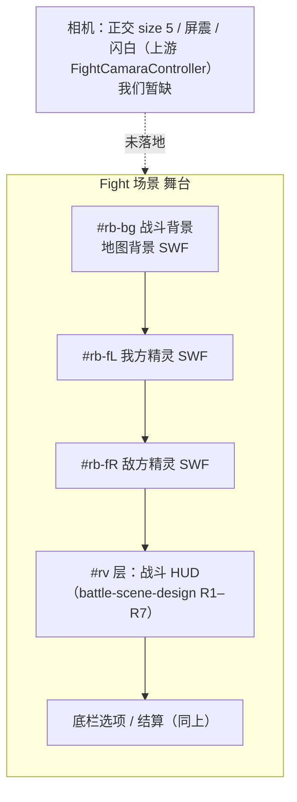
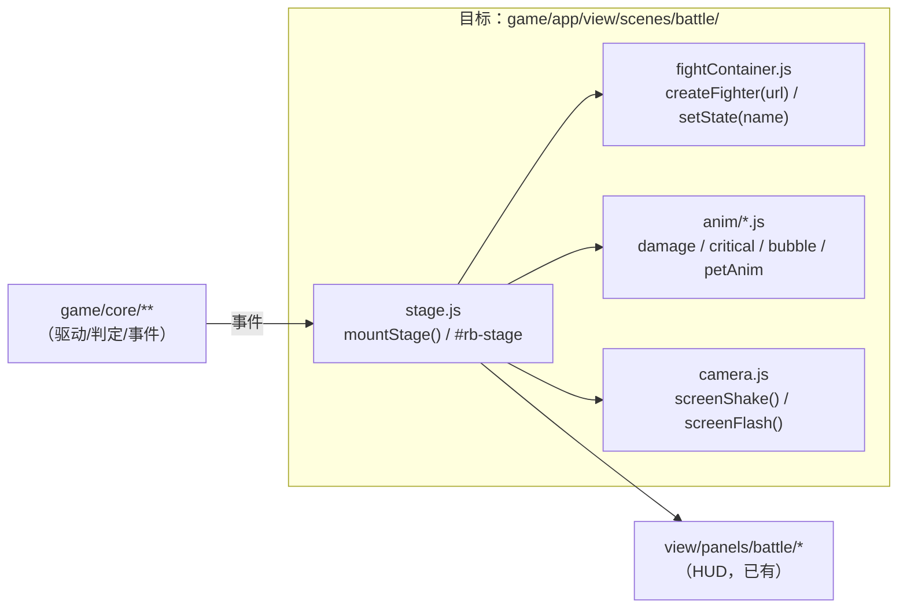

# View 子设计 · 战斗舞台与动画（view-scene-battle-stage.md）

> 子文档 of `docs/view/view-design.md`（§8 子文档地图 B4）。
> 本文定 **战斗场景的舞台与动画**：战斗背景 / 精灵舞台 / 单双打布局 / 相机与屏震 / 动画与特效。
> **不含**：战斗 **HUD（血牌/回合板/资源/天气buff/记录/计时）与底栏选项与结算**（→ `docs/view/scene/battle/view-scene-battle-design.md`）、
> 战斗规则（→ `game/core/**`，差分 oracle 锁定）。
> 证据标注：【样本】/【源码】/【推断】。上游路径相对 `projects/Seer2-Restart-Lite-main/Assets/`。

---

## 1. 范围与边界

| 属本文 | 不属本文 |
|---|---|
| 战斗背景（`Fight Background`） | HUD 顶带的血牌/回合板（→ `battle-scene-design §4.1/§4.2`） |
| 精灵舞台（左右宠容器 / 单双打布局） | 页签簇/技能卡/换宠/捕捉/道具（→ `battle-scene-design §4.4/§4.6`） |
| 相机（正交参数 / 屏震 / 闪白） | 结算面板（→ `battle-scene-design`，`resultView`） |
| 动画与特效（伤害/暴击/技能气泡/宠动作） | 数值与判定（→ `game/core/**`） |
| 单元视图的**结构**（status/num/anim/buff 四槽） | 四槽各画什么（status/num/buff → `battle-scene-design`） |

---

## 2. 上游真值

### 2.1 场景分层（已实证）

`Fight.unity` 顶层 = `Fight Background`（`SpriteRenderer`，`sortOrder = −1`）→ `Main Camera`（正交 `size = 5`，挂宠）
→ `Canvas`（`UI Layer` + `EventSystem`）。【源码】`docs/view/scene/battle/view-scene-battle-design.md §3`

### 2.2 单元与单双打布局（`BattleManager` / `BattleUnitView`）

```csharp
// BattleManager.cs:13-22
[SerializeField] private BattleSystemView systemView;
[SerializeField] private BattleUnitView playerView, enemyView;
[SerializeField] private List<BattleUnitView> doublePlayerView, doubleEnemyView;
[SerializeField] private PhotonView masterView, clientView;

// BattleManager.cs:50-56
GetAllUnitViews() => (parallelCount > 1) ? doublePlayerView.Concat(doubleEnemyView) : { playerView, enemyView };
allPlayerViews = allUnitViews.Take(count/2);      // 前半 = 我方
allEnemyViews  = allUnitViews.TakeLast(count/2);  // 后半 = 敌方
```
- `SetCurrentUIState(newState)` 把同一状态分发给 `systemView` + 全部玩家/敌方 unit view（带 `cursorOffset = i`）。【源码】`BattleManager.cs:84-91`
- **`BattleUnitView` 四槽**：`statusView` / `petNumView` / `animView` / `buffView`；`isDone = statusView.isDone && animView.isDone`
  （`BattleManager.isDone` = 所有 unit 的 `isDone` 与）。【源码】`BattleUnitView.cs:6-14`、`BattleManager.cs:22`

### 2.3 相机与屏震（`FightCamaraController : Module`）

```csharp
[SerializeField] private Transform mainCamaraTransform;   // 调相机位置实现屏幕震动
[SerializeField] private RectTransform uiLayerRect;
[SerializeField] private Animator flashAnim;              // 闪白
public void ScreenShake(float declineExtent = 0.6f, float shakeExtent = 0.75f)
public void ScreenFlash()
```
【源码】`MVC/View/Battle/FightCamaraController.cs:5-44`

### 2.4 动画与特效组件（`MVC/View/Battle/Components/Anim/`）

| 组件 | 作用 |
|---|---|
| `BattlePetAnimView` | 精灵动作（登场/攻击/被击/阵亡…） |
| `BattleDamageAnimView` | 伤害数字飘字 |
| `BattleDamageBackgroundView` | 伤害背景（条/底） |
| `BattleCriticalEffectView`(+`Config`) | 暴击特效（配置驱动） |
| `BattleSkillBubbleAnimView` | 技能气泡 |
- 单元级 `BattleAnimView`（`Components/Unit/BattleAnimView.cs`）是与 `statusView` 并列的槽。
- 另有 ``BattleRecordView` / 页签 Button 视图（`Components/.../Buttons/BattlePet*BlockView`）—— 归 HUD/选项（不属本文）。
  【源码】`MVC/View/Battle/**` 目录树

### 2.5 战斗 Unit 子系统（Model 侧的"产出动画信号"者）

| 子系统 | 与表现的关系 | 出处 |
|---|---|---|
| `UnitHudSystem` | `OnTurnStart` / `OnAttack` / `OnHit(damage,heal)` / `OnTurnEnd` / `OnBattleEnd`，**且都有 `…Undo`**（对名单回滚） | `UnitComponent/UnitHudSystem.cs` |
| `UnitPetSystem` | `petNum` / `alivePetNum` / `deadPetNum`；`SwapBackupPet` / `SwapTokenPet` / `GetParallelPetBag(parallelCount)` / `GetParallelPetBagCursor` | `UnitComponent/UnitPetSystem.cs` |
| `UnitSkillSystem` | 伤害/治疗分桶（`SkillDamage` / `ItemDamage` / `BuffDamage` / `totalSkillHeal` …） | `UnitComponent/UnitSkillSystem.cs` |
| `UnitCardSystem` | 卡组：`Draw(count, filter)` / `Shuffle` / `Use(index)` / `GetToken` / `OnRoundStart` / `OnRoundEnd` | `UnitComponent/UnitCardSystem.cs` |

> 表现层只**消费**这些信号；驱动与判定在 `game/core/**`（MVC 之外），本线不重构。

---

## 3. 我们的现状（`game/app/view/battle/restartFighterStage.js`）

**舞台 DOM**（F14 起三层包进 `#rb-stage`，按视口宽 `scale`，`transform-origin:0 0`）：

```
#rb-stage
 ├── #rb-bg     ← 地图背景 SWF（按 1920/1080 反推铺满，偏移 (−9.6, −5.4)）
 ├── #rb-fL     ← 左宠容器（我方）
 └── #rb-fR     ← 右宠容器（敌方）
```

- **宠容器**：`petContainer.root.swf?url=/swf/fight/{swfId}.swf`（复用 AS3 `battleScene` 已验证口径）；
  就绪握手 = `postMessage 'petRenderCallbacksReady'`；`getAvailableStates()` / `setState(name)` 切 clip。
- **语义 → clip 候选链（✅ 已落地 · 人类 2026-10-19「物攻/特殊/属性技能应当播不同动画」）**：每语义 = 一个**有序候选链**（先命中先赢），不是一档扁平表。
  **词表是封闭的** —— `vendor/seer2-pet-animator/actionscript/Fight.as` 的 `getAvailableStates()` 只回 `FighterActionType.ALL_TYPES` 里、且该 SWF 真有的 label，**一共 15 个**：
  `待机 / 物理攻击 / 属性攻击 / 特殊攻击 / 被打 / 被暴击 / 胜利 / 失败 / 闪避 / 必杀 / 濒死 / 个性出场 / 合体攻击 / 变身效果 / 空`。
  ⇒ 匹配只在白名单里做**精确相等**。

  | 语义 | 来源（上游 `PetAnimationType`） | 候选链（左→右，先命中先赢） |
  |---|---|---|
  | `physic`（物攻） | `SkillType.物理` → `Physic` | `物理攻击` → `特殊攻击` |
  | `special`（特殊） | `SkillType.特殊` → `Special` | `特殊攻击` → `物理攻击` |
  | `property`（属性） | `SkillType.属性` → `Property` | `属性攻击` → `特殊攻击` → `物理攻击` |
  | `super`（必杀/连携） | `SkillType.必杀`/`连携` → `Super`/`SecondSuper` | `必杀` → `特殊攻击` → `物理攻击` |
  | `hit`（挨打） | `OtherSidePetReactionInfo` = Hurt | `被打` → `被暴击` |
  | `crit`（挨暴击） | 同上 = BeCriticalStruck | `被暴击` → `被打` |
  | `miss`（闪避） | 同上 = Evade | `闪避` → `被打` |
  | `dying`（濒死） | `UnitHudSystem.OnTurnStart`：活着且 `hp/maxHp < 0.2` → `Dying`（AS3 `Fighter.playDefAction` 同口径） | `濒死` → `失败` |
  | `ko`（阵亡） | `PetAnimationType.Lose` | `失败` → `濒死` → `被打` |
  | `intercourse`（合体攻击） | `PetAnimationType.SecondSuper`（Unity）≡ AS3 clip `合体攻击`；判据 = 技能 `isSecondSuper`（我们表里 **11 条**） | `合体攻击` → `必杀` → `特殊攻击` → `物理攻击` |
  | `change`（变身效果） | **本血统无触发器**（见下） | `变身效果` → `被打` |
  | `victory`（胜利） | `Win` | `胜利` |
  | `present`（登场） | `Present` | `个性出场` |
  | `idle`（待机） | `Idle` | `待机` → `空` |

  > ⚠️ 人类早先给的候选里有 `专属` / `大招`，但它们**不在白名单**里、`getAvailableStates()` 永远不会返回 ⇒ 已从链里去掉（意图保留在此行）。

  **两条降级口径照 AS3 `FighterAnimation.adjustCurrentLabel`**（Unity 侧没有这层，是 Unity 自己的 Animator 图）：
  `ABOUT_TO_DIE` 无标签 ⇒ 退回 `DEAD`；`PRESENT` 无标签 ⇒ 退回 `IDLE`。

  **「停最后一帧」的语义**（上游 `isStopLastFrame = [ABOUT_TO_DIE, DEAD, WIN]`；AS3 侧同 `MODE_STOP_LAST_FRAME`）：
  这三种播完**停在末帧、不自动回待机** ⇒ 回合尾部复位待机时必须跳过它们，否则濒死/阵亡/胜利的姿态会被立刻抹掉。

  **合体攻击 / 变身效果的触发器（人类 2026-10-19「处理一下」的查证 + 处置）**：

  - `合体攻击` = 上游 `PetAnimationType.SecondSuper`（Unity）≡ AS3 clip `合体攻击`。**触发器可用** ⇒ 判据 = 技能 **`isSecondSuper`**，
    我们表里 **11 条**（迪休拉之怒 / 雷鸣炎破斩 / 联盟的审判 / 伊特大乱斗 / 光影幻象 / 特鬼异星劫 …，全部 `anger=100`）。
    依据：两条血统的出伤帧表都把 SecondSuper 绑在 **`fit` 列** —— `PetHitInfo.fit => GetHitFrameByType(SecondSuper)`、
    `AnimiationHitInfo.fit => INTERCOURSE`。⚠️ `type=3 连携` 那 12 条**全部 `isSecondSuper=false`** ⇒ 仍走普通 `super`，不是合体。
    ⚠️ AS3 侧「合体」本体是**双精灵合体玩法**（`ErrorMap` 有「合体失败，精灵身上星魂未移除」、UI 有「双精灵对战情况下无法完成合体！」），
    我们是单打、无星魂 ⇒ **只能借 SecondSuper 这批技触到 clip**；有 `合体攻击` 素材的宠播得到，没有的退回 `必杀`。
  - `变身效果` = **本血统仍然没有触发器，不编**。上游两条血统都取不到：AS3 靠**服务端 `Command(19, "变身精灵")`** 下发
    （`arena/processor/Processor_19.cs` 置 `isChangeStatus=1` ⇒ `Fighter.disappear` 播 `CHANGE_STATUS`）；
    Unity 侧 `PetAnimationType.Morph = 15` **从没被任何一处赋值**（死枚举），且 `Assets/Scripts` 与 `Resources/Data` 里
    搜 `morph` / `change_status` / `transform` / `shape` **零命中**。链留着 + 调试直调口 `stage.showChange(side)`。

  **暴击大贴图（DB10）的数据结论**：全盘 `Assets/Resources/**` 搜 `CriticalEffect` 只有 **1 张** `JoseCritical.png`、
  `critical_effect.csv` 只有 **1 行数据**（表头 1 行 + 数据 1 行，已实测）⇒ 机制已完整、**数据就一条**，没有可补的。
  该行 ownerId=990，实测我们表里 `ui.defaultAnimId==990` 的恰好 1 只宠（**约瑟**，且 `baseId` 也是 990）⇒ 键能命中。
  为了不用打约瑟也能验收，给了直调口 `stage.showCriticalPoster('my', 990)` / `stage.criticalPosterFor(990)`。
  **算法**（纯表现，不碰数值）：
  ```js
  pickState(states, chain) {               // states = getAvailableStates()
    for (const name of chain) if (states.includes(name)) return name
    return null                            // 整链走空 ⇒ 保持当前 clip + 记一行
  }
  ```
  > 链的**档位顺序**是设计真值。**技能语义从内核来**（`skill.type` → 驱动层给的 `skillKind`），不从战报行猜 —— 战报只带技能名、不带技能类型。

  ⚠️ **攻击语义必须走独立通道，不能挂在伤害事件上**（人类 2026-10-19 报障「迪兰用属性技·洒水播的是物攻」）。
  上游 `BattleAnimView` 是**两条互不相干**的通道：

  | 通道 | 出处 | 会不会不存在 |
  |---|---|---|
  | 攻击动画 + 技能气泡 | `SetPet(currentUnit)` ← `currentUnit.skill` / `hudSystem.petAnimType` | 只看「这一手是不是攻击技」，**与伤害无关** |
  | 伤害气泡 | `SetDamage(currentUnit)` ← `hudSystem.CurDamageInfo` | 零伤害的攻击技**整个不存在** |

  合并的后果（实测）：`洒水(id=10006)` 是 `type=0`（属性）、`power=0`，唯一效果 `powerup / who=op / mat=-1`（纯减魔攻）
  ⇒ `AttackPhase.addReport` 的 `skill.type > 属性 || totalSkillDamage > 0` **两个条件都不成立** ⇒ 战报里没有「對…造成了…」那一行
  ⇒ 没有「被击」动作 ⇒ 挂在上面的技能类型挂不上去 ⇒ 出手动作停在默认的物攻。
  #### 属性技：对方**不播**受击/闪避，但**照常出掉血数字**（两条血统同口径，已查实）

  上游把「数字」与「宠物受击动作」分成两层，属性技只碰第一层：

  | 层 | Unity（重启） | AS3（v2） |
  |---|---|---|
  | 掉血数字 | `ApplySpecialHit` → `CurHealInfo = HealInfo(-N, defUnit.IsMyUnit(), "element")` ⇒ 橙色 `-N` 彩色文字 | `showAtkeeHpReduceSplash` → `HPDECREASE`（`reducedHp > 0` 才播） |
  | 宠物受击/闪避动作 | `UnitHudSystem.OnHit` 的 `if (skill.isAttack \|\| !isHit \|\| damage > 0)` ⇒ 属性技三条全不成立 ⇒ **不建** `CurOtherSidePetReactionInfo` | `FightTurnResultParser.as:102` 的 `if (skillInfo != null && skillInfo.categoryId != SkillCategoryValue.BUF_VALUE)` ⇒ 属性（`BUF=4`）**不调** `sectionSkill()` |

  属性技为什么三条都不成立：`Skill.IsAttack()` 是 `type > 属性` ⇒ `0 > 0` = false；`BeforeAttackPhase` 只在
`skill.isAttack && isHit` 时进 `DamageCalculatePhase` ⇒ **属性技不掷命中、`isHit` 恒 true、永不闪避**；
  纯属性技的伤害全在 `skill_element*` 桶里 ⇒ 红伤 `redDamage = 0`。

  ⇒ 场景侧：伤害事件的 `showBubble === false` 时**不画气泡**（上游 `DamageInfo` 压根没建，且彩色 `-N` 已是数值显示）。
  **受击动作则按决议②偏离上游**：见 §9.9 偏差 6。
  **顺带修掉的另一个隐患**：「激活了专属动作」只是**战报文案」（技能带 `evolve` option 时多打一行），上游并没有为它单独播一段动画
  （`SetPet` 只按 `skill.petAnimType` 出**一次**）⇒ 场景侧不再为它建动作，否则会多播一段多余的 clip。

  ⚠️ **旧实现错在哪（已修，登记备查）**：`KIND` 是**一档扁平词表 + 子串匹配**，两处都错 ——
  ① `attack: ['攻击', …]` 里的 `'攻击'` 是 `物理攻击`/`属性攻击`/`特殊攻击`/`合体攻击` 的**共同子串** ⇒ 物攻/属性/特殊打出哪一段全看 `getAvailableStates()` 的数组顺序，**等于随机**；
  ② 表里 `魔法`/`技`/`被击`/`死亡`/`倒下`/`win`/`idle`/`stand`/`die`/`death`/`登场`/`出场`/`专属`/`大招` **一个都不在白名单**，永远匹配不到。
- **演出节奏（2026-10-19 改）**：⚠️ **不再用固定 `STEP_MS`**。内核一整个回合是同步跑完的，表现层只能靠「等真信号」把节奏排对：
  - **等一段演完** = `Fight.as` 的 `postMessage {type:'animationComplete', state, duration, instanceId}`（`duration` 单位**秒**）。`isStopLastFrame` 的三种（濒死/失败/胜利）与 `待机` 循环**不发**这条。
  - **等打击帧**（飘字与挨打该在第几帧出）= 上游 `HitInfoConfig` / `AnimiationHitInfo` 的出伤帧表（`vendor/seer2-origin-as3/src/_assets/3_com.taomee.seer2.app.arena.util.HitInfoConfig__hitData.xml`，**1711 行**，键 = swfId）。换算照上游：`ms = 表值 / 1.07 × 40`（40 = `ClientConfig.timeRate`，即 25fps 的 ms/帧；`/1.07` 是表按旧 28fps 配的折算）。实测迪兰 物理 28→**1047ms**、属性 63→**2355ms**、必杀 90→**3364ms** —— 全部**远大于**此前的 650ms，这就是「双方一起出手」的成因。
  - 三类动作各等各的：**攻击类**只等到打击帧；**受击类**与飘字同帧出、再等挥击那段收尾（严格一方打完另一方再动）；**其它**播完即止。`STEP_MS = 650` 降级为**兜底**（无出伤帧数据 / clip 不存在 / 停末帧段）。
- ⚠️ **演出的单位是「一次行动」，不是「一个片段」**（人类 2026-10-19 定模型）：

  > 一次行动一次行动地演出；上一次行动演完，下一次才开始，**之间没有关系**。
  > 单看一次行动 = 播**行动方**动画 → 对方在**出伤帧**开始播相应效果（受击动画 + 伤害飘字 + 血条掉落，**三者同一帧**）。

  一行战报 = 一次行动（`AttackPhase.addReport` 把「使用了…對…造成了…」写进同一行）⇒ 行动与战报行天然 1:1。
  行动之间**不携带任何状态**（clip 句柄都是 `runAction` 的局部变量）。非行动条目（登场 / 回合末 buff / 濒死 / 阵亡 / 胜利）另走一条 `fx` 通道。
  上游对应物 = 那个 UI 帧队列：`ProcessQuery` 一次出一帧、`ProcessQuery(true)` 只出一帧（由 `OnPetHit` 在出伤帧触发）⇒ 天然逐动作推进。

- **血牌掉落 = 伤害飘字的同一拍**（人类 2026-10-19）。上游靠**一个 UI 帧机制**保证原子同步：
  `BattlePetAnimView.OnPetHit()`（由 `SetDelayCallback(hitFrame * 1000 / (24 * animSpeed), …)` 在**出伤帧**触发）
  → `UI.ProcessQuery(true)` → `SetCurrentUIState(newState)` ⇒ `statusView.SetPet`（血牌）与 `SetDamage`（伤害气泡）
  在**同一次调用**里更新。AS3 同理（`onAtkerHit` 里 `showAtkeeHpReduceSplash` + `updateStatusPanel()` 一起做）。
  ⚠️ 我们内核是**回合粒度**（`nextRound()` 一次跑完整回合）⇒ 若在 `onRender` 里直接 `renderAll()`，血牌会在动画开演前就掉，
  与飘字错开 1~2.4 秒。解法 = 驱动层在每次出手的帧上记一份**对方 hp/anger 快照**（`attackEventOf` 的 `defHp/defAnger`），
  演出在**每个打击帧**回调 `onContact` 逐拍刷血牌，回合演完再按权威状态收一次（覆盖回合末 buff 掉血/阵亡/胜利等无逐拍快照的部分）。
  ⚠️ 血牌要用 `Object.create(pet)` 做覆盖而**不能** `{...pet}` —— `maxHp`/`name`/`battleElement` 都是原型 getter，浅拷贝会丢。
- **兜底**：缺素材 / 无 Ruffle ⇒ 容器留空、不抛、写一行提示，战斗照常可打（DOM-only 兜底）。
- **素材桥**：`swfId` 由调用方经 `CONTENT.swfIdOf` 解析（与 icon 桥同一**既定例外**：官方表只贡献"动画 id 指针"、不贡献数值）。
  【源码】`restartFighterStage.js:1-60`

**HUD / 选项 / 结算**：已在 `docs/view/scene/battle/view-scene-battle-design.md`（R1–R7）与 `view-scene-battle-impl.md`，本文不重复。

---

## 4. DOM 契约（本文负责的部分）

| 元素 / 类 | 契约 | 谁维护 |
|---|---|---|
| `#rb-stage` | 舞台容器；按视口宽缩放（`transform-origin:0 0`） | `mountStage` |
| `#rb-bg` | 战斗背景 SWF 容器 | `mountStage` |
| `#rb-fL` / `#rb-fR` | 左/右（我/敌）宠容器 | `mountStage` |
| `.rb-stage-box` | 三个舞台盒的公共类 | `mkBox` |
| `body.rbb-full` | 全屏舞台开关（`ui.css:21-30`，见 `docs/view/mech/view-shell.md`） | 场景 |

> 三层容器与 HUD（`#rv` 层）**分属两层**：舞台在 `#wrap`，HUD 在 `#rv`（z-60）。改这里别动 `ui.css` 的 HUD 段。

---

## 5. 层栈图



---

## 6. 文件 ↔ 接口图



---

## 7. 缺口 / 待核

| # | 缺口 | 说明 | 处置 |
|---|---|---|---|
| 1 | ~~**相机缺**~~ ✅ 已落（§9.7 DB7/DB8） | 上游 `FightCamaraController.ScreenShake/ScreenFlash` | 已落码：屏震/闪白各一条触发链，见 §9.7 |
| 2 | **伤害 / 屏震 / 闪白 / 技能气泡 / 暴击贴图 ✅ 已设计（§9）；回合末 buff 飘字 ✅（§9.7 DB11）** | 上游 `BattleDamageAnimView` / `FightCamaraController` / `BattleSkillBubbleAnimView` / `BattleCriticalEffectView`(+Config) | 全部落进 §9（DB 批 + DB2 批）；`critical_effect.csv` 实测只有 1 条配置（`anim/990`），已如实登记 |
| 3 | **单双打布局缺** | 我们只有 L/R 两个容器；上游 `doublePlayerView`/`doubleEnemyView`（`parallelCount>1`） | 需定 N 宠站位公式 |
| 4 | **`BattleUnitView` 四槽映射** | `statusView`/`petNumView`/`buffView` 已在 HUD 线；`animView` 归本文 | 交叉登记，别重复 |
| 5 | **`UnitHudSystem` 的 Undo 对名单** | 动画层若做回滚演出，需要 `OnHitUndo` 等信号 | 驱动层已产事件？待核 `coreBattleDriver` 出口 |
| 6 | ~~**clip 替补链未落地**~~ ✅ 已落（§3） | 旧 `KIND` 是扁平一档表 + 子串匹配，物攻/属性/特殊打出哪段全看数组顺序（等于随机） | 已换成 `CHAIN` 有序候选链 + 白名单精确匹配，物攻/特殊/属性/必杀各播各的 |
| 7 | 目录未拆 | 现全在 `restartFighterStage.js` | 施工时按 §6 拆 |

---

## 9. 伤害飘字层（DB 批 · 人类 2026-10-19 点名「战斗中某一方对另一方造成伤害时增加伤害飘字的特效」）

> 本节把 §7 缺口表第 2 条的「伤害」那一半落成设计。**暴击特效贴图（`BattleCriticalEffectView` + `critical_effect.csv`）与相机屏震/闪白不在本批**（见 §9.7）。

### 9.1 上游真值：谁在什么时刻产出什么

```csharp
// AttackPhase.cs:86-112 —— 每次出手打一次 UI 帧，伤害记在**出手方**的 hudSystem 上
var redDamage = atkUnit.skillSystem.totalSkillDamage - exceptDamage;   // exceptDamage = 属性+粉+白 三色
var redHeal   = atkUnit.skillSystem.heal           - exceptHeal;
if (atkUnit.skillSystem.isHit) { defUnit.pet.hp -= redDamage; ... }
atkUnit.hudSystem.OnHit(atkUnit, true, redDamage, redHeal);           // ← 只有出手方拿到 CurDamageInfo
defUnit.hudSystem.OnHit(defUnit, false, 0, 0);                        // ← 挨打方只清场
```
【源码】`Assets/Scripts/MVC/Model/Battle/Phase/AttackPhase.cs:86-112`

`UnitHudSystem.OnHit` 把这一帧的账压成两个不可变对象（**表现层唯一的输入**）：

| 对象 | 字段 | 消费方 |
|---|---|---|
| `DamageInfo` | `IsMe`（**出手方**是不是我方）/ `DamageType`（技能伤 true、buff 伤 false）/ `Damage`（红伤）/ `IsHit` / `IsCritical` / `ElementRelation` / `ComboDamageInfoList` / `AttackPetBaseId` / `AttackPetAnimId` | `BattleDamageAnimView.SetDamageObject`（**红伤气泡**） |
| `HealInfo` | `Heal`（可负）/ `Type`（`element`/`pink`/`white`/`item`/空）/ `IsMe` | `BattleDamageAnimView.SetHealObject`（**彩色文字**） |

【源码】`Assets/Scripts/Scene Specific/Battle/UnitComponent/UnitHudSystem.cs:101-127`、`:186-233`

> ⚠️ **「打中了却掉 0 血」不是异常，是上游的一等分支**：`Damage=0 && IsHit=true` ⇒ 走 `absorb` 底；`IsHit=false` ⇒ 走 `miss` 底（`HelperUI.SetDamageBackgroundSprite`）。
> 【源码】`Assets/Scripts/Helper/HelperUI.cs:303-326`

### 9.2 上游真值：气泡是怎么画出来的

`BattleDamageBackgroundView.InstantiateDamageNum`（逐字照搬的算法）：

```csharp
string numString = "%" + damage.ToString();      // 伤害号 = '%' 符号 + 十进制数字
int len = numString.Length;
bool isLenOdd = (len % 2 == 1);
for (i = 0; i < len; i++) {
    deltaX = 45 * (i - len / 2);
    rect.anchoredPosition = isLenOdd ? new Vector2(deltaX, 0) : new Vector2(deltaX + 22.5f, 0);
    rect.localScale = 1.5f * Vector3.one;
    img.sprite = ResourceManager.instance.GetSprite("Numbers/Damage/" + numString[i]);
}
criticalRect.anchoredPosition = new Vector3(criticalRect.anchoredPosition.x - 25 * (i - 4), ...);
```

即：**每个字符一张 PNG**、字距 45（画布单位）、偶数位数整体右移半格居中、暴击角标随位数往左让位。
【源码】`Assets/Scripts/MVC/View/Battle/Components/Anim/BattleDamageBackgroundView.cs:74-89`

气泡底按三档换（`HelperUI.SetDamageBackgroundSprite`，同时改框尺寸）：

| 判据 | 底图 | 框尺寸 |
|---|---|---|
| `!isHit` | `Fight/damage miss` | 128 × 43 |
| `isHit && damage == 0` | `Fight/damage absorb` | 116 × 60 |
| `elementRelation > 1` | `Fight/damage weak` | 225 × 158 |
| `elementRelation < 1` | `Fight/damage resist` | 225 × 158 |
| 其余 | `Fight/damage normal` | 225 × 158 |

⚠️ `weak`/`resist` 这两个名字**与直觉相反**（上游就是 `>1 → weak`），照搬不改。

### 9.3 素材表（**盘上全在，0 缺**）

| 用途 | 盘上路径（相对 `projects/Seer2-Restart-Lite-main/Assets/Resources/Sprites/`） | 实测 |
|---|---|---|
| 数字字符 | `Numbers/Damage/{%,0..9}.png` | 11 张，字面 150×163（`6.png` 是 150×158） |
| 气泡底 | `Fight/damage {normal,weak,resist}.png` | 各 400×275（框里缩到 225×158） |
| 未命中底 | `Fight/damage miss.png` | 128×43 |
| 吸收底 | `Fight/damage absorb.png` | 116×60 |
| 暴击角标 | `Fight/critical.png` | 152×92（框 37.2361×21.5647、`localScale 2.7`） |

数字的「36×39 框 + `localScale 1.5`」来自 `Prefabs/Fight/Damage Number.prefab`；`spritePixelsToUnits=100`。
**沿用开始场景那条口径**（STI4）：松散 PNG 直取，浏览器路径 `/projects/Seer2-Restart-Lite-main/Assets/Resources/Sprites/…`。

### 9.4 上游真值：动画曲线（`Animation/Fight/Damage Bubble/`）

| clip | 缩放 | 位移 | alpha | 时长 |
|---|---|---|---|---|
| `Damage Bubble Me` | `0.6 → 1.4`（0→0.183s） | `x 380→550`、`y −180` 恒 | `0.157→1`（0.183s）→`1`（0.6s）→`0`（0.917s） | 0.917s |
| `Damage Bubble Op` | `0.6 → 1.4`（0→0.183s） | `x 250→220`、`y −170` 恒 | 同上（末点 0.933s） | 0.933s |
| `Damage Bubble Absorb Me/Op` | 无缩放曲线 | **只有 `y −150 → −30`**（0→0.333s），0.5s 恒 | 无 alpha 曲线 | 0.5s |

四支都是 `ResetAllTriggers` + `SetTrigger(who + absorb)`，`who = isMe ? "me" : "op"`，动画结束即 `Destroy`。
【源码】`BattleDamageAnimView.cs:118-155`、四个 `.anim` 的 `m_FloatCurves`/`m_ScaleCurves`

> **读法**：`Me` 往**右**飘、`Op` 往**左**飘 —— 两只都朝**对方**方向。配合下面那条「气泡摆在对方一侧」的注释，
> 观感就是：**数字由出手方那一侧持有并触发，但落点在两宠之间的中间带、偏向被打方，并继续朝它飘。**

**为什么落点不在出手方身上 —— 作者自己留了注释**（`BattleAnimView.cs:9`，紧挨着 `damageView` 字段）：

```csharp
// Note that the damage view is on enemy's side.
[SerializeField] private BattlePetAnimView petView;
[SerializeField] private BattleSkillBubbleAnimView skillBubbleView;
[SerializeField] private BattleDamageAnimView damageView;          // ← 摆在**对方**那一侧
[SerializeField] private BattlePetAnimView otherSidePetView;        // ← 挨打方的反应动画也在这个视图里
```

【源码】`Assets/Scripts/MVC/View/Battle/Components/Unit/BattleAnimView.cs:9`

> ⚠️ **别把「谁持有」读成「谁身上」**：`CurDamageInfo` 只写在 `atkUnit` 上（挨打方那句 `OnHit(defUnit,false,…)` 被
> `if (isAtkUnit)` 挡掉），所以**触发方确实是出手方**；但这个视图里的摆放位置是作者**刻意挪到对方一侧**的。
> 宠物本体也不在这个 UI 画布里 —— `BattlePetAnimView.SetPet` 把精灵挂在 `battlePetAnimContainer`（世界空间），
> 我方 `x = −9.6`、敌方 `x = +9.6`（同句），所以 UI 的左右 ≈ 画面的左右。
> 【源码】`BattlePetAnimView.cs` `SetPet` 末段 + `CriticalEffectWorldPosition`（暴击贴图正是拿它做世界→屏幕换算的）

**`damageAnchoredPos` 的两个值（prefab 实例实测，别再抄反）**：`Player View`（`isMe=1`）= `(250,−250)`，
`Enemy View`（`isMe=0`）= `(550,−250)`，锚点是该 unit view 的 **`Anim`** 容器（全屏拉伸），不是血牌。
⚠️ 不过 prefab 里这两个数**其实是死的** —— `Damage Bubble Me/Op.anim` 逐帧覆写 `m_AnchoredPosition.x` 与 `.y`，
第一帧就接管（`x` Me 380→550 / Op 250→220；`y` Me −180 / Op −170）。真正生效的只有「哪个 unit view 持有」+「用哪支 clip」。
【源码】`Assets/Scenes/Fight.unity`（6 个 `BattleDamageAnimView` 实例，按所属 `BattleUnitView.isMe` 分组）

### 9.5 上游真值：连击与终击

`UnitHudSystem.GetComboDamageInfoList`：连击段数 > 1 时，把每段伤害**按段数均摊**成 ≤30 段的整数（余数给前几段各 +1），
某段 `isCritical` = 它覆盖的原始段里**任一段**暴击即真。展示模式由设置 `comboDamageDisplayMode` 决定
（`0=AllComboOnly` 逐段、`1=TotalOnly` 只出总数、`2=AllComboAndTotal` 逐段+总数；**C# 缺省 int 0 ⇒ 逐段**），
段间 `0.18s / max(battleAnimSpeed,1)`。终击（`isFinalDamage=true`）额外：暴击或伤害>500 ⇒ 锚点放大 `1.2`；
暴击命中 ⇒ 屏震；`damage>400` ⇒ 屏震（`shakeWhenBigDamage`）；`damage>500` ⇒ 闪白（`flashWhenBigDamage`）。
【源码】`UnitHudSystem.cs:129-160`、`BattleDamageAnimView.cs:79-118`、`:150-172`

### 9.6 我们的目标行为（DB 批 = 本批施工范围）

| # | 行为 | 口径 |
|---|---|---|
| **DB1** | 信号层：驱动层从内核 `skillSystem` **只读**投影出 `DamageInfo`/`HealInfo` 同形对象 | 照 `UnitHudSystem.OnHit` + `AttackPhase.onHit/applyAttackDamage` 的算法逐条照搬；**`game/core/**` 一行不改**（`hudSystem` 仍留围栏） |
| **DB2** | 红伤气泡 | 由**出手方**那一侧持有并触发，但落点偏**被打方**（`DMG_BIAS=0.62`）并继续朝它飘（§9.4 + §9.9 偏差 1）；`%`+数字逐字拼图、三档底按 `elementRelation` 换、未命中/吸收两底不挂数字 |
| **DB3** | 暴击 | 显示 `Fight/critical.png` 角标（随位数左移让位）+ 锚点 `1.2` 放大；**屏震/闪白本批不做**（相机是 §7 缺口 1） |
| **DB4** | 三色属性伤害 + 治疗 | 走 `HealInfo` 那条彩色文字通道：`element` `#ed780e`、`pink` `#ff40ff`、`white` `#ffffff`、治疗 `+N` 绿 `#77e20c`、负值红。上游 `HealInfo` 记在**哪个 unit** 上就画在**哪个 unit** 上（三色伤害记在挨打方、治疗记在出手方），所以这一路用**独立的 `UNIT_ANCHOR`**（bias=0，就在那只宠正上方），**不跟着伤害气泡跑到对面去** |
| **DB5** | 连击 | 照 §9.5 均摊成 ≤30 段、**逐段冒泡**（= C# 缺省 `AllComboOnly`），段间 `0.18s`；**不出总数** |
| **DB6** | 层与坐标 | `#rb-stage` 内新建 `#rb-dmg`（z 序在 `#rb-fL/#rb-fR` 之上、`#rv` 之下），坐标是**舞台空间 1200×660** 的一套可调常量；气泡用 `DMG_ANCHOR`（偏被打方 0.62），本单位数字用 `UNIT_ANCHOR`（bias 0） |

### 9.7 第二批（DB2 · 人类 2026-10-19「这些也实现吧」）补进来的四件

| # | 件 | 上游真值 | 我们的落法 |
|---|---|---|---|
| **DB7** | **相机屏震** | `FightCamaraController.ScreenShake(declineExtent=0.6, shakeExtent=0.75)`：协程每 `0.1s` 一步、共 `1.8s`=18 步，每步 `e = -e * declineExtent`（**负号 ⇒ 逐帧左右交替**、幅度按 \|0.6\| 衰减）；同时挪相机 `(e, -e/3, -5)`（正交 size=5 ⇒ 满屏 10 单位 = 1080 参考像素 ⇒ 1 单位 = 108px）与 UI 层 `(e*30, -e*10)` px | 协程原样搬成 JS 定时器。玩家看到的**净位移** = `(-108e+30e, +36e-10e)` px（1920 画布）再乘 `1200/1920`；UI 层那一份并进同一层一起晃（不单独动 `#rv`）。晃 `#rb-shake`（`#rb-stage` 里的新一层），并按位移量做 overscan 放大，**保证震动时舞台边缘不露黑边**。同一次伤害里可能连触发两次（暴击 + 大伤害）⇒ 后一次顶掉前一次 |
| **DB8** | **闪白** | `ScreenFlash()` = `flashAnim.SetTrigger("Flash")`；`Animation/Fight/Flash/Flash.anim`：**0.12s**，`r` 恒 1，`g 0→1`、`b 0→1→0.5→0`、`a` 恒 1，scale 恒 12 | 一层全窗口纯色 div 挂 `#wrap`（`#rb-stage` 只按宽缩放、高度未必铺满 `rbb-full` 的 100vh），颜色曲线逐点照搬，0.12s 后撤 |
| **DB9** | **技能气泡** | `BattleSkillBubbleAnimView.SetSkill`：底图 `Fight/Skill name bar.png`（实测 **292×26**）+ 字号 **14**、字色 **(0,1,0.96)=`#00fff5`**、`m_Alignment:4` 居中；文案 = `技能名` +（`combo != 1` 时 `（N连击）`）；**2.5 秒**后隐藏。挂在**出手方**那侧，出手那一刻出 | 同尺寸同色，`left/top` 常量锚在各自半场左上（对应上游 unit view 左上角）。触发时机：场景把技能气泡回挂到同一条**出手**动作上（不是等「被击」）。判据 = `!isActionSkill(type) && type != 被动`（即属性/物理/特殊/连携/必杀） |
| **DB10** | **暴击大贴图** | `BattleCriticalEffectConfig` 读 `Resources/Data/Battle/critical_effect.csv`（**11 列定长**，`GetCriticalPoster(animId, baseId)` = 先 `anim` 后 `base`；ownerId=0 一律无）；`BattleCriticalEffectView.Play`：`anchor` 居中、`sizeDelta = 图尺寸 × scale`、`anchoredPosition = 锚点 + (x·dir, y)`、`localScale=(dir,1,1)`（出手方是敌方则**水平翻转**），逐帧 `EaseOut` 从 `center-offset` 滑到 `center+offset`，alpha 三段（0→18% 淡入、62% 后淡出） | 表经 **`content.js`** 取（`criticalPosterOf(animId, baseId)` + `criticalPosterUrl(cfg)`），落盘 `Sprites/<resolvedAssetKey>.png`（`ResourceManager.spritePath="Sprites/"`）。⚠️ **本盘表里只有 1 条**：`anim/990 → Battle/CriticalEffects/JoseCritical`（x=100 y=-200 scale=0.5 duration=2 moveX=80）。我们没有上游的 `pet.ui.animId`，用重启表 `ui.default_anim` 顶上（实测 838 只宠里**约瑟(990) 恰好命中**）。查不到 ⇒ 静默不画（上游同） |
| **DB11** | **回合末 buff 飘字** | `UnitHudSystem.OnTurnEnd(thisUnit, rhsUnit)`（上游 `TurnEndPhase` 对**双方各调一次**）：`rhsResult<0` ⇒ 在 **thisUnit** 这侧冒 `DamageInfo(thisUnit.IsMyUnit(), **false**, \|rhsResult\|)`；`thisResult>0` ⇒ 在 **thisUnit** 这侧冒 buff 治疗。⚠️ 气泡里的数字取的是**对方**的净 buff 伤、治疗取自己的 —— 原样照搬，不换边。`DamageType=false` ⇒ `SetFinalDamageEffects` 里那句 `if (!info.DamageType \|\| !isDamage) return` 让它**不震屏/不闪白/不出暴击贴图**（1.2 放大仍照做，那句在早退之前） | 内核 `TurnEndPhase.doWork` 开头就把 `whosTurn` 置 0，所以这一路的帧走 `whosTurn===0` 分支采集：两侧的 buff 账在那一帧上**同时可读**，不用归位到出手方。键 = `${turn}\|end\|${side}` ⇒ 出场顺序天然排在同回合出手之后。这路**没有战报行**，所以场景在回合末尾单挂一条 `kind:'buff'` 的动作（不在 `KIND` 里 ⇒ 只冒泡不换 clip） |

**触发阈值**（`SetFinalDamageEffects` + `SetComboDamageObject`，C# 缺省 `shakeWhenBigDamage=true` / `flashWhenBigDamage=true`，我们无设置面板按 true 走）：

| 条件 | 效果 |
|---|---|
| **必杀 / 连携出招那一刻**（`PetAnimationType.Super\|SecondSuper`，判据 `type ∈ {必杀(100), 连携(3)}`） | `ScreenShake(0.4f)` —— 这是**另一条**触发：`BattlePetAnimView.ScreenShake(type)`，与伤害那条同源但发生在动画起点。其中 `isSecondSuper` 的那批走 `intercourse` 段位（见上） |
| 连击里任一段 `damage != 0 && isCritical` | `ScreenShake(0.4f)`（幅度更小） |
| 终击暴击命中 | 暴击贴图 + `ScreenShake()` |
| 终击 `damage > 400` | `ScreenShake()` |
| 终击 `damage > 500` | `ScreenFlash()` |
| 终击 `isCritical \|\| damage > 500` | 锚点放大 `1.2`（气泡峰值缩放） |

### 9.8 本批**不做**（如实登记，非死账）

| # | 不做 | 为什么 |
|---|---|---|
| 1 | 暴击贴图的 **mod 资源**（`mod:` 前缀那条分支） | 本盘表 0 条 mod 配置；分支与解析都在 `content.js parseCriticalEffects` 里留着 | 
| 2 | 屏震对 **HUD 层单独位移** | 上游挪相机 + 挪 `uiLayerRect` 两处；我们合成一处净位移晃 `#rb-shake`，HUD 不跟着抖（更耐看，且不影响读数） |
| 3 | **动画速度设置** `battleAnimSpeed`（屏震/闪白/连击间隔都要除它） | 无设置面板（编排线未接），常量按 `1` 走 |
| 4 | 单双打多宠站位 | §7 缺口 3，`parallelCount` 恒 1 |
| 5 | 相机本身（推拉/旋转/跟随） | 上游 `FightCamaraController` 只有屏震与闪白两件事，别的在 `Fight.unity` 的固定机位里 |

### 9.9 与上游的**有意偏差**登记（不是 bug，是取舍）

| # | 偏差 | 理由 |
|---|---|---|
| 1 | **气泡落点偏得更靠被打方**（上游只抄了「方向」，没抄「偏多少」）。上游的**绝对**落点钉不死 —— `CanvasScaler` 参考 960×540 / match=width，而装气泡的 unit view 盒子只有 100×100（= 屏幕宽 1/9.6），prefab 里的 `anchoredPosition.x` 却写着 380~550（自己盒子宽的 4~5 倍），两者自相矛盾 ⇒ prefab 实例层级还原有断，不编数。我们取 `DMG_BIAS = 0.62`（从出手方的宠朝被打方的宠走 62%），位移照抄上游那两个数（Me `+170` / Op `−30`）× `1200/1920` | 数字的意义就是「这一下打在这儿」，落在挨打那只身上才读得对（人类 2026-10-19 拍板）。旋钮 = `DMG_BIAS` / `y`，靠人眼校 |
| 2 | 缩放基准：上游数字 36×39×1.5、气泡 225×158（1920 画布）；我们用**单一常数 `DMG_SCALE`** 统一乘 | 舞台 1200 宽 ≠ 1920，逐项换算没有意义；一个旋钮更好靠人眼校（同 §4.10 路线 A 口径） |
| 3 | 触发时机：上游靠 `hudSystem.CurDamageInfo` 在**每次 `SetState`** 重建气泡（内核逐动作帧驱动）；我们是**回合粒度**驱动（`restartFighterStage.playRound` 的 `STEP_MS` 节奏） | 与既有舞台演出口径一致（§3 的 `STEP_MS`）；飘字跟着「被击」clip 一起出，不逐动作重建 |
| 4 | 暴击贴图的 `animId`：上游取 `pet.ui.animId`，我们**没有这个字段**，改取重启表 `ui.default_anim` | `build-unity-data.mjs:312` 把 CSV 的 `default_anim` option 存成 `ui.defaultAnimId`；实测全盘唯一那条配置 `anim/990` 恰好被它命中（约瑟 `id=990`、`defaultAnimId=990`），**没有因此漏掉任何一条配置** |
| 5 | 屏震的并发：上游每触发一次就起一个协程（多个协程互抢 `transform`）；我们改成**后一次顶掉前一次** | 同一帧里暴击与大伤害可能连着触发两次；两路位移互抢会抖成噪点，重新起振更接近观感 |
| 6 | **属性技也给对方播受击/闪避**（人类 2026-10-19 拍板「加：对方也播受击」）。上游两条血统都不播（Unity `OnHit` 三条件不成立；AS3 `categoryId != BUF_VALUE`），我们**有意偏离** | 属性技在出伤帧表里**有** `attribute` 列（Unity `hit.csv` 293 行全有值、AS3 xml 1698 条有值），打击点是设计出来的；对方毫无反应会让这一拍看着像打空了。**气泡仍不出**（只保留彩色 `-N`），偏离范围仅此一项 |
| 7 | **出伤帧该列配 0 时，用同一行已配置列的中位数当代理**。上游两条血统把「配 0」实现为**立即命中**（AS3 `setTimeout(…, 0)`、Unity `SetDelayCallback(0, …)`），我们**有意偏离** | 全盘 **1016 只里 300 只的 `critical` 是 0**（AS3 与 Unity 两套数据一致 ⇒ 设计值非缺失）。立刻结算会让「伤害先于挥击出现」；而「等整段动画演完」又太重（必杀拖几秒，人类反馈「还不如之前」）。同一只宠**其它攻击段的打击点**是最贴近的现成依据 ⇒ 取中位数。例：水墨点点 `{physics:58, attribute:19, special:36}` ⇒ 中位数 36 ⇒ **1346ms**。日志标「（代理…）」，`__battle.debug().timing` 的 `proxy:true` |

## 8. 配对 impl 指针

- **`docs/view/view-impl.md`（待写）** 的 `battle-stage` 节：容器 API（`getAvailableStates`/`setState`）冻结、`KIND` 词表登记、
  相机/特效逐件施工、单双打站位公式。
- 承接：`docs/view/scene/battle/view-scene-battle-design.md`（HUD，本文的姊妹）、`docs/view/scene/battle/view-scene-battle-impl.md §3.4`（F14 舞台层跟随）、
  `docs/engine/kernel-handoff.md`（战斗核心的驱动出口）。
