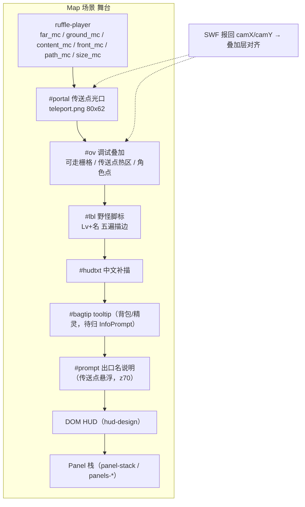
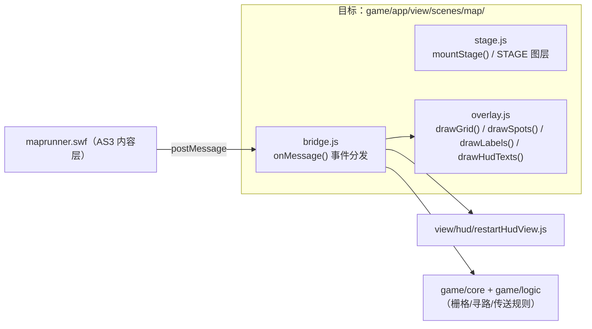

# View 子设计 · 房间场景内容层（view-scene-map-content.md）

> 子文档 of `docs/view/view-design.md`（§8 子文档地图 B3）。
> 本文定 **房间场景（大地图）的内容层**：背景 / 遮罩 / 实体（NPC·Farm·Animal·Teleport）/ 角色 / 相机 / 点击反馈 / 寻路预览。
> **不含**：房间 **HUD 层 + 角标**（→ `docs/view/scene/room/view-scene-hud-design.md`）、Panel（→ `docs/view/mech/view-panel-stack.md` + `docs/view/panel/view-panels-*.md`）、
> 规则（栅格/寻路/传送 = `game/core` 与 `game/logic`，非本文）。
> 证据标注：【样本】/【源码】/【推断】。上游路径相对 `projects/Seer2-Restart-Lite-main/Assets/`。

---

## 1. 范围与边界

| 属本文 | 不属本文 |
|---|---|
| 背景 / 通行遮罩 / 前景遮罩 | 地图名/天气/角标（→ `view-scene-hud-design.md`） |
| 实体：NPC / 农场 / 动物 / 传送点 / 野怪 | 实体的**规则**（漫游 / 对话 / **条件→动作** / 战斗触发 / 传送 = **地图线** `docs/map/map-design.md`） |
| 角色（玩家）表现 + 相机 | 点击 → 寻路的 A*（= `game/core`；**规则正本 = 地图线** `docs/map/map-design.md §2.11`） |
| 点击反馈、寻路虚线预览 | 面板（→ `docs/view/panel/view-panels-map.md`） |

---

## 2. 上游真值（`MVC/View/Map/MapSceneView.cs`）

### 2.1 场景内容 = 三层资源 + 实体

`MapSceneView.SetMap(map)` → `SetResources` + `SetEntites` + `CheckBattleResult` + `CheckDailyLogin`。【源码】`MapSceneView.cs:36-50`

```csharp
SetResources(map.resources, refreshBGM)      // → SetBGM + SetBackground + SetPathMask + SetForegroundMasks
SetEntites(map.entities)                     // → NpcController：npc / farm / animal / teleport
```

| 层 | 真值 | 出处 |
|---|---|---|
| **背景** | `resources.bg`（Sprite）；若有 **动画 prefab** `resources.anim` 则实例化并铺满（`map.anim.AnimScale/AnimPos`）；`map.dream` ⇒ 灰化 | `MapSceneView.cs:70-84` |
| **通行遮罩** | `pathMask.sprite = resources.pathMaskSprite` | `MapSceneView.cs:86-89` |
| **前景遮罩** | 动态建 `"Foreground Masks"` Canvas（`RectTransform` 全拉伸）+ `MapForegroundMaskGraphic`，`SetPolygons(resources.bg, map.geometry.ValidMasks, ReferenceCanvasSize)`；**sibling 插到玩家之上**（`GetForegroundMaskSiblingIndex` 找 `PlayerController`/`PlayerView`） | `MapSceneView.cs:91-158` |
| **实体** | 4 个字典：`npcDict` / `farmDict` / `animalDict` / `teleportDict`，各自 `NpcController` | `MapSceneView.cs:22-25` |
| **野怪** | `MapNavigator wildNpcNavigator`（导航）；野怪气泡/漫游/对话在 `Scene Specific/Map/Entities/Npc/MapWildNpc{Behaviour,SpriteBubble,Talk,Wander}Controller.cs` + `MapWildNpcBubbleHost.cs` | `Scene Specific/Map/Entities/Npc/*` |
| **点击反馈** | `MapClickFeedbackView.Play(canvasPos)`（懒建） | `MapSceneView.cs:179-183` |
| **寻路预览** | `MapPathPreviewView.SetPath(start, path)` / `Clear()`；总开关 `showPathPreview` | `MapSceneView.cs:185-200` |
| **参考分辨率** | `ReferenceCanvasSize = 960×540` | `MapSceneView.cs:11` |

### 2.2 角色（`PlayerView : UIModule`）

- 朝向：`playerDirectionSprite[4]`（0 前左 / 1 后左 / 2 前右 / 3 后右），`SetDirection(direction, isMoving)`。
- 位置：`SetPlayerPosition(currentPos)` —— 内部用 `visualCenterOffset` + 水平翻转补偿，保证**视觉中心点**不变（`GetVisualCenterPosition` / `FlipHorizontal`）。
- 名字/成就两个 `Text`（随翻转一起镜像 `localScale`）。
- 跟随宠：`UniGifImage followerGif` + `Animal.GetGifInfo(dirName)`（GIF/Sprite 二选一）。
- `Shoot(shootId, canvasPos, callbacks)`：实例化 `Map/Npc` prefab 当投射物，按 `speed`/`rotation` 飞，落地换 `resId` 图标。
- `OpenPlayerInfoPanel()` → `PlayerInfoPanel`（面板，归 `docs/view/panel/view-panels-social.md`）。
  【源码】`MVC/View/Player/PlayerView.cs:9-253`
- ⚠️ **装备与坐骑不在重启 `PlayerView` 里**：重启侧 `PlayerController` 只挂 `nonoView`/`robotView` 与成就图标，**没有 11 槽装备 / 骑乘实现**；原版的外观链在 AS3 `ActorEquipHelper` / `MultipleEquipPlayer` / `EquipPlayer`（裸装 5 件默认装（头/眼/手/身/脚），渲染时左右手脚镜像成 8 部件；坐骑 = 3 号槽装备包 + y=−50/藏手脚/速度 25）。**数据链、素材路径、包格式、上游怪癖**已索引在 **`docs/map/map-actor-look.md`（M8 · 2026-10-20 · impl 计划 = `map-impl §3.10` · `MDB8-a`–`d` 手测通过、`MDB8-e`/`f`/`g`/`f2` 代码已落 2026-10-20、e 停点等人手测 §8.17 + 素材采集、f 停点等人手测 §8.18、g 停点等人手测 §8.19 · f2 停点 §8.20（修「双角色」））**；**像素/图层机制的正式归属仍是本份 B3**，M8 只给数据与 JS 回退通路的实现方案。

### 2.3 驱动桥

`MapSceneController : Module` 持 `MapSceneModel` + `MapSceneView`，`SetMap(map)` 同时刷两者（View 不直接碰 Model，经 Controller）。【源码】`MVC/Controller/Map/MapSceneController.cs:5-13`

### 2.4 传送点（"光口" + 出口名）

**数据**：`<teleport id name pos targetMapId targetPos? color?>`（`MapEntities.cs` 的 `teleports`；`TeleportInfo.cs`）。

| 字段 | 含义 | 出处 |
|---|---|---|
| `pos` | 光口在地图坐标（1200×660，y 向下）里的位置 | `TeleportInfo.pos`（`posId.ToVector2()`，`Helper/Helper.cs:250`） |
| `name` | **出口自己的名字** = 悬浮说明的文案（例：`100.xml` 的"草系主城"） | `TeleportInfo.name` |
| `targetMapId` | 跳去哪张图（`0` ⇒ 弹"地图暂未开放"） | `TeleportHandler.Teleport` |
| `targetPos` | 到图后的**落点** | 原版 `Teleport.as:49-50,106-110` 存进 `_actorTargetPoint`，`changeScene(..., x, y)` 用它；⚠️ `TeleportHandler` **没读它** |
| `color` | 光口着色（默认 `"255,255,255,128"`） | `TeleportInfo.rgba` —— ⚠️ **只有重启读它**，原版 `Teleport.as` 完全不读；我们手上的**原版数据 308 条 `<teleport>` 里 0 条带 `@color`** |

⚠️ **`name` ≠ 目标图的 `name`**：全仓 308 条 `<teleport>` 里 **25 条不同**、**1 条为空**（`1.xml`）。
例：`100.xml` `<teleport name="草系主城" targetMapId="90">`，而图 90 自己叫"草目氏族主城"。
⇒ **悬浮说明只能取 `name`**，拿目标图名顶替是**错**的（已落进 `game/data/maps.json` 的 `teleports[].name`，见 `tools/build-map-index.mjs`）。
⚠️ 抵达日志**还没**用上它：`mapEnter` 已带 `name`（`MapRunner.as:549`），但宿主没读 ⇒ 提示条写的是**目标图名**，见 §8 第 13 行。

**原版 AS3**（Flash 线真值）：

- **`Teleport : AnimateElement`**（`entity/Teleport.as`）：`setData(xml)` → `this.name = @name`、`this.x/this.y = pos`、记 `targetMapId/targetPos`；
  `addSpot()` = `TeleportResourcePool.checkOut()` → **`UIManager.getSprite("UI_Teleport")`**（符号在 `swf/ui/UI_hud.swf` 的 SymbolClass 里，id 2038；用 `game/swfshape.mjs` 量其轮廓包围盒 = **80×62**，原点落在**偏下 1/3**：`x∈[-39.65,40.35] y∈[-40.65,21.35]`）；
  `addTooltip()` = **`TooltipManager.addCommonTip(this, this.name)`** —— ⚠️ **`name == ""` 时压根不加**（`Teleport.as:62-66` 的 `if (this.name != StringConstants.EMPTY)`）；
  皮肤 `CommonTipSkin` → `UI_hud.swf` 的 `UI_Tooltip`，贴光标 `(-9,-30)` 再 `deployTooltip(stageX, stageY-10)`；
  click → 已在点上就 `changeMap()`，否则 `runToLocation(x,y)` 等 `MoveEvent.FINISHED`；`isTargetArrived()` 是**严格等点**（`x == this.x && y == this.y`，无半径）；
  `changeMap()` 按 `targetMapId` 分流（50000 HOME / 70000 PLANT / 10..49999 LOBBY / 1..9 NOVICE / >80000 COPY）。
  【源码】`entity/Teleport.as:42-113`、`entity/pool/TeleportResourcePool.as:22-30`、`core/ui/toolTip/BaseTooltip.as`、`tipSkins/CommonTipSkin.as`
- `DoorTeleport`（生日门等）覆写 `addSpot()` → `UI_DreamTeleport`，click 先弹确认框。`DreamTeleport` 同理（梦境图）。

**重启 Unity**（`Seer2-Restart-Lite-main`）：

- `MapSceneView.SetTeleport` 逐个 `Instantiate(RM.GetPrefab("Map/Teleport"))`。【源码】`MVC/View/Map/MapSceneView.cs:469-478`
- **prefab `Map/Teleport`**：`RectTransform` `sizeDelta=80×62`、`pivot=(0,0)`、`anchoredPosition=info.pos`；`Image.sprite = teleport.png`（guid `867d4337…`，80×62 RGBA）、`Image.color=(1,1,1,0.502)`；另挂 `Outline(白 0.75, 1,-1)` + `IButton`。【样本】`Assets/Resources/Prefabs/Map/Teleport.prefab`
- **`teleport.png`** = 就是原版 `UI_Teleport` 的位图导出（**同为 80×62**，白径向光：中位 α≈60/255、峰值 212/255）。【样本】`Assets/StaticResources/Sprites/Map/teleport.png`
- 交互 = `TeleportHandler.SetTeleportButton`：`onPointerEnter → infoPrompt.SetActive(true)`、`onPointerExit → SetActive(false)`、
  `onPointerOver → SetInfoPromptWithAutoSize(info.name, MiddleCenter)`、`onPointerClick → Transport(info.pos, () => Teleport(info))`；
  `Transport` = `PlayerController.SetDestinationNearCanvasPos(pos, 72px, onArrive)`（**先走近 72px 内再跳**），`Teleport(mapId)` 里 `mapId==0` 弹"地图暂未开放"、`50000` 查活动表。【源码】`Scene Specific/Map/Entities/Teleport/TeleportHandler.cs:11-51`
- **`InfoPrompt`**（重启的悬浮说明）：黑底（`Image.color=(0,0,0,1)` + 内置 `UISprite`）、白字 **14px** 居中、盒高 = 文本高 + **21**，`SetPositionOffset` 让它**跟着光标**（偏移 `(10,2)`，pivot 左下 ⇒ 盒底边在光标上方 2px），`SetActive` 里 `SetAsLastSibling()` ⇒ **浮在最上**。【源码】`MVC/View/Basic/InfoPrompt.cs:7-70`、【样本】`Assets/Resources/Prefabs/Info Prompt.prefab`

---

## 3. 血统分工（已拍板）

**规则**（人类拍板）：

1. **涉及 SWF 素材的部分 → 采用原版 AS3**：房间背景、NPC、角色、野怪。
2. **其余 → 采用重启设定**。
3. **能用 DOM 实现的（如 Room HUD）→ 按重启规格用 DOM 实现**。

> ✅ **2026-10-18 人类拍板（与上表第 3 行同向）= 房间里的实体（NPC / Avatar / pet）表现一律用 SWF 美术素材**（见 `docs/map/map-impl.md §4 D10`：**数据面归地图线**、**取图与图层机制归本份**）。
> ⚠️ **留给本份的开放项**：NPC 的**美术映射**（Unity 侧 `<npc>` 的 sprite/resId → 具体 SWF 素材）需**本份与素材层一起定**；地图线只保证**数据到得了**（`docs/map/map-data.md §3.2` / `MDI4`）。
> ✅ **2026-10-18 补一条（路线 A，人类同日裁决）**：**美术与画面逻辑都仍归 AS3**（不换重启底图/蒙版、不实现 Unity 版相机与层序），**但实体（NPC / 野怪）的"分布"（在哪、几只）一律吃重启数据**，换算 = **简单归一化**（`fx = ux/960`, `fy = uy/540`；重启参考画布 960×540），**位置误差人类接受**。
> ⇒ 对本节血统表的影响**只在"数据/位置"一列**：**美术（有 SWF 素材?）与实现（SWF/DOM）两列不变**。细则与两条待办见 **§8.2**。

落到本内容层：

| 层 | 有 SWF 素材? | 血统 | 实现 |
|---|---|---|---|
| 房间背景（`far_mc` / `ground_mc` / 动画 bg） | 是 | **AS3** | SWF |
| 通行 / 前景遮罩（依赖 bg 图 + 几何） | 是 | **AS3** | SWF（`path_mc` / `front_mc`） |
| NPC / 角色 / 野怪 | 是 | **AS3** | SWF（`content_mc` + `game/data/actor/` 部件包，性别色 BLUE 男 / RED 女）；⚠️ **A2b 例外**（人类 2026-10-19，仅 `swfOk===false` 的 JS 回退图）：**角色**改由地图线 L4 用**同一套 `game/data/actor/*.bin` 部件包**在 `#ov` 上 `createImageBitmap`+`drawImage` 合成；⚠️ **M8-b/b2 起已升级为 11 槽外观 + 帧动画 + 4 向 + 左右翻转**（见 `docs/map/map-impl.md §7.3.17/§7.3.18`）；✅ **B3 例外**（人类 2026-10-19 "开工"，同只 `swfOk===false` JS 路）：**NPC** 改由地图线 L4 新建 `#npc` canvas 层画**真 sprite + 头顶中文名**（L1 `npc-art.js` 三类 `resId`→重启 PNG 映射 96.7%，见 `view-scene-map-content-impl §10`）；**野怪遭遇（带 `<wild>` 的 `<npc>`）随 B3 上屏、MB9 漫游（无碰撞）见 `map-impl §7.3.11`；农场/动物/虫/巢 sprite 仍不画**；**SWF 路（`swfOk===true`）NPC 仍不显示**（BCQ1·A） |
| **传送点（光口）** | 美术是 SWF 符号 ⇒ 但**重启已导出成 PNG** | **重启** | DOM：`teleport.png` 画在 `#portal`（美术取重启导出件+重启 prefab 的 0.502 透明），**不用** `UI_hud.swf` 的 `UI_Teleport` |
| **传送点出口名提示** | 否（纯文字） | **重启** | DOM：`#prompt`（重启 `InfoPrompt` 规格）；⚠️ 中文**不能**留给 SWF —— 地图 SWF 的字体子集没有 CJK 字形（同 `#hudtxt` / 脚标的处置） |
| 相机 | 随内容 | **AS3** | SWF 报回 `camX/camY`（供宿主叠加层对齐） |
| 点击反馈 | 否 | **重启** | DOM |
| 寻路虚线预览 | 否 | **重启** | DOM |
| 野怪脚标（`Lv` + 名，五遍描边） | 否（纯文字/描边） | **重启** | DOM（现 `#lbl`） |
| Room HUD / 角标 / Panel | 否 | **重启** | DOM（`view-scene-hud-design.md` / `docs/view/panel/view-panels-*.md`） |

**判据**：某层的视觉**依赖 SWF 素材（图/动画）** → 归 **AS3**；若只是「在舞台坐标上画 DOM / 文字 / 线」→ 归 **重启**。
⚠️ **传送点是这条判据的一处例外，理由两条**（人类 2026-10-17 拍板"调查并实现"）：
① 重启已把该符号**导出成 PNG**（`teleport.png`，80×62，**与原符号同尺寸**）⇒ 不再"依赖 SWF 素材"，按重启设定走 DOM；
② 它的悬浮说明是**中文地图名**，而地图 SWF 的字体子集没有 CJK 字形 ⇒ 放 SWF 里**必然**是空字（同 §4 脚标的既有处置）。

【源码】`game/app/scenes/mapScene.js:1-13, 33-48, 686（STAGE 常量）`、`game/maprunner/mapRunner.swf`（AS3 源 `maprunner/MapRunner.as`）

> 所以本子设计的**目标**不是"用 DOM 重写地图内容层"，而是：**把 AS3 侧与重启 DOM 侧的边界钉死**，
> 并把归重启的层（点击反馈、寻路预览、脚标、传送点光口/出口名）补成宿主可见的行为。

---

## 4. 我们的现状（`mapScene.js`）

**舞台 layers**（`STAGE` 常量，`mapScene.js:686`，自下而上）：

```
ruffle-player（SWF：far → ground → content → front → path → size）
#portal 1200×660 canvas   ← 传送点光口（teleport.png，按 camX/camY 对齐；`drawPortals()` mapScene.js:502）
#ov     1200×660 canvas   ← 调试叠加：可走栅格(绿/红)、传送点热区(青圈+出口名)、角色点 —— ⚠️ 传送点那部分已收进
                            「显示可走栅格」开关（默认关；光口美术才是常态表现）
#lbl    1200×660 canvas   ← 野怪脚标（Lv + 名，五遍描边，UNDER_FEET 贴脚下）
#hudtxt 1200×660 canvas   ← 中文补描（SWF 字体子集没有 CJK 字形）
#bagtip div               ← 背包/精灵 tooltip（自制，非上游 InfoPrompt，见 `view-overlays §7`）
#prompt div               ← 传送点出口名的悬浮说明（重启 InfoPrompt 规格；`onStageMove()` mapScene.js:514）
```

**宿主 ↔ SWF 契约**（`postMessage`，`mapScene.js:onMessage()` 416 起）：

| 消息 | 方向 | 含义 |
|---|---|---|
| `mapReady` | SWF→宿主 | 地图加载完（含 `mapX/mapY/mapW/mapH`、`freeRoam`）；宿主回 `setWalkGrid` |
| `mapState` | SWF→宿主 | 相机 `camX/camY` + 角色 `x/y`（宿主据此对齐 `#portal`/`#ov`/`#lbl`） |
| `mapWorld` | SWF→宿主 | 传送点表（宿主据此画光口 + 悬浮说明；每条含**出口名**） |
| `mapWild` / `mapPets` | SWF→宿主 | 野怪数 / 野怪列表（宿主画脚标） |
| `mapWildFight` | SWF→宿主 | 点野怪开战 → `startWildFight` |
| `mapEnter` / `mapWalk` / `mapArrive` / `mapLog` / `mapFail` | SWF→宿主 | 传送/行走/抵达/日志/缺图退回 |

**栅格**：宿主用 `game/swfshape.mjs` 解析 `path_mc` 矢量 → `walkGridOf(swf, 10)`（10px/格）→ `player.setWalkGrid(...)`，SWF 侧 `extractPath()` 用 `BitmapData.draw` 做主路径（旁路校验只报差异）。【源码】`mapScene.js:sendWalkGrid()`（456 起）

**传送点（光口 + 出口名）**（本份新落，`mapScene.js:29-48, 502-531`）：

| 环节 | 现状 | 血统 |
|---|---|---|
| 出口表 | XML `<teleport>` → `spotsOf()` 拼 `"x\|y\|targetMapId\|出口名"` → `loadWorld(...)` 参数喂 SWF → SWF `mapWorld` 原样报回 | 原版 `setWorld` |
| 出口名 | 取 **`<teleport name>`**（`maps.json.teleports[].name`），**不是**目标图名 | 原版 `Teleport.as: this.name = @name` + 重启 `infoPrompt.SetInfoPromptWithAutoSize(info.name, …)` |
| 光口美术 | `#portal` 画 `teleport.png`（80×62），位次 `camX + pos.x + (-39.65), camY + pos.y + (-40.65)`，`globalAlpha = 0.5` | 重启 `Map/Teleport.prefab` + `teleport.png`；**配准点取原符号包围盒**（重启把 pivot 归一到左下角，见 §2.4 的分歧登记） |
| 靠近提示 | `onStageMove`（window `mousemove`）命中光口矩形 ⇒ `#prompt` 显示出口名，贴光标右下 `(+10, -2-盒高)`；离开即收 | 重启 `InfoPrompt`（黑底白字 14px、跟光标、浮最上）。**中文只能进 DOM** |
| 走近再跳 | 点击仍归 SWF：`MapRunner.spotAt(26px)` 命中 ⇒ 寻路走过去 → 抵达 `mapEnter` → 宿主 `gotoMap(target)` | 原版 `runToLocation` + `changeMap`；半径 26px vs 重启的 72px 见 §8 |
| 指针归属 | `#portal`/`#prompt` 都 `pointer-events:none`；**点击一律由 SWF 接管**，宿主不重复实现 | —— |
| 面板压盖 | 悬浮判定先看 `ev.target`：落在面板族控件上（`#rv` 内）就不出说明；落在面板镂空处照常出（面板容器 `pointer-events:none`，与重启"射线被上层浮层挡掉"同口径） | 推断（重启的 UGUI 射线机制）；见 §8 第 11 行 |

**目标目录**：`game/app/view/scenes/map/`。

---

## 5. DOM 契约（本文负责的部分）

| 元素 | 契约 | 谁维护 |
|---|---|---|
| `ruffle-player` | 内容层（SWF）；`scale:'noScale'`，渲染后端默认 `canvas` | `loadMapRunner` |
| `#portal` | 传送点光口：`1200×660` canvas，`z=1`（SWF 之上、`#ov` 之下），`pointer-events` 不拦 | `drawPortals` |
| `#ov` | 调试叠加（栅格/传送点热区/角色点），`1200×660`，`pointer-events` 不拦；**传送点热区随「显示可走栅格」开关** | 宿主 |
| `#lbl` | 野怪脚标（12px，前景 `#cc9900`，轮廓 `#ffffff`） | `drawLabels` |
| `#hudtxt` | 中文补描（只描非 ASCII） | `drawHudTexts` |
| `#bagtip` | tooltip（**自制**，待归 `InfoPrompt`） | `showBagTip`/`showPetTip` |
| `#prompt` | 传送点出口名的悬浮说明：`z=70`（压过面板宿主 `#rv` z=60），黑底白字 14px 居中、跟光标、`pointer-events` 不拦 | `onStageMove` |

---

## 6. 层栈图



---

## 7. 文件 ↔ 接口图



---

## 8. 缺口 / 待核

| # | 缺口 | 说明 | 处置 |
|---|---|---|---|
| 1 | **点击反馈 / 寻路虚线未实现** | 按 §3 二者无 SWF 素材 ⇒ 归**重启 DOM**；宿主侧目前**没有**对应物 | 需新写（design 已定归属，实现待做） |
| 2 | **前景遮罩** | 按 §3 依赖 bg 图 + 几何 ⇒ 归 **AS3**（SWF `front_mc`） | **已定案**，不做 Unity 版 |
| 3 | `#bagtip` 非上游原语 | 与 `InfoPrompt` 不同源 | 改造或登记偏离（`view-overlays §7`） |
| 4 | 野怪气泡/漫游/对话 | 含 SWF 素材（野怪动画/气泡图）⇒ 按 §3 归 **AS3**（SWF 内） | **已定案**；仅脚标归 DOM |
| 5 | 相机 | 上游 Unity 相机；我们由 SWF 报 `camX/camY` | 已够；仅叠加层依赖 |
| 6 | 目标目录不存在 | 现散在 `scenes/mapScene.js`（U+ 单文件） | 施工时按 §7 拆 |
| 7 | **传送点光口 / 出口名** | 本份新落地（§2.4/§3/§4/§5） | **已实现**；见 §8.1 的人手测项 |
| 8 | **光口层级压不过前景遮罩** | `#portal` 在整块 SWF **之上**，而原版 `Teleport` 是场景实体（在 `front_mc` 掩体**之下**）⇒ 某图的光口若被掩体挡着，我们会把它画到掩体上 | 待核：先手测有没有这种图；真遇到再考虑把光口塞进 SWF 或按掩体几何裁剪 |
| 9 | **`<teleport @color>` 未接** | 重启 `TeleportInfo.rgba` 读它（默认 `255,255,255,128`），原版 `Teleport.as` 不读；**原版数据 308 条 0 条使用** | 暂不接（接的话要往 `spotsOf` 的记录里加第 5 段）。若接，多出口染色才对齐重启 |
| 10 | **走近半径 26px vs 重启 72px** | 我们点光口 = `MapRunner.HOT_R = 26`（原版 flash 无此常数，是 `isTargetArrived` 严格等点）；重启是 `SetDestinationNearCanvasPos(pos, 72)` | 已登记；先手测手感，要就改 `HOT_R` |
| 11 | **面板镂空处仍会出说明** | 浮层判定只看"光标底下是不是面板族控件"（`ev.target.closest('#rv')`）；面板容器本身 `pointer-events:none`（`game/app/ui.css:13,19` 的有意口径 = 舞台照旧点得动）⇒ 光口在**面板镂空处**可见时，说明会画到面板美术上（`#prompt` z=70 > `#rv` z=60） | 已登记为**已知小瑕疵**；若手测觉得碍眼，改 `#prompt` 的 z-index 到 60 以下（让面板盖住它） |
| 12 | **`<teleport name="">` 的兜底** | 原版 `addTooltip()` 有 `if (name != "")` 守卫 ⇒ **name 为空根本不弹提示**（不是弹空盒子）；我们退回目标图名（`spotNameOf`）。全仓只 `1.xml` 这 1 条 | **有意偏离**（原版那条等于没有提示）；若要与真值同，删 `spotNameOf` 的 `|| labelOf(t.target)` 并改成 name 空则不出 `#prompt` |
| 13 | **落点没走 `<teleport targetPos>`** | 原版到图后按 `targetPos`（`_actorTargetPoint`）落人；我们的出口记录只有 `"x\|y\|target\|出口名"`，`mapEnter` 报 `{target, name, fromX, fromY}` —— 宿主 `gotoMap(d.target)` 后按**目标图的 `init`** 落人 | 已登记（**先于本份就存在**的行为，不属本份改动）；要修就 ① `spotsOf` 记录加第 5 段 `targetPos` → ② `MapRunner.as` 的出口解析收下它 → ③ `mapEnter` 多报一段落点 → ④ `worldLoad` 收窄落点。⚠️ 顺带：`mapEnter` 里的 `name`（= 出口名）**宿主现在没用** |
| 14 | **NPC 根本不上屏** | `MapRunner.as` 没有 `npc` 概念（`docs/map/map-design.md §2.11`）；而 **2026-10-18 已定"实体的分布吃重启数据"**（§8.2）⇒ 必须有一条**上屏通道** | ✅ **已定并落地（B3，2026-10-19）= ② 宿主层 canvas 自绘 `#npc`（不碰 `MapRunner.as`）**，仅 JS 路（`swfOk===false`）；SWF 路 NPC 仍不显示（BCQ1·A）。as-built `view-scene-map-content-impl §10` |
| 15 | **实体 / 野怪位置的换算误差** | 两套地图构图不同（同图同去向的门 146 对，线性拟合残差中位 **61px**，`docs/map/map-teleport.md §2.6`）；口径 = **`fx = ux/960`、`fy = uy/540`**（`docs/map/map-data.md §2.10`） | ⏳ **靠人眼校**（§8.1 会加一条）；偏了就按当图舞台矩形微调，或逐图单校 |

### 8.1 等人手测确认项（**不许**记成死账；人类 2026-10-17 决议 ⑦）

跑 `#/map` 选一张有出口的图（例：**信奉广场 100**，两条出口 `草系主城`→90 / `水仙草界`→151），看：

| # | 看什么 | 期望 | 我们现在的选择 |
|---|---|---|---|
| 1 | 光口画出来了没有、贴不贴地面 | 出口点上有一圈白光（80×62） | **透明度 0.5**（跟重启 prefab 的 `image.color.a=0.502`）。⚠️ 原版 AS3 **不**加色（全不透明）；嫌淡就把 `mapScene.js` 的 `PORTAL_ALPHA` 改 `1` |
| 2 | 光口位置对不对（相对地面美术/角色脚下） | 压在原版 flash 的档次上 | **配准点取原符号包围盒**（`pos` 在光口偏下 1/3）。⚠️ 重启把 pivot 归一到左下角 ⇒ 它会比我们偏右 39.65px、偏下 21.35px；若你记得重启的样子更对，改 `PORTAL_OX/PORTAL_OY` |
| 3 | 鼠标靠近 → 出不出出口名 | 出黑底白字小盒，跟着光标、在光标右上方 | 重启 `InfoPrompt` 规格（`+10` 右、盒底边在光标上方 `2`） |
| 4 | 出口名是不是"跳转目标"的名字 | 出 `草系主城`（**不是**图 90 自己的名字"草目氏族主城"） | 取 XML `<teleport name>` |
| 5 | 默认画面干不干净 | 默认**没有**青色调试圈 | 调试圈已收进「显示可走栅格」开关 |
| 6 | 点击光口还能不能跳图（回归） | 角色走过去 → 换图到 90，提示条写 `传送至 草目氏族主城…` | 点击仍归 SWF `spotAt`，未改判据。⚠️ 这里用的是**目标图名**（`worldLoad` 的提示）—— 见 §8 第 13 行 |

> ⏳ **将来会加进来的一条**（**2026-10-18 路线 A 派生**）：**NPC / 野怪"站的位置像不像"** —— 一旦实体分布改吃重启数据（换算 `fx = ux/960`、`fy = uy/540`），要人眼看"它们是不是站在该站的地方"（§8.2 待办 2 / §8 第 14–15 行）。⚠️ **本轮还测不了**（NPC 根本不上屏）。

### 8.2 ✅ 已决（2026-10-18）：**画面素材 / 画面逻辑**的血统 = **路线 A**

> **人类 2026-10-18 原话**："**画面素材归 AS3，但是画面逻辑归 Unity。这个我们需要进一步讨论。**"
> ✅ **同日裁决（路线 A）**："**地图美术选 A：数据先行，素材使用 SWF，画面逻辑仍 AS3，但 NPC 和野怪的分布仍采用重启数据，并进行简单换算，位置出现误差可以接受。**"

**现状**：房间画面**整块是 AS3 的 SWF 在播**（Ruffle 跑 MapRunner + 地图 SWF：`far/ground/content/front/path` 各层、角色、野怪都在里面）；我们只在它上面叠 DOM（`#portal` / `#prompt` / `#lbl` / HUD）。⇒ 今天**素材与逻辑都在 AS3 那一侧**。

**"逻辑归 Unity"= 要把这些接过来**（上游 `MapSceneView` 那一套，§2.1）：① 三层资源与层序（far/ground/前景遮罩）② 相机（跟随 + 边界钳制）③ 实体摆放（npc/farm/animal/teleport 四字典）④ 角色（朝向 4 态、视觉中心补偿、翻转）⑤ 野怪（导航/漫游/气泡）⑥ 点击反馈 / 寻路虚线 / 天气 / 梦境灰化。

**两条实测（2026-10-18 新查，直接动了"素材归 AS3"这个前提）**：

| # | 事实 | 出处 |
|---|---|---|
| **1** | **重启自带地图素材**：`Resources/Maps/bg/*.png` **240 张底图**（416MB；尺寸 `1200×660` / `2400×1320` / `960×560` / `1920×1120` 等）+ `Resources/Maps/path/*.png` **88 张蒙版**（2.3MB）。引擎把 path 图当**可走蒙版 + 前景遮罩**（`MapResources.pathMaskSprite` → `SetPathMask` / `SetForegroundMasks`）；底图路径 = `Maps/bg/{resId}`（`ResourceManager.GetMapResources`） | 【样本】`projects/Seer2-Restart-Lite-main/Resources/Maps/` |
| **2** | **两套坐标对不上、且不是简单换算**：按"同图 + 同去向的门"配 **146 对**，线性拟合（x/y 各自）残差**中位 61px / p90 222px / 最大 558px**（例：图 131 "去草系主城"门 AS3 `(497,575)` vs 重启 `(350,60)`；图 100 的门 AS3 `(1121,321)` vs 重启 `(860,255)`） | 【样本】`swf/map/config/*.xml` vs `Resources/Data/Maps/*.xml`（同 `docs/map/map-teleport.md §2.6`） |

⇒ **推论**：本份 §3 表第 1/2 行（"房间背景 / 通行·前景遮罩 视觉依赖 SWF 素材 ⇒ 归 AS3"）**对底图与蒙版不成立**（重启侧也有素材、且与重启坐标配套）；但**实体**（角色 / 宠物 / NPC）在重启侧是 **Spine / `PetAnimationRenderTexture`**（`Assets/Spine` 只有运行时包），**不是**现成 PNG/矢量 ⇒ 实体美术仍偏向 **SWF**（我们已有 `game/swfshape.mjs` 能吃 SWF 矢量与部件包）。
⚠️ 连带：**"素材吃 AS3 + 坐标吃 Unity"会错位**（事实 2），除非**逐图标定**。

**三条路线（供人类选）**：

| 路线 | 素材 | 画面逻辑 | 后果 |
|---|---|---|---|
| **A** 数据先行（= 现状 + 本线 MB1–MB7） | AS3（SWF） | 仍 AS3（SWF） | **立刻能玩**；"逻辑归 Unity"先落在**数据/规则**（实体/条件/动作/对话/战斗触发/野怪数据）；**不需要标定**；代价 = 画面不是重启版 |
| **B** 素材也归重启 | 重启底图 + 蒙版（实体待议） | 我们按 Unity 实现 | 坐标**天然配套**、与真值一致，且**通行面真值就在仓里**（`path/*.png` 88 张）；代价 = **重做房间渲染**（相机/层/遮挡/实体/漫游） |
| **C** 素材 AS3 + 逻辑 Unity（人类原话） | AS3 | 我们按 Unity 实现 | 必须**先逐图标定** AS3↔Unity 坐标（实测无简单变换）——**最贵且脆** |

**建议**：**先走 A**（把 MB1–MB7 的数据/规则落地，画面照旧），再决定 B/C —— 因为 A 与 B/C **不冲突**（A 是"数据层先行"，B/C 是"表现层替换"），而 B 目前**多一样东西**：重启的 `path/*.png` 让未来的通行面（MB8）也**有真值可用**。
（✅ 人类 2026-10-18 **采纳 = 路线 A**。）

**✅ 裁决的落地口径**：

| 面 | 结论 |
|---|---|
| 地图美术（底图 / 蒙版） | **本轮仍不换** —— `swfOk===true` 的图继续走 AS3 的 SWF；事实 1 的 **240 张底图 / 88 张蒙版**登记为**"以后要重启画面时的真值来源"**。⚠️ **A2 唯一例外**（人类 2026-10-19）：对**没有可玩 SWF 画面的图**（`swfOk===false`，102/272），**底图**改由**地图线 L4 `mapScene.js`** 用那 240 张 `Resources/Maps/bg/{resId??id}.png` **直接画**（JS 回退渲染，**bg + 角色 sprite（A2b：原版小赛尔部件包 JS 合成）+ 光口**、不画 NPC/野怪/农场、不碰 `MapRunner.as`；见 `docs/map/map-impl.md §7.3.7`/`§7.3.8`）—— 这是"底图被消费"的第一块，**蒙版/实体美术（NPC/野怪）/相机仍不在本轮** |
| 画面逻辑（相机 / 层序 / 遮挡 / 角色 / 漫游 / 点击…） | **仍归 AS3**（`MapRunner.as`）；**不实现** Unity 版 |
| ★**NPC / 野怪的"分布"**（在哪、有几只） | ✅ **吃重启数据**：`Resources/Data/Maps/*.xml` 的 `<npc pos>` / `<wild>`（`<wild>` **110 条 / 53 张图**）；⚠️ 这是**数据来源的更换**，见 `docs/map/map-move.md §3.4` |
| ★**换算 = 简单换算、误差可接受** | 口径 = **归一化**：`fx = ux/960`、`fy = uy/540`（重启的参考画布 = **960×540**，`MapSceneView.cs:11 ReferenceCanvasSize`；实测坐标 `x∈[25,880]`、`y∈[45,455]` **全在该画布内**）。理由：现役管线**本来就吃归一化**（`game/maprunner/MapRunner.as:222-223`：`wx = mapX + fx*mapW`）⇒ **一处换算、不动渲染**；误差来自两套地图构图差异（事实 2 的中位 61px），**人类已接受** |
| 实体美术（NPC / 角色 / 宠物的图） | 仍 **SWF 素材**（= §3 第 3 行 + 第 4 条拍板 **不变**） |

⚠️ **由此派生的两条待办**（**都不阻塞地图线 MB1**，属本份 / 其 impl）：

1. **NPC 目前根本不上屏**（§8 第 5 行同族：`MapRunner.as` 里没有 `npc` 概念）⇒ "NPC 分布吃重启数据"得先有**上屏通道**，两条路：① 塞进 `MapRunner`（改 AS3 源 + 重编译 `game/maprunner/mapRunner.swf`）；② 宿主 **DOM 层**用 SWF 素材画（同 `#portal` / `#lbl` 的做法）。✅ **已由 B3 落地（2026-10-19）= 选 ②**（JS 路新建 `#npc` canvas + 重启 PNG，不碰 `MapRunner.as`；as-built `view-scene-map-content-impl §10`）。
2. **"位置对不对"要靠人眼**：换算本身是**拍的**（两套地图构图不同）⇒ 验收 = 人看"野怪/NPC 站的位置像不像"；不像再调（可选项：用当图 `mapX/mapW/mapH` 微调、或个别图单独校）。见 §8.1。

---

## 9. 配对 impl 指针

- **配对 impl 已独立成文并落码（2026-10-19 · ✅ 已落码，as-built 见其 §10）** ⇒ **`docs/view/scene/room/view-scene-map-content-impl.md`**：NPC 真美术上屏的施工图（上屏通道裁决 = **② canvas 自绘 `#npc` 层**、不碰 `MapRunner.as`；L1 `game/logic/map/npc-art.js` 三类 `resId`→`Resources/` PNG 映射；图层序 / 坐标锚定 / 点击命中 / 待拍板 BCQ1–BCQ2 已决 / 施工批 VB3-a…g 已落）。⚠️ **口径更正**：本份 §3 血统表第 3 行、§8 第 14 行、§8.2 待办 1 原写 "NPC 表现 = SWF / 上屏通道待 impl 定"，实测 `MapRunner.as` 无 `npc` 概念 ⇒ **落码走 ② JS 路 canvas + 重启 PNG**，**SWF 路 NPC 仍不显示**（BCQ1·A）；以下各行已按此更正。`docs/view/view-impl.md` 的 `map-content` 节 ⇒ **不再预留**（该文件仍只留给 `panelstack`/`battle-stage`）。
- **本份已落地的 as-built**（2026-10-17，先落码后补此节；impl 文档成文时以此为准）：
  传送点光口 `#portal` + 出口名悬浮说明 `#prompt` —— 见 §2.4（真值）、§3（血统与例外）、§4（契约）、§5（DOM 契约）、§8.1（人手测项）。
  落点：`game/app/scenes/mapScene.js`（`PORTAL_*` 常数 / `drawPortals()` / `onStageMove()`）、`game/index.html`（`#portal`/`#prompt` 样式）、
  `game/data/maps.json` + `tools/build-map-index.mjs`（`teleports[].name`）。
- 承接：`docs/view/scene/room/view-scene-hud-design.md`（HUD 层，本文的上层）、`docs/arch-code.md §5`（内容/数值面）。
