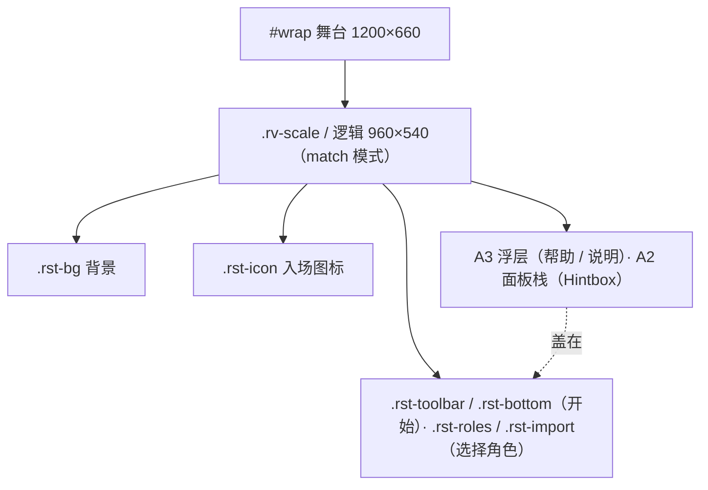
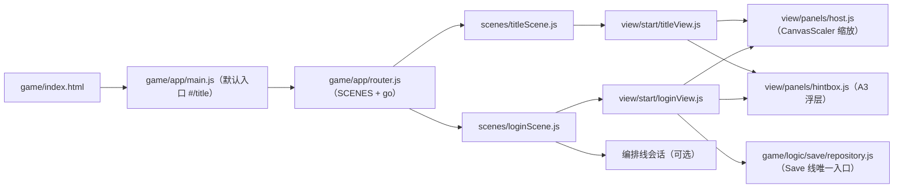

# View 子设计 · 开始场景 / 选择角色场景（view-scene-start-design.md）

> **子文档 of** `docs/view/view-design.md`（§8 子文档地图 **B5**，2026-10-18 **归位**到 `docs/view/scene/start/`）。
> **本文只定**：开始场景（上游 `Title`）与选择角色场景（上游 `Login`）**在我们 View 层的画面、DOM、类名、接线、依赖方向**。
> **不含**：舞台/缩放/加载层（→ A1 `docs/view/mech/view-shell.md`）· 面板模态栈（→ A2 `docs/view/mech/view-panel-stack.md`）· 浮层原语（→ A3 `docs/view/mech/view-overlays.md`）· 会话/场景切换宿主（→ 编排线 `docs/orchestration/orchestration-design.md`）· 存档槽模型（→ Save 线 `docs/save/save-design.md`）· 上游实现的逐行真值（→ 分析报告 `docs/view/scene/start/restart-start-scene.md`）。
> **证据标注**：【样本】/【源码】/【推断】。上游脚本路径相对 `projects/Seer2-Restart-Lite-main/Assets/Scripts/`；**素材全路径**相对仓库根。
> **编号**（`docs/arch-docs.md §7` 口径）：本份**局部**编号 = **STI1–STIn**（不变量）/ **STQ1–STQn**（待拍板）/ **STB-a…f**（施工批）。**上游怪癖**引用**分析报告**的 **A\<n\>**（=`docs/view/scene/start/restart-start-scene.md §5`，**不重复登记**）。圆圈数字 ①–⑧ 只指人类决议。
> **状态**：**2026-10-18 成文（待人类评审）**；**STQ1–STQ8 已于 2026-10-18 全部拍板**（§8.1 = 决议表）；**STB-a/b/c/d/e 已于 2026-10-18 落码，等人类手测**（实况与偏差见 `docs/view/scene/start/view-scene-start-impl.md §9`；**STB-f** 未落）。
> 设计期视觉目标 = 人类实测版面正本 `docs/view/scene/start/start-scene-desc.md`（**非我们撰写，保持原样**）。

---

## 1. 范围与边界

| 属本文 | 不属本文 |
|---|---|
| 开始场景的画面与 DOM（背景 / 底部 HUD / 版本 / 开始钮） | 参考分辨率、缩放、`fixed`/`match`（→ A1） |
| 选择角色场景的画面与 DOM（标题 / 3 角色格 / 导入钮 / 建号） | 面板栈与 `Hintbox` 机制（→ A2） |
| 两场景**读什么数**（版本 / 存档槽）与**点下去跳哪** | 会话单例、启动顺序（→ 编排线） |
| 两场景的**入场动效 / 悬停反馈** | 3 槽存档的**格式与读写**（→ Save 线） |
| 帮助浮层的内容 | 浮层盒体几何（→ A3） |

**边界支点**：
- **场景拆分**：上游是**两个场景**（`SceneId.Title=0` / `SceneId.Login=1`）⇒ 本份覆盖**两屏**（见 STQ1 决定 hash 拆法）。
- **范围来源**：本份属**人类 2026-10-18 拍板"开始 / 选择角色纳入范围"**（`docs/architecture.md §1.1` 已把 `Title`/`Login` 从 A 组出局移入 C 组，并注明"2026-10-18 修订"）。
- **不碰**：`game/core/**`（零 import）、`game/logic/**`（只经 Save 线接口）、AS3/Ruffle 线（`game/maprunner/**`）。

---

## 2. 上游真值（摘要 · 全份见分析报告）

> 逐行真值 = `docs/view/scene/start/restart-start-scene.md`（本文只留"设计要用的那几句"）。

- **开始场景** = `TitleManager`（844 行，`Manager<T>`，**不跨场景**）+ 场景资产（背景图 / Mod mp4 / 版本文本 / `Start Toolbar`{Resource,Mod,Help} / `Start Button`）+ 两段入场动画（Game Icon 擦出、Toolbar 上浮淡入）+ 悬停反馈（`StartButton`、`TitleToolbarButtonHoverFeedback`）【源码】`Scene Specific/Title/**`、`Assets/Scenes/Title.unity`。
- **选择角色场景** = `LoginManager`（68 行）+ `LoginController`/`LoginRoleController`/**3 角色格**（`id=0/1/2`）+ `CreateRoleController`（昵称+性别）+ `ImportRoleController`（`.xml` 导入覆盖）【源码】`Scene Specific/Login/LoginManager.cs`、`MVC/{Controller,Model,View}/Player/**`、`Assets/Scenes/Login.unity`。
- **数据侧**：版本档 = `Resources/Data/System/version.xml`（离线，`lite_4.9.2`）；存档 = `save{id}.xml` **3 槽**、`GameData.IsEmpty()=昵称空`、新档 `initMapId=71`【源码】`System/Data/{VersionData,GameData}.cs`、`System/SaveSystem.cs:15,77-91`。
- **流程**：开始钮 → `CheckVersion()` → `SceneId.Login`；选格 → 非空则 `Player.gameData=档` + `GameState.Login` + `SceneId.Map`；空档 → 建号 UI；导入 → 覆盖槽 + 提示重启【源码】`TitleManager.cs:505-510`、`LoginManager.cs:33-54`。
- ⚠️ **上游怪癖 A1–A22**（死引用/白送禁用/编造版本大小/文件对话框空取消/同钮双接/入场竞态/`debugMode` 白送…）**不重复**，见分析报告 §5。

---

## 3. 我们的 DOM 与类名契约

**舞台**：沿用 A1 —— 舞台 `#wrap` **1200×660**，逻辑坐标 **960×540**（`CanvasScaler` 口径）。两屏都是"满屏 UI（背景铺满）"⇒ **画布模式取 `match`**（上下不裁），同战斗版式口径【推断：`Title/Login.unity` 的最外层都是全屏 Image】。类名前缀 **`rst-*`**（restart start，与 `rbb-*` 战斗 / `rbh-*` 地图 HUD 同族）。

### 3.1 开始场景（`rst-title`）

```
#rst-title  (960×540 逻辑层)
├─ .rst-bg           背景图（FirstPage.jpg；或 Mod 首屏 mp4 的 <video>）
├─ .rst-icon         开始图标（入场：横向擦出 + scale 0.08→1）  ← 上游 "Game Icon"
└─ .rst-bottom       底部 HUD（**人类 desc 口径**：左版本 / 中开始 / 右三钮）
    ├─ .rst-version   左：版本日期 + 版本序号（.rst-version-date / .rst-version-string）
    ├─ .rst-startbtn  中：开始游戏（StartButton.png / StartButtonOutline.png）
    └─ .rst-toolbar   右：Start Toolbar（入场：上浮 −36px + alpha 0→1）
        └─ .rst-tool[data-tool=resource|mod|help]   三钮（悬停 ×1.06 + 上浮 4px）
```

> ⚠️ **版式以人类 desc 为准**（`docs/view/scene/start/start-scene-desc.md` 第 2 条：**底部一个 HUD，左版本 / 右三钮 / 中开始**）。
> 上游场景里的 `Start Toolbar` 是**独立对象**，但它落在底部右侧 —— 我方按 desc **结构化成同一个 `.rst-bottom` 的三个子区**，不另立浮动的工具条层。

- **铁律·不伪造**：`.rst-tool[data-tool=resource|mod]` 无浏览器后端（上游 = 原生文件对话框 + 网络下载，怪癖 A6–A8/A17）⇒ **灰化 + 点击走 A3 说明浮层**，**绝不画假资源/Mod 子面板**（STQ3）。
- `.rst-tool[data-tool=help]` 有内容 ⇒ 可做（弹一段帮助文案，走 A3 浮层）。

### 3.2 选择角色场景（`rst-login`）

```
#rst-login  (960×540 逻辑层)
├─ .rst-login-bg         Login Background.png + .rst-login-noise + .rst-login-stripe（可选装饰）
├─ .rst-login-title      顶部居中："选择角色"（Choose Role.png / 文本）
├─ .rst-roles            中间 3 格
│   └─ .rst-role[data-slot=0|1|2][data-empty=true|false]
│       ├─ .rst-role-name   昵称（空槽显示"—"）
│       ├─ .rst-role-gender 性别图标（男/女）
│       └─ .rst-role-cover  "覆盖"角标（仅 is-importing 时可见）
├─ .rst-import           Other User Login.png：底部"导入其他存档"（导入态文案改"选择要覆盖的存档"）
└─ .rst-create           建号面板（昵称输入 + 性别 Male/Female + 确认/取消）  ← 默认隐藏
```

- **空档**（`hasData=false`）⇒ 格上显"空"，点击开 `.rst-create`（STQ7 已拍：**建号要做**，§4.3）。
- **满档** ⇒ 点击 = 先置选中态 `.rst-role.is-chosen`（人类 desc 的"选中该角色"），**随即以该档进入游戏**（上游是同一次点击就 `Login(id)` ⇒ 视觉上的"选中"只是进入前的一瞬）。
- **导入**（STQ3 已拍：**真要能导入**）⇒ 两段式交互：先点 `.rst-import` 进导入态，再点某格选文件覆盖该槽（§4.2）；**不照抄**上游 `Application.Quit`。

---

## 4. 数据接线（**零算数**）

> **面板零算数**（沿 `ui-handoff.md §6`）：view 只做**取数 + 拼接 + 显隐**，不自己算版本比较/槽位。

| 读什么 | 来源（唯一权威） | 缺时行为 |
|---|---|---|
| 版本日期 / 版本序号 | **本轮不做**（STQ5 已拍"暂不处理"；将来 = L2 内容桥读 `projects/Seer2-Restart-Lite-main/Assets/Resources/Data/System/version.xml` 的 `releaseDate`/`gameVersion`） | **恒占位** `----/--/--` / `----` + `data-version-missing`（**不编造**数字） |
| 3 个角色格 | **Save 线** `repository.load(storage,{gid:0..2})` 的投影（§4.1；档 = `saves/save{id}.xml`） | "空" = **昵称空**（自动造的默认档就是这个样子，**不是**故障） |
| "开始游戏" | 无数据 | — |
| 会话建立（选档后） | **编排线** 会话单例（上游 `Player.instance`） | — |

- **写侧**（建号 / 导入覆盖）**一律调接口**（决议 ③）：落盘/序列化归 Save 线，view 不碰 `localStorage`。
- **切换**：`#/title` --开始--> `#/login` --选档--> 建会话 + `#/map`（经 `router.go`，`game/app/router.js:32`）。
- ⚠️ **不引** `game/core/**`；**不引** `game/logic/**` 的内部（只经 Save 线暴露的接口）。

### 4.1 槽位契约（**Save 线早已定；本份只调**）

> ⚠️ **存档格式不是本份能选的事**：Save 线 **S-决策 1**（`docs/save/save-impl.md:5`）= **XML 真档取代 v3 JSON**，落点 `saves/save{id}.xml`（`{id}=0..2`，文件名与上游一致 ⇒ **可与真游戏互换**，见 `docs/save/save-impl.md §6`）。
> **3 槽也早已存在**：上游 `SaveSystem.MAX_SAVE_COUNT=3` ⇒ Save 线的 `gid = 0..2`（`docs/save/save-code-map.md §4`）。
> **app 唯一入口 = `game/logic/save/repository.js`**（`docs/save/save-code-map.md §2.5`）。**本份不建第二套存档 API**。

| 本份要做的 | 用 Save 线哪个调用 | 说明 |
|---|---|---|
| 画 3 格（昵称 / 性别 / 空档） | `repository.load(storage, { gid: 0..2 })` ×3，取投影 | **忠实上游 `LoginManager`**：它也是循环 `LoadData(0..2)`；缺档由 `load` **照上游自动造默认档**（`save-code-map §2.5` 行为契约 2） |
| **空档判据** | `GameData.IsEmpty()` = **昵称空**（`docs/save/save-design.md`） | ⚠️ **"空"不是"文件不存在"** —— 自动造出的默认档昵称就是空 ⇒ 上来 3 格**都是"空"**，这正是上游现象 |
| 建号 | `load(gid)` → 置 `nickname` / `gender` → `save(storage, gid, g)` | **不调 `newGame`**（那会重置初始宠/币；档已由 `load` 造好） |
| 选档进图 | `load(storage, { gid })` → 交会话（§6.4） | — |
| 导入 | `importXML(storage, gid, xml)` → `{ ok, errors, data? }` | **XML**，字节级保真（`save-impl §3`） |
| 导出 | `exportXML(g)` → string → `<a download="save{gid}.xml">` | 导出的档**真游戏能直接读** |

⚠️ **旧 v3 单档（`rocoshowdown.restart.v3`）**：**人类 2026-10-18 已决 = 照 Save 线 S-决策 1 原样丢弃，不做迁移**（`docs/save/save-impl.md §1`：v3 直接退役）。
本份**据此不写任何迁移代码**；我此前写的"并入 slot 0"**作废且不再复议**。

⚠️ **两处批 C 接线细节**（Save 线批 B 已落码后订正，真值 = `docs/save/save-impl.md §9.4 (4) ②④`）：
① 画 3 格用的 `load(storage,{gid})` **不会写盘**（形状正常的档一个字节都不改）——槽位预览是**只读**的；
② **"选档进图"那一次要传 `login: true`**（`load(storage, { gid, login: true })`）= 上游 `GameManager.GameLogin` 的登录收尾
（版本迁移 + `petBag` resize + 跨天 + 刷 `lastLoginDate`）；
③ "空档判据"与"3 槽"**从 `repository.js` 取**（`isEmpty` / `MAX_SAVE_COUNT` 已由 Save 线再导出）——本份**不自己拼** `nickname === ''`、**不硬写 3**。

### 4.2 导入存档（**STQ3 + STQ8 = XML**）

上游流程 = `ImportRole()` 先翻 `isImporting`（那句文字变"选择要覆盖的存档"）→ 再点某格 `Cover(id)` → 选文件 → 覆盖该槽 → 提示重启（怪癖 A19/A18）。
我方照**同一交互**，文件格式**就是上游那个**（`save{id}.xml`）：

1. 点 `.rst-import` ⇒ 视图进 `is-importing` 态（`.rst-import` 文案变"选择要覆盖的存档"，格子上浮出"覆盖"角标）；
2. 点某格 ⇒ 触发隐藏 `<input type="file" accept=".xml,text/xml">`；
3. `FileReader.readAsText` → `repository.importXML(storage, gid, xml)`：
   - `ok` ⇒ 弹 A3 "导入成功"（**不**照抄上游 `Application.Quit`；浏览器没有"退出"，改为**重载该格**）；
   - `!ok` ⇒ A3 列出 `errors`（**不静默**）；
4. ⚠️ **解析/校验在 Save 线（`codec.parse` + `schema.validate`）**，view 只读文件与转发 —— 这正是 `importXML` 的 `{ ok, errors }` 契约。

### 4.3 建号（**STQ7**）

点空档 ⇒ 开 `.rst-create`（昵称输入 + 男/女）⇒ 确认：

- 昵称空 ⇒ 就地提示（上游 `OnSetPlayerNameEmpty()`），**不关面板**；
- 否则 `load(gid)` 取该槽（自动造的）默认档 → 写 `nickname` / `gender` → `repository.save(storage, gid, g)` ⇒ 该格刷新为**有号** ⇒ **随即进入该角色**（上游 `CreateRole()` 成功后立刻 `Login(id)`）。

---

## 5. 资产权威（重启血统）

| 件 | 重启源（URL 根 = `/projects/Seer2-Restart-Lite-main/Assets/StaticResources/Sprites/Title/`） |
|---|---|
| 开始底图 | `FirstPage.jpg`（1202×663） |
| 开始图标 | `Seer2 New Icon.png` / `1100.png`（2400×1320，可作首屏大图） |
| 开始钮 | `StartButton.png` / `StartButtonOutline.png`（含 `StartButtonNew.png`） |
| 工具条 | `StartToolbar.png` |
| 选择角色底 | `Login Background.png`(1201×661) + `Login Background Noise.png` + `Login Background Stripe.png` + `login background black.png` |
| 选择角色标题 | `Choose Role.png`(431×609) |
| 导入钮 | `Other User Login.png`(357×79) |
| 建号 | `Nickname Field.png` + `Male.png`/`Female.png`（+ `男.png`/`女.png`） |
| 首屏 BGM | `BGM_1100.mp3`（编排线音频缝；**先做缝不做内容**，ORQ2） |

- 口径同 B1/B4：**优先重启 `StaticResources/Sprites/**`（PNG 直 ``）**；缺件 → 原版 SWF（Ruffle 演出层）或诚实兜底 + `data-asset-missing="…"`，**绝不静默换图**。
- 版本档：`projects/Seer2-Restart-Lite-main/Assets/Resources/Data/System/version.xml`（**数据**，非素材）。

---

## 6. 依赖方向

```
titleScene.js  ──►  titleView.js  ──►  (L2 content: 版本)     
loginScene.js  ──►  loginView.js  ──►  (Save 线: 槽) ──► (编排线: 会话)
      │                                                  │
      └────────────► router.go（场景切换）◄──────────────┘
```
- **单向向下**：场景（L4）→ 视图（L3）→ 桥/接口（L2/Save/编排）。**view 不 import core/logic**。
- 场景宿主（`router.js` / `main.js`）只负责"挂/摘"，不含规则。

---

## 7. 两张图

**层栈图**（两屏同构；沿 A1 `view-shell.md`）：



**文件 ↔ 接口图**：



---

## 8. 缺口 / 待核 / 待拍板

### 8.1 决议表（**STQ1–STQ8 · 人类 2026-10-18 全部拍板**）

| # | 问题 | **结论（已决）** | 落地影响 |
|---|---|---|---|
| **STQ1** | 两屏是**两个 hash 场景**还是**一个 `#/start` 内两视图**？ | ✅ **两个 hash 场景**（`#/title` + `#/login`，忠实上游两个 `SceneId`） | `router.js` 加 `title` / `login`；两场景各自 `mount/unmount` |
| **STQ2** | 3 个角色格 ↔ 我方**单档**（`SAVE_KEY_V3`）怎么落？ | ✅ **要真正的多存档 + 建号**（人类原话："支持创建新角色、支持多个存档"） | **3 槽 Save 线早已定了**（`gid 0..2` / `saves/save{id}.xml`，`docs/save/save-code-map.md §4`）⇒ 本份**不新建 API**，只调 `repository.js`（§4.1） |
| **STQ3** | 资源包 / Mod / 导入存档三条文件流程 | ✅ **资源包 / Mod 灰化 + A3 说明**；**导入存档真做**，走 `<input type=file>` | `.rst-tool[data-tool=resource|mod]` 灰化；`.rst-import` → 点格 → 选文件 → `importXML` 覆盖该槽（§4.2） |
| **STQ4** | 默认入口是否改为 `#/title`？ | ✅ **改为 `#/title`** | `main.js` 无 hash 时落 `#/title`；`#/map` 直进保留为开发捷径 |
| **STQ5** | 版本档数据源怎么进 L2 桥？ | ✅ **本轮暂不处理**（不建 L2 版本出口） | 版本两行显**占位** `----/--/--` / `----`（不编造数字；打 `data-version-missing`） |
| **STQ6** | 开始底图取哪张？ | ✅ **优先 `FirstPage.jpg`** | `.rst-bg` 用 `FirstPage.jpg`；不做 Mod mp4 |
| **STQ7** | **建号 UI**（昵称 + 性别）做不做？ | ✅ **要做**（人类原话："建号功能要做"） | 空档点击开建号 UI；确认后**写该槽**并直接进入（§4.3） |
| **STQ8** | **导入存档的文件格式**（STQ3 的必然下游） | ✅ **XML（= 上游 `save{id}.xml` / 我方存档同格式）** | `<input accept=".xml,text/xml">` → `repository.importXML`（`{ok, errors}`）；**不需要任何格式映射**，导出的档真游戏能直接读 |

> ⚠️ **本条我先写错过，此处留档**：我最初按"我方存档 = JSON（`SAVE_KEY_V3`）"把 STQ8 定成"导入我方 JSON、不解析 `.xml`"，**与 Save 线 S-决策 1（XML 真档取代 v3 JSON）冲突**（人类 2026-10-18 指出）。
> **正确事实**：存档格式 = **XML**（`docs/save/save-impl.md:5`、落点 `saves/save{id}.xml`），`importXML/exportXML` 的契约就在 `docs/save/save-code-map.md §2.5`；`restartSession.js` 的 v3 JSON **退役且不迁移**（`save-impl.md §1`）。
> ⇒ 因此 **§4.2 的 `.json` 一律改 `.xml`**，**§8.3 回执 ③（"要 Save 线做 XML→JSON 映射"）作废**。

### 8.2 等人手测确认项（**决议 ⑦**：不许记成死账）

1. **开始钮**：点"开始游戏"应**必进选择角色**（我方不复制上游"版本不符就禁用"，怪癖 A2/A3）。
2. **入场时序**（上游 A10/A16 有竞态）：背景 → 图标擦出 → 工具条上浮，**顺序对、不闪、图标不被遮**。
3. **悬停反馈**：三钮与开始钮的**放大 ×1.06 + 上浮**可感、离开复位。
4. **空档建号**：3 格初始全空 ⇒ 点任一格开建号 ⇒ 昵称留空应被挡 ⇒ 填昵称 + 选性别 ⇒ **直接进游戏** ⇒ 回选择角色，该格显示昵称与性别。
5. **多档并存**：在槽 1 建号后，槽 1 有档、槽 2/3 仍空；**各自进入互不串档**（槽 1 的宠/道具不带进槽 2）。
6. **导入存档**：点"导入其他存档" ⇒ 文案变"选择要覆盖的存档" ⇒ 点某格选 `save{id}.xml`（**上游真档也应能直接吃**）⇒ 覆盖成功、该格变成导入内容；选一个乱文件 ⇒ 有**明确说明**、**不损坏原档**。
7. **导入→导出互通**：把某格导出的 `save{id}.xml` 再导回另一格 ⇒ 内容一致（字节级保真的**可感**版）。
8. **资源包 / Mod**：两颗钮**灰化**，点了有说明、**不出假面板**。
9. **默认入口**：直接开游戏落在**开始场景**；`#/map` 直进仍可用。

### 8.3 跨线回执（本份**要求**别线出的东西）

| # | 收件线 | 要什么 | 阻塞谁 |
|---|---|---|---|
| ① | **Save 线**（L1 `game/logic/save/**`） | **`repository.js` 落码**（`load`/`save`/`importXML`/`exportXML`，`gid 0..2`） | STB-d 的选档 / 建号 / 导入 / 进图（**当前 `game/logic/save/` 目录尚不存在**） |
| ①′ | **Save 线** | **`storage` 适配器的注入点**（谁建 `fsStorage`/`localStorageAdapter`）⇒ ✅ **已决（人类 2026-10-18）：归编排线装配点**（`docs/orchestration/orchestration-design.md §6`）；B5 **不自建 storage**、只接注入 | STB-d 的 `repo.load(storage, …)` 形参从哪来 |
| ② | **Save 线** | v3 `restartSession.js` 退役 ⇒ ✅ **已决（人类 2026-10-18）：照 S-决策 1 原样丢弃、不迁移**（唯一遗留 = "何时删文件"，不阻塞 B5） | — |
| ③ | ~~Save 线~~ | ~~`saveN.xml` → 我方快照的映射~~ ⇒ **作废**：我方存档**就是** `save{id}.xml`（同格式），`importXML/exportXML` 直接可用 | — |
| ④ | **编排线** | **会话单例**（上游 `Player.instance`：`gameDataId` / `currentMapId`），选档后把"哪一槽 + 该槽状态"交给它 | 选档 → `#/map` 的"带谁的档进图" |

---

## 9. 不变量（**STI1–STI11**） · 上游怪癖索引 · 施工批（**STB-a…f**）

### 9.1 不变量（破了即 bug）

| # | 不变量 |
|---|---|
| **STI1** | 舞台口径沿 A1（1200×660 / 逻辑 960×540），两屏画布模式 = **`match`**（不裁）。 |
| **STI2** | **不伪造内容**：**资源包 / Mod**（无浏览器后端）**灰化 + 说明**，不画假面板、不静默换图；**导入存档是真功能**（XML 文件 + Save 线校验），失败必给说明。 |
| **STI3** | **零算数**：view 只取数/拼接/显隐，不自己算版本比较、槽位、随机。 |
| **STI4** | **两套血统不合并**：start 场景只用**重启血统**素材与数据（不引 AS3/Ruffle 线）。 |
| **STI5** | **会话与场景分离**：选档只**建立会话**（编排线），场景切换只走 `router.go`。 |
| **STI6** | **不碰 `game/core/**` 与 `game/logic/**` 内部**（写盘经 Save 线接口，决议 ③）。 |
| **STI7** | **落盘/序列化归 Save 线**：view 不直接写 `localStorage`；**view 不解析 XML**（`importXML`/`exportXML` 是唯一出入口）。 |
| **STI8** | **默认入口 = `#/title`**（STQ4 已决）；`#/map` 直进保留为开发捷径。 |
| **STI9** | **入场动效忠实但不复现上游竞态**（A10/A16）：背景先到位，图标/工具条后演；动效不遮图标。 |
| **STI10** | **弹窗一律走 A3/Hintbox**（复用 `game/app/view/panels/hintbox.js`），不自造对话框。 |
| **STI11** | **"空档"的判据 = 昵称空**（上游 `GameData.IsEmpty()`），**不是"文件不存在"**：`load` 缺档**照上游自动造默认档**（`save-code-map §2.5`），故 3 格上来皆"空"是**正常现象**；view **不自己造档**，写档只走 `repository.save`。 |

### 9.2 上游怪癖索引（**引用分析报告，不重复**）

`docs/view/scene/start/restart-start-scene.md §5` 的 **A1–A22** 是本份的"上游事实底座"。**设计相关**的几条：`A2/A3`（开始钮禁用）、`A6–A8/A17/A18`（文件流程与空取消）、`A10/A16`（入场竞态）、`A22`（`debugMode` 白送，牵 Save 线）。**目标行为**按决议 ②（"声明 + 不照搬"）在 §8/§9.1 写清。

### 9.3 施工批（**STQ 全决后重排**）

| 批 | 内容 | 依赖 |
|---|---|---|
| **STB-a** | 骨架：`router.js` 加两场景、`main.js` 默认入口、两空场景壳 | ✅ **已落 2026-10-18** |
| **STB-b** | 开始场景视觉：背景 + 图标 + 底部 HUD（左版本占位 / 中开始 / 右三钮）+ 悬停/入场 | ✅ **已落 2026-10-18** |
| **STB-c** | 选择角色视觉：标题 + 3 格 + 导入钮 + **建号面板**（STQ7） | ✅ **已落 2026-10-18**（3 格恒空档 = 未接存档） |
| **STB-d** | **槽位接线**（§4.1：`repository.load/save` 投影 + 建号写档）+ 选档建会话 → `#/map` | ✅ **已落 2026-10-18**（接线**落在场景壳** `loginScene.js`，不是 view —— L3 纪律，见 impl §9.2 偏差 10） |
| **STB-e** | 导入存档真做（`<input type=file accept=.xml>` + `importXML` + 失败说明，§4.2） | ✅ **已落 2026-10-18**（失败列出 `errors`、不写盘） |
| **STB-f** | 资源包 / Mod 灰化 + A3 说明；帮助浮层 | STB-b |

---

## 10. 配对 impl 指针

- **`docs/view/scene/start/view-scene-start-impl.md`**（本份的下游 · 已写）：变更文件清单、逐文件施工图、`as-built` 收尾。
- 上游分析报告：`docs/view/scene/start/restart-start-scene.md`。
- 父文档 `view-design.md §8` 的 **B5 行**已指向本份（2026-10-18 归位）。
