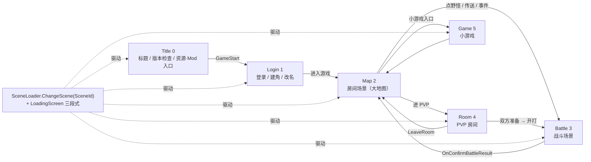
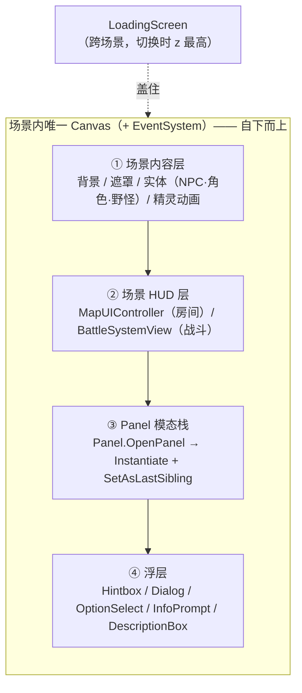
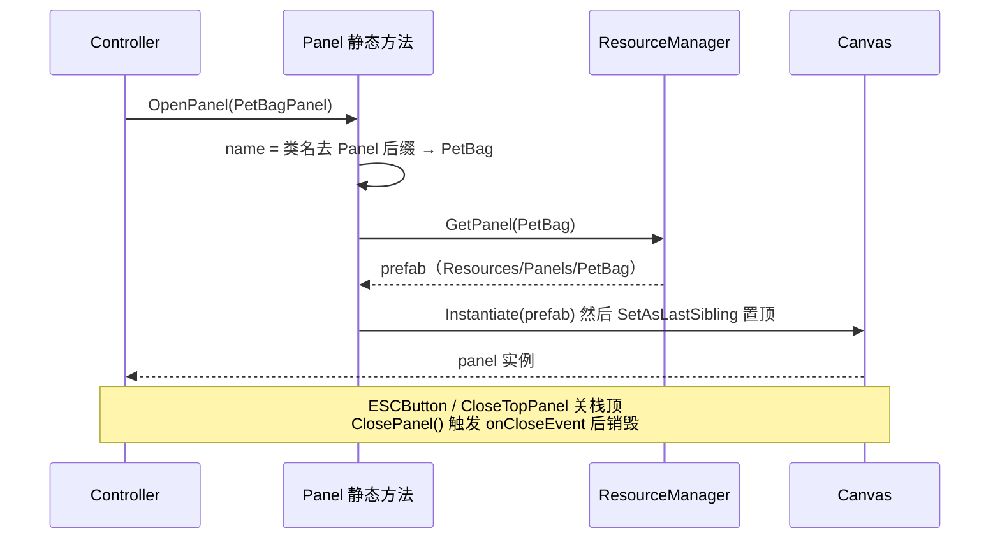
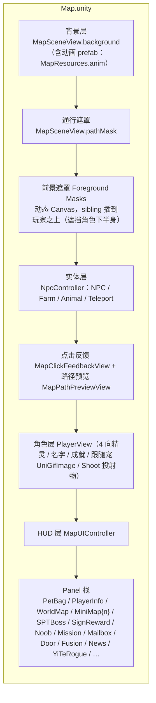
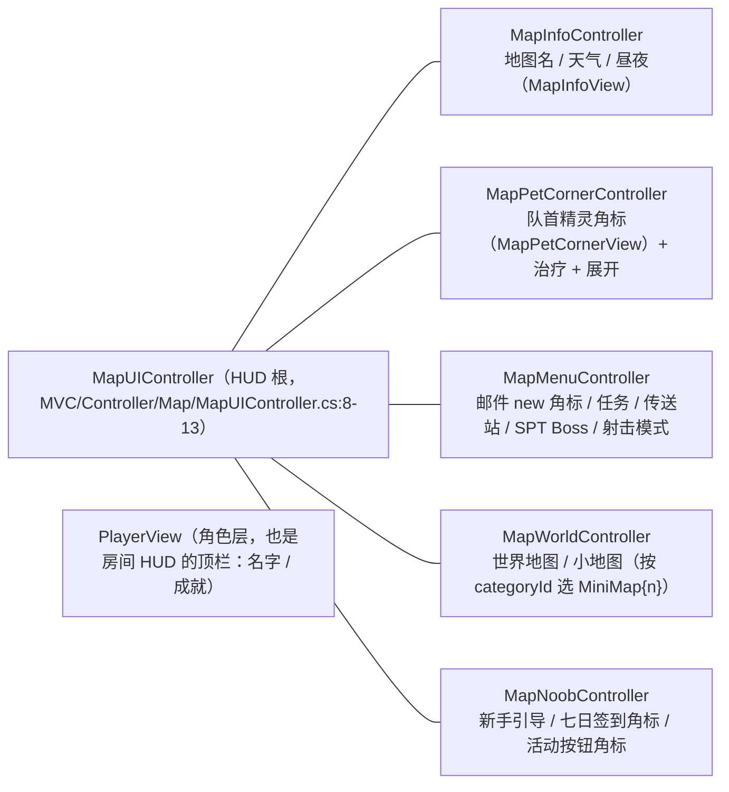
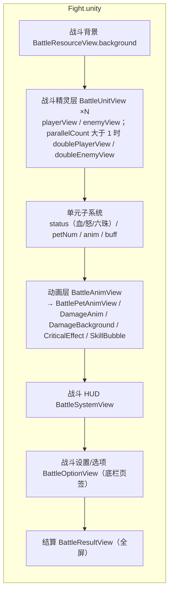
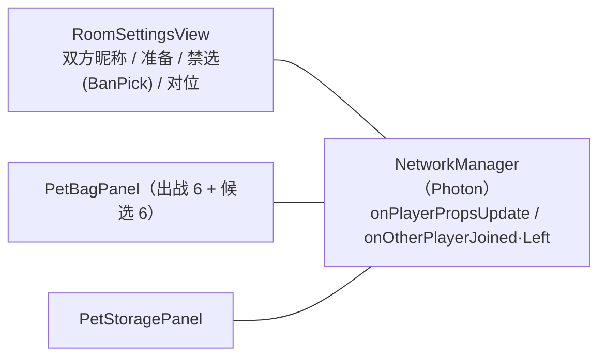

# 重启 View 总设计（view-design.md）

> **定位**：本文是**表现层（View）的总设计** —— 上游 Unity 的 `scene / prefab / Canvas` 层级，
> 如何整体映射到我们要**手写 DOM** 的表现层。本文给**总图与层栈**，不重复逐区像素。
>
> **与逐区文档的关系**（父文档只链接不重复）：
> - 房间（大地图）HUD 逐区规格 → **`docs/view/scene/room/view-scene-hud-design.md`**（+ `scene/room/view-scene-hud-impl.md`）
> - 战斗场景逐区规格 → **`docs/view/scene/battle/view-scene-battle-design.md`**（+ `scene/battle/view-scene-battle-impl.md`）
> - 分层/依赖方向 → **`docs/architecture.md §2`**、**`docs/arch-code.md §3`**
>
> **证据标注**：【源码】= 上游 `.cs`（标 `路径:行/函数`）；【样本】= 真档/截图；【推断】= 未证实。
> 路径均相对 `projects/Seer2-Restart-Lite-main/Assets/`。

---

## 0. 这份文档回答什么

1. 上游 View 的**真机制**是什么（不是"有哪些界面"，而是"界面怎么装上去的"）。
2. 有**几个场景**、场景之间怎么走。
3. 每个场景的**层栈**（背景 / 实体 / 角标 / HUD / Panel）分别是谁。
4. 跨场景的**模态/浮层体系**（Panel 栈、Hintbox、Dialog、OptionSelect、Loading、Story）。
5. 上游的这套结构**落到我们仓库哪里**、**还缺什么**。

---

## 1. 上游 View 的真机制（真值）

### 1.0 血统原则（已拍板，最高优先级）

View 的每一层先问一句：**它的视觉依赖 SWF 素材吗？**

| 依赖 SWF 素材（图 / 动画） | 不依赖（纯 DOM 能画） |
|---|---|
| → **原版 AS3**（`maprunner.swf` 等，Ruffle 承载） | → **重启设定**，手写 **DOM** |

- 例：房间背景 / NPC / 角色 / 野怪 → AS3；Room HUD / 角标 / Panel / 点击反馈 / 寻路预览 → DOM。
- 详表与判据 → **`scene/room/view-scene-map-content.md §3`**。
- 舞台与坐标口径（**舞台 = 1200×660 = 原版 SWF 尺寸**；Unity `960×540` 只是设计坐标）→ **`mech/view-shell.md §3.2/§3.4`**。

### 1.1 单 `Canvas` + Panel 模态栈 —— 最核心的一条

上游**没有**"每个界面一个场景"，而是：

- 每个 `.unity` 场景里各有一个名为 `Canvas` 的 `GameObject`（+ `EventSystem`）。
- **Panel 是 prefab**，用时 `Instantiate` 挂到 `Canvas` 下，并 `SetAsLastSibling()` 置顶 —— 这就是**模态栈**。
- 关闭 = 销毁栈顶那个 `Panel`。

【源码】`Scripts/MVC/View/Basic/Panel.cs`
```csharp
// OpenPanel<T>()：名字 = 类名去 "Panel" 后缀
string name = typeof(T).Name.TrimEnd("Panel");     // PetBagPanel → "PetBag"
GameObject canvas = GameObject.Find("Canvas");
GameObject prefab = ResourceManager.instance.GetPanel(name);
GameObject obj = Instantiate(prefab, canvas.transform);
obj.transform.SetAsLastSibling();                  // 置顶 = 入栈
T panel = obj.GetComponentInChildren<T>();
```
【源码】`Scripts/MVC/View/Basic/Panel.cs:95-115`
```csharp
static void CloseTopPanel()      // 关栈顶：遍历 Canvas 子物体，取最后一个含 Panel 的
public virtual void ClosePanel() // onCloseEvent?.Invoke(); Destroy(background); Destroy(gameObject);
```
- `SetPanelIdentifier(id, param)`（`Panel.cs:123`）让同一个 Panel 复用到不同内容（如 `WorldMapPanel` 的 `world`、`MiniMap{categoryId}`）。
- "`null` / `none`" 当面板名 → 等价于"关栈顶"（`Panel.cs:30-34`）。

> **对我们的意义**：模态栈是一个**机制**，不是一个界面。我们的 DOM 版需要一个统一的
> `panelHost`（一个容器 + 栈数组 + ESC/遮罩关闭），而不是每弹窗各自 `innerHTML`。

### 1.2 View 类族（继承链）

```
IMonoBehaviour
 ├── Module                    ── OpenPanel(name) / GoToMap(mapId)          【Module.cs:7-10】
 │    ├── UIModule             ── + infoPrompt / descriptionBox（悬浮说明）  【UIModule.cs:5】
 │    │    └── Panel           ── + background / ESCButton / onCloseEvent    【Panel.cs:7】
 │    ├── MapSceneView         ── 房间场景"内容层"                            【MapSceneView.cs:9】
 │    ├── MapUIController      ── 房间"HUD 层"根                             【MapUIController.cs:8】
 │    └── BattleBaseView       ── 战斗各 View 的共同基（+ 说明框）           【BattleBaseView.cs:5】
 │         ├── BattleSystemView / BattleUnitView / BattleOptionView / …
 └── LoadingScreen            ── 加载层（+ 进度/文字）                      【LoadingScreen.cs:8】
```
- 注意 **`Module` / `UIModule` / `Panel` 是 `MonoBehaviour` 子类**，但名称是"模块/UI 模块"，**不是 MVC 的"View 层"三件套**。
  真正的分层是目录：`Scripts/MVC/View/**`（View）+ `Scripts/MVC/Controller/**`（Controller）+ `Scripts/MVC/Model/**`（Model）。
- Panel 遵循 **View / Controller / Model 三件套**：如 `MVC/View/Panel/PetBagView.cs` + `MVC/Controller/Panel/PetBagController.cs` + `MVC/Model/Panel/PetBagModel.cs`。

### 1.3 场景与加载

- 六个场景，由 `SceneLoader.ChangeScene(SceneId)` 驱动。【源码】`Scripts/System/SceneLoader.cs:29`
- `SceneLoader` 持有 `defaultLoadingScreen / transparentLoadingScreen / loadingScreens[4]`，按 `sceneId` 取加载屏；
  切换时 `ShowLoadingScreen` 把 `canvas` 打在最上层，`OnBeforeLoading → OnLoading → OnAfterLoading` 三段式。【源码】`SceneLoader.cs:13-50`、`Scripts/Scene Specific/Loading/LoadingScreen.cs:15-35`

### 1.4 Panel 的物理落点（权威清单来源）

Panel 的 prefab 在 **`Assets/Resources/Panels/<Name>/`**，脚本在同目录 `Scripts/<Name>Panel.cs`。
`<Name>` 即 `OpenPanel` 的名字（类名去 `Panel` 后缀）。所以 **Panel 全量清单 = `Assets/Resources/Panels/` 的目录名**（见 §6）。

---

## 2. 六个场景（SceneId）

| SceneId | 值 | 场景文件 | 场景管理器（`Manager<T>`） | 作用 |
|---|---|---|---|---|
| `Title` | 0 | `Assets/Scenes/Title.unity` | `TitleManager` | 标题/版本检查/资源与 Mod 导入入口 |
| `Login` | 1 | `Assets/Scenes/Login.unity` | `LoginManager` | 登录/建角/改名 |
| `Map` | 2 | `Assets/Scenes/Map.unity` | `MapManager` | **房间场景（大地图）** |
| `Battle` | 3 | `Assets/Scenes/Fight.unity` | `BattleManager` | **战斗场景** |
| `Room` | 4 | `Assets/Scenes/Room.unity` | `RoomManager` | PVP 房间（联机） |
| `Game` | 5 | `Assets/Scenes/Game.unity` | `MiniGameManager` | 小游戏 |

【源码】`SceneLoader.cs:102-110`（enum）、各 `Scripts/Scene Specific/*/*Manager.cs`。

---

## 3. 总架构图（mermaid）

### 3.1 场景与导航



### 3.2 每个场景内的通用层栈（同一套 UI 机制）



### 3.3 Panel 模态栈机制（时序）



---

## 4. 场景层栈（逐场景）

### 4.1 `Map`（房间场景）—— 本文最重的一节

上游根管理器 `MapManager : Manager<MapManager>`，持 5 个 Controller。【源码】`Scripts/Scene Specific/Map/MapManager.cs:9-16`



**【角标】**（贴角/贴边的小构件，用户口中的"角标"）与 **HUD** 的分工：



- **场景内容层**由 `MapSceneController`（Model+View 桥）驱动：`SetMap(map)` 同时刷 `MapSceneModel` 与 `MapSceneView`。【源码】`Scripts/MVC/Controller/Map/MapSceneController.cs:5-13`
- **背景/遮罩**：`MapSceneView.SetResources` → `SetBackground / SetPathMask / SetForegroundMasks`；前景遮罩 `GetForegroundMaskSiblingIndex` 保证插在玩家之上。【源码】`Scripts/MVC/View/Map/MapSceneView.cs:36-60,141-158`
- **实体**：`SetEntites(map.entities)` 生成 `NpcController`（NPC/Farm/Animal/Teleport 分字典管理）。【源码】`MapSceneView.cs:22-25,46`
- **角色**：`PlayerView : UIModule`，含 4 向 Sprite（`GetPlayerDirectionSprite`）、名字/成就 Text、跟随宠 GIF（`UniGifImage`）、`Shoot` 投射物、`OpenPlayerInfoPanel`。【源码】`Scripts/MVC/View/Player/PlayerView.cs:9-16,22-39,185-253`
- **HUD 5 个 Controller**：见上 mermaid；每个 `.cs` 在 `Scripts/MVC/Controller/Map/Components/`。
- **Panel**：全部经 `Panel.OpenPanel<…>()`（如 `MapPetCornerController.OpenPetBagPanel` → `PetBagPanel`）【源码】`MapPetCornerController.cs:21-25`。

> 逐区像素规格（R1…R8）→ `docs/view/scene/room/view-scene-hud-design.md`。本文只定"层栈 + 归属"。
> **血统分工（已拍板）**：涉及 SWF 素材的层（房间背景 / NPC / 角色 / 野怪）用**原版 AS3**；
> 其余（HUD / 角标 / Panel / 点击反馈 / 寻路预览 / **传送点光口 + 出口名**）用**重启 DOM**。
> ⚠️ 传送点是这条判据的**例外**（其美术符号重启已导出成 PNG、其出口名是中文 ⇒ 只能 DOM），见 **`scene/room/view-scene-map-content.md §3`**（含 §2.4 真值）。

### 4.2 `Battle`（战斗场景）

根管理器 `BattleManager : Manager<BattleManager>`。【源码】`Scripts/Scene Specific/Battle/BattleManager.cs:10-22`



- **HUD（`BattleSystemView : BattleBaseView`）成员**：`timer`（仅 PVP 显示）+ `BattleResourceView`（血/怒/六珠）+ `BattleOptionView` + `BattleWeatherView` + `BattlePetBuffView(stateBuffView)` + `BattleAudioView` + `BattleResultView`；`normalFightOnlyObjects` / `doubleFightOnlyObjects` 切换单双打。【源码】`BattleSystemView.cs:10-22`
- **单元（`BattleUnitView`）成员**：`statusView` / `petNumView` / `animView` / `buffView`；`isDone = statusView.isDone && animView.isDone`。【源码】`BattleUnitView.cs:6-14`
- **战斗设置/选项（`BattleOptionView`）= 底栏页签簇**：`BattleOptionSelectView` + `BattlePetSkillView`（技能卡）+ `BattleCardHandView`（卡）+ `recordPanel/recordExtendButton`（战斗记录）+ `captureController`/`itemController`（捕捉/道具，`BattlePetItemController`）+ `changeView`/`opChangeView`（换宠）+ `escapeView`（逃跑 `Hintbox`）+ `autoView`（自动）。【源码】`Scripts/MVC/View/Battle/Components/System/BattleOptionView.cs:10-21`
- **页面互斥**：`BattleOptionView.Select` —— `.rbb-content` 内一次只有一个子块可见，由页签簇驱动。（见 `scene/battle/view-scene-battle-design.md §3`）

### 4.3 `Room`（PVP 房间）

`RoomManager : Manager<RoomManager>`，含 `RoomSettingsView` + `PetBagPanel` + `PetStoragePanel`。【源码】`Scripts/Scene Specific/Room/RoomManager.cs:11-13`


- 房间参数来自 Photon 房间属性：`count`（出战数）/`item`（禁道具）/`buff`/`bp`/`seed`。【源码】`RoomManager.cs:52-64`
- 玩家宠物从这里进战斗：`petBag.Take(petCount)` → `Pet.ToBestPet(...)`。【源码】`RoomManager.cs:65-97`

### 4.4 `Title` / `Login` / `Game`

| 场景 | 管理器 | 层栈要点 |
|---|---|---|
| `Title` | `TitleManager` | `VideoPlayer/RawImage`（首屏视频）+ `backgroundImage` + 背景挂件 + `startButton` + 版本文本 + 工具栏（`Resource`/`Mod`/`Help`）；入场动画（Game Icon 扫描线、Toolbar 滑入）。【源码】`Scripts/Scene Specific/Title/TitleManager.cs:10-40` |
| `Login` | `LoginManager` | View：`LoginRoleView`（选角）/ `CreateRoleView`（建角）/ `ChangeNameView`（改名）/ `VolumeSettingView`。【源码】`Scripts/MVC/View/Player/*.cs` |
| `Game` | `MiniGameManager` | `MVC/View/Basic/MiniGame.cs` + `MVC/Controller/MiniGame/PlayerController.cs`（独立于大地图的一套小游戏控制）。 |

> `Title` 也是**资源/Mod 管理入口**（导入/导出/删除 Mod、下载基础资源包）。【源码】`TitleManager.cs:748-835`

---

## 5. 跨场景的模态/浮层体系

### 5.1 层次归属

| 层 | 组件 | 落点 | 机制 |
|---|---|---|---|
| **Panel 栈** | `Panel` 子类（§6） | `Resources/Panels/<Name>/` | `OpenPanel` 实例化 + 置顶；`CloseTopPanel` 关栈顶 |
| **提示框** | `Hintbox` / `HintboxView` / `SelectNumView` | `MVC/View/Utility/Hintbox/` | 1~N 选项；`SetOptionNum` / `SetTitle` / `SetContent` / `SetOptionCallback`【源码】`HintboxView.cs:7-33` |
| **对话框** | `DialogView` / `NpcView` | `MVC/View/Utility/Dialog/` | NPC 对话气泡 + 对话框 |
| **选项选择** | `OptionSelectView` / `CursorOptionSelectView` / `BattleOptionSelectView` | `MVC/View/Utility/Option Select/` | 键鼠/光标选择的通用选项条 |
| **列表基础设施** | `PageView` / `ScrollListView` | `MVC/View/Utility/` | 分页 + 滚动列表（各 Panel 复用） |
| **悬浮说明** | `InfoPrompt` / `DescriptionBox` | `MVC/View/Basic/`（被 `UIModule` 持有） | 鼠标悬浮出的说明条 |
| **加载层** | `LoadingScreen` 族 | `Scene Specific/Loading/` | 三段式（见 §1.3） |
| **剧情层** | `StoryPanel : Panel` + `StoryActorStage` | `MVC/View/Story/` | 立绘舞台（`actorLayer` + 布局文档 `StoryLayoutDocument`/`StorySceneActorLayoutDocument`）+ 旁白/选择。【源码】`StoryActorStage.cs:12-54`、`StoryPanel.cs:16-33` |

### 5.2 浮层与 Panel 的关系（要点）

- `Hintbox` **既可独立开**（`Hintbox.OpenHintbox()`），**也可作为战斗选项**（`BattleOptionView.escapeView` 就是一个 `Hintbox` 字段）。【源码】`BattleOptionView.cs:20`
- `InfoPrompt` / `DescriptionBox` 不是栈成员，而是**每个 `UIModule` 自带的悬浮件**（`SetInfoPromptActive/Content`）。【源码】`UIModule.cs:7-24`

---

## 6. Panel 全量清单（权威 = `Assets/Resources/Panels/`）

> `OpenPanel` 名 = 目录名 = 类名去 `Panel` 后缀。**这张表就是我们的 Panel 施工清单**。

| 分组 | Panel（`Resources/Panels/`） |
|---|---|
| **精灵** | `PetBag`、`OldPetBag`、`PetStorage`、`PetDictionary`、`PetSelectHintbox`、`MainPetEvolve`、`MainPetWakeup`、`SoulPet`、`Fusion`、`FusionRecipe`、`SecretSkill`、`SpriteKing`、`TwelveRound` |
| **物品/商店** | `ItemBag`、`ItemShop`、`ItemHintbox`、`Lottery`、`Cook`、`Pond`、`Workshop`（+ `WorkshopStoryBrowser`） |
| **地图/世界** | `WorldMap`、`MiniMap1/2/3/4/5/6/7/9/11/12/100`、`SPTBoss`、`Door`、`Mission`、`GuideLine` |
| **社交/信息** | `Mailbox`、`News`、`PlayerInfo`、`SignReward`、`Activity`、`Noob` |
| **系统** | `Settings`、`Mod`、`CreateRoom`、`YiTeRogue` |
| **通用浮层** | `Hintbox`、`SelectNumHintbox` |

【源码】`Assets/Resources/Panels/` 目录 + 各 `Scripts/*Panel.cs`（30+ 个 `class … : Panel`）。
> 另有 **Mod Panel**：`Panel.OpenPanel("[Mod]WorldMap")` 走 `Resources/Mod`（`ModPanel` 装饰器），是热加载扩展点。【源码】`Panel.cs:36-65`

---

## 7. 落点映射（上游 → 我们的 DOM）

| 上游机制 | 上游落点 | 我们的落点（现状/目标） |
|---|---|---|
| 场景 + 场景管理器 | `Scenes/*.unity` + `Scene Specific/*/*Manager.cs` | `game/app/scenes/*.js`（`mapScene`/`rbattleScene`/`battleScene`）+ `game/app/router.js` |
| 房间 HUD 层 | `MVC/Controller/Map/MapUIController.cs` | `game/app/view/hud/restartHudView.js`（+ `restartPortrait.js`） |
| 战斗 HUD 层 | `MVC/View/Battle/BattleSystemView.cs` | `game/app/view/panels/battle/*`（`fightPlateView`/`roundPlateView`/`recordPanelView`/`skillCardView`/`petChangeView`/`itemBoardView`/`bottomBarView`/`buffGridView`/`resultView` + `_kit.js`） |
| 战斗精灵动画层 | `BattleUnitView` / `BattleAnimView` | `game/app/view/battle/restartFighterStage.js` |
| Panel 模态栈 | `MVC/View/Basic/Panel.cs` | **缺口**：暂无统一 `panelHost`；仅有 `game/app/view/panels/hintbox.js` 雏形 + `host.js` |
| 浮层（Hintbox/说明条） | `MVC/View/Utility/**`、`MVC/View/Basic/{InfoPrompt,DescriptionBox}` | 部分：`game/app/view/panels/hintbox.js`；`InfoPrompt` 只落了**一个切片** = 地图传送点出口名的 `#prompt`（`game/app/scenes/mapScene.js`），见 `docs/view/mech/view-overlays.md §3/§7` |
| 精灵背包/Panel | `Resources/Panels/PetBag` | `game/app/view/petbag/**`（C1 三层 IA；原过渡件 `restartPetBagView.js` 已删）+ `game/app/view/panels/restartItemBagView.js` |

> 逐面板的类名/CSS 契约由各线文档给（如 `scene/room/view-scene-hud-impl.md §3.2`、`scene/battle/view-scene-battle-impl.md §5`）。

---

## 8. 子文档地图（15 模块）

> 拆轴：**机制层（横切）／场景层／面板族／剧情**。每份 = 一个可独立评审 + 独立施工的边界。
> **父文档只链接不重复**：已有文档直接收编，不重写。批次 P0→P3 = 施工顺序。
> ⚠️ 下表「子设计」列是**同目录短名** —— 准确说 = **相对 `docs/view/` 的路径**（本文件在 `docs/view/` ⇒ 全路径 = `docs/view/<短名>`）；**跨子目录 / 跨线引用仍须写全路径**（口径见 `docs/arch-docs.md §7`）。
> ⚠️ **三层下沉（2026-10-17）**：**A 族 · 机制层** → `docs/view/mech/`（短名带 `mech/`）；**B 族 · 场景层** → `docs/view/scene/`，
> 且**按场景再分两支**：`scene/room/`（房间 / 大地图）与 `scene/battle/`（战斗）⇒ 短名带 `scene/room/`、`scene/battle/`；**B 族 6 份一律改名 `view-scene-*`**。
> **C 族 · 面板族**（C1 及后续 C2–C5）在 `docs/view/panel/` ⇒ 短名带 `panel/`（**C1 的配对 impl 也在那里**：`docs/view/panel/petbag-impl.md`）；**D 族 · 剧情** → `docs/view/story/`（D1 待写）。
> ⚠️ **B5–B7**（标题登录 / PVP 房间 / 小游戏）**不属 room/battle 两支**。**B5 已于 2026-10-18 归位 `scene/start/`**（起自人类版面正本 `scene/start/start-scene-desc.md`）；**B6/B7 仍暂记 `scene/` 根、归属待定**。

| # | 子设计 | 覆盖 | 对应上游 | 批次 | 状态 |
|---|---|---|---|---|---|
| A1 | `mech/view-shell.md` | 舞台 / 坐标口径 / 缩放 / 层栈 z 序 / 场景骨架 / 加载层 | `SceneLoader` + `LoadingScreen` + `CanvasScaler` | **P0** | ✅ 已写 |
| A2 | `mech/view-panel-stack.md` | Panel 模态栈机制（宿主/栈/遮罩/ESC/参数化） | `MVC/View/Basic/Panel.cs` | **P0** | ✅ 已写 |
| A3 | `mech/view-overlays.md` | 浮层原语（Hintbox/Dialog/OptionSelect/InfoPrompt/列表分页） | `MVC/View/Utility/**` + `Basic/{InfoPrompt,DescriptionBox}` | **P0** | ✅ 已写 |
| B1 | `scene/room/view-scene-hud-design.md` | 房间 HUD + 角标 | `MVC/Controller/Map/MapUIController.cs` | — | ✅ 收编（已有） |
| B2 | `scene/battle/view-scene-battle-design.md` | 战斗 HUD + 底栏选项 + 结算 | `MVC/View/Battle/BattleSystemView.cs` | — | ✅ 收编（已有） |
| B3 | `scene/room/view-scene-map-content.md`（配对 impl `view-scene-map-content-impl.md`，2026-10-19 新立·**✅ 已落码 2026-10-19**） | 房间内容层（背景/遮罩/实体/角色/相机/点击反馈/寻路预览） | `MVC/View/Map/MapSceneView.cs` | **P0** | ✅ 已写（design + impl 两份；impl = NPC 真美术上屏施工图，as-built §10） |
| B4 | `scene/battle/view-scene-battle-stage.md` | 战斗舞台与动画（背景/精灵舞台/单双打/相机/特效） | `BattleManager` + `Components/Anim/**` + `FightCamaraController` | **P0** | ✅ 已写 |
| B5 | `scene/start/view-scene-start-design.md`（+ `restart-start-scene.md` / `view-scene-start-impl.md`） | 开始场景（背景/入场/版本/资源·Mod·帮助入口）+ 选择角色（3 槽/建号/导入存档；**改名·音量归 C1/C5**） | `TitleManager` + `LoginManager` | P2 | ✅ **STB-a/b/c 已落（2026-10-18）**，等人类手测（实况见 impl §9）；**STB-d/e 卡 Save 线** |
| B6 | `scene/view-room.md` | PVP 房间（昵称/准备/禁选/对位） | `RoomManager` + `RoomSettingsView` | P2 | ⬜ |
| B7 | `scene/view-minigame.md` | 小游戏 | `MiniGameManager` + `MiniGame` | P3 | ⬜ |
| C1 | `panel/view-panels-pet.md` | 精灵面板族（13 个 Panel） | `Resources/Panels/*` | P1 | ✅ 已写（待人类评审 · **VP1–VP8 已全部拍板 2026-10-17，决议表见 §11**）—— 深写只覆盖**背包 + 仓库**，其余 11 个 Panel 在本文件 §1.3 定归属；⚠️ **版面正本 = 人类实测** `docs/view/panel/petbag/petbag-panel-desc.md`（不是从 prefab 锚点推）；证据底座 = `docs/view/panel/petbag/restart-petbag-panel.md`（四路复用 / 网格机器 / 九件操作 / 怪癖 **A1–A16** / 人手测清单）；**子面板「调整技能」（更换技能）另立两份** = `panel/petbag/skill-panel-design.md` + `skill-panel-impl.md`（**2026-10-19 ✅ 已落码 · 形态按人类实机观察改为「盖板」**，住在 C1 的面板子目录）；⚠️ **第三份 = `panel/dex/`（精灵图鉴，2026-10-19 立项 ⇒ `view-panels-pet.md` 的 VP5 已被人类点名反转）**：底座 `restart-dex-panel.md`（**A1–A14**）+ 设计 `dex-design.md`（**DX1–DX12 / DXI1–DXI6 · DXQ1–6 已全决 = A**）+ 配对 impl `dex-impl.md`（待施工） |
| C2 | `panel/view-panels-item.md` | 物品/商店族（7 个） | 同上 | P1 | ⬜（**规则那半已立 2026-10-17** ⇒ `docs/item/item-design.md`：本份只画面板，道具怎么用不在这里） |
| C3 | `panel/view-panels-map.md` | 地图/世界族（WorldMap/MiniMap*/SPTBoss/Door/Mission/GuideLine） | 同上 | P1 | 🔶 **WorldMap 已落码待手测（2026-10-19，人类点名功能；WMQ1–4 已拍板·全 A）**：证据底座 = `docs/view/panel/worldmap/restart-world-map-panel.md`（分析报告 · A1–A11）+ `worldmap-design.md` + `worldmap-impl.md`（as-built §7 / 请人测 §8；照 `panel/shop/` 先例住面板子目录，族总装 `view-panels-map.md` 仍待写）；🔶 **MiniMap 整族 11 块已落码待手测（2026-10-19，人类点名"实现各个小地图的功能"；MQ0-a…d 已拍板 + MQ1–4 按建议 A 落）**：证据底座 = `docs/view/panel/minimap/restart-mini-map-panel.md`（分析报告 · A1–A12）+ `minimap-design.md` + `minimap-impl.md`（as-built §7 / 请人测 §8）；**SPTBoss 三文齐、待评审（2026-10-19，人类点名"实现游戏的SPT面板"⇒ SPT 面板半边移出 A 组，战斗规则仍留 A 组）**：证据底座 = `docs/view/panel/spt/restart-spt-panel.md`（分析报告 · A1–A8）+ `spt-design.md`（SP1–4 / **SPQ1–6 待拍板**）+ `spt-impl.md`（批 SP-a/SP-b，施工未放行；围栏登记 = 该 design §9 + `docs/architecture.md §1.1` 修订注）；**Door/Mission 仍 ⬜；GuideLine ✅ 已落码待手测（2026-10-20，人类点名"完成主场景 HUD 中的「指引」图标的面板"：证据底座 = `docs/view/panel/guide/restart-guide-panel.md`（A1–A14）+ `guide-design.md`（GD1–GD10 / GDQ1–3 建议默认）+ `guide-impl.md`（as-built GDD1–GDD10））** |
| C4 | `panel/view-panels-social.md` | 社交信息族（Mailbox/News/PlayerInfo/SignReward/Activity/Noob） | 同上 | P1 | 🔶 **Activity 已落码待手测（2026-10-19，人类点名"实现活动面板"、从 A 组移出）**：证据底座 = `docs/view/panel/activity/restart-activity-panel.md`（分析报告 · A1–A11）+ `activity-design.md`（本份已拍板 **ACQ1–4**）+ `activity-impl.md`（as-built §7 / 请人测 §8；照 `panel/shop/` 先例住面板子目录，族总装 `view-panels-social.md` 仍待写）；✅ **PlayerInfo 已落码待手测（2026-10-20，人类点名"信息"图标）**：证据底座 = `docs/view/panel/playerinfo/restart-playerinfo-panel.md`（分析报告 · **A1–A15**）+ `playerinfo-design.md`（**PI1–PI9** / **PIQ1–4 已由人类 2026-10-20 全部拍板 = A**，§8）+ `playerinfo-impl.md`（批 **PI-a…PI-e**；as-built §7 **PID1–PID6** / 请人测 §8 九条）；**⚠️ PI-equip 扩格（2026-10-20 人类点名「装备、坐骑适配个人信息面板，分左右两侧…头/手/脚/腰/背/坐骑/阴影 7 组」⇒ design 新增 §3.8 两栏视图 + PIQ5–7 已拍板〔全目录随便换/两态按钮/canvas 预览〕；施工批 PI-f、as-built §7.4、请人测 §8.10–15；旧三态立绘 + Change 钮随 PIQ7 退役；C4 由此承接 M8 外观系统的第一个正式消费面板，独立正式装备/骑乘面板仍归 C1/C2）**；落码 = L3 `game/app/view/playerinfo/{playerInfoPanel,index}.js` + `ui.css` `rb-pif-*` + L4 `mapScene.js`（`openRestartPlayerInfo` 单例 + 三字段读写全闭包，**未新开 session.js 桥**）+ `restartHudView.js` `info` 行 `handler:'onInfo'`；入口 = HUD 底栏 `info` 钮（场景 GO 名 `Bag` ≠ 面板名 = A15 命名陷阱）；**当前停点 = 停下等人类手测反馈**；**Mailbox/News/SignReward/Noob 仍 ⬜**（活动"去参加"跳它们时只 logLine） |
| C5 | `panel/view-panels-system.md` | 系统族（Settings/Mod/CreateRoom/YiTeRogue） | 同上 | P1 | ⬜ |
| D1 | `story/view-story.md` | 剧情层（StoryPanel + StoryActorStage 立绘舞台） | `MVC/View/Story/**` | P2 | ⬜ |

**每份子设计的统一骨架**：① 范围/边界 ② 上游真值（源码路径 + 层栈 mermaid）③ 我们的 DOM 与类名契约
④ 数据接线（零算数）⑤ 资产权威 ⑥ 依赖方向 ⑦ 交互/事件契约 ⑧ 缺口/待核 ⑨ 配对 impl 指针。
每份必带两张 mermaid：**层栈图** + **文件↔接口图**。

⚠️ **跨族正本（不占上表 15 行的编号）**：**`docs/view/battle-split.md`**（**战斗数值拆分**：伤害按类型拆 / 连击均分 /
治疗 `+` 号与颜色 / 反应与捕获动画 —— 2026-10-17 成文）。它的**入向指针** = `docs/engine/battle-engine-views.md`
**§2.3/§3.2/§6 三处**（+ `docs/arch-docs.md §8`）；**出向读者** = B2 战斗 HUD / **B4 战斗舞台** / 战斗 impl。
⇒ 它被单独立册而不并入 B4 的理由：**它是 C 层（View 自算）的算法正本**，B4 只管"舞台与动画"的**版式**，两者评审边界不同。

---

## 9. 与现有文档/代码的关系 + 缺口（阶段一待补）

**已覆盖（不重复）**

- 房间 HUD 逐区 → `scene/room/view-scene-hud-design.md` / `scene/room/view-scene-hud-impl.md`
- 战斗场景逐区 → `scene/battle/view-scene-battle-design.md` / `scene/battle/view-scene-battle-impl.md`
- 分层/依赖 → `architecture.md §2` / `arch-code.md §3`

**本线缺口（阶段一要补的文档 + 阶段二要补的码）**

| 缺口 | 说明 |
|---|---|
| **Panel 模态栈机制** | 需 design+impl：统一 `panelHost`（栈、遮罩、ESC、`onCloseEvent`）、`OpenPanel(name)`、Panel 注册表 |
| **角标体系** | 队首精灵角标（`MapPetCornerView`）/ 天气昼夜角标 / 邮件 new 角标 / 活动角标 —— 尚未系统化 |
| **场景线** | `Title` / `Login` 已写文档（**2026-10-18** ⇒ `scene/start/`：分析报告 + 设计 + impl；**代码待阶段二**）；`Room` / `Game` 场景**未建**（`docs/architecture.md §1.1` A 组出局） |
| **剧情层** | `StoryPanel` + `StoryActorStage`（立绘舞台/布局文档）未在我们的 View 层落地 |
| **配对实现文档** | 本文的配对 **`docs/view/view-impl.md`（待写）**：变更文件清单、逐层 DOM 契约、门禁判据 |

**落点纪律**（承接 `arch-code.md §3`）

- View 只能依赖 L2 内容桥（`game/app/content.js`），**不得**直接 `import game/core/**`（见 `arch-code.md §3/§8`）。
- 本文所定层栈是**视觉/结构真值**；改这里要同步 `docs/arch-code.md` 的目录树与依赖规则。
